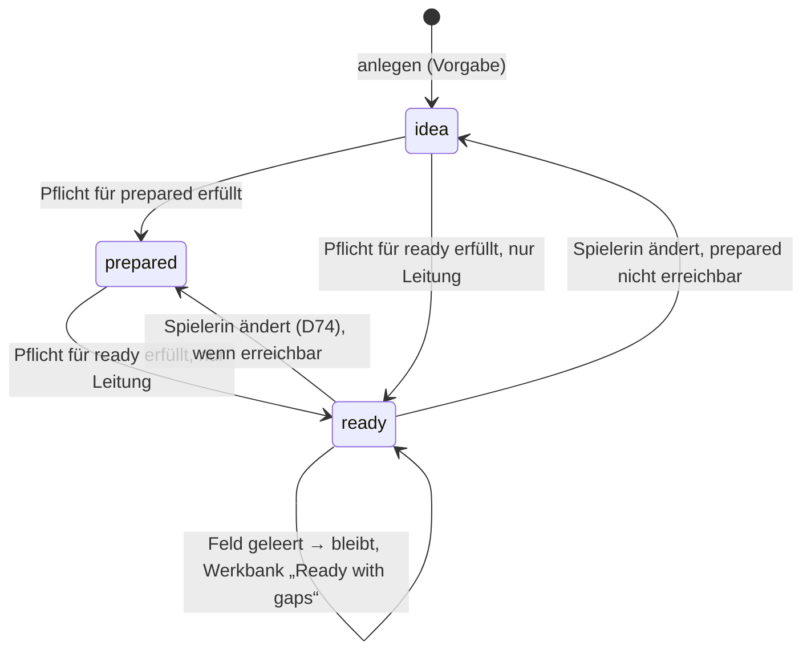

# F-003 Feldformen & Aufzählungen

Was ein Feld halten darf: Formen, Aufzählungszeilen, Spannen, Verweisziele, Vorgaben, freie Sorten.

Epic: [[EP-01 Inhaltsgerüst]]

## Stories

<!-- stories:anfang — erzeugt von anforderungen.mjs, nicht von Hand ändern -->
5 Stories · 7 Punkte · 3 steht · 1 teils · 1 ersetzt

| Story | Rolle | Prio | Stand |
|---|---|---|---|
| [[REQ-012]] Textfelder für jede Art von Text | Spielleitung | 2 | steht |
| [[REQ-023]] Status idea/planned/used/discarded | – | 2 | ersetzt |
| [[REQ-258]] Verweisfeld nennt, welche Artikel es annimmt | Spielleitung | 2 | teils |
| [[REQ-259]] Vorgabewerte für Felder | Spielleitung | 3 | steht |
| [[REQ-261]] Sorte einer Art als freies Feld mit Vorschlägen | Spielleitung | 2 | steht |
<!-- stories:ende -->

## Stand: Pflicht je Stand (T-425, REQ-441, E-177, E-178)

Seit 27.10.2026 (Schnitt 9a): `required` gilt immer, `requiredFor`
(`prepared` oder `ready`) erst für diesen Stand — am Feld, an der
Kantenart und je Art überschreibbar (`InterfaceDef.requiredFor`, `none`
hebt auf). Gesetzt im Register an der Feldzeile und an der Kante
(„Required: to be prepared / to be ready“). Geprüft, wenn der Stand steigt;
wer den Stand hat, behält ihn, und die Werkbank zeigt „Ready with gaps“.
Logik in `packages/model/src/readiness.ts`, Migration 151.

Offen (Schnitt 9b): Status und Ebene immer Pflicht, Migrationen „ready“
für Artikel ohne Status (E-179) und „Unassigned“ (E-182, E-186).

