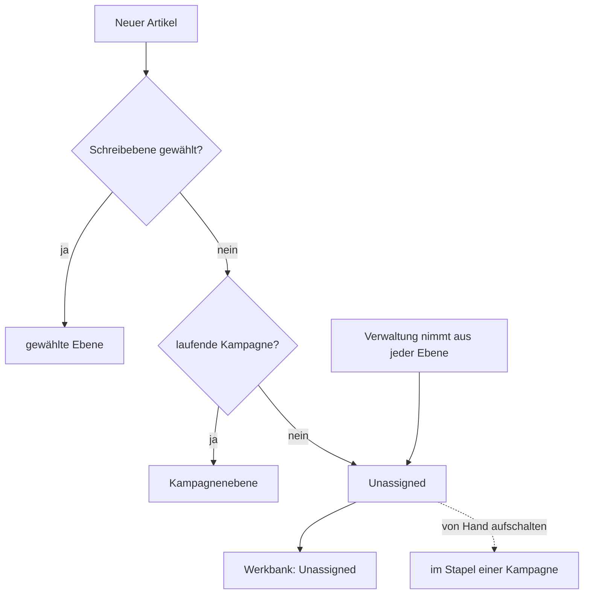

# F-004 Ebenen & Stapel

Ebenen, Gruppen von Ebenen, Herausgeber, Aufschalten (auch teilweise) und was im Stapel einer Kampagne steht.

Epic: [[EP-01 Inhaltsgerüst]]

## Stories

<!-- stories:anfang — erzeugt von anforderungen.mjs, nicht von Hand ändern -->
15 Stories · 58 Punkte · 7 steht · 4 teils · 4 offen

| Story | Rolle | Prio | Stand |
|---|---|---|---|
| [[REQ-004]] Ebenen als Pakete von Inhalt | Spielleitung | 1 | steht |
| [[REQ-005]] Zugehörigkeit eines Artikels zu einer Ebene | Spielleitung | 1 | steht |
| [[REQ-006]] Stapel: was in der Kampagne gilt | Spielleitung | 1 | teils |
| [[REQ-007]] Stapel für Fortgeschrittene | Spielleitung | 3 | offen |
| [[REQ-044]] Herkunft am Artikel sehen | Spielleitung | 2 | steht |
| [[REQ-045]] Ebenen-Aktionen am Artikel | Spielleitung | 3 | offen |
| [[REQ-100]] Welt als Ebene | Spielleitung | 1 | teils |
| [[REQ-102]] Artikel je Stapel und Wissen zeichnen | Spieler | 2 | teils |
| [[REQ-244]] Ebenen gruppieren | Spielleitung | 2 | steht |
| [[REQ-245]] Ebenen beschreiben sich selbst | Spielleitung | 2 | steht |
| [[REQ-249]] Ebenen nach Herausgeber | Spielleitung | 2 | teils |
| [[REQ-253]] Ebenen und Artikel kopieren | Spielleitung | 3 | offen |
| [[REQ-255]] Ebenen teilweise aufschalten | Spielleitung | 2 | steht |
| [[REQ-348]] Ebene am Artikel immer sichtbar | Spielleitung | 1 | steht |
| [[REQ-370]] Neuere Fassung zum Vergleich anfragen | Spieler | 2 | offen |
<!-- stories:ende -->

## Stand: jeder Artikel hat eine Ebene (T-425, E-182, E-183, E-186)

Seit 28.10.2026 (Schnitt 9b): jeder Artikel ausser Ebenen liegt in einer
Ebene und trägt einen Stand. Was keine andere Ebene hat, liegt in der
**Parkplatz-Ebene „Unassigned“** — eine gewöhnliche Ebene, von Hand
aufschaltbar; die Werkbank führt ihren Inhalt (Prüfung „Unassigned“).
Kampagnen liegen in ihrer eigenen Ebene, der Stapel nimmt sie aus. Der
Herausgeber einer eingelesenen Ebene ohne Gruppe heisst „Unknown“ (vorher
„Unassigned“). Migration 152 zog den Bestand nach (dev: 6 Bilder nach
Unassigned, 2 Kampagnen in ihre Ebene, Stand `ready` für Artikel ohne).

