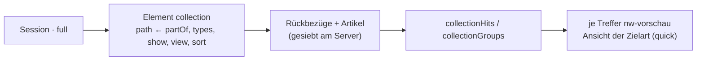

# F-006 Ansichten & Anordnung

Overview, Quick, Full, Print, Search und eigene Ansichten; Anordnung am Typ, ohne Code.

Epic: [[EP-01 Inhaltsgerüst]]

## Stories

## Collection (T-425, 26.10.2026)

Ein Artikel zeigt, was an ihm hängt, in der Ansicht **seiner Art**: die
Session ihre Szenen und Begegnungen als Kacheln, jede die Kurzansicht der
Szene. Das Element wählt die Ansicht, nicht die Kante (E-172); gesiebt hat
der Server; in einer Kachel zeichnet eine weitere Collection nichts.

<!-- stories:anfang — erzeugt von anforderungen.mjs, nicht von Hand ändern -->
5 Stories · 24 Punkte · 2 steht · 2 offen · 1 ersetzt

| Story | Rolle | Prio | Stand |
|---|---|---|---|
| [[REQ-026]] Ansichten festlegen | Spielleitung | 1 | steht |
| [[REQ-164]] Darstellungsstufen als eigenes System | – | 2 | ersetzt |
| [[REQ-256]] Ansichten ohne Code definieren | Spielleitung | 1 | steht |
| [[REQ-376]] Sammlungsansichten neben Artikelansichten | Spielleitung | 2 | offen |
| [[REQ-383]] Ansicht je Artikeltyp teilen, mit Vorschau als Spieler | Spielleitung | 2 | offen |
<!-- stories:ende -->
