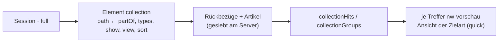
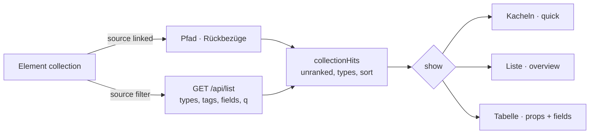
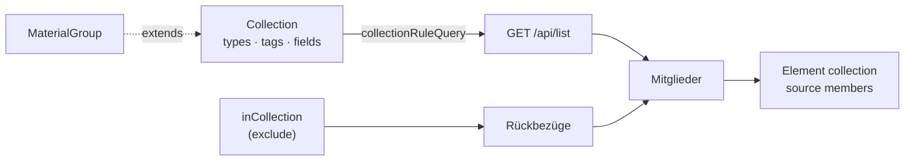
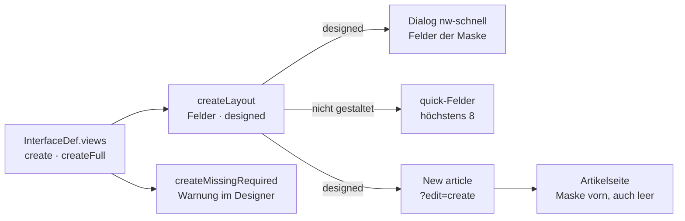
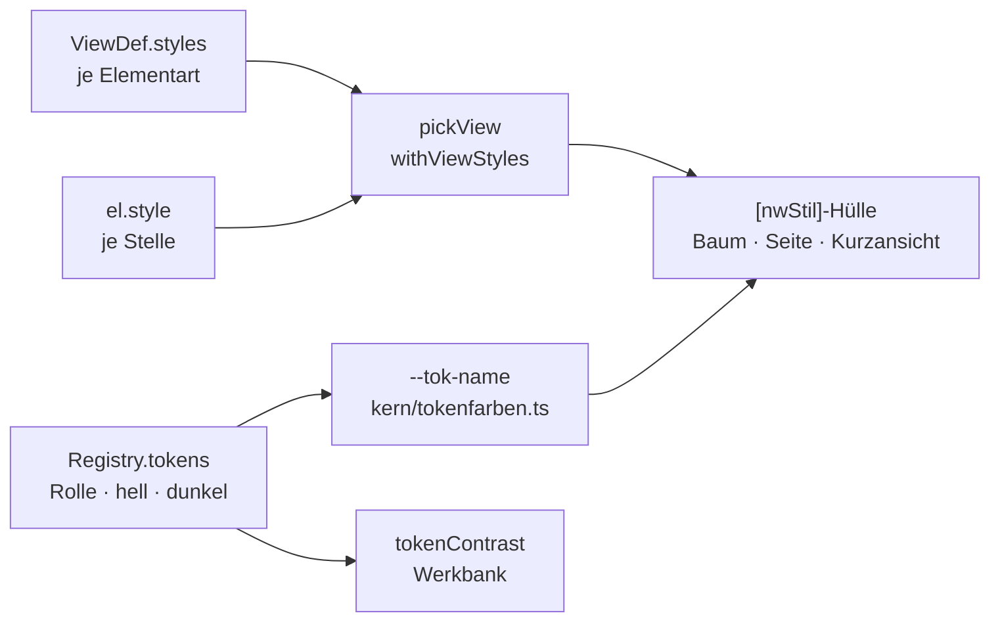
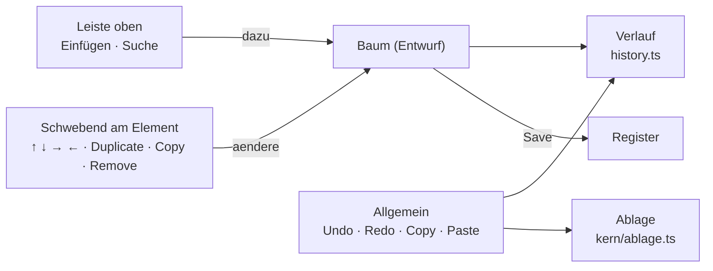
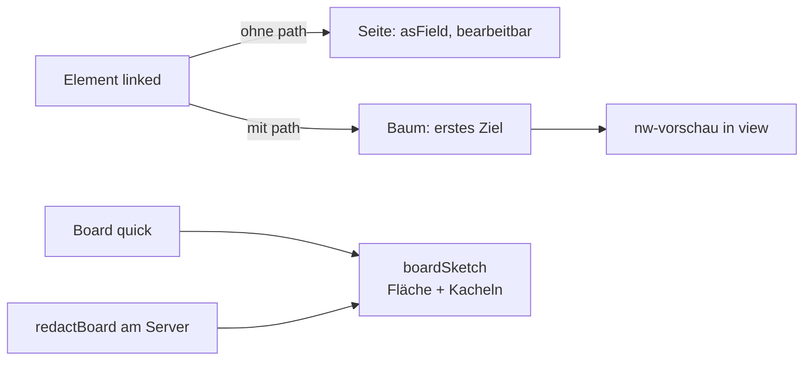
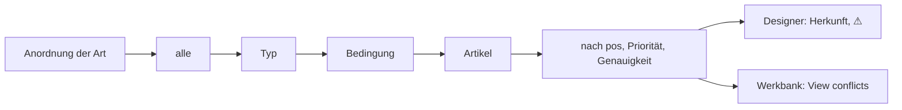

# F-006 Ansichten & Anordnung

Overview, Quick, Full, Print, Search und eigene Ansichten; Anordnung am Typ, ohne Code.

Epic: [[EP-01 Inhaltsgerüst]]

## Stories

## Collection (T-425, 26.10.2026)

Ein Artikel zeigt, was an ihm hängt, in der Ansicht **seiner Art**: die
Session ihre Szenen und Begegnungen als Kacheln, jede die Kurzansicht der
Szene. Das Element wählt die Ansicht, nicht die Kante (E-172); gesiebt hat
der Server; in einer Kachel zeichnet eine weitere Collection nichts.

## Collection fertig (T-425, 26.10.2026)

Eine Collection zeigt als Kacheln, Liste oder **Tabelle** (die frühere
„Table from edges", Migration 146) und nimmt ihre Artikel über einen Pfad
oder aus einem **Filter** wie im Kompendium. Vorgaben: jede Geschichte
zeigt, was ohne Rang zu ihr gehört (`st-contains` an `Story`, ersetzt
„Contains"), ein Ort seine Unterorte und Bewohner (Migration 145).

## Collection als Artikel (T-425, REQ-438, 26.10.2026)

Eine Collection (unter Rule) gruppiert Artikel nach Regel und von Hand
(`inCollection`, `exclude`); ihre Seite zeigt die Mitglieder, gesiebt.
`MaterialGroup` ist ein Untertyp (E-174).

## Erfassungsmasken (T-425, REQ-432, 28.10.2026)

Zwei Ortsansichten sagen, was das Anlegen fragt (E-169 a): `create` den
schnellen Dialog aus einer Auswahl, `createFull` die Artikelseite gleich
nach „New article“ (`?edit=create`), mit den Feldern der Maske vorn, auch
leer. Ohne Gestaltung einer Art gilt das Heutige. Pflichtfelder fragt der
Dialog immer; der Designer warnt, wenn die Maske eines auslässt. Offen
für Schnitt 8: das Element `steps` und der Assistent der Spielerfigur als
Vorgabe ihrer `create`-Maske (E-176).

## Design-Tokens (T-425, REQ-437, 26.10.2026)

Farben sind Registerzeilen mit Rolle und Wert hell/dunkel (E-170 a). Ein
Element nennt je Stelle ein Token, die Ansicht je Elementart eine Vorgabe;
der Kontrast wird geprüft (Werkbank), gepflegt wird unter Registry › Tokens.

## Die Leiste im Designer (T-425, REQ-436, 26.10.2026)

Eine Leiste mit drei Zonen (E-171): oben **Einfügen** nach Gruppe und
Suche, rechts **Allgemein** (Rückgängig, Wiederholen, Kopieren,
Einfügen), am gewählten Element schwebend der **Kontext** (ordnen,
duplizieren, kopieren, entfernen, fertig). Verlauf und Ablage sind Muster
für jede Leiste (`history.ts`, `kern/ablage.ts`).

## Linked article und Board-Skizze (T-425, 26.10.2026)

„Linked article" folgt auf Wunsch einer Kante und zeigt das Ziel in einer
gewählten Ansicht (E-172); ohne Kante bleibt es die bearbeitbare
`asField`-Seite. Die Kurzansicht eines Boards ist eine Skizze
(`boardSketch`); eine Szene zeigt „Contains" als Liste (Element gleicher
Id stellt um, Migration 147).

## Schichten (T-425, 26.10.2026)

Eine Ansicht lässt sich für alle, einen Typ, eine Bedingung (Feld, Kante)
oder einen Artikel **überlagern**, statt sie zu kopieren (E-168): eine
Ansichtszeile mit `adjust` (UI *overlay*) fügt hinzu, verschiebt, nimmt
weg; der Rest folgt der Ansicht. Elemente stehen nach Position (`pos`,
still 10, 20 … der Grundlage), gleich genau ordnet `priority`. Treffen
sich zwei Schichten, zeigt der Designer ⚠ und die Werkbank die Prüfung
„View conflicts“ (E-173). Der Designer speichert „nur dieser Artikel“ und
„mit Bedingung“ auf Wunsch als Schicht (`contributionFrom`).

<!-- stories:anfang — erzeugt von anforderungen.mjs, nicht von Hand ändern -->
5 Stories · 24 Punkte · 2 steht · 2 offen · 1 ersetzt

| Story | Rolle | Prio | Stand |
|---|---|---|---|
| [[REQ-026]] Ansichten festlegen | Spielleitung | 1 | steht |
| [[REQ-164]] Darstellungsstufen als eigenes System | – | 2 | ersetzt |
| [[REQ-256]] Ansichten ohne Code definieren | Spielleitung | 1 | steht |
| [[REQ-376]] Sammlungsansichten neben Artikelansichten | Spielleitung | 2 | offen |
| [[REQ-383]] Ansicht je Artikeltyp teilen, mit Vorschau als Spieler | Spielleitung | 2 | offen |
<!-- stories:ende -->
