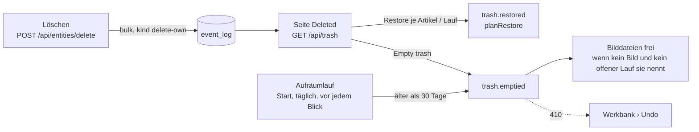

# F-016 Werkbank

Prüfungen über den Bestand, Massenänderungen mit Vorschau und Rückgängig (/werkbank).

Epic: [[EP-02 Zugang & Betrieb]]

## Stories

<!-- stories:anfang — erzeugt von anforderungen.mjs, nicht von Hand ändern -->
3 Stories · 13 Punkte · 1 steht · 1 teils · 1 offen

| Story | Rolle | Prio | Stand |
|---|---|---|---|
| [[REQ-088]] Massenänderungen an Wissen und Rechten | Spielleitung | 3 | teils |
| [[REQ-235]] Werkbank: Prüfungen und Massenänderungen | Spielleitung | 3 | steht |
| [[REQ-381]] Ein Rahmen für alle Werkbank-Seiten | Verwaltung | 2 | offen |
<!-- stories:ende -->

## Löschen aus der eigenen Ebene (T-381)

Seit T-381 löscht nicht nur die Werkbank: `POST /api/entities/delete` nimmt eine Auswahl und löscht davon, was in der Schreibebene des Kontos liegt und was es schreiben darf (`pickDeletable`, `packages/model/src/deletion.ts`). Der Rest wird abgewählt und mit Grund zurückgegeben (`other-layer`, `not-writable`, `not-found`, `protected`). Ausgeführt wird als Massenänderung `delete` — dieselben Folgen (Teile, Kanten, Instanzen) und dasselbe Undo; den eigenen Lauf nimmt auch eine Spielerin zurück, ohne `force`. Folgen an fremden Artikeln (eine Kante auf das Gelöschte) sperren das Löschen nicht. Galerie und Artikelseite nutzen es (`kern/loeschen.ts`). Siehe [[REQ-235]], D84, E-160.

## Papierkorb (T-400)

Der Papierkorb ist **keine zweite Ablage**, sondern eine Seite auf den Löschläufen (`bulk` mit `kind: delete-own`) — sie tragen jede alte Fassung schon (E-160 a, [[REQ-394]]). Dazu kommen zwei Ereignisse unter demselben Lauf: `trash.restored` (welche Artikel einzeln zurückkamen) und `trash.emptied` (endgültig, `reason: empty | expired`). Keine Migration.

- **Wer sieht was:** jedes Konto seine eigenen Läufe; Leitung und Verwaltung auch die anderen, gesiebt an den alten Fassungen wie jede Liste (ein fremder Lauf ohne sichtbaren Artikel steht nicht da).
- **Einzeln zurück** (`planRestore`, `packages/model/src/trash.ts`): der Artikel samt Teilen, die mit ihm gingen, und **nur seine** Kanten — eine Kante auf etwas, das noch im Korb liegt, kommt erst mit ihm. Geprüft wird wie jeder Lauf (`pruefeLauf`, `validateEntity`). Ist alles zurück, gilt der Lauf auch für die Werkbank als zurückgenommen.
- **Endgültig:** nach `TRASH_DAYS` = 30 (fest, keine Einstellung) oder per „Empty trash" (eigene; Leitung alle, die sie sieht). Erst dann gehen Bilddateien — `bilder.aufraeumen`, wenn kein Artikel und kein anderer offener Lauf dieselbe Datei nennt. Die alten Fassungen bleiben im Protokoll (Nachweis); zurückholen lässt sich nichts mehr, auch nicht über `/api/bulk/:id/undo` (410).

