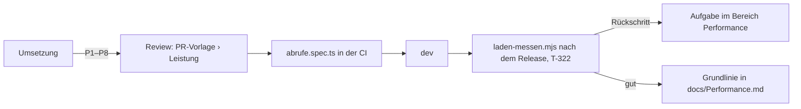

# F-019 Leistung & Laden

Listen am Server, schnelle Navigation, Ladeanzeige.

Epic: [[EP-02 Zugang & Betrieb]]

**Regeln für jede Änderung** (D96, 29.10.2026): P1–P8 und die Budgets je Seite in `docs/Performance.md`. Gemessen wird mit `apps/web/e2e/abrufe.spec.ts` (Abrufe je Seite, in der CI) und `scripts/laden-messen.mjs` (gegen dev, ohne Inhalte); der Prüflauf T-322 vergleicht nach jedem Release mit der Grundlinie.

## Stories

<!-- stories:anfang — erzeugt von anforderungen.mjs, nicht von Hand ändern -->
2 Stories · 10 Punkte · 2 steht

| Story | Rolle | Prio | Stand |
|---|---|---|---|
| [[REQ-232]] Listen rechnet der Server | Spieler | 2 | steht |
| [[REQ-246]] Navigation ohne Einfrieren | Spieler | 1 | steht |
<!-- stories:ende -->
