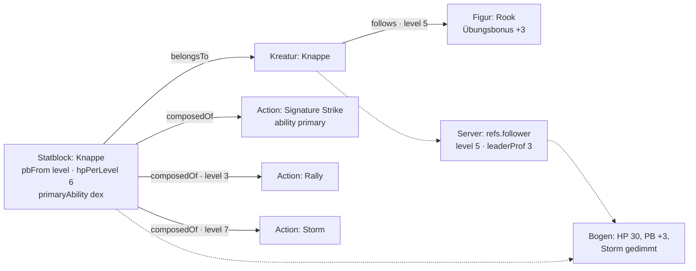

# F-021 Statblock

Die Zahlen einer Kreatur, aus Regeln zusammengesetzt; Vorlage und Instanz.

Epic: [[EP-03 Kreaturen & Figuren]]

## Stories

<!-- stories:anfang — erzeugt von anforderungen.mjs, nicht von Hand ändern -->
7 Stories · 28 Punkte · 4 steht · 3 offen

| Story | Rolle | Prio | Stand |
|---|---|---|---|
| [[REQ-052]] Statblock lesen wie im Buch | Spielleitung | 3 | steht |
| [[REQ-053]] Statblock aus Regeln zusammensetzen | Spielleitung | 2 | steht |
| [[REQ-054]] Kampfrolle am Statblock | Spielleitung | 2 | steht |
| [[REQ-055]] Merkmale beim Tippen wiederverwenden | Spielleitung | 3 | offen |
| [[REQ-058]] Monster skalieren | Spielleitung | 5 | offen |
| [[REQ-062]] Statblöcke anderer Regelsysteme | Spielleitung | 5 | offen |
| [[REQ-272]] Statblock als Instanz einer Vorlage | Spielleitung | 1 | steht |
<!-- stories:ende -->

## Gefolge, Begleiter, Villain Actions, Minions (T-497, 27.11.2026)

Was beim Einlesen eines MCDM-Abenteuers fehlte und für *Flee, Mortals!*
und *Strongholds & Followers* gebraucht wird. Stand: **steht** (Register,
Bogen, Tracker, Paketformat); eingelesen werden die Bücher danach über
`scripts/regelwerk.mjs`.

- **`follows`** (Kreatur → Kreatur, eine je Folgendem): Stufe und Sorte
  (`retainer`, `companion`, `mount`) an der Kante. Der Anführer heisst je
  nach Buch Mentor, Reiter oder Besitzer.
- **Am Statblock:** `pbFrom` (`leader` / `level`), `addPb` (`ac`,
  `damage`, `dc`, `hp` — wo das Buch „+ PB“ schreibt), `hpPerLevel`,
  `tempHpPerLevel`, `primaryAbility`, `saveProf` (eigener Bonus für
  Rettungswürfe), `minion`.
- **An der Aktion:** `round` (Villain Actions), `saveDc`, `saveAbility`;
  `ability: primary` für den Signaturangriff.
- **An `composedOf`:** `level` (ab welcher Stufe die Aktion gilt),
  `saveDc`.
- **An der Kampagne:** Regeloption **Overkill** (Combat).
- **Quelle** (`Source`) an Story, Arc, Szene und Begegnung.

Gerechnet wird beim Lesen (`followerNumbers`, `packages/model/src/follower.ts`);
der Server gibt Stufe und Übungsbonus des Anführers als `refs.follower`
mit, gesiebt (den Namen eines verborgenen Anführers nicht).

Offen (nicht Teil von T-497): Tracker und Kennzahlen (`creatureStats`)
rechnen AC und HP eines Begleiters noch ohne Anführer — der Bogen zeigt
sie richtig; der Overkill-Rest wird genannt, nicht selbst verteilt; ein
gemeinsamer Zug heisst heute „gleiche Initiative“, nicht eine Zeile.

