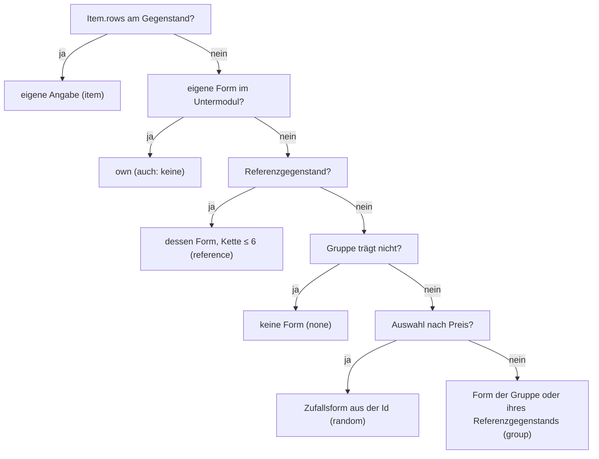

# F-026 Inventar

Liste und Raster, Behälter und Zonen, Ausrüstungsfigur, Ziehen und Verstauen, Gruppeninventar, Gegenstände als Instanz.

Epic: [[EP-04 Spielererlebnis]]

## Stories

<!-- stories:anfang — erzeugt von anforderungen.mjs, nicht von Hand ändern -->
23 Stories · 59 Punkte · 7 steht · 5 teils · 11 offen

| Story | Rolle | Prio | Stand |
|---|---|---|---|
| [[REQ-064]] Inventar als Liste | Spieler | 2 | steht |
| [[REQ-065]] Inventar als Raster | Spieler | 4 | steht |
| [[REQ-183]] Gruppeninventar | Spieler | 3 | steht |
| [[REQ-214]] Ausrüstungsfigur | Spieler | 4 | steht |
| [[REQ-215]] Tragraster aus Grösse und Stärke | Spieler | 3 | teils |
| [[REQ-216]] Behälter in Behältern | Spieler | 3 | teils |
| [[REQ-217]] Ziehen am Bogen | Spieler | 3 | steht |
| [[REQ-225]] Fallenlassen und Verstauen | Spieler | 3 | teils |
| [[REQ-275]] Erhaltene Gegenstände als Instanz | Spieler | 2 | teils |
| [[REQ-276]] Unverstaute Gegenstände gelten als liegengelassen | Spielleitung | 4 | offen |
| [[REQ-277]] Gegenstände mit Form spiegeln | Spieler | 4 | offen |
| [[REQ-320]] Formen frei malen, auch nicht rechteckig | Spielleitung | 2 | offen |
| [[REQ-321]] Stapel im Raster | Spieler | 2 | offen |
| [[REQ-322]] Besondere Zonen mit eigenen Regeln | Spieler | 2 | offen |
| [[REQ-323]] Alle möglichen Plätze eines Gegenstands | Spieler | 2 | offen |
| [[REQ-324]] Hände als Plätze mit Regeln | Spieler | 2 | offen |
| [[REQ-325]] Gegenstandsartikel im Detailbereich | Spieler | 2 | offen |
| [[REQ-326]] Ziehen und Ablegen im Raster | Spieler | 2 | offen |
| [[REQ-327]] Packen am Telefon | Spieler | 2 | offen |
| [[REQ-328]] Ablage für nicht Verstautes | Spieler | 2 | offen |
| [[REQ-333]] Vorgaben für Formen und Stapel | Spielleitung | 2 | teils |
| [[REQ-355]] Tragraster, Zonen und Behälter einstellen | Spielleitung | 2 | steht |
| [[REQ-356]] Tragblatt aus Bausteinen mit Zonen und Bedingungen | Spielleitung | 2 | steht |
<!-- stories:ende -->

## Vorgabeformen (T-394, E-165)

Form und Stapel eines Gegenstands werden beim Lesen gerechnet (D8): aus
dem Untermodul „Default shapes“ des Inventarmoduls — Gruppen und Werte je
Gegenstand —, nicht aus Artikeln je Gegenstand. Der erste Treffer gilt:

Ein Stapel am Gegenstand oder im Untermodul gilt über jeder geerbten Form.
Die Herkunft kommt mit dem Artikel (`refs.shape`). Regel: G15 in
`docs/Datenmodell.md`; Code: `packages/model/src/defaultShapes.ts`.

**Übersicht und Wahl am Gegenstand** (T-394): `/inventory/shapes`
(Rules & options › Inventory › Item shapes) zeigt links die Gruppen,
rechts die Gegenstände mit geltender Form, Herkunft und der Marke „local“
für eigene Angaben; das Element Shape am Gegenstand sagt, woher seine
Form kommt, und setzt Gruppe und Referenzgegenstand („Group &
reference“). Geschrieben wird in die Karte `ShapeDefaults` einer
Formebene, gegen die gelesene Revision.

