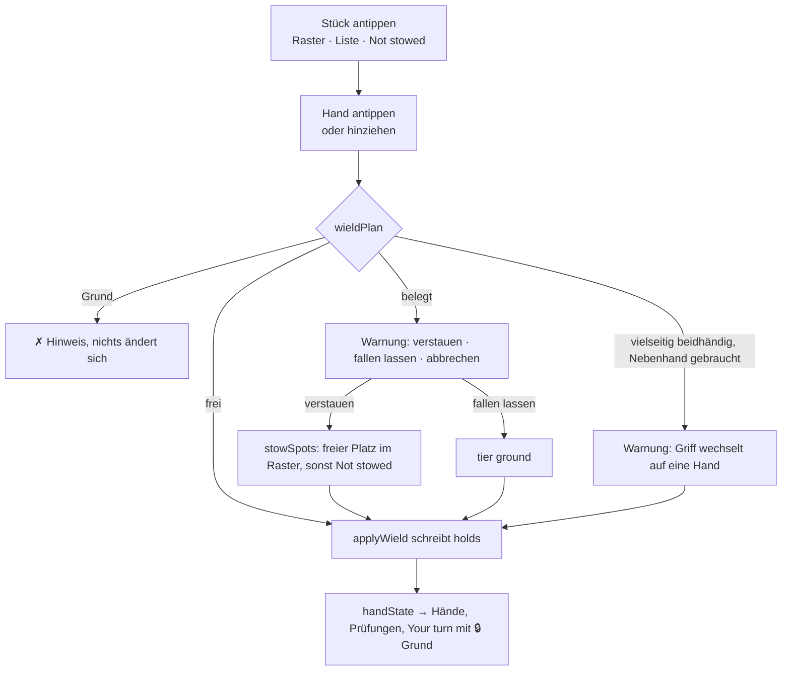
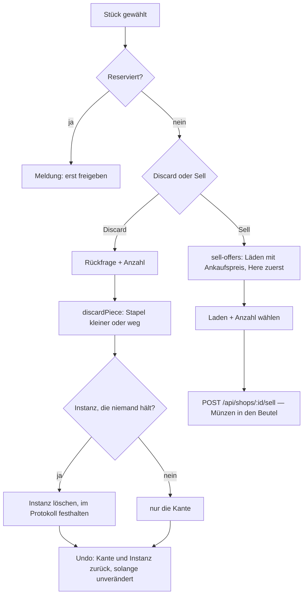
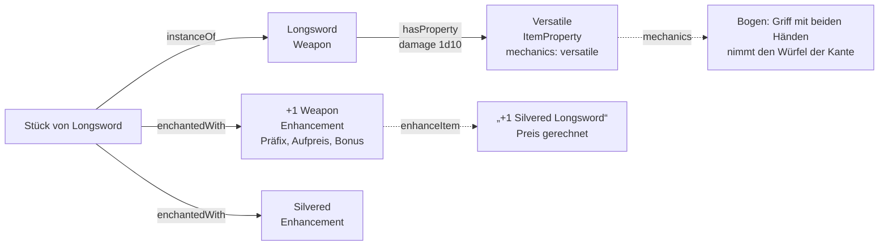
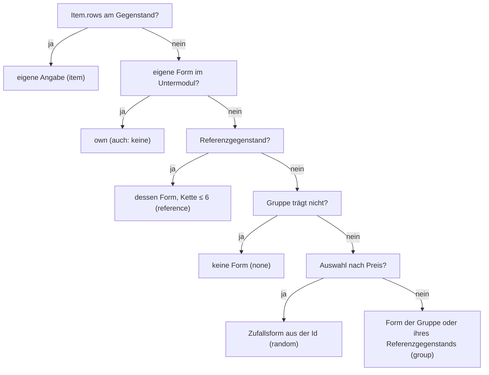

# F-026 Inventar

Liste und Raster, Behälter und Zonen, Ausrüstungsfigur, Ziehen und Verstauen, Gruppeninventar, Gegenstände als Instanz.

Epic: [[EP-04 Spielererlebnis]]

## Stories

<!-- stories:anfang — erzeugt von anforderungen.mjs, nicht von Hand ändern -->
24 Stories · 62 Punkte · 7 steht · 7 teils · 10 offen

| Story | Rolle | Prio | Stand |
|---|---|---|---|
| [[REQ-064]] Inventar als Liste | Spieler | 2 | steht |
| [[REQ-065]] Inventar als Raster | Spieler | 4 | steht |
| [[REQ-183]] Gruppeninventar | Spieler | 3 | steht |
| [[REQ-214]] Ausrüstungsfigur | Spieler | 4 | steht |
| [[REQ-215]] Tragraster aus Grösse und Stärke | Spieler | 3 | teils |
| [[REQ-216]] Behälter in Behältern | Spieler | 3 | teils |
| [[REQ-217]] Ziehen am Bogen | Spieler | 3 | steht |
| [[REQ-225]] Fallenlassen und Verstauen | Spieler | 3 | teils |
| [[REQ-275]] Erhaltene Gegenstände als Instanz | Spieler | 2 | teils |
| [[REQ-276]] Unverstaute Gegenstände gelten als liegengelassen | Spielleitung | 4 | offen |
| [[REQ-277]] Gegenstände mit Form spiegeln | Spieler | 4 | offen |
| [[REQ-320]] Formen frei malen, auch nicht rechteckig | Spielleitung | 2 | offen |
| [[REQ-321]] Stapel im Raster | Spieler | 2 | offen |
| [[REQ-322]] Besondere Zonen mit eigenen Regeln | Spieler | 2 | offen |
| [[REQ-323]] Alle möglichen Plätze eines Gegenstands | Spieler | 2 | teils |
| [[REQ-324]] Hände als Plätze mit Regeln | Spieler | 2 | teils |
| [[REQ-325]] Gegenstandsartikel im Detailbereich | Spieler | 2 | offen |
| [[REQ-326]] Ziehen und Ablegen im Raster | Spieler | 2 | offen |
| [[REQ-327]] Packen am Telefon | Spieler | 2 | offen |
| [[REQ-328]] Ablage für nicht Verstautes | Spieler | 2 | offen |
| [[REQ-333]] Vorgaben für Formen und Stapel | Spielleitung | 2 | teils |
| [[REQ-355]] Tragraster, Zonen und Behälter einstellen | Spielleitung | 2 | steht |
| [[REQ-356]] Tragblatt aus Bausteinen mit Zonen und Bedingungen | Spielleitung | 2 | steht |
| [[REQ-391]] Tragestufen mit Folgen | Spieler | 3 | offen |
<!-- stories:ende -->

## Ausrüsten in die Hände (T-244, Demo-Etappe)

Im Reiter **Gear** einer Figur stehen über dem Raster die Hände. Ein Stück
antippen (Raster, Liste, „Not stowed"), dann eine Hand — oder mit der Maus
hinziehen. Gerechnet wird in `packages/model/src/wield.ts`: `wieldPlan`
sagt, ob der Griff geht und wer weichen muss, `applyWield` schreibt die
Kanten (`holds.props.slot`, `holds.props.grip: two` für beide Hände),
`wieldOptions` listet alle Ziele mit ✓/⚠/✗ und Grund, `handChecks` sagt,
was die Hände erlauben. Was die Hände sperren, rechnet weiter `handState`
(T-247) — dieselbe Sperre in „Your turn".

Zweite Etappe (T-244): Gürtel als Gegenstand mit Raster und Verbund,
Köcher mit Filter, Verstaukosten aus dem Modul, Stapel teilen, Anker,
schwebende Werkzeugleiste, Telefon-Muster.

## Wegwerfen und Verkaufen am Stück (T-407, REQ-404)

Am gewählten Stück stehen **Discard** und **Sell** statt „Remove". Remove
nahm nur die `holds`-Kante weg und liess die Instanz liegen: ein Stück, das
niemand hält und keine Liste zeigt. Jetzt rechnet `discardPiece`
(`packages/model/src/discard.ts`) den Stapel; ist er ganz weg und war das
Stück eine Instanz, die sonst niemand hält, **geht sie mit**. Ein
Grundartikel geht nie mit. Der Server (`apps/server/src/wegwerfen.ts`)
schreibt gegen die gelesene Revision, prüft die Sperre für Reserviertes
(T-134) und protokolliert `inventory.discarded` samt alter Kante und
gelöschter Instanz. **Undo** legt beides zurück, einmal und nur, solange das
Inventar unverändert ist.

**Sell** fragt `GET /api/inventories/:id/sell-offers`: die sichtbaren Läden
mit ihrem Ankaufspreis (`buybackFor`, E-045 b, E-175), die am Ort der Szene
oder Karte im Spiel zuerst (`shopsHere`). Verkauft wird über die Route des
Ladens (T-133), damit Preis, Sperre und Protokoll an einer Stelle stehen.
Aus der Truhe der Gruppe verkauft jedes Mitglied für die Gruppe; das Geld
geht in den Beutel des Inventars, aus dem verkauft wird. Gerechnet wird in
der Grundwährung (Kupfer), gezeigt über `formatMoney`; Münzsorten folgen
nach E-129/E-130.

Wo eine Figur ist, kennt das Modell nicht; „Here" heisst darum: der Laden
teilt eine Kante mit Szene oder Karte im Spiel, oder liegt (`partOf`) in
einem Ort, den sie nennen oder der sie nennt.

## Gegenstandsmerkmale (T-324, E-163)

Was an einen Gegenstand kommt, ohne selbst einer zu sein, ist ein
**Regelartikel** der Art `ItemFeature` — wie ein Monstermerkmal am
Statblock. Zwei Sorten: die **Eigenschaft** (`ItemProperty`: Finesse,
Versatile, Two-Handed) hängt mit `hasProperty` am Gegenstand, das
**Enhancement** (+1 Weapon, Silvered) mit `enchantedWith` an einem Stück.
Was ein Merkmal am Bogen bewirkt, steht in seinem Feld `mechanics`, nicht
in seinem Namen; was es bei diesem Gegenstand heisst (Versatile 1d10,
Thrown 20/60), an der Kante. Name, Preis und Boni des Stücks rechnet das
Lesen (D8). Migration 163 hat die eingelesenen Varianten zu Enhancements
gemacht; Felder, die ein Merkmal nicht trägt, stehen in ihren Notizen.

## Vorgabeformen (T-394, E-165)

Form und Stapel eines Gegenstands werden beim Lesen gerechnet (D8): aus
dem Untermodul „Default shapes“ des Inventarmoduls — Gruppen und Werte je
Gegenstand —, nicht aus Artikeln je Gegenstand. Die Werte stehen in der
Ebene der Mechanik **Grid** und kommen so mit dem Regelwerk (D90); eine
Kampagne schaltet sie auf und passt sie mit einer eigenen Ebene darüber an. Der erste Treffer gilt:

Ein Stapel am Gegenstand oder im Untermodul gilt über jeder geerbten Form.
Die Herkunft kommt mit dem Artikel (`refs.shape`). Regel: G15 in
`docs/Datenmodell.md`; Code: `packages/model/src/defaultShapes.ts`.

**Übersicht und Wahl am Gegenstand** (T-394): `/inventory/shapes`
(Rules & options › Inventory › Item shapes) zeigt links die Gruppen,
rechts die Gegenstände mit geltender Form, Herkunft und der Marke „local“
für eigene Angaben; das Element Shape am Gegenstand sagt, woher seine
Form kommt, und setzt Gruppe und Referenzgegenstand („Group &
reference“). Geschrieben wird in die Karte `ShapeDefaults` einer
Formebene, gegen die gelesene Revision.

**Ankerzelle** (REQ-402, T-406): Wer ein liegendes Stück an einer seiner
Zellen wählt, hält es dort; ein Tippen auf ein freies Feld legt es so ab,
dass genau diese Zelle dort liegt (`grabAnchor`, `placeByAnchor`). Aus
„Not stowed“ hält man es am ersten belegten Feld der obersten Zeile
(`defaultAnchor`). Die Ankerzelle ist markiert.

## Ziehstufe und Kosten der Hände in der Seite (T-350)

Stand 29.10.2026. Jedes Stück nennt seine Ziehstufe die Kette hinauf (`drawStage`); ein eingebettetes Inventar bekommt die Stufe seines Behälters mit. Die Hände nennen die Kosten aus `handActions`.
