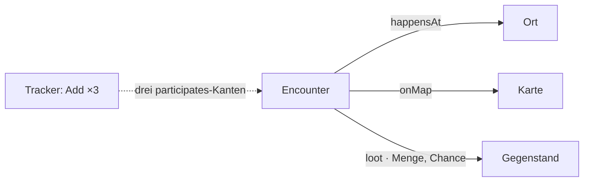
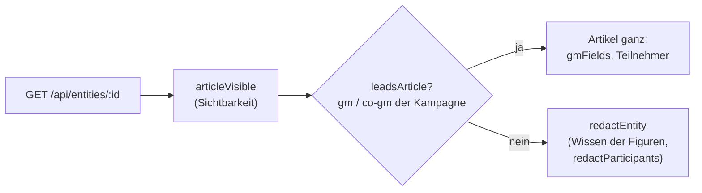

# F-032 Begegnungen

Begegnungen bauen und vorbereiten, Begegnungstabellen, Weltzustand zwischen Sitzungen.

Epic: [[EP-05 Kampagne & Sitzungen]]

## Stories

<!-- stories:anfang — erzeugt von anforderungen.mjs, nicht von Hand ändern -->
4 Stories · 12 Punkte · 2 steht · 2 offen

| Story | Rolle | Prio | Stand |
|---|---|---|---|
| [[REQ-085]] Begegnungen | Spielleitung | 2 | steht |
| [[REQ-172]] Begegnungstabellen je Gebiet | Spielleitung | 3 | steht |
| [[REQ-173]] Weltzustand zwischen Sitzungen | Spielleitung | 4 | offen |
| [[REQ-221]] Begegnungen bauen | Spielleitung | 3 | offen |
<!-- stories:ende -->

## Was eine Begegnung trägt (T-333)

Ort (`happensAt` → Ort, wie bei einer Szene), Karte (`onMap`) und Beute
(`loot` mit Menge und Chance) stehen auf der Seite der Begegnung als
Gruppen — im Ansichtsdesigner verschieb- und abschaltbar. Angelegt wird
unter „Edit" › Relations; die Auswahl bietet „Create … as …".

**Vier Goblins sind vier Kanten.** Im Tracker nimmt „Add a combatant"
eine Anzahl (×, höchstens 20): jeder bekommt seine eigene Zeile mit
eigener Initiative und eigenen Trefferpunkten, durchgezählt „Goblin 1"
bis „Goblin 4". Eine Anzahl *an* der Kante hätte vier Stände in einem
Feld geführt. Auch hier legt die Auswahl einen fehlenden Gegner gleich an.

**Vorplatzieren von der Begegnung aus:** vor dem Start zeigt der Tracker
„Prepare on map"; die Karte öffnet mit `?prepare=` und setzt die
Beteiligten einmal verborgen (wie „Prepare n" in ihrer Seitenleiste).
Jedes Ziel bekommt dabei einen Marker — mehrere Kanten auf denselben
Statblock sind ein Token.

## Die Leitung liest ihre Begegnung ungesiebt (T-447, T-455)

Ein Konto mit Rolle `gm` oder `co-gm` in der Kampagne der Begegnung — ohne
Verwaltungsrolle und ohne eigene Figur — bekam sie bis zum 4.11.2026
gesiebt wie eine Spielerin: ohne Lösung, Hinweise, Geheimnisse und Taktik,
und vor dem ersten Zug ohne jeden Gegner. Der Freigabeknopf unter einem
Hinweis (T-215) stand deshalb nur der Verwaltung; speicherte die Leitung
die Begegnung aus der Artikelseite, schrieb sie die gesiebten Kanten
zurück und verlor die Gegner. Seit D97 (E-204 a, E-208 a) ist die Rolle in
der Kampagne des Artikels die Grenze des Siebs (`leadsArticle`): die
Leitung liest ganz, die Spielerin weiter nach Wissen, und wer eine andere
Runde leitet, liest hier wie eine Spielerin.

Offen: ob Szene („Scene / Encounter") und Begegnung eine Art werden
(E-118).
