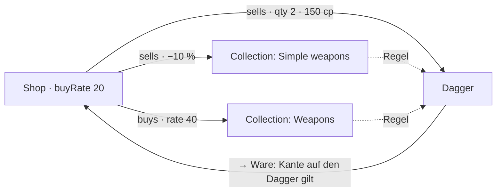
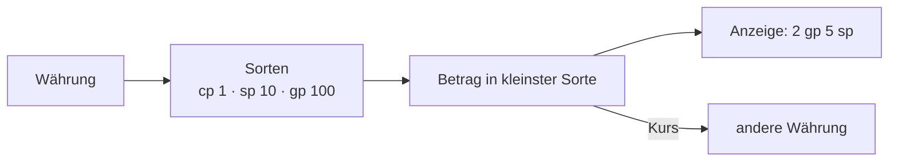

# F-040 Läden & Wirtschaft

Läden mit Waren und Preisen, Fraktionspreise, andere Währungen.

Epic: [[EP-06 Welt & Lore]]

## Stories

<!-- stories:anfang — erzeugt von anforderungen.mjs, nicht von Hand ändern -->
3 Stories · 7 Punkte · 1 steht · 1 teils · 1 offen

| Story | Rolle | Prio | Stand |
|---|---|---|---|
| [[REQ-185]] Andere Währungen und Tausch | Spielleitung | 5 | offen |
| [[REQ-284]] Läden mit Waren und Preisen | Spielleitung | 2 | steht |
| [[REQ-285]] Fraktionspreise | Spielleitung | 3 | teils |
<!-- stories:ende -->

## Stand: Laden nach Kategorien (T-425, REQ-439, E-175)

Seit 26.10.2026 (Schnitt 10b von T-425): `sells` zeigt auf einen Gegenstand
**oder eine Collection** (REQ-438); deren Mitglieder sind die Waren, mit der
Collection als Herkunft. Die einzelne Kante schlägt die Collection. Neu ist
`buys` (Laden → Gegenstand oder Collection, `rate` in Prozent, `mod`) und
`Shop.buyRate`: ohne `buys` kauft ein Laden alles zu seinem Satz (leer
50 %), mit `buys` nur das Genannte — sonst „not bought here“. Gerechnet in
`packages/model/src/shop.ts` (`shopWares`, `buybackFor`), Migration 150.
Das Element `wares` steht in der Palette des Designers.

Offen: `wares` über einen Pfad (Ansicht `shop` am Ladenhalter) statt
„Linked article“ und Collection.

## Stand: Geld rechnen (T-357, Teil 1)

Seit 28.10.2026 rechnet das Modell Geld als ganze Zahl in der kleinsten
Sorte und zeigt es in Sorten: „2 gp 5 sp" eingeben, „2.5 gp" oder „25 sp"
anzeigen, Bereiche wie „1–10 gp" für Filter, Wechsel zwischen Währungen
über einen Kurs (`packages/model/src/money.ts`, docs/Datenmodell.md › 9.7).
Noch ohne Oberfläche: wo eine Währung steht (E-130) und wie die Börse
zählt (E-129) sind offen.

