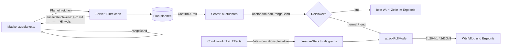
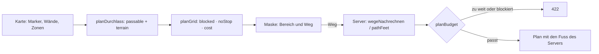
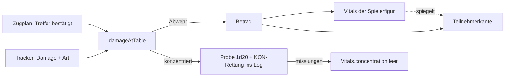

# F-046 Regelauswertung

Effekte, Bedingungen und Wechselwirkungen von Regeln auswerten.

Epic: [[EP-07 Regeln & Nachschlagen]]

## Stories

<!-- stories:anfang — erzeugt von anforderungen.mjs, nicht von Hand ändern -->
7 Stories · 57 Punkte · 1 teils · 6 offen

| Story | Rolle | Prio | Stand |
|---|---|---|---|
| [[REQ-017]] Begriffe je Regelsystem auswerten | Spielleitung | 4 | offen |
| [[REQ-018]] Wirkungen von Regeln beschreiben | Spielleitung | 1 | offen |
| [[REQ-093]] Regeln auswerten | Spielleitung | 5 | offen |
| [[REQ-095]] Gewährtes anwenden | Spieler | 4 | offen |
| [[REQ-096]] Einschränkungen prüfen | Spielleitung | 5 | offen |
| [[REQ-290]] Wechselwirkungen von Regeln auswerten | Spielleitung | 4 | offen |
| [[REQ-357]] Regelgraphen wirken am Tisch | Spielleitung | 3 | teils |
<!-- stories:ende -->

## Reichweite und Vorteil im Zugplan (T-351)

Stand 21.10.2026. Der Zugplan prüft die Reichweite eines Angriffs **am
Server**, nicht nur in der Maske, und würfelt mit Vorteil oder Nachteil
aus drei Quellen: den Wirkungen am Angreifer (`attack`), den Wirkungen am
Ziel (`attacked`, nach Abstand `attacked.near`/`attacked.far` — Prone),
und der langen Reichweite. Zustände wirken über die Wirkungen an ihrem
`Condition`-Artikel; was dort steht, gilt, ohne Code je Zustand.

- Reichweite: `rangeBand` (`packages/model/src/zugplan.ts`) — bis `range`
  normal, bis `longRange` lang, darüber ausser Reichweite; ohne Gitter
  oder Token prüft niemand.
- Abstand: `abstandImPlan` (`apps/server/src/zugplan.ts`), gemessen vom
  Ende des Wegs davor, 5-10-5 wie die Maske.
- Modus: `attackRollMode` (`packages/model/src/actions.ts`), Vorteil und
  Nachteil heben sich auf.
- Vorschau: `GET /api/maps/:id/turn-plan` gibt je Ziel `chances` mit dem
  Modus aus den Wirkungen, `long` für die lange Reichweite, `modes` und
  `feet`.
- Die Zustandsartikel auf dev: Protokoll
  `docs/Nachtarbeit/2026-10-21-T-351.md`.

## Verbündete und schwieriges Gelände im Zugplan (T-349)

Stand 28.10.2026. Der Weg im Zugplan geht **durch Verbündete**, endet aber
nicht auf ihnen, und **schwieriges Gelände** aus den Zonen der Karte
(`ZoneKind.moveCost`, 2 = doppelt) kostet je Feld mehr. Die Maske zeigt
solche Felder im Bereich braun. Der Server zählt die Fuss eines
eingereichten Wegs selbst und lehnt einen zu langen ab — was die Maske
behauptet, zählt nicht.

- Wer verbündet ist: `seiteVon` am Server (Gruppe, Spielerfiguren,
  `ally` an der Begegnung), mitgeschickt als `passable` (Markerkanten).
- Gelände: `mapTerrain` und `terrainCosts` (`packages/model/src/zugplan.ts`);
  eine versteckte Zone (`hiddenUntil`) zählt für Spielende erst, wenn sie
  gefunden ist.
- Nachrechnen: `pathFeet` (`packages/model/src/movement.ts`) — Schritt für
  Schritt, mit Wänden, Gegnern und dem Ende nicht auf einem Verbündeten.
- Grundlinie und Prüfschritte: [docs/Regelwirkung.md](../../docs/Regelwirkung.md) › Punkt 6.

## Schaden im Tracker, Wirkungen an Bogen und Kacheln (T-355)

Stand 28.10.2026. **Ein Treffer, eine Rechnung:** `damageAtTable` zieht
für Zugplan und Tracker nach der Abwehr ab (immun 0, resistent halb,
verwundbar doppelt), eine Spielerfigur an `Vitals` (zeitweilige zuerst),
die Teilnehmerkante spiegelt den Stand. Konzentriert sich das Ziel,
würfelt der Server die Probe ins Log (E-128, Variante A). Im Tracker
fragt „Damage" nach der Art.

**Gesammelte Wirkungen wirken:** `save`/`save.<attr>` an den
Rettungswürfen, `spellSaveDc` und `spellAttack` am Bogen, `check` in der
passiven Wahrnehmung und den Proben, `spellAttack`/`spellDamage` und
`weapon.*` in den Kacheln. **Unarmored Defense** ist eine Wirkung
`ac.base` (Formel `10 + mod(dex) + mod(con)`), für den Mönch
`ac.base.noShield`. Offen: `carry` (Bedeutung des Werts) und Boni, die an
der Waffe selbst stehen.
