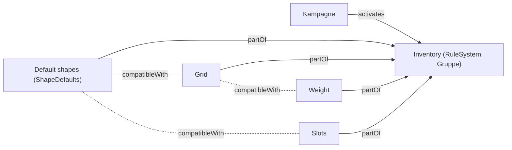

# F-048 Regelsysteme & Module

Regelsysteme und Module als Ebenen, je Sorte ein Modul, gewählt an der Kampagne; Homebrew-Regeln; Rahmen wie Taverne.

Epic: [[EP-07 Regeln & Nachschlagen]]

## Stories

<!-- stories:anfang — erzeugt von anforderungen.mjs, nicht von Hand ändern -->
4 Stories · 21 Punkte · 1 teils · 3 offen

| Story | Rolle | Prio | Stand |
|---|---|---|---|
| [[REQ-223]] Rahmen für Regelsysteme wie Taverne | Spielleitung | 4 | offen |
| [[REQ-287]] Regelsysteme und Module als Ebenen | Spielleitung | 2 | teils |
| [[REQ-289]] Homebrew-Regeln erfassen | Spielleitung | 3 | offen |
| [[REQ-319]] Inventarregeln als wählbares Modul | Spielleitung | 2 | offen |
<!-- stories:ende -->

## Regelsystem und Mechaniken als Ebenen (E-166, T-394)

Inventory ist ein Regelsystem (Ebene der Art `RuleSystem`, als Gruppe);
seine Optionen sind Regelmechaniken (Ebenen der Art `RuleMechanic`), die
sagen, mit welchen anderen sie zusammen gelten. Angelegt beim Start
(`RULE_SYSTEM_LAYERS`), wo sie fehlen.

Was am Tisch zählt, sagt vorerst `Campaign.inventory`. Regel: Datenmodell
§ 10.1a; Entscheid D88.

