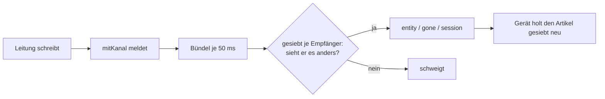

# F-052 Sitzungszustand & Live-Kanal

Was gerade läuft, steht an der Sitzung und kommt live zu allen; Protokoll und Statistik.

Epic: [[EP-08 Live-Spiel]]

## Stories

<!-- stories:anfang — erzeugt von anforderungen.mjs, nicht von Hand ändern -->
4 Stories · 17 Punkte · 2 steht · 1 teils · 1 offen

| Story | Rolle | Prio | Stand |
|---|---|---|---|
| [[REQ-116]] Was gerade läuft, steht an der Sitzung | Spielleitung | 2 | steht |
| [[REQ-117]] Wer am Sitzungszustand schreibt | Spielleitung | 3 | steht |
| [[REQ-120]] Spielprotokoll | Spielleitung | 3 | teils |
| [[REQ-121]] Statistik | Spieler | 4 | offen |
<!-- stories:ende -->

## Live-Abgleich (T-399, REQ-398)

Was die Leitung auf der Karte oder an einem geteilten Artikel ändert, geht
über den Live-Kanal an jedes offene Gerät der Runde — je Empfänger gesiebt.
Bestand, Lücken und Schnitte: `docs/vorschlaege/Live-Abgleich.md`.

- **Nur was er anders sieht:** zieht ein verborgener Gegner oder ein Token
  unter dem Nebel, erfährt es die Leitung, die Spielerin nicht — auch nicht
  über den Takt der Meldungen.
- **Wiederverbinden:** der Server schickt alle 25 s ein `ping`. Bleibt es
  aus — das Telefon schlief, das Netz wechselte —, verbindet die Seite
  selbst neu und holt nach, was sie verpasste; der Punkt in der Kopfleiste
  ist solange hohl. War zu viel weg (`reset`), fragen Karte, Play,
  Initiative und Zugplaner neu.
- **Gleichzeitig auf der Karte:** zieht die Leitung ein Token, während
  jemand anders ein anderes zieht oder den Nebel ändert, gelten beide
  Änderungen. Wer dasselbe Token zur selben Zeit zieht, verliert gegen den,
  der zuerst speicherte, und sieht „Someone else changed this meanwhile“.
