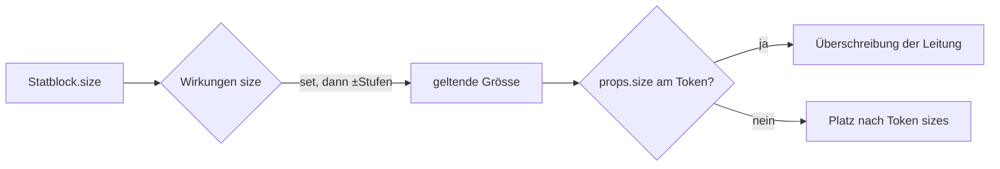

# F-056 Tokens & Marker

Marker, Kulisse, Spiel-Tokens, Gruppen-Token, Grösse.

Epic: [[EP-09 Karten]]

## Grösse eines Tokens (T-390)

Ein Token nimmt so viele Felder ein, wie die Grösse seines Statblocks sagt —
auch wenn es direkt auf einen Statblock zeigt (eingelesene Monster, der
Drache aus dem Demo-Video). Wirkungen mit Ziel `size` an der Kreatur (ein
Zustand „Enlarged" mit `add +1`, „Reduced" mit `add −1`, auch als Zustand
in der Begegnung) verschieben sie, solange sie gelten; die Leitung
überschreibt sie am einzelnen Token (Tokens › Token size, „by size" setzt
zurück). Der Tooltip und die Beschriftung unter „Token size" sagen, woher
die Grösse kommt. Gespeichert wird nur die Überschreibung (D8). Story auf
dem Brett: REQ-396; offen: E-164 (mehrere Grössen-Wirkungen).

## Stories

<!-- stories:anfang — erzeugt von anforderungen.mjs, nicht von Hand ändern -->
6 Stories · 17 Punkte · 4 steht · 2 teils

| Story | Rolle | Prio | Stand |
|---|---|---|---|
| [[REQ-133]] Marker, die zu Artikeln führen | Spielleitung | 3 | steht |
| [[REQ-134]] Kulisse auf der Karte | Spielleitung | 4 | steht |
| [[REQ-135]] Tokens im Spiel | Spielleitung | 3 | teils |
| [[REQ-136]] Gruppe und Quests auf der Karte | Spieler | 3 | steht |
| [[REQ-224]] Kreaturen nach Grösse auf der Karte | Spielleitung | 3 | steht |
| [[REQ-294]] Token ohne Bild zeigt den Anfangsbuchstaben | Spielleitung | 3 | teils |
<!-- stories:ende -->
