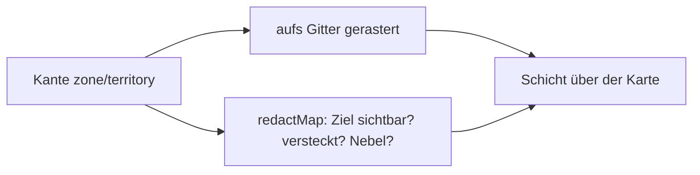
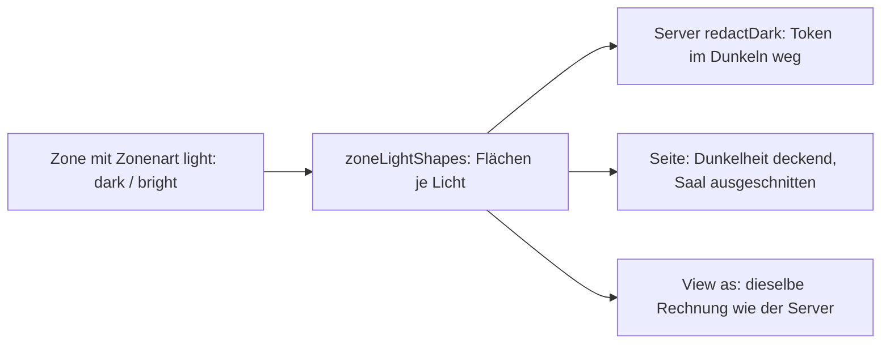

# F-059 Gebiete & Overlays

Gebiete und Hervorhebungen auf der Karte.

Epic: [[EP-09 Karten]]

## Stories

<!-- stories:anfang — erzeugt von anforderungen.mjs, nicht von Hand ändern -->
2 Stories · 8 Punkte · 1 steht · 1 teils

| Story | Rolle | Prio | Stand |
|---|---|---|---|
| [[REQ-137]] Hervorhebungen nach Abfrage | Spielleitung | 4 | teils |
| [[REQ-193]] Gebiete auf der Karte | Spielleitung | 4 | steht |
<!-- stories:ende -->

## In der Seite

Seit T-219 (29.10.2026) zeichnet die Webkarte Zonen (`zone` → Zonenart)
und Gebiete (`territory`) aufs Gitter gerastert, je Ebene; Spielende
bekommen sie gesiebt (unsichtbares Ziel, versteckte Zone, Nebel). Wie:
[Karten › Zonen und Gebiete](../../docs/Karten.md#zonen-und-gebiete-t-219).

Seit #442 lassen sich Flächen auf der Karte ziehen (Gruppe „Zones“).

## Licht der Zonen (T-219, #449)

Seit 4.11.2026 zählt, wo eine Zone liegt, das Licht ihrer Zonenart
(`ZoneKind.light`): in **magischer Dunkelheit** auf einer hellen Karte geht
ein Token nur an Spielende, die es mit Dunkelsicht oder im Licht sehen; in
einem **erleuchteten Saal** einer dunklen Karte ist zu sehen, wer in
Sichtlinie steht. Gerechnet wird einmal (`zoneLightShapes`, `redactDark`
mit `zones`): am Server fürs Zurückhalten, in der Seite für die Flächen
und für „View as“ der Leitung. Wie: [Karten › Tokens im
Dunkeln](../../docs/Karten.md#tokens-im-dunkeln-t-219).

Offen: Abfrage-Overlays (T-332), Biome (E-122).
