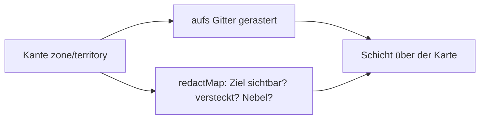

# F-059 Gebiete & Overlays

Gebiete und Hervorhebungen auf der Karte.

Epic: [[EP-09 Karten]]

## Stories

<!-- stories:anfang — erzeugt von anforderungen.mjs, nicht von Hand ändern -->
2 Stories · 8 Punkte · 1 steht · 1 teils

| Story | Rolle | Prio | Stand |
|---|---|---|---|
| [[REQ-137]] Hervorhebungen nach Abfrage | Spielleitung | 4 | teils |
| [[REQ-193]] Gebiete auf der Karte | Spielleitung | 4 | steht |
<!-- stories:ende -->

## In der Seite

Seit T-219 (29.10.2026) zeichnet die Webkarte Zonen (`zone` → Zonenart)
und Gebiete (`territory`) aufs Gitter gerastert, je Ebene; Spielende
bekommen sie gesiebt (unsichtbares Ziel, versteckte Zone, Nebel). Wie:
[Karten › Zonen und Gebiete](../../docs/Karten.md#zonen-und-gebiete-t-219).

Offen: Flächen auf der Karte ziehen (T-219), Abfrage-Overlays (T-332),
Biome (E-122).
