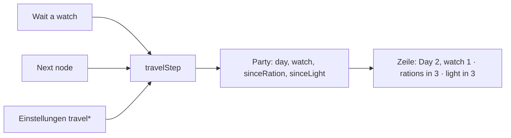

# F-060 Reisen & Erkundung

Point-Crawl, Erkundungsstand, Vorräte und Aktionen je Knoten.

Epic: [[EP-09 Karten]]

## Stories

<!-- stories:anfang — erzeugt von anforderungen.mjs, nicht von Hand ändern -->
4 Stories · 13 Punkte · 4 steht

| Story | Rolle | Prio | Stand |
|---|---|---|---|
| [[REQ-168]] Point-Crawl | Spielleitung | 3 | steht |
| [[REQ-169]] Erkundungsstand | Spieler | 3 | steht |
| [[REQ-170]] Vorräte auf Reisen | Spielleitung | 4 | steht |
| [[REQ-171]] Aktionen je Knoten | Spieler | 4 | steht |
<!-- stories:ende -->

## Reise an der Gruppe in der Seite (T-350)

Stand 29.10.2026. Die Gruppe zeigt Tag, Wache und wann Rationen und Licht fällig sind; „Wait a watch" lässt eine Wache vergehen, „Next node" zieht einen Knoten weiter (eine Wache, Zehrung zählt, Handlungen des Knotens geleert). Gerechnet in `travel.ts` aus den Einstellungen `travel*`. Offen: die Punktreise in der Seite, Rationen vom Inventar abziehen, `route.hours` (E-206).

