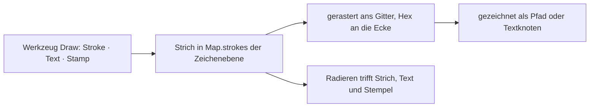

# F-061 Karteneditor

Zeichnen, Assets platzieren, Effekte.

Epic: [[EP-09 Karten]]

## Stories

<!-- stories:anfang — erzeugt von anforderungen.mjs, nicht von Hand ändern -->
3 Stories · 29 Punkte · 1 steht · 2 offen

| Story | Rolle | Prio | Stand |
|---|---|---|---|
| [[REQ-141]] Effekte auf der Karte | Spielleitung | 5 | offen |
| [[REQ-142]] Auf Karten zeichnen | Spielleitung | 5 | steht |
| [[REQ-143]] Karteneditor | Spielleitung | 5 | offen |
<!-- stories:ende -->

## Zeichnen auf der Karte (T-219, REQ-142)

Seit 29.10.2026 ist eine **Zeichenebene** ein Blatt ohne Bild (#445):
Striche mit Farbe und Breite, Radieren, am Gitter eingerastet. Seit 4.11.
(#449) stehen darauf auch **Text** (getippt) und **Stempel** (☠ ⚠ ✕ ★ ⚑
⚔ ⌂ ?) in drei Grössen — ein Strich `kind: 'text'`, als Textknoten
gezeichnet, nie als HTML. Auf Hexkarten rasten Wände an die Ecken des
Felds (`snapPoint`). Wie: [Karten › Auf der Karte
zeichnen](../../docs/Karten.md#auf-der-karte-zeichnen-t-219-req-142).

Offen: Pinsel und Effekte ([[REQ-141]]), Assets platzieren ([[REQ-143]]).
