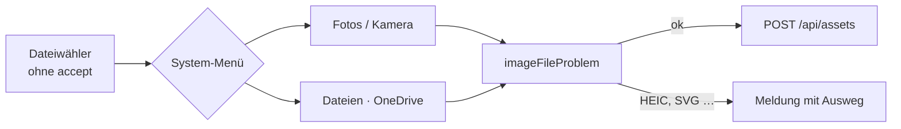

# F-063 Bildverwaltung

Hochladen, Übersicht, Bildklassen, Ersetzen, Import der Bilder.

Epic: [[EP-10 Medien & Assets]]

## Stories

<!-- stories:anfang — erzeugt von anforderungen.mjs, nicht von Hand ändern -->
5 Stories · 13 Punkte · 2 teils · 3 offen

| Story | Rolle | Prio | Stand |
|---|---|---|---|
| [[REQ-147]] Bilder hochladen | Spielleitung | 2 | teils |
| [[REQ-295]] Bild ersetzen als Fassung oder neue Quelle | Spielleitung | 3 | offen |
| [[REQ-296]] Bildklassen | Spielleitung | 3 | teils |
| [[REQ-297]] Bilder aus 5e.tools einlesen und verknüpfen | Spielleitung | 3 | offen |
| [[REQ-329]] Bilder im Inventar | Spieler | 3 | offen |
<!-- stories:ende -->

## Bildwähler auf dem Telefon (T-369)

Alle drei Bildwähler — das Bildfeld eines Artikels (`nw-bildwahl`, auch
Figur, Karte, Board, Inventar), die Bildübersicht (`/images`) und
„Replace image" — sind **allgemeine Dateiwähler ohne `accept` und ohne
`capture`**; geprüft wird nach der Wahl mit `imageFileProblem` aus
`packages/model/src/assets.ts` (Formate in `IMAGE_FORMATS`). Nur „Take
photo" fragt ausdrücklich nach der Kamera (`accept="image/*"
capture="environment"`).

**Warum ohne `accept`:** der erste Versuch (22.10., PR #360) nannte die
Bildtypen einzeln statt `image/*`. Chrome auf Android öffnet aber die
Fotoauswahl des Systems, sobald `accept` *nur* Bild- oder Videotypen
nennt — gleich in welcher Schreibweise —, und OneDrive war weiter nicht
erreichbar. Ohne `accept` kommt das Datei-Menü (26.10.).

HEIC und SVG liest der Server nicht; `imageFileProblem` sagt, was zu tun
ist, bevor etwas hochgeht. Eine Datei ohne Medientyp (manche
Cloud-Anbieter) gilt nach ihrer Endung.

