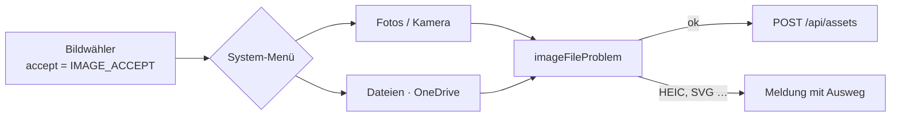

# F-063 Bildverwaltung

Hochladen, Übersicht, Bildklassen, Ersetzen, Import der Bilder.

Epic: [[EP-10 Medien & Assets]]

## Stories

<!-- stories:anfang — erzeugt von anforderungen.mjs, nicht von Hand ändern -->
5 Stories · 13 Punkte · 2 teils · 3 offen

| Story | Rolle | Prio | Stand |
|---|---|---|---|
| [[REQ-147]] Bilder hochladen | Spielleitung | 2 | teils |
| [[REQ-295]] Bild ersetzen als Fassung oder neue Quelle | Spielleitung | 3 | offen |
| [[REQ-296]] Bildklassen | Spielleitung | 3 | teils |
| [[REQ-297]] Bilder aus 5e.tools einlesen und verknüpfen | Spielleitung | 3 | offen |
| [[REQ-329]] Bilder im Inventar | Spieler | 3 | offen |
<!-- stories:ende -->

## Bildwähler auf dem Telefon (T-369)

Alle drei Bildwähler — das Bildfeld eines Artikels (`nw-bildwahl`, auch
Figur, Karte, Board, Inventar), die Bildübersicht (`/images`) und
„Replace image" — nehmen dieselbe Liste `IMAGE_ACCEPT` aus
`packages/model/src/assets.ts`: konkrete Medientypen und Endungen statt
`image/*`, ohne `capture`. Mit `image/*` öffnet Android nur die
Fotoauswahl; mit der Liste kommt das Datei-Menü des Systems, darin auch
OneDrive, Fotos und Kamera bleiben. Nur „Take photo" fragt ausdrücklich
nach der Kamera.

HEIC steht bewusst nicht in der Liste: der Server liest es nicht, und
ohne HEIC wandelt iOS ein Foto aus der Mediathek selbst in JPEG. Kommt
eine HEIC-Datei aus den Dateien, sagt `imageFileProblem`, was zu tun ist,
bevor etwas hochgeht. Eine Datei ohne Medientyp (manche Cloud-Anbieter)
gilt nach ihrer Endung.

