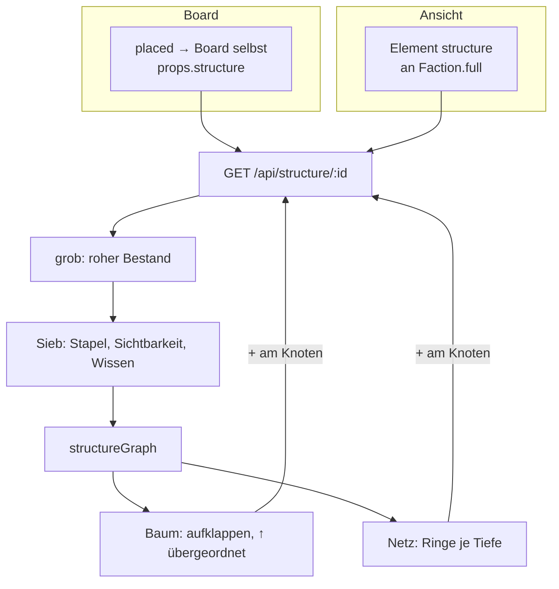

# F-067 Boards

Leinwände mit Platzierungen, Ankern und Bereichen; Anlegen auf dem Board.

Epic: [[EP-11 Oberfläche & Navigation]]

## Stories

<!-- stories:anfang — erzeugt von anforderungen.mjs, nicht von Hand ändern -->
13 Stories · 61 Punkte · 8 steht · 2 teils · 3 offen

| Story | Rolle | Prio | Stand |
|---|---|---|---|
| [[REQ-111]] Boards | Spielleitung | 2 | steht |
| [[REQ-119]] Boards der Spielenden | Spieler | 3 | offen |
| [[REQ-157]] Frei anordnen auf dem Board | Spielleitung | 2 | steht |
| [[REQ-158]] Ansicht je Platzierung | Spielleitung | 2 | steht |
| [[REQ-159]] Anker und Bereiche auf dem Board | Spielleitung | 3 | steht |
| [[REQ-160]] Zwischen Ankern springen | Spielleitung | 3 | teils |
| [[REQ-161]] Regeln für die Darstellung | Spielleitung | 2 | steht |
| [[REQ-162]] Semantischer Zoom | Spielleitung | 4 | offen |
| [[REQ-165]] Bilder, Formen und Werkzeuge auf dem Board | Spielleitung | 2 | steht |
| [[REQ-166]] Auf dem Board anlegen | Spielleitung | 2 | teils |
| [[REQ-291]] Leseansicht auf dem Board | Spielleitung | 3 | offen |
| [[REQ-358]] Kampagnenboard als Startpunkt für Spielende | Spieler | 2 | steht |
| [[REQ-360]] Struktur einer Fraktion als Organigramm oder Netz | Spielleitung | 2 | steht |
<!-- stories:ende -->

## Struktur-Kachel (T-341)

Eine Kachel, die eine Fraktion, einen Ort oder eine Familie aus ihren
Kanten zeichnet — als Organigramm oder Beziehungsnetz; dasselbe als
Element `structure` an der Seite der Fraktion. Gespeichert ist nur die
Frage, gerechnet wird am Server je Betrachter ([[REQ-360]]).

