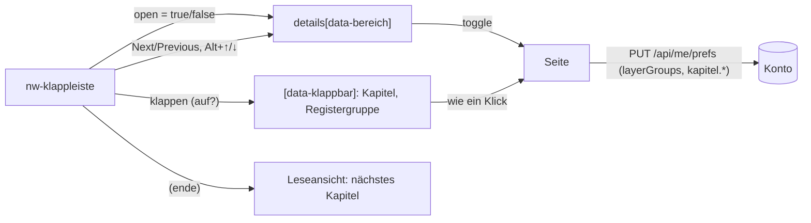

# F-070 Navigation & Kurzansicht

Kopfleiste, Brotkrumen, Kurzansicht als Popup, Kampagne und Ebene sichtbar.

Epic: [[EP-11 Oberfläche & Navigation]]

## Stories

<!-- stories:anfang — erzeugt von anforderungen.mjs, nicht von Hand ändern -->
7 Stories · 22 Punkte · 5 steht · 2 teils

| Story | Rolle | Prio | Stand |
|---|---|---|---|
| [[REQ-248]] Kurzansicht überall | Spieler | 2 | steht |
| [[REQ-305]] Kampagne und Ebene immer sichtbar | Spielleitung | 2 | steht |
| [[REQ-315]] Globale Kopfleiste | Spieler | 1 | steht |
| [[REQ-317]] Zurück an dieselbe Stelle | Spielleitung | 1 | steht |
| [[REQ-342]] Handbuch: alle Erklärungen an einer Stelle | Spielleitung | 1 | steht |
| [[REQ-345]] Schwebende Werkzeugleiste für eine Auswahl | Spieler | 2 | teils |
| [[REQ-361]] Lange Seiten: Bereiche klappen und springen | Spielleitung | 1 | teils |
<!-- stories:ende -->

## Klappleiste (T-220, [[REQ-361]])

Ein Bedienelement für lange Seiten: `nw-klappleiste` (`apps/web/src/app/muster/klappleiste.ts`). Die Seite markiert ihre Bereiche (`data-bereich`, meist ein `
`); die Leiste klappt alle auf oder zu, springt zum vorigen oder nächsten Bereich (zuerst vom Bereich mit dem Fokus aus, sonst nach der Lage) und hört auf Alt+↑/↓ (mit Umschalt: alles zu/auf). Am Telefon steht sie unten fest, über der Leiste der Spielenden (`--basis-unten`).

Den Klappstand merkt sich die Seite, nicht die Leiste: ein geklapptes `
` meldet `toggle` wie bei einem Klick, und die Seite speichert wie bisher am Konto (`layerGroups`, gesammelt nach dem letzten Klappen). Wo nichts klappt (Leseansicht), springt sie nur und meldet am Ende `(ende)` — die Leseansicht blättert ins nächste Kapitel.

**Klappbar ohne `
`** (T-359): ein Bereich mit `data-klappbar` sagt seinen Stand in `data-offen="true|false"` und klappt selbst, wenn die Leiste ihm das Ereignis `klappen` (`detail`: auf?) schickt — so wie ein Kapitel (`nw-kapitelteil`, das am Desktop zugeklappt anfängt: Admin, Log) und eine geerbte Gruppe auf der Typseite des Registers. Die Leiste kennt keine Seite; die Seite merkt sich den Stand wie nach einem Klick. Die Kapitel einer Seite merken sich am Konto, welche zugeklappten offen stehen (`nw-kapitel merke="article"` → Einstellung `kapitel.article`).

**Wem die Tasten gehören** (T-359): eine Leiste kann in einer anderen stehen — die Leseansicht in der Ebenenseite. Alt+↑/↓ beantwortet die innerste sichtbare Leiste, deren Bereich den Fokus hält; jeder Tastendruck nur einmal. Was am Telefon in einem anderen Reiter steht, wird übersprungen (`checkVisibility`).

Im Einsatz:

| Seite | Bereiche | Telefon |
|---|---|---|
| Kampagnenseite › Layers (T-220) | Order in play, Saved selections, Buchgruppen, Compare layers, Extra content; auch im Ebenen-Popup (dort nicht fest) | unten fest |
| Leseansicht (T-220) | Abschnitte, am Ende ins nächste Kapitel | unten fest |
| Kompendium und Bereiche, Filter (T-359) | jede Facette, When & who, Relations, Usable by | im Filterblatt, nicht fest |
| Artikelseite, auch Figur und Ebene (T-359) | die Kapitel; Admin und Log klappen und werden gemerkt; darin z. B. der Inhalt einer Ebene je Art | keine — die Kapitel sind Reiter |
| Register, Typseite (T-359) | Kapitel, geerbte Typen, verlinkte Gruppen, Edges from here | unten fest, im gewählten Reiter |
| Charakter-Assistent (T-359) | in langen Schritten (Wahl mit Unterwahlen, Ausrüstung): Liste, Stufen, Vergleich, Unterwahlen; nur springen | unten fest |

Offen: Klappstand der Facetten und der Registergruppen am Konto (sie halten ihn heute je Sitzung), die Sprungleiste der Kampagnenseite (falls nach den Reitern T-254 noch gewünscht).
