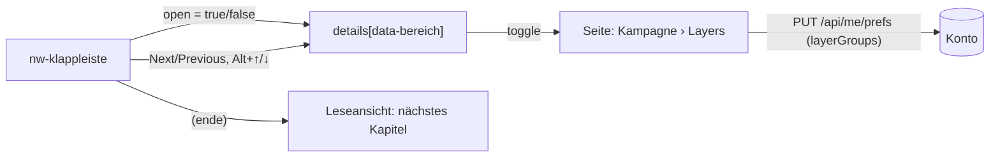

# F-070 Navigation & Kurzansicht

Kopfleiste, Brotkrumen, Kurzansicht als Popup, Kampagne und Ebene sichtbar.

Epic: [[EP-11 Oberfläche & Navigation]]

## Stories

<!-- stories:anfang — erzeugt von anforderungen.mjs, nicht von Hand ändern -->
7 Stories · 22 Punkte · 5 steht · 2 teils

| Story | Rolle | Prio | Stand |
|---|---|---|---|
| [[REQ-248]] Kurzansicht überall | Spieler | 2 | steht |
| [[REQ-305]] Kampagne und Ebene immer sichtbar | Spielleitung | 2 | steht |
| [[REQ-315]] Globale Kopfleiste | Spieler | 1 | steht |
| [[REQ-317]] Zurück an dieselbe Stelle | Spielleitung | 1 | steht |
| [[REQ-342]] Handbuch: alle Erklärungen an einer Stelle | Spielleitung | 1 | steht |
| [[REQ-345]] Schwebende Werkzeugleiste für eine Auswahl | Spieler | 2 | teils |
| [[REQ-361]] Lange Seiten: Bereiche klappen und springen | Spielleitung | 1 | teils |
<!-- stories:ende -->

## Klappleiste (T-220, [[REQ-361]])

Ein Bedienelement für lange Seiten: `nw-klappleiste` (`apps/web/src/app/muster/klappleiste.ts`). Die Seite markiert ihre Bereiche (`data-bereich`, meist ein `
`); die Leiste klappt alle auf oder zu, springt zum vorigen oder nächsten Bereich (zuerst vom Bereich mit dem Fokus aus, sonst nach der Lage) und hört auf Alt+↑/↓ (mit Umschalt: alles zu/auf). Am Telefon steht sie unten fest, über der Leiste der Spielenden (`--basis-unten`).

Den Klappstand merkt sich die Seite, nicht die Leiste: ein geklapptes `
` meldet `toggle` wie bei einem Klick, und die Seite speichert wie bisher am Konto (`layerGroups`, gesammelt nach dem letzten Klappen). Wo nichts klappt (Leseansicht), springt sie nur und meldet am Ende `(ende)` — die Leseansicht blättert ins nächste Kapitel.

Im Einsatz: Kampagnenseite › Layers (Order in play, Saved selections, Buchgruppen, Compare layers, Extra content; auch im Ebenen-Popup der Kopfleiste, dort nicht fest) und die Leseansicht. Offen: Assistent, Facetten, Register, Artikel-, Figur- und Ebenenseite.
