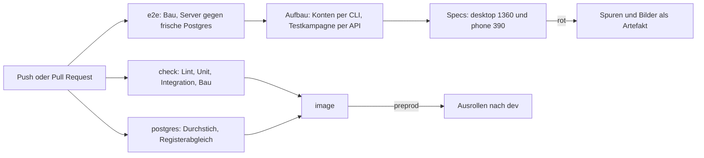

# F-080 Qualität & Tests

Drei Teststufen für jede Änderung — Unit, Integration, E2E im Browser — und wie das CI sie fährt.

Epic: [[EP-02 Zugang & Betrieb]]

Festgelegt von der Leitung am 21.10.2026 (CLAUDE.md › Grundanforderungen
an jede Änderung): jede Änderung bringt ihre Tests auf allen drei Stufen
im selben Pull Request mit.

| Stufe | Wo | Was sie zeigt |
|---|---|---|
| Unit | `packages/*/test`, `apps/web/test` (Vitest) | eine Funktion, jeder Zweig, die Grenzfälle |
| Integration | `apps/server/test` (Vitest, `app.inject`) | eine Route mit ihrer Siebung — Leitung und Spielerin nebeneinander, Helfer `test/hilfen/tisch.ts` |
| Durchstich | `apps/server/scripts/durchstich.mjs` | alle Migrationen gegen eine frische Postgres |
| E2E | `apps/web/e2e/` (Playwright) | der Ablauf im Browser, wie Leitung oder Spielerin ihn macht, bei 1360 und 390 px |

## Wie das CI prüft

Der Job `e2e` baut Server und Oberfläche wie das Abbild, startet den
Server gegen eine frische Postgres (Migrationen und Seed beim Start), legt
drei Konten über `user add` an (Verwaltung, Leitung, Spielerin) und je Lauf
eine eigene Testkampagne über die API. Testdaten legt jeder Spec selbst an,
klein und mit eigenem Namen — keine Daten aus 5e.tools, kein
Kampagneninhalt. Spuren (`trace`) und Bilder entstehen nur bei einem
Fehler und liegen am Lauf als Artefakt `e2e-spuren`.

Die Specs heute, je bei 1360 und 390 px:

| Spec | Ablauf | Rollen |
|---|---|---|
| `anmelden` | Anmelden, falsches Passwort, gespeicherte Sitzung | Leitung, Spielerin |
| `artikel` | Verweis → Kurzansicht → Artikelseite; `audience: gm` kommt nicht an | Leitung, Spielerin |
| `kompendium` | Suche, Feldfilter, Spaltenwahl | Leitung (Desktop), Spielerin (Telefon) |
| `karte` | Karte ins Spiel, aufdecken, freigeben, Token ziehen; versteckter Marker bleibt weg | Leitung, Spielerin |
| `initiative` | Start, End turn der Spielerin, Next turn | Leitung, Spielerin |
| `board` | Text- und Abfrage-Kachel, gesiebt | Leitung, Spielerin |
| `charakter` | Assistent bis zur Figur, dann Stufe 2 | Leitung (Desktop), Spielerin (Telefon) |
| `kampagnenboard` | Spielerin landet auf dem Board, Basis-Leiste; Leitung behält ihren Start (T-342) | Leitung, Spielerin |

Den Merge hält der Job, sobald die Leitung ihn in den Repo-Einstellungen als
Pflichtprüfung einträgt (T-356).

Lokal laufen lassen und einen neuen Spec schreiben:
[CONTRIBUTING.md › E2E-Prüfungen](../../CONTRIBUTING.md#e2e-prüfungen).

## Stories

<!-- stories:anfang — erzeugt von anforderungen.mjs, nicht von Hand ändern -->
1 Stories · 5 Punkte · 1 steht

| Story | Rolle | Prio | Stand |
|---|---|---|---|
| [[REQ-359]] Jede Änderung im Browser geprüft | Verwaltung | 1 | steht |
<!-- stories:ende -->
