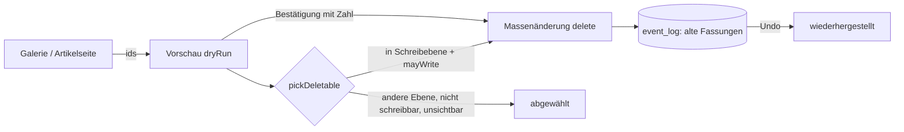

# REQ-235 Werkbank: Prüfungen und Massenänderungen

**Als** Spielleitung **möchte ich** den ganzen Bestand prüfen (Pflichtfelder, Doppel, Kanten ins Leere, Statblöcke ohne Zahlen) und Massenänderungen mit Vorschau, Protokoll und Rückgängig machen, **damit** ich grosse Bestände pflege, ohne etwas kaputt zu machen.

## Akzeptanzkriterien

- Prüfungen sind erweiterbar (`CHECKS`) und verlinken jeden Treffer.
- Eine Massenänderung zeigt vorher, was sie tut, gilt ganz oder gar nicht und lässt sich zurücknehmen.
- Mehrere Artikel löschen geht nur mit ausdrücklicher Bestätigung.
- **Löschen aus der eigenen Ebene** (Leitung, 22.10.2026, T-381): jedes Konto löscht einzeln oder aus einer Mehrfachauswahl, aber nur, was in seiner Schreibebene liegt und was es schreiben darf; Artikel aus anderen Ebenen werden abgewählt, und die Meldung sagt es („3 deleted, 2 from other layers deselected“). Undo direkt danach, auch für Spielende.

## Anmerkungen

Prüfungen: was `validateEntity` ablehnt, leere Pflichtfelder, gleichnamige Artikel, Kanten ins Leere, Statblöcke ohne Zahlen, Instanzen ohne Vorlage, Verweise ohne oder mit mehreren Treffern. Operationen: Feld, Marke, Kante, Zusammenführen; alles oder nichts (D68).

## Bisheriger Wortlaut

> Werkbank: erweiterbare Prüfungen über den ganzen Bestand und Massenänderungen mit Vorschau, Protokoll und Rückgängig; mehrere Artikel löschen nur mit ausdrücklicher Bestätigung
