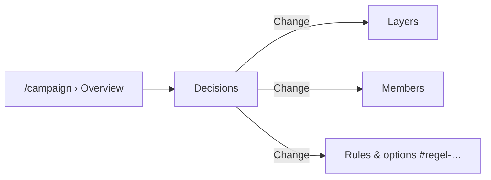

# REQ-274 Charakter- und Kampagnenmanager jederzeit aufrufen

**Als** Spieler **möchte ich** den Charaktermanager (und als Leitung den Kampagnenmanager) jederzeit wieder öffnen und einzelne Entscheidungen neu treffen, **damit** ich eine Wahl korrigieren kann, ohne von vorn zu beginnen.

## Akzeptanzkriterien

- Der Manager öffnet an einer bestehenden Figur bzw. Kampagne mit den getroffenen Wahlen.
- Eine einzelne Wahl lässt sich ändern; was von ihr abhängt, wird neu gerechnet.

## Umsetzung

- **Kampagne** (T-141): `/campaign` › Overview › **Decisions** listet jede Entscheidung — Ebenen, Vergleichsebenen, Mitglieder, jede Regel — mit Stand (`decided`, `default`, `open`), „Change“ an den Ort, an dem genau diese fällt, und dem, was eine Änderung bewirkt. Gerechnet beim Lesen (`campaignDecisions`), nichts gespeichert. Siehe [docs/Datenmodell.md › 10.1a](../../docs/Datenmodell.md).
- **Figur** (T-451): dieselbe Liste für die Wahlen einer Figur, sobald der Assistent eine Ansicht mit Steps ist (T-436).

