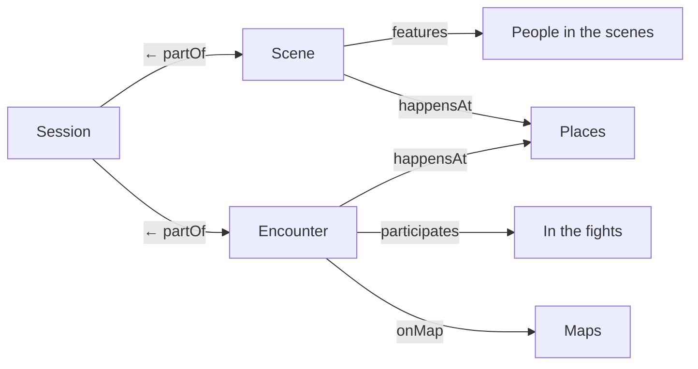

# REQ-282 Sitzungsansicht für das Spiel

**Als** Spielleitung **möchte ich** während der Sitzung eine Ansicht mit den Artikeln, die gerade zählen (Szene, Begegnung, beteiligte NSC, Orte), **damit** ich nicht suchen muss, während der Tisch wartet.

## Akzeptanzkriterien

- Die Ansicht liest Szene, Begegnung und Karte der Sitzung und zeigt, was daran hängt.

## Umsetzung (T-151, 29.10.2026)

Keine Sonderseite, sondern die Vorgabeansicht der Art `Session`
(`InterfaceDef.views.full`, Migration 166): gleich unter `live` fünf
Collections (T-425), zwei Schritte vom Abend weg.

- Gesiebt am Server: was nur eine geheime Szene nennt, kommt bei
  Spielenden nicht an. Leere Sammlungen fallen weg.
- Was gerade auf dem Tisch liegt (`activeScene`, `activeEncounter`,
  `activeMap`), zeigt weiter das Element `live`.
- Offen: ein Pfadschritt über mehrere Kanten, damit NSC aus Szene und Kampf
  in einer Liste stehen (T-454); die Leitung ohne Verwaltungsrecht bekommt
  Gegner einer Begegnung vor Kampfbeginn gesiebt (T-455, E-208).
