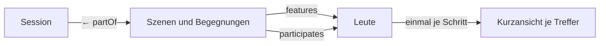

# REQ-282 Sitzungsansicht für das Spiel

**Als** Spielleitung **möchte ich** während der Sitzung eine Ansicht mit den Artikeln, die gerade zählen (Szene, Begegnung, beteiligte NSC, Orte), **damit** ich nicht suchen muss, während der Tisch wartet.

## Akzeptanzkriterien

- Die Ansicht liest Szene, Begegnung und Karte der Sitzung und zeigt, was daran hängt.

## Ein Pfadschritt über mehrere Kantenarten (T-454, 4./5.11.2026)

Die Sitzungsansicht (PR #450, T-151) zeigte die Leute aus den Szenen (`← partOf › features`) und aus den Kämpfen (`← partOf › participates`) in zwei Sammlungen; wer in beiden vorkam, stand zweimal. Seit T-454 darf ein Schritt im Pfad eines Elements `collection` **mehrere Kantenarten** nennen (`relation: ['features', 'participates']`): `followPath` folgt jeder davon und nimmt jeden Artikel je Schritt einmal, die Werte der Kante kommen vom ersten Treffer. Im Ansichtsdesigner nimmt „Also via …“ dem letzten Schritt eine Art dazu, × am Chip lässt sie weg; der Pfad liest sich `← partOf › features | participates`. Das Zusammenlegen von `se-people` und `se-fight` zu „People“ folgt, sobald #450 auf preprod liegt (T-464).

