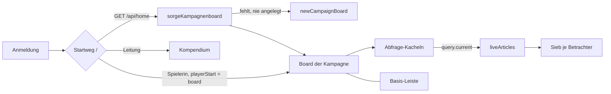

# REQ-358 Kampagnenboard als Startpunkt für Spielende

**Als** Spieler **möchte ich** nach der Anmeldung auf dem Board meiner Kampagne landen — mit ihrem Titel, der laufenden Szene, der nächsten Sitzung, der Gruppe, den offenen Aufträgen und den Gerüchten — und von dort über eine feste Leiste zu meiner Figur, den Karten, der Suche und meinem Wissen und zurück, **damit** ich am Tisch nicht im Kompendium suchen muss.

## Akzeptanzkriterien

- Jede Kampagne hat ein gewöhnliches Board, das an ihr hängt (`partOf`), frei bearbeitbar; neue bekommen es beim Anlegen, bestehende beim ersten Öffnen, gelöscht bleibt es weg.
- Die Kacheln lesen den aktuellen Stand (Szene im Spiel, Gruppe, offene Aufträge) und kopieren nichts; Spielende sehen nur Freigegebenes, gesiebt am Server.
- Spielende landen nach der Anmeldung auf dem Board; die Leitung wählt es ab (`Players start on`) und behält ihren eigenen Start.
- Eine Basis-Leiste für Spielende — am Telefon unten, am Desktop oben — führt zu Board, eigener Figur, Karten, Suche und Wissen.

## Ablauf

## Anmerkungen

Kein Feld „läuft“ an der Sitzung: die laufende ist die späteste, an der etwas im Spiel steht (`sessionsOf`). Regeln: [docs/Datenmodell.md](../../docs/Datenmodell.md) (Kampagnenboard, laufende Quellen).
