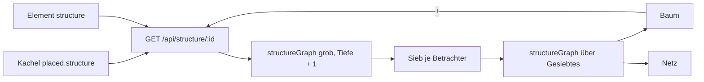

# REQ-360 Struktur einer Fraktion als Organigramm oder Netz

**Als** Spielleitung **möchte ich** eine Fraktion, einen Ort oder eine Familie auf einem Board und an ihrer Seite als Organigramm oder Beziehungsnetz sehen — Mitglieder mit Rang, Unterfraktionen, was sie beherrscht, wer was von wem hält —, **damit** ich am Tisch die Struktur auf einen Blick habe, ohne sie ein zweites Mal pflegen zu müssen.

## Akzeptanzkriterien

- Die Struktur wird aus den Kanten gerechnet (`memberOf`, `partOf`, `controls`, `livesIn`, `regards`), nichts davon gespeichert; gespeichert ist nur Startartikel, Kanten, Tiefe und Form.
- Baum (Organigramm) oder Netz; Knoten zeigen ihre Kurzansicht, klappen auf und zu, „+" holt, was hinter der Tiefe liegt.
- Linien tragen die Marken der Beziehung oder den Rang; jede Richtung von `regards` ist eine eigene Linie.
- Spielende sehen nur Knoten und Linien, die sie sehen dürfen, und nichts, was nur über Verborgenes erreichbar ist — gesiebt am Server.
- Dasselbe steht als Element `structure` im Ansichtsdesigner und an der Seite einer Fraktion.

## Ablauf

## Anmerkungen

Regeln: [docs/Datenmodell.md](../../docs/Datenmodell.md) (Struktur-Kachel), [docs/Beziehungen.md](../../docs/Beziehungen.md).
