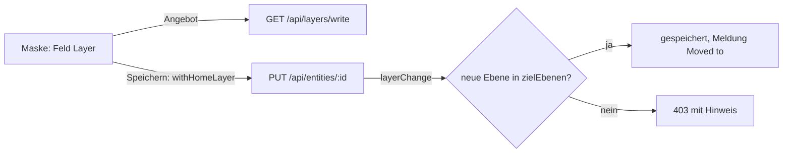

# REQ-367 Ebene eines Artikels im Bearbeiten ändern, als erstes Feld

**Als** Spielleitung **möchte ich** im Bearbeiten eines Artikels seine Ebene als erstes Feld sehen und ändern, **damit** ich einen Artikel ohne Umweg dorthin lege, wo er hingehört.

## Akzeptanzkriterien

- Das Feld „Layer“ steht im Bearbeiten vor allen anderen Feldern, für jede Artikelart, am Telefon wie am Desktop.
- Angeboten werden die Ebene, in der der Artikel liegt, und die Schreibebenen des Kontos, die in der laufenden Kampagne im Spiel sind (dieselben wie unter „Writes to“, T-161). Nur die Verwaltung nimmt einen Artikel aus jeder Ebene.
- Der Server prüft beim Speichern (`PUT /api/entities/:id`): jede neue Ebene muss unter `zielEbenen` stehen, sonst 403 mit dem Namen der Ebene und dem Hinweis, was zu tun ist.
- Nach dem Speichern sagt die Seite „Moved to …“, die Ebenenmarke unter dem Titel zeigt die neue Ebene.
- Kanten bleiben (sie zeigen auf die Id). Fassungen bleiben in ihrer Ebene. Ob Teile, Statblock und Inventar mitwandern: E-161.

## Ablauf

