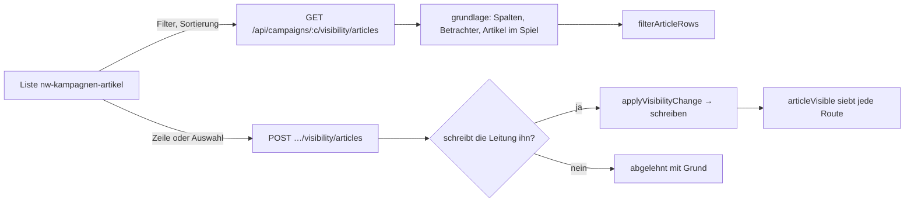

# REQ-368 Artikel mit ihrer Ebene in Layers und Visibility der Kampagne, einzeln und mehrfach entscheiden

**Als** Spielleitung **möchte ich** in der Kampagne unter Layers und Visibility jeden Artikel mit seiner Ebene sehen und einzeln (oder mehrere auf einmal) entscheiden, wer ihn sieht, **damit** ich nicht über Gruppen raten muss, was ein einzelner Artikel tut.

## Akzeptanzkriterien

- Unter Layers und unter Visibility der Kampagnenseite steht „Articles and their layers“: jeder Artikel im Spiel (ohne Instanzen und Buchteile) mit Name, Art, Ebene, Herausgeber und Gruppe der Ebene, der geltenden Stufe und woher sie kommt (eigenes Feld · Regel der Kampagne · Vorgabe der Ebene · Vorgabe) und welche Spalte (Public, Table, je Spielende/r, GM) ihn sieht.
- Filter nach Name, Ebene (auch „No layer“), Art und Stufe; Sortierung nach Name, Ebene, Art, Stufe, auf- und absteigend; unter Layers zuerst nach Ebene. Gerechnet und geblättert am Server.
- Je Zeile: Stufe setzen (Public · Table · Players · GM), ↺ folgt wieder der Gruppe, Klick auf eine Spielerin zeigen → verbergen → folgen.
- Mehrfachauswahl wie in der Galerie (einzeln oder „all shown“): dieselben Knöpfe für die Auswahl, dazu „Show to …“/„Hide from …“ je Spielerin; die Auswahl bleibt nach dem Setzen.
- Geschrieben wird ins eigene Feld des Artikels (`Visibility`), wie jedes Schreiben; was die Leitung nicht schreibt (fremde oder geteilte Ebene, ohne Ebene), bleibt und kommt mit Grund und Ausweg zurück.
- Leitung ändert, Mitleitung sieht, Spielende bekommen die Liste nicht (403).
- Telefon 390 px und Desktop 1360 px.
- **Wartet auf Entscheid:** Ebene wechseln aus der Liste (E-161; bis dahin am Artikel unter Edit › Layer, REQ-367), Vorrang eines Artikels über eine andere Ebene (E-111), Sichtbarkeit eines Artikels in einer Ebene, die die Leitung nicht schreibt (E-162).

## Ablauf

