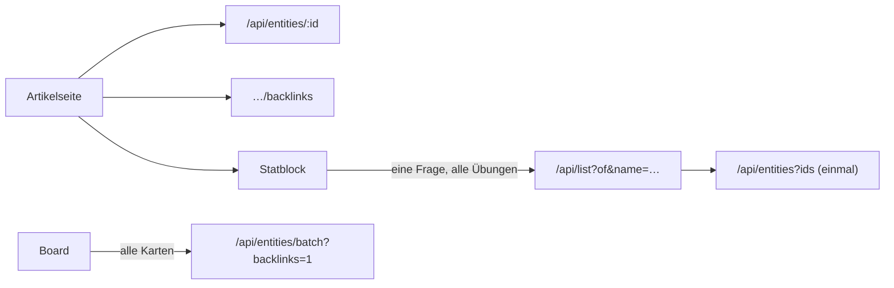

# REQ-397 Artikel laden schnell und stabil

**Als** Spielleitung und Spielende **möchte ich**, dass Artikel, Listen und Kurzansichten schnell und zuverlässig laden, **damit** ich am Tisch nicht warte und keine halb geladenen oder leeren Seiten sehe.

## Akzeptanzkriterien

- Messung vorher und nachher auf dev mit dem ganzen Bestand (Kompendium, Artikelseite, Kurzansicht, Karte, Board; 390 px und 1360 px); die Zielwerte stehen in der Analyse und sind von der Leitung bestätigt.
- Fehler beim Laden werden sichtbar gemeldet und automatisch wiederholt statt stiller Leere.
- Keine doppelten oder wiederholten Abrufe derselben Daten; Listen seitenweise bzw. nachgeladen.
- Messwerte als wiederholbarer Test oder Script (`scripts/laden-messen.mjs`, `apps/web/e2e/abrufe.spec.ts`), damit Rückschritte auffallen.

## Ladepfad der Artikelseite

Analyse und Hebel: [[../../docs/vorschlaege/Laden-Analyse|Laden-Analyse]]; Regeln: [[../../docs/Performance|Performance]].
