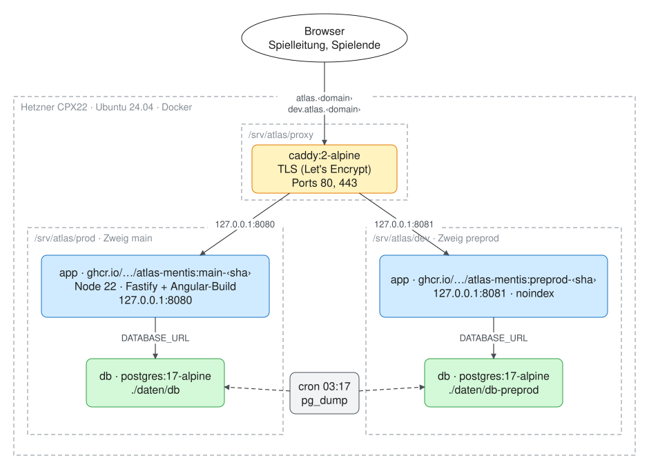
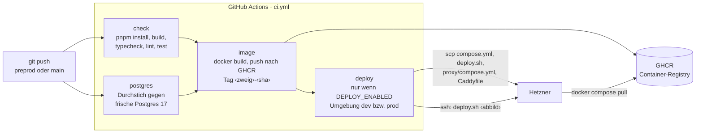
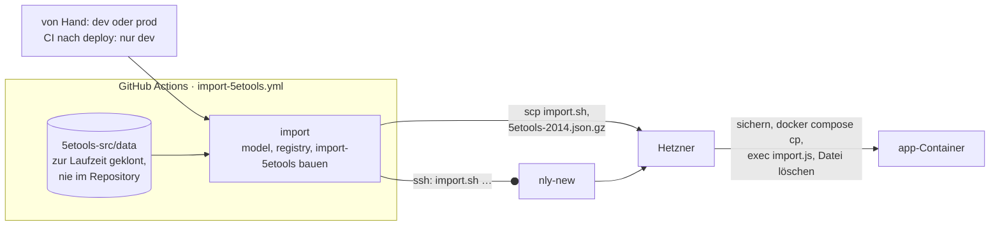
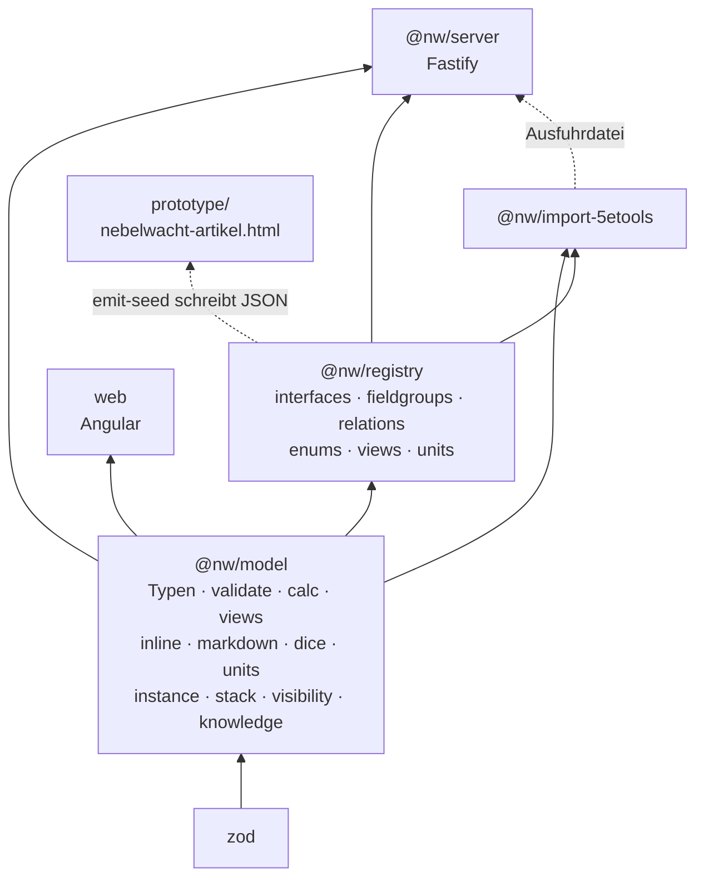
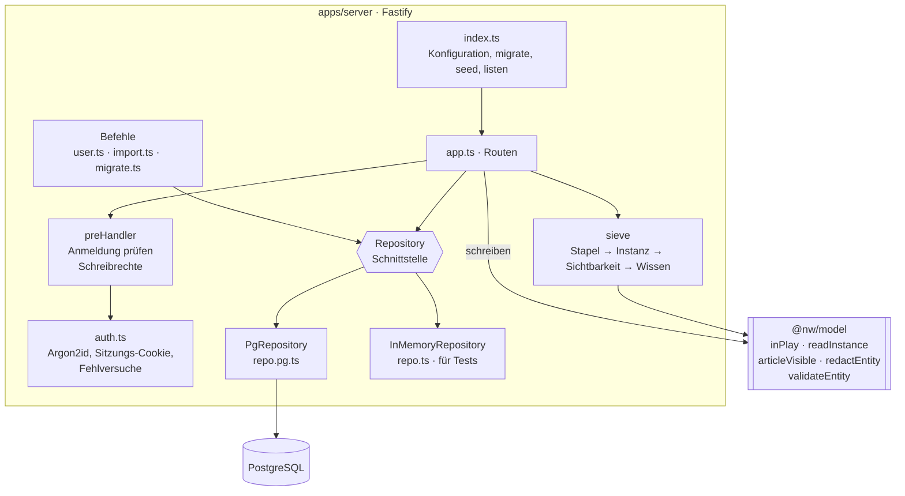
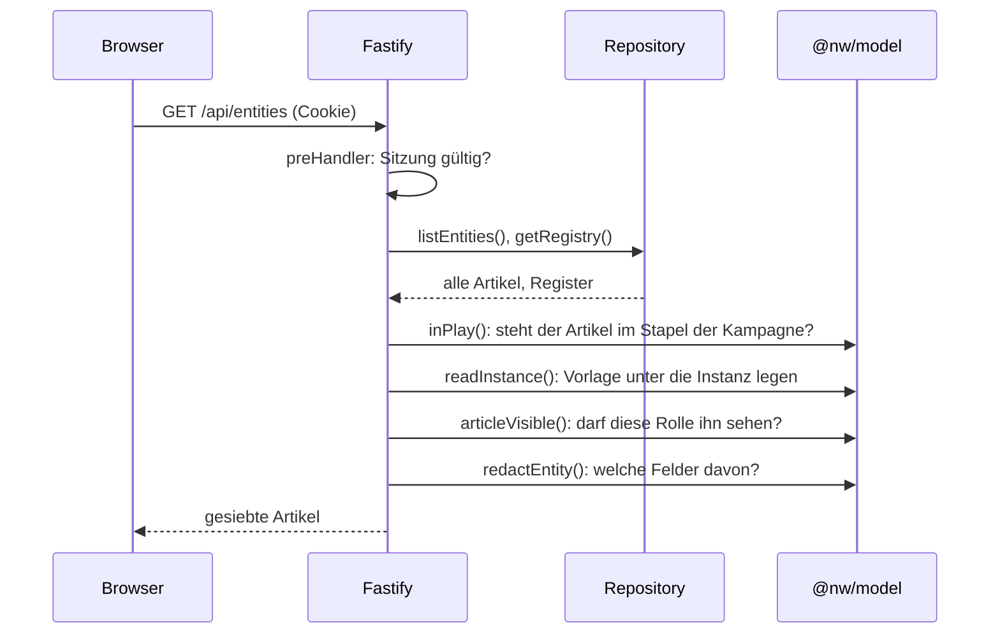
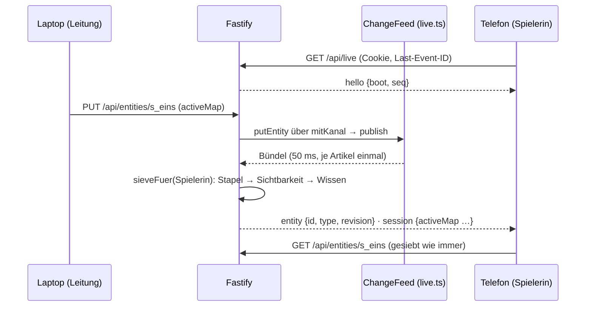
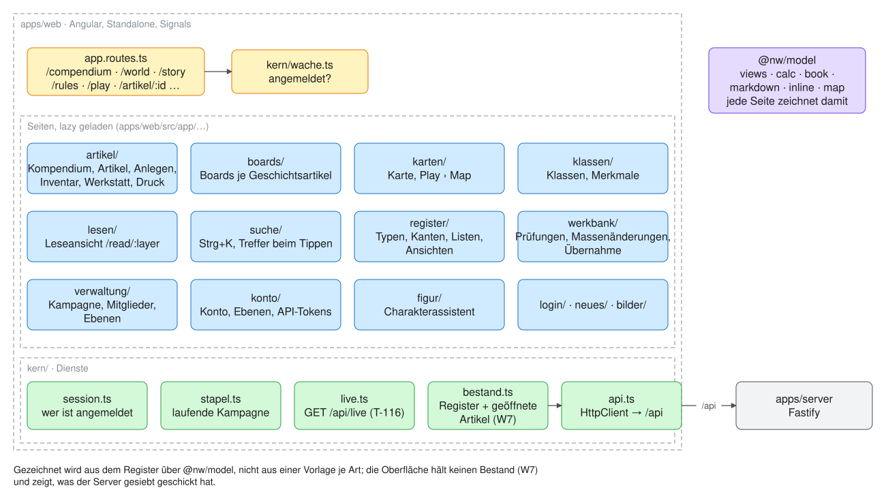
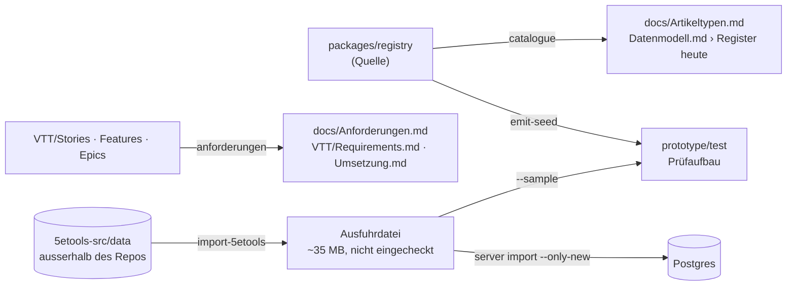

# Architektur

↑ [Technik](Themen/Technik.md) · [Einstieg](README.md)

Stand 2026-10-12 (preprod nach P5); Bilder §1 und §6 als Zeichnung 2026-10-15. Zeigt, **was läuft** (Container),
**womit** (Frameworks), **wo es liegt** (Repo) und **wie der Code
zusammenhängt** (Pakete, Server, Oberfläche). Das Datenmodell selbst —
Typen, Felder, Kanten — steht in [Datenmodell.md](Datenmodell.md);
Einrichtung und Betrieb in [Betrieb.md](Betrieb.md).

---

## 1. Was auf dem Server läuft

Eine Hetzner-Maschine, fünf Container. `prod` und `dev` sind vollständig
getrennt: eigenes Abbild, eigene Datenbank, eigenes Volume. Der einzige
Container mit offenem Port nach aussen ist Caddy.



Gezeichnet in [Bilder/Server.excalidraw.md](Bilder/Server.excalidraw.md).

| Container | Abbild | Aufgabe | Daten |
|---|---|---|---|
| `caddy` | `caddy:2-alpine` | TLS, Weiterleitung nach Hostname | `proxy/daten/` (Zertifikate) |
| `app` (prod, dev) | aus CI, `ghcr.io/mrfudog/atlas-mentis` | API **und** Oberfläche aus einem Prozess; Migrationen beim Start | keine — zustandslos |
| `db` (prod, dev) | `postgres:17-alpine` | Register, Artikel, Kanten, Konten, Sitzungen | `daten/db`, `daten/db-preprod` |

**Ein App-Container, nicht zwei.** Das Angular-Build liegt im selben
Abbild und wird von Fastify als statische Dateien ausgeliefert
(`@fastify/static`, Ordner `public/`). Ein eigener Web-Container wäre
ein zweiter Prozess für ein paar HTML- und JS-Dateien.

Gesichert wird zweimal: `deploy.sh` macht vor jedem Wechsel des Abbilds
einen `pg_dump` (die letzten 20 bleiben), und `cron` sichert jede Nacht
je Wochentag (`backups/nacht/`).

---

## 2. Vom Push bis zum Server

Gebaut wird **nur** in CI. Auf dem Server wird nichts kompiliert; er holt
ein fertiges, geprüftes Abbild.



`deploy.sh` auf dem Server: Abbild holen → Datenbank sichern → Abbild in
`.env` eintragen → `docker compose up -d` → warten, bis `/api/health`
antwortet. Das vorige Abbild steht in `previous-image`, zurück ist ein
Befehl.

**5e.tools einlesen** ist ein eigener Lauf (`import-5etools.yml`, W8): von
Hand, oder aus `ci.yml` nach dem Ausrollen von dev, wenn sich
`packages/import-5etools` geändert hat. Prod nie von selbst.



---

## 3. Frameworks und Werkzeuge

| Schicht | Was | Version | Wofür |
|---|---|---|---|
| Laufzeit | Node.js | 22 (alpine) | Server, Werkzeuge, Build |
| Paketverwaltung | pnpm (Workspaces) | 10.33 | Monorepo, ein Lockfile |
| Sprache | TypeScript | 5.9 | überall ausser Prototyp und Legacy |
| Server | **Fastify** | 5.6 | HTTP-API, Cookies (`@fastify/cookie`), statische Dateien (`@fastify/static`) |
| Datenbank | PostgreSQL + `pg` | 17 / 8.16 | Register und Bestand in generischen Tabellen |
| Passwörter | `@node-rs/argon2` | 2.2 | Argon2id |
| Oberfläche | **Angular** | 21.2 | Standalone-Komponenten, Signals, Router mit Lazy Loading |
| | RxJS | 7.8 | HTTP-Aufrufe in `Api` |
| Modell | Zod | 4.1 | Schemaprüfung in `validateEntity` |
| Tests | Vitest | 4.0 | zwei Projekte: `node` (Modell, Register, Server, Importer) und `web` (jsdom + Angular) |
| | Playwright | 1.63 | Prüflauf des Prototyps |
| Qualität | ESLint 9 + typescript-eslint, Prettier | | `pnpm lint`, `pnpm format` |
| Betrieb | Docker Compose, Caddy 2, GitHub Actions, GHCR | | Abschnitte 1 und 2 |

---

## 4. Das Repository

Ein Repo für Code **und** Vault (D42). Was Obsidian liest, liegt in
`VTT/` und `Ideen/`; was gebaut wird, in `apps/` und `packages/`.

```text
atlas-mentis/
├── apps/
│   ├── server/          @nw/server   Fastify-API, Postgres, Befehle user/import/migrate
│   │   ├── src/                      app.ts (Routen), verwaltung.ts (Kampagnen, Mitglieder, Einladungen), auth.ts, repo.ts, repo.pg.ts, …
│   │   └── migrations/               001_backbone.sql … 009_blocks_are_fields.sql
│   └── web/             web          Angular-Oberfläche (Anmeldung, Liste, Artikel)
├── packages/
│   ├── model/           @nw/model    Typen, Prüfung, Rechnen, Sichtbarkeit — kein Framework
│   ├── registry/        @nw/registry die Registerzeilen (einzige Quelle) + Skripte
│   └── import-5etools/  @nw/import-5etools  Import aus 5e.tools (P5), läuft in der Pipeline (W8)
├── prototype/           Einzeldatei-Prototyp (Artefakt auf claude.ai), Prüfbestand, Migrationsskripte
├── legacy/              alte React-App (Vite + Express) — läuft, bis Karte und Initiative neu stehen
├── deploy/              bootstrap.sh, deploy.sh, import.sh, proxy/ (Caddy)
├── docs/                Datenmodell, Begriffe, Betrieb, Arbeitsplan, Bericht, diese Seite
├── VTT/  Ideen/  .obsidian/   der Obsidian-Vault (Anforderungen, Entscheidungen)
├── .github/workflows/   ci.yml, import-5etools.yml
├── Dockerfile           mehrstufig: Build (alles) → Laufzeit (nur Server + gebaute Oberfläche)
├── docker-compose.yml           prod  (main,    Port 8080)
└── docker-compose.preprod.yml   dev   (preprod, Port 8081)
```

### 4.1 Wer von wem abhängt



Die Regel dahinter: **`@nw/model` kennt kein Framework.** Was dort
steht — Prüfung, gerechnete Werte, Sichtbarkeit, Wissen — gilt für
Server und Oberfläche gleich. Die Oberfläche hängt nur am Modell, nicht
am Register: das Register holt sie zur Laufzeit von `/api/registry`.

---

## 5. Der Server



**Routen sprechen mit `Repository`, nie mit Postgres.** Deshalb laufen
alle Servertests ohne Datenbank gegen `InMemoryRepository`; nur der
Durchstich in CI prüft `PgRepository` gegen eine echte Postgres.

| Route | Was |
|---|---|
| `GET /api/health` | lebt der Prozess (für Docker und deploy.sh) |
| `POST /api/login` · `/api/register` · `/api/logout` · `/api/logout-everywhere` | Konto und Sitzung; Registrieren nur mit Einladung |
| `GET /api/me` | wer bin ich, welche Rollen, welche Figuren |
| `GET/POST/DELETE /api/invites` | Einladungen, mit Kampagne und Rolle; die Verwaltung alle, die Leitung in ihre Kampagne (`gm` legt an und widerruft, `co-gm` sieht) |
| `GET /api/campaigns` · `POST /api/campaigns` | die Kampagnen, an denen jemand leitet oder mitleitet (Verwaltung: alle); anlegen nur die Verwaltung |
| `GET /api/campaigns/:c/members` | Mitglieder mit Rolle und Figuren, dazu die Figuren, die diese Kampagne vergeben darf — `gm`, `co-gm`, Verwaltung |
| `POST /api/campaigns/:c/members` · `PUT`/`DELETE …/members/:user` | Konto beim Namen dazunehmen, Rolle setzen, herausnehmen — `gm` und Verwaltung, nie die eigene Rolle (ausser Verwaltung) |
| `PUT /api/campaigns/:c/members/:user/actors` | welche Figuren ein Mitglied führt (`app_user_actor`); keine Figur einer anderen Kampagne |
| `GET /api/users` | die Konten der Installation — nur die Verwaltung |
| `GET /api/registry` · `PUT /api/registry/:part` | das Register lesen; ändern die Verwaltung und die Leitung (`gm`) der laufenden Kampagne — `/api/me` sagt es mit `registry` |
| `GET /api/registry/usage` | was der Bestand an jeder Zeile trägt (`registryUsage`: je Art, Karte, Feld, Listenwert, Kante) — gezählt, bevor das Register etwas löscht; nur für wer es ändert |
| `GET /api/entities?ids=a,b,c` | diese Artikel ganz, gesiebt (höchstens 500) — die Teile eines Statblocks in einer Anfrage (W2) |
| `GET /api/list?area=&type=&of=&q=&layer=&nolayer=&parts=&sort=&offset=&limit=&f=` | **ein Blatt der Liste** mit Facetten (`{ total, columns, rows, facets }`) — Kompendium, Bereiche und jede Auswahl (W7); die Seiten schicken seit T-186 kein `nolayer` mehr, die Ebenen sagt der Stand der Kampagne |
| `GET/POST /api/me/layer-sets`, `DELETE …/:id` | **gespeicherte Ebenenauswahlen** je Konto, wahlweise an eine Kampagne gebunden (T-186); geladen wird über `PUT /api/campaigns/:c/layers` |
| `GET /api/entities` | der ganze Bestand, **gesiebt** — für Ausfuhr und Prüfungen, nicht für die Oberfläche |
| `GET /api/entities/:id` | ein Artikel, gesiebt, mit `refs`: die Namen seiner Kantenziele und die Treffer seiner `[[Verweise]]` (beim Ausliefern gerechnet, nie gespeichert) |
| `GET /api/entities/:id/backlinks` | wer auf den Artikel zeigt (Kurzfassung + Kante), gesiebt |
| `POST /api/entities` | **anlegen**: `{ type, name, fields? }` → Peg-Id, Nummer (`nextId`), Vorgaben aus dem Register, geprüft mit `validateEntity` |
| `GET /api/classes/:id` | eine Klasse samt Unterklassen, Stufentabellen und den Merkmalen, die eine davon gewährt oder einbettet (`classParts`), gesiebt — die Klassenansicht (W6) in einer Antwort |
| `GET /api/origins/:id` | eine Herkunft oder ein Hintergrund samt Spielarten (`subraceOf`), Tabellen (`tableFor`) und den Merkmalen, die eines davon gewährt oder einbettet (`originParts`), gesiebt — die Herkunftsansicht (T-166) in einer Antwort |
| `PUT /api/entities/:id` · `DELETE /api/entities/:id` | schreiben, immer durch `validateEntity` |
| `POST /api/links` | `[[Name]]` → `[[nummer\|Name]]` (M11), über das, was der Schreibende sieht; liest nur, darf also jeder |
| `POST /api/validate` | prüfen ohne zu speichern |
| `GET/POST /api/tokens` · `DELETE /api/tokens/:id` | eigene API-Tokens (W9); nur aus einer Sitzung, nie mit einem Token |
| `GET /api/checks?check=…&limit=…` | Prüfungen über den gesiebten Bestand (`checks.ts`): Zahl und Beispiele je Prüfung; Leitung und Verwaltung |
| `POST /api/bulk` | Massenänderung (`bulk.ts`): Auswahl → Operationen, `dryRun` zeigt, was geschähe; geschrieben wird durch `validateEntity`, protokolliert mit den alten Fassungen |
| `GET /api/bulk` · `POST /api/bulk/:id/undo` | die letzten Massenänderungen; eine zurücknehmen (Konflikte nur mit `force`) |
| `GET /api/live` | **der Live-Kanal** (T-116): Server-Sent Events, je Empfänger gesiebt — `entity`, `gone`, `session`, `registry`, `reset`; Wiederverbinden mit `Last-Event-ID` (Abschnitt 5.2) |

Ohne Anmeldung offen sind nur Gesundheit, Anmelden, Registrieren,
Abmelden und `me`. **Angemeldet ist man über den Sitzungskeks oder über
`Authorization: Bearer atm_…`** (ein API-Token, W9): das Token wirkt wie die
Sitzung seines Kontos, beschränkt auf `read` oder `write` — ein Lesetoken
darf zusätzlich die zwei POST, die nichts schreiben (`/api/validate` und
`/api/bulk` mit `dryRun`). Ein Server **ohne Konto und ohne Bestand** lässt
lesen; sobald ein Artikel da ist, nicht mehr (P5).

### 5.1 Was beim Lesen eines Artikels passiert



**Die Oberfläche hält keinen Bestand** (W7, 13.10.). Bis dahin lud sie
die Kurzfassung aller Artikel (`?as=summary`, 7,7 MB roh, 675 KB gepackt
bei den 24 157 aus 5e.tools) und rechnete Liste, Filter und Verweise
selbst — und weil Register und Kurzfassung in einem Zug kamen, wartete
sogar die Artikelseite auf die ganze Liste. Die Route ist weggefallen.
Jetzt:

- **Das Register** kommt allein und sofort (`Bestand.load`, ≈11 KB gepackt).
- **Ein Artikel** kommt beim Öffnen, gesiebt, mit `refs` (`names`: Id →
  Name für Kantenziele, Verweisfelder, Sichtbarkeitslisten; `links`: die
  Kandidaten jedes `[[ziel]]` nach `linkCandidates`). Die Artikelseite
  wartet auf Register und Artikel, auf nichts sonst. Die Rückbezüge kommen
  über `/backlinks`; gesiebt werden dort nur die Artikel, die auf ihn
  zeigen.
- **Listen und Auswahlen** fragen `/api/list`. Der Server baut dafür je
  **Bestand-Stempel** (`Repository.version()`: Anzahl und letzte Änderung),
  Register und Betrachter einmal einen **Index** (`apps/server/src/liste.ts`):
  je sichtbarem Artikel eine schmale Zeile mit Name, Art, Bereich, Ebenen,
  Quelle, Stand, Suchtext (Name, Aliasse, Deckname, Nummer), der Zahl der
  Abschnittskanten, die auf ihn zeigen, und den **Spalten seiner Art** —
  den Feldern ihrer `overview` (`listColumns`). Die Verwaltung teilt einen
  Index, ein Spieler hat seinen eigenen (das Sieb rechnet Wissen je
  Artikel); gehalten werden die letzten acht. Blättern, Suchen, Filtern
  laufen über die Zeilen, nicht über die Artikel.
- **Der Bestand selbst** liegt je Stempel im Speicher (`PgRepository`).
  Schreibt der Server einen Artikel, **führt er ihn nach** statt neu zu
  lesen (T-143): unter einer Sperre für andere Schreiber liest er den
  Stempel vor und nach dem Schreiben und ersetzt den einen Artikel, wenn
  der Bestand genau auf dem Stand davor war — sonst (ein fremder Prozess
  wie die Einfuhr schrieb) liest er neu. Mit 150 000 Artikeln: 26 ms statt
  gut vier Sekunden nach einem Häkchen an den Ebenen. Die Ebenenseite
  (`GET /api/campaigns/:c/layers`) zählt ihren Inhalt je Stempel einmal und
  behält die Zählung, wenn sich seither nur die Kampagne geändert hat.
- **Facetten** zählen über die Zeilen, die alle *anderen* Filter bestehen:
  Arten (mit Bereich, das Kompendium gruppiert danach), Ebenen, und bei
  einer gewählten Art je Spalte eine Aufzählung (`enum`/`enumRef` → Werte
  mit Zahl) oder eine Spanne (eine Zahl — oder ein Text, der fast überall
  eine Zahl ist wie der HG „1/4"). Im Code steht keine Spalte und kein
  Filter je Art.
- **Teile von Statblöcken**: ein Artikel, auf den genau einer über eine
  Abschnittskante (`RelationDef.section`, heute `composedOf`) zeigt, ist
  ein Teil davon und fehlt ohne `parts=1`; geteilte tragen die Zahl ihrer
  Nutzer (`users`). Gezählt wird über das, was der Betrachter sieht.

Gemessen mit dem vollen 5e.tools-Bestand (lokal, Postgres 16): ein Blatt
20–40 ms und 2 KB gepackt; der erste Aufruf nach einer Änderung baut den
Index neu (Verwaltung ≈300 ms samt Lesen aus Postgres, Spieler ≈370 ms).

Die Reihenfolge ist die Regel aus CLAUDE.md: erst ob überhaupt
(Stapel, Sichtbarkeit), dann was darin (Wissen). Zurückgehalten wird
**nur hier**; die Oberfläche zeigt, was ankommt.

### 5.2 Der Live-Kanal

Damit Beamer, Laptop und Telefone derselben Runde dasselbe zeigen, ohne
neu zu laden (T-116, REQ-116). **Server-Sent Events, nicht WebSocket:**
der Weg geht nur vom Server zum Gerät — geschrieben wird weiter über die
gewöhnlichen Routen mit ihrer Wache —, es ist gewöhnliches HTTP hinter
Caddy, und der Browser verbindet selbst wieder und sagt dabei, was er
zuletzt bekam (`Last-Event-ID`).



- **Die Quelle** (`ChangeFeed`, `apps/server/src/live.ts`) liegt als Hülle
  um das `Repository` (`mitKanal`): jedes `putEntity`, `deleteEntity` und
  `putRegistryPart` meldet sich, ohne dass eine Route daran denken muss —
  und die Tests mit `InMemoryRepository` sehen dieselbe Quelle. Heute ein
  Prozess, also der Speicher (`LocalChangeFeed`, ein Ring der letzten 1000
  Meldungen zum Nachholen). Laufen einmal mehrere Prozesse, kommt eine
  Umsetzung über Postgres `LISTEN/NOTIFY` hinter dieselbe Schnittstelle.
- **Gesiebt je Empfänger** (`sieveFuer`, dieselbe Rechnung wie
  `GET /api/entities/:id`, mit dem frisch gelesenen Konto): was er nicht
  sieht, bekommt er nicht, auch nicht als Id. Eine Meldung trägt nur Id,
  Art und Revision; den Inhalt holt das Gerät gesiebt wie immer. `gone`
  geht nur an wen den alten Stand sah. `session` trägt `activeMap`,
  `activeEncounter`, `activeScene`, `nowPlaying` aus dem **gesiebten**
  Artikel.
- **Gemeldet wird nur, was er anders sieht** (T-399, REQ-398): die Route
  siebt den Artikel vor und nach dem Schreiben je Empfänger und schweigt,
  wenn beides gleich ist (Revision und Zeitstempel zählen nicht). Zieht ein
  verborgener Gegner oder ein Token unter dem Nebel, erfährt es die
  Leitung — die Spielerin nicht, auch nicht über den Takt der Meldungen.
- **Ein Token auf der Karte ist eine Kante der Karte** (`marker`): es
  bewegt sich, und die Karte meldet `entity`. Eine eigene Meldung mit
  Koordinaten käme erst, wenn die Karte im Web versteckte Tokens selbst
  zurückhält (T-115) — sonst trüge der Kanal, was der Artikel verbirgt.
- **Zu viel auf einmal** (über 200 Artikel in einem Bündel — eine
  Massenänderung) und **zu lange weg** (die Nummer liegt nicht mehr im
  Ring, oder der Server wurde neu gestartet) heissen `reset`: das Gerät
  holt neu, was es offen hat.
- Ein Lebenszeichen alle 25 s, als Ereignis `ping` (ein Kommentar sähe
  der Browser nicht); bleibt 60 s lang alles aus, oder kommt das Telefon
  nach 30 s Stille wieder in den Blick oder ins Netz, verbindet die Seite
  selbst neu, mit `?since=` (T-399). Nach 15 min schliesst der Server und
  das Gerät kommt wieder — dabei prüft die Wache die Anmeldung neu.
  Bei `reset` fragen auch Play, Initiative, Kartenkontext, Zugplaner und
  Seitenleiste neu, nicht nur der Bestand. „Überall
  abmelden" schliesst die Ströme des Kontos sofort.
- **Die Sicht eines Mitglieds** (`X-View-As`) gilt für den Strom nicht —
  `EventSource` kann keinen Kopf setzen. Er läuft als die Leitung; was die
  Seite daraufhin holt, holt sie in der Sicht.

Im Browser: `Live` (`apps/web/src/app/kern/live.ts`) verbindet, solange
jemand angemeldet ist, und verteilt an wer sich anmeldet —
`onArtikel` (geändert / weg), `onSitzung` (der Sitzungszustand, dazu das
Signal `sitzungen`) und `onNeu` (`reset`, Register). Der Transport steht
hinter `LIVE_TRANSPORT`; eine Komponente kennt ihn nicht. Der `Bestand`
holt geöffnete Artikel neu (eine Maske beim Bearbeiten hält ihre
Ausgangslage selbst, REQ-192). Der Punkt in der Kopfleiste zeigt, ob das
Gerät mithört.

### 5.3 Die Tabellen

Drei generische Tabellen tragen jeden Artikel, das Register steht als
Zeilen daneben. Eine neue Artikelart ist eine Zeile, keine Migration.

| Gruppe | Tabellen |
|---|---|
| Bestand | `entity` (die Id), `component` (eine Karte je Art und Artikel), `relation` (Kanten, vorwärts) |
| Register | `interface_def`, `component_def`, `relation_def`, `view_def`, `var_def`, `unit_def`, `enum_def`, `setting_def` |
| Zugang | `app_user`, `app_session`, `app_token`, `app_invite`, `login_attempt`, `campaign_member`, `app_user_actor` |
| Lesen | `reading_position` — der Lesestand je Konto und Buch (T-091) |
| Protokoll | `event_log` — auch jede Massenänderung (`bulk`, mit den alten Fassungen) und ihr Zurücknehmen (`bulk.undone`) |

---

## 6. Die Oberfläche



Gezeichnet in [Bilder/Oberflaeche.excalidraw.md](Bilder/Oberflaeche.excalidraw.md). Die Routen stehen in
`apps/web/src/app/app.routes.ts`; je Ordner ein Bereich, lazy geladen.

**Gezeichnet wird aus dem Register, nicht aus einer Vorlage je Art.**
`felder.ts` liest die Felder einer Art aus dem Register und das Modell
sagt, was in welcher Ansicht steht (`views`), was gerechnet wird
(`calc`) und wie Text aussieht (`markdown`, `inline`). Eine neue
Artikelart erscheint ohne Codeänderung. Die Artikelseite zeichnet die
Anordnung der Art (`layoutFor`); die Buch-Elemente `statblock`, `spell`
und `item` bauen ihre Zeilen in `book.ts` und holen die Teile eines
Statblocks über `Bestand.holen` (`?ids=`) in einer Anfrage.

**Das Register** (`/registry`, W5) bearbeitet dieselben Zeilen, aus
denen gezeichnet wird: Typen (eigene Felder offen, geerbte zugeklappt,
verlinkte und Kanten von hier), Kantenarten und Listen. Geschrieben wird
ein ganzer Teil über `PUT /api/registry/:part` und erst übernommen, wenn
der Server ihn nimmt (`register/arbeit.ts`). Was eine Änderung im Bestand
träfe — ein gelöschtes Feld, ein herausgenommener Typ, ein gestrichener
Listenwert —, wird vorher über `/api/registry/usage` gezählt und in der
Rückfrage gesagt; was der Bestand beim nächsten Speichern nicht mehr
bestünde (eine Karte ohne Typ, ein Typ mit Artikeln), lässt die Seite gar
nicht erst zu. Die reinen Regeln (Feldarten, Zyklen, Umbenennen samt aller
Nennungen) stehen in `register/regeln.ts`.

**Die Oberfläche hält keinen Bestand** (W7): das Register und die
geöffneten Artikel samt den Namen, die sie mitbrachten (`Bestand.namen`,
`Bestand.verweise`). Das Kompendium fragt je Blatt den Server
(`/api/list`); die Seitenzahl, die Feldfilter und die Vorschau stehen im
Filterzustand der Seite (`ListenFilter`, „der Filter gehört der Seite"),
die Art in der Adresse, die Filtergruppe auch (`?view=`, T-137; die
Gruppen hält `Filtergruppen` für Kopfleiste und Unterreiter zugleich). Wer ein Kantenziel oder ein Verweisfeld wählt,
sucht über dieselbe Route (`nw-wahl`, `of=Art&q=…&limit=20`). Boards und Klassen fragen sie ebenso
(`Bestand.liste`): die Boards und die Geschichte mit `rel=partOf`, die
Namen der verbundenen Artikel mit `ids=`; die Zeilen liegen als schmale
Artikel in `Bestand.kurz`.

---

## 7. Das Modellpaket

`packages/model/src`, rund 3 900 Zeilen, ohne Framework:

| Modul | Aufgabe |
|---|---|
| `types.ts` | Registry, Entity, InterfaceDef, PropertySchema … |
| `validate.ts` | `validateEntity`: Pflicht, Spannen, Aufzählungen, Verweisziele, Stufen je Zustand |
| `entity.ts` | Registerzugriff: Typkette, Bereich, eigene Felder, Ids (`nextId`), Rückbezüge |
| `calc.ts` | gerechnete Werte (D8), `evalArith` als Shunting-Yard statt `eval` |
| `views.ts` | welche Felder in `overview`, `quick`, `full`; Anordnung je Typ |
| `inline.ts` · `markdown.ts` · `dice.ts` | Text: `[[id\|Anzeige]]`, `{VAR}`, `{{1d6+2}}`, Markdown |
| `units.ts` | Masse beim Lesen umrechnen |
| `instance.ts` | Vorlage und Instanz: `resolveInstance`, `thinInstance` |
| `stack.ts` | Ebenen: `inPlay`, `overriderOf` |
| `visibility.ts` | `articleVisible`: Rolle am Tisch, `audience`, `revealedTo`, `hiddenFrom` |
| `knowledge.ts` | `redactEntity`: welche Felder ein Träger kennt, Fraktionsränge |
| `checks.ts` | Prüfungen über einen Bestand (W9): eine erweiterbare Liste `CHECKS` reiner Funktionen |
| `bulk.ts` | Massenänderungen (W9): Auswahl, Operationen, Zusammenführen als Vorher/Nachher (`planBulk`), `repoint` |
| `usage.ts` | `registryUsage`: was der Bestand an jeder Registerzeile trägt — für das Register vor dem Löschen |
| `classes.ts` | die Klassenansicht (W6): Merkmale je Stufe aus `grants`, Übungsbonus, eingebettete Merkmale (ein Verweis allein im Absatz), Stufentabelle mit Zusatzspalten; dazu `originParts` für Herkunft und Hintergrund (T-166) |

---

## 8. Neben dem Hauptweg



- **Prototyp** (`prototype/nebelwacht-artikel.html`): eine Datei, als
  Artefakt auf claude.ai, eigene Ablage. Dort entstehen neue Ansichten
  zuerst; was steht, wandert nach `apps/web`.
- **Legacy** (`legacy/`): React + Vite, Express mit Schlüssel-Wert-Ablage.
  Wird nicht weiterentwickelt.
