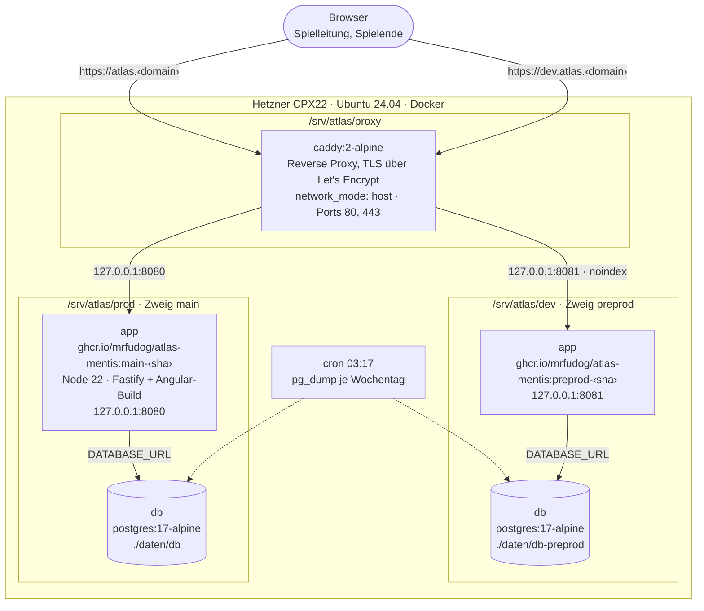
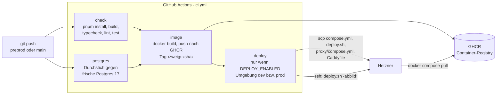
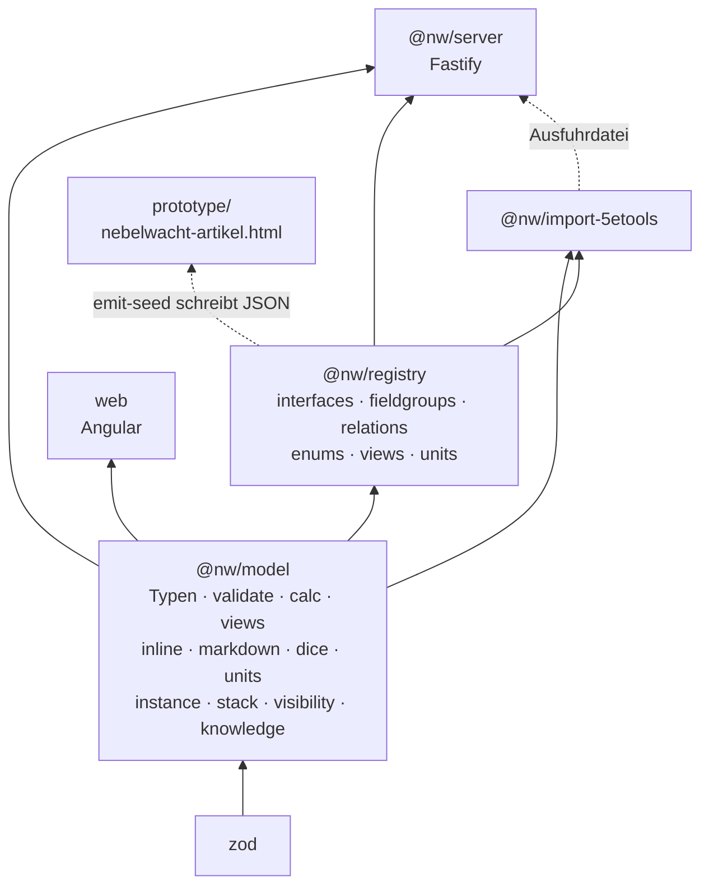
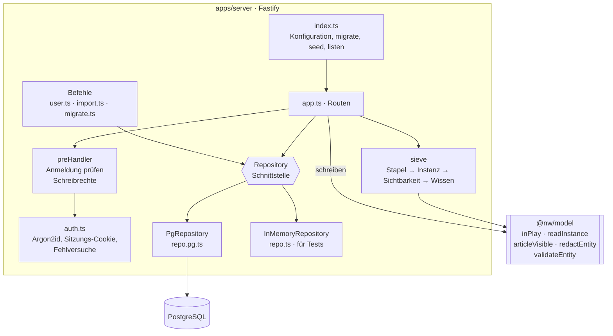
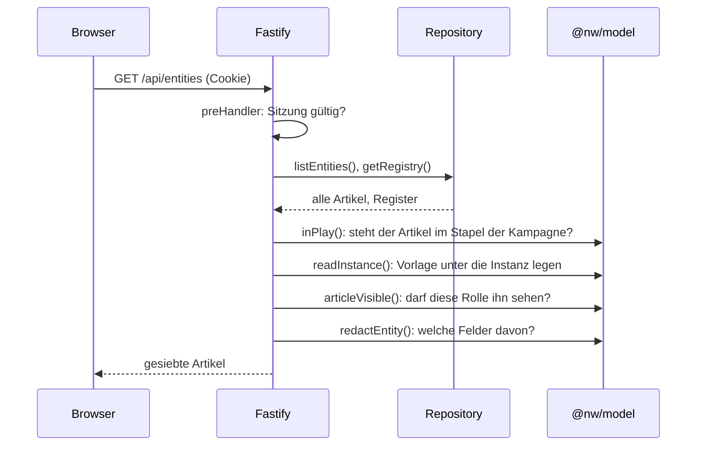
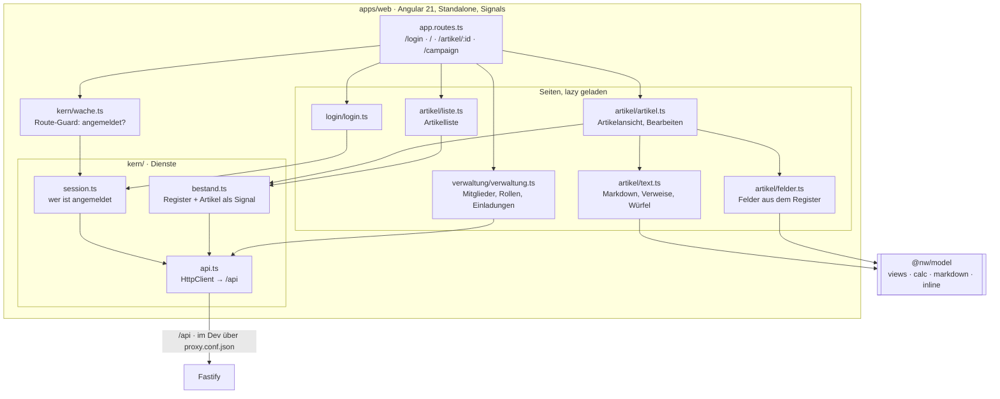
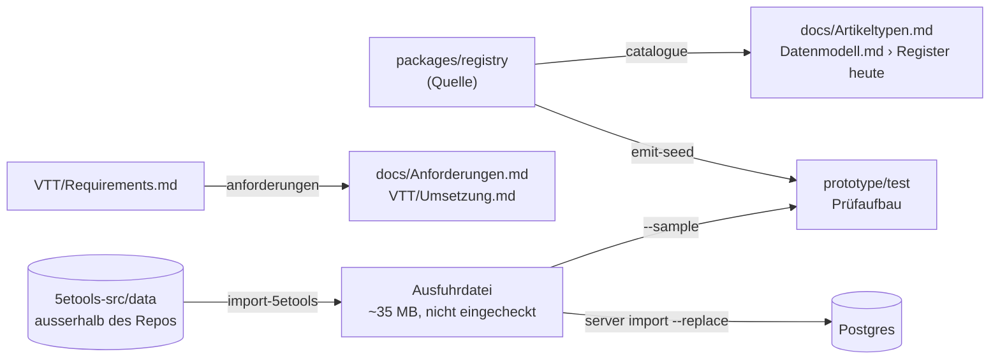

# Architektur

Stand 2026-10-12 (preprod nach P5). Zeigt, **was läuft** (Container),
**womit** (Frameworks), **wo es liegt** (Repo) und **wie der Code
zusammenhängt** (Pakete, Server, Oberfläche). Das Datenmodell selbst —
Typen, Felder, Kanten — steht in [Datenmodell.md](Datenmodell.md);
Einrichtung und Betrieb in [Betrieb.md](Betrieb.md).

---

## 1. Was auf dem Server läuft

Eine Hetzner-Maschine, fünf Container. `prod` und `dev` sind vollständig
getrennt: eigenes Abbild, eigene Datenbank, eigenes Volume. Der einzige
Container mit offenem Port nach aussen ist Caddy.



| Container | Abbild | Aufgabe | Daten |
|---|---|---|---|
| `caddy` | `caddy:2-alpine` | TLS, Weiterleitung nach Hostname | `proxy/daten/` (Zertifikate) |
| `app` (prod, dev) | aus CI, `ghcr.io/mrfudog/atlas-mentis` | API **und** Oberfläche aus einem Prozess; Migrationen beim Start | keine — zustandslos |
| `db` (prod, dev) | `postgres:17-alpine` | Register, Artikel, Kanten, Konten, Sitzungen | `daten/db`, `daten/db-preprod` |

**Ein App-Container, nicht zwei.** Das Angular-Build liegt im selben
Abbild und wird von Fastify als statische Dateien ausgeliefert
(`@fastify/static`, Ordner `public/`). Ein eigener Web-Container wäre
ein zweiter Prozess für ein paar HTML- und JS-Dateien.

Gesichert wird zweimal: `deploy.sh` macht vor jedem Wechsel des Abbilds
einen `pg_dump` (die letzten 20 bleiben), und `cron` sichert jede Nacht
je Wochentag (`backups/nacht/`).

---

## 2. Vom Push bis zum Server

Gebaut wird **nur** in CI. Auf dem Server wird nichts kompiliert; er holt
ein fertiges, geprüftes Abbild.



`deploy.sh` auf dem Server: Abbild holen → Datenbank sichern → Abbild in
`.env` eintragen → `docker compose up -d` → warten, bis `/api/health`
antwortet. Das vorige Abbild steht in `previous-image`, zurück ist ein
Befehl.

---

## 3. Frameworks und Werkzeuge

| Schicht | Was | Version | Wofür |
|---|---|---|---|
| Laufzeit | Node.js | 22 (alpine) | Server, Werkzeuge, Build |
| Paketverwaltung | pnpm (Workspaces) | 10.33 | Monorepo, ein Lockfile |
| Sprache | TypeScript | 5.9 | überall ausser Prototyp und Legacy |
| Server | **Fastify** | 5.6 | HTTP-API, Cookies (`@fastify/cookie`), statische Dateien (`@fastify/static`) |
| Datenbank | PostgreSQL + `pg` | 17 / 8.16 | Register und Bestand in generischen Tabellen |
| Passwörter | `@node-rs/argon2` | 2.2 | Argon2id |
| Oberfläche | **Angular** | 21.2 | Standalone-Komponenten, Signals, Router mit Lazy Loading |
| | RxJS | 7.8 | HTTP-Aufrufe in `Api` |
| Modell | Zod | 4.1 | Schemaprüfung in `validateEntity` |
| Tests | Vitest | 4.0 | zwei Projekte: `node` (Modell, Register, Server, Importer) und `web` (jsdom + Angular) |
| | Playwright | 1.63 | Prüflauf des Prototyps |
| Qualität | ESLint 9 + typescript-eslint, Prettier | | `pnpm lint`, `pnpm format` |
| Betrieb | Docker Compose, Caddy 2, GitHub Actions, GHCR | | Abschnitte 1 und 2 |

---

## 4. Das Repository

Ein Repo für Code **und** Vault (D42). Was Obsidian liest, liegt in
`VTT/` und `Ideen/`; was gebaut wird, in `apps/` und `packages/`.

```text
atlas-mentis/
├── apps/
│   ├── server/          @nw/server   Fastify-API, Postgres, Befehle user/import/migrate
│   │   ├── src/                      app.ts (Routen), verwaltung.ts (Kampagnen, Mitglieder, Einladungen), auth.ts, repo.ts, repo.pg.ts, …
│   │   └── migrations/               001_backbone.sql … 009_blocks_are_fields.sql
│   └── web/             web          Angular-Oberfläche (Anmeldung, Liste, Artikel)
├── packages/
│   ├── model/           @nw/model    Typen, Prüfung, Rechnen, Sichtbarkeit — kein Framework
│   ├── registry/        @nw/registry die Registerzeilen (einzige Quelle) + Skripte
│   └── import-5etools/  @nw/import-5etools  einmaliger Import aus 5e.tools (P5)
├── prototype/           Einzeldatei-Prototyp (Artefakt auf claude.ai), Prüfbestand, Migrationsskripte
├── legacy/              alte React-App (Vite + Express) — läuft, bis Karte und Initiative neu stehen
├── deploy/              bootstrap.sh, deploy.sh, proxy/ (Caddy)
├── docs/                Datenmodell, Begriffe, Betrieb, Arbeitsplan, Bericht, diese Seite
├── VTT/  Ideen/  .obsidian/   der Obsidian-Vault (Anforderungen, Entscheidungen)
├── .github/workflows/ci.yml
├── Dockerfile           mehrstufig: Build (alles) → Laufzeit (nur Server + gebaute Oberfläche)
├── docker-compose.yml           prod  (main,    Port 8080)
└── docker-compose.preprod.yml   dev   (preprod, Port 8081)
```

### 4.1 Wer von wem abhängt



Die Regel dahinter: **`@nw/model` kennt kein Framework.** Was dort
steht — Prüfung, gerechnete Werte, Sichtbarkeit, Wissen — gilt für
Server und Oberfläche gleich. Die Oberfläche hängt nur am Modell, nicht
am Register: das Register holt sie zur Laufzeit von `/api/registry`.

---

## 5. Der Server



**Routen sprechen mit `Repository`, nie mit Postgres.** Deshalb laufen
alle Servertests ohne Datenbank gegen `InMemoryRepository`; nur der
Durchstich in CI prüft `PgRepository` gegen eine echte Postgres.

| Route | Was |
|---|---|
| `GET /api/health` | lebt der Prozess (für Docker und deploy.sh) |
| `POST /api/login` · `/api/register` · `/api/logout` · `/api/logout-everywhere` | Konto und Sitzung; Registrieren nur mit Einladung |
| `GET /api/me` | wer bin ich, welche Rollen, welche Figuren |
| `GET/POST/DELETE /api/invites` | Einladungen, mit Kampagne und Rolle; die Verwaltung alle, die Leitung in ihre Kampagne (`gm` legt an und widerruft, `co-gm` sieht) |
| `GET /api/campaigns` · `POST /api/campaigns` | die Kampagnen, an denen jemand leitet oder mitleitet (Verwaltung: alle); anlegen nur die Verwaltung |
| `GET /api/campaigns/:c/members` | Mitglieder mit Rolle und Figuren, dazu die Figuren, die diese Kampagne vergeben darf — `gm`, `co-gm`, Verwaltung |
| `POST /api/campaigns/:c/members` · `PUT`/`DELETE …/members/:user` | Konto beim Namen dazunehmen, Rolle setzen, herausnehmen — `gm` und Verwaltung, nie die eigene Rolle (ausser Verwaltung) |
| `PUT /api/campaigns/:c/members/:user/actors` | welche Figuren ein Mitglied führt (`app_user_actor`); keine Figur einer anderen Kampagne |
| `GET /api/users` | die Konten der Installation — nur die Verwaltung |
| `GET /api/registry` · `PUT /api/registry/:part` | das Register lesen; ändern nur die Leitung |
| `GET /api/entities` · `GET /api/entities/:id` | Artikel, **gesiebt** |
| `GET /api/entities?as=summary` | die Kurzfassung aller Artikel (`summaryOf`) — für Liste, Verweise, Auswahlen |
| `GET /api/entities/:id/backlinks` | wer auf den Artikel zeigt (Kurzfassung + Kante), gesiebt |
| `PUT /api/entities/:id` · `DELETE /api/entities/:id` | schreiben, immer durch `validateEntity` |
| `POST /api/validate` | prüfen ohne zu speichern |

Ohne Anmeldung offen sind nur Gesundheit, Anmelden, Registrieren,
Abmelden und `me`. Ein Server **ohne Konto und ohne Bestand** lässt
lesen; sobald ein Artikel da ist, nicht mehr (P5).

### 5.1 Was beim Lesen eines Artikels passiert



**Die Oberfläche hält nur die Kurzfassung** (`?as=summary`): Name, Art,
`Identity`, Marken, Stand, Quelle, die Kanten `instanceOf` und `inLayer` und die Felder, nach
denen eine Auswahl filtert (`enumWhere`, aus dem Register gelesen). Den
ganzen Artikel holt sie beim Öffnen, die Rückbezüge dazu über
`/backlinks` — die Gegenrichtung braucht jede Kante im Bestand, und die
hat die Kurzfassung nicht. Gekürzt wird **nach** dem Sieb, damit ein
Deckname der Deckname bleibt. Bis zum 13.10. ging der ganze Bestand an
die Liste; mit den 24 157 Artikeln aus 5e.tools kam sie nicht mehr an.
`listEntities` liest dafür in drei Abfragen statt in dreien je Artikel.

Die Reihenfolge ist die Regel aus CLAUDE.md: erst ob überhaupt
(Stapel, Sichtbarkeit), dann was darin (Wissen). Zurückgehalten wird
**nur hier**; die Oberfläche zeigt, was ankommt.

### 5.2 Die Tabellen

Drei generische Tabellen tragen jeden Artikel, das Register steht als
Zeilen daneben. Eine neue Artikelart ist eine Zeile, keine Migration.

| Gruppe | Tabellen |
|---|---|
| Bestand | `entity` (die Id), `component` (eine Karte je Art und Artikel), `relation` (Kanten, vorwärts) |
| Register | `interface_def`, `component_def`, `relation_def`, `view_def`, `var_def`, `unit_def`, `enum_def`, `setting_def` |
| Zugang | `app_user`, `app_session`, `app_invite`, `login_attempt`, `campaign_member`, `app_user_actor` |
| Protokoll | `event_log` |

---

## 6. Die Oberfläche



**Gezeichnet wird aus dem Register, nicht aus einer Vorlage je Art.**
`felder.ts` liest die Felder einer Art aus dem Register und das Modell
sagt, was in welcher Ansicht steht (`views`), was gerechnet wird
(`calc`) und wie Text aussieht (`markdown`, `inline`). Eine neue
Artikelart erscheint ohne Codeänderung.

Der Bestand wird **einmal** geladen und als Signal gehalten — die
Kampagne ist klein genug. Mit 28 000 importierten Artikeln stimmt das
nicht mehr; Seitenweise laden ist eine offene Frage für die Zeit nach P6.

---

## 7. Das Modellpaket

`packages/model/src`, rund 3 900 Zeilen, ohne Framework:

| Modul | Aufgabe |
|---|---|
| `types.ts` | Registry, Entity, InterfaceDef, PropertySchema … |
| `validate.ts` | `validateEntity`: Pflicht, Spannen, Aufzählungen, Verweisziele, Stufen je Zustand |
| `entity.ts` | Registerzugriff: Typkette, Bereich, eigene Felder, Ids (`nextId`), Rückbezüge |
| `calc.ts` | gerechnete Werte (D8), `evalArith` als Shunting-Yard statt `eval` |
| `views.ts` | welche Felder in `overview`, `quick`, `full`; Anordnung je Typ |
| `inline.ts` · `markdown.ts` · `dice.ts` | Text: `[[id\|Anzeige]]`, `{VAR}`, `{{1d6+2}}`, Markdown |
| `units.ts` | Masse beim Lesen umrechnen |
| `instance.ts` | Vorlage und Instanz: `resolveInstance`, `thinInstance` |
| `stack.ts` | Ebenen: `inPlay`, `overriderOf` |
| `visibility.ts` | `articleVisible`: Rolle am Tisch, `audience`, `revealedTo`, `hiddenFrom` |
| `knowledge.ts` | `redactEntity`: welche Felder ein Träger kennt, Fraktionsränge |

---

## 8. Neben dem Hauptweg



- **Prototyp** (`prototype/nebelwacht-artikel.html`): eine Datei, als
  Artefakt auf claude.ai, eigene Ablage. Dort entstehen neue Ansichten
  zuerst; was steht, wandert nach `apps/web`.
- **Legacy** (`legacy/`): React + Vite, Express mit Schlüssel-Wert-Ablage.
  Wird nicht weiterentwickelt.
