# Datenmodell — das Konzept der Datenbasis

Stand 2026-10-07. **Das hier ist der Vertrag.** Was ein Artikel ist, was ein
Typ trägt, welche Formen ein Feld hat, was eine Kante darf, wie gelesen und
wie geschrieben wird — alles, was gilt, in einer Datei.

Drei Dateien gehören zusammen, und jede hat eine Aufgabe:

| Datei | Sagt | Gepflegt |
|---|---|---|
| **Datenmodell.md** (diese) | **was gilt** — die Regeln und die Formen | von Hand; der Abschnitt „Das Register heute" wird erzeugt |
| [Begriffe.md](Begriffe.md) | **warum** — die Entscheidungen und was nicht mehr gilt | von Hand |
| [Artikeltypen.md](Artikeltypen.md) | **jede Art im Einzelnen** — alle Felder, geerbt und eigen, alle Kanten, die Anordnung | erzeugt: `pnpm --filter @nw/registry catalogue` |

Dazu [Anforderungen.md](Anforderungen.md) — was gefordert war und was davon
steht — und [Durchgang.md](Durchgang.md), die gemessene Durchsicht der Arten
mit den offenen Entscheidungen.

Das ursprüngliche Konzept im Vault (`VTT/` in diesem Repo: `Schemas.md`,
`Data Definitions.md`, `Backbone Concept.md`, Stand 5.9.) ist durch diese
Datei **überholt**: Komponenten, `requires`/`allows`, `Access`,
`KnowledgeLevel`, `successorId`, `key` und die Facetten gibt es nicht mehr.

Sichtbare Namen und Bezeichner sind englisch; die Prosa hier ist deutsch und
nennt den Bezeichner dazu.

---

## 1. Die Bausteine

| Baustein | Was es ist | Wo es steht |
|---|---|---|
| **Artikel** (`Entity`) | Ein Ding in der Kampagne: eine undurchsichtige Id, eine Art, Karten mit Feldwerten, Kanten. | Tabellen `entity`, `component`, `relation`; im Prototyp die Sammlung `entities` |
| **Typ** (`InterfaceDef`) | Eine Registerzeile. Erklärt Felder und erbt über `extends` von beliebig vielen Typen. Abstrakt (ein Grundtyp) oder anlegbar (eine **Artikelart**). | Registerteil `interfaces` |
| **Karte** | Die Feldwerte eines Artikels zu **einem** Typ: `components[Typ]`. Benannt nach dem Typ, der die Felder erklärt. | im Artikel |
| **Feld** (`PropertySchema`) | Eine Tatsache, die ein Typ festhält: Schlüssel, Form, Einstellungen. | im Typ, `schema.properties` |
| **Kante** (`RelationDef`, `Relation`) | Eine typisierte, gerichtete Verbindung zweier Artikel mit eigenen Eigenschaften. Nur vorwärts gespeichert. | Registerteil `relations`; im Artikel `relations[]` |
| **Aufzählung** (`EnumDef`) | Eine benannte Wortliste, die mehrere Felder nennen. | Registerteil `enums` |
| **Einheit** (`UnitDef`) | Ein Mass und seine Umrechnung. | Registerteil `units` |
| **Variable** (`VarDef`) | Ein `{PLATZHALTER}` mit Vorgabe. | Registerteil `vars` |
| **Einstellung** | Ein Schlüssel und ein Wert je Kampagne, ohne Schema — ein Wort oder eine Zahl, nie eine Liste von Dingen, die eine Beschreibung bräuchten (F10). | Registerteil `settings` |
| **Ansicht** (`ViewDef`) und **Anordnung** (`LayoutElement[]`) | Wie ein Artikel gezeichnet wird: drei Ansichten, je eine Grundanordnung; eine Art darf ihre eigene tragen. | Registerteil `views`; `InterfaceDef.views` |

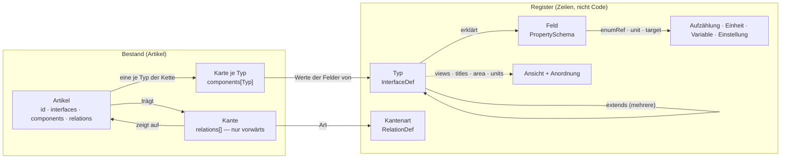

**Alles im Register ist eine Zeile.** Eine neue Artikelart, eine neue Kante,
eine neue Aufzählung ist ein Einfügen und keine Migration. Was im Code steht,
ist die Darstellung (die Layout-Elemente) und die Prüfung — nie die Liste
dessen, was es gibt.

---

## 2. Der Artikel

```json
{
  "id": "n_volo",
  "interfaces": ["Creature"],
  "name": "Volothamp Geddarm",
  "components": {
    "Identity":  { "name": "Volothamp Geddarm", "id": "npc-0003", "aliases": ["Volo"], "cover": "" },
    "Status":    { "status": "ready" },
    "Creature":  { "kind": "npc", "species": "Mensch", "attitude": "freundlich" },
    "Secrets":   { "secret": [{ "id": "secret-schuldet-floon", "value": "Schuldet Floon…" }] }
  },
  "adhoc": [],
  "relations": [
    { "id": "r1", "type": "livesIn", "to": "o_kerzengasse", "props": {} },
    { "id": "r2", "type": "regards", "to": "pa_wacht", "props": { "tags": ["dankbar"] } }
  ],
  "createdAt": "…", "updatedAt": "…", "revision": 4
}
```

Was dabei immer gilt:

| | Regel | Geprüft durch |
|---|---|---|
| A1 | **Die erste Art ist die Art.** `interfaces[0]` sagt, was der Artikel ist; alles, was er festhält, erklärt dieser Typ und seine Kette. | `validateEntity` (`unknown_interface`) |
| A2 | **Eine Karte je Typ**, und nur für Typen der `extends`-Kette. Das hält `hp` am Statblock von `hp` an der Figur auseinander. | `validateEntity` (`unknown_card`, `card_not_inherited`) |
| A3 | **Pflicht steht je Feld** (`schema.required`), und sie gilt für die ganze Kette. Heute: `Identity.name`, `Identity.id`, `Action.actionType`, `Asset.ref`. (`Rule.kind` ist es seit D48 nicht mehr: ein Zauber braucht kein zweites Wort für das, was sein Typ sagt.) | `validateEntity` (`missing_property`) |
| A4 | **Was dasteht, muss das Feld zulassen:** eine Aufzählung hält, eine Spanne hält, eine Zahl ist eine Zahl, ein Verweis zeigt auf seinen Zieltyp. | `validateEntity` (`value_not_allowed`, `value_out_of_range`, `value_not_a_number`, `link_wrong_type`) |
| A5 | **Gerechnetes wird nie gespeichert** (D8): ein Feld mit `derived` hat keine Eingabe und keine Spalte. | Prüfung weist es nicht ab; die Maske gibt keine Eingabe, die Rechnung liest beim Zeichnen |
| A6 | **Kanten nur vorwärts.** Die Gegenrichtung ist eine Abfrage (`backlinks`); ein gespiegeltes Gegenstück verwaist. `cardinality: 'one'` wird geprüft. | `validateEntity`, Server |
| A7 | **Schreiben geht durch `validateEntity`** — am Server vor jedem `PUT`, im Prototyp vor jedem `persist`. | Server, Prototyp |
| A8 | **Die Id ist undurchsichtig** und wird nie wiederverwendet. `Identity.id` ist die ausgegebene Nummer (`npc-0042`): beim Anlegen vergeben, `readOnly`, danach unverändert — auch bei einem Wechsel der Art. | `nextId`, `readOnly` |
| A9 | **`adhoc`** hält Felder, die nur dieser Artikel hat; befördern schreibt sie in den Typ (REQ-181). | Maske |
| A10 | **Was kein Artikel ist, steht nicht im Artikel:** Konten, Rollen, Sitzungen, Einstellungen. Siehe §12. | — |
| A11 | **Geschrieben wird gegen die gelesene Revision** (REQ-192). `revision` zählt der Server, je Schreiben eins mehr (Migration 030). Ein `PUT` nennt die Revision, die er gelesen hat; steht eine andere da — oder fehlt sie bei einem Artikel, den es schon gibt —, wird nichts geschrieben: `409` mit dem Stand, der gilt (`current`, gesiebt wie ein `GET`). Die Maske führt dann zusammen (`mergeEntity`, je Feld und je Kante) und fragt nur, wo beide Seiten dasselbe verschieden geändert haben. Ohne Revision wird nur angelegt; Einfuhr und Massenänderung schreiben ungeprüft, weil sie selbst vergleichen. | Server (`putEntity`, gesperrt mit `for update`), `mergeEntity` |

---

## 3. Typen

### 3.1 Drei Formen

| Form | Kennzeichen | Beispiel |
|---|---|---|
| **Grundtyp** | `abstract: true`; erklärt Felder, trägt keine Artikel | `Identity`, `Time`, `Vitals` |
| **Artikelart** | nicht abstrakt; hat einen Bereich (`area`), steht im Kompendium und in der Leiste, darf eine eigene Anordnung tragen | `Creature`, `Quest`, `Map` |
| **Aufzählung** | eine Zeile in `enums`: Name, Beschriftung, Wörter | `Ability`, `State` |

Ein Grundtyp darf einen Bereich tragen, damit seine Unterarten ihn erben
(`Story` → `story`). Eine Artikelart ohne Bereich (`Asset`, `Layer`) steht in
keiner Liste und wird über den Artikel erreicht, der sie braucht.

### 3.2 Was eine Typzeile trägt

| Angabe | Bedeutung |
|---|---|
| `name` | der Bezeichner, englisch, `UpperCamel` |
| `label` | die Beschriftung |
| `abstract` | Grundtyp oder Artikelart |
| `extends[]` | die Typen, aus denen er gemacht ist — **der erste zeichnet den Baum und entscheidet den Bereich**, alle bringen Felder, Kanten, Beschriftungen und Anordnungen mit |
| `schema.properties` | die eigenen Felder (§4) |
| `schema.required[]` | welche davon Pflicht sind |
| `area` | `world` · `story` · `rules` · `play` — geerbt. `story` ist, was nur die Kampagne betrifft (Kampagne, Sitzung, Szene, Auftrag); die Weltgeschichte (`World`, `Event`) steht unter `world` (bis 13.10. hiess `story` `history` und hielt beides) |
| `units` | `imperial` · `metric` · `both`; überschreibt die Einstellung — geerbt |
| `titles` | `Typ.feld` → eigene Beschriftung eines geerbten Feldes (`Time.until` → „Deadline" am Auftrag) — geerbt |
| `views` | eigene Anordnung je Ansicht (`full`, `quick`, `overview`) — geerbt über `layoutFor` |

### 3.3 Vererbung

`typeChain(T)` ist der Typ selbst und **alle** Typen aus `extends`, rekursiv,
über jeden Zweig. Es gilt die Kette hoch:

- die **Felder** jedes Typs darin (je eine Karte),
- die **Kanten**, deren `from` oder `to` einen Typ der Kette nennt — eine
  Spielerfigur *ist* eine Kreatur,
- die **Zieltypen** von Verweisfeldern (`target.interfaces`) ebenso,
- `area`, `units`, `titles`, `views`: der nächste Typ in der Kette, der etwas
  sagt, gewinnt.

Ein geerbtes Feld wird nicht einzeln ausgeblendet; wer es nicht will, nimmt
den Typ nicht. Umbenannt wird es über `titles`.

### 3.4 Die Grundausstattung

Jede Artikelart nimmt diese sieben Grundtypen (gemessen: 36 von 36):

| Grundtyp | Felder | Wozu |
|---|---|---|
| `Identity` | `name`!, `id`!, `aliases`, `cover` | wie der Artikel heisst und seine Nummer |
| `Status` | `status` (Zeile `State`: idea · prepared · ready) | der Vorbereitungsstand, sonst nichts |
| `Description` | `description` (lang) | die eine Beschreibung, die jede Ansicht zeigt |
| `Visibility` | `audience`, `revealedTo`, `hiddenFrom` | wer den Artikel überhaupt bekommt (§9) |
| `Tags` | `tags` | Marken |
| `Notes` | `note` (Prosa) | Notizen der Leitung |
| `Prose` | `paragraph` (Prosa) | der gewöhnliche Fliesstext |

Dazu nach Bedarf: `Image`, `Source`, `Time`, `Todos`, `Lore`, `Secrets`,
`Facts`, `ReadAloud`, `Tactics`, `Vars`, `Vitals`, `Proficiencies`,
`Choices`, `Effects`, `Abilities`, `Difficulty`, `Story`. Welche Art was nimmt, steht in §13.

### 3.5 Regeln für Typen

| | Regel |
|---|---|
| T1 | **Was mehrere Arten teilen, ist ein Grundtyp** und keine Komponente und keine Kopie (D27). Eine Feldgruppe, die eine Ansicht **als Ganzes** nennen muss (`except: ['Vitals']`), bleibt ein eigener Grundtyp, auch mit nur einem Nutzer. |
| T2 | **Ein Untertyp ohne eigene Felder ist ein Wort und keine Zeile.** `npc`, `companion`, `retainer` sind Werte von `Creature.kind`; `adventure` von `Story.kind`; `era`, `cataclysm`, `milestone` von `Event.kind`; ein Verbrauchsgut ist ein `Item.itemType`. Eine Zeile wird daraus, sobald sie eigene Felder braucht — `Session` ist eine, weil sie den Sitzungszustand trägt, `Arc` seit E-026, weil er Stufen, Hook und Ausgang trägt (ein Abenteuerkapitel ist ein Arc). |
| T3 | **Eine Art trägt ihre Felder selbst**; `requires`/`allows` gibt es nicht. |
| T4 | **Der Bereich steht am Typ** und wird geerbt; im Code steht keine Liste der Bereiche. |
| T5 | **Feldschlüssel und Beschriftungen sind englisch**; Aufzählungswerte, die Kampagneninhalt sind (`gewöhnlich`, `Gebäude`), bleiben in der Sprache der Kampagne. |
| T6 | **Derselbe Schlüssel darf in zwei Typen Verschiedenes heissen**, weil die Karte ihn unterscheidet (`Statblock.hp` ist das Maximum, `Vitals.hp` der Stand). Er darf es nicht, wenn beide Karten auf derselben Seite nebeneinanderstehen und sich widersprechen — dann hat einer von beiden den falschen Namen. |

---

## 4. Felder

### 4.1 Was ein Feld trägt

| Angabe | Bedeutung |
|---|---|
| Schlüssel | `lowerCamel`, englisch; die Karte heisst nach dem Typ, also sind Schlüssel nur je Typ eindeutig |
| `title` | die Beschriftung; ein Typ darf sie über `titles` ersetzen |
| `type` | `string` · `number` · `boolean` · `array` · `object` |
| `format` | die Form, siehe 4.2 |
| `enum` **oder** `enumRef` | eigene Wörter oder der Name einer Aufzählungszeile — nie beides; `enumRef` darf mehrere Zeilen nennen, die dann zusammen gelten, und seit M6 auch eine **Artikelart** (die Namen ihrer sichtbaren Artikel) oder `Typ.feld` (die Liste dieses Feldes) |
| `enumWhere` | je genannter Art ein Filter `{feld: [werte]}` — welche Artikel davon in Frage kommen (`Item` nur mit `itemType` tool …); Vorschlag für die Maske |
| `items` | bei `array`: die Form der Einträge |
| `many` | mehrere Einträge mit Id: `[{id, value}]` |
| `derived` | eine Rechnung gegen die Nachbarfelder derselben Karte, dann gegen die übrigen Karten des Artikels (§6) |
| `of` | der gerechnete Wert reitet in der Zelle des genannten Nachbarn (**DEX 16 (+3)**) |
| `unit` | bei einem Mass: die Einheit, in der der Wert gespeichert ist |
| `min`, `max` | eine Spanne |
| `default` | gilt beim Anlegen, nie rückwirkend |
| `target` | bei einem Verweis: `interfaces` (Regel), `tags`, `where` (Vorschlag für die Maske) |
| `alwaysEdit` | steht immer als Eingabe da (`Vitals.hp`) |
| `suggest` | ein freies Wort schlägt vor, was sichtbare Artikel darin tragen (`Creature.kind`) |
| `readOnly` | ausgegeben, nicht eingetippt (`Identity.id`) |

### 4.2 Die Formen

| `type` + `format` | Was es ist | Gespeichert | Eingabe |
|---|---|---|---|
| `string` | Text | `"…"` | eine Zeile |
| `string` `long` | langer Text, **Markdown** (4.4) | `"…"` | mehrzeilig |
| `string` `long` + `many` | **Prosa**: Einträge mit Id; die Id kommt aus dem Text, Freigabe je Eintrag `Typ.feld#id` | `[{id, value}]` | Element `prose`, nicht die Feldtabelle |
| `string` + `enum`/`enumRef` | Auswahl, ein Wort | `"idea"` | Auswahlliste |
| `array` + `enumRef` | Auswahl, mehrere Wörter aus einer oder mehreren Zeilen, Arten oder Feldlisten; woher ein Wort kommt, sagt die Quelle (`enumSource`) | `["Stealth","Dwarvish","martial"]` | Chips mit × und Suche: die Werte der Listen und die Namen der Artikel jeder genannten Art (`enumWhere` engt ein); ein freies Wort nur, wo eine Art genannt ist (T-068) |
| `string` + `suggest` | freies Wort mit Vorschlägen | `"npc"` | Text mit Liste |
| `string` `date` | Weltdatum als Text; `Time.sort` daneben zum Ordnen | `"Mirtul 12, 1492 DR"` | Text |
| `string` `color` | Farbe | `"#8a4b2a"` | Farbwähler |
| `string` `link` + `target` | ein Artikel eines Zieltyps | Artikel-Id | Suche nach Name und Alias, nur im Zieltyp; `target.tags` zuerst; gelesen als Name mit Link |
| `array` + `link` + `target` | mehrere Artikel eines Zieltyps; jeder Eintrag wird geprüft (`link_wrong_type`) | `[id, …]` | Chips mit × und Suche, nur im Zieltyp; gelesen als Namen mit Link (T-068) |
| `string` `asset` | ein `Asset`-Artikel | Artikel-Id | Bildwahl |
| `string` `measure` + `unit` | Masse im Text („40 ft, climb 20 ft"); umgerechnet beim Lesen, nur Zahlen mit bekannter oder keiner Einheit | `"30/120"` | Text |
| `number` (+ `unit`) | Zahl; `signed` druckt +3; `min`/`max` halten | `16` | Zahl |
| `number` + `derived` | Rechnung; `mod(dex)`, `10+mod(wis)`, `rowCount(rows)`, `8+prof+modOf(spellAbility)`; bei Unsinn `null`, nie 0 | — | keine |
| `boolean` | Häkchen | `true` | Häkchen |
| `array` `grid` | eine Form: ein Zeichen je Feld, `.` ist frei (`Item.rows`, `Inventory.grid`) | `["##.","##."]` | gemalt, nicht getippt |
| `object` `zones` + `enumRef` | je Feld ein Wort aus einer Zeile (`Inventory.zones`) | `{"0,0":"action"}` | gemalt |
| `array` + `many` + `entry` | **Einträge mit Form**: jeder Eintrag ist eine kleine Karte mit `id` (aus dem Text) und den Feldern aus `entry`; geprüft wie eine Karte (Pflicht, Aufzählung, Spanne), jede `id` nur einmal (`entry_id_twice`). Heute `Choices.choices` (REQ-238) | `[{id, kind, count, …}]` | JSON |
| `array` `tags` | Marken | `["händler"]` | Text, kommagetrennt |
| `array` (`items: string`) | eine Liste | `[…]` | Text, kommagetrennt |
| `object` | freie Struktur mit eigenem Element (`Vars.bindings`, `Party.actions`, `Board.rules`, `Map.walls`) | `{…}` | das Element oder JSON |

### 4.3 Regeln für Felder

| | Regel |
|---|---|
| F1 | **Eine Aufzählung, die zwei Felder brauchen, ist eine Zeile** (`enums`), und die Felder nennen sie mit `enumRef` — **oder wenn die Wörter Kampagneninhalt sind, den jemand pflegt** (`State`, `DrawTime`: ein Nutzer, aber die Wörter stehen im Register, damit man sie ändern kann, ohne Code anzufassen; A4). Gelesen wird immer über `enumOptions()`, nie `enum` direkt; wer eine Art nennt, gibt die sichtbaren Artikel mit. |
| F2 | **Eine Zahl mit Grenzen ist eine Spanne**, keine Aufzählung von Wörtern. |
| F3 | **Ein Mass ohne Einheit ist keines:** jedes `measure`-Feld trägt `unit`. |
| F4 | **Ein Verweis nennt seinen Zieltyp.** `target.interfaces` ist Regel, `tags` und `where` sind Vorschlag. |
| F5 | **Ein Textblock ist ein Feld** mit `many` und `long`. Eine Liste erlaubter Blockarten je Art gibt es nicht. |
| F6 | **Immer bearbeitbar steht am Feld und nur dort** (`alwaysEdit`). |
| F7 | **Vorgeschlagen wird nur, wo das Feld es sagt** (`suggest`), und nur aus Artikeln, die man sehen darf. |
| F8 | **Status ist der Vorbereitungsstand** (`idea` · `prepared` · `ready`). Wie weit eine Sache am Tisch ist, sagt das Feld der Art (`Quest.progress`, `Encounter.phase`, `Place.state`). |
| F9 | **Beim Bearbeiten steht jedes Feld als Eingabe da**, auch die aus `Identity`; nur der Name bleibt Überschrift. |
| F10 | **Was eine Beschreibung braucht, ist ein Artikel und keine Wortliste.** Zustände sind Artikel der Art `Condition`, Reisehandlungen Regelartikel mit `Rule.kind` `travel`; Felder, die sie brauchen, verweisen (`Vitals.conditions` auf `Condition`, `Party.actions`). Eine Einstellung hält nur, was ein Wort oder eine Zahl ist (`gridSize`, `units`). `skills` (Fertigkeit → Attribut) war eine solche und ist seit M6 weg: die Fertigkeit ist ein Artikel und trägt ihr Attribut selbst. |
| F11 | **Ein langer Text ist Markdown, und nichts darin wird HTML** (M10). Verweise nennen die Nummer, nicht den Namen (M11); Würfel sind `{{…}}`, Platzhalter `{VAR}` (M12). Siehe 4.4. |
| F12 | **Die Zeile hält, die Art schlägt vor** (M6, D50). Nennt `enumRef` eine Artikelart, sind die Werte die Namen ihrer sichtbaren Artikel (Untertypen ja, Instanzen nein), und gespeichert wird der Name. Die Prüfung hält ein solches Feld **nicht** an der Liste fest (`enumHolds`): ein Name ist der heutige Stand, und eine Umbenennung machte eine gespeicherte Übung sonst rückwirkend falsch — dieselbe Regel wie bei `target.tags` (F4). Eine Liste mit Wörtern, die nur ein Wort sind (Waffengruppen), nennt das Feld, das sie trägt (`Weapon.category`), statt einer zweiten Zeile. **Wo ein Feld genau einen Artikel meint, ist es ein Verweis** (F13). |
| F13 | **Ein Feld, das einen Artikel meint, hält seine Id** (`format: 'link'` mit `target`, T-078). Ein Name zeigt, solange niemand umbenennt, und von ihm kommt man nicht zum Artikel. `enumRef` auf eine Art bleibt, wo ein Feld Artikel **und** Wörter mischt (`Proficiencies.proficient` zieht aus Artikeln und aus `Weapon.category`). Umgestellt: `Statblock.conditionImmunities` → `Condition`, `Weapon.ammoType` → `Item`; die gespeicherten Namen schreibt `025_verweisfelder.sql` in Ids um, und was keinem Artikel eindeutig gehört, steht danach als Notiz (`Notes.note`, `condition-immunities` / `ammunition`). Seit T-099 (E-020, an den Artikeln auf dev entschieden) auch `Deity.domains` → `Subclass` („Knowledge" → „Knowledge Domain", `048_gottheit_domaenen.sql`, Notiz `domains`). **Wird ein Feld mit einem Namensfeld verglichen, bleibt es Name und bekommt die Auswahl** (F12): `Recipe.tool` zieht aus den Werkzeug-Artikeln (`enumRef: 'Item'`, `enumWhere` wie die Übungen), weil das Handwerk es gegen `Proficiencies.proficient` prüft. Welche Felder noch offen sind: [Verweisfelder.md](Verweisfelder.md). |

### 4.4 Langer Text

Jedes Feld mit `format: 'long'` — die Beschreibung, jeder Prosaeintrag,
ein langes Feld in der Feldliste — wird als **Markdown** gelesen (M10,
#61). Zwei Stufen, zwei Funktionen in `packages/model`:

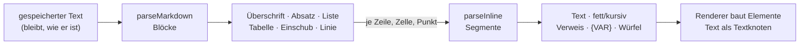

| Im Text | Was es wird |
|---|---|
| `# …` bis `###### …` | Überschrift |
| `- …`, `* …`, `1. …` | Liste; tiefer eingerückt: eine Liste im Punkt |
| `\| a \| b \|` mit `\|---\|` darunter | Tabelle; `:-:` und `--:` richten aus; ein `\|` in `[[…]]` ist kein Zellrand |
| `> …` | Einschub |
| `---` | Trennlinie |
| Leerzeile | neuer Absatz; ein einfacher Zeilenwechsel ist ein Leerzeichen, zwei Leerzeichen oder `\` am Ende ein harter Umbruch |
| `**fett**`, `*kursiv*` | Hervorhebung, schachtelbar; `2 * 3 * 4` bleibt Rechnung |
| `[[npc-0042\|Volo]]` | Verweis über die Nummer (11) |
| `{VAR}` | Platzhalter (6) |
| `{{1d6+2}}`, `{{+4}}` | Würfel zum Anklicken (6) |

**Kein HTML aus dem Text.** Ein Block ist ein Datum und kein Markup; die
Oberfläche baut Elemente (`nw-text`), der Prototyp ebenso (`para`,
`mdDraw`), und `<b>` im Feld steht als `<b>` da. Bewusst nicht dabei:
Codeblöcke, Bilder, Fussnoten — kein Text, der hierher kommt, braucht sie.

---

## 5. Kanten

### 5.1 Was eine Kantenzeile trägt

| Angabe | Bedeutung |
|---|---|
| `type` | der Bezeichner, `lowerCamel` |
| `label`, `inverseLabel` | wie sie sich vom Ausgangs- und vom Zielende liest |
| `from[]`, `to[]` | die Typen an beiden Enden, die Kette hoch; `*` jede Art |
| `cardinality` | `one` oder `many` (Vorgabe) — gezählt am Ende, an dem die Kante liegt |
| `asField` | `from` oder `to`: an diesem Ende liest sich das andere wie ein Feld (§5.3) |
| `section` | die Kante **setzt ein** statt zu verweisen: das Ziel steht unter dieser Überschrift im Artikel (`composedOf`) |
| `props` | Schema der Eigenschaften an der Kante |
| `owned` | das Ziel soll mit dem Artikel gehen (`knowledge`) — **heute von keinem Auswerter gelesen** (T-111) |
| `means` | was die Kante bedeutet, ein Satz in beide Richtungen (T-111) |
| `intended` | was sie bewirken **soll**, solange kein Auswerter sie liest — die Oberfläche sagt dann „not evaluated yet" |

### 5.2 Regeln für Kanten

| | Regel |
|---|---|
| K1 | **Nur vorwärts gespeichert.** Die Gegenrichtung ist eine Abfrage und liest sich über `inverseLabel`. |
| K2 | **Was von beiden Enden abhängt, steht an der Kante:** Menge und Lage im Behälter (`holds`), Drehung auf der Karte (`marker.rot`), die Bindung einer Variablen (`composedOf.vars`), die Marken einer Beziehung (`regards.tags`). Ein Feld am Ziel könnte nur eine der Wahrheiten tragen. |
| K3 | **Was auf etwas zeigt, ist eine Kante**, kein Feld mit Namen: ein Token, eine Platzierung, ein Teilnehmer, eine Zutat. Ein Rechteck auf dem Board zeigt auf nichts und ist darum ein Feld. |
| K4 | **Die Kanten einer Art stehen in ihrer Feldliste mit** — als Gruppe „Edges from here" im Register, zugeklappt. |
| K5 | **Eine Beziehung ist eine Kante mit Marken** (`regards`), beim Urteilenden gespeichert; die Gegenrichtung ist eine eigene Kante. |
| K6 | **Die Wirkung einer Kante wird gerechnet, nicht behauptet** (T-111, REQ-257). Die Zeile sagt, was sie bedeutet (`means`); was sie bewirkt, ergibt sich aus den Auswertern, die sie lesen (`EDGE_READERS` in `packages/model/src/edges.ts`), und aus der Zeile selbst (`section`, `asField`, gerechnete Felder, deren Rechnung sie nennt). Ein Test liest die Dateien der Auswerter und hält das Verzeichnis beim Code. Was nichts liest, ist **nur Anzeige**. |

### 5.3 Teil-Kanten (`asField`)

Eine Kante darf sich an einem Ende wie ein Feld lesen. Das Mass: **ohne das
andere wäre dieser Artikel unvollständig, und an seinem Ende liest es sich
als eines** — darum ist eine solche Kante immer `one`. Heute `belongsTo`
(Statblock → Kreatur, liest die Kreatur) und `carries` (Kreatur/Gruppe →
Inventar, liest die Kreatur). Das Register zeigt die Felder des anderen Typs
als gestrichelte Gruppe `linked · belongsTo`; das Element `linked` zeichnet
sie auf der Seite des lesenden Artikels mit eigenen Eingaben, die in den
anderen Artikel schreiben. Ein Rezept, das einen Gegenstand liefert, ist das
nicht — den gäbe es auch ohne das Rezept.

### 5.4 Die Familien

| Familie | Kanten | Trägt |
|---|---|---|
| Struktur | `partOf`, `insideMap` | Ort, Rahmen, Spur der Weltgeschichte (§5.9), das Board eines Geschichtsartikels (REQ-205) — die Reihenfolge sagt `Time.sort` |
| Teil | `belongsTo`, `carries` | `asField` |
| Einsetzen | `composedOf`, `hasProperty` | `section`, `vars` |
| Regel | `stageOf`, `affects`, `grants`, `subclassOf`, `subraceOf` | Stufe eines Zustands; Wirkung zwischen Regeln (`effect`, `on`, `note`); was Klasse, Abstammung, Hintergrund gewähren (`level`) |
| Charakterbau | `hasClass`, `hasAncestry`, `hasBackground` | Klassenstufe, Unterklasse |
| Verweis | `equips`, `worships`, `livesIn`, `memberOf`, `memberOfParty`, `owes`, `regards`, `controls`, `questGiver`, `questAbout`, `describedIn`, `happensAt`, `features`, `involves`, `mapOf`, `onMap`, `tableFor`, `yields`, `needs`, `playedBy` | Marken, Mengen |
| Platzierung | `marker`, `territory`, `zone`, `placed`, `holds` | Koordinaten, Grösse, Drehung, Lage, versteckt |
| Vorgang | `crafting`, `participates`, `entry`, `route` | Stand eines Gangs, Initiative, Gewicht, Wegdauer |
| Ebene | `inLayer`, `activates`, `overrides`, `variantOf`, `instanceOf` | Modus, Reihenfolge |
| Wissen | `knowledge` (owned), `includes`, `knownBy` | — |

Die vollständige Tabelle mit `from`, `to` und Eigenschaften steht in §13.

### 5.4a Was eine Kante bewirkt (T-111)

`edgeEffects(registry, type)` rechnet je Kantenart die Bedeutung, die
Auswerter und die Wirkungen aus der Zeile. Gezeigt wird das an drei Stellen:
in der Kantenauswahl beim Bearbeiten („Adding this: …", bevor die Kante
angelegt ist), als Tooltip an jeder Kante am Artikel (auch unter „Linked
here") und im Register — an der Kantenart und als Tabelle „How edges work",
wenn unter „Edges" keine gewählt ist.

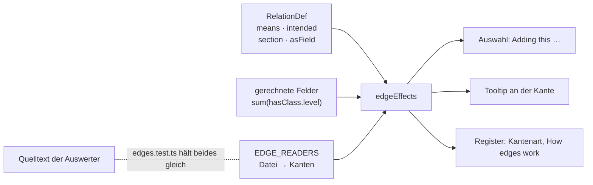

| Auswerter | Bereich | liest |
|---|---|---|
| Layers in play | Stapel | `activates`, `inLayer`, `overrides`, `partOf` |
| Take into your story | Stapel | `partOf`, `mapOf`, `inLayer`, `overrides`, `instanceOf`, `variantOf` |
| Versions and templates | Fassungen | `instanceOf`, `variantOf`, `overrides`, `inLayer`, `belongsTo` |
| Knowledge | Sichtbarkeit | `knownBy`, `includes`, `knowledge`, `memberOf`, `memberOfParty`, `partyOf`, `participates` |
| The campaign’s party | Sichtbarkeit | `partyOf`, `memberOfParty`, `inLayer` |
| Own character and writing | Rechte | `belongsTo`, `carries`, `holds`, `crafting`, `inLayer` |
| Character builder and sheet | Figur | `hasClass`, `hasAncestry`, `hasBackground`, `chose`, `grants`, `allowsMethod`, `allowsEquipment`, `abilityPool`, `carries`, `holds`, `belongsTo` |
| Effects on the numbers | Figur | `grants`, `carries`, `holds` |
| Class pages | Figur | `grants`, `subclassOf`, `tableFor` |
| Initiative | Spiel | `participates`, `memberOfParty`, `belongsTo` |
| Boards | Spiel | `placed`, `partOf`, `inLayer`, `instanceOf` |
| Reading view, Timelines | Lesen | `partOf`, `inLayer`, `mapOf`, `overrides`, `participates` |
| Validation and workbench | Prüfung | `stageOf`, `participates`, `overrides`, `instanceOf`, `variantOf`, `inLayer` |
| Import and export | Transfer | `inLayer`, `partOf`, `instanceOf`, `activates` |
| Where it is from | Anzeige | `inLayer`, `instanceOf`, `partOf` |

Die Tabelle ist eine Zusammenfassung; massgeblich ist `EDGE_READERS`.
**Nicht ausgewertet, aber versprochen** (`intended`, Vorschlag im Brett,
E-031): `affects`, `casts`, `equips`, `hasProperty`, `subraceOf`, `needs`,
`yields`, `loot`, `entry`, `route`, `inWorld` und die Kartenkanten
`insideMap`, `marker`, `zone`, `territory`, `onMap`. **Nur Anzeige** und so
gemeint: `worships`, `owes`, `livesIn`, `controls`, `describedIn`,
`questGiver`, `questAbout`, `happensAt`, `features`, `involves`, `regards`,
`chapterOf`.

### 5.5 Regeltypen, Stufen und Wirkungen (D48)

**Die Messlatte:** eine Regelart wird ein eigener Typ, wenn ein Verweisfeld
oder eine Kante sie *als Art* verlangt oder wenn sie eigene Felder trägt;
sonst bleibt sie ein Wort in `Rule.kind` (Zeile `RuleKind`: `rule`,
`travel`, `sense`, `reward`, `boon`, `option`). Unter `Rule` stehen
`Condition` (`Disease` erbt von ihr), `ActionType`, `Action`, `Feature`,
`ItemProperty`, `Feat` und `Skill`.

| | Regel | Geprüft durch |
|---|---|---|
| R1 | **Was man einer Kreatur zuweist, ist eine Art:** `Vitals.conditions` zeigt auf `Condition`, und die Prüfung hält es. Ein Filter nach `kind` schlüge bloss vor. | `validateEntity` (`link_wrong_type`) |
| R2 | **Eine Stufe ist ein Zustand für sich:** „Exhaustion 3" hat `Condition.stage` 3 und die Kante `stageOf` auf „Exhaustion". Der Grundzustand trägt die allgemeine Regel und `recovery` (`longRestStep`: eine lange Rast senkt um eine Stufe). Dasselbe Muster trägt die Stadien einer Krankheit. | — |
| R3 | **Höchstens eine Stufe je Grundzustand** in `Vitals.conditions` und in `participates.props.conditions`. Die Stufe ändern heisst ersetzen (gleicher `stageOf`, `stage ± 1`), nicht zählen. Darum gibt es `Vitals.exhaustion` nicht mehr: dieselbe Zahl an zwei Stellen läuft auseinander. | `validateEntity` (`condition_stage_twice`), mit `stageOf` aus `stageBases` |
| R4 | **Wirkungen zwischen Regeln sind Kanten** (`affects`, `props.effect`: `imposes`, `prevents`, `limits`, `advantage`, `disadvantage`, `triggers`; `on`: worauf). Gespeichert wird vorwärts; „was verbietet mir Reaktionen?" ist eine Abfrage. **Ausgewertet wird vorerst nichts** — die Kanten sind Daten, die der Bogen zeigt. Der Importer legt sie nicht an: dass ein Text einen Zustand nennt, heisst nicht, dass er ihn bewirkt. | — |
| R5 | **Eine Aktion nennt ihre Aktionsart** (`Action.actionType`, Pflicht, Verweis auf `ActionType`) **und sagt, worauf ihr Angriff rechnet** (P4, D51): `attack` (mehrere aus melee/ranged weapon/spell — ein Dolch sticht und wird geworfen), `ability` (`str` … `cha`, `finesse` = das bessere von STR und DEX, `spell` = Zauberattribut; leer: Nahkampf STR, Fernkampf DEX), `damageDice` ohne Modifikator, `damageType` aus der Zeile `DamageType`, `reach`/`range` in Fuss, `target`, Zusatzschaden `extraDamageDice`/`extraDamageType`, und `toHitBonus`/`damageBonus` für einen Bonus über der Rechnung. Der Text sagt nur noch, was die Felder nicht sagen. | `validateEntity` (`missing_property`, `link_wrong_type`, `value_not_allowed`) |
| R7 | **Trefferbonus und Schaden rechnet der Statblock** (D51, D8): Treffer = `prof` + Mod(Attribut) + `toHitBonus`, Schaden = Würfel + Mod + `damageBonus`, beim Lesen, nie gespeichert (`attackNumbers`, Zeile `attackLine`). Ein Angriff ist darum **einer für alle**, die so angreifen — „Bite" je Sorte und Schadensart einmal. **Was ein Statblock anders macht, steht an seiner Kante** `composedOf` und nur dort: dieselben Felder (andere Würfel, Reichweite, Attribut, Zusatzschaden), `note` für den Satz nur dieses Statblocks, und `toHit`/`damageFlat` als **Buchzahl**, wo sie nicht aus der Rechnung folgt — gezeigt wird das Buch, als fest markiert, mit der Rechnung daneben. Ohne `prof` am Statblock gibt es keinen Trefferbonus statt einer falschen Zahl. | Modell (`attackNumbers`), Prototyp (`elComposed`) |
| R8 | **Woher ein Angriff oder Merkmal kommt, wird gezeigt und nicht gepflegt** (D51): das Layout-Element `usedBy` zählt die Statblöcke, die den Artikel zusammensetzen, **nach Kreaturentyp** (Tiere, Drachen …). Ein Monstermerkmal, das ein Volksmerkmal ist („Aggressive" des Orks), zeigt mit `variantOf` auf dieses — der Importer verbindet nur, wenn ein Träger zu dem Volk gehört. | — |
| R6 | **`overrides` zeigt nur auf eine Fassung derselben Art** (M9). **Je Buch eine Ebene** (`Layer.kind` `book`, Id `e5_book_<kürzel>`, T-081, E-017) hält den importierten Regelbestand dieses Buchs; was kein Buch nennt, liegt in der Systemebene „D&D 5e (2014)". Welche Seite, sagt `Source.publication` mit `page`, die Lizenzflagge `Source.srd`. | `validateEntity` (`overrides_other_type`) |
| R9 | **Ein Abenteuer ist eine Ebene mit seiner Geschichte und seinem Text** (`Layer.kind` `adventure`, T-082, REQ-240; T-108, E-029): das Abenteuer eine `Story` mit `kind: adventure`; je Kapitel **ein `Arc` und ein `Chapter`** — der Arc (`partOf` das Abenteuer; E-026 — die Peg-Id rechnet der Importer weiter wie für eine Story) ist die Geschichte, das Chapter (`<Arc>_chapter`, `chapterOf` der Arc) die Lesestruktur; je Abschnitt eine `Scene` — auf Kapitelstufe `partOf` der Arc **und** mit Rang im Chapter, Räume („1. Cave Mouth") mit Rang in ihrer Szene. **Der Text sind Teile** (E14, R10): Absätze, Überschriften, Vorlesetexte (`ReadAloudText`), Verweise auf Statblöcke, mit Rang im Chapter oder in der Szene, an ihrer Stelle im Buch; Szenen tragen keinen eigenen Text mehr. Kreaturen, Gegenstände, Zauber im Text sind **Verweise** auf die Buchartikel; `{@area}` ein Verweis auf den Abschnitt. Je Karte (`imageType: map`) eine `Map` mit der Bildadresse bei 5e.tools (nicht im Repository), `mapOf` ihr Abschnitt; **eine Karte steht immer an einer Szene** — liegt sie im Text des Kapitels, bekommt sie ihre eigene (`<Karte>_scene`, `mode: exploration`, E-026), die als Teil an ihrer Stelle im Chapter steht. Nennt ein Abschnitt Kreaturen **mit Anzahl** („two goblins"), eine `Encounter` (`partOf` der Abschnitt, ohne Rang) mit einer `participates`-Kante je Teilnehmer auf den Statblock. Alles auf `audience: gm`. Ein Abenteuer in einem Quellenbuch (MOT, FRAiF) liegt in dessen Ebene. **Schon geladene Abenteuer** bekommen das von Migration 046: je Arc sein Chapter (dieselbe Id), die Szenen mit Rang, der Text von Arc und Szene als `ReadAloudText` (`<Artikel>_read<n>`) und ein `Paragraph` (`<Artikel>_text`) — gröber als ein Neuimport, nichts geht. **Teile kommen nur mit ihrem Ganzen:** `--only-new` legt in einem Kapitel oder einer Szene, die schon steht, keine Teile an. | `arten/abenteuer.ts`, `abenteuer.test.ts`, Durchstich |
| R10 | **Ein Buch ist eine Ebene mit seinen Kapiteln** (T-108, E-028, E-029 a, REQ-247): jedes Buch aus 5e.tools (`book/`, auch ein Regelbuch) bringt je Kapitel der obersten Stufe ein `Chapter` (Name wie bei 5e.tools, „Chapter 9: Combat", `ordinal` „Chapter 9"; ohne Credits), darin seine Teile nach Rang (E14): eine Zeichenkette ein `Paragraph`, ein Kasten `kind: sidebar`, ein Zitat `quote`, eine Liste `list`, eine Tabelle `table`; ein benannter Abschnitt eine `Heading` bis zur dritten Stufe (darunter fett im Absatz); ein Vorlesetext ein `ReadAloudText`. **Was schon Artikel ist, wird ein `Embed`:** ein `statblock`-Eintrag (Monster, Zauber, Gegenstand), eine Tabelle mit dem Namen einer `Table` desselben Buchs, ein benannter Abschnitt mit dem Namen eines Artikels desselben Buchs (Zustand, Klasse, Abstammung, Aktion …). Die Peg-Id eines Teils ist aus seinem Ganzen und seinem Rang gerechnet. Bilder bleiben weg (E5). | `arten/buch.ts`, `teile.ts`, `buch.test.ts` |

Dazu aus M7 und M8: `Hazard` (Falle oder Gefahr, auf der Karte über
`marker`), `Deity` (Anhänger über `worships` von Kreatur und Fraktion),
`Faction.goal`, und `Table.columns` — mit Spalten ist eine Zeile in
`rows` eine Liste von Zellen; die gewichteten Einträge bleiben
`entry`-Kanten. Wer ein Merkmal gewährt, sagt seit P4 `grants` (§5.7) —
das, was der Arbeitsplan `featureOf` nannte, vorwärts vom Gebenden aus.

### 5.6 Zauber und Gegenstände (M2, M4)

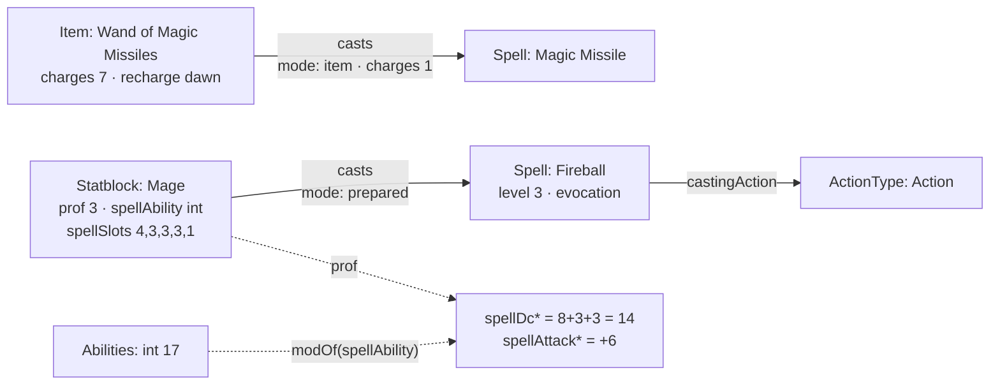

| | Regel | Geprüft durch |
|---|---|---|
| Z1 | **Ein Zauber ist eine Regel mit eigenen Feldern** (`Spell` erbt `Rule`): Grad 0–9 (0 ist ein Zaubertrick), Schule, Wirkzeit, Reichweite (`rangeKind` + `range` in Fuss), Komponenten `v`/`s`/`m` mit Material, Kosten in Kupfer und ob es verbraucht wird, Dauer (`instant`/`timed`/`permanent`/`special`, mit `durationAmount`/`durationUnit`), Konzentration, Ritual, „At higher levels" (langer Text, Würfel darin), Rettungswurf (`enumRef: Ability`), Zauberangriff, Schadensarten. | `validateEntity` (`value_not_allowed`, `value_out_of_range`) |
| Z2 | **Die Wirkzeit nennt ihre Aktionsart:** bei Aktion, Bonusaktion und Reaktion zeigt `castingAction` auf den `ActionType` (D48); längere Wirkzeiten sind `castingTime` mit `castingUnit` (`minute`, `hour`). Der Auslöser einer Reaktion steht in `castingCondition`. | `validateEntity` (`link_wrong_type`) |
| Z3 | **Welche Zustände ein Zauber bewirkt, ist die Kante `affects`** (`effect: imposes`) zur `Condition` — kein Feld daneben (D49). | — |
| Z4 | **Wer einen Zauber wirkt, ist die Kante `casts`** (Statblock, PlayerCharacter, Item, Subclass, Ancestry → Spell) mit `mode` (`prepared`, `known`, `innate`, `item`), `uses` („at will", „3/day"), `level`, `charges` (was ein Gegenstand je Wirken verbraucht) und `fromLevel` (Domänenzauber ab Klassenstufe 3, Thaumaturgy des Tieflings ab Stufe 1). Gespeichert vorwärts; „wer kann Feuerball?" ist eine Abfrage. | Kantenprüfung (`from`/`to`) |
| Z5 | **Zauberwirken steht am Statblock** (`spellAbility`, `casterLevel`, `spellSlots` je Grad, der erste ist der 1.). **SG und Angriffsbonus werden gerechnet** (D8): `spellDc = 8+prof+modOf(spellAbility)`, `spellAttack = prof+modOf(spellAbility)`. Ohne Attribut gibt es keinen Wert — 8 + Übung sähe aus wie ein SG. | Rechenwerk (`derivedValue`) |
| Z6 | **Verbrauchte Plätze sind ein Stand** (`Vitals.slotsUsed` je Grad), an der Figur und nicht am Statblock — wie `hp` an beiden. | — |
| G1 | **Ein Gegenstand trägt, was 5e.tools kennt:** `tier` (minor/major), Einstimmung (`attunement`, `attunementNote`), Ladungen (`charges`, `recharge`, `rechargeAmount`), Boni (`bonusWeapon`, `bonusAc`, `bonusSpellAttack`, `bonusSave`), `appliesTo` (Marken, woran eine Variante passt). `itemType` und `rarity` sind englische Aufzählungen am Feld (E3); `rarity` kennt `none` und `varies`. | `validateEntity` (`value_not_allowed`) |
| G2 | **Waffe und Rüstung:** `Weapon.category` (simple/martial), `damage2` (zweihändig, bei `versatile`), `ammoType` (Verweis auf den Munitionsartikel, T-078), `damageType` aus der Zeile `DamageType` (seit P4); `Armor.armorType` (light/medium/heavy/shield), `strength`, `stealthDisadvantage`. Eigenschaften bleiben die Kante `hasProperty` → `ItemProperty`. | `validateEntity` |
| G3 | **Ein Gegenstand darf ein Behälter sein** (`carries` → `Inventory`, wie an Kreatur und Gruppe) und **ein Stück am Tisch eine Instanz** des Gegenstands im Buch (`instanceOf`, §7): das +1-Langschwert speichert nur, was abweicht. Eine Instanz ist von derselben Art wie ihre Vorlage (`to: same`). | Kantenprüfung |

| G4 | **Die Plätze nach Basils Blatt** (D54, REQ-214): `holds.props.slot` kennt Kopf, Schultern, Torso, Handschuhe, rechte und linke Hand (`mainHand`, `offHand`, beide nehmen alles), Beine, Stiefel, Gurt, zwei Holster, je vier Ringe an jeder Hand (`ringR1`…`ringL4`) und vier Halsketten (`neck1`…`neck4`). Gelesen aus der Zeile, nicht aus dem Code; ein Platz, den die Zeile nicht kennt, bleibt am Stück stehen und wird gezeigt. Umbenennung: `prototype/migration/plaetze-nach-dem-blatt.mjs`. | — |
| G5 | **Die Figur steht an der Kreatur** (`Creature.figure`: male · female · neutral, Liste am Feld), nicht am Inventar: das Inventar wechselt den Träger, die Figur nicht. | `validateEntity` (`value_not_allowed`) |
| G6 | **Das Tragraster wird gerechnet** (D54, REQ-215): ein Inventar einer Kreatur **ohne eigenes `grid`** liest seine Form aus der Grösse des Statblocks (Grundquadrat, Einstellung `carrySquares`) und aus `Statblock.carryExtra` (Zusatzquadrat, `derived`, Spanne 0…5). Eine Grösse, die die Einstellung nicht kennt, behält das Rechteck (`inventoryCols`, `inventoryRows`). Die Basiszonen kommen nach Spalten aus `carryZones`, bis der Behälter eigene malt. | Rechenwerk (`carryGrid`, `columnZones`) |
| G7 | **Jeder Behälter gibt eine Ziehstufe dazu** (D54, REQ-216): die Stufe eines Stücks ist das Langsamere aus seiner Zone und der Stufe seines Behälters + 1, die Kette hinauf (`carries` von einem Gegenstand). Aussen gilt der Platz (`slotDraw`) oder die Zone. Kennt ein Schritt keine Stufe, hat das Stück keine. | Rechenwerk (`drawStage`) |
| G8 | **Fallenlassen und Verstauen haben feste Kosten, egal wohin** (D58, REQ-225): Einstellung `handActions` (`drop:free action, stow:bonus action`, Werte aus `DrawTime`; ein Wert ausserhalb der Leiter gilt nicht). **In der Hand** ist, was an `mainHand`/`offHand` liegt, oder ohne Platz `tier: held`. **Fallen gelassen** wird an Ort und Stelle: die `holds`-Kante bleibt, verliert Platz und Rasterlage und bekommt `tier: ground` — das Stück gehört der Figur weiter und hat keine Ziehstufe. **Verstaut** wird an einen freien Platz, der keine Hand ist, oder an die erste freie Stelle im Raster (`tier: pack`). Der Gurt ist eine freie Aktion (`slotDraw` `belt`). | Rechenwerk (`handActions`, `inHand`) |

Offen: wie viele Ladungen ein Stück am Tisch noch hat (ein Stand am
Gegenstand oder an `holds`).

### 5.7 Statblock, Charakterbau und Übungen aus Artikeln (M5, M3, M6)

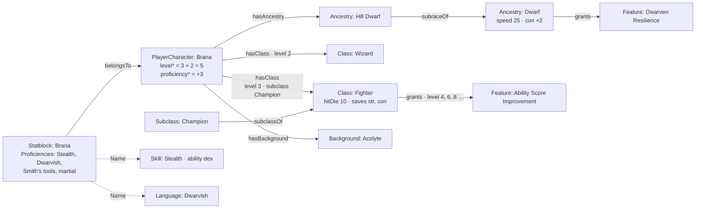

| | Regel | Geprüft durch |
|---|---|---|
| S1 | **Der Statblock wächst** (M5): `languageNote` (was keine Sprache ist: „telepathy 120 ft.", „any four languages"), `conditionImmunities` (Verweise auf `Condition`-Artikel, seit T-078; vorher ihre Namen), `legendaryActions` (Anzahl je Runde), `bonuses` (`{"Stealth": 6}` — feste Boni, die nicht aus Übung folgen; der Bogen nimmt sie statt der Rechnung), `token` (Asset). `size` liest die Zeile `Size`, englisch. Er nimmt `Proficiencies`, `Lore` und `Image` dazu; die Umgebung eines Monsters sind Marken. | `validateEntity` |
| S2 | **Die Übungen wohnen am Statblock**, nicht an der Kreatur: sie gehören zu den Zahlen (Übungsbonus, Attribut). An beiden Stellen wären sie zwei Antworten auf „worin ist sie geübt". | Register (`typeChain`) |
| S3 | **Was ein Statblock führt, ist die Kante `equips`** (Statblock → Item): der Gegenstand aus dem Buch, kein Inventar. | Kantenprüfung |
| C1 | **Klasse, Unterklasse, Abstammung, Hintergrund sind Arten unter `Rule`** (Bereich `rules`). Jede nimmt `Proficiencies` (was sie fest gewährt — die Beschriftung heisst dort „Grants proficiency in") und `Choices` (was zu wählen ist, C6). Die Klasse trägt `hitDie`, `primaryAbility`, `startingEquipment`, `multiclassRequirement`, `multiclassProficient`, `subclassTitle`, mit der Unterklasse `casterProgression` und `spellAbility`; die Abstammung `size`, `speed`, `abilityBonus` (`{"con": 2}`), `age`, `darkvision`, `resistances`. | `validateEntity` |
| C2 | **Die Figur zeigt darauf:** `hasClass` (mehrmals, `props.level` Pflicht, `props.subclass` → `Subclass`), `hasAncestry` und `hasBackground` (je eine). `PlayerCharacter.class` und `.ancestry` sind weg. | Kantenprüfung |
| C3 | **Die Stufe wird gerechnet:** `level = sum(hasClass.level)`, `proficiency = 2+(sum(hasClass.level)-1)/4` (D8). Ohne Klasse keine Stufe — kein Wert statt 0. | Rechenwerk (`derivedValue` mit Kanten) |
| C4 | **Was eine Klasse, Abstammung, ein Hintergrund oder Talent gewährt, ist die Kante `grants`** (→ `Rule`) mit `props.level`. Die Stufe steht an der Kante und nicht am Merkmal: „Ability Score Improvement" ist ein Artikel und sieben Kanten. `Feature.level` ist deshalb weg (D50). `subclassOf` und `subraceOf` sagen, wozu eine Unterklasse oder Unterart gehört. Die Stufentabelle einer Klasse und die Charakterzug-Tabellen eines Hintergrunds sind `Table`-Artikel über `tableFor`. | Kantenprüfung |
| C5 | **Ein Merkmal bettet ein, was allein in einem Absatz steht** (W6): ein Absatz, der nur aus einem Verweis auf ein `Feature` besteht (`[[feature-0479\|Abjuration Savant]]`), heisst „hier steht dieses Merkmal" — so schreibt der Importer `refSubclassFeature` und `refOptionalfeature`. Die Klassenansicht zeichnet es an dieser Stelle aus; ein Kopf, der Merkmale **seiner Sorte** einbettet („School of Abjuration"), heisst in der Tabelle nach seinen Teilen, einer mit Optionen („Fighting Style" › „Archery") nach sich. Optionale Merkmale und Variantenregeln tragen die Marke `optional`. Bringt eine Unterklasse eigene Spalten (`subclassTableGroups`: Eldritch Knight), ist das ein `Table` über `tableFor` an ihr. | `classParts`, `levelFeatures` (`packages/model/src/classes.ts`) |
| C6 | **Was zu wählen ist, ist ein Feld; was gewählt wurde, eine Kante** (REQ-238, E-015 a). Klasse, Unterklasse, Abstammung, Hintergrund und Talent nehmen `Choices`: `choices` hält je Wahl `{id, kind, level, when, from, count, bonus, repeat, onlyIf, default, note}` — `kind` ist proficiency · ability · feat · spell · equipment · feature · subclass · option (benannte Möglichkeiten, die nur steuern, welche Wahlen dahinter gelten); `from` ist **eine** von drei Formen: `values` (Namen aus Listen, `enumRef` nennt sie, wenn es keine feste Aufzählung gibt), Artikel (`interfaces` mit den Filtern von `LinkTarget` und `edge`: nur Unterklassen dieser Klasse) oder `options` (`[{key, label}]`, Ausrüstung a/b); `when` sagt an einer Klasse „nur als erste Klasse" (`start`) oder „nur beim Mehrklassen-Einstieg" (`multiclass`); `bonus` bei `ability` je Wahl (+2/+1 heisst `[2, 1]`). `repeat` erlaubt denselben Wert mehrmals (+1 zweimal auf STR ist +2); `onlyIf: {choice, pick}` lässt eine Wahl nur gelten, wenn eine Wahl davor **an derselben Quelle** diesen Wert trägt; `default` gilt, bis jemand antwortet (`assumed`). Die `id` kommt aus dem Text (`skills`, `fighting-style-2`). Die Figur speichert **nur ihre Antworten**: je Wahl eine Kante `chose` (PlayerCharacter → der fragende Artikel) mit `props.choice` und `props.picks` (Namen, Artikel-Ids oder Schlüssel). **Gerechnet beim Lesen** (D8): `chosenResult` ergibt Übungen, Attributsboni (dazu fest aus `Ancestry.abilityBonus`), gewählte Artikel und Ausrüstung; `pendingChoices` was offen ist, `orphanAnswers` Antworten auf Wahlen, die es nicht mehr gibt. **Eine Wahl ohne Spielraum ist beantwortet** (`fixedPicks`: „eines aus [con]"). **Eine Sprachwahl ohne `from` zieht aus den Sprachen** (T-095): nennt eine Übungswahl ohne Liste in `id` oder `note` Sprachen („two standard languages of your choice", aus `ProficiencyChoice` übernommen oder von Hand), liest `choicesOf` sie als `from: {enumRef: ['Language']}`, und ohne `count` gilt die Zahl am Anfang des Satzes — gespeichert wird nichts davon. **Ein Merkmal, das eine Quelle mehrfach gewährt, fragt je Gewährung** (T-107, E-027): jede Kante `grants` macht es zu einer eigenen Quelle (`ChoiceSource.grant: {by, level}`), und die Antwort merkt sich die ihre (`chose` mit `props.by` und `props.level`, Schlüssel `answerKey`: `quelle#wahl@von:stufe`). Die Attributssteigerung (`Feature` nimmt dafür `Choices`) trägt drei Wahlen: `improvement` (option: Steigerung oder Talent, Vorgabe Steigerung), `ability-scores` (zwei Punkte, `repeat`) und `feat` (je mit `onlyIf`). Eine ältere Antwort ohne `by`/`level` gilt für die **erste** Gewährung; eine zu einer Gewährung, die es nicht mehr gibt, ist verwaist. Erlaubt die Kampagne keine Talente (`Campaign.feats: false`, `campaignAllowsFeats`), bietet `offeredOptions` den Ausweg Talent nicht an, und eine Wahl mit einer Möglichkeit allein ist kein Schritt. Feste Gaben bleiben, was sie sind: `Proficiencies`, `grants` mit `props.level`, `abilityBonus`. | `validateEntity` (`entry`), `packages/model/src/choices.ts` |
| C7 | **Der Assistent liest seine Schritte aus den Artikeln** (REQ-238, T-080): Abstammung, Hintergrund, Klasse (Stufe 1), Attribute, je offene Wahl ein Schritt (`builderSteps` über `choicesAtCharacter`, Quellen in dieser Reihenfolge, Geöffnetes dahinter), die Ausrüstung (ein Schritt für alle Ausrüstungswahlen, C10), Name. Zur Wahl steht, was der Betrachter sieht, im Stapel liegt und `ready` ist. Gespeichert wird die Figur (`ready`, E-014 d) mit `hasAncestry`, `hasBackground`, `hasClass`, `chose`, `memberOfParty` und ein eigener Statblock (`belongsTo`) mit den **Grundwerten** — Boni rechnet `chosenResult`. Eine Unterklasse steht dazu an `hasClass.props.subclass`. Der **Stufenaufstieg** ist derselbe Mechanismus: die gespeicherte Figur mit einer Stufe mehr, ohne was sie schon beantwortet hat (`answeredKeys`, je Gewährung — die Steigerung auf Stufe 8 fragt, auch wenn die auf 4 beantwortet ist); dazu nennt er, was Klasse und Unterklasse genau auf der neuen Stufe gewähren (`gainedFeatures`, `grants` mit `props.level`). **Sprachwahlen** bieten die Namen der `Language`-Artikel an, und nennt die Kampagne Sprachen (`Campaign.languages`, REQ-251, `campaignLanguages`), nur diese. Am Artikel steht **je Klasse ein Eintrag**: Klasse, Stufe, Unterklasse und die Antworten auf ihre Wahlen zusammen (die Kanten `chose` hängen sich an die Kante ihrer Quelle, T-095). | `packages/model/src/builder.ts` |
| C8 | **Attributsverfahren sind Artikel** (E-016 a): `AbilityMethod` mit `method` (`array` · `pointBuy` · `roll`), `scores`, `budget`, `costs` (`{"8": 0, "15": 9}`), `dice` (`4d6kh3`), `count`, `scope` (`character` · `party`). Die Kampagne erlaubt über `allowsMethod`; ohne Kante gelten Standardreihe und Punktekauf (`DEFAULT_ABILITY_METHODS`). Gewürfelt wird am Server (`POST /api/abilities/roll`), jeder Wurf steht im Protokoll (`abilities.rolled`); der **Gruppenpool** steht an der Gruppe (`abilityPool` → Verfahren, `props.values`, `rolls`, `at`), jede Figur verteilt dieselben Werte, neu würfelt nur die Leitung. Der Würfelausdruck kennt dafür `khN`/`klN` (behalten). **Bei Reihe und Pool wird jeder Wert genau einmal vergeben**: wer einen schon vergebenen wählt, tauscht mit dem Attribut, das ihn hält (`assignScore`, T-095); der Punktekauf tauscht nicht. | `packages/model/src/abilities.ts`, `dice.ts` |
| C9 | **Was ein Artikel an der Figur verändert, ist ein Feld** (REQ-238, REQ-063, E-025 a). Der Gegenstand nimmt `Effects`: `effects` hält je Wirkung `{id, target, op, value, when, note}` — `target` ist frei (`ability.str`, `ac`, `speed.walk`, `speed.*`, `spellSaveDc`, `spellAttack`, `save`, `resist`, `immune`, `vulnerable`, `conditionImmune`, `critThreshold`, `carry`, `capacity`, `weapon`; ein neues Ziel ist ein Wert, kein Feld), `op` ist add · set · grant (`set` hebt ein Attribut nur, wenn es niedriger ist; beim kritischen Treffer gilt die kleinste Schwelle), `when` ist worn · attuned · carried · self — ohne Angabe eingestimmt, wenn der Gegenstand Einstimmung verlangt, sonst getragen. **Getragen** heisst `holds.tier` held/worn oder ein Körperplatz (`slot`), **eingestimmt** `holds.attuned` und getragen, **dabei** alles ausser `stored` und `ground` (auch im Beutel), `self` gilt für keine Figur (Waffenbonus, Fassungsvermögen). **Gerechnet beim Lesen** (D8): `effectsAt` sammelt aus dem Inventar (`carries` → `holds`, Behälter weiter hinein) und aus den Quellen der Wahlen (`choiceSources`, dazu ihre `grants` auf Stufe), `effectTotals` fasst zusammen, `abilityWithEffects` rechnet einen Attributswert mit Boni aus `chosenResult`. Die alten Zahlenfelder `bonusAc`, `bonusWeapon`, `bonusSpellAttack`, `bonusSave` bleiben und zählen beim Lesen als Wirkung (`effectsOf`). | `validateEntity` (`entry`), `packages/model/src/effects.ts` |
| C10 | **Startausrüstung nach Kampagnenregel** (REQ-250, T-096): Verfahren sind Artikel wie C8 — `EquipmentMethod` mit `method` `rules` (was Klasse und Hintergrund geben), `gold` (`gold` fest `100` oder gewürfelt `5d4×10`, leer: `Class.startingGold`) oder `free` (`budget` in gp, leer: ohne Grenze); für `gold` und `free` zählen `magic` (`{"uncommon": 1}` je Seltenheit höchstens; was fehlt, keiner; ohne Angabe nur, was einen Preis hat) und `itemTypes` (aus `Item.itemType`). Die Kampagne erlaubt über `allowsEquipment`; ohne Kante gelten „Class and background" und „Starting gold" (`DEFAULT_EQUIPMENT_METHODS`). **Die Varianten (a)/(b) sind Ausrüstungswahlen** (C6, `kind: 'equipment'`), ihre Möglichkeiten `{key, label, items?: [{id, qty}], gold?}` — `items` nennt Nummern wie ein Verweis; ohne `items` liest `equipmentFromText` die Verweise, Mengen und gp aus dem `label`. **Das Feste ist eine Wahl mit einer Möglichkeit** (beantwortet sich selbst); ältere Klassen tragen es nur als Zeilen in `startingEquipment` (ohne „(a)"), und `startingBundle` liest sie dort. Eine zweite Klasse bringt keine Ausrüstung (`when: 'start'`). Der Assistent sammelt die Ausrüstungswahlen einer neuen Figur in **einem** Schritt `equipment`. **Am Server**: Startgold wird gewürfelt (`POST /api/equipment/roll`, Protokoll `equipment.rolled`, die Id ist der Beleg), `POST /api/entities/:id/equipment` rechnet das Paket aus den gespeicherten Antworten oder prüft den Einkauf (`checkPurchase`: Preis, Budget, Arten, Seltenheiten — nur sichtbare, fertige Gegenstände) und legt das Inventar an (`carries` → `Inventory` mit `holds`, Rest im Beutel `Inventory.copper`); jeder Beleg gilt einmal, und hält das Inventar schon etwas, gibt es mehr nur durch die Leitung (`equipment.applied`). | `packages/model/src/equipment.ts`, `apps/server/test/ausruestung.test.ts` |
| Ü1 | **Übungen kommen aus Artikeln** (M6): `Proficiencies.proficient` und `expertise` nennen `Skill`, `Language`, `Item` (nur Werkzeuge, `enumWhere` auf `itemType`), `Weapon`, `Weapon.category`, `Armor.armorType`. Die Zeilen `Skill`, `Language`, `Tool`, `WeaponTraining`, `ArmorTraining`, `KnowledgeField` und die Einstellung `skills` sind weg; worauf eine Fertigkeit rechnet, sagt `Skill.ability`. Ein Wissensgebiet (Hausregel) ist eine Fertigkeit mit Artikel. | F12 |
| Ü2 | **`Language` ist eine Art** (`languageType` standard/exotic/rare/secret, `script`, `typicalSpeakers`). | — |
| Ü3 | **`DamageType` und `Size` sind Zeilen** (F1): drei Felder nennen die Schadensarten (Waffe, Aktion, Zauber; die Abstammung für Resistenzen), zwei die Grösse. | `validateEntity` (`value_not_allowed`) |

Offen: der Bogen der Oberfläche (`apps/web`) zeichnet Klasse und Stufe
noch nicht (die Klasse selbst steht unter `/classes/:id`, W6) und rechnet
die Boni aus `chosenResult` noch nicht zu den Grundwerten des Statblocks —
der Assistent (`/characters/new`, C7) zeigt die Summe; eine umbenannte
Fertigkeit nimmt die gespeicherten Übungen nicht mit (F12), und eine
Antwort mit Namen ebenso wenig.

### 5.8 Initiative (D53)

Ein Teilnehmer ist eine `participates`-Kante an der Begegnung; die Kante
hält den **Stand** im Kampf, nicht die Zahlen der Kreatur.

```mermaid
flowchart LR
  E[Encounter] -- "participates<br/>init · hp · conditions[]<br/>revealed · involved · identified" --> C[Creature]
  S[Statblock-Instanz] -- belongsTo --> C
  S -- instanceOf --> V[Statblock-Vorlage]
  E -. "ac, hpMax: participantStats" .-> S
### 5.9 Zeitleisten und Spuren (D57, REQ-220)

```mermaid
flowchart LR
  AGE["Event: Third Age<br/>Time 1000 – 1500"]
  WAR["Event: Dragon War<br/>Time 1480 – 1490"] -- "partOf" --> AGE
  B["Event: Battle of Ash · 1485"] -- "partOf" --> WAR
  L["Event: Late skirmish · 1495"] -- "partOf" --> WAR
  W["Event: Royal wedding · 1486<br/>(keine Kante)"]
  C["Campaign: Nebelwacht<br/>Spanne gerechnet: 1486 – 1492"]
  S["Session one · 1492"] -- "partOf" --> C
  W -. "hält keine Spur → Kampagne" .-> C
```

| | Regel | Geprüft durch |
|---|---|---|
| I1 | **RK und TP-Maximum stehen am Statblock** (der Instanz, mit der Vorlage darunter), `props.hp` ist der Stand. `props.hpMax` ist eine Abschrift aus der Zeit davor und gilt nur, wo kein Statblock hängt. | Modell (`participantStats`) |
| I2 | **Ein Eintrag in `props.conditions` trägt seine Dauer:** `rounds`, `anchor` (Id einer Teilnehmerkante derselben Begegnung) und `at` (`start`/`end`). Er zählt herunter, wenn der Zug des Ankers anfängt bzw. endet, und fällt bei null weg. **Ohne `anchor` der eigene Zug, ohne `at` das Ende** — so zählte der Bestand, und er bleibt gültig. Ohne `rounds` bleibt er, bis ihn jemand entfernt. | Modell (`tickEntries`) |
| I3 | **Gezählt wird ab jetzt:** das Ende des laufenden Zuges kommt noch, sein Anfang ist vorbei. Die Maske sagt beim Setzen, wann ein Eintrag abläuft. | Modell (`expiresAt`) |
| I4 | **Eine Notiz ist ein Eintrag mit `text` statt `rule`**, mit derselben Dauer. `hidden` hält einen Eintrag von den Spielenden fern. | — |
| I5 | **Spielende sehen die Gruppe und wer `revealed` oder `involved` ist**; ohne `identified` den Decknamen (`Identity.cover`) und keinen Verweis auf den Artikel; die Trefferpunkte aller ausser der Gruppe als Wort (`unhurt`, `bloodied`, `down`); `hidden`-Einträge und `props.note` nie. Zurückgehalten wird in `redactEntity`, nicht in der Maske. Wer getroffen wird, ist `involved`. | Modell (`redactParticipants`, in `redactEntity`) |

| I6 | **In der ersten Runde steht ein Gegner erst, wenn sein Zug gekommen ist** (REQ-226, D58): vor Runde 1 keiner, in Runde 1 sobald sein Zug beginnt, und dann bleibt er; ab Runde 2 gilt I5. Gemessen wird an der ganzen Reihe (`initiativeOrder`, wie der Prototyp sortiert) und an `Encounter.round`/`turn`. Wer nie aufgedeckt wurde, bleibt verborgen — ein Zug allein deckt weiter nicht auf. Verbündete (`ally`) und die Gruppe sind keine Gegner. | Modell (`turnHasCome`, `redactParticipants` mit `FightState`) |
| I7 | **Die Zugnummer geht nicht an Spielende**: `Encounter.turn` zählt die ganze Reihe und verriete, wie viele davor verborgen sind oder noch nicht erschienen. `redactEntity` lässt sie weg; wer dran ist, sagt die Marke `props.current` an diesem Teilnehmer — nur, wenn er gezeigt wird. | Modell (`redactEntity`) |

Offen: dass `bloodied` schon unter dem Maximum gilt und nicht erst ab der
Hälfte; ob ein Gegner, den die Gruppe in Runde 1 vor seinem Zug trifft
(`involved`), schon dann erscheinen soll (heute nicht — D58 wörtlich).
| Z1 | **Eine Spur ist ein Ereignis mit Spanne** (`Event`, `Time.sort` … `Time.untilSort`). Ein Ende vor dem Anfang ist keine Spanne. Eine neue Art gibt es dafür nicht: ein Krieg, eine Dynastie, ein Zeitalter sind Ereignisse, die dauern (`Event.kind` sagt, welche Sorte). | `isTrack` |
| Z2 | **Was in einer Spur liegt, sagt `partOf`**, nicht der Zeitraum (D57): die Schlacht ist Teil des Kriegs, der Krieg Teil des Zeitalters. Die Kante ist dafür auf `Event` verbreitert (`from`/`to`). Ein Artikel liegt in der **nächsten** Spur über seine Kette; ein Glied, das keine Spur ist oder nicht gesehen wird, wird übersprungen. | Kantenprüfung, `worldHistory` |
| Z3 | **Die Spanne prüft mit, sie ordnet nicht ein.** Was über die Kante drinliegt und ausserhalb fällt, nennt die Rechnung (`outside`) — die Leitung sieht es gestrichelt; verschoben oder abgelehnt wird nichts. | `worldHistory` |
| Z4 | **Eine Spur in einer Spur ist beides**: ein Balken in der äusseren und eine eigene Spur darunter. Ihr Inhalt steht nur in ihr. | `worldHistory` |
| Z5 | **Die Kampagne ist eine Spur.** Was keine Spur hält, gehört ihr (ausser es gehört über seine Ebene einer anderen Kampagne). Ihre Spanne ist ihre `Time`, sonst die ihres Inhalts — beim Lesen gerechnet (D8). Liegt sie selbst über `partOf` in einer Spur, hängt sie darunter. | `worldHistory` |
| Z6 | **Eine Achse für alle**: `sort` ist der Wert im Weltkalender (`World.calendar`), und alle Kampagnen einer Welt lesen so. | — |
| Z7 | **Was man nicht sieht, steht nicht da**: Sichtbarkeit (`articleVisible`) zuerst; wessen Zeit man nicht weiss (eine unbekannte Information nennt `Time`), der steht nicht auf der Leiste — man wüsste nicht, wo. | `worldHistory` (`visible`, `dated`) |

Gezeichnet wird im Element `timeline` an der Kampagne, in zwei Reitern:
**Campaign** (die Liste der Kampagnenspur) und **World history** (die
Spuren auf einer Achse, je Spur ein- und ausblendbar, herangezoomt auf
eine; ein Klick auf einen Balken öffnet den Artikel).

Offen: der Kalender ist ein Name und keine Rechnung — `sort` tippt die
Leitung selbst, aus „Mirtul 12, 1492 DR" wird keine Zahl. Ein Zeitalter
als Hintergrund **über allen** Spuren (alles in seiner Spanne, ohne Kante)
gibt es nicht; es ist eine Spur wie die anderen.

---

## 6. Gerechnet, nicht gespeichert

Drei Dinge entstehen beim Lesen und stehen nie in den Daten (D8):

**Gerechnete Felder** (`derived`). `evalArith` ist ein Auswerter mit
Operatorvorrang, kein `eval`; Namen lösen **erst gegen die Nachbarfelder
derselben Karte, dann gegen die übrigen Karten des Artikels** auf, dazu
`mod(feld)`, `modOf(feld)` (der Modifikator des Attributs, das ein Feld
nennt), `sum(kante.feld)` (die Summe einer Kanteneigenschaft über die
eigenen Vorwärtskanten — die Stufe einer Figur aus `hasClass`, §5.7) und
die Formfunktionen `rowCount`, `colCount`, `cellCount`. Unsinn
ergibt `null`, nie eine irreführende 0. `of` lässt den Wert in der Zelle
des Nachbarn reiten. Der Rückgriff auf den Artikel ist für den Statblock
da: `prof` und das Zauberwirken stehen in seiner Karte, die sechs Werte in
`Abilities`, und der Zauber-SG braucht beide (§5.6). Was die eigene Karte
trägt, gewinnt immer; tragen zwei andere Karten denselben Namen
verschieden, hat die Rechnung keinen Wert.

**Variablen** `{VAR}`. Aufgelöst in dieser Reihenfolge, die erste Stelle
gewinnt: die Bindung an der Kante (`composedOf.props.vars`) → die eigene
Karte `Vars.bindings` → die gerechneten Kampagnenwerte (`{PARTY}`,
`{PARTYSIZE}`, `{PARTYLEVEL}`, `{PARTYTIER}`, `{PARTYWHERE}`, `{TODAY}`,
`{CALENDAR}`) → die Registerzeile `vars`. **Nie in den gespeicherten Text
eingesetzt**; ein unaufgelöster Platzhalter bleibt sichtbar stehen.
**Am Satzanfang schreibt ein eingesetzter Wert gross** (Textanfang oder
nach `.`, `!`, `?`, `:` und Zeilenumbruch; Hervorhebung zählt nicht) —
gespeichert bleibt die Bindung, wie sie ist. Darum **trägt ein
Platzhalter seinen Artikel**: das Merkmal heisst „{CREATURE} can breathe
air and water.", die Kante bindet `CREATURE` an „the dragon" oder
„Venomfang", und die Vorgabe an der Vorlage ist `Vars.bindings.CREATURE`
= „the creature". So teilen sich Drache, Riese und benannte Kreatur einen
Text (W1).

**Würfel** `{{1d6+2}}` (M12, REQ-070). Ein Ausdruck aus Würfeln und
Zahlen, `d` oder `W`; ein blosser Modifikator `{{+4}}` ist ein Wurf auf
den W20 mit diesem Bonus. Ein `{VAR}` darin wird zuerst aufgelöst
(`{{1d8+{STR}}}`). Gewürfelt wird beim Klick, ohne `eval` (`rollDice`);
was kein Ausdruck ist oder einen offenen Platzhalter hat, bleibt Text,
wie es dasteht.

**Das Tragraster und die Ziehstufe** (D54). Ein Inventar ohne eigene
Form, das eine Kreatur trägt, ist nach Basils Blatt 11 × 6: links das
Grundquadrat nach Grösse, rechts das Zusatzquadrat, das der Statblock als
`carryExtra` rechnet (`mod(str)`, geklemmt auf 0…5) — wie ein Angriff
seinen Treffer am Statblock rechnet. Was ein Stück zum Herausholen kostet,
wird die Behälterkette hinauf gerechnet:

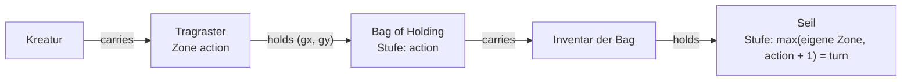

**Der Kalender** steht an der **Welt** (`World.calendar`), und jede Kampagne
hängt über `inWorld` an genau einer: alle Runden in derselben Welt lesen
ihre Weltdaten (`Time.sort`, `Time.display`) im selben Kalender, und
`{CALENDAR}` kommt von dort. Er war eine Einstellung je Kampagne und ein
Feld je Artikel (A11, 7.10.).

**Masse.** Eine Zahl steht in der Einheit ihres Feldes (`unit`); gezeigt wird
nach der Einstellung `units` (`imperial` · `metric` · `both`), die eine Art
überschreiben darf. Wie gerechnet wird, steht in der Zeile `units`
(`quantity`, `system`, `base` in der Grundeinheit); die Zieleinheit wählt die
Grössenordnung. In einem Text mit `measure` greift das Ausgangsmass nur für
Zahlen ohne Buchstaben — „7 zorp" bleibt sieben Zorp.

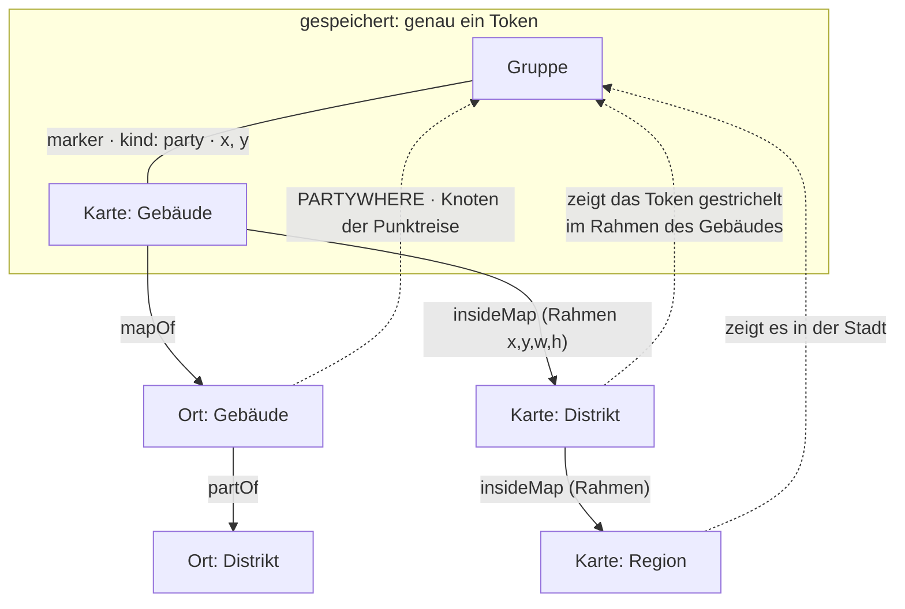

**Wo die Gruppe ist.** Genau eine Stelle: ihr Token (`marker`, `kind:
party`) auf der feinsten Karte, auf der sie steht. Der Ort ist die Marke,
auf der es steht, sonst der Ort der Karte (`mapOf`); der Knoten der
Punktreise ist dieser Ort oder der Knoten, in dem er liegt (`partOf`); jede
gröbere Karte bildet das Token durch den Rahmen ihrer Unterkarte ab
(`insideMap`), ohne ein zweites zu halten. Weiterziehen setzt das Token um.
`Party.at` war ein Feld daneben und ist seit dem 7.10. weg (A6).

**Der Zug auf der Karte (D56, REQ-206–210; Grössen D58, REQ-224).** Gerechnet wird beim Lesen,
gespeichert nur, was danach gilt:

| | Regel | Wo |
|---|---|---|
| Z1 | **Diagonalen 5-10-5 je Kreatur und Zug** (D52). Die Parität gehört zum Suchzustand des Weges (Dijkstra über Feld × Parität), läuft über Wegpunkte und über mehrere Bewegungen desselben Zuges weiter und fängt mit jedem Zug neu an. Wände (`blocksMove`) halten den Schritt von Feldmitte zu Feldmitte, eine Ecke hält mit; Gegner sind nicht passierbar, Verbündete passierbar, aber kein Ziel. | `packages/model` `movement.ts` (`cheapestPath`, `pathVia`, `reachable`), Prototyp `moveGrid` |
| Z2 | **Das Tempo des Zuges ist eine Zahl** und steht im **Sitzungszustand** (`SessionState.moves`: `token`, `turn`, `speed`, `used`, `parity`), nicht an der Kreatur. Die Kurzwahl (Grundtempo, Spurt ×2, Klettern/Schwimmen mit eigenem Tempo oder ½) setzt nur die Zahl (`speedPresets`); jede weitere Ausnahme ist eine andere Zahl. Ein Eintrag mit einem anderen `turn` gilt als frisch (`currentMove`). | Modell, Prototyp `turnKey` |
| Z3 | **Eine Zonenart ist ein Regelartikel** (`ZoneKind` erbt von `Rule`), wo sie liegt, sagt die Kante `zone` (Form wie `territory`, aufs Gitter gerastert). Gerechnet werden `moveCost` (Faktor auf das betretene Feld), `light`, `obscured` und `hiddenUntil` (versteckt bis passive Wahrnehmung n, `zone.props.found`); gezeigt und beim Betreten in `SessionState.log` geschrieben werden Schaden, Rettungswurf, Zustand und die Beschreibung als freie Regel. | Prototyp `zonesAt` |
| Z4 | **Gesehen wird mit Sichtlinie, Licht und passiver Wahrnehmung** gegen `marker.props.stealth` (−5 im Dämmerlicht und in leicht verdeckten Feldern, im Dunkeln nur mit Dunkelsicht). Dieselbe Prüfung dient dem Aufdecken von Hand („sees / seen by“) und **entlang des bestätigten Pfads**, Schritt für Schritt; dabei weicht auch der Nebel im Sichtkreis. | `sight.ts` (`notices`, `lightAt`), Prototyp `sightCheck` |
| Z5 | **Versteckt ist eine Angabe an der Kante** (`marker.props.hidden`): Spielende sehen versteckte Tokens und unentdeckte Zonen nicht, und der Weg, den sie sich rechnen lassen, kennt nur, was sie sehen. Zurückhalten muss am Server `redactEntity` (offen). | Prototyp `tokenShown` |
| Z6 | **Eine Kreatur nimmt Felder nach ihrer Grösse ein** (D58, REQ-224, Regeln 2014): tiny, small, medium ein Feld — tiny darf es teilen (es hält Verbündete nicht ab, und es darf auf ihnen stehen) —, large 2 × 2, huge 3 × 3, gargantuan 4 × 4. Die Grösse wird **beim Lesen** vom Statblock genommen (`Statblock.size`; eine Instanz über `resolveInstance`), nicht am Token gespeichert (D8); ohne Statblock oder Grösse ein Feld. Gezeichnet wird das Token in der Grösse seines Platzes; nur was keine Kreatur ist, behält die Breite an der Kante (`marker.props.size`). | `sizeSpan`, `statblockSize`, Prototyp `tokenSpan` |
| Z7 | **Gespeichert ist die Mitte des Platzes, gerechnet über seine Ecke.** `marker.props.x/y` ist die Mitte (bei einem Feld die Feldmitte wie bisher, bei 2 × 2 eine Rasterecke); der Rechner sucht über den **Anker** — das Feld oben links (`anchorAt`, `footprintCentre`). Ein Klick oder ein Ziehen meint die Mitte: bei 2 × 2 setzt er den Platz auf die nächste Rasterecke. | `movement.ts`, Prototyp `tokenAnchorAt`, `anchorMid` |
| Z8 | **Der ganze Platz muss passen und jeder Schritt für jedes seiner Felder gehen**: kein Feld ausserhalb, gesperrt oder unbetretbar (Faktor `Infinity`), keine Wand quer durch den Platz, und keine Wand, die den Schritt für eines seiner Felder hält (Ecke hält mit). Andere Kreaturen sperren mit ihrem **ganzen Platz** (Gegner) bzw. sind dort kein Ziel (Verbündete); die Reichweite eines Gegners (Meiden) ist der Ring um seinen ganzen Platz, 5 ft (`footprintRing`). **Ein Schritt kostet nach dem teuersten Feld, das er neu betritt** (D58) — nicht nach der Summe und nicht nach Feldern, die der Platz schon belegt. 5-10-5 bleibt. | `cheapestPath` (`MoveGrid.span`, `share`) |
| Z9 | **Gesehen wird vom ganzen Platz zum ganzen Platz**: von irgendeinem Feld des eigenen zu irgendeinem Feld des Ziels; gilt das erste Paar, das sieht, sonst das, das am weitesten kam (`bestNotice`). Dasselbe beim Aufdecken entlang des Pfads; der Sichtkreis im Nebel geht von der Mitte des Platzes aus, um seine halbe Breite weiter. | `sight.ts` (`pairsOf`, `spaceLineOfSight`, `bestNotice`), Prototyp `sightFrom` |

Dazu die beiden Abfragen, die wie Daten aussehen: die **Gegenrichtung einer
Kante** (`backlinks`) und **was gerade gilt** (§8).

---

## 7. Vorlage und Instanz

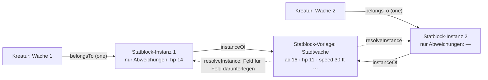

Ein Statblock darf aus einer **Vorlage** lesen: die Kante `instanceOf` zeigt
auf sie, gespeichert wird an der Instanz **nur, was abweicht**, gelesen wird
beides zusammen (`resolveInstance`), Feld für Feld.

| | Regel |
|---|---|
| V1 | **Gleich wie die Vorlage heisst: folgt der Vorlage.** Beim Speichern fällt weg, was gleich steht (`thinInstance`); den Wert der Vorlage eintragen oder das Feld leeren heisst, ihr wieder zu folgen. |
| V2 | **Kanten nach Art:** die Aktionen der Vorlage (`composedOf`) kommen mit, solange die Instanz keine eigenen hat; eine geänderte Liste gehört ganz ihr. |
| V3 | **Nicht vererbt:** `Identity`, `Visibility` und die Kanten, die zur Vorlage als Artikel gehören (`inLayer`, `belongsTo`, `overrides`, `variantOf`). |
| V4 | **Eine Vorlage darf selbst Instanz sein**; gelesen wird die Kette hoch, ein Kreis bricht ab. |
| V5 | **Instanzen stehen an ihrer Kreatur und sonst nirgends** — nicht in Listen, nicht als Verweisziel. |
| V6 | **Löschen nimmt nichts weg:** geht die Vorlage, bekommen die Instanzen vorher, was sie lasen (`detachInstance`); geht die Kreatur, geht ihre Instanz mit. |
| V7 | Am Server kommt eine Instanz aufgelöst an, mit `fromTemplate` (Vorlage, geerbte Felder) — nur gelesen, nie gespeichert. |

Welche Arten Vorlagen haben dürfen, sagt die Kante (`instanceOf.from`/`to`),
heute `Statblock` und `Item` (M4: das +1-Langschwert am Tisch ist eine
Instanz des Langschwerts), und `to: same` hält die Instanz in der Art ihrer
Vorlage. Ein eigener Typ dafür wäre derselbe Typ ein zweites Mal.

---

## 8. Ebenen und Stapel

| Zeile | Was sie sagt |
|---|---|
| Artikelart `Layer` | `kind` (`system` · `expansion` · `book` · `adventure` · `world` · `pack` · `campaign` · `overrides` · `group`), `order`, und die **Beschreibung** (T-088, REQ-245): `abbreviation` (das Kürzel, unter dem ihre Artikel die Quelle nennen, „XGE"), `published`, `author`, `version` (Regelstand, „2014"), bei Abenteuern `levels` und `storyline`; der volle Titel ist der Name. An einer Gruppe sagt `groupBy` (`category` · `publisher`, T-094), wonach sie ordnet (E10). `kind` ist **Beschreibung**, keine Regel — ausser `group` (E8): eine Gruppe enthält Ebenen. Die Ausfuhr lässt `system`/`expansion`/`book`/`adventure` als Regelwerk weg. |
| Kante `partOf` (Layer → Layer) | die Ebene gehört zu dieser **Gruppe** (E-022 b, T-088); eine Ebene darf in mehreren sein, eine Gruppe in einer Gruppe |
| Kante `inLayer` (`*` → Layer) | der Artikel liegt in dieser Ebene; `props.mode` `adds` (Vorgabe) oder `removes` |
| Kante `activates` (Campaign → Layer, „Layers in play" / „In play in") | die Kampagne schaltet die Ebene auf; `props.order` ordnet, sonst `Layer.order`. Gepflegt auf der Kampagnenseite (Häkchen und Reihenfolge, `PUT /api/campaigns/:c/layers`) |
| `activates` mit `props.mode: 'compare'` | **Vergleichsebene** (T-092, E-021 d): nicht im Spiel, ihre Fassungen stehen auf Wunsch an den Feldern und lassen sich übernehmen. Zählt nicht für `activeStack`, `campaignsOf`, `campaignsActivating` und die Ausfuhr. Gepflegt auf der Kampagnenseite (`PUT /api/campaigns/:c/compare`) |
| `activates` mit `props.mode: 'off'` | **ausdrücklich aus** (T-088): die Ebene ist nicht im Spiel, auch wenn eine aufgeschaltete Gruppe sie brächte. Ohne Gruppe tut die Kante nichts. Gepflegt auf der Kampagnenseite (`PUT /api/campaigns/:c/layers` mit `off`) |
| `activates` mit `props.areas` / `props.types` | **was die Ebene bringt** (T-105, REQ-255): Bereiche (`area` der Art, geerbt) und einzelne Arten; ein Artikel passt, wenn seine Art genannt ist oder ihr Bereich. Ohne beide: alles. Gilt an aufgeschalteten Ebenen, an Gruppen (die Mitglieder tragen die Auswahl ihrer Gruppe, eine ausdrückliche Kante ihre eigene) und an Vergleichsebenen. Gepflegt auf der Kampagnenseite (`PUT /api/campaigns/:c/layers/:layer/only`) |
| Feld `Campaign.compareFor` | wer die Vergleichsebenen sieht: `gm` (Vorgabe — Verwaltung, `gm`, `co-gm`) oder `players` (jede Rolle am Tisch) |
| Kante `overrides` (`*` → `*`, one) | der neue Artikel gilt statt des alten, solange seine Ebene läuft. **So passt eine Kampagne ein Abenteuer an** (E-018 a, T-082): „Adapt" (`POST /api/entities/:id/adapt`, `adaptedVersion`) legt eine Fassung mit denselben Karten und Kanten in die Ebene der Kampagne (`campaignLayer`) — seit T-098 auch „Edit" an einem fremden Artikel, in eine Ebene, in der man schreibt (§ 9.4); zurück heisst, die Fassung zu löschen |
| Kante `variantOf` (`*` → `*`, one) | eine Kopie mit Herkunft; sie ersetzt nichts |

| | Regel |
|---|---|
| E1 | **Ohne `inLayer` gehört ein Artikel der Kampagne und ist immer da.** Das ist der Normalfall und kostet keine Zeile. |
| E2 | **Was gilt, ist eine Abfrage** (`inStack`, `resolveArticle`, `inPlay` in `packages/model/src/stack.ts`): ein Artikel steht im Stapel, wenn eine aufgeschaltete Ebene ihn bringt und keine spezifischere ihn herausnimmt; Überschreibungen werden bis zum Ende der Kette verfolgt, nicht im Kreis. Gelöscht wird dabei nie. **Der Server siebt damit zuerst** — vor Sichtbarkeit und Wissen, für jeden, auch die Verwaltung (A2, 7.10.); die laufende Kampagne ist die Einstellung `campaign`, sonst die erste. Ohne irgendeine Kampagne gilt alles. |
| E2a | **Ohne Aufschalten ist ein Artikel einer Ebene nicht da** — er ist nicht gelöscht, er steht nur in keiner Liste der Kampagne. Sobald es eine Kampagne gibt, zeigt der Server nur, was ihre aufgeschalteten Ebenen bringen, und Artikel ohne Ebene; eine Ebene, die sie nicht aufschaltet (z. B. ein Buch aus 5e.tools nach dem Einlesen), bleibt mit all ihren Artikeln aussen vor. **Darum sagen es die Listen** (T-069): `/api/list` zählt je Ebene, was mit denselben Filtern fehlt, weil die laufende Kampagne die Ebene nicht aufschaltet (`unactivatedLayers`, Feld `unactivated`), und Kompendium, Bereiche und Board-Suche zeigen es mit „Turn on" für wer darf. Was eine aufgeschaltete Ebene herausnimmt oder eine Fassung überschreibt, zählt nicht — das ist Absicht. Das Register zählt je Art beides: im Stapel und gespeichert. |
| E2b | **Aufschalten dürfen die Verwaltung und die Leitung (`gm`) der Kampagne**, wie bei den Mitgliedern; ein Mitleiter sieht die Liste. Eine Ebene, die genau **einer anderen** Kampagne gehört (E3), schaltet nur die Verwaltung dazu — sonst würde sie gemeinsam, und die Leitung sähe, was dort nur deren Leitung sieht (`mayActivate`). Neu aufgeschaltet steht eine Ebene, wo ihre `Layer.order` sie hinstellt; danach ordnet die Kante. |
| E3 | **Wem ein Artikel gehört, sagt der Stapel** (`campaignsOf`): eine Ebene, die genau eine Kampagne aufschaltet, gehört ihr; eine, die mehrere aufschalten, ist gemeinsam; ohne Ebene ist er niemandem zuzuordnen. `removes` zählt nicht. |
| E4 | **Instanzen und Varianten** erben die Ebene nicht (V3). |
| E5 | **Ein Verweis aufs Original führt zur Fassung, die gilt** (E-018, T-082): der Server liefert beim Öffnen, in den Namen der Kantenziele und in den Treffern von `[[…]]` die Fassung, die in der laufenden Kampagne das Original ersetzt (`resolveArticle`), und die Rückbezüge einer Fassung sammeln auch, was aufs Original zeigt (`replacedIds`) — die Szenen eines angepassten Kapitels bleiben seine. Die Seite zieht die Adresse nach. Das Original selbst sieht in dieser Kampagne niemand; es bleibt für jede andere. |
| E6 | **Fassungen derselben Sache** (`versions.ts`, T-092, E-021 d): zwei Artikel derselben Art, verbunden über `variantOf` (in beide Richtungen) oder `overrides`, mit demselben Namen nach Abzug eines angehängten „ (Buch)" der eigenen Quelle (`versionName`, `sameThing`); `overrides` zählt immer. Die Gruppe ist alles, was so erreichbar ist (`versionsOf` je Artikel, `versionGroups` für eine Liste — beide ein Gang über den Bestand). Es gibt **keinen Umschalter**: die Artikelseite zeigt an jedem Feld, an jeder Kantenart und an jedem Text, was eine Fassung aus einer Spiel- oder Vergleichsebene anders sagt (`versionDiff`), mit dem Kürzel ihrer Ebene (`layerShort`) — **an genau der Stelle, an der es gelesen wird** (T-103): ein langer Text Abschnitt für Abschnitt unter seinen Überschriften (`textSections`, `sectionDiff`; was nur die Fassung hat, unter seiner eigenen Überschrift), die Zeilen eines Statblocks, Zaubers oder Gegenstands nach Beschriftung (`linesDiff`), ein Feld, das nur die Fassung füllt, an seinem Platz mit „—", auch in der Maske; Kantenziele gleichen Namens zählen nicht als Abweichung; ein- und ausschaltbar und je Ebene, gemerkt am Konto (`app_user_pref`, Schlüssel `versions`). Das Kompendium zeigt eine Zeile je Sache, Kopf ist die Fassung aus der obersten Spielebene (`/api/list?versions=1`). Die Fassungen eines Artikels: `GET /api/entities/:id/versions`. |
| E7 | **Übernehmen** (T-092): die Leitung macht eine Fassung aus einer Vergleichsebene zur geltenden — `POST /api/campaigns/:c/adopt {version, over}` legt eine **Kopie** in die Ebene der Kampagne (`campaignLayer`) mit `overrides` → `over` und `variantOf` → `version`, mit dem Namen von `over` — wie „Adapt" (E5), nur aus einer Vergleichsebene und mit der Herkunft in `variantOf`. Keine Kante am Buchartikel: eine Überschreibung in einer geteilten Ebene gälte in jeder Kampagne, die sie aufschaltet. Rückgängig: `DELETE /api/campaigns/:c/adopt/:kopie`. |
| E8 | **Gruppen sind Ebenen, die Ebenen enthalten** (E-022 b, T-088, REQ-244; `resolvedStack`, `groupMembers`, `layersInGroup` in `stack.ts`). Schaltet die Kampagne eine Gruppe auf, sind alle Mitglieder im Spiel, verschachtelt auch deren Mitglieder, nicht im Kreis. **Den Rang gibt die Gruppe**: an ihrer Stelle im Stapel steht sie selbst, darüber ihre Mitglieder nach `Layer.published` (ohne Datum zuletzt), das neuere höher; bringen zwei Gruppen dieselbe Ebene, zählt die höhere. **Die ausdrückliche Kante schlägt die Gruppe:** eine Ebene, die die Kampagne selbst aufschaltet, steht an ihrer eigenen Stelle; eine mit `mode: 'off'` ist aus, und was nur über sie käme, auch — aus schlägt an. Gerechnet wird einmal je Anfrage (`playStack`, T-086); die Mitglieder werden einmal gesammelt. **Wem eine Ebene gehört (E3), sagt nur die ausdrückliche Kante** — eine Gruppe macht ihre Mitglieder nicht zu Eigentum; dafür schaltet eine Leitung eine Gruppe nur auf, wenn sie jedes Mitglied aufschalten dürfte (`mayActivate`, E2b). Eine Gruppe ist kein Ort für neue Artikel (`campaignLayer`). Der Importer legt die Gruppen aus der 5e.tools-Gruppe an (Core rules, Supplements, Settings, Adventures, Unearthed Arcana, 2024 rules, Screens & other); eigene legt die Leitung als Ebene mit `kind: 'group'` an. |
| E9 | **Eine Ebene beschreibt sich selbst** (T-088, REQ-245): Kürzel, Erscheinen, Autor, Regelstand, Stufen und Handlungsstrang stehen an `Layer`, der Importer füllt sie (`import --layers` trägt sie an bestehenden Ebenen nach, ohne einen Artikel anzufassen), die Leitung darf sie ändern. **Was sie enthält, wird gerechnet** (D8): `GET /api/campaigns/:c/layers` zählt je Ebene ihre Artikel je Art (`content`). Ein Quellenkürzel zeigt überall seinen vollen Titel (`GET /api/sources`: Kürzel → Name, aus `Layer.abbreviation`). |
| E10 | **Der Herausgeber ist eine Gruppe** (T-094, REQ-249; `publisherOf`, `groupingOf` in `stack.ts`). Neben den Kategorien (E8) ordnen Gruppen mit `Layer.groupBy: 'publisher'` nach Herausgeber: Official (Wizards of the Coast), Partnered, Third party. Ein Buch steht in einer Kategorie- *und* einer Herausgeber-Gruppe; aufgeschaltet bringt jede ihre Mitglieder wie in E8. **Der Herausgeber einer Ebene wird gerechnet** (`publisherInfo`): die Namen der Herausgeber-Gruppen, an denen sie mit `partOf` hängt; hängt sie an keiner, ist sie „Homebrew", wenn sie hier angelegt wurde (von einem Konto, mit einer Kampagne — alles ausser den Pegs `e5_…` des Importers), sonst „Unassigned" (T-109). Ein Feld `publisher` daneben wäre die zweite Stelle. **Sichtbar und änderbar an der Ebene** (T-109): die Artikelseite einer Ebene zeigt „Publisher" mit dem Grund („Because this layer is part of the publisher group Official." / „Not part of any publisher group."), und für die Verwaltung und wer die Ebene besitzt eine Auswahl, die die `partOf`-Kante zur Herausgeber-Gruppe setzt (`GET`/`PUT /api/layers/:id/publisher`; Kanten zu Kategorien bleiben). Auf der Kampagnenseite steht der Grund an der Marke (`publisherWhy`). **„D&D 5e (2014)" ist eine Gruppe** (Kategorie, kein Herausgeber) aller offiziellen Ebenen mit Regelstand 2014; was kein Buch nennt (die Aktionsarten), liegt in „D&D 5e (2014) — no book given" unter Official (Migration 044, der Importer ebenso). `groupBy` zählt für den Stapel nicht; es sagt nur, in welcher Ansicht der Kampagnenseite (group by category / publisher) die Gruppe steht. Der Importer legt die Herausgeber-Gruppen aus den 5e.tools-Quelldaten an (Partner-Quellen nach `5etools-src/js/parser.js`) und zusätzlich die Kategorien der Content Blocklist, die E8 nicht hat (Non-standard, Comedy, Outside the Forgotten Realms); Regel und unklare Fälle: [5etools-Abgleich › Herausgeber](5etools-Abgleich.md#herausgeber-und-blocklist-kategorien-t-094). `GET /api/sources` nennt je Kürzel auch den Herausgeber (`publishers`), damit Listen und die Vorschau ihn als Marke zeigen. |
| E11 | **Eine Ebene liest sich als Buch** (T-091, REQ-247, `readingOrder` in `packages/model/src/reading.ts`): ihr Text sind die Artikel der Ebene von einer Leseart (`READING_TYPES`: `Chapter`, `Story`, `Arc`, `Scene`, dazu die Teile, E14), verbunden über `partOf`. **Hat die Ebene Kapitel, liest sie sich aus ihnen** (E14): jedes Kapitel eine Wurzel und ein Stück, darunter seine Teile nach `partOf.rank`; ins Inhaltsverzeichnis kommen Kapitel, Szenen und Überschriften (`toc`), eine Überschrift so tief, wie ihre Stufe sagt. Sonst gilt der Baum aus Story, Arc und Szene: Geschwister stehen nach ihrer Nummer (`Identity.id`), gelesen wird Tiefe zuerst. Gezeigt wird **ein Stück am Stück**: hat die Ebene genau eine Wurzel (das Abenteuer), ist sie die Titelseite und jedes Kapitel darunter ein Stück, sonst jede Wurzel. Karten (`mapOf`) und Begegnungen (`partOf`) stehen an ihrem Abschnitt. Gesiebt wird wie überall (E2, Sichtbarkeit, Wissen); eine Fassung steht an der Stelle ihres Originals (E5), der Baum bleibt der des Originals. Die Seite eines Abschnitts ist `Source.page`, bei `Story`/`Scene` (ohne `Source`) die Notiz `source` des Importers — darüber springt „XGE p. 12" an die Stelle (`nodeAtPage`). **Teile in der Leseansicht** (T-108): Absätze, Vorlesetexte und Verweise stehen ohne Kopf im Fluss des Stücks; ein Verweis-Teil bringt sein Ziel gesiebt mit (`target`), fällt es durchs Sieb, steht an der Stelle nichts; `?at=` und ein Suchtreffer dürfen ein Absatz sein (der Server findet sein Stück). Fürs Verzeichnis siebt der Server nur dessen Einträge. |
| E12 | **Ein Teil eines Abenteuers in die eigene Geschichte holen** (T-097, E-026, REQ-252; `takenWith`, `rehang` in `stack.ts`): `POST /api/entities/:id/take {into}` macht aus einem Kapitel (`Arc`) oder einer Szene **samt allem darunter** — was über `partOf` oder `mapOf` daran hängt, in jeder Tiefe: Szenen, Räume, Begegnungen, Karten — Fassungen in der Ebene der laufenden Kampagne (`overrides`, wie E5; E-018 a). Die Teile hängen an den Fassungen ihrer Eltern, das Geholte selbst nur noch an `into`: der Kampagne oder einem ihrer Arcs (`refs.takeInto` sagt, welche). Eine Fassung, die es schon gibt, wird genommen und nur umgehängt — zweimal holen legt nichts doppelt an. Holen darf, wer in der Ebene der Kampagne schreibt: Verwaltung, `gm`, `co-gm` (T-098). Nicht dasselbe wie „Übernehmen" (E7, aus einer Vergleichsebene). **Ein Kapitel und ein einzelner Teil** (T-108, E-028): ein `Chapter` lässt sich wie ein Arc holen (mit allen Teilen und Szenen darunter), ein Teil (`ReadAloudText`, `Paragraph` …) einzeln — dann auch in eine eigene Szene der Kampagne; beide stehen im Ziel an der nächsten Stelle (`partOf.rank`, `nextRank`). **Verwenden statt holen** (`take {into, use: true}`): statt einer Fassung legt der Server einen `Embed` in der Kampagnenebene an, der aufs Original zeigt — eine Korrektur am Original erreicht ihn, ändern heisst, den Teil doch zu holen. Ein geholtes Kapitel macht die Kampagnenebene nicht zum Buch: `readingOrder` liest eine Ebene nur dann aus Kapiteln, wenn sie eigene hat (keine Fassung). |
| E13 | **Teilweise aufschalten** (T-105, REQ-255; `filterOf`, `withFilter`, `resolvedEntries` in `stack.ts`): eine Kante `activates` darf mit `areas` und `types` sagen, was ihre Ebene bringt — aus einem Abenteuer nur Regeln und Gegenstände, nicht seine Orte, NSC und Begegnungen. **Was nicht passt, bringt die Ebene nicht, in keiner Rolle**: nicht als Artikel, nicht als Herausnahme (`removes`), nicht als Überschreibung. Der Bereich ist der der Art (`areaOf`, die `extends`-Kette hoch); die Arten werden genau genommen (ein `Weapon` ist nicht `Item`). Eine Gruppe gibt ihre Auswahl an alle Mitglieder weiter (E8), eine ausdrückliche Kante eines Mitglieds hat ihre eigene. Ein abgewählter Artikel zählt nicht als „nur nicht aufgeschaltet" (`unactivated`, T-069): die Ebene ist an, die Leitung hat ihn abgewählt. Gerechnet wird der Bereich einmal je Art und Anfrage (`playStack(…, registry)`, T-086); **ohne Register gilt die Bereichsauswahl nicht** (lieber zu viel als still ein ganzes Buch weg) — wer einen Stapel rechnet, gibt es mit. Die Kampagnenseite zeigt je Ebene und Gruppe „Brings: everything" zum Aufklappen, je Bereich ein Häkchen mit Zähler, darunter die Arten; sind alle an, schickt sie keine Auswahl, damit eine neue Art mitkommt. |
| E14 | **Ein Buch besteht aus Kapiteln, ein Kapitel aus Teilen** (T-108, E-028, E-029; `partsIndex`, `isBookPart` in `packages/model/src/parts.ts`). `Chapter` ist die Lesestruktur eines Buchs oder Abenteuers (ohne Bereich); seine Teile sind eigene Artikel unter dem abstrakten `BookPart` — `Heading` (Text im Namen, `level`), `Paragraph` (`Prose.paragraph`, `kind`: text, list, table, sidebar, quote), `ReadAloudText` (`ReadAloud.readaloud`), `Embed` (`target`: ein Artikel, der für sich steht, etwa ein Monster aus dem Monster Manual — er bekommt keine Kante, die stünde in einer fremden Ebene) — und im Abenteuer Szenen, die selbst wieder Teile haben. **Die Reihenfolge steht an der Kante** (`partOf.props.rank`): derselbe Vorlesetext darf im Kapitel an dritter und in einem eigenen Arc an erster Stelle stehen; `partOf` ohne `rank` hängt etwas an (eine Begegnung an ihre Szene) und steht nicht im Fluss. **Ein Kapitel eines offiziellen Abenteuers gibt es zweimal und seine Teile einmal:** als `Chapter` zum Lesen und als `Arc` zum Spielen, verbunden über `chapterOf` (Chapter → Arc); beide zeigen auf dieselben Szenen. **Teile stehen in keiner Liste und sind kein Verweisziel nach Namen** (`isBookPart` in `linkFinder`, `linkCandidates`, der Liste und den Werten einer Art): ein Absatz heisst nach seinen ersten Worten (`partName`), eine Überschrift wie die Regel darunter; die Nummer bleibt ein Ziel. **Auf der Artikelseite** eines Kapitels, einer Szene oder eines Arcs zeichnet das Layout-Element `parts` (in der Grundanordnung `full`, Migration 047) die Teile wie im Buch (`GET /api/entities/:id/parts`; eine Fassung hat die Teile ihres Originals dazu); unter „Linked here" stehen sie nicht. Ein Textblock ist sonst ein Feld (F-Regeln) — Buchtext ist die Ausnahme, weil man einen Absatz einzeln wiederverwendet. |

Offen und benannt: der Server kennt heute nur E3; E2 läuft im Prototyp
(siehe [Durchgang.md](Durchgang.md), Abgleich). Mit einer zweiten Kampagne
braucht jede ihre eigene Ebene — E1 stimmt bei einer.

---

## 9. Sichtbarkeit, Rollen, Wissen

**Zwei Fragen, und die grobe kommt zuerst.** Die Sichtbarkeit sagt, ob ein
Artikel an jemanden geht; das Wissen sagt, welche Felder darin.

### 9.1 Sichtbarkeit (`Visibility`, `articleVisible`)

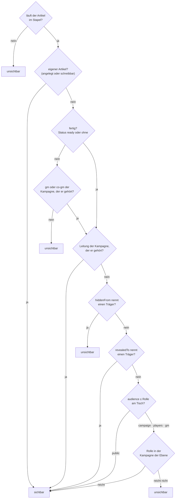

Träger eines Betrachters: seine Figuren, deren `Party` (`memberOfParty`)
und deren `Faction` (`memberOf`) — einen Schritt weit.

| Feld | Werte | Bedeutung |
|---|---|---|
| `audience` | `public` (Vorgabe) · `campaign` · `players` · `gm` | jedes Konto · jedes Konto mit Rolle am Tisch · `player`, `co-gm`, `gm` · `gm`, `co-gm` |
| `revealedTo` | Träger | ausdrücklich freigegeben |
| `hiddenFrom` | Träger | ausdrücklich verborgen |

`hiddenFrom` schlägt `revealedTo` schlägt `audience`. Träger sind `Creature`,
`Party`, `Faction` — dieselben drei wie `knownBy`. Gefragt wird die
Rolle in **der** Kampagne, der der Artikel gehört (E3); gehört er keiner
einzelnen, zählt die stärkste Rolle irgendwo. **Vererbt wird nichts.** Wer
durchfällt, bekommt in der Liste nichts und beim Einzelabruf 404. Die
Verwaltung (`is_admin`) sieht alles.

**Spieler und Gruppe in der Auswahl** (T-100, E-007). Die Maske bietet in
`revealedTo` und `hiddenFrom` auch **Spieler** an — gespeichert werden ihre
Figuren, nie das Konto (REQ-199): ein Spieler zu wählen heisst, die
Figuren zu wählen, die er heute in der laufenden Kampagne führt
(`GET /api/players`, ohne Konto-Id). Eine Figur, die er später bekommt,
ist nicht mitgemeint; wer „alle Spieler" meint, nennt die Gruppe.
**Jede Kampagne hat eine Gruppe**: beim Anlegen (`pt_<kampagne>`, in ihrer
Ebene, `partyOf`), für ältere Migration 039. Bekommt ein Konto mit Rolle
`player` eine Figur zugeteilt (Kampagnenseite oder Einladung), kommt sie
in die erste Gruppe dieser Kampagne (`memberOfParty`, `inDieGruppe`) —
ausser sie steht schon in einer, oder die Leitung sagt `party: false`.
Danach ist es eine gewöhnliche Kante an der Figur und wird dort geändert.

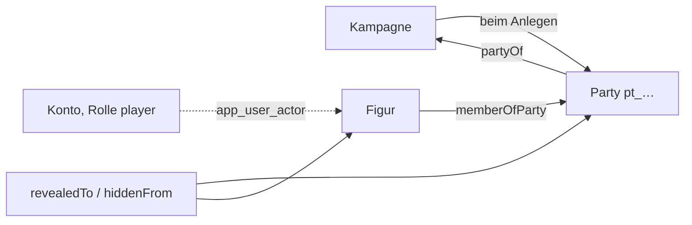

**Der Vorbereitungsstand ist Teil der groben Frage** (REQ-237, D72): wer
nicht `gm` oder `co-gm` der Kampagne ist, der der Artikel gehört, sieht nur
Artikel mit `Status.status: ready` — **ein Artikel ohne Status-Karte oder
ohne Wert zählt als fertig** (`isReady`), sonst verschwände, was keinen
Stand trägt. **Eigenes sieht man in jedem Stand**: was das Konto angelegt
hat (`app_user_article`) oder schreiben darf (seine Figuren samt dem, was an
ihnen hängt) — der Server gibt es als `Viewer.own` mit. Das gilt überall,
wo gesiebt wird: Liste, Artikel, Verweise, Rückbezüge, Auswahlen.

**Die eigene Figur ist ausgenommen** (E-014 d, D74): ein Spielercharakter,
der einem Konto zugeteilt ist (`app_user_actor`), samt seinem Statblock
(`belongsTo`, auch eine Instanz) und seinem Inventar (`carries`) geht nach
der gewöhnlichen Sichtbarkeit an die Mitspielenden, in jedem Stand — der
Server gibt die Figuren *aller* Konten als `Viewer.ungated` mit.

**Der letzte fertige Stand gilt** (E-012, D74): fiel ein Artikel nach einer
Änderung einer Spielerin auf `prepared` zurück, bekommt, wer den
Arbeitsstand nicht sieht (`seesUnfinished`: nicht Leitung, nicht Eigenes),
die Kopie von vorher aus `entity_ready` — in Liste, Artikel und als
Zusammenhang des Siebs. Wer ihn sieht, bekommt den neuen Stand mit dem
Datum des alten (`refs.ready`) und mit `?stand=ready` den alten.

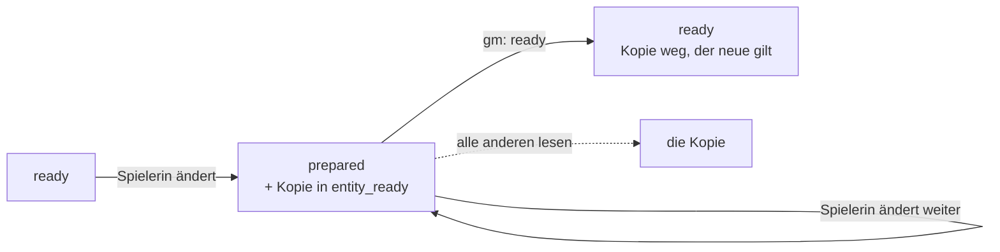

### 9.2 Rollen

Die Rolle am Tisch steht **am Konto, je Kampagne**: `gm` · `co-gm` · `player`
· `spectator`. Am Server `campaign_member (campaign_id, user_id, role)` neben
`app_user_actor` (welche Figuren ein Konto führt); im Prototyp die Sammlung
`members`. Gepflegt auf der Kampagnenseite (Element `members`) von Leitung
und Verwaltung; `gm` und `co-gm` sehen dasselbe. In keinem Artikel.

### 9.3 Wissen (`Information`, `Knowledge`, `redactEntity`)

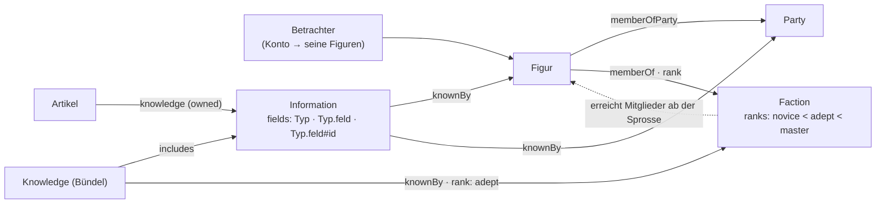

```
Artikel     --knowledge-->  Information        (owned)
Knowledge   --includes-->   Information        (ein Bündel; ein Schritt weit)
Information | Knowledge --knownBy--> Creature | Party | Faction
```

`Information.fields` nennt, was sie beansprucht: `Typ` (alle Felder des
Typs), `Typ.feld`, `Typ.feld#id` (ein Eintrag). **Was keine Information
nennt, liegt offen.** Ein Betrachter ist die Liste seiner Figuren; eine Figur
zählt einen Schritt weit auch als ihre `Party` (`memberOfParty`) und ihre
`Faction` (`memberOf`). **Eine Fraktion weiss nichts, ihre Mitglieder
wissen:** `Faction.ranks` ist die Leiter, `memberOf.props.rank` die Sprosse,
und `knownBy.props.rank` an einer Zuteilung an die Fraktion ein Mindestrang
(A7, REQ-203). Ohne Betrachter liest die Leitung.

Zurückgehalten wird **am Server**: Felder, die eine ungewusste Information
beansprucht; die Felder aus der Einstellung `gmFields`
(`Secrets.secret`, `Tactics.tactics`), es sei denn, eine gewusste
Information gibt einen Eintrag frei; der Name, wenn beansprucht — dann steht
der Deckname (`Identity.cover`). Kanten bleiben. Eine zweite Prüfung in der
Maske gibt es nicht.

### 9.4 Schreiben

Die Verwaltung schreibt alles. Ein Spieler schreibt seine Figuren und was an
ihnen hängt (`carries`, `holds`, `crafting`), **und was er selbst angelegt
hat** (D72). **Anlegen** darf, wer in der laufenden Kampagne `player` ist —
jede Art, die einen Stand trägt (E-013); der Server legt den Artikel in die
Ebene der Kampagne (`campaignLayer`: die spezifischste aufgeschaltete, die
keine andere Kampagne aufschaltet), auf `idea` oder `prepared`, und vermerkt
die Verfasserin neben dem Konto (`app_user_article`), nicht im Artikel
(REQ-199). Eine angelegte Spielerfigur führt sie gleich. **`ready` setzen
die Verwaltung und `gm` der Kampagne, der der Artikel gehört**, nicht
Spielende und nicht `co-gm`; der Server prüft es, auch wenn die Status-Karte
fehlt. Dafür schreibt `gm` die Artikel, die Spielende angelegt haben.
**Ausgenommen ist die eigene Figur** (E-014 d, D74): der Spieler schreibt
auch ihren Statblock (`belongsTo`) und setzt bei Figur, Statblock und
Inventar den Stand selbst, auch `ready`. **Ändert eine Spielerin einen
anderen fertigen Artikel, fällt er auf `prepared`** (E-012, D74), und der
Stand davor bleibt als Kopie (`entity_ready`, Migration 027) — jede
Änderung zählt, ein Speichern ohne Änderung nicht. Setzt `gm` wieder
`ready` (in der Maske oder per `POST /api/entities/:id/ready`), gilt der
neue und die Kopie fällt weg; ändert `gm` selbst, fällt nichts zurück. Was
wartet, listet `GET /api/unready` (Werkbank, „Not ready, by players"). Das
Register schreiben die Verwaltung und `gm` der laufenden Kampagne.

**Schreibrechte je Ebene** (T-098, E-001): jedes Konto schreibt, was
**ganz** in Ebenen liegt, in denen es schreibt (`inWritableLayers`: jede
Ebene, die den Artikel bringt, ohne `removes`) — ein Artikel, der auch im
geteilten Regelwerk liegt, änderte sonst dort mit. In welchen Ebenen ein
Konto schreibt, steht **neben dem Konto** (`app_user_layer`, Migration 035;
`owner` heisst: besitzt sie und sagt, wer sonst darin schreibt), und dazu
schreiben **`gm` und `co-gm` die Ebene ihrer Kampagne** aus ihrer Rolle.
**Eine eigene Ebene legt jedes Konto an** (`POST /api/layers`) und besitzt
sie; sie wirkt, sobald die Leitung sie aufschaltet. **Jede Kampagne hat
ihre Ebene** (`campaignLayer`: die spezifischste aufgeschaltete, die keine
andere Kampagne aufschaltet, keine Gruppe ist und **keinem Konto gehört** —
die aufgeschaltete eigene Ebene einer Spielerin wird nicht zur
Kampagnenebene); eine neue Kampagne bekommt sie beim Anlegen
(`ly_<kampagne>`, `kind: 'campaign'`, Spezifität 100), eine ältere legt
Migration 035 an. **Was nicht in den eigenen Ebenen liegt, ändert man als
Fassung:** „Edit" an einem fremden Artikel — auch einem ohne Ebene, der
bleibt bei der Verwaltung — legt über `POST /api/entities/:id/adapt` eine
Fassung (E5) in eine eigene Ebene, die im Spiel ist (`zielEbenen`; bei
mehreren `{ layer }`). `ready` bleibt bei `gm`: ändert die Mitleitung oder
eine Spielerin in ihrer Ebene etwas Fertiges, fällt es zurück wie oben.

### 9.5 Handwerk: gelernt und gebunden (D55)

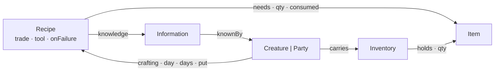

- **Eine Blaupause wird gelernt, und gelernt heisst zugeteilt** (REQ-218):
  jede Information am Rezept erreicht die Figur über `knownBy` (selbst,
  Gruppe, Fraktion — dieselbe Abfrage wie in 9.3). Ein Rezept **ohne**
  Information hat niemand gelernt; bis D52 hiess das „offen". Teilwissen
  ist nicht gelernt. Ob ein Rezept **dasteht**, sagt weiter
  `articleVisible`; ungelernte stehen gestrichelt mit „must still be
  learned", ohne Fundort. „Lehren" legt, wo nötig, eine Information ohne
  Felder an — sie hütet nichts, sie ist das, was man lernen kann.
- **Filter der Werkbank:** gelernt · alle; machbar · fast (1–2 fehlende
  **Posten**: je Zutat einer, das Werkzeug einer); nach Material (welche
  Rezepte es über `needs` nennen); nach Beruf (`Recipe.trade`) oder
  Werkzeug (`Recipe.tool`).
- **Material wird beim Start gebunden** (REQ-219): was das Rezept braucht
  und dabei ist, verlässt das Inventar und steht in `crafting.props.put` —
  auch, was nicht verbraucht wird. Fehlt etwas, darf trotzdem begonnen und
  unterwegs nachgelegt werden (Aufgabe #34); Vorgabe ist das nicht mehr.
  Das Werkzeug wird geprüft, nicht gebunden (es ist ein Name aus den
  Werkzeug-Artikeln, keine Kante — verglichen mit der Werkzeugübung, F13).
- **Was zurückkommt:** was nicht verbraucht wird, immer; das Übrige beim
  Misslingen und beim Abbruch nach `Recipe.onFailure` (`nothingLost` alles,
  `halfLost` die abgerundete Hälfte, `materialsLost` nichts); beim Gelingen
  nichts davon. Ein Gang aus der Zeit vor D55 ist dieselbe Kante mit
  weniger in `put`: nicht Verbrauchtes zählt dann in der Hand, und er
  läuft weiter.

---

## 10. Ansichten und Anordnung

Drei Ansichten, und der Ort wählt sie:

| Ansicht | Wo | Zeigt |
|---|---|---|
| `overview` | ein Verweis, eine Listenzeile | Beschreibung und die Felder, die die Art dafür wählt — **die Spalten im Kompendium** |
| `quick` | eine Kachel auf dem Board, die Schnellanlage | Bild, Beschreibung, Felder, Prosa |
| `full` | die Artikelseite | alles |

**Eine Listenzeile ist `overview`** (W7): welche Spalten das Kompendium
für eine Art zeigt und wonach es filtert, sagen die `fields`-Elemente ihrer
`overview`-Anordnung (`listColumns` in `views.ts`: `Typ.feld` oder ein
Typname für alle seine Felder, ohne gerechnete). Ein Feld mit
`enum`/`enumRef` wird ein Filter mit Häkchen, eine Zahl (oder ein Text,
der fast überall eine Zahl ist, wie der HG „1/4") eine Spanne. Heute sagen
es Zauber (Grad, Schule, Dauer, Konzentration, Ritual), Statblock (HG,
Grösse, Typ, Gesinnung), Gegenstand (Art, Seltenheit, Einstimmung), Waffe,
Rüstung, Aktion, Merkmal, Talent, Sprache, Klasse, Unterklasse,
Abstammung, Zustand, Gefahr, Gottheit, Tabelle, Regel und Kreatur. Eine
Art ohne eigene `overview` erbt die ihres Obertyps; sagt keiner etwas,
hat die Zeile keine Spalten ausser Name und Quelle.

**Nur die Kachel auf dem Board wählt** (REQ-161, `placementView`): zuerst
die Platzierung (`placed.props.view`), dann die Regel des Boards je Art
(`Board.rules`, die `extends`-Kette hoch), und sagt keiner etwas, **die
Grösse** — eine Kachel bis 110 px Höhe ist eine Zeile und zeigt `overview`,
eine höhere eine Karte und zeigt `quick`. Wer sie grösser zieht, bekommt
die Karte, ohne etwas auszuwählen.

**Ein Board gehört über `partOf` zu seinem Geschichtsartikel** (REQ-205):
Kampagne, Arc (auch ein Abenteuerkapitel), Sitzung — nicht Szene, die ist eine
Karte auf dem Board ihrer Sitzung. Ein Board ohne die Kante ist ein
Regel-Board. Eine eigene Kante `boardOf` wäre eine zweite Hierarchie neben
`partOf`, mit Rückbezügen, die niemand neben „contains" sucht. Die Liste
der Boards und ihr Pfad „Kampagne › Kapitel › Sitzung" kommen ohne einen
ganzen Artikel aus: `/api/list?rel=partOf` schickt die Kante je Zeile mit
(W7).

Eine Spieleransicht gibt es nicht: gesiebt wird am Server, alle sehen
dieselbe Ansicht. **Die Sicht eines Mitglieds** (REQ-241) ist darum keine
Ansicht, sondern ein anderes Konto in derselben Rechnung: mit `X-View-As`
siebt der Server für die Leitung als dieses Mitglied, nur zum Lesen
(siehe [Zugang.md](Zugang.md#die-sicht-eines-mitglieds-req-241-e-019-a)). Für `overview` und `quick` wählt eine Art **nach Gruppe**
(ein Typname in `except`), nicht Feld für Feld.

**Die Anordnung wohnt am Typ** (`views.full` usw.) und ist eine geordnete
Liste von Elementen; `layoutFor` läuft die Kette hoch, sonst gilt die
Grundanordnung der Ansicht (`fields` · `linked` · `prose` · `composed` ·
`relations` · …). Jedes Element ist eine Zeichenfunktion im Code — **Daten
sind Zeilen, Darstellung ist Code.**

| Element | Zeichnet |
|---|---|
| `heading`, `text` | eine Überschrift, einen festen Text |
| `description`, `image` | die Beschreibung, das Bild |
| `fields` | die Feldtabelle: `fields: 'all'` oder `['Typ', 'Typ.feld']`, `except`, `columns` |
| `prose` | die Prosafelder, mit Anlegen und Bearbeiten an Ort und Stelle |
| `linked` | die Felder der Teil-Artikel (§5.3), mit eigenen Eingaben |
| `composed` | die eingesetzten Regeln (`section`-Kanten), Variablen aufgelöst |
| `relations` | die Kanten als Liste |
| `standing` | die Beziehungen (`regards`), vorwärts und zurück |
| `knowledge` | der Artikel nach Informationen geordnet |
| `sheet`, `inventory`, `crafting` | Bogen, Kachelraster, Werkbank |
| `map`, `board`, `initiative`, `live` | Karte, Leinwand, Initiative, Sitzungsschirm |
| `quests`, `timeline`, `prep`, `table`, `crawl` | Auftragsbrett, Zeitleiste, Vorbereitung, Tabelle, Punktreise |
| `stack`, `members` | der Ebenenstapel, die Konten am Tisch |
| `statblock`, `spell`, `item` | **wie im Buch** (W2): Statblock wie im MM (Kopf kursiv, Kopfzeilen, sechs Werte in einer Reihe, Saves bis Challenge, Abschnitte aus `composedOf` je Aktionsart), Zauber wie im PHB (Casting Time, Range, Components, Duration, At Higher Levels), Gegenstand wie im DMG (Art, Seltenheit, Einstimmung kursiv; AC, Schaden, Preis, Gewicht). Jedes zeichnet **alle** Felder seiner Karten (`BOOK_CARDS`, `book.ts`), was keine Stelle im Buch hat als Zusatzzeile; die Feldtabelle derselben Anordnung nimmt diese Karten mit `except` heraus. Masse in der Einheit von `units` |
| `tabs` | benannte Gruppen desselben Layouts |

**Was kein Element zeichnet, steht am Ende.** Die Artikelseite der
Oberfläche kennt noch nicht jedes Element (Bogen, Inventar, Karte …); ein
Feld, das nur dort stünde, setzt sie unter die Anordnung, statt es zu
verschweigen.

---

## 11. Bezeichner und Namen

| Was | Wo | Regel |
|---|---|---|
| die Id | `entity.id` | undurchsichtig, nie wiederverwendet; keine Herkunft darin (REQ-163) |
| die Nummer | `Identity.id` | `art-0042`, beim Anlegen ausgegeben (`nextId`: das Höchste plus eins), `readOnly`; überlebt den Wechsel der Art |
| der Name | `entity.name` und `Identity.name` | die Überschrift; beide gleich |
| Aliasse | `Identity.aliases` | Vorschläge und Verweise finden sie |
| Deckname | `Identity.cover` | steht statt des Namens, solange der Name beansprucht und ungewusst ist |
| Verweis im Text | `[[npc-0042|Anzeige]]`; als Eingabe auch `[[Name]]` | zuerst über die Nummer (`Identity.id`), sonst über Name und Alias (`linkCandidates`, ohne Instanzen). Beim Speichern wird ein eindeutiger Name zur Nummer (`idLinks`, M11); ein mehrdeutiger bleibt stehen und sagt es, statt den ersten Treffer zu nehmen; einer ohne Artikel bietet das Anlegen an |
| Eintrags-Id | `Typ.feld#id` | aus dem Text gebildet, eindeutig je Artikel, übersteht einen Import |

---

## 12. Was ausserhalb der Artikel steht

| Was | Wo | Wandert mit der Ausfuhr |
|---|---|---|
| Konten, Passwörter, Sitzungen, Einladungen, Fehlversuche | Server: `app_user`, `app_session`, `app_invite`, `login_attempt` | nein (REQ-199) |
| welche Figuren ein Konto führt | `app_user_actor` | nein |
| wer einen Artikel angelegt hat (D72) | `app_user_article` | nein |
| wer in welcher Ebene schreibt, wer sie besitzt (T-098) | `app_user_layer` | nein |
| der letzte fertige Stand eines zurückgefallenen Artikels (D74) | `entity_ready` | nein |
| wo ein Konto in einem Buch stehen blieb (T-091) | `reading_position` (Konto, Ebene, Abschnitt) | nein |
| wie jemand liest — Fassungen an den Feldern an/aus, welche Ebenen (T-092) | `app_user_pref` (Konto, Schlüssel, JSON) | nein |
| Rolle je Kampagne | `campaign_member`; Prototyp: Sammlung `members` | nein |
| Verwaltung der Installation | `app_user.is_admin` | nein |
| das Register | Tabellen `interface_def`, `relation_def`, `view_def`, `unit_def`, `var_def`, `enum_def` (Aufzählungen), `setting_def` (Einstellungen, seit Migration 019); Prototyp: Sammlung `registry` | ja — allein weiterreichbar (`register-datei.mjs`) |
| Einstellungen | Registerteil `settings` | ja |
| Dateien | Asset-Ablage (`AssetStore`, 12.1); der Artikel `Asset` trägt `backend`, `ref`, `mime`, Masse | der Artikel ja, die Bytes nein — die Ausfuhr nennt sie (`files`) |
| Ereignisse | `event_log` | nein |
| Augenblicke (Würfe, Zeigen) | der Raum-Kanal, nicht gespeichert | nein |

### 12.1 Bilder (T-114, REQ-021, E-032)

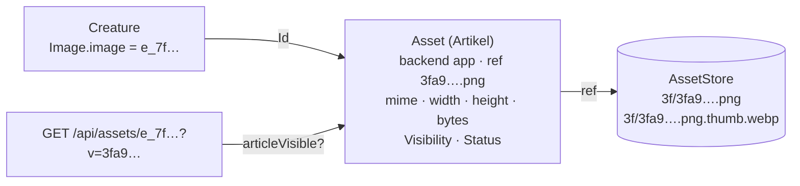

| Nr | Regel | Wo |
|---|---|---|
| B1 | **Ein Bild ist ein Asset-Artikel und eine Datei.** Ein Feld mit `format: 'asset'` (`Image.image`, `token`, `background`) hält die **Id des Artikels**; die Datei kennt nur er (`Asset.ref`). Eine fremde Adresse ist ein Asset mit `backend: external` und der Adresse in `ref`. | `bilder.ts` |
| B2 | **Die Datei heisst nach ihrem Inhalt:** `<sha256>.<endung>`, die Vorschau (480 px, WebP) `<…>.thumb.webp`. Dieselbe Datei liegt einmal da, auch wenn zwei Assets sie nennen; sie geht erst mit dem letzten. Ein `ref`, das nicht so aussieht, liest die Ablage nicht (`validKey`). | `assets.ts` |
| B3 | **Hochladen legt den Artikel an** (`POST /api/assets`, multipart) — mit den Regeln von `POST /api/entities`: wer dort nicht anlegt, lädt nichts hoch; durch `validateEntity`. Angenommen werden JPEG, PNG, WebP, GIF, AVIF, geprüft am Inhalt; **kein SVG**. Ein Foto verliert sein EXIF (der Aufnahmeort) und wird aufgerichtet. Grenze `ASSET_MAX_MB` (40). | `bilder.ts` |
| B4 | **Aus einem Artikel heraus** (`for`) übernimmt das Asset dessen `audience`, `revealedTo`, `hiddenFrom`, Stand und Ebene: das Bild eines verborgenen NSC ist nicht öffentlich. Ohne Status-Karte zählt der Artikel als fertig, das Bild auch; wer `ready` nicht setzen darf, bekommt `idea` (D74). Das Bild der eigenen Figur nennt ihr Spieler fertig (E-014 d). | `bilder.ts`, `anlegen` |
| B5 | **Ausgeliefert wird nur, was sichtbar ist** (`GET /api/assets/:id`, `?size=thumb`): das Sieb über den Asset-Artikel; sonst 404. `private`; mit `?v=<hash>` für immer im Browser, ohne `ETag` und 304. | `bilder.ts` |
| B6 | **Die Ablage ist eine Schnittstelle** (`AssetStore`): heute eine Dateiablage im Volume (`ASSET_DIR`, E-032 a), in Tests im Speicher. Ein Wechsel heisst Dateien umkopieren — kein Artikel ändert sich. | `assets.ts` |

---

## 13. Das Register heute

Erzeugt aus `packages/registry` — nicht von Hand ändern:
`pnpm --filter @nw/registry catalogue` schreibt diesen Abschnitt und
[Artikeltypen.md](Artikeltypen.md) neu.

<!-- register:anfang -->
Stand 2026-10-14: 54 Artikelarten, 24 Grundtypen, 59 Kantenarten, 6 Aufzählungszeilen, 14 Einheiten, 6 Variablen.

### Grundtypen

| Grundtyp | Felder | genommen von |
|---|---|---|
| `Abilities` | `str` `strMod*` `dex` `dexMod*` `con` `conMod*` `int` `intMod*` `wis` `wisMod*` `cha` `chaMod*` `initiative*` `passivePerception*` | `Statblock` |
| `BookPart` | — | 4 |
| `Choices` | `choices` | 6 |
| `Description` | `description` | 25 |
| `Difficulty` | `difficulty` | `Scene` `Encounter` |
| `Effects` | `effects` | `Item` |
| `Facts` | `fact` | `Creature` `Item` `Information` |
| `Identity` | `name` `id` `aliases` `cover` | 26 |
| `Image` | `image` `caption` `alt` | 15 |
| `Lore` | `lore` | 17 |
| `Notes` | `note` | 26 |
| `Proficiencies` | `proficient` `expertise` `saves` | 5 |
| `Prose` | `paragraph` | 26 |
| `ReadAloud` | `readaloud` | 7 |
| `Secrets` | `secret` | 15 |
| `Source` | `publication` `page` `anchor` `url` `srd` | 12 |
| `Status` | `status` | 23 |
| `Tactics` | `tactics` | `Statblock` `Scene` `Encounter` |
| `Tags` | `tags` | 26 |
| `Time` | `sort` `display` `untilSort` `until` `duration` | `Story` `Quest` `Event` |
| `Todos` | `items` | 4 |
| `Vars` | `bindings` | `Creature` `Rule` `Statblock` |
| `Visibility` | `audience` `revealedTo` `hiddenFrom` | 26 |
| `Vitals` | `hp` `hpTemp` `hitDiceLeft` `deathSuccess` `deathFail` `inspiration` `conditions` `nat1` `slotsUsed` | `Creature` |

Ein `*` am Feld heisst gerechnet.

### Artikelarten

Die Grundausstattung (`Identity`, `Status`, `Description`, `Visibility`, `Tags`, `Notes`, `Prose`) nimmt jede Art und steht nicht dabei; „erbt" nennt die übrigen direkten Obertypen.

**World**

| Art | erbt | eigene Felder | Kanten von hier | Kanten hierher | Anordnung |
|---|---|---|---|---|---|
| `Armor` | `Item` | `ac` `armorType` `strength` `stealthDisadvantage` | `casts` `hasProperty` `carries` `instanceOf` | `equips` `holds` `needs` `yields` `loot` `instanceOf` | overview |
| `Article` | `Source` `Todos` `Lore` `Secrets` | — | — | `describedIn` | — |
| `Creature` | `Image` `Source` `Vars` `Vitals` `Lore` `Facts` `Secrets` `ReadAloud` | `appearance` `personality` `species` `kind` `role` `attitude` `figure` | `worships` `owes` `memberOf` `livesIn` `memberOfParty` `carries` `crafting` `regards` | `belongsTo` `owes` `questGiver` `features` `knownBy` `participates` `regards` | overview, full |
| `Deity` | `Image` `Source` `Lore` `Secrets` | `pantheon` `title` `alignment` `domains` `symbol` `province` `plane` | — | `worships` | overview |
| `Event` | `Time` `Lore` `Secrets` `ReadAloud` | `kind` | `partOf` `involves` | `partOf` | — |
| `Faction` | `Image` `Lore` `Secrets` | `kind` `color` `ranks` `goal` | `worships` `controls` `regards` | `memberOf` `questGiver` `features` `knownBy` `regards` | — |
| `Hazard` | `Image` `Source` `Secrets` | `kind` `category` `tier` `threat` `trigger` `duration` `effect` `countermeasures` `initiative` | — | — | overview |
| `Item` | `Image` `Source` `Lore` `Secrets` `Facts` `Effects` | `itemType` `rarity` `tier` `attunement` `attunementNote` `charges` `recharge` `rechargeAmount` `bonusWeapon` `bonusAc` `bonusSpellAttack` `bonusSave` `appliesTo` `availability` `copperPrice` `stackSize` `weight` `rows` `width*` `height*` `cells*` | `casts` `hasProperty` `carries` `instanceOf` | `equips` `holds` `needs` `yields` `loot` `instanceOf` | overview, full |
| `Material` | `Item` | `materialType` `trades` | `casts` `hasProperty` `carries` `instanceOf` | `equips` `holds` `needs` `yields` `loot` `instanceOf` | — |
| `Party` | `Image` `Lore` | `level` `motto` `day` `watch` `sinceRation` `sinceLight` `actions` | `abilityPool` `partyOf` `carries` `crafting` `regards` | `memberOfParty` `knownBy` `participates` `regards` | full |
| `Place` | `Image` `Lore` `ReadAloud` `Secrets` | `kind` `environment` `state` `arrival` | `partOf` `tableFor` `route` | `livesIn` `partOf` `controls` `happensAt` `mapOf` `route` | full |
| `PlayerCharacter` | `Creature` | `backstory` `level*` `proficiency*` | `worships` `casts` `hasClass` `hasAncestry` `hasBackground` `chose` `owes` `memberOf` `livesIn` `memberOfParty` `carries` `crafting` `regards` | `belongsTo` `owes` `questGiver` `features` `knownBy` `participates` `regards` | — |
| `Weapon` | `Item` | `category` `damage` `damage2` `damageType` `range` `ammoType` | `casts` `hasProperty` `carries` `instanceOf` | `equips` `holds` `needs` `yields` `loot` `instanceOf` | overview |
| `World` | `Image` `Lore` | `calendar` | — | `inWorld` | — |

**story**

| Art | erbt | eigene Felder | Kanten von hier | Kanten hierher | Anordnung |
|---|---|---|---|---|---|
| `Arc` | `Story` | `levelFrom` `levelTo` `hook` `outcome` | `partOf` `happensAt` `features` `onMap` `loot` `tableFor` | `partOf` `chapterOf` `mapOf` | — |
| `Campaign` | `Story` | `compareFor` `languages` `feats` | `allowsMethod` `allowsEquipment` `partOf` `happensAt` `features` `onMap` `loot` `tableFor` `inWorld` `activates` | `partOf` `chapterOf` `partyOf` `mapOf` | full |
| `Quest` | `Todos` `Time` `Lore` `Secrets` | `progress` `reward` `deadline` `restriction` `tasks` | `partOf` `questGiver` `questAbout` `loot` | — | full |
| `Scene` | `Story` `Tactics` `Difficulty` | `mode` | `partOf` `happensAt` `features` `onMap` `loot` `tableFor` | `partOf` `chapterOf` `mapOf` | — |
| `Session` | `Story` | `activeScene` `activeEncounter` `activeMap` `nowPlaying` `moves` `log` `partyNote` `stewardship` | `partOf` `happensAt` `features` `onMap` `loot` `tableFor` | `partOf` `chapterOf` `mapOf` | full |
| `Story` | `Todos` `Time` `Lore` `Secrets` `ReadAloud` | `kind` `played` `summary` | `partOf` `happensAt` `features` `onMap` `loot` `tableFor` | `partOf` `chapterOf` `mapOf` | — |

**Rules**

| Art | erbt | eigene Felder | Kanten von hier | Kanten hierher | Anordnung |
|---|---|---|---|---|---|
| `AbilityMethod` | `Rule` | `method` `scores` `budget` `costs` `dice` `count` `scope` | `affects` | `composedOf` `affects` `allowsMethod` `abilityPool` `grants` | overview |
| `Action` | `Rule` | `actionType` `recharge` `uses` `attack` `ability` `toHitBonus` `reach` `range` `target` `damageDice` `damageBonus` `damageType` `extraDamageDice` `extraDamageType` | `affects` | `composedOf` `affects` `grants` | overview |
| `ActionType` | `Rule` | `per` `count` | `affects` | `composedOf` `affects` `grants` | — |
| `Ancestry` | `Rule` `Proficiencies` `Choices` `Lore` `Image` | `size` `speed` `abilityBonus` `abilityNote` `age` `darkvision` `creatureType` `resistances` | `affects` `casts` `subraceOf` `grants` `tableFor` | `composedOf` `affects` `subraceOf` `hasAncestry` `chose` `grants` | overview |
| `Background` | `Rule` `Proficiencies` `Choices` `Lore` `Image` | `startingEquipment` | `affects` `grants` `tableFor` | `composedOf` `affects` `hasBackground` `chose` `grants` | — |
| `Class` | `Rule` `Proficiencies` `Choices` `Lore` `Image` | `hitDie` `primaryAbility` `startingEquipment` `startingGold` `multiclassRequirement` `multiclassProficient` `subclassTitle` `casterProgression` `spellAbility` | `affects` `grants` `tableFor` | `composedOf` `affects` `subclassOf` `hasClass` `chose` `grants` | overview |
| `Condition` | `Rule` | `kind` `stage` `recovery` | `stageOf` `affects` | `composedOf` `stageOf` `affects` `grants` | overview |
| `Disease` | `Condition` | `kind` `save` `dc` `incubation` `transmission` | `stageOf` `affects` | `composedOf` `stageOf` `affects` `grants` | — |
| `EquipmentMethod` | `Rule` | `method` `gold` `budget` `magic` `itemTypes` | `affects` | `composedOf` `affects` `allowsEquipment` `grants` | overview |
| `Feat` | `Rule` `Choices` | `prerequisite` `repeatable` | `affects` `grants` | `composedOf` `affects` `chose` `grants` `loot` | overview |
| `Feature` | `Rule` `Choices` | `featureType` | `affects` | `composedOf` `affects` `chose` `grants` | overview |
| `Information` | `Secrets` `Facts` | `fields` `tier` | `knownBy` | `knowledge` `includes` `loot` | — |
| `Inventory` | — | `capacity` `copper` `grid` `zones` | `holds` | `carries` | full |
| `ItemProperty` | `Rule` | `abbreviation` | `affects` | `composedOf` `affects` `grants` `hasProperty` | — |
| `Knowledge` | — | — | `knownBy` `includes` | — | — |
| `Language` | `Rule` | `languageType` `script` `typicalSpeakers` | `affects` | `composedOf` `affects` `grants` | overview |
| `Recipe` | `Source` `Secrets` `Lore` | `trade` `tool` `ability` `dc` `time` `days` `yieldCount` `onFailure` | `needs` `yields` | `crafting` | full |
| `Rule` | `Source` `Vars` | `kind` `autolink` | `affects` | `composedOf` `affects` `grants` | overview |
| `Skill` | `Rule` | `ability` | `affects` | `composedOf` `affects` `grants` `loot` | — |
| `Spell` | `Rule` | `level` `school` `castingTime` `castingAction` `castingUnit` `castingCondition` `rangeKind` `range` `components` `material` `materialCost` `materialConsumed` `duration` `durationAmount` `durationUnit` `concentration` `ritual` `higherLevels` `save` `attack` `damageTypes` | `affects` | `composedOf` `affects` `casts` `grants` | overview, full |
| `Statblock` | `Source` `Abilities` `Proficiencies` `Vars` `Tactics` `Lore` `Image` | `system` `size` `creatureType` `alignment` `ac` `acNote` `hp` `hpFormula` `speed` `cr` `prof` `carryExtra*` `combatRole` `senses` `languageNote` `resistances` `vulnerabilities` `immunities` `conditionImmunities` `legendaryActions` `bonuses` `token` `spellAbility` `casterLevel` `spellSlots` `spellDc*` `spellAttack*` | `composedOf` `belongsTo` `casts` `equips` `instanceOf` | `features` `participates` `instanceOf` | overview, quick, full |
| `Subclass` | `Rule` `Proficiencies` `Choices` `Lore` `Image` | `shortName` `casterProgression` `spellAbility` | `affects` `casts` `subclassOf` `grants` `tableFor` | `composedOf` `affects` `chose` `grants` | overview |
| `Table` | `Source` `Secrets` | `kind` `die` `columns` `rows` | `entry` | `tableFor` | overview, full |
| `ZoneKind` | `Rule` | `moveCost` `light` `obscured` `hiddenUntil` `damage` `damageType` `save` `saveDC` `condition` `trigger` | `affects` | `composedOf` `affects` `grants` `zone` | — |

**Play**

| Art | erbt | eigene Felder | Kanten von hier | Kanten hierher | Anordnung |
|---|---|---|---|---|---|
| `Board` | — | `width` `height` `snap` `background` `rules` `shapes` `anchors` | `partOf` `placed` | — | full |
| `Encounter` | `Todos` `Tactics` `ReadAloud` `Secrets` `Difficulty` | `xpBudget` `phase` `round` `turn` `surprise` | `partOf` `participates` `onMap` `loot` `tableFor` | — | full |
| `Map` | `Image` `Secrets` `ReadAloud` | `sheets` `baseHidden` `baseGmOnly` `kind` `gridShape` `gridSize` `gridOffsetX` `gridOffsetY` `scale` `lighting` `fog` `reveal` `walls` `tiles` `tileCols` `tileRows` `tileSize` | `mapOf` `insideMap` `marker` `zone` `territory` | `insideMap` `onMap` | full |

**Ohne Bereich**

| Art | erbt | eigene Felder | Kanten von hier | Kanten hierher | Anordnung |
|---|---|---|---|---|---|
| `Asset` | `Image` `Source` | `backend` `ref` `mime` `width` `height` `bytes` | — | — | — |
| `Chapter` | `Source` | `ordinal` | `partOf` `chapterOf` | `partOf` | — |
| `Embed` | `BookPart` | `target` | `partOf` | — | — |
| `Heading` | `BookPart` | `level` | `partOf` | — | — |
| `Layer` | — | `kind` `order` `abbreviation` `published` `author` `version` `levels` `storyline` `groupBy` | `partOf` | `partOf` `inLayer` `activates` | — |
| `Paragraph` | `BookPart` | `kind` | `partOf` | — | — |
| `ReadAloudText` | `BookPart` `ReadAloud` | — | `partOf` | — | — |

### Kanten

| Kante | von → nach | eins | liest sich / setzt ein | Eigenschaften |
|---|---|---|---|---|
| `abilityPool` | Party → AbilityMethod |  | — | `values` `rolls` `at` |
| `activates` | Campaign → Layer |  | — | `order` `mode` `areas` `types` |
| `affects` | Rule → Rule |  | — | `effect` `on` `note` |
| `allowsEquipment` | Campaign → EquipmentMethod |  | — | — |
| `allowsMethod` | Campaign → AbilityMethod |  | — | — |
| `belongsTo` | Statblock → Creature | ja | Feld am `to`-Ende | — |
| `carries` | Creature \| Party \| Item → Inventory | ja | Feld am `from`-Ende | — |
| `casts` | Statblock \| PlayerCharacter \| Item \| Subclass \| Ancestry → Spell |  | — | `mode` `uses` `level` `charges` `fromLevel` |
| `chapterOf` | Chapter → Story | ja | — | — |
| `chose` | PlayerCharacter → Choices |  | — | `choice` `picks` `by` `level` |
| `composedOf` | Statblock → Rule |  | Abschnitt „Actions & traits" | `vars` `ability` `damageDice` `damageType` `reach` `range` `target` `toHitBonus` `damageBonus` `extraDamageDice` `extraDamageType` `toHit` `damageFlat` `note` |
| `controls` | Faction → Place |  | — | — |
| `crafting` | Creature \| PlayerCharacter \| Party → Recipe |  | — | `day` `days` `put` `rolls` |
| `describedIn` | * → Article |  | — | — |
| `entry` | Table → * |  | — | `weight` `qty` `label` `requiresTag` `note` |
| `equips` | Statblock → Item |  | — | — |
| `features` | Story → Creature \| Statblock \| Faction |  | — | — |
| `grants` | Class \| Subclass \| Ancestry \| Background \| Feat → Rule |  | — | `level` |
| `happensAt` | Story → Place |  | — | — |
| `hasAncestry` | PlayerCharacter → Ancestry | ja | — | — |
| `hasBackground` | PlayerCharacter → Background | ja | — | — |
| `hasClass` | PlayerCharacter → Class |  | — | `level` `subclass` |
| `hasProperty` | Weapon \| Item \| Armor → ItemProperty |  | — | — |
| `holds` | Inventory → Item |  | — | `qty` `tier` `slot` `gx` `gy` `rot` `attuned` `note` |
| `includes` | Knowledge → Information |  | — | — |
| `inLayer` | * → Layer |  | — | `mode` `addedAt` |
| `insideMap` | Map → Map | ja | — | `x` `y` `w` `h` |
| `instanceOf` | Statblock \| Item → same | ja | — | — |
| `involves` | Event → * |  | — | — |
| `inWorld` | Campaign → World | ja | — | — |
| `knowledge` | * → Information |  | owned | — |
| `knownBy` | Information \| Knowledge → Creature \| Party \| Faction |  | — | `rank` |
| `livesIn` | Creature → Place |  | — | — |
| `loot` | Encounter \| Story \| Quest → Item \| Information \| Feat \| Skill |  | — | `qty` `chance` |
| `mapOf` | Map → Place \| Story |  | — | — |
| `marker` | Map → * |  | — | `x` `y` `kind` `size` `rot` `ratio` `note` `light` `dim` `hidden` `stealth` |
| `memberOf` | Creature → Faction |  | — | `rank` `note` |
| `memberOfParty` | Creature → Party |  | — | — |
| `needs` | Recipe → Item |  | — | `qty` `consumed` `note` |
| `onMap` | Encounter \| Story → Map | ja | — | — |
| `overrides` | * → * | ja | — | `scope` `note` |
| `owes` | Creature → Creature |  | — | — |
| `participates` | Encounter → Creature \| Statblock \| Party |  | — | `label` `init` `hp` `hpMax` `ally` `conditions` `note` `revealed` `involved` `identified` |
| `partOf` | Place \| Story \| Quest \| Event \| Board \| Encounter \| Layer \| Chapter \| BookPart → Place \| Story \| Event \| Layer \| Chapter |  | — | `rank` |
| `partyOf` | Party → Campaign | ja | — | — |
| `placed` | Board → * |  | — | `x` `y` `w` `h` `view` `z` `locked` `note` |
| `questAbout` | Quest → * |  | — | — |
| `questGiver` | Quest → Creature \| Faction |  | — | — |
| `regards` | Creature \| Party \| Faction → Creature \| Party \| Faction |  | — | `tags` `note` |
| `route` | Place → Place |  | — | `hours` `terrain` `signal` `hidden` `oneWay` |
| `stageOf` | Condition → Condition | ja | — | — |
| `subclassOf` | Subclass → Class | ja | — | — |
| `subraceOf` | Ancestry → Ancestry | ja | — | — |
| `tableFor` | Place \| Story \| Encounter \| Class \| Subclass \| Ancestry \| Background → Table |  | — | — |
| `territory` | Map → * |  | — | `kind` `x` `y` `w` `h` `r` `pts` `color` `opacity` |
| `variantOf` | * → * | ja | — | — |
| `worships` | Creature \| Faction → Deity |  | — | — |
| `yields` | Recipe → Item | ja | — | — |
| `zone` | Map → ZoneKind |  | — | `kind` `x` `y` `w` `h` `found` `note` |

### Aufzählungszeilen

| Zeile | Wörter | genannt von |
|---|---|---|
| `Ability` | str · dex · con · int · wis · cha | `Proficiencies.saves` `Skill.ability` `Class.primaryAbility` `Class.spellAbility` `Subclass.spellAbility` `Disease.save` `Spell.save` `ZoneKind.save` `Statblock.spellAbility` `Recipe.ability` |
| `DamageType` | 13: acid · bludgeoning · cold · fire … | `Ancestry.resistances` `Action.damageType` `Action.extraDamageType` `Spell.damageTypes` `Weapon.damageType` |
| `DrawTime` | free action · bonus action · action · turn · round | `Inventory.zones` |
| `RuleKind` | rule · travel · sense · reward · boon · option | `Rule.kind` |
| `Size` | tiny · small · medium · large · huge · gargantuan | `Ancestry.size` `Statblock.size` |
| `State` | idea · prepared · ready | `Status.status` |

### Einheiten, Variablen, Einstellungen

- Einheiten: length · imperial: `ft` `in` `mi`; length · metric: `cm` `m` `km`; weight · imperial: `lb` `oz`; weight · metric: `g` `kg`; volume · imperial: `gal` `pt`; volume · metric: `ml` `l`
- Variablen: `ATK` `DMG` `DMG2` `DMGTYP` `DMGTYP2` `RNG`
- Einstellungen: `gridSize` `gridUnit` `inventoryCols` `inventoryRows` `carrySquares` `carryZones` `slotDraw` `handActions` `container:Backpack` `container:Bag of Holding` `today` `gmFields` `units` `travelRationEvery` `travelLightEvery` `travelWatchesPerDay`
<!-- register:ende -->

---

## 14. Was die Prüfung hält und was nur hier steht

| Regel | Gehalten durch |
|---|---|
| A1–A4, A6 (one), F1–F4 (Werte, Spanne, Einheit, Zieltyp), R3 und R6 | `validateEntity`, am Server und im Prototyp (R3 und R6 nur mit mitgegebenen Arten und `stageOf`; im Prototyp setzt `withCondition` die Stufe um, statt sie abzulehnen) |
| Schema des Registers (welche Angaben eine Zeile tragen darf) | `RegistrySchema` (zod) am Server |
| `measure` ohne `unit`, `link` ohne `target`, `asField` ist `one`, Grundausstattung, Bereiche aus dem Register, Bezugstreue des Seeds | `packages/registry/test` |
| T2 (Wort statt Zeile), T6, F7, K2, K3, R2, R4, die Familien, E1–E4, §9, §10 | **nur dokumentiert** — darum der Abgleich in [Durchgang.md](Durchgang.md) |
