# Datenmodell — das Konzept der Datenbasis

Stand 2026-10-07. **Das hier ist der Vertrag.** Was ein Artikel ist, was ein
Typ trägt, welche Formen ein Feld hat, was eine Kante darf, wie gelesen und
wie geschrieben wird — alles, was gilt, in einer Datei.

Drei Dateien gehören zusammen, und jede hat eine Aufgabe:

| Datei | Sagt | Gepflegt |
|---|---|---|
| **Datenmodell.md** (diese) | **was gilt** — die Regeln und die Formen | von Hand; der Abschnitt „Das Register heute" wird erzeugt |
| [Begriffe.md](Begriffe.md) | **warum** — die Entscheidungen und was nicht mehr gilt | von Hand |
| [Artikeltypen.md](Artikeltypen.md) | **jede Art im Einzelnen** — alle Felder, geerbt und eigen, alle Kanten, die Anordnung | erzeugt: `pnpm --filter @nw/registry catalogue` |

Dazu [Anforderungen.md](Anforderungen.md) — was gefordert war und was davon
steht — und [Durchgang.md](Durchgang.md), die gemessene Durchsicht der Arten
mit den offenen Entscheidungen.

Das ursprüngliche Konzept im Vault (`VTT/` in diesem Repo: `Schemas.md`,
`Data Definitions.md`, `Backbone Concept.md`, Stand 5.9.) ist durch diese
Datei **überholt**: Komponenten, `requires`/`allows`, `Access`,
`KnowledgeLevel`, `successorId`, `key` und die Facetten gibt es nicht mehr.

Sichtbare Namen und Bezeichner sind englisch; die Prosa hier ist deutsch und
nennt den Bezeichner dazu.

---

## 1. Die Bausteine

| Baustein | Was es ist | Wo es steht |
|---|---|---|
| **Artikel** (`Entity`) | Ein Ding in der Kampagne: eine undurchsichtige Id, eine Art, Karten mit Feldwerten, Kanten. | Tabellen `entity`, `component`, `relation`; im Prototyp die Sammlung `entities` |
| **Typ** (`InterfaceDef`) | Eine Registerzeile. Erklärt Felder und erbt über `extends` von beliebig vielen Typen. Abstrakt (ein Grundtyp) oder anlegbar (eine **Artikelart**). | Registerteil `interfaces` |
| **Karte** | Die Feldwerte eines Artikels zu **einem** Typ: `components[Typ]`. Benannt nach dem Typ, der die Felder erklärt. | im Artikel |
| **Feld** (`PropertySchema`) | Eine Tatsache, die ein Typ festhält: Schlüssel, Form, Einstellungen. | im Typ, `schema.properties` |
| **Kante** (`RelationDef`, `Relation`) | Eine typisierte, gerichtete Verbindung zweier Artikel mit eigenen Eigenschaften. Nur vorwärts gespeichert. | Registerteil `relations`; im Artikel `relations[]` |
| **Aufzählung** (`EnumDef`) | Eine benannte Wortliste, die mehrere Felder nennen. | Registerteil `enums` |
| **Einheit** (`UnitDef`) | Ein Mass und seine Umrechnung. | Registerteil `units` |
| **Variable** (`VarDef`) | Ein `{PLATZHALTER}` mit Vorgabe. | Registerteil `vars` |
| **Einstellung** | Ein Schlüssel und ein Wert je Kampagne, ohne Schema — ein Wort oder eine Zahl, nie eine Liste von Dingen, die eine Beschreibung bräuchten (F10). | Registerteil `settings` |
| **Ansicht** (`ViewDef`) und **Anordnung** (`LayoutElement[]`) | Wie ein Artikel gezeichnet wird: vier Ansichten, nach denen ein Ort fragt, und eigene; je eine Grundanordnung; eine Art darf sie anpassen oder ihre eigene tragen (T-110). | Registerteil `views`; `InterfaceDef.views` |

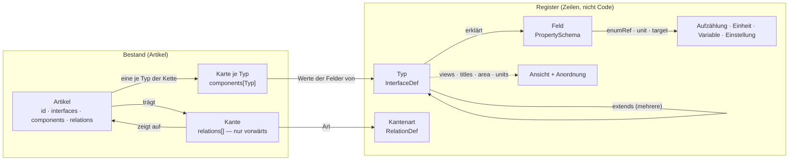

**Alles im Register ist eine Zeile.** Eine neue Artikelart, eine neue Kante,
eine neue Aufzählung ist ein Einfügen und keine Migration. Was im Code steht,
ist die Darstellung (die Layout-Elemente) und die Prüfung — nie die Liste
dessen, was es gibt.

---

## 2. Der Artikel

```json
{
  "id": "n_volo",
  "interfaces": ["Creature"],
  "name": "Volothamp Geddarm",
  "components": {
    "Identity":  { "name": "Volothamp Geddarm", "id": "npc-0003", "aliases": ["Volo"], "cover": "" },
    "Status":    { "status": "ready" },
    "Creature":  { "kind": "npc", "species": "Mensch", "attitude": "freundlich" },
    "Secrets":   { "secret": [{ "id": "secret-schuldet-floon", "value": "Schuldet Floon…" }] }
  },
  "adhoc": [],
  "relations": [
    { "id": "r1", "type": "livesIn", "to": "o_kerzengasse", "props": {} },
    { "id": "r2", "type": "regards", "to": "pa_wacht", "props": { "tags": ["dankbar"] } }
  ],
  "createdAt": "…", "updatedAt": "…", "revision": 4
}
```

Was dabei immer gilt:

| | Regel | Geprüft durch |
|---|---|---|
| A1 | **Die erste Art ist die Art.** `interfaces[0]` sagt, was der Artikel ist; alles, was er festhält, erklärt dieser Typ und seine Kette. | `validateEntity` (`unknown_interface`) |
| A2 | **Eine Karte je Typ**, und nur für Typen der `extends`-Kette. Das hält `hp` am Statblock von `hp` an der Figur auseinander. | `validateEntity` (`unknown_card`, `card_not_inherited`) |
| A3 | **Pflicht steht je Feld** (`schema.required`), und sie gilt für die ganze Kette. Heute: `Identity.name`, `Identity.id`, `Action.actionType`, `Asset.ref`. (`Rule.kind` ist es seit D48 nicht mehr: ein Zauber braucht kein zweites Wort für das, was sein Typ sagt.) | `validateEntity` (`missing_property`) |
| A4 | **Was dasteht, muss das Feld zulassen:** eine Aufzählung hält, eine Spanne hält, eine Zahl ist eine Zahl, ein Verweis zeigt auf seinen Zieltyp. | `validateEntity` (`value_not_allowed`, `value_out_of_range`, `value_not_a_number`, `link_wrong_type`) |
| A5 | **Gerechnetes wird nie gespeichert** (D8): ein Feld mit `derived` hat keine Eingabe und keine Spalte. | Prüfung weist es nicht ab; die Maske gibt keine Eingabe, die Rechnung liest beim Zeichnen |
| A6 | **Kanten nur vorwärts.** Die Gegenrichtung ist eine Abfrage (`backlinks`); ein gespiegeltes Gegenstück verwaist. `cardinality: 'one'` wird geprüft. | `validateEntity`, Server |
| A7 | **Schreiben geht durch `validateEntity`** — am Server vor jedem `PUT`, im Prototyp vor jedem `persist`. | Server, Prototyp |
| A8 | **Die Id ist undurchsichtig** und wird nie wiederverwendet. `Identity.id` ist die ausgegebene Nummer (`npc-0042`): beim Anlegen vergeben, `readOnly`, danach unverändert — auch bei einem Wechsel der Art. **Einzige Ausnahme: die Übernahme zwischen zwei Installationen** (T-130, §12.2) — prod vergibt die Nummer, und dev zieht nach, samt Verweisen. Die Id bleibt auf beiden Seiten dieselbe. | `nextId`, `readOnly`, `assignNumbers` |
| A9 | **`adhoc`** hält Felder, die nur dieser Artikel hat; befördern schreibt sie in den Typ (REQ-181). | Maske |
| A10 | **Was kein Artikel ist, steht nicht im Artikel:** Konten, Rollen, Sitzungen, Einstellungen. Siehe §12. | — |
| A11 | **Geschrieben wird gegen die gelesene Revision** (REQ-192). `revision` zählt der Server, je Schreiben eins mehr (Migration 030). Ein `PUT` nennt die Revision, die er gelesen hat; steht eine andere da — oder fehlt sie bei einem Artikel, den es schon gibt —, wird nichts geschrieben: `409` mit dem Stand, der gilt (`current`, gesiebt wie ein `GET`). Die Maske führt dann zusammen (`mergeEntity`, je Feld und je Kante) und fragt nur, wo beide Seiten dasselbe verschieden geändert haben. Ohne Revision wird nur angelegt; Einfuhr und Massenänderung schreiben ungeprüft, weil sie selbst vergleichen. | Server (`putEntity`, gesperrt mit `for update`), `mergeEntity` |

---

## 3. Typen

### 3.1 Drei Formen

| Form | Kennzeichen | Beispiel |
|---|---|---|
| **Grundtyp** | `abstract: true`; erklärt Felder, trägt keine Artikel | `Identity`, `Time`, `Vitals` |
| **Artikelart** | nicht abstrakt; hat einen Bereich (`area`), steht im Kompendium und in der Leiste, darf eine eigene Anordnung tragen | `Creature`, `Quest`, `Map` |
| **Aufzählung** | eine Zeile in `enums`: Name, Beschriftung, Wörter | `Ability`, `State` |

Ein Grundtyp darf einen Bereich tragen, damit seine Unterarten ihn erben
(`Story` → `story`). Eine Artikelart ohne Bereich (`Asset`, `Layer`) steht in
keiner Liste und wird über den Artikel erreicht, der sie braucht.

### 3.2 Was eine Typzeile trägt

| Angabe | Bedeutung |
|---|---|
| `name` | der Bezeichner, englisch, `UpperCamel` |
| `label` | die Beschriftung |
| `abstract` | Grundtyp oder Artikelart |
| `extends[]` | die Typen, aus denen er gemacht ist — **der erste zeichnet den Baum und entscheidet den Bereich**, alle bringen Felder, Kanten, Beschriftungen und Anordnungen mit |
| `schema.properties` | die eigenen Felder (§4) |
| `schema.required[]` | welche davon Pflicht sind |
| `area` | `world` · `story` · `rules` · `play` — geerbt. `story` ist, was nur die Kampagne betrifft (Kampagne, Sitzung, Szene, Auftrag); die Weltgeschichte (`World`, `Event`) steht unter `world` (bis 13.10. hiess `story` `history` und hielt beides) |
| `units` | `imperial` · `metric` · `both`; überschreibt die Einstellung — geerbt |
| `titles` | `Typ.feld` → eigene Beschriftung eines geerbten Feldes (`Time.until` → „Deadline" am Auftrag) — geerbt |
| `targets` | `Typ.feld` → eigenes Ziel eines geerbten Feldes (`Image.image` an der Karte: Kartenbilder, T-119); ersetzt `target` des Feldes ganz — geerbt (`fieldTarget`) |
| `views` | je Ansicht eine eigene Anordnung (Liste) oder eine Anpassung der geerbten (`{ adjust }`, T-110) — geerbt über `layoutFor` |

### 3.3 Vererbung

`typeChain(T)` ist der Typ selbst und **alle** Typen aus `extends`, rekursiv,
über jeden Zweig. Es gilt die Kette hoch:

- die **Felder** jedes Typs darin (je eine Karte),
- die **Kanten**, deren `from` oder `to` einen Typ der Kette nennt — eine
  Spielerfigur *ist* eine Kreatur,
- die **Zieltypen** von Verweisfeldern (`target.interfaces`) ebenso,
- `area`, `units`, `titles`, `targets`, `views`: der nächste Typ in der
  Kette, der etwas sagt, gewinnt.

Ein geerbtes Feld wird nicht einzeln ausgeblendet; wer es nicht will, nimmt
den Typ nicht. Umbenannt wird es über `titles`.

### 3.4 Die Grundausstattung

Jede Artikelart nimmt diese sieben Grundtypen (gemessen: 36 von 36):

| Grundtyp | Felder | Wozu |
|---|---|---|
| `Identity` | `name`!, `id`!, `aliases`, `cover` | wie der Artikel heisst und seine Nummer |
| `Status` | `status` (Zeile `State`: idea · prepared · ready) | der Vorbereitungsstand, sonst nichts |
| `Description` | `description` (lang) | die eine Beschreibung, die jede Ansicht zeigt |
| `Visibility` | `audience`, `revealedTo`, `hiddenFrom` | wer den Artikel überhaupt bekommt (§9) |
| `Tags` | `tags` | Marken |
| `Notes` | `note` (Prosa) | Notizen der Leitung |
| `Prose` | `paragraph` (Prosa) | der gewöhnliche Fliesstext |

Dazu nach Bedarf: `Image`, `Source`, `Time`, `Todos`, `Lore`, `Secrets`,
`Facts`, `ReadAloud`, `Tactics`, `Vars`, `Vitals`, `Proficiencies`,
`Choices`, `Effects`, `Abilities`, `Difficulty`, `Story`. Welche Art was nimmt, steht in §13.

### 3.5 Regeln für Typen

| | Regel |
|---|---|
| T1 | **Was mehrere Arten teilen, ist ein Grundtyp** und keine Komponente und keine Kopie (D27). Eine Feldgruppe, die eine Ansicht **als Ganzes** nennen muss (`except: ['Vitals']`), bleibt ein eigener Grundtyp, auch mit nur einem Nutzer. |
| T2 | **Ein Untertyp ohne eigene Felder ist ein Wort und keine Zeile.** `npc`, `companion`, `retainer` sind Werte von `Creature.kind`; `adventure` von `Story.kind`; `era`, `cataclysm`, `milestone` von `Event.kind`; ein Verbrauchsgut ist ein `Item.itemType`. Eine Zeile wird daraus, sobald sie eigene Felder braucht — `Session` ist eine, weil sie den Sitzungszustand trägt, `Arc` seit E-026, weil er Stufen, Hook und Ausgang trägt (ein Abenteuerkapitel ist ein Arc). |
| T3 | **Eine Art trägt ihre Felder selbst**; `requires`/`allows` gibt es nicht. |
| T4 | **Der Bereich steht am Typ** und wird geerbt; im Code steht keine Liste der Bereiche. |
| T5 | **Feldschlüssel und Beschriftungen sind englisch**; Aufzählungswerte, die Kampagneninhalt sind (`gewöhnlich`, `Gebäude`), bleiben in der Sprache der Kampagne. |
| T6 | **Derselbe Schlüssel darf in zwei Typen Verschiedenes heissen**, weil die Karte ihn unterscheidet (`Statblock.hp` ist das Maximum, `Vitals.hp` der Stand). Er darf es nicht, wenn beide Karten auf derselben Seite nebeneinanderstehen und sich widersprechen — dann hat einer von beiden den falschen Namen. |

---

## 4. Felder

### 4.1 Was ein Feld trägt

| Angabe | Bedeutung |
|---|---|
| Schlüssel | `lowerCamel`, englisch; die Karte heisst nach dem Typ, also sind Schlüssel nur je Typ eindeutig |
| `title` | die Beschriftung; ein Typ darf sie über `titles` ersetzen |
| `type` | `string` · `number` · `boolean` · `array` · `object` |
| `format` | die Form, siehe 4.2 |
| `enum` **oder** `enumRef` | eigene Wörter oder der Name einer Aufzählungszeile — nie beides; `enumRef` darf mehrere Zeilen nennen, die dann zusammen gelten, und seit M6 auch eine **Artikelart** (die Namen ihrer sichtbaren Artikel) oder `Typ.feld` (die Liste dieses Feldes) |
| `enumWhere` | je genannter Art ein Filter `{feld: [werte]}` — welche Artikel davon in Frage kommen (`Item` nur mit `itemType` tool …); Vorschlag für die Maske |
| `items` | bei `array`: die Form der Einträge |
| `many` | mehrere Einträge mit Id: `[{id, value}]` |
| `derived` | eine Rechnung gegen die Nachbarfelder derselben Karte, dann gegen die übrigen Karten des Artikels (§6) |
| `of` | der gerechnete Wert reitet in der Zelle des genannten Nachbarn (**DEX 16 (+3)**) |
| `unit` | bei einem Mass: die Einheit, in der der Wert gespeichert ist |
| `min`, `max` | eine Spanne |
| `default` | gilt beim Anlegen, nie rückwirkend |
| `target` | bei einem Verweis: `interfaces` (Regel), `tags`, `where` (Vorschlag für die Maske) |
| `alwaysEdit` | steht immer als Eingabe da (`Vitals.hp`) |
| `prominent` | steht beim Bearbeiten auch leer da (`Description.description`, `Status.status`, T-195) |
| `description` | ein Satz, was das Feld meint — gezeigt in „+ Add field“ (T-195) |
| `suggest` | ein freies Wort schlägt vor, was sichtbare Artikel darin tragen (`Creature.kind`) |
| `readOnly` | ausgegeben, nicht eingetippt (`Identity.id`) |
| `editOnly` | nur in der Maske, nie beim Lesen: ein Schlüssel zum Ordnen (`Time.sort`, T-126) |
| `facet` | als Filter in der Liste (T-174): `false` nimmt das Feld aus den Facetten, `{label, order}` benennt oder ordnet es (F15) |

### 4.2 Die Formen

| `type` + `format` | Was es ist | Gespeichert | Eingabe |
|---|---|---|---|
| `string` | Text | `"…"` | eine Zeile |
| `string` `long` | langer Text, **Markdown** (4.4) | `"…"` | mehrzeilig |
| `string` `long` + `many` | **Prosa**: Einträge mit Id; die Id kommt aus dem Text, Freigabe je Eintrag `Typ.feld#id` | `[{id, value}]` | Element `prose`, nicht die Feldtabelle |
| `string` + `enum`/`enumRef` | Auswahl, ein Wort | `"idea"` | Auswahlliste |
| `array` + `enumRef` | Auswahl, mehrere Wörter aus einer oder mehreren Zeilen, Arten oder Feldlisten; woher ein Wort kommt, sagt die Quelle (`enumSource`) | `["Stealth","Dwarvish","martial"]` | Chips mit × und Suche: die Werte der Listen und die Namen der Artikel jeder genannten Art (`enumWhere` engt ein); ein freies Wort nur, wo eine Art genannt ist (T-068) |
| `string` + `suggest` | freies Wort mit Vorschlägen | `"npc"` | Text mit Liste |
| `string` `date` | Weltdatum als Text; `Time.sort` daneben zum Ordnen (`editOnly`: nur in der Maske) | `"Mirtul 12, 1492 DR"` | Text |
| `string` `color` | Farbe | `"#8a4b2a"` | Farbwähler |
| `string` `link` + `target` | ein Artikel eines Zieltyps | Artikel-Id | Suche nach Name und Alias, nur im Zieltyp; `target.tags` zuerst; gelesen als Name mit Link |
| `array` + `link` + `target` | mehrere Artikel eines Zieltyps; jeder Eintrag wird geprüft (`link_wrong_type`) | `[id, …]` | Chips mit × und Suche, nur im Zieltyp; gelesen als Namen mit Link (T-068) |
| `string` `asset` | ein `Asset`-Artikel oder eine `https`-Adresse (12.1) | Artikel-Id | Bild: hochladen, ziehen, einfügen, Kamera, vorhandenes wählen, Adresse; gezeigt als Bild |
| `string` `measure` + `unit` | Masse im Text („40 ft, climb 20 ft"); umgerechnet beim Lesen, nur Zahlen mit bekannter oder keiner Einheit | `"30/120"` | Text |
| `number` (+ `unit`) | Zahl; `signed` druckt +3; `min`/`max` halten | `16` | Zahl |
| `number` + `derived` | Rechnung; `mod(dex)`, `10+mod(wis)`, `rowCount(rows)`, `8+prof+modOf(spellAbility)`; bei Unsinn `null`, nie 0 | — | keine |
| `boolean` | Häkchen | `true` | Häkchen |
| `array` `grid` | eine Form: ein Zeichen je Feld, `.` ist frei (`Item.rows`, `Inventory.grid`) | `["##.","##."]` | gemalt, nicht getippt |
| `object` `zones` + `enumRef` | je Feld ein Wort aus einer Zeile (`Inventory.zones`) | `{"0,0":"action"}` | gemalt |
| `array` + `many` + `entry` | **Einträge mit Form**: jeder Eintrag ist eine kleine Karte mit `id` (aus dem Text) und den Feldern aus `entry`; geprüft wie eine Karte (Pflicht, Aufzählung, Spanne), jede `id` nur einmal (`entry_id_twice`). Heute `Choices.choices` (REQ-238) | `[{id, kind, count, …}]` | JSON |
| `array` `tags` | Marken | `["händler"]` | Text, kommagetrennt |
| `array` (`items: string`) | eine Liste | `[…]` | Text, kommagetrennt |
| `object` | freie Struktur mit eigenem Element (`Vars.bindings`, `Party.actions`, `Board.rules`, `Map.walls`) | `{…}` | das Element oder JSON |

### 4.3 Regeln für Felder

| | Regel |
|---|---|
| F1 | **Eine Aufzählung, die zwei Felder brauchen, ist eine Zeile** (`enums`), und die Felder nennen sie mit `enumRef` — **oder wenn die Wörter Kampagneninhalt sind, den jemand pflegt** (`State`, `DrawTime`: ein Nutzer, aber die Wörter stehen im Register, damit man sie ändern kann, ohne Code anzufassen; A4). Gelesen wird immer über `enumOptions()`, nie `enum` direkt; wer eine Art nennt, gibt die sichtbaren Artikel mit. |
| F2 | **Eine Zahl mit Grenzen ist eine Spanne**, keine Aufzählung von Wörtern. |
| F3 | **Ein Mass ohne Einheit ist keines:** jedes `measure`-Feld trägt `unit`. |
| F4 | **Ein Verweis nennt seinen Zieltyp.** `target.interfaces` ist Regel, `tags` und `where` sind Vorschlag. |
| F5 | **Ein Textblock ist ein Feld** mit `many` und `long`. Eine Liste erlaubter Blockarten je Art gibt es nicht. |
| F6 | **Immer bearbeitbar steht am Feld und nur dort** (`alwaysEdit`). |
| F7 | **Vorgeschlagen wird nur, wo das Feld es sagt** (`suggest`), und nur aus Artikeln, die man sehen darf. |
| F8 | **Status ist der Vorbereitungsstand** (`idea` · `prepared` · `ready`). Wie weit eine Sache am Tisch ist, sagt das Feld der Art (`Quest.progress`, `Encounter.phase`, `Place.state`). |
| F9 | **Beim Bearbeiten ist jedes Feld erreichbar** (T-195), auch die aus `Identity`; nur der Name bleibt Überschrift. Gezeigt werden Pflichtfelder, Felder mit Wert (die Vorgabe zählt nicht), `alwaysEdit` und `prominent`; die übrigen holt „+ Add field“ — nach Bestandteil gruppiert, mit Suche und der `description` des Felds (sonst was es hält). |
| F10 | **Was eine Beschreibung braucht, ist ein Artikel und keine Wortliste.** Zustände sind Artikel der Art `Condition`, Reisehandlungen Regelartikel mit `Rule.kind` `travel`; Felder, die sie brauchen, verweisen (`Vitals.conditions` auf `Condition`, `Party.actions`). Eine Einstellung hält nur, was ein Wort oder eine Zahl ist (`gridSize`, `units`). `skills` (Fertigkeit → Attribut) war eine solche und ist seit M6 weg: die Fertigkeit ist ein Artikel und trägt ihr Attribut selbst. |
| F11 | **Ein langer Text ist Markdown, und nichts darin wird HTML** (M10). Verweise nennen die Nummer, nicht den Namen (M11); Würfel sind `{{…}}`, Platzhalter `{VAR}` (M12). Siehe 4.4. |
| F12 | **Die Zeile hält, die Art schlägt vor** (M6, D50). Nennt `enumRef` eine Artikelart, sind die Werte die Namen ihrer sichtbaren Artikel (Untertypen ja, Instanzen nein), und gespeichert wird der Name. Die Prüfung hält ein solches Feld **nicht** an der Liste fest (`enumHolds`): ein Name ist der heutige Stand, und eine Umbenennung machte eine gespeicherte Übung sonst rückwirkend falsch — dieselbe Regel wie bei `target.tags` (F4). Eine Liste mit Wörtern, die nur ein Wort sind (Waffengruppen), nennt das Feld, das sie trägt (`Weapon.category`), statt einer zweiten Zeile. **Wo ein Feld genau einen Artikel meint, ist es ein Verweis** (F13). |
| F13 | **Ein Feld, das einen Artikel meint, hält seine Id** (`format: 'link'` mit `target`, T-078). Ein Name zeigt, solange niemand umbenennt, und von ihm kommt man nicht zum Artikel. `enumRef` auf eine Art bleibt, wo ein Feld Artikel **und** Wörter mischt (`Proficiencies.proficient` zieht aus Artikeln und aus `Weapon.category`). Umgestellt: `Statblock.conditionImmunities` → `Condition`, `Weapon.ammoType` → `Item`; die gespeicherten Namen schreibt `025_verweisfelder.sql` in Ids um, und was keinem Artikel eindeutig gehört, steht danach als Notiz (`Notes.note`, `condition-immunities` / `ammunition`). Seit T-099 (E-020, an den Artikeln auf dev entschieden) auch `Deity.domains` → `Subclass` („Knowledge" → „Knowledge Domain", `048_gottheit_domaenen.sql`, Notiz `domains`). **Wird ein Feld mit einem Namensfeld verglichen, bleibt es Name und bekommt die Auswahl** (F12): `Recipe.tool` zieht aus den Werkzeug-Artikeln (`enumRef: 'Item'`, `enumWhere` wie die Übungen), weil das Handwerk es gegen `Proficiencies.proficient` prüft. Welche Felder noch offen sind: [Verweisfelder.md](Verweisfelder.md). |
| F15 | **Wonach eine Liste filtert, sagt das Register** (T-174, `facetsFor` in `packages/model/src/facets.ts`). Aus der Form des Felds: Aufzählung (`enum`, `enumRef`, auch mehrere Zeilen) → Häkchen, Schalter → ja/nein (ohne Wert zählt „nein"), Zahl → Spanne, Verweis mit Zieltyp → Artikelwahl, freies Wort mit `suggest` → Häkchen über das, was dasteht; ein freier Text, den die Übersicht als Spalte zeigt, wird eine Spanne, wenn fast alles darin Zahl ist (der Herausforderungsgrad). Dazu jede Kante mit einer genannten Art am anderen Ende, in beide Richtungen (`out.grants` „grants", `in.grants` „granted by") — nicht mit `*`, `same`, `asField`, `section` und nicht `inLayer`. Gerechnet wird am Server über den gesiebten Bestand: Zahlen und Werte nur aus Artikeln, die das Konto sieht; UND zwischen Facetten, ODER innerhalb; jede Facette zählt ohne ihren eigenen Filter. Was die Ableitung falsch trifft, sagt `facet` am Feld oder an der Kante — eine Zeile, **keine Liste je Art im Code**. |
| F14 | **Was nur ordnet, steht nur in der Maske** (`editOnly`): `Time.sort` und `untilSort` setzt man beim Bearbeiten, gelesen wird das Datum daneben. Eine Ansicht kann es nicht ausblenden — `hide` nimmt ein Feld aus einem Element, und der Rest der Artikelseite zeigte es wieder (T-126). |

### 4.4 Langer Text

Jedes Feld mit `format: 'long'` — die Beschreibung, jeder Prosaeintrag,
ein langes Feld in der Feldliste — wird als **Markdown** gelesen (M10,
#61). Zwei Stufen, zwei Funktionen in `packages/model`:

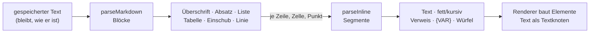

| Im Text | Was es wird |
|---|---|
| `# …` bis `###### …` | Überschrift |
| `- …`, `* …`, `1. …` | Liste; tiefer eingerückt: eine Liste im Punkt |
| `\| a \| b \|` mit `\|---\|` darunter | Tabelle; `:-:` und `--:` richten aus; ein `\|` in `[[…]]` ist kein Zellrand |
| `> …` | Einschub |
| `---` | Trennlinie |
| Leerzeile | neuer Absatz; ein einfacher Zeilenwechsel ist ein Leerzeichen, zwei Leerzeichen oder `\` am Ende ein harter Umbruch |
| `**fett**`, `*kursiv*` | Hervorhebung, schachtelbar; `2 * 3 * 4` bleibt Rechnung |
| `[[npc-0042\|Volo]]` | Verweis über die Nummer (11) |
| `{VAR}` | Platzhalter (6) |
| `{{1d6+2}}`, `{{+4}}` | Würfel zum Anklicken (6) |

**Kein HTML aus dem Text.** Ein Block ist ein Datum und kein Markup; die
Oberfläche baut Elemente (`nw-text`), der Prototyp ebenso (`para`,
`mdDraw`), und `<b>` im Feld steht als `<b>` da. Bewusst nicht dabei:
Codeblöcke, Bilder, Fussnoten — kein Text, der hierher kommt, braucht sie.

---

## 5. Kanten

### 5.1 Was eine Kantenzeile trägt

| Angabe | Bedeutung |
|---|---|
| `type` | der Bezeichner, `lowerCamel` |
| `label`, `inverseLabel` | wie sie sich vom Ausgangs- und vom Zielende liest |
| `from[]`, `to[]` | die Typen an beiden Enden, die Kette hoch; `*` jede Art |
| `cardinality` | `one` oder `many` (Vorgabe) — gezählt am Ende, an dem die Kante liegt |
| `asField` | `from` oder `to`: an diesem Ende liest sich das andere wie ein Feld (§5.3) |
| `section` | die Kante **setzt ein** statt zu verweisen: das Ziel steht unter dieser Überschrift im Artikel (`composedOf`) |
| `props` | Schema der Eigenschaften an der Kante |
| `owned` | das Ziel soll mit dem Artikel gehen (`knowledge`) — **heute von keinem Auswerter gelesen** (T-111) |
| `means` | was die Kante bedeutet, ein Satz in beide Richtungen (T-111) |
| `intended` | was sie bewirken **soll**, solange kein Auswerter sie liest — die Oberfläche sagt dann „not evaluated yet" |
| `facet` | als Filter in der Liste, beide Richtungen (T-174, F15): `false` nimmt sie heraus, `{label, order}` benennt oder ordnet sie |

### 5.2 Regeln für Kanten

| | Regel |
|---|---|
| K1 | **Nur vorwärts gespeichert.** Die Gegenrichtung ist eine Abfrage und liest sich über `inverseLabel`. |
| K2 | **Was von beiden Enden abhängt, steht an der Kante:** Menge und Lage im Behälter (`holds`), Drehung auf der Karte (`marker.rot`), die Bindung einer Variablen (`composedOf.vars`), die Marken einer Beziehung (`regards.tags`). Ein Feld am Ziel könnte nur eine der Wahrheiten tragen. |
| K3 | **Was auf etwas zeigt, ist eine Kante**, kein Feld mit Namen: ein Token, eine Platzierung, ein Teilnehmer, eine Zutat. Ein Rechteck auf dem Board zeigt auf nichts und ist darum ein Feld. |
| K4 | **Die Kanten einer Art stehen in ihrer Feldliste mit** — als Gruppe „Edges from here" im Register, zugeklappt. |
| K5 | **Eine Beziehung ist eine Kante mit Marken** (`regards`), beim Urteilenden gespeichert; die Gegenrichtung ist eine eigene Kante. |
| K6 | **Die Wirkung einer Kante wird gerechnet, nicht behauptet** (T-111, REQ-257). Die Zeile sagt, was sie bedeutet (`means`); was sie bewirkt, ergibt sich aus den Auswertern, die sie lesen (`EDGE_READERS` in `packages/model/src/edges.ts`), und aus der Zeile selbst (`section`, `asField`, gerechnete Felder, deren Rechnung sie nennt). Ein Test liest die Dateien der Auswerter und hält das Verzeichnis beim Code. Was nichts liest, ist **nur Anzeige**. |

### 5.3 Teil-Kanten (`asField`)

Eine Kante darf sich an einem Ende wie ein Feld lesen. Das Mass: **ohne das
andere wäre dieser Artikel unvollständig, und an seinem Ende liest es sich
als eines** — darum ist eine solche Kante immer `one`. Heute `belongsTo`
(Statblock → Kreatur, liest die Kreatur) und `carries` (Kreatur/Gruppe →
Inventar, liest die Kreatur). Das Register zeigt die Felder des anderen Typs
als gestrichelte Gruppe `linked · belongsTo`; das Element `linked` zeichnet
sie auf der Seite des lesenden Artikels mit eigenen Eingaben, die in den
anderen Artikel schreiben. Ein Rezept, das einen Gegenstand liefert, ist das
nicht — den gäbe es auch ohne das Rezept.

Fehlt das andere Ende und liegt die Kante dort (`belongsTo` am Statblock),
steht an seiner Stelle „Create" (mit dem Namen des lesenden Artikels) und,
wo die Art Vorlagen kennt (`instanceOf.from`), „From a template": das legt
eine **Instanz** an, die nur speichert, was abweicht — der Server prüft sie
beim Anlegen aufgelöst und speichert sie ausgedünnt wie beim Schreiben. An
der Instanz zeigt die Maske blass, was von der Vorlage kommt, und ↺ lässt
ein Feld ihr wieder folgen. Liegt die Kante beim lesenden Artikel und fehlt
(`carries` an einem Gegenstand), steht nichts da: ein Schwert ohne Inventar
ist kein Behälter. Nur das Element `inventory` fragt ausdrücklich (T-125).

### 5.4 Die Familien

| Familie | Kanten | Trägt |
|---|---|---|
| Struktur | `partOf`, `insideMap` | Ort, Rahmen, Spur der Weltgeschichte (§5.9), das Board eines Geschichtsartikels (REQ-205) — die Reihenfolge sagt `Time.sort` |
| Teil | `belongsTo`, `carries` | `asField` |
| Einsetzen | `composedOf`, `hasProperty` | `section`, `vars` |
| Regel | `stageOf`, `affects`, `grants`, `subclassOf`, `subraceOf` | Stufe eines Zustands; Wirkung zwischen Regeln (`effect`, `on`, `note`); was Klasse, Abstammung, Hintergrund gewähren (`level`) |
| Charakterbau | `hasClass`, `hasAncestry`, `hasBackground` | Klassenstufe, Unterklasse |
| Verweis | `equips`, `worships`, `livesIn`, `memberOf`, `memberOfParty`, `owes`, `regards`, `controls`, `questGiver`, `questAbout`, `describedIn`, `happensAt`, `features`, `involves`, `mapOf`, `onMap`, `tableFor`, `yields`, `needs`, `playedBy` | Marken, Mengen |
| Platzierung | `marker`, `territory`, `zone`, `placed`, `holds` | Koordinaten, Grösse, Drehung, Lage, versteckt |
| Vorgang | `crafting`, `participates`, `entry`, `route` | Stand eines Gangs, Initiative, Gewicht, Wegdauer |
| Ebene | `inLayer`, `activates`, `overrides`, `variantOf`, `instanceOf` | Modus, Reihenfolge |
| Wissen | `knowledge` (owned), `includes`, `knownBy` | — |

Die vollständige Tabelle mit `from`, `to` und Eigenschaften steht in §13.

### 5.4a Was eine Kante bewirkt (T-111)

`edgeEffects(registry, type)` rechnet je Kantenart die Bedeutung, die
Auswerter und die Wirkungen aus der Zeile. Gezeigt wird das an drei Stellen:
in der Kantenauswahl beim Bearbeiten („Adding this: …", bevor die Kante
angelegt ist), als Tooltip an jeder Kante am Artikel (auch unter „Linked
here") und im Register — an der Kantenart und als Tabelle „How edges work",
wenn unter „Edges" keine gewählt ist.

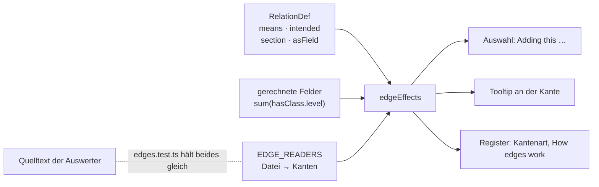

| Auswerter | Bereich | liest |
|---|---|---|
| Layers in play | Stapel | `activates`, `inLayer`, `overrides`, `partOf` |
| Take into your story | Stapel | `partOf`, `mapOf`, `inLayer`, `overrides`, `instanceOf`, `variantOf` |
| Versions and templates | Fassungen | `instanceOf`, `variantOf`, `overrides`, `inLayer`, `belongsTo` |
| Knowledge | Sichtbarkeit | `knownBy`, `includes`, `knowledge`, `memberOf`, `memberOfParty`, `partyOf`, `participates` |
| The campaign’s party | Sichtbarkeit | `partyOf`, `memberOfParty`, `inLayer` |
| Own character and writing | Rechte | `belongsTo`, `carries`, `holds`, `crafting`, `inLayer` |
| Character builder and sheet | Figur | `hasClass`, `hasAncestry`, `hasBackground`, `chose`, `grants`, `allowsMethod`, `allowsEquipment`, `abilityPool`, `carries`, `holds`, `belongsTo` |
| Effects on the numbers | Figur | `grants`, `carries`, `holds` |
| Class pages | Figur | `grants`, `subclassOf`, `tableFor` |
| Initiative | Spiel | `participates`, `memberOfParty`, `belongsTo` |
| Boards | Spiel | `placed`, `partOf`, `inLayer`, `instanceOf` |
| Reading view, Timelines | Lesen | `partOf`, `inLayer`, `mapOf`, `overrides`, `participates` |
| Validation and workbench | Prüfung | `stageOf`, `participates`, `overrides`, `instanceOf`, `variantOf`, `inLayer` |
| Import and export | Transfer | `inLayer`, `partOf`, `instanceOf`, `activates` |
| Where it is from | Anzeige | `inLayer`, `instanceOf`, `partOf` |

Die Tabelle ist eine Zusammenfassung; massgeblich ist `EDGE_READERS`.
**Nicht ausgewertet, aber versprochen** (`intended`, Vorschlag im Brett,
E-031): `affects`, `casts`, `equips`, `hasProperty`, `subraceOf`, `needs`,
`yields`, `loot`, `entry`, `route`, `inWorld` und die Kartenkanten
`insideMap`, `marker`, `zone`, `territory`, `onMap`. **Nur Anzeige** und so
gemeint: `worships`, `owes`, `livesIn`, `controls`, `describedIn`,
`questGiver`, `questAbout`, `happensAt`, `features`, `involves`, `regards`,
`chapterOf`.

### 5.5 Regeltypen, Stufen und Wirkungen (D48)

**Die Messlatte:** eine Regelart wird ein eigener Typ, wenn ein Verweisfeld
oder eine Kante sie *als Art* verlangt oder wenn sie eigene Felder trägt;
sonst bleibt sie ein Wort in `Rule.kind` (Zeile `RuleKind`: `rule`,
`travel`, `sense`, `reward`, `boon`, `option`, seit T-087 `upgrade`,
`facility`, `card`). Unter `Rule` stehen
`Condition` (`Disease` erbt von ihr), `ActionType`, `Action`, `Feature`,
`ItemProperty`, `Feat` und `Skill`.

| | Regel | Geprüft durch |
|---|---|---|
| R1 | **Was man einer Kreatur zuweist, ist eine Art:** `Vitals.conditions` zeigt auf `Condition`, und die Prüfung hält es. Ein Filter nach `kind` schlüge bloss vor. | `validateEntity` (`link_wrong_type`) |
| R2 | **Eine Stufe ist ein Zustand für sich:** „Exhaustion 3" hat `Condition.stage` 3 und die Kante `stageOf` auf „Exhaustion". Der Grundzustand trägt die allgemeine Regel und `recovery` (`longRestStep`: eine lange Rast senkt um eine Stufe). Dasselbe Muster trägt die Stadien einer Krankheit. | — |
| R3 | **Höchstens eine Stufe je Grundzustand** in `Vitals.conditions` und in `participates.props.conditions`. Die Stufe ändern heisst ersetzen (gleicher `stageOf`, `stage ± 1`), nicht zählen. Darum gibt es `Vitals.exhaustion` nicht mehr: dieselbe Zahl an zwei Stellen läuft auseinander. | `validateEntity` (`condition_stage_twice`), mit `stageOf` aus `stageBases` |
| R4 | **Wirkungen zwischen Regeln sind Kanten** (`affects`, `props.effect`: `imposes`, `prevents`, `limits`, `advantage`, `disadvantage`, `triggers`; `on`: worauf). Gespeichert wird vorwärts; „was verbietet mir Reaktionen?" ist eine Abfrage. **Ausgewertet wird vorerst nichts** — die Kanten sind Daten, die der Bogen zeigt. Der Importer legt sie nicht an: dass ein Text einen Zustand nennt, heisst nicht, dass er ihn bewirkt. | — |
| R5 | **Eine Aktion nennt ihre Aktionsart** (`Action.actionType`, Pflicht, Verweis auf `ActionType`) **und sagt, worauf ihr Angriff rechnet** (P4, D51): `attack` (mehrere aus melee/ranged weapon/spell — ein Dolch sticht und wird geworfen), `ability` (`str` … `cha`, `finesse` = das bessere von STR und DEX, `spell` = Zauberattribut; leer: Nahkampf STR, Fernkampf DEX), `damageDice` ohne Modifikator, `damageType` aus der Zeile `DamageType`, `reach`/`range` in Fuss, `target`, Zusatzschaden `extraDamageDice`/`extraDamageType`, und `toHitBonus`/`damageBonus` für einen Bonus über der Rechnung. Der Text sagt nur noch, was die Felder nicht sagen. | `validateEntity` (`missing_property`, `link_wrong_type`, `value_not_allowed`) |
| R7 | **Trefferbonus und Schaden rechnet der Statblock** (D51, D8): Treffer = `prof` + Mod(Attribut) + `toHitBonus`, Schaden = Würfel + Mod + `damageBonus`, beim Lesen, nie gespeichert (`attackNumbers`, Zeile `attackLine`). Ein Angriff ist darum **einer für alle**, die so angreifen — „Bite" je Sorte und Schadensart einmal. **Was ein Statblock anders macht, steht an seiner Kante** `composedOf` und nur dort: dieselben Felder (andere Würfel, Reichweite, Attribut, Zusatzschaden), `note` für den Satz nur dieses Statblocks, und `toHit`/`damageFlat` als **Buchzahl**, wo sie nicht aus der Rechnung folgt — gezeigt wird das Buch, als fest markiert, mit der Rechnung daneben. Ohne `prof` am Statblock gibt es keinen Trefferbonus statt einer falschen Zahl. | Modell (`attackNumbers`), Prototyp (`elComposed`) |
| R8 | **Woher ein Angriff oder Merkmal kommt, wird gezeigt und nicht gepflegt** (D51): das Layout-Element `usedBy` zählt die Statblöcke, die den Artikel zusammensetzen, **nach Kreaturentyp** (Tiere, Drachen …). Ein Monstermerkmal, das ein Volksmerkmal ist („Aggressive" des Orks), zeigt mit `variantOf` auf dieses — der Importer verbindet nur, wenn ein Träger zu dem Volk gehört. | — |
| R6 | **`overrides` zeigt nur auf eine Fassung derselben Art** (M9). **Je Buch eine Ebene** (`Layer.kind` `book`, Id `e5_book_<kürzel>`, T-081, E-017) hält den importierten Regelbestand dieses Buchs; was kein Buch nennt, liegt in der Systemebene „D&D 5e (2014)". Welche Seite, sagt `Source.publication` mit `page`, die Lizenzflagge `Source.srd`. | `validateEntity` (`overrides_other_type`) |
| R9 | **Ein Abenteuer ist eine Ebene mit seiner Geschichte und seinem Text** (`Layer.kind` `adventure`, T-082, REQ-240; T-108, E-029): das Abenteuer eine `Story` mit `kind: adventure`; je Kapitel **ein `Arc` und ein `Chapter`** — der Arc (`partOf` das Abenteuer; E-026 — die Peg-Id rechnet der Importer weiter wie für eine Story) ist die Geschichte, das Chapter (`<Arc>_chapter`, `chapterOf` der Arc) die Lesestruktur; je Abschnitt eine `Scene` — auf Kapitelstufe `partOf` der Arc **und** mit Rang im Chapter, Räume („1. Cave Mouth") mit Rang in ihrer Szene. **Der Text sind Teile** (E14, R10): Absätze, Überschriften, Vorlesetexte (`ReadAloudText`), Verweise auf Statblöcke, mit Rang im Chapter oder in der Szene, an ihrer Stelle im Buch; Szenen tragen keinen eigenen Text mehr. Kreaturen, Gegenstände, Zauber im Text sind **Verweise** auf die Buchartikel; `{@area}` ein Verweis auf den Abschnitt. Je Karte (`imageType: map`) eine `Map` mit der Bildadresse bei 5e.tools (nicht im Repository), `mapOf` ihr Abschnitt; **eine Karte steht immer an einer Szene** — liegt sie im Text des Kapitels, bekommt sie ihre eigene (`<Karte>_scene`, `mode: exploration`, E-026), die als Teil an ihrer Stelle im Chapter steht. Nennt ein Abschnitt Kreaturen **mit Anzahl** („two goblins"), eine `Encounter` (`partOf` der Abschnitt, ohne Rang) mit einer `participates`-Kante je Teilnehmer auf den Statblock. Alles auf `audience: gm`. Ein Abenteuer in einem Quellenbuch (MOT, FRAiF) liegt in dessen Ebene. **Schon geladene Abenteuer** bekommen das von Migration 046: je Arc sein Chapter (dieselbe Id), die Szenen mit Rang, der Text von Arc und Szene als `ReadAloudText` (`<Artikel>_read<n>`) und ein `Paragraph` (`<Artikel>_text`) — gröber als ein Neuimport, nichts geht. **Teile kommen nur mit ihrem Ganzen:** `--only-new` legt in einem Kapitel oder einer Szene, die schon steht, keine Teile an. | `arten/abenteuer.ts`, `abenteuer.test.ts`, Durchstich |
| R10 | **Ein Buch ist eine Ebene mit seinen Kapiteln** (T-108, E-028, E-029 a, REQ-247): jedes Buch aus 5e.tools (`book/`, auch ein Regelbuch) bringt je Kapitel der obersten Stufe ein `Chapter` (Name wie bei 5e.tools, „Chapter 9: Combat", `ordinal` „Chapter 9"; ohne Credits), darin seine Teile nach Rang (E14): eine Zeichenkette ein `Paragraph`, ein Kasten `kind: sidebar`, ein Zitat `quote`, eine Liste `list`, eine Tabelle `table`; ein benannter Abschnitt eine `Heading` bis zur dritten Stufe (darunter fett im Absatz); ein Vorlesetext ein `ReadAloudText`. **Was schon Artikel ist, wird ein `Embed`:** ein `statblock`-Eintrag (Monster, Zauber, Gegenstand), eine Tabelle mit dem Namen einer `Table` desselben Buchs, ein benannter Abschnitt mit dem Namen eines Artikels desselben Buchs (Zustand, Klasse, Abstammung, Aktion …). Die Peg-Id eines Teils ist aus seinem Ganzen und seinem Rang gerechnet. Bilder bleiben weg (E5). | `arten/buch.ts`, `teile.ts`, `buch.test.ts` |
| R11 | **Was 5e.tools bis T-087 zurückhielt, ist keine eigene Art** (T-087, REQ-243, löst E4 des Arbeitsplans ab): ein **Fahrzeug** ist ein `Statblock` mit `creatureType` „vehicle (ship)" (Schiff, Spelljammer, Höllenmaschine, Luftschiff) — RK und TP aus dem Rumpf, die Attribute, die Immunitäten; Rumpf, Steuerung, Antrieb, Waffen, Besatzung, Laderaum und Tempo stehen als Text, weil heute nichts mit ihnen rechnet. Eine **Aufrüstung** eines Fahrzeugs, ein **Raum einer Bastion** (2024) und eine **Karte** sind eine `Rule` mit `kind` `upgrade`, `facility`, `card`; ein **Deck** ist eine `Table` mit `kind: 'deck'`, je Karte eine Kante `entry` mit ihrer Anzahl als Gewicht — eine Karte ziehen heisst auf ihm würfeln. Eine **Waffenmeisterschaft** (2024) ist eine `ItemProperty` mit der Marke `mastery`, und die Waffe zeigt mit `hasProperty` darauf wie auf „Finesse". Braucht eine davon eigene Felder, wird sie eine Zeile (T2). | `packages/import-5etools/src/arten/neu.ts` |
| R12 | **Was T-084 nachträgt, zählt hinter allem anderen** (T-084, REQ-186, REQ-238): die Lebenstabellen aus „This Is Your Life" (je Hintergrund und Klasse eine `Table` der Gründe, dazu die Ergänzungstabellen der Klassen und die Trinkets), die Schatztabellen (Hort und Einzelschatz je Herausforderungsgrad, Drachenhorte, Kram im Drachenhort), die **Spielarten** (`_versions`: eine Kopie ihres Eintrags mit `variantOf` darauf — die einer Unterart nicht, sie ändern das Volk) und die **+N-Gegenstände**, die ein Text nennt (eine magische Variante an einem Grundgegenstand, `variantOf` auf ihn). Eine Lebenstabelle hängt über `tableFor` an Hintergrund oder Klasse. **Ein verschachtelter Wurf steht in der Zeile**, als Verweis auf die Tabelle (`{{2d6}} × [[table-0141\|10 gp Gemstones]]`), und nicht als `entry`: eine Zeile nennt oft zwei Tabellen, und zwei gewichtete Kanten zählten sie doppelt. Ein Lauf rechnet **drei Gänge** — Grundstand, dann was T-087 brachte, dann die Nachträge —, jeder mit den Nummern des vorigen; was vor den Nachträgen da war, sieht sie nicht (ausser Buch- und Abenteuertext), sonst stünde sein Text anders als auf dev. | `arten/schatz.ts`, `copy.ts` (`spielarten`), `arten/gegenstaende.ts` (`ausgeschrieben`), `nachtraege.test.ts` |

Dazu aus M7 und M8: `Hazard` (Falle oder Gefahr, auf der Karte über
`marker`), `Deity` (Anhänger über `worships` von Kreatur und Fraktion),
`Faction.goal`, und `Table.columns` — mit Spalten ist eine Zeile in
`rows` eine Liste von Zellen; die gewichteten Einträge bleiben
`entry`-Kanten. Wer ein Merkmal gewährt, sagt seit P4 `grants` (§5.7) —
das, was der Arbeitsplan `featureOf` nannte, vorwärts vom Gebenden aus.

### 5.6 Zauber und Gegenstände (M2, M4)

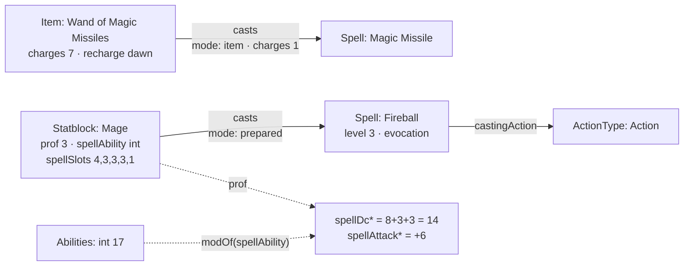

| | Regel | Geprüft durch |
|---|---|---|
| Z1 | **Ein Zauber ist eine Regel mit eigenen Feldern** (`Spell` erbt `Rule`): Grad 0–9 (0 ist ein Zaubertrick), Schule, Wirkzeit, Reichweite (`rangeKind` + `range` in Fuss), Komponenten `v`/`s`/`m` mit Material, Kosten in Kupfer und ob es verbraucht wird, Dauer (`instant`/`timed`/`permanent`/`special`, mit `durationAmount`/`durationUnit`), Konzentration, Ritual, „At higher levels" (langer Text, Würfel darin), Rettungswurf (`enumRef: Ability`), Zauberangriff, Schadensarten. | `validateEntity` (`value_not_allowed`, `value_out_of_range`) |
| Z2 | **Die Wirkzeit nennt ihre Aktionsart:** bei Aktion, Bonusaktion und Reaktion zeigt `castingAction` auf den `ActionType` (D48); längere Wirkzeiten sind `castingTime` mit `castingUnit` (`minute`, `hour`). Der Auslöser einer Reaktion steht in `castingCondition`. | `validateEntity` (`link_wrong_type`) |
| Z3 | **Welche Zustände ein Zauber bewirkt, ist die Kante `affects`** (`effect: imposes`) zur `Condition` — kein Feld daneben (D49). | — |
| Z4 | **Wer einen Zauber wirkt, ist die Kante `casts`** (Statblock, PlayerCharacter, Item, Subclass, Ancestry, Feat, Faction, Rule → Spell) mit `mode` (`prepared`, `known`, `innate`, `item`), `uses` („at will", „3/day"), `level`, `charges` (was ein Gegenstand je Wirken verbraucht) und `fromLevel` (Domänenzauber ab Klassenstufe 3, Thaumaturgy des Tieflings ab Stufe 1). Ein Talent wirkt wie eine Abstammung (Drow High Magic: Levitate 1/day); ein Kult und ein Segen wirken ihre Signaturzauber (T-084), ohne `mode` — wer dazugehört, hat sie typischerweise; bietet es mehrere Zauberlisten zur Wahl (Magic Initiate), wird das eine Wahl `option`, und die Zauber dahinter sind Wahlen mit `onlyIf` (T-089). Gespeichert vorwärts; „wer kann Feuerball?" ist eine Abfrage. | Kantenprüfung (`from`/`to`) |
| Z5 | **Zauberwirken steht am Statblock** (`spellAbility`, `casterLevel`, `spellSlots` je Grad, der erste ist der 1.). **SG und Angriffsbonus werden gerechnet** (D8): `spellDc = 8+prof+modOf(spellAbility)`, `spellAttack = prof+modOf(spellAbility)`. Ohne Attribut gibt es keinen Wert — 8 + Übung sähe aus wie ein SG. | Rechenwerk (`derivedValue`) |
| Z6 | **Verbrauchte Plätze sind ein Stand** (`Vitals.slotsUsed` je Grad), an der Figur und nicht am Statblock — wie `hp` an beiden. | — |
| G1 | **Ein Gegenstand trägt, was 5e.tools kennt:** `tier` (minor/major), Einstimmung (`attunement`, `attunementNote`), Ladungen (`charges`, `recharge`, `rechargeAmount`), Boni (`bonusWeapon`, `bonusAc`, `bonusSpellAttack`, `bonusSave`), `appliesTo` (Marken, woran eine Variante passt). `itemType` und `rarity` sind englische Aufzählungen am Feld (E3); `rarity` kennt `none` und `varies`. | `validateEntity` (`value_not_allowed`) |
| G2 | **Waffe und Rüstung:** `Weapon.category` (simple/martial), `damage2` (zweihändig, bei `versatile`), `ammoType` (Verweis auf den Munitionsartikel, T-078), `damageType` aus der Zeile `DamageType` (seit P4); `Armor.armorType` (light/medium/heavy/shield), `strength`, `stealthDisadvantage`. Eigenschaften bleiben die Kante `hasProperty` → `ItemProperty`. | `validateEntity` |
| G3 | **Ein Gegenstand darf ein Behälter sein** (`carries` → `Inventory`, wie an Kreatur und Gruppe) und **ein Stück am Tisch eine Instanz** des Gegenstands im Buch (`instanceOf`, §7): das +1-Langschwert speichert nur, was abweicht. Eine Instanz ist von derselben Art wie ihre Vorlage (`to: same`). | Kantenprüfung |

| G4 | **Die Plätze nach Basils Blatt** (D54, REQ-214): `holds.props.slot` kennt Kopf, Schultern, Torso, Handschuhe, rechte und linke Hand (`mainHand`, `offHand`, beide nehmen alles), Beine, Stiefel, Gurt, zwei Holster, je vier Ringe an jeder Hand (`ringR1`…`ringL4`) und vier Halsketten (`neck1`…`neck4`). Gelesen aus der Zeile, nicht aus dem Code; ein Platz, den die Zeile nicht kennt, bleibt am Stück stehen und wird gezeigt. Umbenennung: `prototype/migration/plaetze-nach-dem-blatt.mjs`. | — |
| G5 | **Die Figur steht an der Kreatur** (`Creature.figure`: male · female · neutral, Liste am Feld), nicht am Inventar: das Inventar wechselt den Träger, die Figur nicht. | `validateEntity` (`value_not_allowed`) |
| G6 | **Das Tragraster wird gerechnet** (D54, REQ-215): ein Inventar einer Kreatur **ohne eigenes `grid`** liest seine Form aus der Grösse des Statblocks (Grundquadrat, Einstellung `carrySquares`) und aus `Statblock.carryExtra` (Zusatzquadrat, `derived`, Spanne 0…5). Eine Grösse, die die Einstellung nicht kennt, behält das Rechteck (`inventoryCols`, `inventoryRows`). Die Basiszonen kommen nach Spalten aus `carryZones`, bis der Behälter eigene malt. | Rechenwerk (`carryGrid`, `columnZones`) |
| G7 | **Jeder Behälter gibt eine Ziehstufe dazu** (D54, REQ-216): die Stufe eines Stücks ist das Langsamere aus seiner Zone und der Stufe seines Behälters + 1, die Kette hinauf (`carries` von einem Gegenstand). Aussen gilt der Platz (`slotDraw`) oder die Zone. Kennt ein Schritt keine Stufe, hat das Stück keine. | Rechenwerk (`drawStage`) |
| G8 | **Fallenlassen und Verstauen haben feste Kosten, egal wohin** (D58, REQ-225): Einstellung `handActions` (`drop:free action, stow:bonus action`, Werte aus `DrawTime`; ein Wert ausserhalb der Leiter gilt nicht). **In der Hand** ist, was an `mainHand`/`offHand` liegt, oder ohne Platz `tier: held`. **Fallen gelassen** wird an Ort und Stelle: die `holds`-Kante bleibt, verliert Platz und Rasterlage und bekommt `tier: ground` — das Stück gehört der Figur weiter und hat keine Ziehstufe. **Verstaut** wird an einen freien Platz, der keine Hand ist, oder an die erste freie Stelle im Raster (`tier: pack`). Der Gurt ist eine freie Aktion (`slotDraw` `belt`). | Rechenwerk (`handActions`, `inHand`) |
| G9 | **Wie eine Kampagne Inventar zählt, ist ein Wort an der Kampagne** (T-127): `Campaign.inventory` — `grid` (Raster nach Basils Blatt, Vorgabe), `weight` (Gewicht mit Tragestufen) oder `slots` (je Stapel ein Slot, ein Stapel fasst `Item.stackSize`; Fassung `Inventory.capacity`). Gelesen nur über `inventoryRulesOf`; wandert mit T-132 in ein Modul, dann ändert sich, wo diese Funktion nachsieht. **Gewicht** ist Menge × `Item.weight`, mit dem Inhalt der Behälter; die Stufen nach der Variante aus dem Spielerhandbuch: bis 5 × STÄ leicht, bis 10 × belastet, bis 15 × schwer (zugleich die Tragfähigkeit), darüber zu viel, je Grösse vervielfacht (`loadStage`, `sizeFactor`). Ohne Stärke keine Stufe. | `inventoryRulesOf`, `loadStage`, `slotsUsed` |
| G10 | **Ein Stück wandert, indem seine `holds`-Kante wandert** (T-127): `moveHeld` nimmt sie aus dem einen Inventar und legt sie ins andere — Figur ↔ Gruppe, in einen Behälter, eine Stufe hinauf; weniger als der Stapel teilt ihn. **Die Lage bleibt zurück** (`gx`, `gy`, `rot`, `slot`: sie galt im alten Behälter), und liegt derselbe Gegenstand drüben lose im Fach, wächst dessen Stapel. Kein Ziel ist das Stück selbst oder was darin steckt (`insideOf`). Geschrieben wird erst das Ziel, dann die Quelle — bricht es dazwischen ab, liegt es doppelt und nicht nirgends. **Das Gruppeninventar** (`Party` `carries` `Inventory`, REQ-183) schreibt, wer am Tisch der Kampagne sitzt (nicht `spectator`); die Gruppe selbst nicht. **Ein Behälter in einem eigenen Inventar** ist mit dessen Inventar eigen (der Rucksack in Rooks Gepäck), der Gegenstand nicht. | `moveHeld`, `apps/server/test/inventar.test.ts` |
| G11 | **Reserviert ist ein Stapel, nicht ein Gegenstand** (T-127, Schnittstelle für T-128): `holds.props.reservedFor` nennt den Artikel, der ihn braucht (ein Handwerksauftrag). Das Stück bleibt, wo es liegt, und gehört weiter der Figur; verschieben, teilen und herausnehmen geht nicht, bis die Reservierung fällt — der Server prüft es (T-134). An der Kante wie die Drehung. | `reservedFor`, `reserve`, `moveHeld` (`refused: 'reserved'`), `reservationBreaches` |
| G12 | **Was ankommt, liegt erst unverstaut da** (T-140, REQ-064, REQ-183): gekauft, erbeutet, geschenkt — die `holds`-Kante trägt `unstowed: true` und keine Lage. Verstaut ist der Stapel im Raster, an einem Platz, in einem Behälter (`moveHeld` mit `stow`) oder ohne Raster auf „Stow"; der Träger wechselt ihn nicht (der Gruppe gegeben, bleibt er unverstaut), und gestapelt wird nur auf einen Stapel im selben Zustand. Wächst beim Kauf ein schon verstauter Stapel, bleibt er, wie er war, und der Zuwachs liegt daneben (`arriveUnstowed`). **Wie lange es so liegen darf, ist ein Wort an der Kampagne**: `Campaign.stowing` — `anytime` (Vorgabe), `bySessionEnd`, `immediately` (bis an der Sitzung Szene, Kampf oder Karte wechseln, `tableMovedOn`; Auslegung offen in E-054). Danach **bleibt es liegen**: es verlässt die Inventare der Gruppen und Figuren der Kampagne (samt Behältern) und steht an der Sitzung als `leftBehind` (`qty`, `from` = das Inventar, `at`); Reserviertes bleibt. Gelöscht wird nichts — **Aufheben** (`pickUp`) nimmt die Kante und legt den Stapel unverstaut in ein Inventar, das der Aufhebende schreibt. Erst die Sitzung, dann die Inventare: bricht es dazwischen, liegt es kurz doppelt und nicht nirgends. | `stowingRuleOf`, `arriveUnstowed`, `leaveBehind`, `pickUp`, `POST /api/sessions/:id/end` · `…/pick-up`, `apps/server/test/liegen.test.ts` |

Offen: wie viele Ladungen ein Stück am Tisch noch hat (ein Stand am
Gegenstand oder an `holds`).

### 5.7 Statblock, Charakterbau und Übungen aus Artikeln (M5, M3, M6)

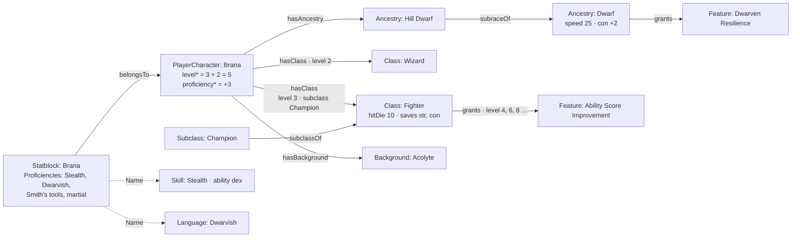

| | Regel | Geprüft durch |
|---|---|---|
| S1 | **Der Statblock wächst** (M5): `languageNote` (was keine Sprache ist: „telepathy 120 ft.", „any four languages"), `conditionImmunities` (Verweise auf `Condition`-Artikel, seit T-078; vorher ihre Namen), `legendaryActions` (Anzahl je Runde), `bonuses` (`{"Stealth": 6}` — feste Boni, die nicht aus Übung folgen; der Bogen nimmt sie statt der Rechnung), `token` (Asset). `size` liest die Zeile `Size`, englisch. Er nimmt `Proficiencies`, `Lore` und `Image` dazu; die Umgebung eines Monsters sind Marken. | `validateEntity` |
| S2 | **Die Übungen wohnen am Statblock**, nicht an der Kreatur: sie gehören zu den Zahlen (Übungsbonus, Attribut). An beiden Stellen wären sie zwei Antworten auf „worin ist sie geübt". | Register (`typeChain`) |
| S3 | **Was ein Statblock führt, ist die Kante `equips`** (Statblock → Item): der Gegenstand aus dem Buch, kein Inventar. | Kantenprüfung |
| C1 | **Klasse, Unterklasse, Abstammung, Hintergrund sind Arten unter `Rule`** (Bereich `rules`). Jede nimmt `Proficiencies` (was sie fest gewährt — die Beschriftung heisst dort „Grants proficiency in") und `Choices` (was zu wählen ist, C6). Die Klasse trägt `hitDie`, `primaryAbility`, `startingEquipment`, `multiclassRequirement`, `multiclassProficient`, `subclassTitle`, mit der Unterklasse `casterProgression` und `spellAbility`; die Abstammung `size`, `speed`, `abilityBonus` (`{"con": 2}`), `age`, `darkvision`, `resistances`. | `validateEntity` |
| C2 | **Die Figur zeigt darauf:** `hasClass` (mehrmals, `props.level` Pflicht, `props.subclass` → `Subclass`), `hasAncestry` und `hasBackground` (je eine). `PlayerCharacter.class` und `.ancestry` sind weg. | Kantenprüfung |
| C3 | **Die Stufe wird gerechnet:** `level = sum(hasClass.level)`, `proficiency = 2+(sum(hasClass.level)-1)/4` (D8). Ohne Klasse keine Stufe — kein Wert statt 0. | Rechenwerk (`derivedValue` mit Kanten) |
| C4 | **Was eine Klasse, Abstammung, ein Hintergrund oder Talent gewährt, ist die Kante `grants`** (→ `Rule`) mit `props.level`. Die Stufe steht an der Kante und nicht am Merkmal: „Ability Score Improvement" ist ein Artikel und sieben Kanten. `Feature.level` ist deshalb weg (D50). `subclassOf` und `subraceOf` sagen, wozu eine Unterklasse oder Unterart gehört. Die Stufentabelle einer Klasse und die Charakterzug-Tabellen eines Hintergrunds sind `Table`-Artikel über `tableFor`. | Kantenprüfung |
| C5 | **Ein Merkmal bettet ein, was allein in einem Absatz steht** (W6): ein Absatz, der nur aus einem Verweis auf ein `Feature` besteht (`[[feature-0479\|Abjuration Savant]]`), heisst „hier steht dieses Merkmal" — so schreibt der Importer `refSubclassFeature` und `refOptionalfeature`. Die Klassenansicht zeichnet es an dieser Stelle aus; ein Kopf, der Merkmale **seiner Sorte** einbettet („School of Abjuration"), heisst in der Tabelle nach seinen Teilen, einer mit Optionen („Fighting Style" › „Archery") nach sich. Optionale Merkmale und Variantenregeln tragen die Marke `optional`. Bringt eine Unterklasse eigene Spalten (`subclassTableGroups`: Eldritch Knight), ist das ein `Table` über `tableFor` an ihr. Herkunft und Hintergrund liest die Herkunftsansicht gleich (T-166), nur ohne Stufen: ihre Spielarten sind die Artikel derselben Art mit `subraceOf` auf sie (einen Schritt tief), ihre Würfeltabellen `tableFor`, ihre Merkmale `grants` in der Reihenfolge der Kanten. **Eine Unterart bringt ihre Grundart mit** (T-193): an der Figur zählt jede Herkunft der Reihe `ancestryLine` (die Unterart, dann über `subraceOf` ihre Grundart, höchstens vier, ohne Kreis) als Quelle `hasAncestry` — ihre `abilityBonus` summieren sich in `chosenResult`, ihre Wahlen sind Schritte. **Was eine Möglichkeit bringt**, rechnet `optionEffects` aus Feldern und Kanten: Boni (summiert), Grösse, Tempo, Darkvision, Kreaturtyp (die Unterart geht vor), Resistenzen, Trefferwürfel, Hauptattribut, Rettungswürfe, Übungen (vereinigt), Merkmale (`grants` bis Stufe 1) und die Wahlen danach (ohne Ausrüstung und Mehrklassen-Einstieg). | `classParts`, `originParts`, `levelFeatures` (`packages/model/src/classes.ts`), `ancestryLine` (`choices.ts`), `optionEffects` (`builder.ts`) |
| C6 | **Was zu wählen ist, ist ein Feld; was gewählt wurde, eine Kante** (REQ-238, E-015 a). Klasse, Unterklasse, Abstammung, Hintergrund und Talent nehmen `Choices`: `choices` hält je Wahl `{id, kind, level, when, from, count, bonus, repeat, onlyIf, default, note}` — `kind` ist proficiency · ability · feat · spell · equipment · feature · subclass · option (benannte Möglichkeiten, die nur steuern, welche Wahlen dahinter gelten); `from` ist **eine** von drei Formen: `values` (Namen aus Listen, `enumRef` nennt sie, wenn es keine feste Aufzählung gibt), Artikel (`interfaces` mit den Filtern von `LinkTarget` und `edge`: nur Unterklassen dieser Klasse) oder `options` (`[{key, label}]`, Ausrüstung a/b); `when` sagt an einer Klasse „nur als erste Klasse" (`start`) oder „nur beim Mehrklassen-Einstieg" (`multiclass`); `bonus` bei `ability` je Wahl (+2/+1 heisst `[2, 1]`). `repeat` erlaubt denselben Wert mehrmals (+1 zweimal auf STR ist +2); `onlyIf: {choice, pick}` lässt eine Wahl nur gelten, wenn eine Wahl davor **an derselben Quelle** diesen Wert trägt; `default` gilt, bis jemand antwortet (`assumed`). Die `id` kommt aus dem Text (`skills`, `fighting-style-2`). Die Figur speichert **nur ihre Antworten**: je Wahl eine Kante `chose` (PlayerCharacter → der fragende Artikel) mit `props.choice` und `props.picks` (Namen, Artikel-Ids oder Schlüssel). **Gerechnet beim Lesen** (D8): `chosenResult` ergibt Übungen, Attributsboni (dazu fest aus `Ancestry.abilityBonus`), gewählte Artikel und Ausrüstung; `pendingChoices` was offen ist, `orphanAnswers` Antworten auf Wahlen, die es nicht mehr gibt. **Eine Wahl ohne Spielraum ist beantwortet** (`fixedPicks`: „eines aus [con]"). **Eine Sprachwahl ohne `from` zieht aus den Sprachen** (T-095): nennt eine Übungswahl ohne Liste in `id` oder `note` Sprachen („two standard languages of your choice", aus `ProficiencyChoice` übernommen oder von Hand), liest `choicesOf` sie als `from: {enumRef: ['Language']}`, und ohne `count` gilt die Zahl am Anfang des Satzes — gespeichert wird nichts davon. **Ein Merkmal, das eine Quelle mehrfach gewährt, fragt je Gewährung** (T-107, E-027): jede Kante `grants` macht es zu einer eigenen Quelle (`ChoiceSource.grant: {by, level}`), und die Antwort merkt sich die ihre (`chose` mit `props.by` und `props.level`, Schlüssel `answerKey`: `quelle#wahl@von:stufe`). Die Attributssteigerung (`Feature` nimmt dafür `Choices`) trägt drei Wahlen: `improvement` (option: Steigerung oder Talent, Vorgabe Steigerung), `ability-scores` (zwei Punkte, `repeat`) und `feat` (je mit `onlyIf`). Eine ältere Antwort ohne `by`/`level` gilt für die **erste** Gewährung; eine zu einer Gewährung, die es nicht mehr gibt, ist verwaist. Erlaubt die Kampagne keine Talente (`Campaign.feats: false`, `campaignAllowsFeats`), bietet `offeredOptions` den Ausweg Talent nicht an, und eine Wahl mit einer Möglichkeit allein ist kein Schritt. **Eine Werkzeugwahl zieht aus ihrer Sorte** (T-162): nennt eine Übungswahl ohne `from` oder mit `enumRef: ['Item']` in `note` eine Gegenstandssorte („1 any artisans tool tool of your choice", „three musical instruments"), liest `choicesOf` sie als `from: {enumRef: ['Item'], where: {component: 'Item', property: 'itemType', value: [...]}}`, ohne `count` mit der Zahl im Satz — gespeichert wird nichts. **Wie eine Wahl heisst**, sagt `choiceLabel` (kurze Notiz, sonst die Id einer Übungswahl — `skills` „Skill proficiencies", eine Wahl aus `Item` „Tool proficiencies" —, sonst die Sorte; „(choose n)" bei mehreren), an der Figur `choiceTitle`: „<Quelle> · <Wahl>", der Name der Quelle über `entityName`. Feste Gaben bleiben, was sie sind: `Proficiencies`, `grants` mit `props.level`, `abilityBonus`. | `validateEntity` (`entry`), `packages/model/src/choices.ts` |
| C7 | **Der Assistent liest seine Schritte aus den Artikeln** (REQ-238, T-080): Abstammung, Hintergrund, Klasse (Stufe 1), Attribute, je offene Wahl ein Schritt (`builderSteps` über `choicesAtCharacter`, Quellen in dieser Reihenfolge, Geöffnetes dahinter), die Ausrüstung (ein Schritt für alle Ausrüstungswahlen, C10), Name. Zur Wahl steht, was der Betrachter sieht, im Stapel liegt und `ready` ist. Gespeichert wird die Figur (`ready`, E-014 d) mit `hasAncestry`, `hasBackground`, `hasClass`, `chose`, `memberOfParty` und ein eigener Statblock (`belongsTo`) mit den **Grundwerten** — Boni rechnet `chosenResult`. Eine Unterklasse steht dazu an `hasClass.props.subclass`. Der **Stufenaufstieg** ist derselbe Mechanismus: die gespeicherte Figur mit einer Stufe mehr, ohne was sie schon beantwortet hat (`answeredKeys`, je Gewährung — die Steigerung auf Stufe 8 fragt, auch wenn die auf 4 beantwortet ist); dazu nennt er, was Klasse und Unterklasse genau auf der neuen Stufe gewähren (`gainedFeatures`, `grants` mit `props.level`). **Sprachwahlen** bieten die Namen der `Language`-Artikel an, und nennt die Kampagne Sprachen (`Campaign.languages`, REQ-251, `campaignLanguages`), nur diese. Am Artikel steht **je Klasse ein Eintrag**: Klasse, Stufe, Unterklasse und die Antworten auf ihre Wahlen zusammen (die Kanten `chose` hängen sich an die Kante ihrer Quelle, T-095). **Was eine Grundwahl fragt, steht in ihr** (T-193, `builderSteps` mit `nest`): die Wahlen einer Quelle, die zu Abstammung (samt Grundart), Hintergrund oder Klasse gehört — dazu die Unterklasse und was eine davon gewährt (`choiceRoots`) —, trägt der Schritt dieser Grundwahl als `nested`; ein gewähltes Talent, das selbst fragt (`chose`), bleibt ein eigener Schritt. Spielarten stehen unter ihrer Grundart (`subraceOf`). Der **Entwurf** liegt je Konto in den Einstellungen (`characterDraft`, `/api/me/prefs`) und kommt beim Öffnen zurück, bis die Figur angelegt ist; ein unfertiger Schritt fragt („Decide later"/„Stay") und bleibt markiert — auf später gelegte Attribute bleiben am Statblock leer, eine auf später gelegte Ausrüstung wird nicht angewandt. | `packages/model/src/builder.ts` |
| C8 | **Attributsverfahren sind Artikel** (E-016 a): `AbilityMethod` mit `method` (`array` · `pointBuy` · `roll`), `scores`, `budget`, `costs` (`{"8": 0, "15": 9}`), `dice` (`4d6kh3`), `count`, `scope` (`character` · `party`). Die Kampagne erlaubt über `allowsMethod`; ohne Kante gelten Standardreihe und Punktekauf (`DEFAULT_ABILITY_METHODS`). Gewürfelt wird am Server (`POST /api/abilities/roll`), jeder Wurf steht im Protokoll (`abilities.rolled`); der **Gruppenpool** steht an der Gruppe (`abilityPool` → Verfahren, `props.values`, `rolls`, `at`), jede Figur verteilt dieselben Werte, neu würfelt nur die Leitung. Der Würfelausdruck kennt dafür `khN`/`klN` (behalten). **Bei Reihe und Pool wird jeder Wert genau einmal vergeben**: wer einen schon vergebenen wählt, tauscht mit dem Attribut, das ihn hält (`assignScore`, T-095); der Punktekauf tauscht nicht. | `packages/model/src/abilities.ts`, `dice.ts` |
| C9 | **Was ein Artikel an der Figur verändert, ist ein Feld** (REQ-238, REQ-063, E-025 a). Der Gegenstand nimmt `Effects`: `effects` hält je Wirkung `{id, target, op, value, when, note}` — `target` ist frei (`ability.str`, `ac`, `speed.walk`, `speed.*`, `spellSaveDc`, `spellAttack`, `save`, `resist`, `immune`, `vulnerable`, `conditionImmune`, `critThreshold`, `carry`, `capacity`, `weapon`, `weapon.attack`, `weapon.damage`, `spellDamage`, `check`, `prof`, `save.concentration`; ein neues Ziel ist ein Wert, kein Feld), `op` ist add · set · grant (`set` hebt ein Attribut nur, wenn es niedriger ist; beim kritischen Treffer gilt die kleinste Schwelle), `when` ist worn · attuned · carried · self — ohne Angabe eingestimmt, wenn der Gegenstand Einstimmung verlangt, sonst getragen. **Getragen** heisst `holds.tier` held/worn oder ein Körperplatz (`slot`), **eingestimmt** `holds.attuned` und getragen, **dabei** alles ausser `stored` und `ground` (auch im Beutel), `self` gilt für keine Figur (Waffenbonus, Fassungsvermögen). **Gerechnet beim Lesen** (D8): `effectsAt` sammelt aus dem Inventar (`carries` → `holds`, Behälter weiter hinein) und aus den Quellen der Wahlen (`choiceSources`, dazu ihre `grants` auf Stufe), `effectTotals` fasst zusammen, `abilityWithEffects` rechnet einen Attributswert mit Boni aus `chosenResult`. Die alten Zahlenfelder `bonusAc`, `bonusWeapon`, `bonusSpellAttack`, `bonusSave` bleiben und zählen beim Lesen als Wirkung (`effectsOf`). | `validateEntity` (`entry`), `packages/model/src/effects.ts` |
| C10 | **Startausrüstung nach Kampagnenregel** (REQ-250, T-096, T-162): Verfahren sind Artikel wie C8 — `EquipmentMethod` mit `method` `rules` (was Klasse und Hintergrund geben), `gold` (`gold` fest `100` oder gewürfelt `5d4×10`, leer: `Class.startingGold`) oder `free` (`budget` in gp, leer: ohne Grenze); für `gold` und `free` zählen `magic` (`{"uncommon": 1}` je Seltenheit höchstens; was fehlt, keiner; ohne Angabe nur, was einen Preis hat) und `itemTypes` (aus `Item.itemType`). Die Kampagne erlaubt über `allowsEquipment`; ohne Kante gelten „Class and background" und „Starting gold" (`DEFAULT_EQUIPMENT_METHODS`). **Die Varianten (a)/(b) sind Ausrüstungswahlen** (C6, `kind: 'equipment'`), ihre Möglichkeiten `{key, label, items?: [{id, qty}], gold?}` — `items` nennt Nummern wie ein Verweis; ohne `items` liest `equipmentFromText` die Verweise, Mengen und gp aus dem `label`. **Das Feste ist eine Wahl mit einer Möglichkeit** (beantwortet sich selbst); ältere Klassen tragen es nur als Zeilen in `startingEquipment` (ohne „(a)"), und `startingBundle` liest sie dort. Eine zweite Klasse bringt keine Ausrüstung (`when: 'start'`). Der Assistent sammelt die Ausrüstungswahlen einer neuen Figur in **einem** Schritt `equipment`; beim Aufstieg ist keine Ausrüstungswahl ein Schritt (T-162). **Offene Stellen** (T-162, `slots.ts`): ein Satz einer Möglichkeit, der eine Sorte statt eines Gegenstands nennt („two martial weapons of your choice", „one weapon martial melee of your choice", „an artisan's tools"), ist eine Stelle `{count, type: Weapon|Item, category, itemTypes}` (`itemSlotIn`, `optionSlots`); die Antwort füllt sie der Reihe nach (`chose.props.items`, Artikel-Ids, `''` für leer). `slotAccepts` prüft Art, `Weapon.category`, `Item.itemType` und dass der Gegenstand gewöhnlich ist (Seltenheit leer oder `none`); `slotQuery` sagt der Liste Art und Spaltenfilter. `startingBundle` nimmt nur, was die Stelle annimmt, und eine ganz gefüllte Stelle verlässt den Rest. Das Feste mit offener Stelle („one artisan's tools of your choice") steht als Wahl im Schritt; die Antwort ist `picks: ['fixed']` mit `items`. Die Auswahl schlägt Kaufbares vor (`Item.copperPrice`), solange es das gibt — der Server nimmt alles, was die Stelle annimmt. Der Importer schreibt eine Sorte mit Menge und in gesprochener Form („two martial weapons of your choice"; vorher „one weapon martial of your choice" ohne Menge). **Am Server**: Startgold wird gewürfelt (`POST /api/equipment/roll`, Protokoll `equipment.rolled`, die Id ist der Beleg), `POST /api/entities/:id/equipment` rechnet das Paket aus den gespeicherten Antworten oder prüft den Einkauf (`checkPurchase`: Preis, Budget, Arten, Seltenheiten — nur sichtbare, fertige Gegenstände) und legt das Inventar an (`carries` → `Inventory` mit `holds`, Rest im Beutel `Inventory.copper`); jeder Beleg gilt einmal, und hält das Inventar schon etwas, gibt es mehr nur durch die Leitung (`equipment.applied`). | `packages/model/src/equipment.ts`, `packages/model/src/slots.ts`, `apps/server/test/ausruestung.test.ts` |
| C11 | **Trefferpunkte je Klassenstufe** (T-194): was der Trefferwürfel einer Stufe brachte, steht an der Kante zur Klasse (`hasClass.props.hp`, je Stufe ein Wert ohne KON, der erste die erste Stufe); die erste Stufe der ersten Klasse ist immer das Maximum des Würfels (`Class.hitDie`). Gewürfelt (am Server, im Protokoll), der Durchschnitt oder je Stufe wählbar, sagt `Campaign.hitPoints` (`either` · `average` · `roll`, bis zum Regelmodul T-132; `hitPointRuleOf`). Das Maximum (`maxHitPoints`: je Stufe Wert + KON-Modifikator, mindestens 1) schreibt der Assistent an den Statblock (`Statblock.hp`), der Stand an der Figur (`Vitals.hp`) wandert um dieselbe Differenz. Eine Figur ohne Stufenwerte, aber mit Maximum (vor T-194), fragt beim Aufstieg nur die neue Stufe und rechnet auf ihr Maximum. **Edit an einer Figur ist der Assistent** (`/characters/:id/edit`, `builderSteps` mit `edit`: alle Schritte mit ihren Antworten, ohne Startausrüstung); „Full edit“ ist die Feldmaske. | `packages/model/src/hitpoints.ts` |
| Ü1 | **Übungen kommen aus Artikeln** (M6): `Proficiencies.proficient` und `expertise` nennen `Skill`, `Language`, `Item` (nur Werkzeuge, `enumWhere` auf `itemType`), `Weapon`, `Weapon.category`, `Armor.armorType`. Die Zeilen `Skill`, `Language`, `Tool`, `WeaponTraining`, `ArmorTraining`, `KnowledgeField` und die Einstellung `skills` sind weg; worauf eine Fertigkeit rechnet, sagt `Skill.ability`. Ein Wissensgebiet (Hausregel) ist eine Fertigkeit mit Artikel. | F12 |
| Ü2 | **`Language` ist eine Art** (`languageType` standard/exotic/rare/secret, `script`, `typicalSpeakers`). | — |
| Ü3 | **`DamageType` und `Size` sind Zeilen** (F1): drei Felder nennen die Schadensarten (Waffe, Aktion, Zauber; die Abstammung für Resistenzen), zwei die Grösse. | `validateEntity` (`value_not_allowed`) |

Offen: der Bogen der Oberfläche (`apps/web`) zeichnet Klasse und Stufe
noch nicht (die Klasse selbst zeigt ihre Artikelseite mit dem Element `classOverview`, W6, T-191) und rechnet
die Boni aus `chosenResult` noch nicht zu den Grundwerten des Statblocks —
der Assistent (`/characters/new`, C7) zeigt die Summe; eine umbenannte
Fertigkeit nimmt die gespeicherten Übungen nicht mit (F12), und eine
Antwort mit Namen ebenso wenig.

### 5.8 Initiative (D53)

Ein Teilnehmer ist eine `participates`-Kante an der Begegnung; die Kante
hält den **Stand** im Kampf, nicht die Zahlen der Kreatur.

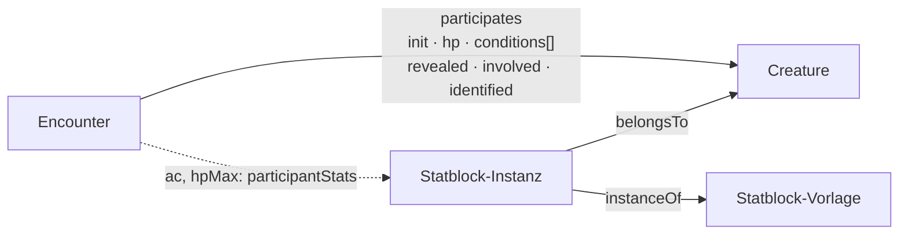

**Die Art einer Begegnung** (T-178): `Encounter.kind` hält Wörter aus der
Aufzählungszeile `EncounterKind` — `combat`, `social`, `puzzle`,
`exploration`, `hazard`, `trap`, `resource`, `story` —, mehrere zugleich,
weil ein Gespräch in einen Kampf kippt. Eine Zeile und keine Liste am
Feld: Zufallstabellen (Biom, Region, Reise) liefern Begegnungen jeder Art,
und die Oberfläche handelt je Art anders. Leer heisst „nicht gesagt“;
Migration 077 setzt `combat`, wo schon `participates` steht. Die Felder,
die nur eine Art braucht (Lösung eines Rätsels, Auslöser einer Falle …),
kommen als Gruppe am `Encounter` dazu und nicht als eigene Arten.

### 5.9 Zeitleisten und Spuren (D57, REQ-220)

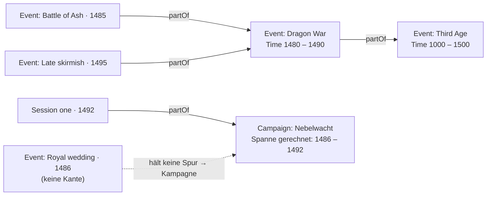

| | Regel | Geprüft durch |
|---|---|---|
| I1 | **RK und TP-Maximum stehen am Statblock** (der Instanz, mit der Vorlage darunter), `props.hp` ist der Stand. `props.hpMax` ist eine Abschrift aus der Zeit davor und gilt nur, wo kein Statblock hängt. | Modell (`participantStats`) |
| I2 | **Ein Eintrag in `props.conditions` trägt seine Dauer:** `rounds`, `anchor` (Id einer Teilnehmerkante derselben Begegnung) und `at` (`start`/`end`). Er zählt herunter, wenn der Zug des Ankers anfängt bzw. endet, und fällt bei null weg. **Ohne `anchor` der eigene Zug, ohne `at` das Ende** — so zählte der Bestand, und er bleibt gültig. Ohne `rounds` bleibt er, bis ihn jemand entfernt. | Modell (`tickEntries`) |
| I3 | **Gezählt wird ab jetzt:** das Ende des laufenden Zuges kommt noch, sein Anfang ist vorbei. Die Maske sagt beim Setzen, wann ein Eintrag abläuft. | Modell (`expiresAt`) |
| I4 | **Eine Notiz ist ein Eintrag mit `text` statt `rule`**, mit derselben Dauer. `hidden` hält einen Eintrag von den Spielenden fern. | — |
| I5 | **Spielende sehen die Gruppe und wer `revealed` oder `involved` ist**; ohne `identified` den Decknamen (`Identity.cover`) und keinen Verweis auf den Artikel; die Trefferpunkte aller ausser der Gruppe als Wort (`unhurt`, `bloodied`, `down`); `hidden`-Einträge und `props.note` nie. Zurückgehalten wird in `redactEntity`, nicht in der Maske. Wer getroffen wird, ist `involved`. | Modell (`redactParticipants`, in `redactEntity`) |

| I6 | **In der ersten Runde steht ein Gegner erst, wenn sein Zug gekommen ist** (REQ-226, D58): vor Runde 1 keiner, in Runde 1 sobald sein Zug beginnt, und dann bleibt er; ab Runde 2 gilt I5. Gemessen wird an der ganzen Reihe (`initiativeOrder`, wie der Prototyp sortiert) und an `Encounter.round`/`turn`. Wer nie aufgedeckt wurde, bleibt verborgen — ein Zug allein deckt weiter nicht auf. Verbündete (`ally`) und die Gruppe sind keine Gegner. | Modell (`turnHasCome`, `redactParticipants` mit `FightState`) |
| I7 | **Die Zugnummer geht nicht an Spielende**: `Encounter.turn` zählt die ganze Reihe und verriete, wie viele davor verborgen sind oder noch nicht erschienen. `redactEntity` lässt sie weg; wer dran ist, sagt die Marke `props.current` an diesem Teilnehmer — nur, wenn er gezeigt wird. | Modell (`redactEntity`) |

Offen: dass `bloodied` schon unter dem Maximum gilt und nicht erst ab der
Hälfte; ob ein Gegner, den die Gruppe in Runde 1 vor seinem Zug trifft
(`involved`), schon dann erscheinen soll (heute nicht — D58 wörtlich).
| Z1 | **Eine Spur ist ein Ereignis mit Spanne** (`Event`, `Time.sort` … `Time.untilSort`). Ein Ende vor dem Anfang ist keine Spanne. Eine neue Art gibt es dafür nicht: ein Krieg, eine Dynastie, ein Zeitalter sind Ereignisse, die dauern (`Event.kind` sagt, welche Sorte). | `isTrack` |
| Z2 | **Was in einer Spur liegt, sagt `partOf`**, nicht der Zeitraum (D57): die Schlacht ist Teil des Kriegs, der Krieg Teil des Zeitalters. Die Kante ist dafür auf `Event` verbreitert (`from`/`to`). Ein Artikel liegt in der **nächsten** Spur über seine Kette; ein Glied, das keine Spur ist oder nicht gesehen wird, wird übersprungen. | Kantenprüfung, `worldHistory` |
| Z3 | **Die Spanne prüft mit, sie ordnet nicht ein.** Was über die Kante drinliegt und ausserhalb fällt, nennt die Rechnung (`outside`) — die Leitung sieht es gestrichelt; verschoben oder abgelehnt wird nichts. | `worldHistory` |
| Z4 | **Eine Spur in einer Spur ist beides**: ein Balken in der äusseren und eine eigene Spur darunter. Ihr Inhalt steht nur in ihr. | `worldHistory` |
| Z5 | **Die Kampagne ist eine Spur.** Was keine Spur hält, gehört ihr (ausser es gehört über seine Ebene einer anderen Kampagne). Ihre Spanne ist ihre `Time`, sonst die ihres Inhalts — beim Lesen gerechnet (D8). Liegt sie selbst über `partOf` in einer Spur, hängt sie darunter. | `worldHistory` |
| Z6 | **Eine Achse für alle**: `sort` ist der Wert im Weltkalender (`World.calendar`), und alle Kampagnen einer Welt lesen so. | — |
| Z7 | **Was man nicht sieht, steht nicht da**: Sichtbarkeit (`articleVisible`) zuerst; wessen Zeit man nicht weiss (eine unbekannte Information nennt `Time`), der steht nicht auf der Leiste — man wüsste nicht, wo. | `worldHistory` (`visible`, `dated`) |

Gezeichnet wird im Element `timeline` an der Kampagne, in zwei Reitern:
**Campaign** (die Liste der Kampagnenspur) und **World history** (die
Spuren auf einer Achse, je Spur ein- und ausblendbar, herangezoomt auf
eine; ein Klick auf einen Balken öffnet den Artikel).

Offen: der Kalender ist ein Name und keine Rechnung — `sort` tippt die
Leitung selbst, aus „Mirtul 12, 1492 DR" wird keine Zahl. Ein Zeitalter
als Hintergrund **über allen** Spuren (alles in seiner Spanne, ohne Kante)
gibt es nicht; es ist eine Spur wie die anderen.

---

## 6. Gerechnet, nicht gespeichert

Drei Dinge entstehen beim Lesen und stehen nie in den Daten (D8):

**Gerechnete Felder** (`derived`). `evalArith` ist ein Auswerter mit
Operatorvorrang, kein `eval`; Namen lösen **erst gegen die Nachbarfelder
derselben Karte, dann gegen die übrigen Karten des Artikels** auf, dazu
`mod(feld)`, `modOf(feld)` (der Modifikator des Attributs, das ein Feld
nennt), `sum(kante.feld)` (die Summe einer Kanteneigenschaft über die
eigenen Vorwärtskanten — die Stufe einer Figur aus `hasClass`, §5.7) und
die Formfunktionen `rowCount`, `colCount`, `cellCount`. Unsinn
ergibt `null`, nie eine irreführende 0. `of` lässt den Wert in der Zelle
des Nachbarn reiten. Der Rückgriff auf den Artikel ist für den Statblock
da: `prof` und das Zauberwirken stehen in seiner Karte, die sechs Werte in
`Abilities`, und der Zauber-SG braucht beide (§5.6). Was die eigene Karte
trägt, gewinnt immer; tragen zwei andere Karten denselben Namen
verschieden, hat die Rechnung keinen Wert.

**Variablen** `{VAR}`. Aufgelöst in dieser Reihenfolge, die erste Stelle
gewinnt: die Bindung an der Kante (`composedOf.props.vars`) → die eigene
Karte `Vars.bindings` → die gerechneten Kampagnenwerte (`{PARTY}`,
`{PARTYSIZE}`, `{PARTYLEVEL}`, `{PARTYTIER}`, `{PARTYWHERE}`, `{TODAY}`,
`{CALENDAR}`) → die Registerzeile `vars`. **Nie in den gespeicherten Text
eingesetzt**; ein unaufgelöster Platzhalter bleibt sichtbar stehen.
**Am Satzanfang schreibt ein eingesetzter Wert gross** (Textanfang oder
nach `.`, `!`, `?`, `:` und Zeilenumbruch; Hervorhebung zählt nicht) —
gespeichert bleibt die Bindung, wie sie ist. Darum **trägt ein
Platzhalter seinen Artikel**: das Merkmal heisst „{CREATURE} can breathe
air and water.", die Kante bindet `CREATURE` an „the dragon" oder
„Venomfang", und die Vorgabe an der Vorlage ist `Vars.bindings.CREATURE`
= „the creature". So teilen sich Drache, Riese und benannte Kreatur einen
Text (W1).

**Würfel** `{{1d6+2}}` (M12, REQ-070). Ein Ausdruck aus Würfeln und
Zahlen, `d` oder `W`; ein blosser Modifikator `{{+4}}` ist ein Wurf auf
den W20 mit diesem Bonus. Ein `{VAR}` darin wird zuerst aufgelöst
(`{{1d8+{STR}}}`). Gewürfelt wird beim Klick, ohne `eval` (`rollDice`);
was kein Ausdruck ist oder einen offenen Platzhalter hat, bleibt Text,
wie es dasteht.

**Das Tragraster und die Ziehstufe** (D54). Ein Inventar ohne eigene
Form, das eine Kreatur trägt, ist nach Basils Blatt 11 × 6: links das
Grundquadrat nach Grösse, rechts das Zusatzquadrat, das der Statblock als
`carryExtra` rechnet (`mod(str)`, geklemmt auf 0…5) — wie ein Angriff
seinen Treffer am Statblock rechnet. Was ein Stück zum Herausholen kostet,
wird die Behälterkette hinauf gerechnet:

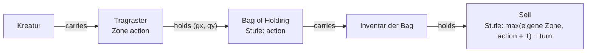

**Der Kalender** steht an der **Welt** (`World.calendar`), und jede Kampagne
hängt über `inWorld` an genau einer: alle Runden in derselben Welt lesen
ihre Weltdaten (`Time.sort`, `Time.display`) im selben Kalender, und
`{CALENDAR}` kommt von dort. Er war eine Einstellung je Kampagne und ein
Feld je Artikel (A11, 7.10.).

**Masse.** Eine Zahl steht in der Einheit ihres Feldes (`unit`); gezeigt wird
nach der Einstellung `units` (`imperial` · `metric` · `both`), die eine Art
überschreiben darf. Wie gerechnet wird, steht in der Zeile `units`
(`quantity`, `system`, `base` in der Grundeinheit); die Zieleinheit wählt die
Grössenordnung. In einem Text mit `measure` greift das Ausgangsmass nur für
Zahlen ohne Buchstaben — „7 zorp" bleibt sieben Zorp.

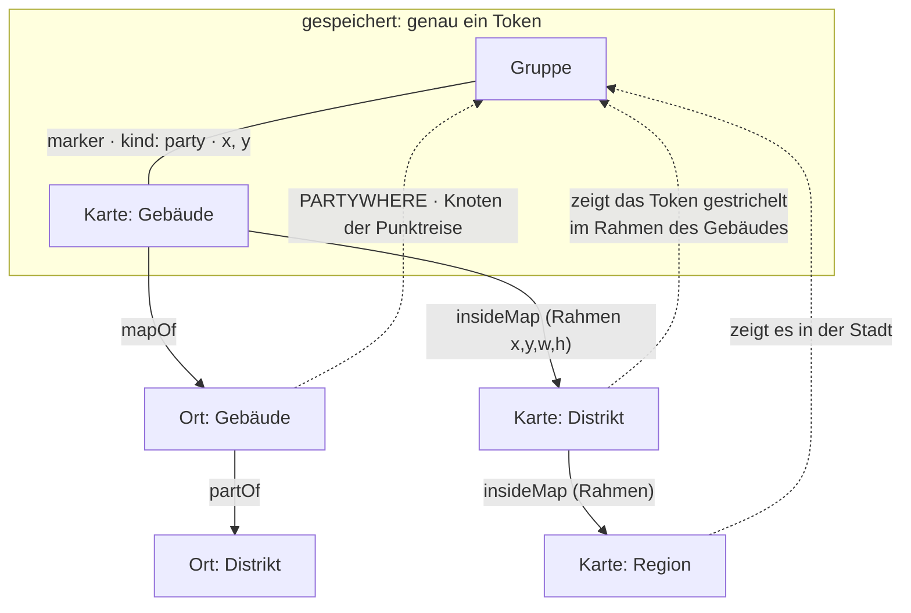

**Wo die Gruppe ist.** Genau eine Stelle: ihr Token (`marker`, `kind:
party`) auf der feinsten Karte, auf der sie steht. Der Ort ist die Marke,
auf der es steht, sonst der Ort der Karte (`mapOf`); der Knoten der
Punktreise ist dieser Ort oder der Knoten, in dem er liegt (`partOf`); jede
gröbere Karte bildet das Token durch den Rahmen ihrer Unterkarte ab
(`insideMap`), ohne ein zweites zu halten. Weiterziehen setzt das Token um.
`Party.at` war ein Feld daneben und ist seit dem 7.10. weg (A6).

**Die Karte in der Seite (T-115).** Gerechnet wird in
`packages/model/src/map.ts`, gezeichnet von `nw-karte` (Element `map` auf
der Artikelseite und Play › Map):

| | Regel | Wo |
|---|---|---|
| K1 | **Alles in Anteilen, das Gitter in Bildpunkten.** Marker (`x`, `y`), Rahmen (`x`, `y`, `w`, `h`) und Messpunkte stehen in 0–1 des Kartenbildes; das Gitter (`gridSize`, `gridOffsetX/Y`) in Bildpunkten des Bildes, weil man es dort misst. Gezoomt wird der Kasten, der genau so gross ist wie das Bild; bei Zoom 1 ist er so breit wie das Fenster. | `mapSettings`, `gridGeometry` |
| K2 | **Blätter:** das Kartenbild (`Image.image`) ist das unterste und bleibt auch ausgeblendet (`baseHidden`) im Fluss — durchsichtig, nicht weg; die Blätter aus `Map.sheets` liegen darüber. Ein- und ausschalten in der Leiste gilt nur für den Betrachter und wird nicht gespeichert. | `mapSheets`, `drawnSheets` |
| K3 | **Messen:** auf Quadraten jede zweite Diagonale doppelt (wie Z1), auf Hexfeldern die Hexdistanz, ohne Gitter gerade über die Feldgrösse; mal dem Massstab (`scale`, „1,5 m"). | `measure`, `cellAt`, `cellDistance` |
| K4 | **Hinein und hinaus zoomen:** füllt ein Rahmen den Blick zu `MAP_NEAR` (55 %) in beiden Richtungen, sagt er an; der nächste Schritt hinein betritt ihn. Ganz draussen führt der Schritt hinaus zur Karte darüber. Mit zwei Fingern dieselben Fragen am Ende der Geste. | `zoomStep`, `frameShare` |
| K5 | **Was neben einer Karte steht, ist eine Abfrage** (`GET /api/maps/:id/context`): die Karten darüber (Brotkrumen), die Unterkarten mit Rahmen (Gegenrichtung von `insideMap`), die Ziele der Marker (Name, Art, Bild) und die Gruppe (`partyPosition`). Gesiebt wie jede Liste. | `apps/server/src/karten.ts` |
| K6 | **Was auf dem Tisch liegt, sagt die Sitzung** (`SessionState.activeMap`): Play nimmt die gewählte Sitzung, sonst die jüngste mit Karte (`Time.sort`, dann Nummer). Hineinzoomen unter Play ändert die Sitzung nicht (`?map=`). Gelesen wird die Karte `Session`, die die Maske schreibt, und das ältere `SessionState` darunter (`sessionState`, T-202 — vorher nur `SessionState`, und die gesetzte Karte lag nie auf dem Tisch). | `GET /api/play`, `sessionState` |
| K7 | **Marker setzen und verschieben schreibt die Kante** (`marker`), nichts sonst — durch `validateEntity` und `PUT`, wie ein Board. | `addMarker`, `moveMarker` |
| K8 | **Nebel** (T-117, REQ-139): `Map.fog` schaltet ihn, `Map.reveal` hält die aufgedeckten Formen — `rect`, `circle`, `poly` und der Pinselstrich `path` (Linienzug mit Halbmesser `r`), alles in Anteilen; Kreis und Strich tragen das Seitenverhältnis `ar`, mit dem sie gezogen wurden, damit der Server ohne Bildgrösse prüfen kann. Zudecken nimmt die Formen weg, deren Mitte im Kasten liegt. Für Spielende hält `redactMap` die Marker unter dem Nebel zurück — ausser dem Gruppen-Token und den Figuren der Gruppe —, und der Kontext die Rahmen, von denen weder Mitte noch Ecke aufgedeckt ist. Das Bild geht ganz hinaus und wird im Browser zugedeckt (E-041). | `revealShapes`, `isRevealed`, `revealArea`, `coverArea`, `redactMap` |
| K9 | **Die Spielersicht der Leitung** ist dieselbe Rechnung (`redactMap` mit `gm: false`) im Browser — eine Vorschau und keine Schranke; zurückgehalten wird am Server. Gilt der Nebel je Figur, zeigt sie die Sicht der Figur, die unter „For“ gewählt ist (ohne Wahl nur das für alle Aufgedeckte). Gezeichnet wird der Nebel auf einer Leinwand, nicht mit einer SVG-Maske: `url(#…)` löst nicht jeder Browser unter `<base href>` auf (T-204). | `nw-karte`, `karten/nebel.ts` |
| K10 | **Spiel-Tokens** (T-117, REQ-135): „Place combatants" setzt je Teilnehmer der laufenden Begegnung ohne Token einen Marker `kind: play` in einem Block in die Mitte des Ausschnitts; „Clear play tokens" nimmt alle `play`-Marker weg. Sie liegen bis zu E-039 an der Karte wie jeder Marker und laufen über den Live-Kanal wie jede Änderung der Karte. Das Bild eines Tokens ist `Statblock.token` (über `belongsTo`, gesiebt), sonst `Image.image`, sonst die Anfangsbuchstaben des gesiebten Namens — für Spielende der Deckname (REQ-178). | `placeTokens`, `clearPlayTokens`, `apps/server/src/karten.ts` |
| K11 | **Wer dran ist** (REQ-144): der Kontext nennt die Begegnung auf dieser Karte (die eine Sitzung führt, `activeEncounter`, sonst eine laufende mit `onMap`) und die Artikel hinter dem laufenden und dem nächsten Teilnehmer (`turnOf`); das Token bekommt einen Ring, der Nächste einen gestrichelten. Spielende bekommen nur, was ihre Reihe zeigt (D53, D58): den Laufenden, wenn `current` an ihrer gesiebten Kante steht, den Nächsten, wenn seine Kante für sie dasteht — und beides nur für ein Token, das auf ihrer Karte steht. | `turnOf`, `apps/server/src/karten.ts` |
| K12 | **Ein Kartenbild wird beim Wählen zur Karte** (T-202): eine Auswahl, die `Map` verlangt (`Session.activeMap`), bietet auch Bilder der Klasse an, die `targets['Image.image']` an der Karte nennt (`imageBecomes`); gewählt, entsteht eine Karte mit Name aus dem Bild und dem Bild als `Image.image`, angelegt in der Schreibebene (`fromImage` → `mapFromImage` mit dem vorgeschlagenen Gitter, dieselbe Funktion wie „Use as map“ am Bild, T-201). | `maplist.ts`, `nw-wahl` |
| K13 | **Karten haben einen Ort** (T-202): Play › Maps (`GET /api/maps`) listet jede sichtbare Karte als Baum über `insideMap` (`mapTree`, eine Karte ohne sichtbare Obere steht oben), mit Bild, Marken und Ebenen; der Filter lässt die Karten über einem Treffer stehen. Wo eine Karte vorkommt (`GET /api/maps/:id/uses`, `mapUses`): Artikel, die sie in einem Feld halten (`Session.activeMap`), `onMap` auf sie und ihr `mapOf` — Marken und Unterkarten nicht; gesiebt. | `maplist.ts`, `apps/server/src/kartenliste.ts` |
| K14 | **Die Karte am Tisch sagt die Kampagne** (T-204, Regeloptionen „On the map“): `Campaign.fog` — `party` (alle sehen alles Aufgedeckte) oder `player`: eine Form darf `for` nennen (Figur oder Gruppe), dann sehen sie nur diese, ihre Gruppe und die Leitung; ohne `for` gilt sie allen. Der Server schickt jedem nur seine Formen und nimmt die Marker unter den übrigen heraus (`revealFor` in `redactMap`). `Campaign.moves` — ausserhalb eines Kampfes zieht eine Spielerin ihre Figur frei oder macht einen Vorschlag (ein Zugplan mit einem Schritt, gestrichelt), den die Leitung bestätigt; im Kampf gilt der Zugplan (T-198). Gezogen wird über `POST /api/maps/:id/move`, auch ohne Schreibrecht an der Karte. `Campaign.revealOnMove`, an der Karte überschreibbar (`Map.revealOnMove`): ein Zug deckt seinen Weg zwei Felder breit auf, `for` die Figur; die Bewegung zählt in beiden Fällen. | `mapRulesOf`, `revealFor`, `moveRevealRadius`, `zugplan.ts` (`wegAufdecken`) |

**Der Zug auf der Karte (D56, REQ-206–210; Grössen D58, REQ-224).** Gerechnet wird beim Lesen,
gespeichert nur, was danach gilt:

| | Regel | Wo |
|---|---|---|
| Z1 | **Diagonalen 5-10-5 je Kreatur und Zug** (D52). Die Parität gehört zum Suchzustand des Weges (Dijkstra über Feld × Parität), läuft über Wegpunkte und über mehrere Bewegungen desselben Zuges weiter und fängt mit jedem Zug neu an. Wände (`blocksMove`) halten den Schritt von Feldmitte zu Feldmitte, eine Ecke hält mit; Gegner sind nicht passierbar, Verbündete passierbar, aber kein Ziel. | `packages/model` `movement.ts` (`cheapestPath`, `pathVia`, `reachable`), Prototyp `moveGrid` |
| Z2 | **Das Tempo des Zuges ist eine Zahl** und steht im **Sitzungszustand** (`SessionState.moves`: `token`, `turn`, `speed`, `used`, `parity`), nicht an der Kreatur. Die Kurzwahl (Grundtempo, Spurt ×2, Klettern/Schwimmen mit eigenem Tempo oder ½) setzt nur die Zahl (`speedPresets`); jede weitere Ausnahme ist eine andere Zahl. Ein Eintrag mit einem anderen `turn` gilt als frisch (`currentMove`). | Modell, Prototyp `turnKey` |
| Z3 | **Eine Zonenart ist ein Regelartikel** (`ZoneKind` erbt von `Rule`), wo sie liegt, sagt die Kante `zone` (Form wie `territory`, aufs Gitter gerastert). Gerechnet werden `moveCost` (Faktor auf das betretene Feld), `light`, `obscured` und `hiddenUntil` (versteckt bis passive Wahrnehmung n, `zone.props.found`); gezeigt und beim Betreten in `SessionState.log` geschrieben werden Schaden, Rettungswurf, Zustand und die Beschreibung als freie Regel. | Prototyp `zonesAt` |
| Z4 | **Gesehen wird mit Sichtlinie, Licht und passiver Wahrnehmung** gegen `marker.props.stealth` (−5 im Dämmerlicht und in leicht verdeckten Feldern, im Dunkeln nur mit Dunkelsicht). Dieselbe Prüfung dient dem Aufdecken von Hand („sees / seen by“) und **entlang des bestätigten Pfads**, Schritt für Schritt; dabei weicht auch der Nebel im Sichtkreis. | `sight.ts` (`notices`, `lightAt`), Prototyp `sightCheck` |
| Z5 | **Versteckt ist eine Angabe an der Kante** (`marker.props.hidden`): Spielende sehen versteckte Tokens und unentdeckte Zonen nicht, und der Weg, den sie sich rechnen lassen, kennt nur, was sie sehen. **Zurückgehalten wird am Server** (T-115): `redactMap` nimmt aus einer Karte für alle, die sie nicht leiten oder schreiben (`seesUnfinished`), versteckte Marker, Marker auf Artikel, die sie nicht sehen (`articleVisible`), die Kante zu einer Karte darüber, die sie nicht sehen, die Blätter mit `gmOnly` und mit `baseGmOnly` das Kartenbild selbst. Unentdeckte Zonen noch nicht. | `map.ts` (`redactMap`, im Sieb des Servers), Prototyp `tokenShown` |
| Z6 | **Eine Kreatur nimmt Felder nach ihrer Grösse ein** (D58, REQ-224, Regeln 2014): tiny, small, medium ein Feld — tiny darf es teilen (es hält Verbündete nicht ab, und es darf auf ihnen stehen) —, large 2 × 2, huge 3 × 3, gargantuan 4 × 4. Die Grösse wird **beim Lesen** vom Statblock genommen (`Statblock.size`; eine Instanz über `resolveInstance`), nicht am Token gespeichert (D8); ohne Statblock oder Grösse ein Feld. Gezeichnet wird das Token in der Grösse seines Platzes; nur was keine Kreatur ist, behält die Breite an der Kante (`marker.props.size`). | `sizeSpan`, `statblockSize`, Prototyp `tokenSpan` |
| Z7 | **Gespeichert ist die Mitte des Platzes, gerechnet über seine Ecke.** `marker.props.x/y` ist die Mitte (bei einem Feld die Feldmitte wie bisher, bei 2 × 2 eine Rasterecke); der Rechner sucht über den **Anker** — das Feld oben links (`anchorAt`, `footprintCentre`). Ein Klick oder ein Ziehen meint die Mitte: bei 2 × 2 setzt er den Platz auf die nächste Rasterecke. | `movement.ts`, Prototyp `tokenAnchorAt`, `anchorMid` |
| Z8 | **Der ganze Platz muss passen und jeder Schritt für jedes seiner Felder gehen**: kein Feld ausserhalb, gesperrt oder unbetretbar (Faktor `Infinity`), keine Wand quer durch den Platz, und keine Wand, die den Schritt für eines seiner Felder hält (Ecke hält mit). Andere Kreaturen sperren mit ihrem **ganzen Platz** (Gegner) bzw. sind dort kein Ziel (Verbündete); die Reichweite eines Gegners (Meiden) ist der Ring um seinen ganzen Platz, 5 ft (`footprintRing`). **Ein Schritt kostet nach dem teuersten Feld, das er neu betritt** (D58) — nicht nach der Summe und nicht nach Feldern, die der Platz schon belegt. 5-10-5 bleibt. | `cheapestPath` (`MoveGrid.span`, `share`) |
| Z9 | **Gesehen wird vom ganzen Platz zum ganzen Platz**: von irgendeinem Feld des eigenen zu irgendeinem Feld des Ziels; gilt das erste Paar, das sieht, sonst das, das am weitesten kam (`bestNotice`). Dasselbe beim Aufdecken entlang des Pfads; der Sichtkreis im Nebel geht von der Mitte des Platzes aus, um seine halbe Breite weiter. | `sight.ts` (`pairsOf`, `spaceLineOfSight`, `bestNotice`), Prototyp `sightFrom` |

Dazu die beiden Abfragen, die wie Daten aussehen: die **Gegenrichtung einer
Kante** (`backlinks`) und **was gerade gilt** (§8).

---

## 7. Vorlage und Instanz

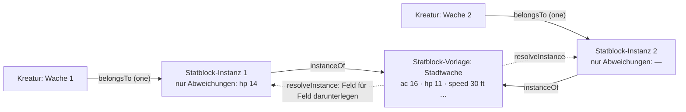

Ein Statblock darf aus einer **Vorlage** lesen: die Kante `instanceOf` zeigt
auf sie, gespeichert wird an der Instanz **nur, was abweicht**, gelesen wird
beides zusammen (`resolveInstance`), Feld für Feld.

| | Regel |
|---|---|
| V1 | **Gleich wie die Vorlage heisst: folgt der Vorlage.** Beim Speichern fällt weg, was gleich steht (`thinInstance`); den Wert der Vorlage eintragen oder das Feld leeren heisst, ihr wieder zu folgen. |
| V2 | **Kanten nach Art:** die Aktionen der Vorlage (`composedOf`) kommen mit, solange die Instanz keine eigenen hat; eine geänderte Liste gehört ganz ihr. |
| V3 | **Nicht vererbt:** `Identity`, `Visibility` und die Kanten, die zur Vorlage als Artikel gehören (`inLayer`, `belongsTo`, `overrides`, `variantOf`) — dazu, was ein **Stück** trägt (`carries`, `PIECE_RELATIONS`, T-150): zwei Rucksäcke aus einer Vorlage haben nicht denselben Inhalt. Anders als `inLayer` ist `carries` eine Abweichung: ein Behälter mit eigenem Inhalt folgt der Vorlage nicht mehr (`followsTemplate`) und bildet keinen Stapel. |
| V4 | **Eine Vorlage darf selbst Instanz sein**; gelesen wird die Kette hoch, ein Kreis bricht ab. |
| V5 | **Instanzen stehen an ihrer Kreatur oder in ihrem Inventar und sonst nirgends** — nicht in Listen, nicht als Verweisziel. |
| V6 | **Löschen nimmt nichts weg:** geht die Vorlage, bekommen die Instanzen vorher, was sie lasen (`detachInstance`); geht die Kreatur, geht ihre Instanz mit. |
| V7 | Am Server kommt eine Instanz aufgelöst an, mit `fromTemplate` (Vorlage, geerbte Felder) — nur gelesen, nie gespeichert. |

Welche Arten Vorlagen haben dürfen, sagt die Kante (`instanceOf.from`/`to`),
heute `Statblock` und `Item` (M4: das +1-Langschwert am Tisch ist eine
Instanz des Langschwerts), und `to: same` hält die Instanz in der Art ihrer
Vorlage. Ein eigener Typ dafür wäre derselbe Typ ein zweites Mal.

**Was eine Figur in die Hand bekommt, entsteht als Instanz** (T-150, zuerst
beim Kauf, T-133): `newInstance` legt den Artikel an — `instanceOf` auf den
Grundartikel, `inLayer` in die Ebene der Kampagne, `Identity` mit dem Namen
der Vorlage und einer neuen Nummer, `Status: ready`, sonst nichts. Eine
Funktion für alle Wege, und eine fürs Einlegen (`receivePiece`): liegt ein
loser Stapel desselben Grundartikels da, wächst er, sonst kommt eine neue
`holds`-Kante auf das neue Stück. `followsTemplate` sagt, ob eine Instanz in
nichts abweicht — dann ist sie ein beliebiges Stück und darf einen Stapel
bilden. Am Server legt `stueckWerkstatt` (`apps/server/src/stueck.ts`) die
Stücke einer Anfrage an und nimmt sie zurück, wenn das Inventar danach
nicht geschrieben werden kann. Die Wege:

| Weg | Wo |
|---|---|
| Kauf (T-133) | `POST /api/shops/:id/buy` |
| Handwerk, der Ertrag bei Erfolg (T-128) | `abrechnen` in `handwerk.ts` |
| Startausrüstung (T-096) | `POST /api/entities/:id/equipment` |
| **Geben** — Beute, Geschenke, „Add an item" am Inventar | `POST /api/inventories/:id/give` (`{ item, qty }`): die Leitung der laufenden Kampagne in jedes Inventar, das sie sieht, sonst wer das Inventar schreibt; der Gegenstand muss sichtbar sein. Protokoll `inventory.given` |

Wer ein Stück **weitergibt** (verschieben zwischen Figur, Gruppe und
Behälter, `moveHeld`), gibt dieses Stück — eine Instanz einer Instanz
entsteht nie. **Material zählt nach dem Grundartikel** (`baseArticle`): das
Rezept braucht „Eisenbarren", der gekaufte Barren ist eine Instanz davon.
Reservierte Stücke (T-134) bleiben gesperrt; die Reservierung steht an der
Kante und nicht am Gegenstand.

**Der Bestand vor T-150** (Migration 067): jede `holds`-Kante, die direkt auf
einen Gegenstand zeigte, zeigt danach auf ein eigenes Stück — Name, Art und
Sichtbarkeit des Gegenstands, eine neue Nummer, `ready`, in den Ebenen
seines Inventars, verfasst von dem, der das Inventar verfasst hat. Menge,
Lage und Reservierung bleiben an der Kante. Ein Behälter mit eigenem Inhalt
und ein Ziel, das kein Gegenstand ist, bleiben und werden aufgezählt.

---

## 8. Ebenen und Stapel

| Zeile | Was sie sagt |
|---|---|
| Artikelart `Layer` | `kind` (`system` · `expansion` · `book` · `adventure` · `world` · `pack` · `campaign` · `overrides` · `group`), `order`, und die **Beschreibung** (T-088, REQ-245): `abbreviation` (das Kürzel, unter dem ihre Artikel die Quelle nennen, „XGE"), `published`, `author`, `version` (Regelstand, „2014"), bei Abenteuern `levels` und `storyline`; der volle Titel ist der Name. An einer Gruppe sagt `groupBy` (`category` · `publisher`, T-094), wonach sie ordnet (E10). `kind` ist **Beschreibung**, keine Regel — ausser `group` (E8): eine Gruppe enthält Ebenen. Die Ausfuhr lässt `system`/`expansion`/`book`/`adventure` als Regelwerk weg. |
| Kante `partOf` (Layer → Layer) | die Ebene gehört zu dieser **Gruppe** (E-022 b, T-088); eine Ebene darf in mehreren sein, eine Gruppe in einer Gruppe |
| Kante `inLayer` (`*` → Layer) | der Artikel liegt in dieser Ebene; `props.mode` `adds` (Vorgabe) oder `removes` |
| Kante `activates` (Campaign → Layer, „Layers in play" / „In play in") | die Kampagne schaltet die Ebene auf; `props.order` ordnet, sonst `Layer.order`. Gepflegt auf der Kampagnenseite (Häkchen und Reihenfolge, `PUT /api/campaigns/:c/layers`) |
| `activates` mit `props.mode: 'compare'` | **Vergleichsebene** (T-092, E-021 d): nicht im Spiel, ihre Fassungen stehen auf Wunsch an den Feldern und lassen sich übernehmen. Eine **Gruppe** zum Vergleich vergleicht ihre Mitglieder, verschachtelt, soweit sie nicht im Spiel sind (`playStack`, T-143). Zählt nicht für `activeStack`, `campaignsOf`, `campaignsActivating` und die Ausfuhr. Gepflegt auf der Kampagnenseite und im Popup der Kopfleiste (`PUT /api/campaigns/:c/compare`) |
| `activates` mit `props.mode: 'off'` | **ausdrücklich aus** (T-088): die Ebene ist nicht im Spiel, auch wenn eine aufgeschaltete Gruppe sie brächte. Ohne Gruppe tut die Kante nichts. Gepflegt auf der Kampagnenseite (`PUT /api/campaigns/:c/layers` mit `off`) |
| `activates` mit `props.areas` / `props.types` | **was die Ebene bringt** (T-105, REQ-255): Bereiche (`area` der Art, geerbt) und einzelne Arten; ein Artikel passt, wenn seine Art genannt ist oder ihr Bereich. Ohne beide: alles. Gilt an aufgeschalteten Ebenen, an Gruppen (die Mitglieder tragen die Auswahl ihrer Gruppe, eine ausdrückliche Kante ihre eigene) und an Vergleichsebenen. Gepflegt auf der Kampagnenseite (`PUT /api/campaigns/:c/layers/:layer/only`) |
| Feld `Campaign.compareFor` | wer die Vergleichsebenen sieht: `gm` (Vorgabe — Verwaltung, `gm`, `co-gm`) oder `players` (jede Rolle am Tisch) |
| Kante `overrides` (`*` → `*`, one) | der neue Artikel gilt statt des alten, solange seine Ebene läuft. **So passt eine Kampagne ein Abenteuer an** (E-018 a, T-082): „Adapt" (`POST /api/entities/:id/adapt`, `adaptedVersion`) legt eine Fassung mit denselben Karten und Kanten in die Ebene der Kampagne (`campaignLayer`) — seit T-098 auch „Edit" an einem fremden Artikel, in eine Ebene, in der man schreibt (§ 9.4); zurück heisst, die Fassung zu löschen |
| Kante `variantOf` (`*` → `*`, one) | eine Kopie mit Herkunft; sie ersetzt nichts |

| | Regel |
|---|---|
| E1 | **Ohne `inLayer` gehört ein Artikel der Kampagne und ist immer da.** Das ist der Normalfall und kostet keine Zeile. |
| E2 | **Was gilt, ist eine Abfrage** (`inStack`, `resolveArticle`, `inPlay` in `packages/model/src/stack.ts`): ein Artikel steht im Stapel, wenn eine aufgeschaltete Ebene ihn bringt und keine spezifischere ihn herausnimmt; Überschreibungen werden bis zum Ende der Kette verfolgt, nicht im Kreis. Gelöscht wird dabei nie. **Der Server siebt damit zuerst** — vor Sichtbarkeit und Wissen, für jeden, auch die Verwaltung (A2, 7.10.); die laufende Kampagne ist die Einstellung `campaign`, sonst die erste. Ohne irgendeine Kampagne gilt alles. |
| E2a | **Ohne Aufschalten ist ein Artikel einer Ebene nicht da** — er ist nicht gelöscht, er steht nur in keiner Liste der Kampagne. Sobald es eine Kampagne gibt, zeigt der Server nur, was ihre aufgeschalteten Ebenen bringen, und Artikel ohne Ebene; eine Ebene, die sie nicht aufschaltet (z. B. ein Buch aus 5e.tools nach dem Einlesen), bleibt mit all ihren Artikeln aussen vor. **Darum sagen es die Listen** (T-069): `/api/list` zählt je Ebene, was mit denselben Filtern fehlt, weil die laufende Kampagne die Ebene nicht aufschaltet (`unactivatedLayers`, Feld `unactivated`), und Kompendium, Bereiche und Board-Suche sagen es in **einer Zeile** mit der Zahl und einem Link auf die Kampagne (`canManage`) — ohne die Ebenen aufzuzählen (T-207). Was eine aufgeschaltete Ebene herausnimmt oder eine Fassung überschreibt, zählt nicht — das ist Absicht. Das Register zählt je Art beides: im Stapel und gespeichert. |
| E2b | **Was nicht aufgeschaltet ist, steht nicht da** (T-207, `shownLayers` in `stack.ts`): genannt werden die Ebenen des Stapels (`resolvedStack`, Gruppen und ihre Mitglieder) und — wer sie sieht (`Campaign.compareFor`) — die Vergleichsebenen; eine andere erscheint weder als Artikel (die Ebene selbst), noch als Ebene einer Zeile, Fassung, Filteroption, Quellenkürzel oder Zählung. Gesiebt wird am Server **einmal im Listenindex** (`buildListIndex(…, shown)`) — damit gilt es für `/api/list`, `/api/search`, `/api/sources` und jede Auswahl —, dazu an `GET /api/entities/:id` (`refs.names` der `inLayer`-Ziele) und `…/versions`. Ohne Kampagne gibt es keinen Stapel und alles steht da. Ausnahmen bewusst: die Kampagnenseite und das Popup der Kopfleiste (dort wird geschaltet), die Bibliothek (Bücher zum Aufschalten, T-168) und die Werkbank (`/api/list?allLayers=1`, nur Verwaltung, `gm` und `co-gm`). |
| E2b | **Aufschalten dürfen die Verwaltung und die Leitung (`gm`) der Kampagne**, wie bei den Mitgliedern; ein Mitleiter sieht die Liste. Eine Ebene, die genau **einer anderen** Kampagne gehört (E3), schaltet nur die Verwaltung dazu — sonst würde sie gemeinsam, und die Leitung sähe, was dort nur deren Leitung sieht (`mayActivate`). Neu aufgeschaltet steht eine Ebene, wo ihre `Layer.order` sie hinstellt; danach ordnet die Kante. |
| E3 | **Wem ein Artikel gehört, sagt der Stapel** (`campaignsOf`): eine Ebene, die genau eine Kampagne aufschaltet, gehört ihr; eine, die mehrere aufschalten, ist gemeinsam; ohne Ebene ist er niemandem zuzuordnen. `removes` zählt nicht. |
| E4 | **Instanzen und Varianten** erben die Ebene nicht (V3). |
| E5 | **Ein Verweis aufs Original führt zur Fassung, die gilt** (E-018, T-082): der Server liefert beim Öffnen, in den Namen der Kantenziele und in den Treffern von `[[…]]` die Fassung, die in der laufenden Kampagne das Original ersetzt (`resolveArticle`), und die Rückbezüge einer Fassung sammeln auch, was aufs Original zeigt (`replacedIds`) — die Szenen eines angepassten Kapitels bleiben seine. Die Seite zieht die Adresse nach. Das Original selbst sieht in dieser Kampagne niemand; es bleibt für jede andere. |
| E6 | **Fassungen derselben Sache** (`versions.ts`, T-092, E-021 d): zwei Artikel derselben Art, verbunden über `variantOf` (in beide Richtungen) oder `overrides`, mit demselben Namen nach Abzug eines angehängten „ (Buch)" der eigenen Quelle (`versionName`, `sameThing`); `overrides` zählt immer. Die Gruppe ist alles, was so erreichbar ist (`versionsOf` je Artikel, `versionGroups` für eine Liste — beide ein Gang über den Bestand). Es gibt **keinen Umschalter**: die Artikelseite zeigt an jedem Feld, an jeder Kantenart und an jedem Text, was eine Fassung aus einer Spiel- oder Vergleichsebene anders sagt (`versionDiff`), mit dem Kürzel ihrer Ebene (`layerShort`) — **an genau der Stelle, an der es gelesen wird** (T-103): ein langer Text Abschnitt für Abschnitt unter seinen Überschriften (`textSections`, `sectionDiff`; was nur die Fassung hat, unter seiner eigenen Überschrift), die Zeilen eines Statblocks, Zaubers oder Gegenstands nach Beschriftung (`linesDiff`), ein Feld, das nur die Fassung füllt, an seinem Platz mit „—", auch in der Maske; Kantenziele gleichen Namens zählen nicht als Abweichung; ein- und ausschaltbar und je Ebene, gemerkt am Konto (`app_user_pref`, Schlüssel `versions`). Das Kompendium zeigt eine Zeile je Sache, Kopf ist die Fassung aus der obersten Spielebene (`/api/list?versions=1`). Die Fassungen eines Artikels: `GET /api/entities/:id/versions`, je Ebene im Spiel mit ihrem Platz im Stapel (`rank`). **Auf einen Blick** (T-173): unter dem Namen ein Abzeichen „2 versions · differs in tier", je Fassung im Kasten ein Satz, was sie anders hat oder dass nur die Quelle anders steht (`versionSummary`), ein Feld, das die Fassung nicht setzt, als „— not set in XDMG", und sind zwei Fassungen im Spiel, welche gilt — die aus der obersten Ebene (`versionInPlay`, dieselbe Regel wie das Kompendium). **Nebeneinander** (`/artikel/:id/compare/:other`): alle Felder und Kanten beider Artikel, gleiche mit, Name, Quelle und Ebene am Ende (`compareRows`), lange Texte Zeile für Zeile wie ein Git-Vergleich (`lineDiff`); die Komponente `nw-vergleich` nimmt zwei beliebige Artikel und dient auch der Übertragung dev → prod (T-130). |
| E7 | **Übernehmen** (T-092): die Leitung macht eine Fassung aus einer Vergleichsebene zur geltenden — `POST /api/campaigns/:c/adopt {version, over}` legt eine **Kopie** in die Ebene der Kampagne (`campaignLayer`) mit `overrides` → `over` und `variantOf` → `version`, mit dem Namen von `over` — wie „Adapt" (E5), nur aus einer Vergleichsebene und mit der Herkunft in `variantOf`. Keine Kante am Buchartikel: eine Überschreibung in einer geteilten Ebene gälte in jeder Kampagne, die sie aufschaltet. Rückgängig: `DELETE /api/campaigns/:c/adopt/:kopie`. |
| E8 | **Gruppen sind Ebenen, die Ebenen enthalten** (E-022 b, T-088, REQ-244; `resolvedStack`, `groupMembers`, `layersInGroup` in `stack.ts`). Schaltet die Kampagne eine Gruppe auf, sind alle Mitglieder im Spiel, verschachtelt auch deren Mitglieder, nicht im Kreis. **Den Rang gibt die Gruppe**: an ihrer Stelle im Stapel steht sie selbst, darüber ihre Mitglieder nach `Layer.published` (ohne Datum zuletzt), das neuere höher; bringen zwei Gruppen dieselbe Ebene, zählt die höhere. **Die ausdrückliche Kante schlägt die Gruppe:** eine Ebene, die die Kampagne selbst aufschaltet, steht an ihrer eigenen Stelle; eine mit `mode: 'off'` ist aus, und was nur über sie käme, auch — aus schlägt an. Gerechnet wird einmal je Anfrage (`playStack`, T-086); die Mitglieder werden einmal gesammelt. **Wem eine Ebene gehört (E3), sagt nur die ausdrückliche Kante** — eine Gruppe macht ihre Mitglieder nicht zu Eigentum; dafür schaltet eine Leitung eine Gruppe nur auf, wenn sie jedes Mitglied aufschalten dürfte (`mayActivate`, E2b). Eine Gruppe ist kein Ort für neue Artikel (`campaignLayer`). Der Importer legt die Gruppen aus der 5e.tools-Gruppe an (Core rules, Supplements, Settings, Adventures, Unearthed Arcana, 2024 rules, Screens & other); eigene legt die Leitung als Ebene mit `kind: 'group'` an. **Eine Gruppe ganz schalten** (T-185, `groupSwitched`, `PUT /api/campaigns/:c/layers/:gruppe/group` mit `{ on }`): an bringt die Gruppe in den Stapel und nimmt jede Abschaltung darin weg; aus nimmt die Gruppe und jede ausdrückliche Kante darin aus dem Stapel und schaltet ab, was eine andere aufgeschaltete Gruppe noch brächte — eine Gruppe, in der danach nichts mehr an ist, geht mit. Das Häkchen der Gruppe zeigt den Stand ihrer Bücher (alle, keines, teilweise), nicht ihre Kante. |
| E9 | **Eine Ebene beschreibt sich selbst** (T-088, REQ-245): Kürzel, Erscheinen, Autor, Regelstand, Stufen und Handlungsstrang stehen an `Layer`, der Importer füllt sie (`import --layers` trägt sie an bestehenden Ebenen nach, ohne einen Artikel anzufassen), die Leitung darf sie ändern. **Was sie enthält, wird gerechnet** (D8): `GET /api/campaigns/:c/layers` zählt je Ebene ihre Artikel je Art (`content`). Ein Quellenkürzel zeigt überall seinen vollen Titel (`GET /api/sources`: Kürzel → Name, aus `Layer.abbreviation`). |
| E10 | **Der Herausgeber ist eine Gruppe** (T-094, REQ-249; `publisherOf`, `groupingOf` in `stack.ts`). Neben den Kategorien (E8) ordnen Gruppen mit `Layer.groupBy: 'publisher'` nach Herausgeber: Official (Wizards of the Coast), Partnered, Third party. Ein Buch steht in einer Kategorie- *und* einer Herausgeber-Gruppe; aufgeschaltet bringt jede ihre Mitglieder wie in E8. **Der Herausgeber einer Ebene wird gerechnet** (`publisherInfo`): die Namen der Herausgeber-Gruppen, an denen sie mit `partOf` hängt; hängt sie an keiner, ist sie „Homebrew", wenn sie hier angelegt wurde (von einem Konto, mit einer Kampagne — alles ausser den Pegs `e5_…` des Importers), sonst „Unassigned" (T-109). Ein Feld `publisher` daneben wäre die zweite Stelle. **Sichtbar und änderbar an der Ebene** (T-109): die Artikelseite einer Ebene zeigt „Publisher" mit dem Grund („Because this layer is part of the publisher group Official." / „Not part of any publisher group."), und für die Verwaltung und wer die Ebene besitzt eine Auswahl, die die `partOf`-Kante zur Herausgeber-Gruppe setzt (`GET`/`PUT /api/layers/:id/publisher`; Kanten zu Kategorien bleiben). Auf der Kampagnenseite steht der Grund an der Marke (`publisherWhy`). **„D&D 5e (2014)" ist eine Gruppe** (Kategorie, kein Herausgeber) aller offiziellen Ebenen mit Regelstand 2014; was kein Buch nennt (die Aktionsarten), liegt in „D&D 5e (2014) — no book given" unter Official (Migration 044, der Importer ebenso). `groupBy` zählt für den Stapel nicht; es sagt nur, in welcher Ansicht der Kampagnenseite (group by category / publisher) die Gruppe steht. Der Importer legt die Herausgeber-Gruppen aus den 5e.tools-Quelldaten an (Partner-Quellen nach `5etools-src/js/parser.js`) und zusätzlich die Kategorien der Content Blocklist, die E8 nicht hat (Non-standard, Comedy, Outside the Forgotten Realms); Regel und unklare Fälle: [5etools-Abgleich › Herausgeber](5etools-Abgleich.md#herausgeber-und-blocklist-kategorien-t-094). `GET /api/sources` nennt je Kürzel auch den Herausgeber (`publishers`), damit Listen und die Vorschau ihn als Marke zeigen. |
| E11 | **Eine Ebene liest sich als Buch** (T-091, REQ-247, `readingOrder` in `packages/model/src/reading.ts`): ihr Text sind die Artikel der Ebene von einer Leseart (`READING_TYPES`: `Chapter`, `Story`, `Arc`, `Scene`, dazu die Teile, E14), verbunden über `partOf`. **Hat die Ebene Kapitel, liest sie sich aus ihnen** (E14): jedes Kapitel eine Wurzel und ein Stück, darunter seine Teile nach `partOf.rank`; ins Inhaltsverzeichnis kommen Kapitel, Szenen und Überschriften (`toc`), eine Überschrift so tief, wie ihre Stufe sagt. Sonst gilt der Baum aus Story, Arc und Szene: Geschwister stehen nach ihrer Nummer (`Identity.id`), gelesen wird Tiefe zuerst. Gezeigt wird **ein Stück am Stück**: hat die Ebene genau eine Wurzel (das Abenteuer), ist sie die Titelseite und jedes Kapitel darunter ein Stück, sonst jede Wurzel. Karten (`mapOf`) und Begegnungen (`partOf`) stehen an ihrem Abschnitt. Gesiebt wird wie überall (E2, Sichtbarkeit, Wissen); eine Fassung steht an der Stelle ihres Originals (E5), der Baum bleibt der des Originals. Die Seite eines Abschnitts ist `Source.page`, bei `Story`/`Scene` (ohne `Source`) die Notiz `source` des Importers — darüber springt „XGE p. 12" an die Stelle (`nodeAtPage`). **Teile in der Leseansicht** (T-108): Absätze, Vorlesetexte und Verweise stehen ohne Kopf im Fluss des Stücks; ein Verweis-Teil bringt sein Ziel gesiebt mit (`target`), fällt es durchs Sieb, steht an der Stelle nichts; `?at=` und ein Suchtreffer dürfen ein Absatz sein (der Server findet sein Stück). Fürs Verzeichnis siebt der Server nur dessen Einträge. **Vor dem Aufschalten lesen** (T-167): die eine Ausnahme von der nullten Frage (E2) — für `/api/read/:layer` fragt das Sieb auch, was **nur** fehlt, weil diese Ebene (bei einer Gruppe: eine ihrer Ebenen) nicht aufgeschaltet ist (`{ preview }`); Sichtbarkeit und Wissen gelten danach wie immer. Das dürfen die Verwaltung, wer irgendwo leitet und wer die Ebene besitzt oder bearbeitet; Spielende nur bei ausdrücklichem `audience: 'public'` an der Ebene (die Vorgabe ohne Angabe reicht nicht). Die Antwort sagt `inactive` und `preview`. **Eine Gruppe liest sich als Regal** (`shelf`): ihre direkten Mitglieder, je mit `hasText` — ein Buch ohne Text steht ausgegraut da, statt zu fehlen; ebenso steht `refs.reading` an jeder Ebene, ohne Text mit `empty`. |
| E12 | **Ein Teil eines Abenteuers in die eigene Geschichte holen** (T-097, E-026, REQ-252; `takenWith`, `rehang` in `stack.ts`): `POST /api/entities/:id/take {into}` macht aus einem Kapitel (`Arc`) oder einer Szene **samt allem darunter** — was über `partOf` oder `mapOf` daran hängt, in jeder Tiefe: Szenen, Räume, Begegnungen, Karten — Fassungen in der Ebene der laufenden Kampagne (`overrides`, wie E5; E-018 a). Die Teile hängen an den Fassungen ihrer Eltern, das Geholte selbst nur noch an `into`: der Kampagne oder einem ihrer Arcs (`refs.takeInto` sagt, welche). Eine Fassung, die es schon gibt, wird genommen und nur umgehängt — zweimal holen legt nichts doppelt an. Holen darf, wer in der Ebene der Kampagne schreibt: Verwaltung, `gm`, `co-gm` (T-098). Nicht dasselbe wie „Übernehmen" (E7, aus einer Vergleichsebene). **Ein Kapitel und ein einzelner Teil** (T-108, E-028): ein `Chapter` lässt sich wie ein Arc holen (mit allen Teilen und Szenen darunter), ein Teil (`ReadAloudText`, `Paragraph` …) einzeln — dann auch in eine eigene Szene der Kampagne; beide stehen im Ziel an der nächsten Stelle (`partOf.rank`, `nextRank`). **Verwenden statt holen** (`take {into, use: true}`): statt einer Fassung legt der Server einen `Embed` in der Kampagnenebene an, der aufs Original zeigt — eine Korrektur am Original erreicht ihn, ändern heisst, den Teil doch zu holen. Ein geholtes Kapitel macht die Kampagnenebene nicht zum Buch: `readingOrder` liest eine Ebene nur dann aus Kapiteln, wenn sie eigene hat (keine Fassung). |
| E13 | **Teilweise aufschalten** (T-105, REQ-255; `filterOf`, `withFilter`, `resolvedEntries` in `stack.ts`): eine Kante `activates` darf mit `areas` und `types` sagen, was ihre Ebene bringt — aus einem Abenteuer nur Regeln und Gegenstände, nicht seine Orte, NSC und Begegnungen. **Was nicht passt, bringt die Ebene nicht, in keiner Rolle**: nicht als Artikel, nicht als Herausnahme (`removes`), nicht als Überschreibung. Der Bereich ist der der Art (`areaOf`, die `extends`-Kette hoch); die Arten werden genau genommen (ein `Weapon` ist nicht `Item`). Eine Gruppe gibt ihre Auswahl an alle Mitglieder weiter (E8), eine ausdrückliche Kante eines Mitglieds hat ihre eigene. Ein abgewählter Artikel zählt nicht als „nur nicht aufgeschaltet" (`unactivated`, T-069): die Ebene ist an, die Leitung hat ihn abgewählt. Gerechnet wird der Bereich einmal je Art und Anfrage (`playStack(…, registry)`, T-086); **ohne Register gilt die Bereichsauswahl nicht** (lieber zu viel als still ein ganzes Buch weg) — wer einen Stapel rechnet, gibt es mit. Die Kampagnenseite zeigt je Ebene und Gruppe „Brings: everything" zum Aufklappen, je Bereich ein Häkchen mit Zähler, darunter die Arten; sind alle an, schickt sie keine Auswahl, damit eine neue Art mitkommt. |
| E14 | **Ein Buch besteht aus Kapiteln, ein Kapitel aus Teilen** (T-108, E-028, E-029; `partsIndex`, `isBookPart` in `packages/model/src/parts.ts`). `Chapter` ist die Lesestruktur eines Buchs oder Abenteuers (ohne Bereich); seine Teile sind eigene Artikel unter dem abstrakten `BookPart` — `Heading` (Text im Namen, `level`), `Paragraph` (`Prose.paragraph`, `kind`: text, list, table, sidebar, quote), `ReadAloudText` (`ReadAloud.readaloud`), `Embed` (`target`: ein Artikel, der für sich steht, etwa ein Monster aus dem Monster Manual — er bekommt keine Kante, die stünde in einer fremden Ebene) — und im Abenteuer Szenen, die selbst wieder Teile haben. **Die Reihenfolge steht an der Kante** (`partOf.props.rank`): derselbe Vorlesetext darf im Kapitel an dritter und in einem eigenen Arc an erster Stelle stehen; `partOf` ohne `rank` hängt etwas an (eine Begegnung an ihre Szene) und steht nicht im Fluss. **Ein Kapitel eines offiziellen Abenteuers gibt es zweimal und seine Teile einmal:** als `Chapter` zum Lesen und als `Arc` zum Spielen, verbunden über `chapterOf` (Chapter → Arc); beide zeigen auf dieselben Szenen. **Teile stehen in keiner Liste und sind kein Verweisziel nach Namen** (`isBookPart` in `linkFinder`, `linkCandidates`, der Liste und den Werten einer Art): ein Absatz heisst nach seinen ersten Worten (`partName`), eine Überschrift wie die Regel darunter; die Nummer bleibt ein Ziel. **Auf der Artikelseite** eines Kapitels, einer Szene oder eines Arcs zeichnet das Layout-Element `parts` (in der Grundanordnung `full`, Migration 047) die Teile wie im Buch (`GET /api/entities/:id/parts`; eine Fassung hat die Teile ihres Originals dazu); unter „Linked here" stehen sie nicht. Ein Textblock ist sonst ein Feld (F-Regeln) — Buchtext ist die Ausnahme, weil man einen Absatz einzeln wiederverwendet. |
| E15 | **Jeder Regelstand kommt herein, jede Quelle in ihre Ebene, und keine neue ist aufgeschaltet** (T-087, REQ-243; löst E2 des Arbeitsplans ab — 2014 als Basis, der Rest weggesiebt). `Layer.version` sagt `2014`, `2024` oder `UA`; 2024-Bücher stehen in der Gruppe „2024 rules", Unearthed Arcana in „Unearthed Arcana". Ein Merkmal oder eine Unterklasse, die 5e.tools aus einem 2014-Buch an eine 2024-Klasse hängt, liegt in der Ebene der Klasse und heisst nach beiden („Champion (PHB, XPHB)"). **Die Grundfassung ist die des Grundstands** (E-021 d): der 2014-Fireball behält seinen Namen, die 2024-Fassung heisst „Fireball (XPHB)" und zeigt mit `variantOf` auf ihn (E6 zeigt sie am Feld). Die Gruppe „D&D 5e (2014)" hält nur, was vor T-087 hereinkam: eine 2014-Ebene, die nur Fahrzeuge oder Karten bringt, käme sonst über die Gruppe in jede Kampagne, die sie aufschaltet. | `packages/import-5etools/src/lesen.ts` (`regelstandVon`, `ebeneQuelle`, `imGrundstand`), `test/lauf.test.ts` |
| E16 | **Ein Ort aus einem Buch ist ein `Place` neben seinem Text** (T-175; `packages/import-5etools/src/orte.ts`). Der Importer legt zu jedem Abschnitt, der einen Ort beschreibt, einen `Place` in der Ebene des Buchs an: im Abenteuer ein Raum mit Schlüssel („K1. Front Courtyard" → `kind: 'Raum'`) und ein Abschnitt mit eigener Karte (benannt nach dem Kartentitel: „Areas of the Village" mit „Map 3.1: Village of Barovia" → „Village of Barovia"; zwei Karten derselben Gegend sind ein Ort), überall ein Abschnitt, dessen erster Satz ihn als Ort nennt („X is a walled city …", das Ortswort als Hauptwort, die Art daraus). **Erfunden wird nichts:** ein Ortswort, das nicht der Abschnitt selbst ist, und eine Liste von Räumen ohne Karte zählen als Kandidat im Bericht; die Räume einer solchen Liste liegen im Ort der Karte daneben. Ein Abschnitt tiefer als Stufe 3 hat keine Überschrift — sein Ort zeigt auf den Absatz, der mit seinem Namen beginnt. Der Ort trägt Name, `kind`, Quelle mit Seite (`Place` nimmt `Source`, Migration 075) und zeigt mit **`describedIn` auf den Abschnitt**, der ihn beschreibt (Überschrift oder Szene — `describedIn` nimmt dafür `Story` und `BookPart` als Ziel); die Leseansicht zeigt ihn dort als Verweis. Hierarchie über `partOf` (Raum → Burg → Gegend), im Abenteuer `happensAt` von der Szene und `mapOf` von ihrer Karte. `arrival` bleibt leer: der Vorlesetext steht im Abschnitt, und eine Kopie liefe auseinander. Die Peg-Id hängt an der des Abschnitts, `--only-new` legt keinen Ort zweimal an. |

Offen und benannt: der Server kennt heute nur E3; E2 läuft im Prototyp
(siehe [Durchgang.md](Durchgang.md), Abgleich). Mit einer zweiten Kampagne
braucht jede ihre eigene Ebene — E1 stimmt bei einer.

---

## 9. Sichtbarkeit, Rollen, Wissen

**Zwei Fragen, und die grobe kommt zuerst.** Die Sichtbarkeit sagt, ob ein
Artikel an jemanden geht; das Wissen sagt, welche Felder darin.

### 9.1 Sichtbarkeit (`Visibility`, `articleVisible`)


Gezeichnet in [Bilder/Sichtbarkeit.excalidraw.md](Bilder/Sichtbarkeit.excalidraw.md) — wer die Regel ändert, ändert die Zeichnung im selben Commit.

Träger eines Betrachters: seine Figuren, deren `Party` (`memberOfParty`)
und deren `Faction` (`memberOf`) — einen Schritt weit.

| Feld | Werte | Bedeutung |
|---|---|---|
| `audience` | `public` (Vorgabe) · `campaign` · `players` · `gm` | jedes Konto · jedes Konto mit Rolle am Tisch · `player`, `co-gm`, `gm` · `gm`, `co-gm` |
| `revealedTo` | Träger | ausdrücklich freigegeben |
| `hiddenFrom` | Träger | ausdrücklich verborgen |

`hiddenFrom` schlägt `revealedTo` schlägt `audience`. Träger sind `Creature`,
`Party`, `Faction` — dieselben drei wie `knownBy`. Gefragt wird die
Rolle in **der** Kampagne, der der Artikel gehört (E3); gehört er keiner
einzelnen, zählt die stärkste Rolle irgendwo. **Vererbt wird nichts.** Wer
durchfällt, bekommt in der Liste nichts und beim Einzelabruf 404. Die
Verwaltung (`is_admin`) sieht alles.

**Spieler und Gruppe in der Auswahl** (T-100, E-007). Die Maske bietet in
`revealedTo` und `hiddenFrom` auch **Spieler** an — gespeichert werden ihre
Figuren, nie das Konto (REQ-199): ein Spieler zu wählen heisst, die
Figuren zu wählen, die er heute in der laufenden Kampagne führt
(`GET /api/players`, ohne Konto-Id). Eine Figur, die er später bekommt,
ist nicht mitgemeint; wer „alle Spieler" meint, nennt die Gruppe.
**Jede Kampagne hat eine Gruppe**: beim Anlegen (`pt_<kampagne>`, in ihrer
Ebene, `partyOf`), für ältere Migration 039. Bekommt ein Konto mit Rolle
`player` eine Figur zugeteilt (Kampagnenseite oder Einladung), kommt sie
in die erste Gruppe dieser Kampagne (`memberOfParty`, `inDieGruppe`) —
ausser sie steht schon in einer, oder die Leitung sagt `party: false`.
Danach ist es eine gewöhnliche Kante an der Figur und wird dort geändert.

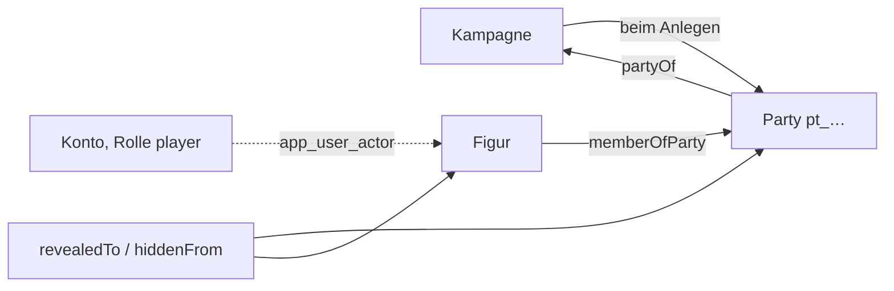

**Der Vorbereitungsstand ist Teil der groben Frage** (REQ-237, D72): wer
nicht `gm` oder `co-gm` der Kampagne ist, der der Artikel gehört, sieht nur
Artikel mit `Status.status: ready` — **ein Artikel ohne Status-Karte oder
ohne Wert zählt als fertig** (`isReady`), sonst verschwände, was keinen
Stand trägt. **Eigenes sieht man in jedem Stand**: was das Konto angelegt
hat (`app_user_article`) oder schreiben darf (seine Figuren samt dem, was an
ihnen hängt) — der Server gibt es als `Viewer.own` mit. Das gilt überall,
wo gesiebt wird: Liste, Artikel, Verweise, Rückbezüge, Auswahlen.

**Die eigene Figur ist ausgenommen** (E-014 d, D74): ein Spielercharakter,
der einem Konto zugeteilt ist (`app_user_actor`), samt seinem Statblock
(`belongsTo`, auch eine Instanz) und seinem Inventar (`carries`) geht nach
der gewöhnlichen Sichtbarkeit an die Mitspielenden, in jedem Stand — der
Server gibt die Figuren *aller* Konten als `Viewer.ungated` mit.

**Der letzte fertige Stand gilt** (E-012, D74): fiel ein Artikel nach einer
Änderung einer Spielerin auf `prepared` zurück, bekommt, wer den
Arbeitsstand nicht sieht (`seesUnfinished`: nicht Leitung, nicht Eigenes),
die Kopie von vorher aus `entity_ready` — in Liste, Artikel und als
Zusammenhang des Siebs. Wer ihn sieht, bekommt den neuen Stand mit dem
Datum des alten (`refs.ready`) und mit `?stand=ready` den alten.

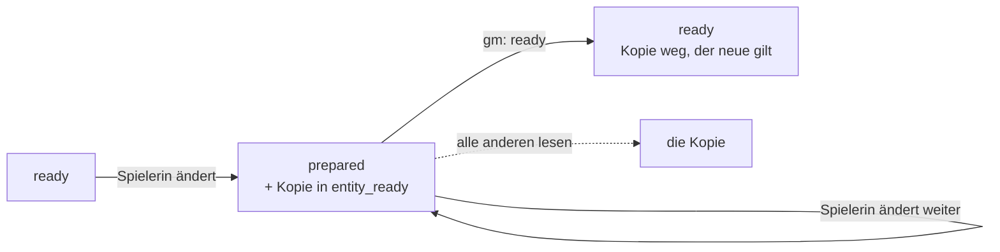

### 9.2 Rollen

Die Rolle am Tisch steht **am Konto, je Kampagne**: `gm` · `co-gm` · `player`
· `spectator`. Am Server `campaign_member (campaign_id, user_id, role)` neben
`app_user_actor` (welche Figuren ein Konto führt); im Prototyp die Sammlung
`members`. Gepflegt auf der Kampagnenseite (Element `members`) von Leitung
und Verwaltung; `gm` und `co-gm` sehen dasselbe. In keinem Artikel.

### 9.3 Wissen (`Information`, `Knowledge`, `redactEntity`)

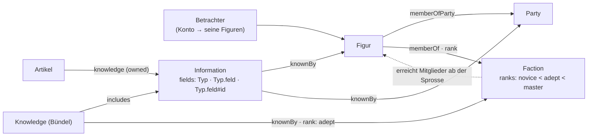

```
Artikel     --knowledge-->  Information        (owned)
Knowledge   --includes-->   Information        (ein Bündel; ein Schritt weit)
Information | Knowledge --knownBy--> Creature | Party | Faction
```

`Information.fields` nennt, was sie beansprucht: `Typ` (alle Felder des
Typs), `Typ.feld`, `Typ.feld#id` (ein Eintrag). **Was keine Information
nennt, liegt offen.** Ein Betrachter ist die Liste seiner Figuren; eine Figur
zählt einen Schritt weit auch als ihre `Party` (`memberOfParty`) und ihre
`Faction` (`memberOf`). **Eine Fraktion weiss nichts, ihre Mitglieder
wissen:** `Faction.ranks` ist die Leiter, `memberOf.props.rank` die Sprosse,
und `knownBy.props.rank` an einer Zuteilung an die Fraktion ein Mindestrang
(A7, REQ-203). Ohne Betrachter liest die Leitung.

Zurückgehalten wird **am Server**: Felder, die eine ungewusste Information
beansprucht; die Felder aus der Einstellung `gmFields`
(`Secrets.secret`, `Tactics.tactics`), es sei denn, eine gewusste
Information gibt einen Eintrag frei; der Name, wenn beansprucht — dann steht
der Deckname (`Identity.cover`). Kanten bleiben. Eine zweite Prüfung in der
Maske gibt es nicht.

### 9.4 Schreiben

Die Verwaltung schreibt alles. Ein Spieler schreibt seine Figuren und was an
ihnen hängt (`carries`, `holds`, `crafting`), **und was er selbst angelegt
hat** (D72). **Anlegen** darf, wer in der laufenden Kampagne `player` ist —
jede Art, die einen Stand trägt (E-013); der Server legt den Artikel in die
Ebene der Kampagne (`campaignLayer`: die spezifischste aufgeschaltete, die
keine andere Kampagne aufschaltet), auf `idea` oder `prepared`, und vermerkt
die Verfasserin neben dem Konto (`app_user_article`), nicht im Artikel
(REQ-199). Eine angelegte Spielerfigur führt sie gleich. **`ready` setzen
die Verwaltung und `gm` der Kampagne, der der Artikel gehört**, nicht
Spielende und nicht `co-gm`; der Server prüft es, auch wenn die Status-Karte
fehlt. Dafür schreibt `gm` die Artikel, die Spielende angelegt haben.
**Ausgenommen ist die eigene Figur** (E-014 d, D74): der Spieler schreibt
auch ihren Statblock (`belongsTo`) und setzt bei Figur, Statblock und
Inventar den Stand selbst, auch `ready`. **Ändert eine Spielerin einen
anderen fertigen Artikel, fällt er auf `prepared`** (E-012, D74), und der
Stand davor bleibt als Kopie (`entity_ready`, Migration 027) — jede
Änderung zählt, ein Speichern ohne Änderung nicht. Setzt `gm` wieder
`ready` (in der Maske oder per `POST /api/entities/:id/ready`), gilt der
neue und die Kopie fällt weg; ändert `gm` selbst, fällt nichts zurück. Was
wartet, listet `GET /api/unready` (Werkbank, „Not ready, by players"). Das
Register schreiben die Verwaltung und `gm` der laufenden Kampagne.

**Schreibrechte je Ebene** (T-098, E-001): jedes Konto schreibt, was
**ganz** in Ebenen liegt, in denen es schreibt (`inWritableLayers`: jede
Ebene, die den Artikel bringt, ohne `removes`) — ein Artikel, der auch im
geteilten Regelwerk liegt, änderte sonst dort mit. In welchen Ebenen ein
Konto schreibt, steht **neben dem Konto** (`app_user_layer`, Migration 035;
`owner` heisst: besitzt sie und sagt, wer sonst darin schreibt), und dazu
schreiben **`gm` und `co-gm` die Ebene ihrer Kampagne** aus ihrer Rolle.
**Eine eigene Ebene legt jedes Konto an** (`POST /api/layers`) und besitzt
sie; sie wirkt, sobald die Leitung sie aufschaltet. **Jede Kampagne hat
ihre Ebene** (`campaignLayer`: die spezifischste aufgeschaltete, die keine
andere Kampagne aufschaltet, keine Gruppe ist und **keinem Konto gehört** —
die aufgeschaltete eigene Ebene einer Spielerin wird nicht zur
Kampagnenebene); eine neue Kampagne bekommt sie beim Anlegen
(`ly_<kampagne>`, `kind: 'campaign'`, Spezifität 100), eine ältere legt
Migration 035 an. **Was nicht in den eigenen Ebenen liegt, ändert man als
Fassung:** „Edit" an einem fremden Artikel — auch einem ohne Ebene, der
bleibt bei der Verwaltung — legt über `POST /api/entities/:id/adapt` eine
Fassung (E5) in eine eigene Ebene, die im Spiel ist (`zielEbenen`; bei
mehreren `{ layer }`). Die Verwaltung wählt dabei zwischen der Ebene der
Kampagne und ihren eigenen Ebenen im Spiel — so legt die Werkbank geschätzte
Preise in „AI generated prices" (T-139). `ready` bleibt bei `gm`: ändert die Mitleitung oder
eine Spielerin in ihrer Ebene etwas Fertiges, fällt es zurück wie oben.

**Die gewählte Schreibebene** (T-176): jedes Konto darf je Kampagne eine
seiner Zielebenen als Vorgabe wählen (Kontoeinstellung `writeLayer`, neben
dem Konto wie jede Einstellung, nie im Artikel — REQ-199). Sie schlägt die
gerechnete Vorgabe (`grundEbene`), solange das Konto dort schreibt und
die Ebene im Spiel ist; sonst gilt wieder die gerechnete. Es ist dieselbe
Wahl wie die Schreibebene in der Kopfleiste (T-161, unten); Account ›
Layers setzt sie mit „Make default", die Verwaltung auch für ein anderes
Konto. Die Verwaltung
legt ohne Wahl wie bisher ohne Ebene an. Gedacht für eine Testebene der
Leitung (`Layer.kind: 'test'`, Beschreibung wie jedes `kind`; Migration 073), die sich mit „Empty this layer" (eine umkehrbare Massenänderung
`delete`, Teile und Kanten darauf eingeschlossen) wieder leeren lässt.

**Die Spielerebene** (T-164): je Konto und Kampagne, in der es `player`
ist, eine eigene Ebene — **die Vorgabe zum Schreiben**. Figur, Notizen und
was eine Spielerin sonst anlegt, landen dort (`vorgabeEbene`, für die
Kopfleiste `GET /api/layers/default`); ohne Spielerebene wie bisher in der
Ebene der Kampagne. Angelegt wird sie, sobald das Konto die Rolle `player`
bekommt (Kampagnenseite, Einladung, `user role`; ältere Mitglieder:
Migration 069), als `<Konto> · <Kampagne>`, umbenennbar, `Layer.kind:
'player'` — Beschreibung wie jedes `kind`. **Wessen sie ist, steht neben
dem Konto** (`app_user_layer.campaign_id`, REQ-199). Die Kampagne schaltet
sie **dicht unter ihrer eigenen Ebene** auf; genau eine Kampagne heisst,
sie gehört ihr (`campaignsOf`), also sieht deren Leitung darin, was sie in
der Kampagnenebene sähe — **die Sichtbarkeit bleibt am Artikel**, die Ebene
ist Herkunft und Schreibrecht, kein Versteck. `gm` und `co-gm` schreiben die
Spielerebenen ihrer Runde mit (wie D72). **Keine Fassung fremder Artikel
darin** (`anpassZiele`): der Stapel gilt für alle am Tisch, eine
Überschreibung in einer Spielerebene änderte den Artikel für alle — wer
etwas an einem fremden Artikel anmerken will, schreibt eine Notiz mit
Verweis. **Rolle weg, Ebene bleibt:** beschrieben wird sie nur, solange
ihr Konto in der Kampagne mitspielt oder leitet; danach holt die Leitung
den Inhalt in die Ebene der Kampagne und löscht die leere Ebene
(`POST /api/layers/:layer/takeover`), und wer eine Ebene mit Inhalt löschen
will, bekommt den Inhalt aufgezählt (`409`, `contents`). Migration 069 legt
die Spielerebenen der heutigen Mitglieder an und holt hinein, was ein
einziges Konto angelegt hat oder führt (`app_user_article`,
`app_user_actor`) und in der Ebene seiner Kampagne lag; was zwei Konten
zugleich gehört, bleibt und wird gezählt. Bei der Übernahme zwischen zwei
Installationen (T-130) wandert die Ebene als Artikel mit, die Zuordnung zum
Konto nicht.

**Die Schreibebene** (T-161): wohin ein Konto in der laufenden Kampagne
anlegt, wenn es keine Ebene nennt. Ohne Wahl ist es die Vorgabe oben
(`grundEbene`: als `player` die Spielerebene, als Leitung die Ebene der
Kampagne); **gewählt wird im Popup der Kopfleiste** unter den Zielebenen
(`zielEbenen`) — Gruppen und nicht aufgeschaltete Ebenen stehen dort
ausgegraut mit dem Grund. **Gespeichert am Server je Konto und Kampagne**
(Einstellung `writeLayer`: Kampagne → Ebene), gesetzt nur über
`PUT /api/layers/write`, das gegen die Zielebenen prüft; `/api/me/prefs`
nimmt den Schlüssel nicht. **Gelesen wird immer gegen die Zielebenen**
(`schreibEbene`): fällt die gewählte aus dem Stapel oder entfällt das
Recht, gilt die Vorgabe, und `GET /api/layers/write` sagt es (`dropped`);
die Wahl bleibt stehen und gilt wieder, sobald die Ebene zurück ist.
Sie wirkt beim **Anlegen** (auch aus einem Verweisfeld, eine im Dialog
genannte Ebene geht vor), bei **Fassungen** (`adapt` ohne `{ layer }`,
`adaptTo` mit ihr vorn — nur eine *gewählte*, ohne Wahl fragt der Server bei
mehreren Zielen zurück) und bei der **Übernahme** einer Spielerebene (in die
gewählte, wenn sie keine Spielerebene ist, sonst in die Ebene der
Kampagne). **Die Verwaltung** legt ohne Wahl wie bisher ausserhalb jeder
Ebene an (`none`); hat sie eine gewählt, dorthin. Die Oberfläche zeigt sie
unter der Kampagne („Writes to", am Telefon ✎), im Anlegedialog und beim
Bearbeiten — dort mit einer Warnung, wenn die Änderung in eine andere Ebene
geht als die Schreibebene.

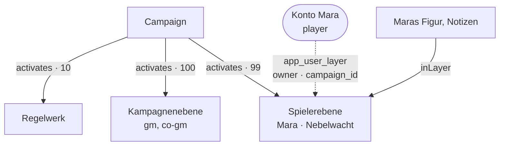

### 9.5 Handwerk: gelernt und gebunden (D55)

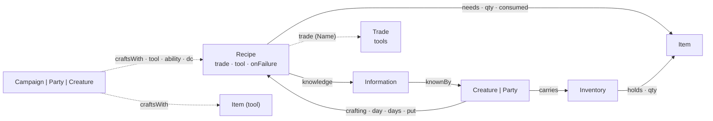

- **Eine Blaupause wird gelernt, und gelernt heisst zugeteilt** (REQ-218):
  jede Information am Rezept erreicht die Figur über `knownBy` (selbst,
  Gruppe, Fraktion — dieselbe Abfrage wie in 9.3). Ein Rezept **ohne**
  Information hat niemand gelernt; bis D52 hiess das „offen". Teilwissen
  ist nicht gelernt. Ob ein Rezept **dasteht**, sagt weiter
  `articleVisible`; ungelernte stehen gestrichelt mit „must still be
  learned", ohne Fundort. „Lehren" legt, wo nötig, eine Information ohne
  Felder an — sie hütet nichts, sie ist das, was man lernen kann.
- **Filter der Werkbank:** gelernt · alle; machbar · fast (1–2 fehlende
  **Posten**: je Zutat einer, das Werkzeug einer); nach Material (welche
  Rezepte es über `needs` nennen); nach Beruf (`Recipe.trade`) oder
  Werkzeug (`Recipe.tool`).
- **Material wird beim Start gebunden** (REQ-219): was das Rezept braucht
  und dabei ist, verlässt das Inventar und steht in `crafting.props.put` —
  auch, was nicht verbraucht wird. Fehlt etwas, darf trotzdem begonnen und
  unterwegs nachgelegt werden (Aufgabe #34); Vorgabe ist das nicht mehr.
  Das Werkzeug wird geprüft, nicht gebunden (es ist ein Name aus den
  Werkzeug-Artikeln, keine Kante — verglichen mit der Werkzeugübung, F13).
- **Was zurückkommt:** was nicht verbraucht wird, immer; das Übrige beim
  Misslingen und beim Abbruch nach `Recipe.onFailure` (`nothingLost` alles,
  `halfLost` die abgerundete Hälfte, `materialsLost` nichts); beim Gelingen
  nichts davon. Ein Gang aus der Zeit vor D55 ist dieselbe Kante mit
  weniger in `put`: nicht Verbrauchtes zählt dann in der Hand, und er
  läuft weiter.
- **Womit gefertigt wird, ist wählbar** (T-122): Werkzeug, Attribut und
  SG nennt das Rezept, wie seine Quelle sie druckt. Eine Kampagne, eine
  Gruppe oder eine Figur weicht ab mit einer Kante `craftsWith` — zum
  **Rezept** (dieses eine) oder zum **Werkzeug** (jedes Rezept, das von
  sich aus dieses Werkzeug nennt: „Kräuterkunde mit Weisheit"). Die Kante
  trägt nur, was sie ändert. Gelesen wird Kampagne → Gruppe (`memberOfParty`,
  ein Schritt) → Figur, je Träger erst Werkzeug, dann Rezept; das Spätere
  schlägt (`craftCheck`, `packages/model/src/crafting.ts`, mit der Herkunft
  jedes Werts). Das Werkzeug selbst tauscht nur eine Kante zum Rezept —
  sonst hinge das Ergebnis von der Reihenfolge der Werkzeugkanten ab. Eine
  Kopie des Rezepts wäre eine zweite Fassung, die eine Korrektur am
  Original nicht mehr erreicht; ein Feld an der Kampagne wäre eine Liste
  von Rezeptnamen neben den Rezepten.
  Die Artikelseite eines Rezepts zeigt das Ergebnis (Element `crafting`):
  am Tisch und je eigener Figur, mit dem, was nicht aus dem Rezept kommt —
  gerechnet am Server (`refs.craft`), nicht in der Maske.
- **Beruf, Werkzeug, Figur: was man womit fertigt** (T-196). Ein Beruf
  ist eine Art `Trade` (erbt von `Rule`: Text, Quelle, Marken) mit seinen
  Werkzeugen (`Trade.tools`, beim Namen wie `Recipe.tool`). Das Rezept
  nennt seinen Beruf (`Recipe.trade`, `enumRef: 'Trade'` — schlägt vor,
  hält nicht); gefunden wird er über Name **und Aliasse**. Eine Liste der
  Rezepte am Beruf gibt es nicht — sie wäre die zweite Stelle, die beim
  nächsten Rezept veraltet. Gerechnet wird in beide Richtungen
  (`recipesOfTrade`, `tradesOfTool`, `recipesOfTool` in `crafting.ts`):
  **womit ein Rezept gefertigt wird**, sagt sein eigenes Werkzeug, sonst
  die Werkzeuge seines Berufs (`recipeTools`) — das Rezept ist
  spezifischer. Das Element `crafting` zeichnet am Beruf die Übersicht
  (Werkzeuge, Rezepte mit Probe, Dauer, Ertrag und Seltenheit, das
  Material nach Zahl der Rezepte), an einem Werkzeug „Can craft", an einer
  Figur je Werkzeug, in dem ihr Statblock geübt ist, dasselbe mit
  **gelernt/nicht gelernt** (nur für Leitung und Führende). Gerechnet am
  Server aus dem **Gesiebten** (`GET /api/crafting/:id`, `kind: trade |
  tool | actor | none`): was eine Information zurückhält, steht nicht da,
  und was nicht im Stapel steht, auch nicht. Filter (Suche, Seltenheit,
  gelernt) sind die der Seite.
- **Fortschritt in Proben** (T-122): `Recipe.checks` sagt, wie viele
  gelungene Proben die Arbeit braucht — Regelwerke wie Kibbles’ Compendium
  zählen in Proben je Zeitabschnitt (zwei Stunden, eine Probe) statt in
  Tagen. Ohne Angabe gilt eine Probe am Ende. Auf bestehenden Datenbanken
  trägt Migration 059 das Feld nach.
- **Ein Regelwerk mit Rezepten** (Kibbles’ Compendium, T-122) ist eine
  Ebene wie ein Buch: Rezepte, Materialien und Gegenstände sind Artikel
  darin, `needs`/`yields` verbinden sie, und jedes Rezept trägt eine
  Information ohne Felder, die man lernen kann. Eine Kampagne lehrt, ohne
  das Regelwerk zu schreiben: ein `Knowledge`-Bündel in ihrer Ebene
  `includes` die Blaupausen und ist `knownBy` der Figur (9.3).

#### Der Fertigungsauftrag in der Seite (T-128)

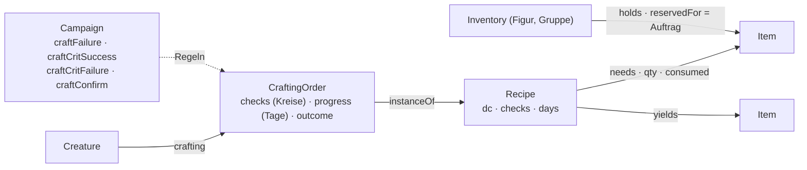

- **Ein Auftrag ist eine Instanz des Rezepts** (`CraftingOrder extends
  Recipe`, `instanceOf` aufs Rezept; `same` nimmt die Obertypen mit). Er
  liest Werkzeug, SG, Proben, Tage, Material und Ertrag beim Rezept und
  speichert nur, was abweicht — die Leitung gibt *diesem* Auftrag einen
  anderen SG, ohne das Rezept zu kopieren. Eigen sind ihm `checks` (die
  Proben als Kreise, unten), `progress` (gearbeitete Tage), `outcome`
  (`open`, `succeeded`, `failed`, `aborted`) und `started`. Wer fertigt, sagt `crafting` vom Fertigenden zum Auftrag. Wie
  jede Instanz steht er in keiner Liste; er hängt an der Figur und am
  Rezept. **Nicht das Endprodukt:** ein Ertrag von drei Tränken ist ein
  Stapel im Inventar und keine Instanz, und ein Gegenstand im Inventar ist
  ein Verweisziel, eine Instanz nicht.
- **Das Material bleibt im Inventar und wird reserviert**
  (`holds.props.reservedFor` = der Auftrag): aus dem Inventar der Figur
  und dem ihrer Gruppen, Behälter darin eingeschlossen; ein grösserer
  Stapel wird geteilt (`reserveIn`). Reserviert wandert nichts. Das löst
  in der Seite das Binden in `crafting.props.put` (D55) ab — gebunden ist
  es so wie dort, aber es bleibt sichtbar, wo es liegt.
- **Gesperrt wird am Server** (T-134, `reservationBreaches`): ein `PUT`
  oder `DELETE`, das ein reserviertes Stück eines **laufenden** Auftrags
  wegnimmt, ändert (Menge, Gegenstand, Reservierung) oder eine
  Reservierung erfindet, bekommt 423 mit „reserved for crafting order …".
  Umräumen im selben Behälter (Raster, Platz, Drehung, Griffweite) geht.
  Frei wird es durch Abschluss oder Abbruch, durch die Leitung (Knopf
  „Release" im Inventar) oder indem der Auftrag gelöscht wird — dann wie
  ein Abbruch. Ein Inventar mit Reserviertem und ein Gegenstand, der
  irgendwo reserviert liegt, lassen sich nicht löschen. Laden (T-133) und
  Übernahme (T-130) fragen dieselbe Funktion (`reservierteSperre`).
- **Fortschritt** (`orderNeed`): nennt das Rezept `checks`, zählt jede
  gelungene Probe eins; sonst zählen Arbeitstage, und am Ende entscheidet
  eine Probe. Die Probe rechnet gegen den SG aus `craftCheck` (mit den
  `craftsWith`-Kanten der Figur).
- **Die Regeln stehen an der Kampagne, und nur dort** (`craftRulesOf`,
  T-165; wandern mit T-132 in ein Modul): `craftFailure` —
  `noProgress`, `progressLost`, `materialsLost`, `halfLost` (Vorgabe),
  `nothingLost`, `custom` (die Leitung entscheidet); `craftCritSuccess`
  (`double`: die natürliche 20 zählt zweimal); `craftCritFailure`
  (eigener Ausgang der natürlichen 1); `craftConfirm` (`gm`: eine Probe
  der Spielenden wartet, bis die Leitung sie annimmt). **Das Rezept
  entscheidet nichts mehr:** `Recipe.onFailure` ist der Text der Quelle
  („Source: on a failure") und steht im Kasten „Campaign rules" daneben,
  gilt aber nicht. Bis T-165 war es eine Auswahl, die über die
  Kampagnenregel `recipe` galt — zwei Stellen für eine Regel. Migration
  072 gibt einer Kampagne, die dem Rezept folgte, die Regel, die bei den
  Rezepten am häufigsten stand (auf dev: `materialsLost` bei allen 698),
  schreibt die Auswahlwerte am Rezept in Sätze und zählt die Rezepte auf,
  die bisher anders galten. Am Rezept
  und am Auftrag stehen die Regeln je ein Satz (`craftRuleSentences`),
  mit dem Link zur Kampagne, wo die Leitung sie ändert.
- **Die Proben sind Kreise** (T-165, `CraftingOrder.checks`, je Kreis
  `{ mark, by, at, total?, nat?, dc?, pending? }` oder `null`): ein Klick
  setzt ✓, der zweite ✗, der dritte leert (`nextMark`); ein Wurf setzt
  den ersten freien Kreis mit Summe und SG. **Was die Kreise bewirken,
  wird gerechnet** (`tallyChecks`, D8): der Reihe nach durch `applyRoll`,
  bis einer den Auftrag entscheidet; danach stehen so viele leere Kreise
  da, wie gelungene Proben fehlen (bei Tagen einer, offen erst, wenn die
  Tage gearbeitet sind — ein Verlust des Fortschritts verlangt neue Tage).
  Ein ✗ wendet die Regel also sofort an — Fortschritt, und am
  reservierten Material steht, was beim Abschluss verloren ginge —, und
  Zurückklicken nimmt sie zurück. **Endgültig ist erst der Abschluss**
  (`POST …/finish`: abrechnen, Ertrag) oder der Abbruch. Ein Kreis der
  Spielenden unter `craftConfirm: 'gm'` ist `pending` und zählt erst
  angenommen; verworfen wird er leer. Was jede zählende Probe auslöste,
  steht als Zeile im Verlauf (`lines`).

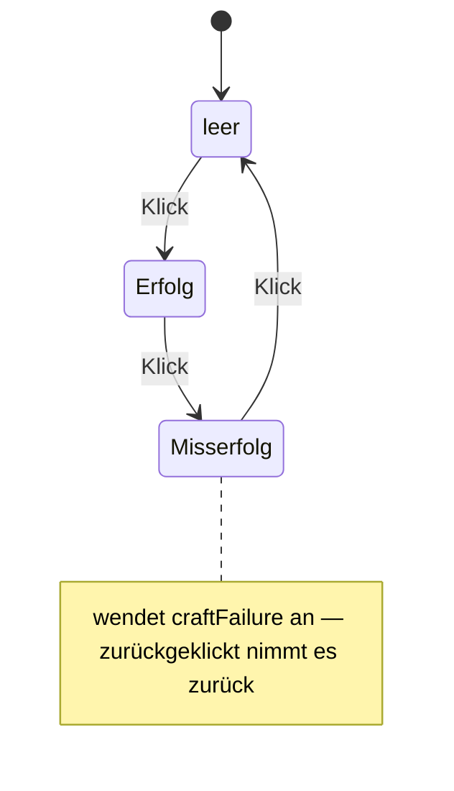
- **Abrechnung** (`settlePieces`): bei Erfolg ist das Verbrauchte weg, das
  Übrige frei, und der Ertrag (`yieldCount` ×) liegt im Inventar der Figur
  (sonst der Gruppe); beim Abbruch kommt alles zurück; beim Misserfolg nach
  der Regel (`halfLost`: die abgerundete Hälfte zurück). Was nicht
  verbraucht wird, kommt immer zurück.
- **Geschrieben wird nur über `/api/crafting`** (`apps/server/src/handwerk.ts`;
  ein Kreis über `PUT /api/crafting/:id/checks/:index` mit dem Zielstand,
  damit zwei schnelle Klicks zwei Stände sind und nicht zweimal „weiter"),
  nicht über `PUT`: ein Ausgang, den jemand in der Maske setzt, hätte
  nichts abgerechnet — die Felder des Auftrags sind `readOnly`. Spielende
  starten für ihre Figur und nur Gelerntes (`recipeLearned`), mit allem
  Verbrauchten; die Leitung für jede Figur und auch mit Lücken. Was sich
  ändert, geht über den Live-Kanal (T-116).

### 9.6 Laden und Preise (T-129)

- **Ein Laden ist ein Ort** (`Shop extends Place`, Bereich `world`). Er
  trägt einen Abschlag für alle (`Shop.priceMod`); was er führt, steht an
  `sells` zum Gegenstand: `qty` (leer: unbegrenzt, 0: ausverkauft),
  `price` (in Kupfer, statt `Item.copperPrice`), `mod` (nur diese Ware),
  `available`. Wer ihn hält, steht an `shopkeeper`; eine Fraktion, die ihn
  kontrolliert, an ihrer Kante `controls`.
- **Ein Preis sagt, woher er kommt** (T-139, E-046): `Item.copperPrice`
  in Kupfer, daneben `Item.priceNote`. Leer heisst Listenpreis der
  Quelle; sonst steht da, wie gerechnet oder geschätzt wurde —
  „derived: base price + 100 gp" (der Importer rechnet so die
  `valueExpression` einer Variante am Grundgegenstand), „estimated: DMG
  2024 rare". Der Buchstil zeigt es hinter dem Preis. Ein Satz und keine
  Aufzählung: nach welcher Regel geschätzt wird, entscheidet die Leitung,
  und ein geschätzter Preis soll sich finden und ersetzen lassen.
- **Geschätzte Preise wohnen in einer eigenen Ebene** (T-139, Vorgabe der
  Leitung 14.10.): „AI generated prices" in der Herausgeber-Gruppe „AI
  content". Der Grundartikel behält, was die Quelle sagt; die Schätzung
  ist eine Fassung mit `overrides` aufs Original (E5) und `priceNote`.
  Schaltet die Kampagne die Gruppe ab (`activates` `mode: 'off'`), gilt
  wieder das Original — ohne Preis. Die Artikelseite zeigt den Unterschied
  an `copperPrice` wie jede Fassung (E6). Ein Listenpreis, den die Quelle
  als Rechnung gibt (`valueExpression`), ist keine Schätzung und bleibt im
  Grundartikel.
- **Ein Abschlag ist ein Wort**: `−10 gp`, `+5 sp`, `−10 %`
  (`parsePriceMod`). Ohne Einheit ist er keiner; was sich nicht lesen
  lässt, zählt 0 und steht als `invalid` in der Herkunft.
- **Rabatt** (`discount`, Geber → Empfänger, `props.mod`, `props.rank`):
  Geber sind der Laden, die Fraktionen, die ihn kontrollieren, und seine
  Ladenhalter. Er trifft die kaufende Figur, wenn der Empfänger sie selbst
  ist, eine ihrer Gruppen (`memberOfParty`) oder eine ihrer Fraktionen
  (`memberOf`) — dort ab dem Rang an der Kante, nach `Faction.ranks`; ein
  Rang ausserhalb der Leiter trifft niemanden. Eine Fraktion, die ihren
  eigenen Mitgliedern Rabatt gibt, zeigt auf sich selbst.
- **Gerechnet beim Lesen** (D8, `shopWares`, `packages/model/src/shop.ts`):
  Grundpreis = `sells.price` sonst Listenpreis **der geltenden Fassung**
  (T-139: der Server rechnet in der **Preissicht** `withVersionPrices` —
  jedes Original trägt Preis und Herkunft seiner geltenden Fassung, Ids
  bleiben; Kaufen, Verkaufen und Ankauf rechnen damit, gesiebt wird die
  Fassung; die Herkunft reitet als `listNote` mit); dann Laden, Rabatte,
  Ware.
  **Prozent auf den Grundpreis**, addiert, je Schritt auf Kupfer gerundet;
  nie unter 0. Jeder Schritt nennt Geber, Empfänger und Rang.
- **Am Server** (`refs.shop`): am Tisch (Laden und Ware) und je eigener
  Figur. Gerechnet über den ganzen Stand — ein Rabatt gilt auch, wenn die
  Figur den Geber nicht aufschlagen darf —, gezeigt wird nur, was der
  Betrachter sieht: verborgene Waren fehlen, ein verborgener Geber bleibt
  ohne Namen. Element `wares` auf der Artikelseite.
- **`regards` rechnet nicht mit** (E-043, offen): persönliche Rabatte sind
  `discount` vom Ladenhalter an die Figur.
- Migration 061 trägt Art und Kanten nach.
- **Kaufen** (T-133, `POST /api/shops/:id/buy`, `buyWare`): die Maske
  schickt Ware (`sells`-Kante), Menge und Figur — **nie einen Preis**; der
  Server rechnet `shopWares` für diese Figur neu. Die gezählte Menge sinkt
  (leer bleibt unbegrenzt), und `Inventory.copper` sinkt um Preis × Menge.
  Ins Inventar, das die Figur trägt (`carries`), kommt per `holds` **eine
  Instanz** des Gegenstands (`newInstance`, T-150): ein eigener Artikel mit
  `instanceOf` auf den Grundartikel, in der Ebene der Kampagne, `ready`,
  sonst nur Name und Nummer — Preis, Gewicht und Form liest er von der
  Vorlage, bis er abweicht. Liegt schon ein loser Stapel desselben da (der
  Grundartikel selbst oder eine Instanz, die nicht abweicht,
  `followsTemplate`), wächst der, und es entsteht nichts. Wer kauft, hat
  das Stück angelegt (`app_user_article`, D72) und darf es ändern. Nein
  sagen `soldOut`, `unavailable`, `tooFew`, `noPrice` (verschenkt wird
  nichts), `tooPoor`; ohne Inventar gibt es nichts zu bezahlen.
- **Verkaufen** (`POST /api/shops/:id/sell`, `sellPiece`): ein Stapel aus
  dem Inventar der Figur oder einem Behälter darin (nicht dem der Gruppe),
  zum **Ankaufspreis** `buybackPrice` = halber Listenpreis, abgerundet (5e;
  ob ein Laden einen eigenen Satz trägt, ist offen: E-045). Rabatte gelten
  nur beim Kaufen. Ein **reserviertes** Stück (`holds.props.reservedFor`,
  T-128) und ein Behälter, in dem noch etwas liegt, bleiben. Eine
  Instanz, die **nicht abweicht**, zählt als Grundartikel: führt der Laden
  ihn mit gezählter Menge, steigt sie, und ist der Stapel ganz verkauft,
  wird die Instanz gelöscht. Eine, die **abweicht** (eigener Name, Gravur),
  geht als dieses Stück über den Tresen — der Laden führt sie danach selbst
  (`sells` auf die Instanz), und wer sie zurückkauft, bekommt genau sie.
- **Wer handelt:** für die eigene Figur (D74, wie beim Inventar), die
  Leitung für jede. Laden und Inventar werden **gegen die gelesene
  Revision** geschrieben — kaufen zwei die letzte Laterne, bekommt sie
  einer, der andere ein 409. `refs.shop.mine` nennt je Figur dazu ihr
  Inventar, ihr Geld (`purse`) und was sie verkaufen kann (`sellable`).
- **Protokoll:** `shop.bought` und `shop.sold` am Laden — Figur, Konto,
  Gegenstand, Menge, Stückpreis, Summe, beim Kauf Listen- und Grundpreis
  und jeder Abschlag mit Herkunft (`steps`), beim Verkauf die Regel
  (`rule: 'half'`).

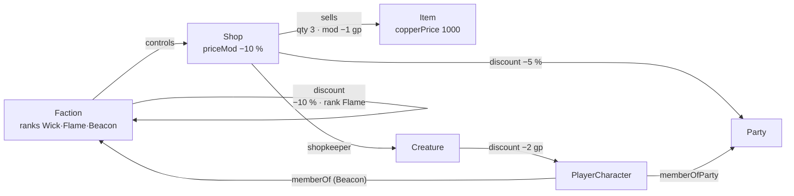

---

## 10. Ansichten und Anordnung

Fünf Ansichten, und der Ort wählt sie — dazu eigene (T-110, REQ-256,
E-030 b; `search` seit T-138):

| Ansicht | Wo | Zeigt |
|---|---|---|
| `overview` | ein Verweis, eine Listenzeile | ein Vorschaubild neben dem Namen (Element `image`, T-114), Beschreibung und die Felder, die die Art dafür wählt — **die Spalten im Kompendium** |
| `quick` | eine Kachel auf dem Board, die Vorschau, das Popup, die Schnellanlage | Bild, Beschreibung, Felder, Prosa |
| `full` | die Artikelseite | alles |
| `print` | „Print" an der Artikelseite: ein Blatt A4 (`/artikel/:id/print`) | Beschreibung, alle Felder ausser dem Vorbereitungsstand, Prosa, Teile, Abschnitte — ohne Seitenspalte; Statblock, Zauber, Gegenstand wie im Buch |
| `search` | das „+" an einem Treffer der übergreifenden Suche (T-138) | Bild, Beschreibung und die Felder, die die Art dafür wählt; Art, Ebene und Herausgeber stehen in der Trefferzeile, sie sind keine Felder |
| eigene, z. B. `handout` | dort, wo gewählt wird: die Kachel auf dem Board, der Druck | was sie sagt — der Handzettel: Beschreibung, Absatz, Vorlesetext |

**Ansichten sind Zeilen und werden im Register bearbeitet** (Register ›
Views, T-110): anlegen (als Abschrift einer anderen), umbenennen, ordnen,
löschen — die fünf, nach denen ein Ort fragt (`PLACE_VIEWS`), nicht. Je
Ansicht eine **globale Anordnung**: Elemente in ihrer Reihenfolge, ein
`fields`- oder `prose`-Element mit Einträgen „ganzer Typ" (`Spell` — ein
neues Feld erscheint von selbst) oder „Typ.Feld" (`Spell.level` — bleibt
genau das), gewählt mit „Add field". **Gezeigt wird die Schnittmenge**: was
die Ansicht nimmt und der Artikel hat. Zwei Einstellungen sagen, was mit
dem Übrigen geschieht:

| Einstellung | Wirkung |
|---|---|
| `rest: true` | Was kein Element nimmt, steht am Ende. `full` ja — so geht auf der Seite kein Feld verloren, auch eines, das nur ein noch nicht gezeichnetes Element (Bogen) zeigen sollte; die Karte nein. |
| `empty: 'show'` | Leere Felder stehen mit „—" da (ohne gerechnete und ohne Prosa). Vorgabe `hide`: ein Artikel zeigt, was er hat. |

**Je Art überschreiben** (`InterfaceDef.views[ansicht]`, die
`extends`-Kette hoch wie bisher):

- **eine eigene Anordnung** (eine Liste) ersetzt, was darüber gilt;
- **eine Anpassung** (`{ adjust: { drop, hide, add, extra, order } }`)
  nimmt, was darüber gilt — die nächste Art der Kette, die etwas sagt,
  sonst die Ansicht — und weicht ab: Elemente weglassen (`drop`, nach
  `id`), Einträge nirgends zeigen (`hide`, wird zu `except`), Felder in
  ein Element dazunehmen (`add`, Element-`id` → Einträge), Elemente nur
  hier (`extra`), umsortieren (`order`, nach `id`). Mehrere Anpassungen die
  Kette hoch gelten alle, die allgemeinste zuerst (`applyAdjust`,
  `layoutFor` gibt `mode: 'view' | 'adjusted' | 'own'` mit).

Eine Anpassung bleibt richtig, wenn die Ansicht sich ändert; eine Abschrift
bliebe beim Alten. Darum ist sie die Vorgabe der Maske, und eine eigene
Liste der Fall für eine Art, die wirklich anders aussieht (der Bogen der
Kreatur). Im Register steht dazu eine **Vorschau an einem Beispielartikel**,
gezeichnet aus dem Entwurf, und ohne Artikel, welches Feld der Art in
welchem Element landet (`viewFields`).

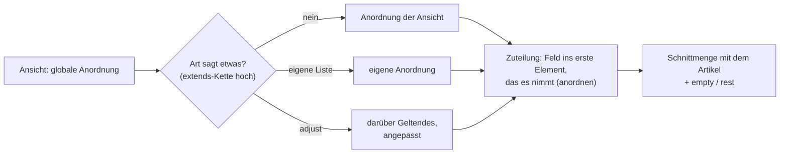

**Was eine eigene Seite war, ist ein Element** (T-191): die Leseansicht,
die Klassenübersicht und die Übersicht einer Herkunft oder eines
Hintergrunds hatten eigene Routen (`/read/:layer`, `/classes/:id`,
`/ancestries/:id`, `/backgrounds/:id`). Sie sind jetzt Layout-Elemente, die
die Art in `full` nennt — eine fünfte Ansicht braucht es dafür nicht, denn
der Ort ist derselbe: die Artikelseite. Die alten Wege leiten auf
`/artikel/:id` um (`?at=`, `?page=`, `?sub=`, `?opt=` gehen mit).

| Element | Art (`full`, Anpassung) | Zeichnet |
|---|---|---|
| `reader` | `Layer` | die Ebene als Buch (E11): Inhalt, Suche, ein Stück am Stück, Lesestand je Konto; eine Gruppe als Regal. Über die ganze Breite unter Haupt- und Seitenspalte. Gesprungen wird nur auf Wunsch (`?at=`, `?page=`, `?tab=read`) — wer die Ebene öffnet, sieht zuerst ihren Kopf, und solange das Buch nicht oben steht, bleibt der Lesestand. |
| `classOverview` | `Class` | Eckdaten, Stufentabelle, Unterklassen zum Wählen und Vergleichen, Merkmale je Stufe (C5). Nimmt `Proficiencies` und `Choices` aus der Feldtabelle (`BOOK_CARDS`); die Karte `Class` bleibt dort, weil die Übersicht nicht jedes ihrer Felder zeigt. |
| `originOverview` | `Ancestry`, `Background` | Eckdaten, Spielarten zum Umschalten und Vergleichen, Merkmale (C5, T-166); nimmt ebenso `Proficiencies` und `Choices`. |

Die Anpassungen stehen in `ansichten.ts` und kommen über Migration 084 in
bestehende Datenbanken, nur wo die Art für `full` noch nichts sagt. Boards,
Bibliothek und Handbuch nehmen dieselben Elemente, sobald sie Anordnungen
zeichnen (T-147, T-168, E-055).

**Die ersten Ansichten je Art** (T-110 Schritt 7, `ansichten.ts`,
Migration 052, [Bericht](Nachtarbeit/T-110-Ansichten.md)): die Karte
nimmt je Art die zwei, drei Werte, an denen man eine Sache erkennt (Zauber:
Grad, Schule …; Gegenstand: Art, Seltenheit, Einstimmung), der Druck setzt
Statblock, Zauber und Gegenstand wie im Buch obenan und lässt den
Vorbereitungsstand weg, und **`handout`** ist die erste eigene Ansicht:
Beschreibung, Absatz, Vorlesetext — ohne Werte und Geheimnisse. Alles
Anpassungen; Migration 052 schreibt nur, wo eine Art noch nichts sagt.

Die Migration (050) änderte, was gezeichnet wird, nicht: `full` bekam
`rest: true` — das tat die Artikelseite schon immer, nur stand es nirgends —,
`print` kam dazu; die Anordnungen an den Arten bleiben Listen.

**Eine Listenzeile ist `overview`** (W7): welche Spalten das Kompendium
für eine Art zeigt und wonach es filtert, sagen die `fields`-Elemente ihrer
`overview`-Anordnung (`listColumns` in `views.ts`: `Typ.feld` oder ein
Typname für alle seine Felder, ohne gerechnete). Ein Feld mit
`enum`/`enumRef` wird ein Filter mit Häkchen, eine Zahl (oder ein Text,
der fast überall eine Zahl ist, wie der HG „1/4") eine Spanne. Heute sagen
es Zauber (Grad, Schule, Dauer, Konzentration, Ritual), Statblock (HG,
Grösse, Typ, Gesinnung), Gegenstand (Art, Seltenheit, Einstimmung), Waffe,
Rüstung, Aktion, Merkmal, Talent, Sprache, Klasse, Unterklasse,
Abstammung, Zustand, Gefahr, Gottheit, Tabelle, Regel und Kreatur. Eine
Art ohne eigene `overview` erbt die ihres Obertyps; sagt keiner etwas,
hat die Zeile keine Spalten ausser Name und Quelle.

**Filtergruppen je Seite** (T-137): eine Listenseite — Kompendium, World,
Story, Rules — hat benannte, gespeicherte Filter als Unterreiter
(`/world?view=<id>`), in der Kopfleiste über ▾ neben der Seite direkt
aufrufbar. Eine Gruppe gehört **der Kampagne** (die Leitung — Verwaltung,
`gm`, `co-gm` — legt sie an, jedes Mitglied sieht sie) oder **einem Konto**
(nur seine, in jeder Runde). **Die Vorgabe einer Seite ist eine Gruppe der
Kampagne mit `default`**, je Kampagne und Seite höchstens eine: sie gilt,
solange niemand einen anderen Reiter wählt, und „All" (`?view=all`) zeigt
die Seite ohne sie. So ist „World ohne Items" ein Eintrag und keine Liste im
Code. Was eine Gruppe festhält, ist zweierlei: **was den Reiter ausmacht** —
Arten samt Untertypen (`of`), ohne Arten samt Untertypen (`notype`),
Marken, Stand (`status`; ohne Status-Karte zählt `ready`) — geht als
Grenze an `/api/list`; **womit er anfängt** — Suche, Facetten — setzt die
Seitenleiste einmal beim Betreten, danach gehört der Filter der Seite.
Gespeichert in `list_filter` (Migration 066), nicht im Artikel: eine
Konto-Id wandert nicht mit der Ausfuhr (REQ-199). Routen:
`GET`/`POST /api/filters`, `PUT`/`DELETE /api/filters/:id`.

**Ebenen filtert keine Seite selbst** (T-186, REQ-318): die Listen folgen
dem Stand der laufenden Kampagne, den das Popup der Kopfleiste schaltet;
eine Gruppe trägt kein `layer`/`nolayer` mehr (Migration 080 legt alte
Angaben nach `list_filter_ebenen_alt`, gezählt). Stattdessen speichert das
Popup **Ebenenauswahlen** („Saved selections"): der Stapel von unten nach
oben (`layers`, Gruppen inbegriffen) und was trotz Gruppe aus ist (`off`),
unter einem Namen, je Konto und wahlweise nur für eine Kampagne
(`app_user_pref`, Schlüssel `layerSets`; Routen `GET`/`POST
/api/me/layer-sets`, `DELETE …/:id`). Laden schreibt den Stapel über
`PUT /api/campaigns/:c/layers` — dort prüft der Server die Rolle wie bei
jedem Häkchen; was fehlt oder sich hier nicht aufschalten lässt, bleibt
draussen und wird gezählt. Was eine Ebene bringt (`only`, T-105), bleibt
an ihrer Kante und gehört nicht zur Auswahl.

**Nur die Kachel auf dem Board wählt** (REQ-161, `placementView`): zuerst
die Platzierung (`placed.props.view`), dann die Regel des Boards je Art
(`Board.rules`, die `extends`-Kette hoch), und sagt keiner etwas, **die
Grösse** — eine Kachel bis 110 px Höhe ist eine Zeile und zeigt `overview`,
eine höhere eine Karte und zeigt `quick`. Wer sie grösser zieht, bekommt
die Karte, ohne etwas auszuwählen.

**Ein Board gehört über `partOf` zu seinem Geschichtsartikel** (REQ-205):
Kampagne, Arc (auch ein Abenteuerkapitel), Sitzung — nicht Szene, die ist eine
Karte auf dem Board ihrer Sitzung. Ein Board ohne die Kante ist ein
Regel-Board. Eine eigene Kante `boardOf` wäre eine zweite Hierarchie neben
`partOf`, mit Rückbezügen, die niemand neben „contains" sucht. Die Liste
der Boards und ihr Pfad „Kampagne › Kapitel › Sitzung" kommen ohne einen
ganzen Artikel aus: `/api/list?rel=partOf` schickt die Kante je Zeile mit
(W7).

**Ein Bereich ist ein Anker mit Rechteck** (T-073, REQ-159): ein Eintrag
in `Board.anchors` mit `id`, `name`, `x`, `y` und dazu `w`, `h`. Ohne
Breite und Höhe bleibt er ein Punkt (wie der Prototyp ihn anlegt, mit
`zoom`). Kein neues Feld: ein Bereich ist eine Stelle, zu der man
springt, und das war der Anker schon — eine Form mit Namen (`shapes`) ist
Zeichnung und springt nirgends hin. **Welche Karten dazugehören, sagt die
Lage** (`anchorAreaOf`): ihre Mitte liegt im Rechteck, bei mehreren im
kleinsten. Eine Kante dafür wäre dieselbe Auskunft zweimal, und nach dem
ersten Verschieben stimmte eine davon nicht mehr. Die Anker stehen oben
als Reiter (ein Klick springt hin), ein Bereich lässt sich einklappen —
dann zeigt er nur seine Titelzeile, und seine Karten sind verborgen,
nicht verschoben. **Eingeklappt ist je Betrachter** (im Browser): am
Board gespeichert klappte ein Spieler der Leitung die Conditions zu.
**Ein Bereich wird an seiner Titelzeile verschoben und nimmt seine Karten
mit** (T-146) — sonst stünden sie danach draussen und gehörten nach der
Lage zu keinem Bereich mehr; an der Ecke ändert er seine Grösse, und die
Karten bleiben liegen. Gezogen wird mit Pointer-Events, mit Maus, Stift
und Finger gleich.

Eine Spieleransicht gibt es nicht: gesiebt wird am Server, alle sehen
dieselbe Ansicht. **Die Sicht eines Mitglieds** (REQ-241) ist darum keine
Ansicht, sondern ein anderes Konto in derselben Rechnung: mit `X-View-As`
siebt der Server für die Leitung als dieses Mitglied, nur zum Lesen
(siehe [Zugang.md](Zugang.md#die-sicht-eines-mitglieds-req-241-e-019-a)). Gewählt wird
**zuerst nach Gruppe** (ein Typname in `fields` oder `except`) — ein ganzer
Typ nimmt ein Feld, das morgen dazukommt, von selbst mit; ein einzelnes
Feld (`Typ.feld`) ist richtig, wo genau dieses gemeint ist (die Spalten
einer Listenzeile, der Grad auf der Karte), und bleibt dann genau das.

**Die Anordnung wohnt am Typ** (`views.full` usw.) und ist eine geordnete
Liste von Elementen; `layoutFor` läuft die Kette hoch, sonst gilt die
Grundanordnung der Ansicht (`fields` · `linked` · `prose` · `composed` ·
`relations` · …). Jedes Element ist eine Zeichenfunktion im Code — **Daten
sind Zeilen, Darstellung ist Code.**

| Element | Zeichnet |
|---|---|
| `heading`, `text` | eine Überschrift, einen festen Text |
| `description`, `image` | die Beschreibung, das Bild |
| `fields` | die Feldtabelle: `fields: 'all'` oder `['Typ', 'Typ.feld']`, `except`, `columns`. `'all'` und der Rest nehmen `Image` nicht — Bild, Unterschrift und Alternativtext gehören dem Element `image`; einzeln genannt stehen sie da (T-090) |
| `prose` | die Prosafelder, mit Anlegen und Bearbeiten an Ort und Stelle |
| `linked` | die Felder der Teil-Artikel (§5.3), mit eigenen Eingaben |
| `composed` | die eingesetzten Regeln (`section`-Kanten), Variablen aufgelöst |
| `relations` | die Kanten als Liste |
| `standing` | die Beziehungen (`regards`), vorwärts und zurück |
| `knowledge` | der Artikel nach Informationen geordnet |
| `sheet`, `inventory`, `crafting` | Bogen, Kachelraster, Werkbank |
| `map`, `board`, `initiative`, `live` | Karte, Leinwand, Initiative, Sitzungsschirm |
| `quests`, `timeline`, `prep`, `table`, `crawl` | Auftragsbrett, Zeitleiste, Vorbereitung, Tabelle, Punktreise |
| `stack`, `members` | der Ebenenstapel, die Konten am Tisch |
| `statblock`, `spell`, `item` | **wie im Buch** (W2): Statblock wie im MM (Kopf kursiv, Kopfzeilen, sechs Werte in einer Reihe, Saves bis Challenge, Abschnitte aus `composedOf` je Aktionsart), Zauber wie im PHB (Casting Time, Range, Components, Duration, At Higher Levels), Gegenstand wie im DMG (Art, Seltenheit, Einstimmung kursiv; AC, Schaden, Preis, Gewicht). Jedes zeichnet **alle** Felder seiner Karten (`BOOK_CARDS`, `book.ts`), was keine Stelle im Buch hat als Zusatzzeile; die Feldtabelle derselben Anordnung nimmt diese Karten mit `except` heraus. Masse in der Einheit von `units` |
| `stats` | **die Kennzahlen** (T-206): Rüstungsklasse, Trefferpunkte, Bewegung, Initiative, passive Wahrnehmung, Herausforderung als eine Reihe Kacheln (`keyStats`, `book.ts`), dazu die Zustände einer Figur. An einem Statblock aus ihm selbst; an einem anderen Artikel aus dem, was über eine `asField`-Kante hängt und in `quick` selbst `stats` zeigt (der Statblock einer Kreatur), mit dessen Stand: Trefferpunkte jetzt/Maximum aus `Vitals`. Die Kurzansicht von `Statblock` und `Creature` — Karte, Popup, Token; der Bogen (`statblock`) bleibt der Artikelseite. Nimmt kein Feld aus der Tabelle |
| `rules` | die Regeloptionen (T-190): nimmt die Felder, die `fields` nennt, aus der Feldtabelle und verweist auf den Reiter „Rules & options"; auf einem Blatt ohne Reiter stehen sie als Felder |
| `tabs` | benannte Gruppen desselben Layouts |

**Was kein Element zeichnet, steht am Ende — wo die Ansicht `rest` sagt.**
Die Artikelseite der Oberfläche kennt noch nicht jedes Element (Bogen,
Inventar …; die Karte seit T-115); ein Feld, das nur dort stünde, setzt sie unter die
Anordnung, statt es zu verschweigen. Zugeteilt wird an einer Stelle
(`anordnen` in `apps/web/src/app/artikel/anordnung.ts`) für Artikelseite,
Druck und Registervorschau.

### 10.1 Die Regeloptionen einer Kampagne (T-190)

Wonach eine Kampagne spielt, steht heute an drei Stellen: als **Feld an
der Kampagne** (`Campaign.inventory`, `stowing`, `craft*`, `feats`,
`languages`, `playerRolls`, `compareFor`), als **Kante auf ein Verfahren**
(`allowsMethod` → `AbilityMethod`, `allowsEquipment` → `EquipmentMethod`)
und als **Einstellung der Installation** (`units`, `travel*`, Basils Blatt).
Der Reiter **„Rules & options"** an der Kampagne
(`/artikel/:id?tab=rules`) zeigt alle drei **nach Sorte** — Ability scores,
Starting equipment, Character options, Inventory, Crafting, Travel, Units,
At the table; dieselben Sorten, die T-132 als Module baut —, je Option
einen Satz, was sie bewirkt, und je Variante, welche gilt.

- **Gerechnet am Server** (`GET /api/campaigns/:id/rules`,
  `apps/server/src/regeloptionen.ts`) mit `ruleOptionsOf`
  (`packages/model/src/ruleOptions.ts`). Jede Option liest über die
  Funktion ihres Teilsystems (`inventoryRulesOf`, `craftRulesOf`,
  `allowedMethods` …) — die Seite sagt nie etwas anderes, als gilt.
- **Der Katalog** (`RULE_OPTIONS`) nennt je Option ihre Quelle, die
  Varianten mit einem eigenen Satz und die Namen der Regelartikel, die sie
  erklären. Ein Test hält ihn mit `CampaignInfo` zusammen: jedes Feld eine
  Option, jeder Aufzählungswert eine Variante.
- **Regelartikel nach Namen:** importierte heissen, wie das Regelwerk sie
  nennt („Encumbrance"), eine eigene Erklärung `<Option>: <Variante>`
  (`ownRuleName`). Genannt wird ein Artikel der Art `Rule` nur, wenn er im
  Stapel steht und der Betrachter ihn sieht (E2, Sichtbarkeit) — sonst
  bietet die Seite der Leitung „Write rule article" an: ein Regelartikel
  mit diesem Namen und dem Satz der Seite, in der Schreibebene. Buchtext
  steht im Code keiner.
- **Geändert wird, wo es steht:** Felder und Kanten in der Maske der
  Kampagne; die Einstellungen der Installation sind als
  „installation-wide" markiert und gelten für jede Kampagne, bis T-132 sie
  ins Modul holt. Auf der Artikelseite selbst nimmt das Layout-Element
  `rules` (`fields: ['Campaign']`) die eigenen Felder der Kampagne aus der
  Feldtabelle und verweist auf den Reiter — sie stünden dort ein zweites
  Mal, ungeordnet; ein `except` an der Feldtabelle reichte nicht, weil der
  Rest (`rest`) sie am Ende wieder hereinholte. Migration 081.
- **Mit T-132** schaut `ruleOptionsOf` je Sorte ins gewählte Modul (ein
  lesbarer Regelartikel); Route und Reiter bleiben.

---

## 11. Bezeichner und Namen

| Was | Wo | Regel |
|---|---|---|
| die Id | `entity.id` | undurchsichtig, nie wiederverwendet; keine Herkunft darin (REQ-163) |
| die Nummer | `Identity.id` | `art-0042`, beim Anlegen ausgegeben (`nextId`: das Höchste plus eins), `readOnly`; überlebt den Wechsel der Art. Zwischen dev und prod gehört sie prod (§12.2): kommt ein Artikel neu nach prod und ist seine Nummer dort vergeben, gibt prod die nächste freie, und dev nimmt sie samt `[[…]]`-Verweisen an; holt dev von prod, weicht auf dev, was dieselbe Nummer trägt |
| der Name | `entity.name` und `Identity.name` | die Überschrift; beide gleich |
| Aliasse | `Identity.aliases` | Vorschläge und Verweise finden sie |
| Deckname | `Identity.cover` | steht statt des Namens, solange der Name beansprucht und ungewusst ist |
| Verweis im Text | `[[npc-0042|Anzeige]]`; als Eingabe auch `[[Name]]` | zuerst über die Nummer (`Identity.id`), sonst über Name und Alias (`linkCandidates`, ohne Instanzen). Beim Speichern wird ein eindeutiger Name zur Nummer (`idLinks`, M11); ein mehrdeutiger bleibt stehen und sagt es, statt den ersten Treffer zu nehmen; einer ohne Artikel bietet das Anlegen an |
| Eintrags-Id | `Typ.feld#id` | aus dem Text gebildet, eindeutig je Artikel, übersteht einen Import |

---

## 12. Was ausserhalb der Artikel steht

| Was | Wo | Wandert mit der Ausfuhr |
|---|---|---|
| Konten, Passwörter, Sitzungen, Einladungen, Fehlversuche | Server: `app_user`, `app_session`, `app_invite`, `login_attempt` | nein (REQ-199) |
| welche Figuren ein Konto führt | `app_user_actor` | nein |
| wer einen Artikel angelegt hat (D72) | `app_user_article` | nein |
| wer in welcher Ebene schreibt, wer sie besitzt (T-098) | `app_user_layer` | nein |
| der letzte fertige Stand eines zurückgefallenen Artikels (D74) | `entity_ready` | nein |
| wo ein Konto in einem Buch stehen blieb (T-091) | `reading_position` (Konto, Ebene, Abschnitt) | nein |
| wie jemand liest — Fassungen an den Feldern an/aus, welche Ebenen (T-092) | `app_user_pref` (Konto, Schlüssel, JSON) | nein |
| Filtergruppen je Seite und die Vorgabe einer Seite (T-137) | `list_filter` (Seite, Name, Kampagne *oder* Konto, Filter, `is_default`) | nein |
| gespeicherte Ebenenauswahlen (T-186) | `app_user_pref`, Schlüssel `layerSets` | nein |
| Rolle je Kampagne | `campaign_member`; Prototyp: Sammlung `members` | nein |
| Verwaltung der Installation | `app_user.is_admin` | nein |
| das Register | Tabellen `interface_def`, `relation_def`, `view_def`, `unit_def`, `var_def`, `enum_def` (Aufzählungen), `setting_def` (Einstellungen, seit Migration 019); Prototyp: Sammlung `registry` | ja — allein weiterreichbar (`register-datei.mjs`) |
| Einstellungen | Registerteil `settings` | ja |
| Dateien | Asset-Ablage (`AssetStore`, 12.1); der Artikel `Asset` trägt `backend`, `ref`, `mime`, Masse | der Artikel ja, die Bytes nein — die Ausfuhr nennt sie (`files`) |
| Ereignisse | `event_log` | nein |
| der Stand der letzten Übernahme je Gegenstelle (T-130) | `transfer_base` (Gegenstelle, Peg-Id oder `registry:<teil>:<name>`, JSON) | nein |
| Würfe auf einem Artikel (T-172) | `event_log`, `name: 'roll'`, `subject` der Artikel (12.3) | nein |
| Augenblicke (Zeigen) | der Raum-Kanal, nicht gespeichert | nein |

### 12.1 Bilder (T-114, REQ-021, E-032)

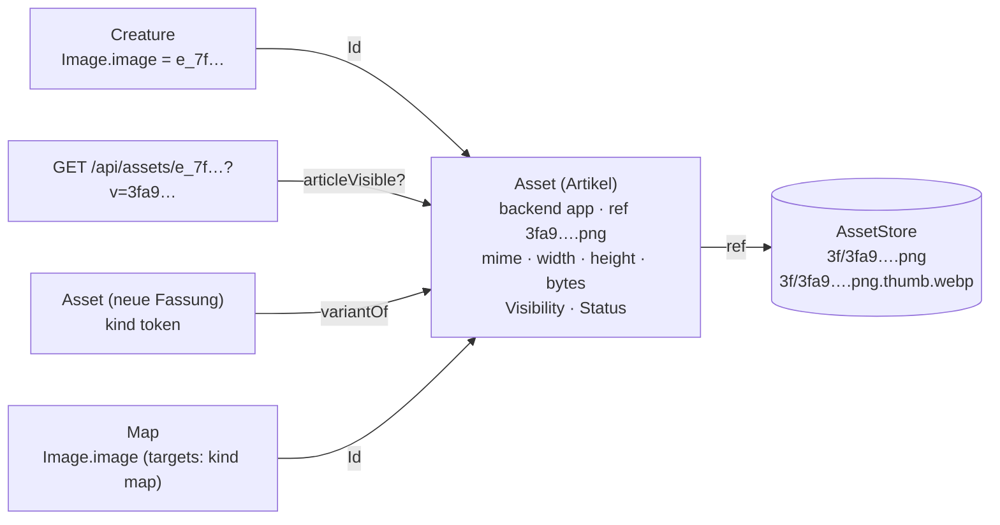

| Nr | Regel | Wo |
|---|---|---|
| B1 | **Ein Bild ist ein Asset-Artikel und eine Datei.** Ein Feld mit `format: 'asset'` (`Image.image`, `token`, `background`) hält die **Id des Artikels**; die Datei kennt nur er (`Asset.ref`). Eine fremde Adresse ist ein Asset mit `backend: external` und der Adresse in `ref`. | `bilder.ts` |
| B2 | **Die Datei heisst nach ihrem Inhalt:** `<sha256>.<endung>`, die Vorschau (480 px, WebP) `<…>.thumb.webp`. Dieselbe Datei liegt einmal da, auch wenn zwei Assets sie nennen; sie geht erst mit dem letzten. Ein `ref`, das nicht so aussieht, liest die Ablage nicht (`validKey`). | `assets.ts` |
| B3 | **Hochladen legt den Artikel an** (`POST /api/assets`, multipart) — mit den Regeln von `POST /api/entities`: wer dort nicht anlegt, lädt nichts hoch; durch `validateEntity`. Angenommen werden JPEG, PNG, WebP, GIF, AVIF, geprüft am Inhalt; **kein SVG**. Ein Foto verliert sein EXIF (der Aufnahmeort) und wird aufgerichtet. Grenze `ASSET_MAX_MB` (40). | `bilder.ts` |
| B4 | **Aus einem Artikel heraus** (`for`) übernimmt das Asset dessen `audience`, `revealedTo`, `hiddenFrom`, Stand und Ebene: das Bild eines verborgenen NSC ist nicht öffentlich. Ohne Status-Karte zählt der Artikel als fertig, das Bild auch; wer `ready` nicht setzen darf, bekommt `idea` (D74). Das Bild der eigenen Figur nennt ihr Spieler fertig (E-014 d). | `bilder.ts`, `anlegen` |
| B5 | **Ausgeliefert wird nur, was sichtbar ist** (`GET /api/assets/:id`, `?size=thumb`): das Sieb über den Asset-Artikel; sonst 404. `private`; mit `?v=<hash>` für immer im Browser, ohne `ETag` und 304. | `bilder.ts` |
| B6 | **Die Ablage ist eine Schnittstelle** (`AssetStore`): heute eine Dateiablage im Volume (`ASSET_DIR`, E-032 a), in Tests im Speicher. Ein Wechsel heisst Dateien umkopieren — kein Artikel ändert sich. | `assets.ts` |
| B8 | **Die Klasse eines Bildes ist ein Wort** (`Asset.kind`: `image` · `map` · `token` · `prop`, Vorgabe `image`, T-119): ein allgemeines Bild (Porträt, Handout), ein Kartenbild, ein Token, ein Stück zum Platzieren (Möbel, Requisite, Stempel). **Keine Unterart**: keine der vier trägt ein eigenes Feld — die Grösse eines Tokens ist die seiner Kreatur, das Raster gehört der Karte. Braucht eine Klasse eigene Felder, wird sie eine Art, die von `Asset` erbt. | `fieldgroups.ts` |
| B9 | **Wo eine Klasse angeboten wird, sagt das Feld**: `target.where` `{component: 'Asset', property: 'kind', value}` — `Image.image` allgemeine Bilder, `Statblock.token` Tokens, an der Karte über `Map.targets` Kartenbilder (`fieldTarget`, `offeredAssetKind`). Ein Vorschlag wie jedes `where`: die Eingabe zeigt die Klasse zuerst und die übrigen auf Wunsch; gespeichert ist ein Bild jeder Klasse gültig. Wer Tokens braucht (T-117), fragt `GET /api/list?type=Asset&f=Asset.kind:token`. | `assets.ts`, `bild.ts` |
| B10 | **Wo ein Bild verwendet wird, ist eine Rückfrage** (`assetUses`, `GET /api/assets/:id/uses`): jeder Artikel, der die Id als ganzen Wert in einer Karte hält (in jeder Tiefe — Kartenblätter zählen) oder mit einer Kante auf das Asset zeigt; `variantOf` und `inLayer` zählen nicht. **Nur, was der Betrachter sieht**: die Verwender gehen durchs Sieb, ebenso `unused=1` in der Liste („von niemandem verwendet, den du siehst"). Je Bestandsstempel einmal gerechnet. | `assets.ts`, `bilder.ts` |
| B11 | **Ersetzen auf zwei Wegen.** *Neue Fassung* (`POST /api/assets` mit `variantOf`): ein eigenes Asset mit `variantOf` auf das alte, mit dessen Klasse, Marken, Quelle, Sichtbarkeit, Stand und Ebene; die Verwender bleiben beim alten, bis man sie umstellt. *Quelle ersetzen* (`PUT /api/assets/:id/file`, gegen `revision`): derselbe Artikel bekommt `ref`, `mime` und Masse der neuen Datei, alle Verwender zeigen sofort das neue Bild (die Adresse trägt die Version); geschrieben wird mit den Regeln von `PUT /api/entities/:id` (`schreiben`), ersetzen darf, wer den Artikel schreibt. **Die alte Datei bleibt liegen** (Ereignis `asset.replaced` nennt sie) und kommt in die nächste Sicherung. | `bilder.ts`, `app.ts` |
| B12 | **Die Galerie** (`/images`, Kopfleiste „Images"): alle Bilder, die der Betrachter sieht, als Raster — gefiltert nach Klasse (`f=Asset.kind:…`), Marken (`tag=a,b`, jede engt ein; `facets.tags` zählt), Ebene, „Unused" und Suche, über dieselbe Liste wie das Kompendium (`/api/list`). Ein Klick zeigt die Kurzansicht, „Open article" das Bild als Artikel; dort stehen „Used in" (B10), seine Fassungen und „Replace image" mit der Frage *neue Fassung* oder *Quelle* (B11). Mehrfachauswahl setzt und nimmt Marken über die Massenänderung (`/api/bulk`, die Leitung, mit Rückgängig). Die Bildeingabe (`nw-bildwahl`) zeigt beim Wählen Vorschaubilder der angebotenen Klasse (B9), auf Wunsch alle, und gibt einem neuen Bild diese Klasse. Nach „Quelle ersetzen" fragt jedes Bild mit dieser Id auf der Seite nach der neuen Version (`BildStand`, `?v=`). | `bilder/galerie.ts`, `bilder/bildpanel.ts`, `bild.ts` |
| B13 | **Die Masse einer Datei stehen am Asset** (`Asset.width`, `height`, `mime`, `bytes`, T-201): gelesen beim Hochladen und Ersetzen am Server, aus der Datei — sie ist die Quelle, gerechnet wird beim Lesen nichts. Das **Seitenverhältnis** steht nirgends: es ist eine Rechnung aus zwei gespeicherten Zahlen (D8, `aspectRatio`). Die Liste gibt die Masse je Bild mit (`rows[].asset`, `assetMeta`), die Galerie schreibt sie als eine Zeile (`describeAsset`: `1920×1080 px · 16:9 · 640 KB · WEBP`). Fehlende trägt `scripts/bilder-nachtrag.mjs` aus dem Kopf der Datei nach (`imageHeader`: PNG, JPEG, WebP, GIF, ohne Bibliothek — eine Adresse wird nur angelesen). | `assets.ts` (Modell, Server), `liste.ts` |
| B14 | **Ein Bild als Adresse ist für die Galerie nicht da.** Ein Feld mit `format: 'asset'`, in dem eine `http(s)`-Adresse steht (die Karten der Abenteuer aus 5e.tools), zeigt das Bild, führt es aber nicht als Artikel; die Prüfung `imageAddress` (Werkbank) zählt solche Felder, `scripts/bilder-nachtrag.mjs --write` legt je Adresse ein Asset `backend: 'external'` **in der Ebene des zeigenden Artikels** an und stellt das Feld darauf um (`imageAddresses`). Das Einlesen der Dateien selbst ist T-144. | `assets.ts`, `checks.ts` |
| B15 | **Ein Bild verwenden** (`POST /api/assets/:id/use`, `{as: 'map'|'token'|'prop', for?}`, T-201): setzt die Klasse, wenn man das Bild schreibt, und legt an oder hängt an — `map` einen `Map`-Artikel mit dem Bild und einem **Gitter aus der Auflösung** (`mapFromImage`/`suggestGrid`: Felder aus dem Namen wie „30x20“, sonst die erste übliche Feldgrösse, die in beiden Richtungen aufgeht; sonst keins), `token` das Token **am Statblock** der genannten Kreatur (ohne Statblock 409; ohne `for` nur die Klasse), `prop` nur die Klasse. Angelegt wird mit den Regeln von `POST /api/entities`; die Antwort nennt den Artikel für „Open“. Dieselbe Funktion baut die Karte beim Wählen in der Sitzung (T-202). | `bilder.ts`, `assets.ts` |
| B7 | **Gezeigt wird mit dem Element `image`**, und der Ort wählt die Grösse: in `overview` ein Daumennagel neben dem Namen in der Listenzeile (die Liste nennt das Asset nur, wenn der Betrachter es sieht — `rows[].image`), in `quick` die Vorschau, in `full` das ganze Bild. An einem Asset ist das Bild es selbst, sonst `Image.image` (`bildDes`). Ein Feld mit `format: 'asset'` steht in der Feldtabelle als Vorschau. Die Eingabe (`nw-bildwahl`) lädt hoch — Datei, Ziehen, Einfügen, Telefonkamera —, wählt ein vorhandenes Asset oder nimmt eine `https`-Adresse; hochgeladen wird sofort, das Feld hält danach die Id. Bestehende Anordnungen bekommen `image` über Migration 053. | `bild.ts`, `liste.ts`, `views.ts` |

### 12.3 Würfe im Protokoll (T-172, REQ-070)

Gewürfelt wird **am Server** (`POST /api/rolls`), nicht im Browser: das
Log stimmt, und niemand würfelt nach, was er nicht mag. Ein Wurf ist ein
Eintrag im Protokoll — kein neues Speicherfach — mit dem Artikel, auf dem
gewürfelt wurde, als `subject`. Die Oberfläche zeigt das Ergebnis aus der
Antwort; der Tisch bekommt den Eintrag über den Live-Kanal (`roll`).

```mermaid
flowchart LR
  K["Würfelknopf {{+4}}<br/>auf dem Statblock"] -->|"POST /api/rolls<br/>{expr, subject, label, mode}"| S["Server würfelt<br/>(crypto)"]
  S --> E[("event_log<br/>name roll · subject sb_wolf<br/>payload: expr, rolls, total, nat, by, actor, campaign, session, hidden")]
  S -->|"Live: roll"| T["Geräte am Tisch<br/>(rollVisible je Empfänger)"]
  E -->|"GET /api/rolls?subject=cr_wolf"| L["Log an der Kreatur:<br/>ihre Würfe + die ihres Statblocks"]
```

| Nr | Regel | Wo |
|---|---|---|
| W1 | **Ein Wurf ist ein Eintrag `roll`** im `event_log`, `subject` der Artikel. `payload` (`RollPayload`): `expr` (mit Vorteil umgeschrieben, `asked` der Ausdruck davor), `rolls` (die einzelnen Würfel und festen Glieder), `modifier`, `total`, `mode` (`adv`/`dis`), `nat` und `crit` (`crit`/`fumble`, nur bei genau einem gezählten W20), `label`, `by` (Konto, Name), `actor` (die Figur), `campaign`, `session`, `hidden`, `entered` (am Tisch gewürfelt und eingetragen, die Handwerksprobe). | `packages/model/src/rolls.ts`, `apps/server/src/wuerfe.ts` |
| W2 | **Vorteil** schreibt den ersten W20 zu `2d20kh1` (Nachteil `kl1`, `withAdvantage`); Schaden bleibt, wie er ist. | `dice.ts` |
| W3 | **Die Figur** ist die genannte, wenn sie dem Konto gehört, sonst der Artikel selbst oder die Figur seines Statblocks, sonst die einzige des Kontos. **Die Sitzung** ist die genannte (Play), am Sitzungsartikel er selbst, sonst die am Tisch (`tischSitzung`: die jüngste, an der Karte, Kampf oder Szene läuft). | `wuerfe.ts` |
| W4 | **Das Log eines Artikels** (`GET /api/rolls`): neueste zuerst, seitenweise, nach Person und Sitzung filterbar. An einer Kreatur auch die Würfe auf ihrem Statblock (`belongsTo` hoch), an einer Sitzung alle, die während ihr fielen (`payload.session`). Gelesen werden die letzten 1000 Einträge. | `wuerfe.ts` |
| W5 | **Sichtbarkeit** (`rollVisible`): wer den Artikel nicht sieht (`articleVisible` über das Sieb), sieht seine Würfe nicht. Danach sieht ihn, wer gewürfelt hat, die Leitung der Kampagne des Wurfs jeden, einen verdeckten (`hidden`) sonst niemand, alle übrigen mit einer Rolle an diesem Tisch. Verdeckt würfelt nur die Leitung; `Campaign.playerRolls: 'gm'` macht jeden Wurf der Spielenden verdeckt — festgehalten beim Wurf, ein späteres Umstellen deckt nichts auf. Der Live-Kanal siebt mit derselben Rechnung. | `rolls.ts`, `live.ts` |
| W6 | **Würfe sind Spielgeschehen, kein Inhalt:** sie stehen in keiner Ausfuhr und keiner Übertragung dev→prod. Das Protokoll ist append-only; ein gelöschter Artikel lässt seine Würfe stehen („deleted article"). | — |

Offen: Proben und Rettungswürfe aus dem Bogen, Tabellenwürfe und
Initiative würfeln noch nicht hierüber — es gibt sie in der Seite noch
nicht als Knöpfe; wer sie baut, nimmt `POST /api/rolls`.

### 12.2 Übernahme zwischen Installationen (T-130, REQ-155)

Die Leitung prüft auf dev vor und zieht auf prod nach — nach Artikeln,
Arten, Ebenen, Marken, Suchauswahl und Registerzeilen. Ausgelöst wird auf
dev (Werkbank › Transfer between installations); prod ist die Gegenstelle. Ablauf und
Einrichtung: [Betrieb › Übernahme dev ↔ prod](Betrieb.md#übernahme-dev--prod).

```mermaid
flowchart LR
  subgraph dev["dev (löst aus)"]
    W["Werkbank › Transfer between installations"] --> P["/api/transfer/preview<br/>/api/transfer/run"]
    B[("transfer_base<br/>Stand der letzten Übernahme")]
    P --- B
  end
  subgraph prod["prod (Gegenstelle)"]
    R["/api/transfer/peer/read"]
    A["/api/transfer/peer/apply<br/>nur mit ATLAS_TRANSFER_ACCEPT"]
    S[("backups/uebernahme<br/>vorher-Fassungen")]
    A --> S
  end
  P -->|"ATLAS_PEER_TOKEN<br/>(nur am Server)"| R
  P -->|Ergebnis, Bilder| A
  A -->|"Nummern, geschrieben"| P
```

| Nr | Regel | Wo |
|---|---|---|
| Ü1 | **Wie git, mit einer Basis.** Je Feld (`Karte.feld`), je Kante (nach ihrer Id), für die Arten und `adhoc`: hat seit der letzten Übernahme nur die Quelle geändert, gilt die Quelle; nur das Ziel, bleibt das Ziel; beide verschieden, ist es ein **Konflikt** und wird einzeln gelöst (Quelle nehmen, Ziel behalten, von Hand). Ohne Basis ist jeder Unterschied ein Konflikt — nichts wird still überschrieben. | `compareThree`, `mergeTransfer` |
| Ü2 | **Die Basis steht beim Auslöser** (`transfer_base`), je Gegenstelle: nach jeder Übernahme der Stand, auf dem beide gleich stehen. Schieben: das Ergebnis auf prod, und dev übernimmt es selbst (prod ist der Master). Holen: der Stand von prod — was dev dabei abweichend behielt, schlägt die nächste Übernahme nach prod vor. | `uebernahme.ts` (Server) |
| Ü3 | **Die Id ist dieselbe, die Nummer gehört prod.** Ein Artikel ist auf beiden Seiten derselbe, wenn die Peg-Id gleich ist. Neue Artikel behalten auf prod ihre Nummer, wenn sie frei ist, sonst gibt prod die nächste (`assignNumbers`); dev zieht nach und hängt `[[…]]`-Verweise um (`repoint`). Holt dev von prod, bekommt auf dev eine neue Nummer, was die Nummer eines ankommenden Artikels trug (`yieldNumbers`). | `uebernahme.ts` (Modell) |
| Ü4 | **Vorschau, dann genau sie.** Der Lauf rechnet die Vorschau neu und schreibt nur, wenn jeder gewählte Artikel auf beiden Seiten noch so steht (`transferKey`); prod prüft zudem die Revision. Sonst 409, nichts geschrieben. | `/api/transfer/run`, `/api/transfer/peer/apply` |
| Ü5 | **Geschrieben wird durch `validateEntity`**, auf prod gegen den Bestand danach; vorher die Sicherung (die alten Fassungen als Ausfuhrdatei in `ATLAS_BACKUP_DIR`) und das Ereignis mit jeder alten Fassung (`transfer`, `transfer.in`). **Rückgängig** je Übernahme nimmt beide Seiten zurück, wenn seither niemand geändert hat. | Server |
| Ü6 | **Abhängigkeiten auf Wunsch:** was zum Artikel gehört, ganz (Statblock und Instanz über `belongsTo`, Teile über `partOf`, Inventar und Inhalt über `carries`/`holds`, die Vorlage über `instanceOf`), und jedes Kantenziel und jeder Verweis in einem Feld einen Schritt weit — auch Bilder, deren Dateien mitgehen. | `withDependencies` |
| Ü7 | **Was kein Artikel ist, wandert nicht** (REQ-199, A10): Konten, Rollen (`campaign_member`), Figuren eines Kontos, wer was angelegt hat, wer in welcher Ebene schreibt, Tokens. Auch nicht beim **Überklonen**, das dev ganz aus prod neu bestückt (Register, Artikel, Bilder; mit `confirm` und ganzer Sicherung vorher). | `uebernahme.ts`, `runImport` |
| Ü8 | **Nur die Verwaltung der Installation**, nie in einer Sicht. Auf `prod` wird nichts ausgelöst; prod nimmt nur mit `ATLAS_TRANSFER_ACCEPT=1` an. Die Verbindung ist eine Server-Einstellung (`ATLAS_PEER_URL`, `ATLAS_PEER_TOKEN`) — das Token geht nie an den Browser. | Server |

---

## 13. Das Register heute

Erzeugt aus `packages/registry` — nicht von Hand ändern:
`pnpm --filter @nw/registry catalogue` schreibt diesen Abschnitt und
[Artikeltypen.md](Artikeltypen.md) neu.

<!-- register:anfang -->
Stand 2026-10-15: 57 Artikelarten, 24 Grundtypen, 64 Kantenarten, 7 Aufzählungszeilen, 14 Einheiten, 6 Variablen.

### Grundtypen

| Grundtyp | Felder | genommen von |
|---|---|---|
| `Abilities` | `str` `strMod*` `dex` `dexMod*` `con` `conMod*` `int` `intMod*` `wis` `wisMod*` `cha` `chaMod*` `initiative*` `passivePerception*` | `Statblock` |
| `BookPart` | — | 4 |
| `Choices` | `choices` | 6 |
| `Description` | `description` | 25 |
| `Difficulty` | `difficulty` | `Scene` `Encounter` |
| `Effects` | `effects` | `Item` |
| `Facts` | `fact` | `Creature` `Item` `Information` |
| `Identity` | `name` `id` `aliases` `cover` | 26 |
| `Image` | `image` `caption` `alt` | 15 |
| `Lore` | `lore` | 17 |
| `Notes` | `note` | 26 |
| `Proficiencies` | `proficient` `expertise` `saves` | 5 |
| `Prose` | `paragraph` | 26 |
| `ReadAloud` | `readaloud` | 7 |
| `Secrets` | `secret` | 15 |
| `Source` | `publication` `page` `anchor` `url` `srd` | 13 |
| `Status` | `status` | 23 |
| `Tactics` | `tactics` | `Statblock` `Scene` `Encounter` |
| `Tags` | `tags` | 26 |
| `Time` | `sort` `display` `untilSort` `until` `duration` | `Story` `Quest` `Event` |
| `Todos` | `items` | 4 |
| `Vars` | `bindings` | `Creature` `Rule` `Statblock` |
| `Visibility` | `audience` `revealedTo` `hiddenFrom` | 26 |
| `Vitals` | `hp` `hpTemp` `hitDiceLeft` `deathSuccess` `deathFail` `inspiration` `conditions` `nat1` `slotsUsed` | `Creature` |

Ein `*` am Feld heisst gerechnet.

### Artikelarten

Die Grundausstattung (`Identity`, `Status`, `Description`, `Visibility`, `Tags`, `Notes`, `Prose`) nimmt jede Art und steht nicht dabei; „erbt" nennt die übrigen direkten Obertypen.

**World**

| Art | erbt | eigene Felder | Kanten von hier | Kanten hierher | Anordnung |
|---|---|---|---|---|---|
| `Armor` | `Item` | `ac` `armorType` `strength` `stealthDisadvantage` | `casts` `hasProperty` `carries` `instanceOf` | `equips` `sells` `holds` `leftBehind` `needs` `yields` `craftsWith` `loot` `instanceOf` | quick, overview |
| `Article` | `Source` `Todos` `Lore` `Secrets` | — | — | `describedIn` | — |
| `Creature` | `Image` `Source` `Vars` `Vitals` `Lore` `Facts` `Secrets` `ReadAloud` | `appearance` `personality` `species` `kind` `role` `attitude` `figure` | `worships` `owes` `memberOf` `livesIn` `discount` `memberOfParty` `carries` `craftsWith` `crafting` `regards` | `belongsTo` `owes` `discount` `shopkeeper` `questGiver` `features` `knownBy` `participates` `regards` | quick, overview, full |
| `Deity` | `Image` `Source` `Lore` `Secrets` | `pantheon` `title` `alignment` `domains` `symbol` `province` `plane` | — | `worships` | quick, overview |
| `Event` | `Time` `Lore` `Secrets` `ReadAloud` | `kind` | `partOf` `involves` | `partOf` | — |
| `Faction` | `Image` `Lore` `Secrets` | `kind` `color` `ranks` `goal` | `worships` `casts` `controls` `discount` `regards` | `memberOf` `discount` `questGiver` `features` `knownBy` `regards` | quick |
| `Hazard` | `Image` `Source` `Secrets` | `kind` `category` `tier` `threat` `trigger` `duration` `effect` `countermeasures` `initiative` | — | — | quick, overview |
| `Item` | `Image` `Source` `Lore` `Secrets` `Facts` `Effects` | `itemType` `rarity` `tier` `attunement` `attunementNote` `charges` `recharge` `rechargeAmount` `bonusWeapon` `bonusAc` `bonusSpellAttack` `bonusSave` `appliesTo` `availability` `copperPrice` `priceNote` `stackSize` `weight` `rows` `width*` `height*` `cells*` | `casts` `hasProperty` `carries` `instanceOf` | `equips` `sells` `holds` `leftBehind` `needs` `yields` `craftsWith` `loot` `instanceOf` | quick, print, overview, full |
| `Material` | `Item` | `materialType` `trades` | `casts` `hasProperty` `carries` `instanceOf` | `equips` `sells` `holds` `leftBehind` `needs` `yields` `craftsWith` `loot` `instanceOf` | — |
| `Party` | `Image` `Lore` | `level` `motto` `day` `watch` `sinceRation` `sinceLight` `actions` | `abilityPool` `partyOf` `carries` `craftsWith` `crafting` `regards` | `discount` `memberOfParty` `knownBy` `participates` `regards` | full |
| `Place` | `Image` `Lore` `ReadAloud` `Secrets` `Source` | `kind` `environment` `state` `arrival` | `partOf` `tableFor` `route` | `livesIn` `partOf` `controls` `happensAt` `mapOf` `route` | quick, full |
| `PlayerCharacter` | `Creature` | `backstory` `level*` `proficiency*` | `worships` `casts` `hasClass` `hasAncestry` `hasBackground` `chose` `owes` `memberOf` `livesIn` `discount` `memberOfParty` `carries` `craftsWith` `crafting` `regards` | `belongsTo` `owes` `discount` `shopkeeper` `questGiver` `features` `knownBy` `participates` `regards` | — |
| `Shop` | `Place` | `priceMod` | `partOf` `sells` `discount` `shopkeeper` `tableFor` `route` | `livesIn` `partOf` `controls` `happensAt` `mapOf` `route` | full |
| `Weapon` | `Item` | `category` `damage` `damage2` `damageType` `range` `ammoType` | `casts` `hasProperty` `carries` `instanceOf` | `equips` `sells` `holds` `leftBehind` `needs` `yields` `craftsWith` `loot` `instanceOf` | quick, overview |
| `World` | `Image` `Lore` | `calendar` | — | `inWorld` | — |

**story**

| Art | erbt | eigene Felder | Kanten von hier | Kanten hierher | Anordnung |
|---|---|---|---|---|---|
| `Arc` | `Story` | `levelFrom` `levelTo` `hook` `outcome` | `partOf` `happensAt` `features` `onMap` `loot` `tableFor` | `partOf` `chapterOf` `describedIn` `mapOf` | — |
| `Campaign` | `Story` | `compareFor` `languages` `feats` `hitPoints` `inventory` `stowing` `craftFailure` `craftCritSuccess` `craftCritFailure` `craftConfirm` `playerRolls` `fog` `moves` `revealOnMove` | `allowsMethod` `allowsEquipment` `partOf` `happensAt` `features` `craftsWith` `onMap` `loot` `tableFor` `inWorld` `activates` | `partOf` `chapterOf` `describedIn` `partyOf` `mapOf` | full |
| `Quest` | `Todos` `Time` `Lore` `Secrets` | `progress` `reward` `deadline` `restriction` `tasks` | `partOf` `questGiver` `questAbout` `loot` | — | quick, full |
| `Scene` | `Story` `Tactics` `Difficulty` | `mode` | `partOf` `happensAt` `features` `onMap` `loot` `tableFor` | `partOf` `chapterOf` `describedIn` `mapOf` | quick |
| `Session` | `Story` | `activeScene` `activeEncounter` `activeMap` `nowPlaying` `moves` `log` `partyNote` `stewardship` | `partOf` `leftBehind` `happensAt` `features` `onMap` `loot` `tableFor` | `partOf` `chapterOf` `describedIn` `mapOf` | full |
| `Story` | `Todos` `Time` `Lore` `Secrets` `ReadAloud` | `kind` `played` `summary` | `partOf` `happensAt` `features` `onMap` `loot` `tableFor` | `partOf` `chapterOf` `describedIn` `mapOf` | — |

**Rules**

| Art | erbt | eigene Felder | Kanten von hier | Kanten hierher | Anordnung |
|---|---|---|---|---|---|
| `AbilityMethod` | `Rule` | `method` `scores` `budget` `costs` `dice` `count` `scope` | `affects` `casts` | `composedOf` `affects` `allowsMethod` `abilityPool` `grants` | overview |
| `Action` | `Rule` | `actionType` `recharge` `uses` `attack` `ability` `toHitBonus` `reach` `range` `target` `damageDice` `damageBonus` `damageType` `extraDamageDice` `extraDamageType` | `affects` `casts` | `composedOf` `affects` `grants` | overview |
| `ActionType` | `Rule` | `per` `count` | `affects` `casts` | `composedOf` `affects` `grants` | — |
| `Ancestry` | `Rule` `Proficiencies` `Choices` `Lore` `Image` | `size` `speed` `abilityBonus` `abilityNote` `age` `darkvision` `creatureType` `resistances` | `affects` `casts` `subraceOf` `grants` `tableFor` | `composedOf` `affects` `subraceOf` `hasAncestry` `chose` `grants` | quick, full, overview |
| `Background` | `Rule` `Proficiencies` `Choices` `Lore` `Image` | `startingEquipment` | `affects` `casts` `grants` `tableFor` | `composedOf` `affects` `hasBackground` `chose` `grants` | full |
| `Class` | `Rule` `Proficiencies` `Choices` `Lore` `Image` | `hitDie` `primaryAbility` `startingEquipment` `startingGold` `multiclassRequirement` `multiclassProficient` `subclassTitle` `casterProgression` `spellAbility` | `affects` `casts` `grants` `tableFor` | `composedOf` `affects` `subclassOf` `hasClass` `chose` `grants` | quick, full, overview |
| `Condition` | `Rule` | `kind` `stage` `recovery` | `stageOf` `affects` `casts` | `composedOf` `stageOf` `affects` `grants` | overview |
| `Disease` | `Condition` | `kind` `save` `dc` `incubation` `transmission` | `stageOf` `affects` `casts` | `composedOf` `stageOf` `affects` `grants` | — |
| `EquipmentMethod` | `Rule` | `method` `gold` `budget` `magic` `itemTypes` | `affects` `casts` | `composedOf` `affects` `allowsEquipment` `grants` | overview |
| `Feat` | `Rule` `Choices` | `prerequisite` `repeatable` | `affects` `casts` `grants` | `composedOf` `affects` `chose` `grants` `loot` | quick, overview |
| `Feature` | `Rule` `Choices` | `featureType` | `affects` `casts` | `composedOf` `affects` `chose` `grants` | overview |
| `Information` | `Secrets` `Facts` | `fields` `tier` | `knownBy` | `knowledge` `includes` `loot` | — |
| `Inventory` | — | `capacity` `copper` `grid` `zones` | `holds` | `carries` | full |
| `ItemProperty` | `Rule` | `abbreviation` | `affects` `casts` | `composedOf` `affects` `grants` `hasProperty` | — |
| `Knowledge` | — | — | `knownBy` `includes` | — | — |
| `Language` | `Rule` | `languageType` `script` `typicalSpeakers` | `affects` `casts` | `composedOf` `affects` `grants` | overview |
| `Recipe` | `Source` `Secrets` `Lore` | `trade` `tool` `ability` `dc` `time` `days` `checks` `yieldCount` `onFailure` | `needs` `yields` | `craftsWith` `crafting` | full |
| `Rule` | `Source` `Vars` | `kind` `autolink` | `affects` `casts` | `composedOf` `affects` `grants` | quick, overview |
| `Skill` | `Rule` | `ability` | `affects` `casts` | `composedOf` `affects` `grants` `loot` | — |
| `Spell` | `Rule` | `level` `school` `castingTime` `castingAction` `castingUnit` `castingCondition` `rangeKind` `range` `components` `material` `materialCost` `materialConsumed` `duration` `durationAmount` `durationUnit` `concentration` `ritual` `higherLevels` `save` `attack` `damageTypes` | `affects` `casts` | `composedOf` `affects` `casts` `grants` | quick, print, overview, full |
| `Statblock` | `Source` `Abilities` `Proficiencies` `Vars` `Tactics` `Lore` `Image` | `system` `size` `creatureType` `alignment` `ac` `acNote` `hp` `hpFormula` `speed` `cr` `prof` `carryExtra*` `combatRole` `senses` `languageNote` `resistances` `vulnerabilities` `immunities` `conditionImmunities` `legendaryActions` `bonuses` `token` `spellAbility` `casterLevel` `spellSlots` `spellDc*` `spellAttack*` | `composedOf` `belongsTo` `casts` `equips` `instanceOf` | `features` `participates` `instanceOf` | print, overview, quick, full |
| `Subclass` | `Rule` `Proficiencies` `Choices` `Lore` `Image` | `shortName` `casterProgression` `spellAbility` | `affects` `casts` `subclassOf` `grants` `tableFor` | `composedOf` `affects` `chose` `grants` | overview |
| `Table` | `Source` `Secrets` | `kind` `die` `columns` `rows` | `entry` | `tableFor` | overview, full |
| `Trade` | `Rule` | `tools` | `affects` `casts` | `composedOf` `affects` `grants` | quick, full |
| `ZoneKind` | `Rule` | `moveCost` `light` `obscured` `hiddenUntil` `damage` `damageType` `save` `saveDC` `condition` `trigger` | `affects` `casts` | `composedOf` `affects` `grants` `zone` | — |

**Play**

| Art | erbt | eigene Felder | Kanten von hier | Kanten hierher | Anordnung |
|---|---|---|---|---|---|
| `Board` | — | `width` `height` `snap` `background` `rules` `shapes` `anchors` | `partOf` `placed` | — | full |
| `CraftingOrder` | `Recipe` | `progress` `outcome` `started` `checks` | `needs` `yields` `instanceOf` | `craftsWith` `instanceOf` `crafting` | full |
| `Encounter` | `Todos` `Tactics` `ReadAloud` `Secrets` `Difficulty` | `kind` `xpBudget` `phase` `round` `turn` `surprise` | `partOf` `participates` `onMap` `loot` `tableFor` | — | overview, full |
| `Map` | `Image` `Secrets` `ReadAloud` | `sheets` `baseHidden` `baseGmOnly` `kind` `gridShape` `gridSize` `gridOffsetX` `gridOffsetY` `scale` `lighting` `fog` `reveal` `revealOnMove` `walls` `tiles` `tileCols` `tileRows` `tileSize` | `mapOf` `insideMap` `marker` `zone` `territory` | `insideMap` `onMap` | full |

**Ohne Bereich**

| Art | erbt | eigene Felder | Kanten von hier | Kanten hierher | Anordnung |
|---|---|---|---|---|---|
| `Asset` | `Image` `Source` | `backend` `ref` `kind` `mime` `width` `height` `bytes` | — | — | overview |
| `Chapter` | `Source` | `ordinal` | `partOf` `chapterOf` | `partOf` | — |
| `Embed` | `BookPart` | `target` | `partOf` | `describedIn` | — |
| `Heading` | `BookPart` | `level` | `partOf` | `describedIn` | — |
| `Layer` | — | `kind` `order` `abbreviation` `published` `author` `version` `levels` `storyline` `groupBy` | `partOf` | `partOf` `inLayer` `activates` | full |
| `Paragraph` | `BookPart` | `kind` | `partOf` | `describedIn` | — |
| `ReadAloudText` | `BookPart` `ReadAloud` | — | `partOf` | `describedIn` | — |

### Kanten

| Kante | von → nach | eins | liest sich / setzt ein | Eigenschaften |
|---|---|---|---|---|
| `abilityPool` | Party → AbilityMethod |  | — | `values` `rolls` `at` |
| `activates` | Campaign → Layer |  | — | `order` `mode` `areas` `types` |
| `affects` | Rule → Rule |  | — | `effect` `on` `note` |
| `allowsEquipment` | Campaign → EquipmentMethod |  | — | — |
| `allowsMethod` | Campaign → AbilityMethod |  | — | — |
| `belongsTo` | Statblock → Creature | ja | Feld am `to`-Ende | — |
| `carries` | Creature \| Party \| Item → Inventory | ja | Feld am `from`-Ende | — |
| `casts` | Statblock \| PlayerCharacter \| Item \| Subclass \| Ancestry \| Feat \| Faction \| Rule → Spell |  | — | `mode` `uses` `level` `charges` `fromLevel` |
| `chapterOf` | Chapter → Story | ja | — | — |
| `chose` | PlayerCharacter → Choices |  | — | `choice` `picks` `by` `level` `items` |
| `composedOf` | Statblock → Rule |  | Abschnitt „Actions & traits" | `vars` `ability` `damageDice` `damageType` `reach` `range` `target` `toHitBonus` `damageBonus` `extraDamageDice` `extraDamageType` `toHit` `damageFlat` `note` |
| `controls` | Faction → Place |  | — | — |
| `crafting` | Creature \| PlayerCharacter \| Party → Recipe |  | — | `day` `days` `put` `rolls` |
| `craftsWith` | Campaign \| Party \| Creature → Recipe \| Item |  | — | `tool` `ability` `dc` `note` |
| `describedIn` | * → Article \| Story \| BookPart |  | — | — |
| `discount` | Shop \| Faction \| Creature → Creature \| Party \| Faction |  | — | `mod` `rank` `note` |
| `entry` | Table → * |  | — | `weight` `qty` `label` `requiresTag` `note` |
| `equips` | Statblock → Item |  | — | — |
| `features` | Story → Creature \| Statblock \| Faction |  | — | — |
| `grants` | Class \| Subclass \| Ancestry \| Background \| Feat → Rule |  | — | `level` |
| `happensAt` | Story → Place |  | — | — |
| `hasAncestry` | PlayerCharacter → Ancestry | ja | — | — |
| `hasBackground` | PlayerCharacter → Background | ja | — | — |
| `hasClass` | PlayerCharacter → Class |  | — | `level` `subclass` `hp` |
| `hasProperty` | Weapon \| Item \| Armor → ItemProperty |  | — | — |
| `holds` | Inventory → Item |  | — | `qty` `tier` `slot` `gx` `gy` `rot` `attuned` `note` `reservedFor` `unstowed` |
| `includes` | Knowledge → Information |  | — | — |
| `inLayer` | * → Layer |  | — | `mode` `addedAt` |
| `insideMap` | Map → Map | ja | — | `x` `y` `w` `h` |
| `instanceOf` | Statblock \| Item \| CraftingOrder → same | ja | — | — |
| `involves` | Event → * |  | — | — |
| `inWorld` | Campaign → World | ja | — | — |
| `knowledge` | * → Information |  | owned | — |
| `knownBy` | Information \| Knowledge → Creature \| Party \| Faction |  | — | `rank` |
| `leftBehind` | Session → Item |  | — | `qty` `from` `at` |
| `livesIn` | Creature → Place |  | — | — |
| `loot` | Encounter \| Story \| Quest → Item \| Information \| Feat \| Skill |  | — | `qty` `chance` |
| `mapOf` | Map → Place \| Story |  | — | — |
| `marker` | Map → * |  | — | `x` `y` `kind` `size` `rot` `ratio` `note` `light` `dim` `hidden` `stealth` |
| `memberOf` | Creature → Faction |  | — | `rank` `note` |
| `memberOfParty` | Creature → Party |  | — | — |
| `needs` | Recipe → Item |  | — | `qty` `consumed` `note` |
| `onMap` | Encounter \| Story → Map | ja | — | — |
| `overrides` | * → * | ja | — | `scope` `note` |
| `owes` | Creature → Creature |  | — | — |
| `participates` | Encounter → Creature \| Statblock \| Party |  | — | `label` `init` `hp` `hpMax` `ally` `conditions` `note` `revealed` `involved` `identified` |
| `partOf` | Place \| Story \| Quest \| Event \| Board \| Encounter \| Layer \| Chapter \| BookPart → Place \| Story \| Event \| Layer \| Chapter |  | — | `rank` |
| `partyOf` | Party → Campaign | ja | — | — |
| `placed` | Board → * |  | — | `x` `y` `w` `h` `view` `z` `locked` `note` |
| `questAbout` | Quest → * |  | — | — |
| `questGiver` | Quest → Creature \| Faction |  | — | — |
| `regards` | Creature \| Party \| Faction → Creature \| Party \| Faction |  | — | `tags` `note` |
| `route` | Place → Place |  | — | `hours` `terrain` `signal` `hidden` `oneWay` |
| `sells` | Shop → Item |  | — | `qty` `price` `mod` `available` |
| `shopkeeper` | Shop → Creature |  | — | — |
| `stageOf` | Condition → Condition | ja | — | — |
| `subclassOf` | Subclass → Class | ja | — | — |
| `subraceOf` | Ancestry → Ancestry | ja | — | — |
| `tableFor` | Place \| Story \| Encounter \| Class \| Subclass \| Ancestry \| Background → Table |  | — | — |
| `territory` | Map → * |  | — | `kind` `x` `y` `w` `h` `r` `pts` `color` `opacity` |
| `variantOf` | * → * | ja | — | — |
| `worships` | Creature \| Faction → Deity |  | — | — |
| `yields` | Recipe → Item | ja | — | — |
| `zone` | Map → ZoneKind |  | — | `kind` `x` `y` `w` `h` `found` `note` |

### Aufzählungszeilen

| Zeile | Wörter | genannt von |
|---|---|---|
| `Ability` | str · dex · con · int · wis · cha | `Proficiencies.saves` `Skill.ability` `Class.primaryAbility` `Class.spellAbility` `Subclass.spellAbility` `Disease.save` `Spell.save` `ZoneKind.save` `Statblock.spellAbility` `Recipe.ability` |
| `DamageType` | 13: acid · bludgeoning · cold · fire … | `Ancestry.resistances` `Action.damageType` `Action.extraDamageType` `Spell.damageTypes` `Weapon.damageType` |
| `DrawTime` | free action · bonus action · action · turn · round | `Inventory.zones` |
| `EncounterKind` | combat · social · puzzle · exploration · hazard · trap · resource · story | `Encounter.kind` |
| `RuleKind` | 9: rule · travel · sense · reward … | `Rule.kind` |
| `Size` | tiny · small · medium · large · huge · gargantuan | `Ancestry.size` `Statblock.size` |
| `State` | idea · prepared · ready | `Status.status` |

### Einheiten, Variablen, Einstellungen

- Einheiten: length · imperial: `ft` `in` `mi`; length · metric: `cm` `m` `km`; weight · imperial: `lb` `oz`; weight · metric: `g` `kg`; volume · imperial: `gal` `pt`; volume · metric: `ml` `l`
- Variablen: `ATK` `DMG` `DMG2` `DMGTYP` `DMGTYP2` `RNG`
- Einstellungen: `gridSize` `gridUnit` `inventoryCols` `inventoryRows` `carrySquares` `carryZones` `slotDraw` `handActions` `container:Backpack` `container:Bag of Holding` `today` `gmFields` `units` `travelRationEvery` `travelLightEvery` `travelWatchesPerDay`
<!-- register:ende -->

---

## 14. Was die Prüfung hält und was nur hier steht

| Regel | Gehalten durch |
|---|---|
| A1–A4, A6 (one), F1–F4 (Werte, Spanne, Einheit, Zieltyp), R3 und R6 | `validateEntity`, am Server und im Prototyp (R3 und R6 nur mit mitgegebenen Arten und `stageOf`; im Prototyp setzt `withCondition` die Stufe um, statt sie abzulehnen) |
| Schema des Registers (welche Angaben eine Zeile tragen darf) | `RegistrySchema` (zod) am Server |
| `measure` ohne `unit`, `link` ohne `target`, `asField` ist `one`, Grundausstattung, Bereiche aus dem Register, Bezugstreue des Seeds | `packages/registry/test` |
| T2 (Wort statt Zeile), T6, F7, K2, K3, R2, R4, die Familien, E1–E4, §9, §10 | **nur dokumentiert** — darum der Abgleich in [Durchgang.md](Durchgang.md) |
