# Datenmodell — das Konzept der Datenbasis

Stand 2026-10-07. **Das hier ist der Vertrag.** Was ein Artikel ist, was ein
Typ trägt, welche Formen ein Feld hat, was eine Kante darf, wie gelesen und
wie geschrieben wird — alles, was gilt, in einer Datei.

Drei Dateien gehören zusammen, und jede hat eine Aufgabe:

| Datei | Sagt | Gepflegt |
|---|---|---|
| **Datenmodell.md** (diese) | **was gilt** — die Regeln und die Formen | von Hand; der Abschnitt „Das Register heute" wird erzeugt |
| [Begriffe.md](Begriffe.md) | **warum** — die Entscheidungen und was nicht mehr gilt | von Hand |
| [Artikeltypen.md](Artikeltypen.md) | **jede Art im Einzelnen** — alle Felder, geerbt und eigen, alle Kanten, die Anordnung | erzeugt: `pnpm --filter @nw/registry catalogue` |

Dazu [Anforderungen.md](Anforderungen.md) — was gefordert war und was davon
steht — und [Durchgang.md](Durchgang.md), die gemessene Durchsicht der Arten
mit den offenen Entscheidungen.

Das ursprüngliche Konzept im Vault (`VTT/` in diesem Repo: `Schemas.md`,
`Data Definitions.md`, `Backbone Concept.md`, Stand 5.9.) ist durch diese
Datei **überholt**: Komponenten, `requires`/`allows`, `Access`,
`KnowledgeLevel`, `successorId`, `key` und die Facetten gibt es nicht mehr.

Sichtbare Namen und Bezeichner sind englisch; die Prosa hier ist deutsch und
nennt den Bezeichner dazu.

---

## 1. Die Bausteine

| Baustein | Was es ist | Wo es steht |
|---|---|---|
| **Artikel** (`Entity`) | Ein Ding in der Kampagne: eine undurchsichtige Id, eine Art, Karten mit Feldwerten, Kanten. | Tabellen `entity`, `component`, `relation`; im Prototyp die Sammlung `entities` |
| **Typ** (`InterfaceDef`) | Eine Registerzeile. Erklärt Felder und erbt über `extends` von beliebig vielen Typen. Abstrakt (ein Grundtyp) oder anlegbar (eine **Artikelart**). | Registerteil `interfaces` |
| **Karte** | Die Feldwerte eines Artikels zu **einem** Typ: `components[Typ]`. Benannt nach dem Typ, der die Felder erklärt. | im Artikel |
| **Feld** (`PropertySchema`) | Eine Tatsache, die ein Typ festhält: Schlüssel, Form, Einstellungen. | im Typ, `schema.properties` |
| **Kante** (`RelationDef`, `Relation`) | Eine typisierte, gerichtete Verbindung zweier Artikel mit eigenen Eigenschaften. Nur vorwärts gespeichert. | Registerteil `relations`; im Artikel `relations[]` |
| **Aufzählung** (`EnumDef`) | Eine benannte Wortliste, die mehrere Felder nennen. | Registerteil `enums` |
| **Einheit** (`UnitDef`) | Ein Mass und seine Umrechnung. | Registerteil `units` |
| **Variable** (`VarDef`) | Ein `{PLATZHALTER}` mit Vorgabe. | Registerteil `vars` |
| **Einstellung** | Ein Schlüssel und ein Wert je Kampagne, ohne Schema — ein Wort oder eine Zahl, nie eine Liste von Dingen, die eine Beschreibung bräuchten (F10). | Registerteil `settings` |
| **Ansicht** (`ViewDef`) und **Anordnung** (`LayoutElement[]`) | Wie ein Artikel gezeichnet wird: vier Ansichten, nach denen ein Ort fragt, und eigene; je eine Grundanordnung; eine Art darf sie anpassen oder ihre eigene tragen (T-110). | Registerteil `views`; `InterfaceDef.views` |

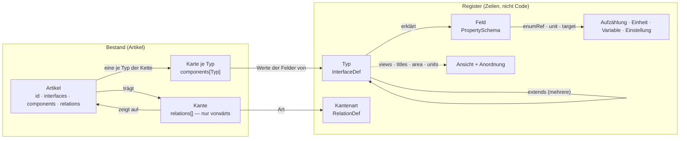

**Alles im Register ist eine Zeile.** Eine neue Artikelart, eine neue Kante,
eine neue Aufzählung ist ein Einfügen und keine Migration. Was im Code steht,
ist die Darstellung (die Layout-Elemente) und die Prüfung — nie die Liste
dessen, was es gibt.

---

## 2. Der Artikel

```json
{
  "id": "n_volo",
  "interfaces": ["Creature"],
  "name": "Volothamp Geddarm",
  "components": {
    "Identity":  { "name": "Volothamp Geddarm", "id": "npc-0003", "aliases": ["Volo"], "cover": "" },
    "Status":    { "status": "ready" },
    "Creature":  { "kind": "npc", "species": "Mensch", "attitude": "freundlich" },
    "Secrets":   { "secret": [{ "id": "secret-schuldet-floon", "value": "Schuldet Floon…" }] }
  },
  "adhoc": [],
  "relations": [
    { "id": "r1", "type": "livesIn", "to": "o_kerzengasse", "props": {} },
    { "id": "r2", "type": "regards", "to": "pa_wacht", "props": { "tags": ["dankbar"] } }
  ],
  "createdAt": "…", "updatedAt": "…", "revision": 4
}
```

Was dabei immer gilt:

| | Regel | Geprüft durch |
|---|---|---|
| A1 | **Die erste Art ist die Art.** `interfaces[0]` sagt, was der Artikel ist; alles, was er festhält, erklärt dieser Typ und seine Kette. | `validateEntity` (`unknown_interface`) |
| A2 | **Eine Karte je Typ**, und nur für Typen der `extends`-Kette. Das hält `hp` am Statblock von `hp` an der Figur auseinander. | `validateEntity` (`unknown_card`, `card_not_inherited`) |
| A3 | **Pflicht steht je Feld** (`schema.required`), und sie gilt für die ganze Kette. Heute: `Identity.name`, `Identity.id`, `Action.actionType`, `Asset.ref`. (`Rule.kind` ist es seit D48 nicht mehr: ein Zauber braucht kein zweites Wort für das, was sein Typ sagt.) | `validateEntity` (`missing_property`) |
| A4 | **Was dasteht, muss das Feld zulassen:** eine Aufzählung hält, eine Spanne hält, eine Zahl ist eine Zahl, ein Verweis zeigt auf seinen Zieltyp. | `validateEntity` (`value_not_allowed`, `value_out_of_range`, `value_not_a_number`, `link_wrong_type`) |
| A5 | **Gerechnetes wird nie gespeichert** (D8): ein Feld mit `derived` hat keine Eingabe und keine Spalte. | Prüfung weist es nicht ab; die Maske gibt keine Eingabe, die Rechnung liest beim Zeichnen |
| A6 | **Kanten nur vorwärts.** Die Gegenrichtung ist eine Abfrage (`backlinks`); ein gespiegeltes Gegenstück verwaist. `cardinality: 'one'` wird geprüft. | `validateEntity`, Server |
| A7 | **Schreiben geht durch `validateEntity`** — am Server vor jedem `PUT`, im Prototyp vor jedem `persist`. | Server, Prototyp |
| A8 | **Die Id ist undurchsichtig** und wird nie wiederverwendet. `Identity.id` ist die ausgegebene Nummer (`npc-0042`): beim Anlegen vergeben, `readOnly`, danach unverändert — auch bei einem Wechsel der Art. **Einzige Ausnahme: die Übernahme zwischen zwei Installationen** (T-130, §12.2) — prod vergibt die Nummer, und dev zieht nach, samt Verweisen. Die Id bleibt auf beiden Seiten dieselbe. | `nextId`, `readOnly`, `assignNumbers` |
| A9 | **`adhoc`** hält Felder, die nur dieser Artikel hat; befördern schreibt sie in den Typ (REQ-181). | Maske |
| A10 | **Was kein Artikel ist, steht nicht im Artikel:** Konten, Rollen, Sitzungen, Einstellungen. Siehe §12. | — |
| A11 | **Geschrieben wird gegen die gelesene Revision** (REQ-192). `revision` zählt der Server, je Schreiben eins mehr (Migration 030). Ein `PUT` nennt die Revision, die er gelesen hat; steht eine andere da — oder fehlt sie bei einem Artikel, den es schon gibt —, wird nichts geschrieben: `409` mit dem Stand, der gilt (`current`, gesiebt wie ein `GET`). Die Maske führt dann zusammen (`mergeEntity`, je Feld und je Kante) und fragt nur, wo beide Seiten dasselbe verschieden geändert haben. **Karte und Board fragen nicht** (T-399): berühren sich die Änderungen nicht — zwei Tokens, Nebel hier und ein Zug dort —, geht das Zusammengeführte gleich nochmals hinaus; berühren sie sich, gilt, wer zuerst speicherte, und die Seite lädt den Stand (`Brett.schreiben` mit `basis`). Ohne Revision wird nur angelegt; Einfuhr und Massenänderung schreiben ungeprüft, weil sie selbst vergleichen. | Server (`putEntity`, gesperrt mit `for update`), `mergeEntity` |

---

## 3. Typen

### 3.1 Drei Formen

| Form | Kennzeichen | Beispiel |
|---|---|---|
| **Grundtyp** | `abstract: true`; erklärt Felder, trägt keine Artikel | `Identity`, `Time`, `Vitals` |
| **Artikelart** | nicht abstrakt; hat einen Bereich (`area`), steht im Kompendium und in der Leiste, darf eine eigene Anordnung tragen | `Creature`, `Quest`, `Map` |
| **Aufzählung** | eine Zeile in `enums`: Name, Beschriftung, Wörter | `Ability`, `State` |

Ein Grundtyp darf einen Bereich tragen, damit seine Unterarten ihn erben
(`Story` → `story`). Eine Artikelart ohne Bereich (`Asset`, `Layer`) steht in
keiner Liste und wird über den Artikel erreicht, der sie braucht.

### 3.2 Was eine Typzeile trägt

| Angabe | Bedeutung |
|---|---|
| `name` | der Bezeichner, englisch, `UpperCamel` |
| `label` | die Beschriftung |
| `abstract` | Grundtyp oder Artikelart |
| `extends[]` | die Typen, aus denen er gemacht ist — **der erste zeichnet den Baum und entscheidet den Bereich**, alle bringen Felder, Kanten, Beschriftungen und Anordnungen mit |
| `schema.properties` | die eigenen Felder (§4) |
| `schema.required[]` | welche davon Pflicht sind |
| `area` | `world` · `story` · `rules` · `play` — geerbt. `story` ist, was nur die Kampagne betrifft (Kampagne, Sitzung, Szene, Auftrag); die Weltgeschichte (`World`, `Event`) steht unter `world` (bis 13.10. hiess `story` `history` und hielt beides) |
| `units` | `imperial` · `metric` · `both`; überschreibt die Einstellung — geerbt |
| `titles` | `Typ.feld` → eigene Beschriftung eines geerbten Feldes (`Time.until` → „Deadline" am Auftrag) — geerbt |
| `targets` | `Typ.feld` → eigenes Ziel eines geerbten Feldes (`Image.image` an der Karte: Kartenbilder, T-119); ersetzt `target` des Feldes ganz — geerbt (`fieldTarget`) |
| `views` | je Ansicht eine eigene Anordnung (Liste) oder eine Anpassung der geerbten (`{ adjust }`, T-110) — geerbt über `layoutFor` |

### 3.3 Vererbung

`typeChain(T)` ist der Typ selbst und **alle** Typen aus `extends`, rekursiv,
über jeden Zweig. Es gilt die Kette hoch:

- die **Felder** jedes Typs darin (je eine Karte),
- die **Kanten**, deren `from` oder `to` einen Typ der Kette nennt — eine
  Spielerfigur *ist* eine Kreatur,
- die **Zieltypen** von Verweisfeldern (`target.interfaces`) ebenso,
- `area`, `units`, `titles`, `targets`, `views`: der nächste Typ in der
  Kette, der etwas sagt, gewinnt.

Ein geerbtes Feld wird nicht einzeln ausgeblendet; wer es nicht will, nimmt
den Typ nicht. Umbenannt wird es über `titles`.

### 3.4 Die Grundausstattung

Jede Artikelart nimmt diese sieben Grundtypen (gemessen: 36 von 36):

| Grundtyp | Felder | Wozu |
|---|---|---|
| `Identity` | `name`!, `id`!, `aliases`, `cover` | wie der Artikel heisst und seine Nummer |
| `Status` | `status` (Zeile `State`: idea · prepared · ready) | der Vorbereitungsstand, sonst nichts |
| `Description` | `description` (lang) | die eine Beschreibung, die jede Ansicht zeigt |
| `Visibility` | `audience`, `revealedTo`, `hiddenFrom` | wer den Artikel überhaupt bekommt (§9) |
| `Tags` | `tags` | Marken |
| `Notes` | `note` (Prosa) | Notizen der Leitung |
| `Prose` | `paragraph` (Prosa) | der gewöhnliche Fliesstext |

Dazu nach Bedarf: `Image`, `Source`, `Time`, `Todos`, `Lore`, `Secrets`,
`Facts`, `ReadAloud`, `Tactics`, `Vars`, `Vitals`, `Proficiencies`,
`Choices`, `Effects`, `Abilities`, `Difficulty`, `Story`. Welche Art was nimmt, steht in §13.

### 3.5 Regeln für Typen

| | Regel |
|---|---|
| T1 | **Was mehrere Arten teilen, ist ein Grundtyp** und keine Komponente und keine Kopie (D27). Eine Feldgruppe, die eine Ansicht **als Ganzes** nennen muss (`except: ['Vitals']`), bleibt ein eigener Grundtyp, auch mit nur einem Nutzer. |
| T2 | **Ein Untertyp ohne eigene Felder ist ein Wort und keine Zeile.** `npc`, `companion`, `retainer` sind Werte von `Creature.kind`; `adventure` von `Story.kind`; `era`, `cataclysm`, `milestone` von `Event.kind`; ein Verbrauchsgut ist ein `Item.itemType`. Eine Zeile wird daraus, sobald sie eigene Felder braucht — `Session` ist eine, weil sie den Sitzungszustand trägt, `Arc` seit E-026, weil er Stufen, Hook und Ausgang trägt (ein Abenteuerkapitel ist ein Arc). |
| T3 | **Eine Art trägt ihre Felder selbst**; `requires`/`allows` gibt es nicht. |
| T4 | **Der Bereich steht am Typ** und wird geerbt; im Code steht keine Liste der Bereiche. |
| T5 | **Feldschlüssel und Beschriftungen sind englisch**; Aufzählungswerte, die Kampagneninhalt sind (`gewöhnlich`, `Gebäude`), bleiben in der Sprache der Kampagne. |
| T6 | **Derselbe Schlüssel darf in zwei Typen Verschiedenes heissen**, weil die Karte ihn unterscheidet (`Statblock.hp` ist das Maximum, `Vitals.hp` der Stand). Er darf es nicht, wenn beide Karten auf derselben Seite nebeneinanderstehen und sich widersprechen — dann hat einer von beiden den falschen Namen. |

---

## 4. Felder

### 4.1 Was ein Feld trägt

| Angabe | Bedeutung |
|---|---|
| Schlüssel | `lowerCamel`, englisch; die Karte heisst nach dem Typ, also sind Schlüssel nur je Typ eindeutig |
| `title` | die Beschriftung; ein Typ darf sie über `titles` ersetzen |
| `type` | `string` · `number` · `boolean` · `array` · `object` |
| `format` | die Form, siehe 4.2 |
| `enum` **oder** `enumRef` | eigene Wörter oder der Name einer Aufzählungszeile — nie beides; `enumRef` darf mehrere Zeilen nennen, die dann zusammen gelten, und seit M6 auch eine **Artikelart** (die Namen ihrer sichtbaren Artikel) oder `Typ.feld` (die Liste dieses Feldes) |
| `enumWhere` | je genannter Art ein Filter `{feld: [werte]}` — welche Artikel davon in Frage kommen (`Item` nur mit `itemType` tool …); Vorschlag für die Maske |
| `items` | bei `array`: die Form der Einträge |
| `many` | mehrere Einträge mit Id: `[{id, value}]` |
| `derived` | eine Rechnung gegen die Nachbarfelder derselben Karte, dann gegen die übrigen Karten des Artikels (§6) |
| `of` | der gerechnete Wert reitet in der Zelle des genannten Nachbarn (**DEX 16 (+3)**) |
| `unit` | bei einem Mass: die Einheit, in der der Wert gespeichert ist |
| `min`, `max` | eine Spanne |
| `default` | gilt beim Anlegen, nie rückwirkend |
| `target` | bei einem Verweis: `interfaces` (Regel), `tags`, `where` (Vorschlag für die Maske) |
| `alwaysEdit` | steht immer als Eingabe da (`Vitals.hp`) |
| `prominent` | steht beim Bearbeiten auch leer da (`Description.description`, `Status.status`, T-195) |
| `description` | ein Satz, was das Feld meint — gezeigt in „+ Add field“ (T-195) |
| `glossary` | der Glossarbegriff, der das Feld erklärt (Name, `Statblock.hp` → „Hit points“): der Feldname ist gepunktet und trägt seine Definition (T-347) |
| `suggest` | ein freies Wort schlägt vor, was sichtbare Artikel darin tragen (`Creature.kind`) |
| `readOnly` | ausgegeben, nicht eingetippt (`Identity.id`) |
| `editOnly` | nur in der Maske, nie beim Lesen: ein Schlüssel zum Ordnen (`Time.sort`, T-126) |
| `facet` | als Filter in der Liste (T-174): `false` nimmt das Feld aus den Facetten, `{label, order}` benennt oder ordnet es (F15); `{as: 'requirement'}` liest einen Satz als Voraussetzung, `{as: 'effect'}` die Einträge von `Effects.effects` (T-180, F16) |

### 4.2 Die Formen

| `type` + `format` | Was es ist | Gespeichert | Eingabe |
|---|---|---|---|
| `string` | Text | `"…"` | eine Zeile |
| `string` `long` | langer Text, **Markdown** (4.4) | `"…"` | mehrzeilig |
| `string` `long` + `many` | **Prosa**: Einträge mit Id; die Id kommt aus dem Text, Freigabe je Eintrag `Typ.feld#id` | `[{id, value}]` | Element `prose`, nicht die Feldtabelle |
| `string` + `enum`/`enumRef` | Auswahl, ein Wort | `"idea"` | Auswahlliste |
| `array` + `enumRef` | Auswahl, mehrere Wörter aus einer oder mehreren Zeilen, Arten oder Feldlisten; woher ein Wort kommt, sagt die Quelle (`enumSource`) | `["Stealth","Dwarvish","martial"]` | Chips mit × und Suche: die Werte der Listen und die Namen der Artikel jeder genannten Art (`enumWhere` engt ein); ein freies Wort nur, wo eine Art genannt ist (T-068) |
| `string` + `suggest` | freies Wort mit Vorschlägen | `"npc"` | Text mit Liste |
| `string` `date` | Weltdatum als Text; `Time.sort` daneben zum Ordnen (`editOnly`: nur in der Maske) | `"Mirtul 12, 1492 DR"` | Text |
| `string` `color` | Farbe | `"#8a4b2a"` | Farbwähler |
| `string` `link` + `target` | ein Artikel eines Zieltyps | Artikel-Id | Suche nach Name und Alias, nur im Zieltyp; `target.tags` zuerst; gelesen als Name mit Link |
| `array` + `link` + `target` | mehrere Artikel eines Zieltyps; jeder Eintrag wird geprüft (`link_wrong_type`) | `[id, …]` | Chips mit × und Suche, nur im Zieltyp; gelesen als Namen mit Link (T-068) |
| `string` `asset` | ein `Asset`-Artikel oder eine `https`-Adresse (12.1) | Artikel-Id | Bild: hochladen, ziehen, einfügen, Kamera, vorhandenes wählen, Adresse; gezeigt als Bild |
| `string` `measure` + `unit` | Masse im Text („40 ft, climb 20 ft"); umgerechnet beim Lesen, nur Zahlen mit bekannter oder keiner Einheit | `"30/120"` | Text |
| `number` (+ `unit`) | Zahl; `signed` druckt +3; `min`/`max` halten | `16` | Zahl |
| `number` + `derived` | Rechnung; `mod(dex)`, `10+mod(wis)`, `rowCount(rows)`, `8+prof+modOf(spellAbility)`; bei Unsinn `null`, nie 0 | — | keine |
| `boolean` | Häkchen | `true` | Häkchen |
| `array` `grid` | eine Form: ein Zeichen je Feld, `.` ist frei (`Item.rows`, `Inventory.grid`) | `["##.","##."]` | gemalt, nicht getippt |
| `object` `zones` + `enumRef` | je Feld ein Wort aus einer Zeile (`Inventory.zones`) | `{"0,0":"action"}` | gemalt |
| `array` + `many` + `entry` | **Einträge mit Form**: jeder Eintrag ist eine kleine Karte mit `id` (aus dem Text) und den Feldern aus `entry`; geprüft wie eine Karte (Pflicht, Aufzählung, Spanne), jede `id` nur einmal (`entry_id_twice`). Heute `Choices.choices` (REQ-238) | `[{id, kind, count, …}]` | JSON |
| `array` `tags` | Marken | `["händler"]` | Text, kommagetrennt |
| `array` (`items: string`) | eine Liste | `[…]` | Text, kommagetrennt |
| `object` | freie Struktur mit eigenem Element (`Vars.bindings`, `Party.actions`, `Board.rules`, `Map.walls`) | `{…}` | das Element oder JSON |

### 4.3 Regeln für Felder

| | Regel |
|---|---|
| F1 | **Eine Aufzählung, die zwei Felder brauchen, ist eine Zeile** (`enums`), und die Felder nennen sie mit `enumRef` — **oder wenn die Wörter Kampagneninhalt sind, den jemand pflegt** (`State`, `DrawTime`: ein Nutzer, aber die Wörter stehen im Register, damit man sie ändern kann, ohne Code anzufassen; A4). Gelesen wird immer über `enumOptions()`, nie `enum` direkt; wer eine Art nennt, gibt die sichtbaren Artikel mit. |
| F2 | **Eine Zahl mit Grenzen ist eine Spanne**, keine Aufzählung von Wörtern. |
| F3 | **Ein Mass ohne Einheit ist keines:** jedes `measure`-Feld trägt `unit`. |
| F4 | **Ein Verweis nennt seinen Zieltyp.** `target.interfaces` ist Regel, `tags` und `where` sind Vorschlag. |
| F5 | **Ein Textblock ist ein Feld** mit `many` und `long`. Eine Liste erlaubter Blockarten je Art gibt es nicht. |
| F6 | **Immer bearbeitbar steht am Feld und nur dort** (`alwaysEdit`). |
| F7 | **Vorgeschlagen wird nur, wo das Feld es sagt** (`suggest`), und nur aus Artikeln, die man sehen darf. |
| F8 | **Status ist der Vorbereitungsstand** (`idea` · `prepared` · `ready`). Wie weit eine Sache am Tisch ist, sagt das Feld der Art (`Quest.progress`, `Encounter.phase`, `Place.state`). |
| F8b | **Ebene und Stand immer** (T-425, E-179, E-182, E-183, E-186): jeder Artikel ausser Ebenen (`LAYER_TYPES`) liegt in mindestens einer Ebene und trägt einen Stand. Neu angelegt: die gewählte Schreibebene, sonst (Verwaltung) die Ebene der laufenden Kampagne, sonst die **Parkplatz-Ebene „Unassigned“** (`UNASSIGNED_LAYER = ly_unassigned`, Startzeile `UNASSIGNED_LAYER_ROW`, vom Start und bei Bedarf angelegt); Stand nach der Vorgabe `idea`. Wer die letzte Ebene oder den Stand eines Artikels entfernt, der sie hatte, bekommt 422 (`layer_required`, `status_required`) mit einem Satz, was zu tun ist; nimmt die Verwaltung einen Artikel aus jeder Ebene, liegt er danach in „Unassigned“. „Unassigned“ ist eine gewöhnliche Ebene (`kind: pack`, `order` 5): keine Kampagne schaltet sie von selbst auf; die Werkbank führt ihren Inhalt und Artikel ohne Ebene (`unassigned`, auch wenn die Ebene nicht im Spiel ist). **Eine Kampagne liegt in ihrer eigenen Ebene** (beim Anlegen), und der Stapel nimmt Kampagnen aus (`stapelFrage`) — sonst fände man eine, während eine andere läuft, nicht. Migration 152: Parkplatz anlegen, Kampagnen in ihre Ebene, übrige ohne Ebene nach „Unassigned“ (dev 28.10.: 6 Bilder), Stand `ready` für jeden Artikel einer Art mit Stand ohne Stand (Instanzen ausgenommen). Nichts wird entfernt. |
| F8a | **Pflicht je Stand** (T-425, REQ-441, E-177, E-178, E-180): `required` gilt immer; `requiredFor: prepared \| ready` am Feld oder an der Kantenart (für den Anfang der Kante) erst für diesen Stand, `ready` schliesst `prepared` ein. Je Art überschreibbar mit `InterfaceDef.requiredFor` (`Typ.feld` oder `edge:<Art>` → Stand, `none` hebt auf), die `extends`-Kette hoch, die genaueste gewinnt (`requiredForOf`). **Geprüft beim Heben des Stands** (`stateRefusal`, am Server in `schreibeGeprueft`, auch für „Mark ready"): mit Lücken 422 `state_gaps` und ein Satz, was fehlt (`stateGapMessage`). Wer den Stand hat, behält ihn; die Werkbank zeigt `readyWithGaps`. Der Rückfall nach D74 geht auf den höchsten erreichbaren Stand (`reachableState`). **Offene Entscheide** (T-436, E-176): mit dem Bestand (`GapContext.byId`) ist jede offene Wahl einer Figur (`pendingChoices`, ohne Ausrüstung) eine Lücke ab `prepared` (`kind: 'choice'`, `choice:<Quelle>#<Wahl>`) — die Figur entsteht im Assistenten gleich und bleibt `idea`, bis alles entschieden ist; die Meldung sagt „decide: …“. Neu angelegt gilt `idea` (Vorgabe `Status.status`). Migration 151: Spalten `required_for` an `interface_def` und `relation_def`; leer heisst wie bisher. |
| F9 | **Beim Bearbeiten ist jedes Feld erreichbar** (T-195), auch die aus `Identity`; nur der Name bleibt Überschrift. Gezeigt werden Pflichtfelder, Felder mit Wert (die Vorgabe zählt nicht), `alwaysEdit` und `prominent`; die übrigen holt „+ Add field“ — nach Bestandteil gruppiert, mit Suche und der `description` des Felds (sonst was es hält). |
| F10 | **Was eine Beschreibung braucht, ist ein Artikel und keine Wortliste.** Zustände sind Artikel der Art `Condition`, Reisehandlungen Regelartikel mit `Rule.kind` `travel`; Felder, die sie brauchen, verweisen (`Vitals.conditions` auf `Condition`, `Party.actions`). Eine Einstellung hält nur, was ein Wort oder eine Zahl ist (`gridSize`, `units`). `skills` (Fertigkeit → Attribut) war eine solche und ist seit M6 weg: die Fertigkeit ist ein Artikel und trägt ihr Attribut selbst. |
| F11 | **Ein langer Text ist Markdown, und nichts darin wird HTML** (M10). Verweise nennen die Nummer, nicht den Namen (M11); Würfel sind `{{…}}`, Platzhalter `{VAR}` (M12). Siehe 4.4. |
| F12 | **Die Zeile hält, die Art schlägt vor** (M6, D50). Nennt `enumRef` eine Artikelart, sind die Werte die Namen ihrer sichtbaren Artikel (Untertypen ja, Instanzen nein), und gespeichert wird der Name. Die Prüfung hält ein solches Feld **nicht** an der Liste fest (`enumHolds`): ein Name ist der heutige Stand, und eine Umbenennung machte eine gespeicherte Übung sonst rückwirkend falsch — dieselbe Regel wie bei `target.tags` (F4). Eine Liste mit Wörtern, die nur ein Wort sind (Waffengruppen), nennt das Feld, das sie trägt (`Weapon.category`), statt einer zweiten Zeile. **Wo ein Feld genau einen Artikel meint, ist es ein Verweis** (F13). **Frei mit Vorschlag** (T-423): sagt das Feld `suggest`, schlägt auch eine Zeile nur vor (`enumHolds` ist dann falsch) — die Maske bietet die Werte der Liste und, was an sichtbaren Artikeln dasteht (`GET /api/suggest?field=Typ.feld`, gesiebt), ein eigenes Wort wird gespeichert. Für Sorten, die Kampagneninhalt sind: `Encounter.kind` (Zeile `EncounterKind`), `Place.kind` (Zeile `PlaceKind`, Migration 143, Registry › Lists). Werte, die ein Ablauf liest (`Encounter.phase`, `Map.kind`, `Item.itemType`), halten weiter. |
| F13 | **Ein Feld, das einen Artikel meint, hält seine Id** (`format: 'link'` mit `target`, T-078). Ein Name zeigt, solange niemand umbenennt, und von ihm kommt man nicht zum Artikel. `enumRef` auf eine Art bleibt, wo ein Feld Artikel **und** Wörter mischt (`Proficiencies.proficient` zieht aus Artikeln und aus `Weapon.category`). Umgestellt: `Statblock.conditionImmunities` → `Condition`, `Weapon.ammoType` → `Item`; die gespeicherten Namen schreibt `025_verweisfelder.sql` in Ids um, und was keinem Artikel eindeutig gehört, steht danach als Notiz (`Notes.note`, `condition-immunities` / `ammunition`). Seit T-099 (E-020, an den Artikeln auf dev entschieden) auch `Deity.domains` → `Subclass` („Knowledge" → „Knowledge Domain", `048_gottheit_domaenen.sql`, Notiz `domains`). **Wird ein Feld mit einem Namensfeld verglichen, bleibt es Name und bekommt die Auswahl** (F12): `Recipe.tool` zieht aus den Werkzeug-Artikeln (`enumRef: 'Item'`, `enumWhere` wie die Übungen), weil das Handwerk es gegen `Proficiencies.proficient` prüft. Welche Felder noch offen sind: [Verweisfelder.md](Verweisfelder.md). |
| F15 | **Wonach eine Liste filtert, sagt das Register** (T-174, `facetsFor` in `packages/model/src/facets.ts`). Aus der Form des Felds: Aufzählung (`enum`, `enumRef`, auch mehrere Zeilen) → Häkchen, Schalter → ja/nein (ohne Wert zählt „nein"), Zahl → Spanne, Verweis mit Zieltyp → Artikelwahl, freies Wort mit `suggest` → Häkchen über das, was dasteht; ein freier Text, den die Übersicht als Spalte zeigt, wird eine Spanne, wenn fast alles darin Zahl ist (der Herausforderungsgrad). Dazu jede Kante mit einer genannten Art am anderen Ende, in beide Richtungen (`out.grants` „grants", `in.grants` „granted by") — nicht mit `*`, `same`, `asField`, `section` und nicht `inLayer`. Gerechnet wird am Server über den gesiebten Bestand: Zahlen und Werte nur aus Artikeln, die das Konto sieht; UND zwischen Facetten, ODER innerhalb; jede Facette zählt ohne ihren eigenen Filter. Was die Ableitung falsch trifft, sagt `facet` am Feld oder an der Kante — eine Zeile, **keine Liste je Art im Code**. Dieselben Facetten filtern die übergreifende Suche, sobald genau eine Art gewählt ist (`/api/search?f=`, T-180). **Eingestellt wird `facet` im Register** (Registry › Feld oder Kante: „In list filters", Beschriftung, Reihenfolge, am Feld „Read as", T-212). |
| F16 | **Voraussetzungen und Wirkungen sind Facetten, die gelesen werden** (T-180). Ein Feld mit `facet: {as: 'requirement'}` (`Feat.prerequisite`, `Item.attunementNote`, `Class.multiclassRequirement`) wird beim Rechnen zerlegt (`parseRequirement` in `packages/model/src/requirements.ts`): `; or` trennt Möglichkeiten, das Komma Teile; erkannt werden Stufe (auch einer Klasse), Attribut, Zauberwirken, Übung, Klasse, Abstammung (auch über ihre Grundart) und ein genannter Artikel (`[[id|…]]`); die Namen sind die der sichtbaren Klassen und Abstammungen. Was die Form nicht kennt, zählt als „Other (text only)" — nichts davon wird gespeichert (D8). **„Usable by <Figur>"** (`usable=<id>`) prüft je Zeile gegen die Figur, wie der Betrachter sie sieht (`characterProfile`: Klassenkanten, Abstammung, Statblock-Werte und -Übungen, Gewährtes und Gewähltes): „nein" fällt weg und wird gezählt, **„unbekannt" bleibt und ist markiert**. `facet: {as: 'effect'}` an `Effects.effects` gibt je Eintrag ein Wort aus Ziel und Art (`resist:fire`, `add:ac`; die alten Bonusfelder des Gegenstands zählen mit). `Effects` tragen Gegenstand, Talent und Merkmal; Zauber nicht, solange `effectsAt` gewährte Artikel ohne Bedingung anrechnet. **Ein Zauber ist „usable", wenn er auf der Liste einer Klasse oder Unterklasse der Figur steht** (`spellList`, Z7) und sie dort Zauber seines Grads wirkt (T-212): `characterProfile.casting` rechnet je Klassenkante den höchsten Grad aus `casterProgression` der Unterklasse, sonst der Klasse, und ihrer Stufe (`maxSpellLevel`: voll, halb ab 2, ein Drittel ab 3, Pakt bis 5, Artificer); die Unterklasse zaubert für die Klasse mit und umgekehrt. Ein Zauber ohne sichtbare Liste hat keine Voraussetzung und bleibt. |
| F14 | **Was nur ordnet, steht nur in der Maske** (`editOnly`): `Time.sort` und `untilSort` setzt man beim Bearbeiten, gelesen wird das Datum daneben. Eine Ansicht kann es nicht ausblenden — `hide` nimmt ein Feld aus einem Element, und der Rest der Artikelseite zeigte es wieder (T-126). |

### 4.4 Langer Text

Jedes Feld mit `format: 'long'` — die Beschreibung, jeder Prosaeintrag,
ein langes Feld in der Feldliste — wird als **Markdown** gelesen (M10,
#61). Zwei Stufen, zwei Funktionen in `packages/model`:

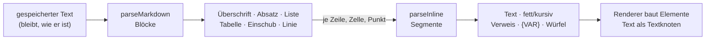

| Im Text | Was es wird |
|---|---|
| `# …` bis `###### …` | Überschrift |
| `- …`, `* …`, `1. …` | Liste; tiefer eingerückt: eine Liste im Punkt |
| `\| a \| b \|` mit `\|---\|` darunter | Tabelle; `:-:` und `--:` richten aus; ein `\|` in `[[…]]` ist kein Zellrand |
| `> …` | Einschub |
| `---` | Trennlinie |
| Leerzeile | neuer Absatz; ein einfacher Zeilenwechsel ist ein Leerzeichen, zwei Leerzeichen oder `\` am Ende ein harter Umbruch |
| `**fett**`, `*kursiv*` | Hervorhebung, schachtelbar; `2 * 3 * 4` bleibt Rechnung |
| `[[npc-0042\|Volo]]` | Verweis über die Nummer (11) |
| `{VAR}` | Platzhalter (6) |
| `{{1d6+2}}`, `{{+4}}` | Würfel zum Anklicken (6) |
| ein Glossarbegriff (Name, Alias) | gepunktet unterstrichen, wenn er `autolink` hat (10.2) |

**Kein HTML aus dem Text.** Ein Block ist ein Datum und kein Markup; die
Oberfläche baut Elemente (`nw-text`), der Prototyp ebenso (`para`,
`mdDraw`), und `<b>` im Feld steht als `<b>` da. Bewusst nicht dabei:
Codeblöcke, Bilder, Fussnoten — kein Text, der hierher kommt, braucht sie.

---

## 5. Kanten

### 5.1 Was eine Kantenzeile trägt

| Angabe | Bedeutung |
|---|---|
| `type` | der Bezeichner, `lowerCamel` |
| `label`, `inverseLabel` | wie sie sich vom Ausgangs- und vom Zielende liest |
| `from[]`, `to[]` | die Typen an beiden Enden, die Kette hoch; `*` jede Art |
| `cardinality` | `one` oder `many` (Vorgabe) — gezählt am Ende, an dem die Kante liegt |
| `asField` | `from` oder `to`: an diesem Ende liest sich das andere wie ein Feld (§5.3) |
| `section` | die Kante **setzt ein** statt zu verweisen: das Ziel steht unter dieser Überschrift im Artikel (`composedOf`) |
| `props` | Schema der Eigenschaften an der Kante |
| `owned` | das Ziel soll mit dem Artikel gehen (`knowledge`) — **heute von keinem Auswerter gelesen** (T-111) |
| `means` | was die Kante bedeutet, ein Satz in beide Richtungen (T-111) |
| `intended` | was sie bewirken **soll**, solange kein Auswerter sie liest — die Oberfläche sagt dann „not evaluated yet" |
| `facet` | als Filter in der Liste, beide Richtungen (T-174, F15): `false` nimmt sie heraus, `{label, order}` benennt oder ordnet sie |

### 5.2 Regeln für Kanten

| | Regel |
|---|---|
| K1 | **Nur vorwärts gespeichert.** Die Gegenrichtung ist eine Abfrage und liest sich über `inverseLabel`. |
| K2 | **Was von beiden Enden abhängt, steht an der Kante:** Menge und Lage im Behälter (`holds`), Drehung auf der Karte (`marker.rot`), die Bindung einer Variablen (`composedOf.vars`), die Marken einer Beziehung (`regards.tags`). Ein Feld am Ziel könnte nur eine der Wahrheiten tragen. |
| K3 | **Was auf etwas zeigt, ist eine Kante**, kein Feld mit Namen: ein Token, eine Platzierung, ein Teilnehmer, eine Zutat. Ein Rechteck auf dem Board zeigt auf nichts und ist darum ein Feld. |
| K4 | **Die Kanten einer Art stehen in ihrer Feldliste mit** — als Gruppe „Edges from here" im Register, zugeklappt. |
| K5 | **Eine Beziehung ist eine Kante mit Marken** (`regards`), beim Urteilenden gespeichert; die Gegenrichtung ist eine eigene Kante. |
| K6 | **Die Wirkung einer Kante wird gerechnet, nicht behauptet** (T-111, REQ-257). Die Zeile sagt, was sie bedeutet (`means`); was sie bewirkt, ergibt sich aus den Auswertern, die sie lesen (`EDGE_READERS` in `packages/model/src/edges.ts`), und aus der Zeile selbst (`section`, `asField`, gerechnete Felder, deren Rechnung sie nennt). Ein Test liest die Dateien der Auswerter und hält das Verzeichnis beim Code. Was nichts liest, ist **nur Anzeige**. |

### 5.3 Teil-Kanten (`asField`)

Eine Kante darf sich an einem Ende wie ein Feld lesen. Das Mass: **ohne das
andere wäre dieser Artikel unvollständig, und an seinem Ende liest es sich
als eines** — darum ist eine solche Kante immer `one`. Heute `belongsTo`
(Statblock → Kreatur, liest die Kreatur) und `carries` (Kreatur/Gruppe →
Inventar, liest die Kreatur). Das Register zeigt die Felder des anderen Typs
als gestrichelte Gruppe `linked · belongsTo`; das Element `linked` zeichnet
sie auf der Seite des lesenden Artikels mit eigenen Eingaben, die in den
anderen Artikel schreiben. Ein Rezept, das einen Gegenstand liefert, ist das
nicht — den gäbe es auch ohne das Rezept.

Fehlt das andere Ende und liegt die Kante dort (`belongsTo` am Statblock),
steht an seiner Stelle „Create" (mit dem Namen des lesenden Artikels) und,
wo die Art Vorlagen kennt (`instanceOf.from`), „From a template": das legt
eine **Instanz** an, die nur speichert, was abweicht — der Server prüft sie
beim Anlegen aufgelöst und speichert sie ausgedünnt wie beim Schreiben. An
der Instanz zeigt die Maske blass, was von der Vorlage kommt, und ↺ lässt
ein Feld ihr wieder folgen. Liegt die Kante beim lesenden Artikel und fehlt
(`carries` an einem Gegenstand), steht nichts da: ein Schwert ohne Inventar
ist kein Behälter. Nur das Element `inventory` fragt ausdrücklich (T-125).

### 5.4 Die Familien

| Familie | Kanten | Trägt |
|---|---|---|
| Struktur | `partOf`, `insideMap` | Ort, Rahmen, Spur der Weltgeschichte (§5.9), das Board eines Geschichtsartikels (REQ-205) — die Reihenfolge sagt `Time.sort` |
| Teil | `belongsTo`, `carries` | `asField` |
| Einsetzen | `composedOf`, `hasProperty` | `section`, `vars` |
| Regel | `stageOf`, `affects`, `grants`, `subclassOf`, `subraceOf` | Stufe eines Zustands; Wirkung zwischen Regeln (`effect`, `on`, `note`); was Klasse, Abstammung, Hintergrund gewähren (`level`) |
| Charakterbau | `hasClass`, `hasAncestry`, `hasBackground` | Klassenstufe, Unterklasse |
| Verweis | `equips`, `worships`, `livesIn`, `memberOf`, `memberOfParty`, `owes`, `regards`, `controls`, `questGiver`, `questAbout`, `describedIn`, `happensAt`, `features`, `involves`, `mapOf`, `onMap`, `tableFor`, `yields`, `needs`, `playedBy` | Marken, Mengen |
| Platzierung | `marker`, `territory`, `zone`, `placed`, `holds` | Koordinaten, Grösse, Drehung, Lage, versteckt |
| Vorgang | `crafting`, `participates`, `entry`, `route` | Stand eines Gangs, Initiative, Gewicht, Wegdauer |
| Ebene | `inLayer`, `activates`, `overrides`, `variantOf`, `instanceOf` | Modus, Reihenfolge |
| Wissen | `knowledge` (owned), `includes`, `knownBy` | — |

Die vollständige Tabelle mit `from`, `to` und Eigenschaften steht in §13.

### 5.4a Was eine Kante bewirkt (T-111)

`edgeEffects(registry, type)` rechnet je Kantenart die Bedeutung, die
Auswerter und die Wirkungen aus der Zeile. Gezeigt wird das an drei Stellen:
in der Kantenauswahl beim Bearbeiten („Adding this: …", bevor die Kante
angelegt ist), als Tooltip an jeder Kante am Artikel (auch unter „Linked
here") und im Register — an der Kantenart und als Tabelle „How edges work",
wenn unter „Edges" keine gewählt ist.

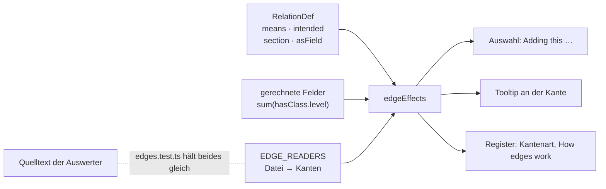

| Auswerter | Bereich | liest |
|---|---|---|
| Layers in play | Stapel | `activates`, `inLayer`, `overrides`, `partOf` |
| Take into your story | Stapel | `partOf`, `mapOf`, `inLayer`, `overrides`, `instanceOf`, `variantOf` |
| Versions and templates | Fassungen | `instanceOf`, `variantOf`, `overrides`, `inLayer`, `belongsTo` |
| Knowledge | Sichtbarkeit | `knownBy`, `includes`, `knowledge`, `memberOf`, `memberOfParty`, `partyOf`, `participates` |
| The campaign’s party | Sichtbarkeit | `partyOf`, `memberOfParty`, `inLayer` |
| Own character and writing | Rechte | `belongsTo`, `carries`, `holds`, `crafting`, `inLayer` |
| Character builder and sheet | Figur | `hasClass`, `hasAncestry`, `hasBackground`, `chose`, `grants`, `allowsMethod`, `allowsEquipment`, `abilityPool`, `carries`, `holds`, `belongsTo` |
| Effects on the numbers | Figur | `grants`, `carries`, `holds` |
| Class pages | Figur | `grants`, `subclassOf`, `tableFor` |
| Initiative | Spiel | `participates`, `memberOfParty`, `belongsTo` |
| Boards | Spiel | `placed`, `partOf`, `inLayer`, `instanceOf` |
| Reading view, Timelines | Lesen | `partOf`, `inLayer`, `mapOf`, `overrides`, `participates` |
| Validation and workbench | Prüfung | `stageOf`, `participates`, `overrides`, `instanceOf`, `variantOf`, `inLayer` |
| Import and export | Transfer | `inLayer`, `partOf`, `instanceOf`, `activates` |
| Where it is from | Anzeige | `inLayer`, `instanceOf`, `partOf` |

Die Tabelle ist eine Zusammenfassung; massgeblich ist `EDGE_READERS`.
**Nicht ausgewertet, aber versprochen** (`intended`, Vorschlag im Brett,
E-031): `affects`, `casts`, `equips`, `hasProperty`, `subraceOf`, `needs`,
`yields`, `loot`, `entry`, `route`, `inWorld` und die Kartenkanten
`insideMap`, `marker`, `zone`, `territory`, `onMap`. **Nur Anzeige** und so
gemeint: `worships`, `owes`, `livesIn`, `controls`, `describedIn`,
`questGiver`, `questAbout`, `happensAt`, `features`, `involves`, `regards`,
`chapterOf`.

### 5.5 Regeltypen, Stufen und Wirkungen (D48)

**Die Messlatte:** eine Regelart wird ein eigener Typ, wenn ein Verweisfeld
oder eine Kante sie *als Art* verlangt oder wenn sie eigene Felder trägt;
sonst bleibt sie ein Wort in `Rule.kind` (Zeile `RuleKind`: `rule`,
`travel`, `sense`, `reward`, `boon`, `option`, seit T-087 `upgrade`,
`facility`, `card`). Unter `Rule` stehen
`Condition` (`Disease` erbt von ihr), `ActionType`, `Action`, `Feature`,
`ItemProperty`, `Feat` und `Skill`.

| | Regel | Geprüft durch |
|---|---|---|
| R1 | **Was man einer Kreatur zuweist, ist eine Art:** `Vitals.conditions` zeigt auf `Condition`, und die Prüfung hält es. Ein Filter nach `kind` schlüge bloss vor. | `validateEntity` (`link_wrong_type`) |
| R2 | **Eine Stufe ist ein Zustand für sich:** „Exhaustion 3" hat `Condition.stage` 3 und die Kante `stageOf` auf „Exhaustion". Der Grundzustand trägt die allgemeine Regel und `recovery` (`longRestStep`: eine lange Rast senkt um eine Stufe). Dasselbe Muster trägt die Stadien einer Krankheit. | — |
| R3 | **Höchstens eine Stufe je Grundzustand** in `Vitals.conditions` und in `participates.props.conditions`. Die Stufe ändern heisst ersetzen (gleicher `stageOf`, `stage ± 1`), nicht zählen. Darum gibt es `Vitals.exhaustion` nicht mehr: dieselbe Zahl an zwei Stellen läuft auseinander. | `validateEntity` (`condition_stage_twice`), mit `stageOf` aus `stageBases` |
| R4 | **Wirkungen zwischen Regeln sind Kanten** (`affects`, `props.effect`: `imposes`, `prevents`, `limits`, `advantage`, `disadvantage`, `triggers`; `on`: worauf). Gespeichert wird vorwärts; „was verbietet mir Reaktionen?" ist eine Abfrage. **Ausgewertet wird vorerst nichts** — die Kanten sind Daten, die der Bogen zeigt. Der Importer legt sie nicht an: dass ein Text einen Zustand nennt, heisst nicht, dass er ihn bewirkt. | — |
| R5 | **Eine Aktion nennt ihre Aktionsart** (`Action.actionType`, Pflicht, Verweis auf `ActionType`) **und sagt, worauf ihr Angriff rechnet** (P4, D51): `attack` (mehrere aus melee/ranged weapon/spell — ein Dolch sticht und wird geworfen), `ability` (`str` … `cha`, `finesse` = das bessere von STR und DEX, `spell` = Zauberattribut; leer: Nahkampf STR, Fernkampf DEX), `damageDice` ohne Modifikator, `damageType` aus der Zeile `DamageType`, `reach`/`range` in Fuss, `target`, Zusatzschaden `extraDamageDice`/`extraDamageType`, und `toHitBonus`/`damageBonus` für einen Bonus über der Rechnung. Der Text sagt nur noch, was die Felder nicht sagen. | `validateEntity` (`missing_property`, `link_wrong_type`, `value_not_allowed`) |
| R7 | **Trefferbonus und Schaden rechnet der Statblock** (D51, D8): Treffer = `prof` + Mod(Attribut) + `toHitBonus`, Schaden = Würfel + Mod + `damageBonus`, beim Lesen, nie gespeichert (`attackNumbers`, Zeile `attackLine`). Ein Angriff ist darum **einer für alle**, die so angreifen — „Bite" je Sorte und Schadensart einmal. **Was ein Statblock anders macht, steht an seiner Kante** `composedOf` und nur dort: dieselben Felder (andere Würfel, Reichweite, Attribut, Zusatzschaden), `note` für den Satz nur dieses Statblocks, und `toHit`/`damageFlat` als **Buchzahl**, wo sie nicht aus der Rechnung folgt — gezeigt wird das Buch, als fest markiert, mit der Rechnung daneben. Ohne `prof` am Statblock gibt es keinen Trefferbonus statt einer falschen Zahl. | Modell (`attackNumbers`), Prototyp (`elComposed`) |
| R8 | **Woher ein Angriff oder Merkmal kommt, wird gezeigt und nicht gepflegt** (D51): das Layout-Element `usedBy` zählt die Statblöcke, die den Artikel zusammensetzen, **nach Kreaturentyp** (Tiere, Drachen …). Ein Monstermerkmal, das ein Volksmerkmal ist („Aggressive" des Orks), zeigt mit `variantOf` auf dieses — der Importer verbindet nur, wenn ein Träger zu dem Volk gehört. | — |
| R6 | **`overrides` zeigt nur auf eine Fassung derselben Art** (M9). **Je Buch eine Ebene** (`Layer.kind` `book`, Id `e5_book_<kürzel>`, T-081, E-017) hält den importierten Regelbestand dieses Buchs; was kein Buch nennt, liegt in der Systemebene „D&D 5e (2014)". Welche Seite, sagt `Source.publication` mit `page`, die Lizenzflagge `Source.srd`. | `validateEntity` (`overrides_other_type`) |
| R9 | **Ein Abenteuer ist eine Ebene mit seiner Geschichte und seinem Text** (`Layer.kind` `adventure`, T-082, REQ-240; T-108, E-029): das Abenteuer eine `Story` mit `kind: adventure`; je Kapitel **ein `Arc` und ein `Chapter`** — der Arc (`partOf` das Abenteuer; E-026 — die Peg-Id rechnet der Importer weiter wie für eine Story) ist die Geschichte, das Chapter (`<Arc>_chapter`, `chapterOf` der Arc) die Lesestruktur; je Abschnitt eine `Scene` — auf Kapitelstufe `partOf` der Arc **und** mit Rang im Chapter, Räume („1. Cave Mouth") mit Rang in ihrer Szene. **Der Text sind Teile** (E14, R10): Absätze, Überschriften, Vorlesetexte (`ReadAloudText`), Verweise auf Statblöcke, mit Rang im Chapter oder in der Szene, an ihrer Stelle im Buch; Szenen tragen keinen eigenen Text mehr. Kreaturen, Gegenstände, Zauber im Text sind **Verweise** auf die Buchartikel; `{@area}` ein Verweis auf den Abschnitt. Je Karte (`imageType: map`) eine `Map` mit der Bildadresse bei 5e.tools (nicht im Repository), `mapOf` ihr Abschnitt; **eine Karte steht immer an einer Szene** — liegt sie im Text des Kapitels, bekommt sie ihre eigene (`<Karte>_scene`, `mode: exploration`, E-026), die als Teil an ihrer Stelle im Chapter steht. Nennt ein Abschnitt Kreaturen **mit Anzahl** („two goblins"), eine `Encounter` (`partOf` der Abschnitt, ohne Rang) mit einer `participates`-Kante je Teilnehmer auf den Statblock. Alles auf `audience: gm`. Ein Abenteuer in einem Quellenbuch (MOT, FRAiF) liegt in dessen Ebene. **Schon geladene Abenteuer** bekommen das von Migration 046: je Arc sein Chapter (dieselbe Id), die Szenen mit Rang, der Text von Arc und Szene als `ReadAloudText` (`<Artikel>_read<n>`) und ein `Paragraph` (`<Artikel>_text`) — gröber als ein Neuimport, nichts geht. **Teile kommen nur mit ihrem Ganzen:** `--only-new` legt in einem Kapitel oder einer Szene, die schon steht, keine Teile an — **ausser einem Bild im Text** (`Illustration`, T-284): es ist kein zweiter Text, und sein Rang ist ein Bruch hinter dem Teil davor. | `arten/abenteuer.ts`, `abenteuer.test.ts`, Durchstich |
| R10 | **Ein Buch ist eine Ebene mit seinen Kapiteln** (T-108, E-028, E-029 a, REQ-247): jedes Buch aus 5e.tools (`book/`, auch ein Regelbuch) bringt je Kapitel der obersten Stufe ein `Chapter` (Name wie bei 5e.tools, „Chapter 9: Combat", `ordinal` „Chapter 9"; ohne Credits), darin seine Teile nach Rang (E14): eine Zeichenkette ein `Paragraph`, ein Kasten `kind: sidebar`, ein Zitat `quote`, eine Liste `list`, eine Tabelle `table`; ein benannter Abschnitt eine `Heading` bis zur dritten Stufe (darunter fett im Absatz); ein Vorlesetext ein `ReadAloudText`. **Was schon Artikel ist, wird ein `Embed`:** ein `statblock`-Eintrag (Monster, Zauber, Gegenstand), eine Tabelle mit dem Namen einer `Table` desselben Buchs, ein benannter Abschnitt mit dem Namen eines Artikels desselben Buchs (Zustand, Klasse, Abstammung, Aktion …). Die Peg-Id eines Teils ist aus seinem Ganzen und seinem Rang gerechnet. Bilder bleiben weg (E5). | `arten/buch.ts`, `teile.ts`, `buch.test.ts` |
| R11 | **Was 5e.tools bis T-087 zurückhielt, ist keine eigene Art** (T-087, REQ-243, löst E4 des Arbeitsplans ab): ein **Fahrzeug** ist ein `Statblock` mit `creatureType` „vehicle (ship)" (Schiff, Spelljammer, Höllenmaschine, Luftschiff) — RK und TP aus dem Rumpf, die Attribute, die Immunitäten; Rumpf, Steuerung, Antrieb, Waffen, Besatzung, Laderaum und Tempo stehen als Text, weil heute nichts mit ihnen rechnet. Eine **Aufrüstung** eines Fahrzeugs, ein **Raum einer Bastion** (2024) und eine **Karte** sind eine `Rule` mit `kind` `upgrade`, `facility`, `card`; ein **Deck** ist eine `Table` mit `kind: 'deck'`, je Karte eine Kante `entry` mit ihrer Anzahl als Gewicht — eine Karte ziehen heisst auf ihm würfeln. Eine **Waffenmeisterschaft** (2024) ist eine `ItemProperty` mit der Marke `mastery`, und die Waffe zeigt mit `hasProperty` darauf wie auf „Finesse". Braucht eine davon eigene Felder, wird sie eine Zeile (T2). | `packages/import-5etools/src/arten/neu.ts` |
| R12 | **Was T-084 nachträgt, zählt hinter allem anderen** (T-084, REQ-186, REQ-238): die Lebenstabellen aus „This Is Your Life" (je Hintergrund und Klasse eine `Table` der Gründe, dazu die Ergänzungstabellen der Klassen und die Trinkets), die Schatztabellen (Hort und Einzelschatz je Herausforderungsgrad, Drachenhorte, Kram im Drachenhort), die **Spielarten** (`_versions`: eine Kopie ihres Eintrags mit `variantOf` darauf — die einer Unterart nicht, sie ändern das Volk) und die **+N-Gegenstände**, die ein Text nennt (eine magische Variante an einem Grundgegenstand, `variantOf` auf ihn). Eine Lebenstabelle hängt über `tableFor` an Hintergrund oder Klasse. **Ein verschachtelter Wurf steht in der Zeile**, als Verweis auf die Tabelle (`{{2d6}} × [[table-0141\|10 gp Gemstones]]`), und nicht als `entry`: eine Zeile nennt oft zwei Tabellen, und zwei gewichtete Kanten zählten sie doppelt. Ein Lauf rechnet **drei Gänge** — Grundstand, dann was T-087 brachte, dann die Nachträge —, jeder mit den Nummern des vorigen; was vor den Nachträgen da war, sieht sie nicht (ausser Buch- und Abenteuertext), sonst stünde sein Text anders als auf dev. | `arten/schatz.ts`, `copy.ts` (`spielarten`), `arten/gegenstaende.ts` (`ausgeschrieben`), `nachtraege.test.ts` |

Dazu aus M7 und M8: `Hazard` (Falle oder Gefahr, auf der Karte über
`marker`), `Deity` (Anhänger über `worships` von Kreatur und Fraktion),
`Faction.goal`, und `Table.columns` — mit Spalten ist eine Zeile in
`rows` eine Liste von Zellen; die gewichteten Einträge bleiben
`entry`-Kanten. Wer ein Merkmal gewährt, sagt seit P4 `grants` (§5.7) —
das, was der Arbeitsplan `featureOf` nannte, vorwärts vom Gebenden aus.

### 5.6 Zauber und Gegenstände (M2, M4)

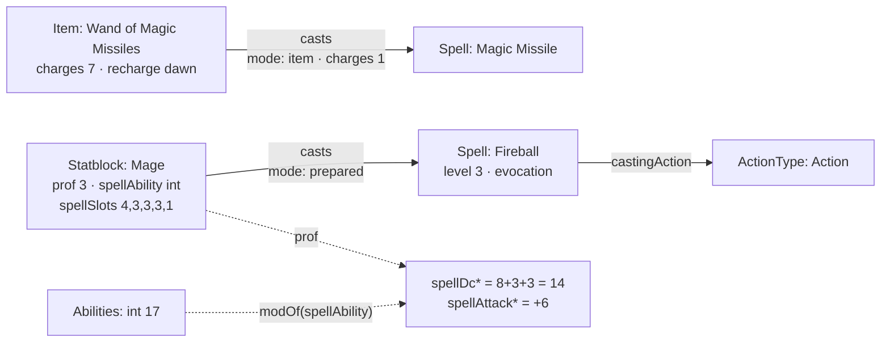

| | Regel | Geprüft durch |
|---|---|---|
| Z1 | **Ein Zauber ist eine Regel mit eigenen Feldern** (`Spell` erbt `Rule`): Grad 0–9 (0 ist ein Zaubertrick), Schule, Wirkzeit, Reichweite (`rangeKind` + `range` in Fuss), Komponenten `v`/`s`/`m` mit Material, Kosten in Kupfer und ob es verbraucht wird, Dauer (`instant`/`timed`/`permanent`/`special`, mit `durationAmount`/`durationUnit`), Konzentration, Ritual, „At higher levels" (langer Text, Würfel darin), Rettungswurf (`enumRef: Ability`), Zauberangriff, Schadensarten. | `validateEntity` (`value_not_allowed`, `value_out_of_range`) |
| Z2 | **Die Wirkzeit nennt ihre Aktionsart:** bei Aktion, Bonusaktion und Reaktion zeigt `castingAction` auf den `ActionType` (D48); längere Wirkzeiten sind `castingTime` mit `castingUnit` (`minute`, `hour`). Der Auslöser einer Reaktion steht in `castingCondition`. | `validateEntity` (`link_wrong_type`) |
| Z3 | **Welche Zustände ein Zauber bewirkt, ist die Kante `affects`** (`effect: imposes`) zur `Condition` — kein Feld daneben (D49). | — |
| Z4 | **Wer einen Zauber wirkt, ist die Kante `casts`** (Statblock, PlayerCharacter, Item, Subclass, Ancestry, Feat, Faction, Rule → Spell) mit `mode` (`prepared`, `known`, `innate`, `item`), `uses` („at will", „3/day"), `level`, `charges` (was ein Gegenstand je Wirken verbraucht) und `fromLevel` (Domänenzauber ab Klassenstufe 3, Thaumaturgy des Tieflings ab Stufe 1). Ein Talent wirkt wie eine Abstammung (Drow High Magic: Levitate 1/day); ein Kult und ein Segen wirken ihre Signaturzauber (T-084), ohne `mode` — wer dazugehört, hat sie typischerweise; bietet es mehrere Zauberlisten zur Wahl (Magic Initiate), wird das eine Wahl `option`, und die Zauber dahinter sind Wahlen mit `onlyIf` (T-089). Gespeichert vorwärts; „wer kann Feuerball?" ist eine Abfrage. | Kantenprüfung (`from`/`to`) |
| Z5 | **Zauberwirken steht am Statblock** (`spellAbility`, `casterLevel`, `spellSlots` je Grad, der erste ist der 1.). **SG und Angriffsbonus werden gerechnet** (D8): `spellDc = 8+prof+modOf(spellAbility)`, `spellAttack = prof+modOf(spellAbility)`. Ohne Attribut gibt es keinen Wert — 8 + Übung sähe aus wie ein SG. | Rechenwerk (`derivedValue`) |
| Z6 | **Verbrauchte Plätze sind ein Stand** (`Vitals.slotsUsed` je Grad), an der Figur und nicht am Statblock — wie `hp` an beiden. | — |
| Z7 | **Welche Zauber eine Klasse lernen darf, ist die Kante `spellList`** (Class, Subclass → Spell, T-212) — die Zauberliste, nicht was jemand wirkt (`casts`) und nicht was er bekommt (`grants`: dessen Ziele brächten ihre Wirkungen ohne Bedingung an die Figur, `effectsAt`). Von der Unterklasse die erweiterte Liste (Paktgeber, Eldritch Knight); `props.optional` sind die Ergänzungen aus Tasha's, die eine Kampagne erlaubt oder nicht. Der Importer liest sie aus `generated/gendata-spell-source-lookup.json` (`arten/zauberlisten.ts`); auf einen bestehenden Bestand kommen sie über eine Massenänderung (`--spell-lists`, `scripts/zauberlisten-5etools.mjs`). Am Zauber ist „Class spell list" die erste Facette (`facet.order: 0`). | Kantenprüfung |
| Z8 | **Die Spielerseite liest den Stand an der Figur und rechnet im Modell** (T-247, `packages/model/src/sheet.ts`). `Vitals` trägt dazu `concentration` (der Zauber, ein Verweis — höchstens einer), `durations` (wie lange noch, je Zustand oder `concentration`, ein Wort: „9 min", „until you attack"), `hidden` und `turnUsed` (`action`/`bonus`/`reaction` in diesem Zug; „New turn" leert es). Schaden geht zuerst von `hpTemp`, zeitweilige addieren sich nicht (`applyDamage`, `grantTemp`); Schaden bei Konzentration fragt den KON-Rettungswurf gegen max(10, halber Schaden) (`concentrationDc`). Der Kopf (`sheetHeader`) rechnet Vitals, Zauberwirken, Trefferwürfel (je Klassenstufe einer, `hitPointLevels`), Plätze und Rettungswürfe beim Lesen (D8). | Tests `sheet.test.ts` |
| Z9 | **Was die Hände sperren, steht mit Grund da** (`handState`, `castBlock`, `lockOf`): gehalten ist, was am Platz `mainHand`/`offHand` liegt (`holds.props.slot`, G4); eine Waffe mit der Eigenschaft „two-handed" (`hasProperty`) belegt beide. Somatik und Material brauchen eine freie Hand oder den Fokus in der Hand, ein Schild ohne Übung verbietet jedes Zaubern, die Nebenhand-Attacke braucht eine leichte Waffe. Gesperrte Aktionen bleiben sichtbar (🔒 Grund). Das Ausrüsten selbst (Griff, Verdrängen, Tragplätze) wartet auf T-244 und speist dann dieselbe Funktion. | Tests `sheet.test.ts` |
| Z10 | **Wirken verbraucht den kleinsten freien Platz ab dem Grad** (`slotFor`, `Vitals.slotsUsed`); ein Zaubertrick keinen, ein Ritual ohne freien Platz keinen. Gesperrt wird zuerst nach den Händen, dann nach dem Platz (`spellLock`). Ein Konzentrationszauber setzt `Vitals.concentration` (und `durations.concentration` aus seiner Dauer), die Aktionsart der Wirkzeit wird in „Your turn" verbraucht. „Possible for you now" ist dieselbe Frage wie „Usable by" (`usable`, T-180, Zauberliste T-212). Wie eine Figur Zauber lernt, liest sich aus `casts.props.mode`; die Abläufe selbst werden Regelartikel (T-241, T-249). | Tests `sheet.test.ts` |
| Z11 | **Der Reiter Crafting an der Figur baut auf der Werkbank** (T-128, T-197): `GET /api/crafting/:figur` bringt dazu alle Blaupausen (`recipes`, mit `toolOk`), das freie Material der Figur und ihrer Gruppe nach Grundartikel (`stock`, ohne Reserviertes) und ihre Aufträge (`orders`) — beides nur für sie selbst und die Leitung. „Bereit"/„fast" rechnet `blueprintState` ohne Ersatz; den Ersatz entscheidet die Werkbank beim Start. | `apps/server/test/handwerk.test.ts`, `sheet.test.ts` |
| Z12 | **Der Reiter Campaign fragt nur `GET /api/list`** — Sichtbarkeit, Stand und Stapel rechnet der Server, die Maske prüft nicht nach. Handouts sind sichtbare Bilder (`Asset`) und Wissen (`Information`, `Knowledge`), das an der Figur oder ihrer Gruppe hängt (`knownBy`, ein Schritt). | `bogen.test.ts` |
| G1 | **Ein Gegenstand trägt, was 5e.tools kennt:** `tier` (minor/major), Einstimmung (`attunement`, `attunementNote`), Ladungen (`charges`, `recharge`, `rechargeAmount`), Boni (`bonusWeapon`, `bonusAc`, `bonusSpellAttack`, `bonusSave`), `appliesTo` (Marken, woran eine Variante passt). `itemType` und `rarity` sind englische Aufzählungen am Feld (E3); `rarity` kennt `none` und `varies`. | `validateEntity` (`value_not_allowed`) |
| G2 | **Waffe und Rüstung:** `Weapon.category` (simple/martial), `damage2` (zweihändig, bei `versatile`), `ammoType` (Verweis auf den Munitionsartikel, T-078), `damageType` aus der Zeile `DamageType` (seit P4); `Armor.armorType` (light/medium/heavy/shield), `strength`, `stealthDisadvantage`. Eigenschaften bleiben die Kante `hasProperty` → `ItemProperty`. | `validateEntity` |
| G3 | **Ein Gegenstand darf ein Behälter sein** (`carries` → `Inventory`, wie an Kreatur und Gruppe) und **ein Stück am Tisch eine Instanz** des Gegenstands im Buch (`instanceOf`, §7): das +1-Langschwert speichert nur, was abweicht. Eine Instanz ist von derselben Art wie ihre Vorlage (`to: same`). | Kantenprüfung |

| G4 | **Die Plätze nach Basils Blatt** (D54, REQ-214): `holds.props.slot` kennt Kopf, Schultern, Torso, Handschuhe, rechte und linke Hand (`mainHand`, `offHand`, beide nehmen alles), Beine, Stiefel, Gurt, zwei Holster, je vier Ringe an jeder Hand (`ringR1`…`ringL4`) und vier Halsketten (`neck1`…`neck4`). Gelesen aus der Zeile, nicht aus dem Code; ein Platz, den die Zeile nicht kennt, bleibt am Stück stehen und wird gezeigt. Umbenennung: `prototype/migration/plaetze-nach-dem-blatt.mjs`. | — |
| G5 | **Die Figur steht an der Kreatur** (`Creature.figure`: male · female · neutral, Liste am Feld), nicht am Inventar: das Inventar wechselt den Träger, die Figur nicht. | `validateEntity` (`value_not_allowed`) |
| G6 | **Das Tragraster wird gerechnet** (D54, REQ-215, REQ-356): ein Inventar einer Kreatur **ohne eigenes `grid`** liest seine Form aus dem **Tragblatt** — einer Liste von **Bausteinen** (Einstellung `carrySheet`, JSON): je Baustein eine gemalte Form, eigene **Zonen** (Felder mit einer Dauer aus `DrawTime`) und Bedingungen auf Felder des Statblocks (`Statblock.size` ist eine von, `Statblock.carryExtra` eine Spanne, jedes andere Feld ebenso; alle müssen gelten; eine Bedingung, die weder Werte noch Spanne nennt, gilt für niemanden, ein Baustein ganz ohne Bedingung für jede Kreatur). Was gilt, wird **aneinandergefügt**, links nach rechts in Listenreihenfolge, oben bündig — eine kleine Kreatur mit viel Stärke hat ein Raster ohne Lücke. Gilt keiner, bleibt das Rechteck (`inventoryCols`, `inventoryRows`). Fehlt `carrySheet`, wird das Blatt aus `carrySquares`/`carryZones` gerechnet (je Grösse ein Quadrat, je Stufe des Zusatzquadrats eines, Zonen aus den Spalten wie bisher). Behältervorlagen (`container:*`) tragen ihre Zonen ebenso. Eingestellt unter Rules & options › Inventory (REQ-355, REQ-356). | Rechenwerk (`assembleCarry`, `carryFieldValue`, `legacyCarrySheet`) |
| G7 | **Jeder Behälter gibt eine Ziehstufe dazu** (D54, REQ-216): die Stufe eines Stücks ist das Langsamere aus seiner Zone und der Stufe seines Behälters + 1, die Kette hinauf (`carries` von einem Gegenstand). Aussen gilt der Platz (`slotDraw`) oder die Zone. Kennt ein Schritt keine Stufe, hat das Stück keine. | Rechenwerk (`drawStage`) |
| G8 | **Fallenlassen und Verstauen haben feste Kosten, egal wohin** (D58, REQ-225): Einstellung `handActions` (`drop:free action, stow:bonus action`, Werte aus `DrawTime`; ein Wert ausserhalb der Leiter gilt nicht). **In der Hand** ist, was an `mainHand`/`offHand` liegt, oder ohne Platz `tier: held`. **Fallen gelassen** wird an Ort und Stelle: die `holds`-Kante bleibt, verliert Platz und Rasterlage und bekommt `tier: ground` — das Stück gehört der Figur weiter und hat keine Ziehstufe. **Verstaut** wird an einen freien Platz, der keine Hand ist, oder an die erste freie Stelle im Raster (`tier: pack`). Der Gurt ist eine freie Aktion (`slotDraw` `belt`). | Rechenwerk (`handActions`, `inHand`) |
| G9 | **Wie eine Kampagne Inventar zählt, ist ein Wort an der Kampagne** (T-127): `Campaign.inventory` — `grid` (Raster nach Basils Blatt, Vorgabe), `weight` (Gewicht mit Tragestufen) oder `slots` (je Stapel ein Slot, ein Stapel fasst `Item.stackSize`; Fassung `Inventory.capacity`). Gelesen nur über `inventoryRulesOf`; wandert mit T-132 in ein Modul, dann ändert sich, wo diese Funktion nachsieht. **Gewicht** ist Menge × `Item.weight`, mit dem Inhalt der Behälter; die Stufen nach der Variante aus dem Spielerhandbuch: bis 5 × STÄ leicht, bis 10 × belastet, bis 15 × schwer (zugleich die Tragfähigkeit), darüber zu viel, je Grösse vervielfacht (`loadStage`, `sizeFactor`). Ohne Stärke keine Stufe. | `inventoryRulesOf`, `loadStage`, `slotsUsed` |
| G10 | **Ein Stück wandert, indem seine `holds`-Kante wandert** (T-127): `moveHeld` nimmt sie aus dem einen Inventar und legt sie ins andere — Figur ↔ Gruppe, in einen Behälter, eine Stufe hinauf; weniger als der Stapel teilt ihn. **Die Lage bleibt zurück** (`gx`, `gy`, `rot`, `slot`: sie galt im alten Behälter), und liegt derselbe Gegenstand drüben lose im Fach, wächst dessen Stapel. Kein Ziel ist das Stück selbst oder was darin steckt (`insideOf`). Geschrieben wird erst das Ziel, dann die Quelle — bricht es dazwischen ab, liegt es doppelt und nicht nirgends. **Das Gruppeninventar** (`Party` `carries` `Inventory`, REQ-183) schreibt, wer am Tisch der Kampagne sitzt (nicht `spectator`); die Gruppe selbst nicht. **Ein Behälter in einem eigenen Inventar** ist mit dessen Inventar eigen (der Rucksack in Rooks Gepäck), der Gegenstand nicht. | `moveHeld`, `apps/server/test/inventar.test.ts` |
| G11 | **Reserviert ist ein Stapel, nicht ein Gegenstand** (T-127, Schnittstelle für T-128): `holds.props.reservedFor` nennt den Artikel, der ihn braucht (ein Handwerksauftrag). Das Stück bleibt, wo es liegt, und gehört weiter der Figur; verschieben, teilen und herausnehmen geht nicht, bis die Reservierung fällt — der Server prüft es (T-134). An der Kante wie die Drehung. | `reservedFor`, `reserve`, `moveHeld` (`refused: 'reserved'`), `reservationBreaches` |
| G12 | **Was ankommt, liegt erst unverstaut da** (T-140, REQ-064, REQ-183): gekauft, erbeutet, geschenkt — die `holds`-Kante trägt `unstowed: true` und keine Lage. Verstaut ist der Stapel im Raster, an einem Platz, in einem Behälter (`moveHeld` mit `stow`) oder ohne Raster auf „Stow"; der Träger wechselt ihn nicht (der Gruppe gegeben, bleibt er unverstaut), und gestapelt wird nur auf einen Stapel im selben Zustand. Wächst beim Kauf ein schon verstauter Stapel, bleibt er, wie er war, und der Zuwachs liegt daneben (`arriveUnstowed`). **Wie lange es so liegen darf, ist ein Wort an der Kampagne**: `Campaign.stowing` — `anytime` (Vorgabe), `bySessionEnd`, `immediately` (bis an der Sitzung Szene, Kampf oder Karte wechseln, `tableMovedOn`; Auslegung offen in E-054). Danach **bleibt es liegen**: es verlässt die Inventare der Gruppen und Figuren der Kampagne (samt Behältern) und steht an der Sitzung als `leftBehind` (`qty`, `from` = das Inventar, `at`); Reserviertes bleibt. Gelöscht wird nichts — **Aufheben** (`pickUp`) nimmt die Kante und legt den Stapel unverstaut in ein Inventar, das der Aufhebende schreibt. Erst die Sitzung, dann die Inventare: bricht es dazwischen, liegt es kurz doppelt und nicht nirgends. | `stowingRuleOf`, `arriveUnstowed`, `leaveBehind`, `pickUp`, `POST /api/sessions/:id/end` · `…/pick-up`, `apps/server/test/liegen.test.ts` |
| G13 | **Enhancements: „+1 Dagger" ist ein Stück mit Kanten, kein Artikel** (T-300, E-107). „+1 Weapon", „Silvered", „Adamantine Armor" sind **Enhancements** — seit T-324 (E-163) ein Regelartikel der Art `Enhancement` unter `ItemFeature` (G13a), kein Gegenstand. Am Merkmal stehen `appliesTo`, `namePrefix`/`nameSuffix` und der **Aufpreis** `priceAdd` (Kupfer) und/oder `priceMult` (Faktor auf den Grundpreis), am Enhancement Seltenheit, Einstimmung und Boni; ohne Aufpreis rechnet sich kein Preis. Angehängt wird er an ein **Stück** (Instanz des Grundgegenstands, G3) mit `enchantedWith` (mehrere, in Reihenfolge), geprüft gegen `appliesTo` (Wörter wie `weapon`, `sword`, `melee weapon`; Paare wie `weaponCategory:martial`, die nur halten, wenn der Gegenstand etwas dazu sagt), nie an den Grundgegenstand. **Gerechnet beim Lesen** (D8, `enhanceItem`): Name = Präfixe + Name des Grundgegenstands + Suffixe (ein eigener Name des Stücks geht vor), Seltenheit = die höchste, Boni = die Summe, **Preis nach `Campaign.itemPricing`**: `combined` (Vorgabe) = Grundpreis × Faktoren + Beträge, `base` = Grundpreis, `none` = keiner; fehlt einer Eigenschaft der Aufpreis, gibt es keinen Preis statt eines falschen. Ausgeliefert als `enhanced` neben dem Artikel (wie `fromTemplate`, beim Schreiben weg); `entityName` nimmt den gerechneten Namen, Laden und Ankauf den gerechneten Preis (`piecePrice`). Ein Stück mit Enhancement weicht von der Vorlage ab und stapelt nicht mit anderen (`followsTemplate`). **Wer anhängt:** die Leitung; `Campaign.enhancementsBy: players` lässt Spielende an Stücken in einem Inventar, das sie schreiben (vorbereitet für das Handwerk). Auch das gewöhnliche Schreiben prüft beides. Rechenbeispiel: Dolch 2 gp + „+1 Weapon" (+ 1,000 gp) + „Silvered" (+ 100 gp) = **„+1 Silvered Dagger", 1,102 gp**, uncommon, +1 auf Angriff und Schaden. Der Importer legt jede Variante (`magicvariant`) als Enhancement an und schreibt Namensteile und Aufpreis (`valueExpression` `+ n` → `priceAdd`, `× n`/`valueMult` → `priceMult`); ausgeschriebene Paare bleiben benannte Gegenstände (E-110 a). | `enhanceItem`, `enhancementRefusal`, `itemPricingOf`, `POST`/`DELETE /api/entities/:id/enhancements`, `apps/server/test/aufwertung.test.ts` |
| G13a | **Gegenstandsmerkmal: was an einen Gegenstand kommt, ist ein Regelartikel** (T-324, E-163) — wie ein Monstermerkmal am Statblock. Die abstrakte Art `ItemFeature` (unter `Rule`, dazu `Effects`, `Image`, `Lore`, `Secrets`, `Facts`) hat zwei Sorten: **`ItemProperty`** (Finesse, Versatile, Heavy; Kante `hasProperty` vom Gegenstand) und **`Enhancement`** (+1 Weapon, Silvered; Kante `enchantedWith` vom Stück, G13). Gemeinsam am Merkmal: `appliesTo`, Namensteile, Aufpreis und **`mechanics`** — was es am Bogen bewirkt (`two-handed`, `versatile`, `light`, `finesse`), aus den Daten und nie aus dem Namen (`featureMechanics`, `itemFeaturesOf`); eine Hausregel-Eigenschaft darf zweihändig sein, ohne so zu heissen. **Die Werte des Einzelfalls stehen an der Kante:** `hasProperty.props.damage` (Versatile 1d10) und `.range` (Thrown 20/60), wie `composedOf` am Statblock; der vielseitige Würfel der Kante geht `Weapon.damage2` vor. Am Grundgegenstand steht nichts davon. Migration 163 hat die eingelesenen Varianten (Art genau `Item` mit `appliesTo`, samt Überschreibungen und Instanzen) zu Enhancements gemacht: Karte `Item` aufgeteilt, der Preis ohne eigene Angabe als `priceAdd`, was kein Merkmal trägt (Stufe, Ladungen, Form …) als Satz in `Notes.note` (`item-fields`); und den Eigenschaften ihre `mechanics` gegeben (aus der Abkürzung 2H/V/L/F, sonst dem Namen — einmal, dort). | `ITEM_FEATURE`, `isEnhancement`, `featureMechanics`, `itemFeaturesOf`, `wieldItemOf`, `apps/server/migrations/163_gegenstandsmerkmal.sql`, `packages/model/test/enhancement.test.ts` |
| G14 | **Die Form eines Gegenstands wird gemalt und ohne Ränder gespeichert** (T-142): `Item.rows` (`#` belegt, `.` frei), gemalt im Element `shape` auf einem Raster von 5 × 5, das am Rand wächst, oder als Zeilen getippt (`X`/`0` aus dem Vault gehen auch); gespeichert ohne leere Zeilen und Spalten am Rand (`trimShape`, aus dem Vault `shapeFromVault`). **Gespiegelt wird an der Kante wie gedreht** (`holds.props.flip`, vor der Drehung, `itemShape`), angeboten nur, wo die gespiegelte Form keine Drehung der ursprünglichen ist (`shapeChiral`). **Das Bild liegt in der Form**: `Item.inventoryImage`, sonst `Image.image`, nach `Item.inventoryFrame` (`zoom`, `x`, `y` in Prozent, `rot` in Vierteln, `fit` `contain`/`cover`) und nur in den belegten Feldern; der Ausschnitt steht am Gegenstand (bzw. seiner Fassung), die Lage an der Kante. | `trimShape`, `shapeFromVault`, `shapeChiral`, `inventoryFrame`, `inventoryImageOf`, `packages/model/test/form.test.ts` |
| G15 | **Vorgabeformen wohnen im Inventarmodul, nicht am Gegenstand** (T-394, E-165, E-075 b, REQ-333): eine aufgeschaltete Ebene mit der Karte `ShapeDefaults` trägt **Gruppen** (`shapeGroups`: Form `rows`, `stackSize`, `carryable`, Referenzgegenstand `ref`, Satz `rule`, Notiz `note`, für Kunstgegenstände `shapes` mit Gewichten je Preisstufe `tiers` in Gold) und **Werte je Gegenstand** (`shapeItems`, Schlüssel ist die Artikel-Id: `group`, `ref` — `null` heisst keiner —, eigene Form `rows` — `null` heisst keine —, `stackSize`). Gerechnet beim Lesen (D8, `defaultShapeOf`), der erste Treffer gilt: `Item.rows` am Gegenstand › eigene Form im Untermodul › **Referenzgegenstand** (Kette bis sechs Schritte, ohne Kreis, wie er in der Kampagne gilt) › Gruppe trägt nicht (keine Form) › Zufallsform nach Preis (FNV-Hash der Id, dieselbe Statue liegt immer gleich) › Form der Gruppe, oder die eigene ihres Referenzgegenstands. Ein Stapel am Gegenstand oder im Untermodul gilt über jeder geerbten Form. Mehrere Ebenen mit der Karte legen sich in der Reihenfolge des Stapels übereinander, Feld für Feld (`campaignShapeDefaults`). `GET /api/entities/:id` und `?ids=` bringen Form und Stapel im Gegenstand mit — ebenso der Listenindex (`GET /api/list`: Spalte Shape, Filter „hat Shape“ `@has:Item.rows`) — und sagen woher (`refs.shape`: `source` item/own/reference/random/group/none, `group`, `ref` — ein Referenzgegenstand, den der Betrachter nicht sieht, wird nicht genannt). **Geschrieben** wird nur die Abweichung: schickt die Maske die gerechneten Werte zurück, fallen sie weg (`stripDefaultShape`). **Geändert** wird die Karte über `PUT /api/inventory/shapes/groups/:id` und `…/items/:id` (`withShapeGroup`, `withShapeItem`: ein Wert setzt, `null` nimmt ein Feld heraus, `rows: []` heisst ausdrücklich keine Form) in der genannten Formebene, die der Betrachter schreibt — **in die Ebene selbst**, ob eine Kampagne sie aufschaltet oder nicht: die Formen gehören dem Modul, eine Kampagne schaltet es auf und passt es mit einer eigenen Formebene darüber an; ohne Angabe in die spezifischste aufgeschaltete, die er schreibt —, gegen die gelesene Revision — zwei Änderungen an derselben Karte zur selben Zeit gehen beide durch. `PUT /api/inventory/shapes` legt viele Gruppen und Werte Feld für Feld auf einmal über die Karte (`mergeShapeDefaults`, mit `dryRun`; das Werkzeug `scripts/vorgabeformen.mjs` lädt so die Seite der Leitung). `GET /api/inventory/shapes` liefert die Übersicht (Gruppen, je sichtbarem Gegenstand Form, Herkunft und die lokale Angabe `set`), gesiebt wie jede Route; die Seite ist `/inventory/shapes` (Rules & options › Inventory › Item shapes), am Gegenstand das Element Shape mit Herkunft, „Group & reference“ und „Use the default“. Die Karte trägt eine Regelmechanik (`RuleMechanic`, E-166, § 10.1a): **die Vorgaben stehen in der Ebene von Grid** und kommen so mit dem Regelwerk in jede Kampagne, die das Raster aufschaltet (D90); eine Kampagne passt sie mit einer eigenen Formebene darüber an, wie die umgezogene Formebene aus T-142 (Migration 141). Als Formebene gilt, was die Karte trägt oder die Mechanik `grid` oder `shapes` ist (`isShapesLayer`). | `defaultShapeOf`, `withDefaultShape`, `campaignShapeDefaults`, `stripDefaultShape`, `packages/model/test/defaultShapes.test.ts`, `apps/server/test/vorgabeformen.test.ts` |
| G16 | **In der Hand ist ein Platz an der Kante, und der Griff auch** (T-244): `holds.props.slot` `mainHand`/`offHand`, dazu `holds.props.grip: two` für beide Hände (vielseitig mit dem zweiten Würfel, zweihändig zum Angreifen). Wer wohin darf und wer weichen muss, rechnet `wieldPlan` aus den Eigenschaften des Gegenstands (`hasProperty`, `Item.itemType`): zweihändig belegt beide Hände, ein Schild nur die Nebenhand, eine Rüstung keine; braucht die Nebenhand ein Stück, rückt eine beidhändig gehaltene vielseitige Waffe auf eine Hand, statt zu gehen. Verdrängtes wird verstaut (erster freier Platz, `stowSpots`, sonst unverstaut) oder fallen gelassen (`tier: ground`); aus einem Stapel geht eines in die Hand. Was die Hände dann sperren, rechnet weiter `handState`. | `wieldPlan`, `applyWield`, `wieldOptions`, `handChecks`, `packages/model/test/wield.test.ts` |

Offen: wie viele Ladungen ein Stück am Tisch noch hat (ein Stand am
Gegenstand oder an `holds`).

### 5.7 Statblock, Charakterbau und Übungen aus Artikeln (M5, M3, M6)

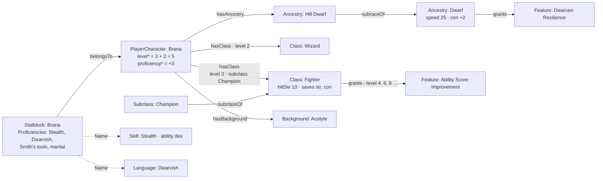

| | Regel | Geprüft durch |
|---|---|---|
| S1 | **Der Statblock wächst** (M5): `languageNote` (was keine Sprache ist: „telepathy 120 ft.", „any four languages"), `conditionImmunities` (Verweise auf `Condition`-Artikel, seit T-078; vorher ihre Namen), `legendaryActions` (Anzahl je Runde), `legendaryActionsLair` (Anzahl im Lair, wo sie abweicht — „3 (4 in Lair)", T-437; der Satz über den Legendären Aktionen nennt sie), `bonuses` (`{"Stealth": 6}` — feste Boni, die nicht aus Übung folgen; der Bogen nimmt sie statt der Rechnung), `token` (Asset). `size` liest die Zeile `Size`, englisch. Er nimmt `Proficiencies`, `Lore` und `Image` dazu; die Umgebung eines Monsters sind Marken. | `validateEntity` |
| S2 | **Die Übungen wohnen am Statblock**, nicht an der Kreatur: sie gehören zu den Zahlen (Übungsbonus, Attribut). An beiden Stellen wären sie zwei Antworten auf „worin ist sie geübt". | Register (`typeChain`) |
| S3 | **Was ein Statblock führt, ist die Kante `equips`** (Statblock → Item): der Gegenstand aus dem Buch, kein Inventar. | Kantenprüfung |
| C1 | **Klasse, Unterklasse, Abstammung, Hintergrund sind Arten unter `Rule`** (Bereich `rules`). Jede nimmt `Proficiencies` (was sie fest gewährt — die Beschriftung heisst dort „Grants proficiency in") und `Choices` (was zu wählen ist, C6). Die Klasse trägt `hitDie`, `primaryAbility`, `startingEquipment`, `multiclassRequirement`, `multiclassProficient`, `subclassTitle`, mit der Unterklasse `casterProgression` und `spellAbility`; die Abstammung `size`, `speed`, `abilityBonus` (`{"con": 2}`), `age`, `darkvision`, `resistances`. | `validateEntity` |
| C2 | **Die Figur zeigt darauf:** `hasClass` (mehrmals, `props.level` Pflicht, `props.subclass` → `Subclass`), `hasAncestry` und `hasBackground` (je eine). `PlayerCharacter.class` und `.ancestry` sind weg. | Kantenprüfung |
| C3 | **Die Stufe wird gerechnet:** `level = sum(hasClass.level)`, `proficiency = 2+(sum(hasClass.level)-1)/4` (D8). Ohne Klasse keine Stufe — kein Wert statt 0. | Rechenwerk (`derivedValue` mit Kanten) |
| C4 | **Was eine Klasse, Abstammung, ein Hintergrund oder Talent gewährt, ist die Kante `grants`** (→ `Rule`) mit `props.level`. Die Stufe steht an der Kante und nicht am Merkmal: „Ability Score Improvement" ist ein Artikel und sieben Kanten. `Feature.level` ist deshalb weg (D50). `subclassOf` und `subraceOf` sagen, wozu eine Unterklasse oder Unterart gehört. Die Stufentabelle einer Klasse und die Charakterzug-Tabellen eines Hintergrunds sind `Table`-Artikel über `tableFor`. | Kantenprüfung |
| C5 | **Ein Merkmal bettet ein, was allein in einem Absatz steht** (W6): ein Absatz, der nur aus einem Verweis auf ein `Feature` besteht (`[[feature-0479\|Abjuration Savant]]`), heisst „hier steht dieses Merkmal" — so schreibt der Importer `refSubclassFeature` und `refOptionalfeature`. Die Klassenansicht zeichnet es an dieser Stelle aus; ein Kopf, der Merkmale **seiner Sorte** einbettet („School of Abjuration"), heisst in der Tabelle nach seinen Teilen, einer mit Optionen („Fighting Style" › „Archery") nach sich. Optionale Merkmale und Variantenregeln tragen die Marke `optional`. Bringt eine Unterklasse eigene Spalten (`subclassTableGroups`: Eldritch Knight), ist das ein `Table` über `tableFor` an ihr. Herkunft und Hintergrund liest die Herkunftsansicht gleich (T-166), nur ohne Stufen: ihre Spielarten sind die Artikel derselben Art mit `subraceOf` auf sie (einen Schritt tief), ihre Würfeltabellen `tableFor`, ihre Merkmale `grants` in der Reihenfolge der Kanten. **Eine Unterart bringt ihre Grundart mit** (T-193): an der Figur zählt jede Herkunft der Reihe `ancestryLine` (die Unterart, dann über `subraceOf` ihre Grundart, höchstens vier, ohne Kreis) als Quelle `hasAncestry` — ihre `abilityBonus` summieren sich in `chosenResult`, ihre Wahlen sind Schritte. **Was eine Möglichkeit bringt**, rechnet `optionEffects` aus Feldern und Kanten: Boni (summiert), Grösse, Tempo, Darkvision, Kreaturtyp (die Unterart geht vor), Resistenzen, Trefferwürfel, Hauptattribut, Rettungswürfe, Übungen (vereinigt), Merkmale (`grants` bis Stufe 1) und die Wahlen danach (ohne Ausrüstung und Mehrklassen-Einstieg). | `classParts`, `originParts`, `levelFeatures` (`packages/model/src/classes.ts`), `ancestryLine` (`choices.ts`), `optionEffects` (`builder.ts`) |
| C6 | **Was zu wählen ist, ist ein Feld; was gewählt wurde, eine Kante** (REQ-238, E-015 a). Klasse, Unterklasse, Abstammung, Hintergrund und Talent nehmen `Choices`: `choices` hält je Wahl `{id, kind, level, when, from, count, bonus, repeat, onlyIf, default, note}` — `kind` ist proficiency · ability · feat · spell · equipment · feature · subclass · option (benannte Möglichkeiten, die nur steuern, welche Wahlen dahinter gelten); `from` ist **eine** von drei Formen: `values` (Namen aus Listen, `enumRef` nennt sie, wenn es keine feste Aufzählung gibt), Artikel (`interfaces` mit den Filtern von `LinkTarget` und `edge`: nur Unterklassen dieser Klasse) oder `options` (`[{key, label}]`, Ausrüstung a/b); `when` sagt an einer Klasse „nur als erste Klasse" (`start`) oder „nur beim Mehrklassen-Einstieg" (`multiclass`); `bonus` bei `ability` je Wahl (+2/+1 heisst `[2, 1]`). `repeat` erlaubt denselben Wert mehrmals (+1 zweimal auf STR ist +2); `onlyIf: {choice, pick}` lässt eine Wahl nur gelten, wenn eine Wahl davor **an derselben Quelle** diesen Wert trägt; `default` gilt, bis jemand antwortet (`assumed`). Die `id` kommt aus dem Text (`skills`, `fighting-style-2`). Die Figur speichert **nur ihre Antworten**: je Wahl eine Kante `chose` (PlayerCharacter → der fragende Artikel) mit `props.choice` und `props.picks` (Namen, Artikel-Ids oder Schlüssel). **Gerechnet beim Lesen** (D8): `chosenResult` ergibt Übungen, Attributsboni (dazu fest aus `Ancestry.abilityBonus`), gewählte Artikel und Ausrüstung; `pendingChoices` was offen ist, `orphanAnswers` Antworten auf Wahlen, die es nicht mehr gibt. **Eine Wahl ohne Spielraum ist beantwortet** (`fixedPicks`: „eines aus [con]"). **Eine Sprachwahl ohne `from` zieht aus den Sprachen** (T-095): nennt eine Übungswahl ohne Liste in `id` oder `note` Sprachen („two standard languages of your choice", aus `ProficiencyChoice` übernommen oder von Hand), liest `choicesOf` sie als `from: {enumRef: ['Language']}`, und ohne `count` gilt die Zahl am Anfang des Satzes — gespeichert wird nichts davon. **Ein Merkmal, das eine Quelle mehrfach gewährt, fragt je Gewährung** (T-107, E-027): jede Kante `grants` macht es zu einer eigenen Quelle (`ChoiceSource.grant: {by, level}`), und die Antwort merkt sich die ihre (`chose` mit `props.by` und `props.level`, Schlüssel `answerKey`: `quelle#wahl@von:stufe`). Die Attributssteigerung (`Feature` nimmt dafür `Choices`) trägt drei Wahlen: `improvement` (option: Steigerung oder Talent, Vorgabe Steigerung), `ability-scores` (zwei Punkte, `repeat`) und `feat` (je mit `onlyIf`). Eine ältere Antwort ohne `by`/`level` gilt für die **erste** Gewährung; eine zu einer Gewährung, die es nicht mehr gibt, ist verwaist. Erlaubt die Kampagne keine Talente (`Campaign.feats: false`, `campaignAllowsFeats`), bietet `offeredOptions` den Ausweg Talent nicht an, und eine Wahl mit einer Möglichkeit allein ist kein Schritt. **Eine Werkzeugwahl zieht aus ihrer Sorte** (T-162): nennt eine Übungswahl ohne `from` oder mit `enumRef: ['Item']` in `note` eine Gegenstandssorte („1 any artisans tool tool of your choice", „three musical instruments"), liest `choicesOf` sie als `from: {enumRef: ['Item'], where: {component: 'Item', property: 'itemType', value: [...]}}`, ohne `count` mit der Zahl im Satz — gespeichert wird nichts. **Wie eine Wahl heisst**, sagt `choiceLabel` (kurze Notiz, sonst die Id einer Übungswahl — `skills` „Skill proficiencies", eine Wahl aus `Item` „Tool proficiencies" —, sonst die Sorte; „(choose n)" bei mehreren), an der Figur `choiceTitle`: „<Quelle> · <Wahl>", der Name der Quelle über `entityName`. Feste Gaben bleiben, was sie sind: `Proficiencies`, `grants` mit `props.level`, `abilityBonus`. | `validateEntity` (`entry`), `packages/model/src/choices.ts` |
| C7 | **Der Assistent liest seine Schritte aus den Artikeln** (REQ-238, T-080): Abstammung, Hintergrund, Klasse (Stufe 1), Attribute, je offene Wahl ein Schritt (`builderSteps` über `choicesAtCharacter`, Quellen in dieser Reihenfolge, Geöffnetes dahinter), die Ausrüstung (ein Schritt für alle Ausrüstungswahlen, C10), Name. Zur Wahl steht, was der Betrachter sieht, im Stapel liegt und `ready` ist. Gespeichert wird die Figur (`ready`, E-014 d) mit `hasAncestry`, `hasBackground`, `hasClass`, `chose`, `memberOfParty` und ein eigener Statblock (`belongsTo`) mit den **Grundwerten** — Boni rechnet `chosenResult`. Eine Unterklasse steht dazu an `hasClass.props.subclass`. **Einen eigenen Stufenaufstieg gibt es nicht** (T-319): im Klassen-Schritt steht jede Klasse der Figur mit ihrer Stufe (− und +, gesamt höchstens 20, `classLevelRows`, `changeClassLevel` — sinkt eine Stufe, gehen die Antworten mit, die nicht mehr gelten), eine weitere kommt nach den Mehrklassen-Regeln dazu (`canAddClass`: die Mindestwerte aus `Class.multiclassRequirement` jeder bisherigen Klasse und der neuen, mit den Endwerten); was die neue Stufe gewährt, nennt `gainedFeatures`, und was sie fragt, sind Schritte wie jede Wahl, die Trefferpunkte ebenso (bei einer Figur ohne Werte je Stufe nur die neuen, auf das alte Maximum). `/characters/:id/level-up` führt auf Edit. (`answeredKeys` und `builderSteps({levelUp})` rechnen weiter, was ein Aufstieg allein fragte.) **Sprachwahlen** bieten die Namen der `Language`-Artikel an, und nennt die Kampagne Sprachen (`Campaign.languages`, REQ-251, `campaignLanguages`), nur diese. Am Artikel steht **je Klasse ein Eintrag**: Klasse, Stufe, Unterklasse und die Antworten auf ihre Wahlen zusammen (die Kanten `chose` hängen sich an die Kante ihrer Quelle, T-095). **Was eine Grundwahl fragt, steht in ihr** (T-193, `builderSteps` mit `nest`): die Wahlen einer Quelle, die zu Abstammung (samt Grundart), Hintergrund oder Klasse gehört — dazu die Unterklasse und was eine davon gewährt (`choiceRoots`) —, trägt der Schritt dieser Grundwahl als `nested`; ein gewähltes Talent, das selbst fragt (`chose`), bleibt ein eigener Schritt. Spielarten stehen unter ihrer Grundart (`subraceOf`). Der **Entwurf** liegt je Konto in den Einstellungen (`characterDraft`, `/api/me/prefs`) und kommt beim Öffnen zurück, bis die Figur angelegt ist; ein unfertiger Schritt fragt („Decide later"/„Stay") und bleibt markiert — auf später gelegte Attribute bleiben am Statblock leer, eine auf später gelegte Ausrüstung wird nicht angewandt. | `packages/model/src/builder.ts` |
| C8 | **Attributsverfahren sind Artikel** (E-016 a): `AbilityMethod` mit `method` (`array` · `pointBuy` · `roll`), `scores`, `budget`, `costs` (`{"8": 0, "15": 9}`), `dice` (`4d6kh3`), `count`, `scope` (`character` · `party`). Die Kampagne erlaubt über `allowsMethod`; ohne Kante gelten Standardreihe und Punktekauf (`DEFAULT_ABILITY_METHODS`). Gewürfelt wird am Server (`POST /api/abilities/roll`), jeder Wurf steht im Protokoll (`abilities.rolled`); der **Gruppenpool** steht an der Gruppe (`abilityPool` → Verfahren, `props.values`, `rolls`, `at`), jede Figur verteilt dieselben Werte, neu würfelt nur die Leitung. Der Würfelausdruck kennt dafür `khN`/`klN` (behalten). **Bei Reihe und Pool wird jeder Wert genau einmal vergeben**: wer einen schon vergebenen wählt, tauscht mit dem Attribut, das ihn hält (`assignScore`, T-095); der Punktekauf tauscht nicht. | `packages/model/src/abilities.ts`, `dice.ts` |
| C9 | **Was ein Artikel an der Figur verändert, ist ein Feld** (REQ-238, REQ-063, E-025 a). Der Gegenstand nimmt `Effects`: `effects` hält je Wirkung `{id, target, op, value, when, note}` — `target` ist frei (`ability.str`, `ac`, `ac.base` und `ac.base.noShield` — eine Formel als RK-Grundlage ohne Rüstung, Unarmored Defense, T-355 —, `speed.walk`, `speed.*`, `spellSaveDc`, `spellAttack`, `save`, `resist`, `immune`, `vulnerable`, `conditionImmune`, `critThreshold`, `carry`, `capacity`, `weapon`, `weapon.attack`, `weapon.damage`, `spellDamage`, `check`, `prof`, `save.concentration`, `size` — Stufen mit `add`, ein Grössenwort mit `set`, gelesen von der Karte, T-390; überlappen sich Quellen, gilt eine — am Token gewählt (`marker.props.sizeSource`), sonst die zuletzt hinzugekommene, T-428, E-164; ein neues Ziel ist ein Wert, kein Feld), `op` ist add · set · grant · limit (`set` hebt ein Attribut nur, wenn es niedriger ist; beim kritischen Treffer gilt die kleinste Schwelle; `limit` deckelt — gepackt heisst `speed.*` höchstens 0; `grant advantage`/`disadvantage` an `attack` und `attacked`, nach Abstand `attacked.near` bis 5 ft und `attacked.far` darüber — Prone, T-351), `when` ist worn · attuned · carried · self — ohne Angabe eingestimmt, wenn der Gegenstand Einstimmung verlangt, sonst getragen. **Getragen** heisst `holds.tier` held/worn oder ein Körperplatz (`slot`), **eingestimmt** `holds.attuned` und getragen, **dabei** alles ausser `stored` und `ground` (auch im Beutel), `self` gilt für keine Figur (Waffenbonus, Fassungsvermögen). **Gerechnet beim Lesen** (D8): `effectsAt` sammelt aus dem Inventar (`carries` → `holds`, Behälter weiter hinein, `itemsAt`), aus dem, was ein Statblock über `equips` führt (gilt als getragen und eingestimmt), aus den Quellen der Wahlen (`choiceSources`, dazu ihre `grants` auf Stufe) und aus den **Zuständen** (`Vitals.conditions` und die Einträge der Initiative mit `rule`; `Condition` nimmt `Effects`, T-275), `effectTotals` fasst zusammen, `abilityWithEffects` rechnet einen Attributswert mit Boni aus `chosenResult`. Die alten Zahlenfelder `bonusAc`, `bonusWeapon`, `bonusSpellAttack`, `bonusSave` bleiben und zählen beim Lesen als Wirkung (`effectsOf`). | `validateEntity` (`entry`), `packages/model/src/effects.ts` |
| C10 | **Startausrüstung nach Kampagnenregel** (REQ-250, T-096, T-162): Verfahren sind Artikel wie C8 — `EquipmentMethod` mit `method` `rules` (was Klasse und Hintergrund geben), `gold` (`gold` fest `100` oder gewürfelt `5d4×10`, leer: `Class.startingGold`) oder `free` (`budget` in gp, leer: ohne Grenze); für `gold` und `free` zählen `magic` (`{"uncommon": 1}` je Seltenheit höchstens; was fehlt, keiner; ohne Angabe nur, was einen Preis hat) und `itemTypes` (aus `Item.itemType`). Die Kampagne erlaubt über `allowsEquipment`; ohne Kante gelten „Class and background" und „Starting gold" (`DEFAULT_EQUIPMENT_METHODS`). **Die Varianten (a)/(b) sind Ausrüstungswahlen** (C6, `kind: 'equipment'`), ihre Möglichkeiten `{key, label, items?: [{id, qty}], gold?}` — `items` nennt Nummern wie ein Verweis; ohne `items` liest `equipmentFromText` die Verweise, Mengen und gp aus dem `label`. **Das Feste ist eine Wahl mit einer Möglichkeit** (beantwortet sich selbst); ältere Klassen tragen es nur als Zeilen in `startingEquipment` (ohne „(a)"), und `startingBundle` liest sie dort. Eine zweite Klasse bringt keine Ausrüstung (`when: 'start'`). Der Assistent sammelt die Ausrüstungswahlen einer neuen Figur in **einem** Schritt `equipment`; beim Aufstieg ist keine Ausrüstungswahl ein Schritt (T-162). **Offene Stellen** (T-162, `slots.ts`): ein Satz einer Möglichkeit, der eine Sorte statt eines Gegenstands nennt („two martial weapons of your choice", „one weapon martial melee of your choice", „an artisan's tools"), ist eine Stelle `{count, type: Weapon|Item, category, itemTypes}` (`itemSlotIn`, `optionSlots`); die Antwort füllt sie der Reihe nach (`chose.props.items`, Artikel-Ids, `''` für leer). `slotAccepts` prüft Art, `Weapon.category`, `Item.itemType` und dass der Gegenstand gewöhnlich ist (Seltenheit leer oder `none`); `slotQuery` sagt der Liste Art und Spaltenfilter. `startingBundle` nimmt nur, was die Stelle annimmt, und eine ganz gefüllte Stelle verlässt den Rest. Das Feste mit offener Stelle („one artisan's tools of your choice") steht als Wahl im Schritt; die Antwort ist `picks: ['fixed']` mit `items`. Die Auswahl schlägt Kaufbares vor (`Item.copperPrice`), solange es das gibt — der Server nimmt alles, was die Stelle annimmt. Der Importer schreibt eine Sorte mit Menge und in gesprochener Form („two martial weapons of your choice"; vorher „one weapon martial of your choice" ohne Menge). **Am Server**: Startgold wird gewürfelt (`POST /api/equipment/roll`, Protokoll `equipment.rolled`, die Id ist der Beleg), `POST /api/entities/:id/equipment` rechnet das Paket aus den gespeicherten Antworten oder prüft den Einkauf (`checkPurchase`: Preis, Budget, Arten, Seltenheiten — nur sichtbare, fertige Gegenstände) und legt das Inventar an (`carries` → `Inventory` mit `holds`, Rest im Beutel `Inventory.copper`); jeder Beleg gilt einmal, und hält das Inventar schon etwas, gibt es mehr nur durch die Leitung (`equipment.applied`). | `packages/model/src/equipment.ts`, `packages/model/src/slots.ts`, `apps/server/test/ausruestung.test.ts` |
| C11 | **Trefferpunkte je Klassenstufe** (T-194): was der Trefferwürfel einer Stufe brachte, steht an der Kante zur Klasse (`hasClass.props.hp`, je Stufe ein Wert ohne KON, der erste die erste Stufe); die erste Stufe der ersten Klasse ist immer das Maximum des Würfels (`Class.hitDie`). Gewürfelt (am Server, im Protokoll), der Durchschnitt oder je Stufe wählbar, sagt `Campaign.hitPoints` (`either` · `average` · `roll`, bis zum Regelmodul T-132; `hitPointRuleOf`). Das Maximum (`maxHitPoints`: je Stufe Wert + KON-Modifikator, mindestens 1) schreibt der Assistent an den Statblock (`Statblock.hp`), der Stand an der Figur (`Vitals.hp`) wandert um dieselbe Differenz. Eine Figur ohne Stufenwerte, aber mit Maximum (vor T-194), fragt beim Aufstieg nur die neue Stufe und rechnet auf ihr Maximum. **Edit an einer Figur ist der Assistent** (`/characters/:id/edit`, `builderSteps` mit `edit`: alle Schritte mit ihren Antworten, ohne Startausrüstung); „Full edit“ ist die Feldmaske. | `packages/model/src/hitpoints.ts` |
| Ü1 | **Übungen kommen aus Artikeln** (M6): `Proficiencies.proficient` und `expertise` nennen `Skill`, `Language`, `Item` (nur Werkzeuge, `enumWhere` auf `itemType`), `Weapon`, `Weapon.category`, `Armor.armorType`. Die Zeilen `Skill`, `Language`, `Tool`, `WeaponTraining`, `ArmorTraining`, `KnowledgeField` und die Einstellung `skills` sind weg; worauf eine Fertigkeit rechnet, sagt `Skill.ability`. Ein Wissensgebiet (Hausregel) ist eine Fertigkeit mit Artikel. | F12 |
| Ü4 | **Geübt ist, was alle Quellen zusammen bringen, und gefragt wird eine Funktion** (T-239): `proficienciesOf(Figur, Statblock, byId)` sammelt Übung, Expertise und Rettungswürfe mit Herkunft — der Statblock (von Hand), die **erste** Klasse mit ihrer Karte `Proficiencies` (jede weitere nur `Class.multiclassProficient`, keine Rettungswürfe), Unterklasse, Herkunft samt Grundart, Hintergrund, was sie auf ihrer Stufe gewähren (`grants`), gewählte Talente (`chose` auf einen Artikel), beantwortete Wahlen der Sorte `proficiency` (eine, deren Id oder Satz Expertise nennt, gibt Expertise) und Wirkungen `grant` auf `proficiency`, `expertise`, `saveProficiency` (ein Gegenstand, solange er wirkt). Gerechnet beim Lesen (D8), nichts davon wird in den Statblock geschrieben. Handwerk, Bogen (Rettungswürfe, Waffe und Schild in der Hand) und „usable by“ lesen nur sie (`hasProficiency`: gross/klein egal, Mehrzahl gleich, Expertise zählt als Übung); `missing` nennt Artikel, die die Rechnung braucht und nicht hatte. | `packages/model/src/proficiency.ts` |
| Ü5 | **Die Zahlen einer Figur werden gelesen, nicht abgetippt** (T-272): am Statblock stehen die **Grundwerte** (C7); `characterStats(Figur, Statblock, byId)` rechnet beim Lesen (D8) die Attribute aus Grundwert, `Ancestry.abilityBonus` (samt Grundart), beantworteten Wahlen der Sorte `ability` und Wirkungen `ability.*` (`add`, `set` höchstens hinauf), den Übungsbonus aus der Stufe (sonst `Statblock.prof`), die Trefferpunkte aus den Klassenstufen plus CON je Stufe (sonst `Statblock.hp`, mit Hinweis, wenn beide verschieden sind), die AC (**getragene Rüstung** — leicht mit ganzer, mittel mit höchstens +2 DEX, schwer ohne — und Schild aus dem Inventar, sonst der Statblock, sonst 10 + DEX, plus Wirkungen `ac`; was ein Statblock über `equips` führt, steckt in seiner Buch-RK und zählt nur mit seinen Wirkungen), Initiative, Bewegung (Statblock, sonst Herkunft; **je Bewegungsart** `add`, `set` und `limit`) und Sinne (dazu Darkvision der Herkunft), dazu die **Abwehr** (`defenses`: Resistenz, Immunität, Verwundbarkeit, Zustandsimmunität aus Statblock, `Ancestry.resistances` und Wirkungen `grant`) und die **Schwelle des kritischen Treffers** (`critThreshold`, T-275) — je Wert mit seinen Teilen und deren Artikel. Dazu der **gelesene Statblock**: dieselbe Karte mit Endwerten, Übungsbonus, Trefferpunkten und den Übungen aus `proficienciesOf`. Bogen, Statblock an der Figur, Kennzahlen und „usable by“ lesen ihn; geschrieben wird in die gespeicherte Karte. **Unarmored Defense** ist eine Wirkung `ac.base` (`set`, eine Formel wie `10 + mod(dex) + mod(con)`, gerechnet mit den gelesenen Attributen; `ac.base.noShield` nur ohne Schild): ohne Rüstung gilt die beste Grundlage (T-355). **Wo die übrigen Wirkungen wirken** (T-355): `save` und `save.<attr>` an den Rettungswürfen (Bogen, `saveBonus` für die Konzentration), `spellSaveDc` und `spellAttack` am Bogen, `check` in der passiven Wahrnehmung und den Proben des Zugplans, `spellAttack`/`spellDamage` und `weapon.attack`/`weapon.damage`/`weapon` in den Kacheln des Zugplans (`withEffectBonuses`; was an der Waffe selbst steht, `when: self`, kennt die Kachel nicht). `carry` ist gesammelt und noch ohne Folge. **Am Tisch liest jede Stelle dieselbe Rechnung** (T-275): `creatureStats` (Statblock finden, aufgelöst mit `resolvedLookup`, dann `characterStats`) — Initiative (`participantStats`, mit den Zuständen ihrer Einträge) und Zugplan (Treffer gegen die gelesene RK). **Schaden ist eine Rechnung** (`damageAtTable`, T-355): Zugplan und Tracker ziehen nach der Abwehr ab, eine Spielerfigur an `Vitals` (zeitweilige zuerst), die Teilnehmerkante spiegelt den Stand; eine Kreatur ohne Figurstand nur an der Kante. Der **Übungsbonus** steht einmal (`proficiencyBonus` in `calc.ts`; im Register `profBonus(hasClass.level)`), die **passive Wahrnehmung** rechnet Übung und Expertise mit (`10+check(wis.Perception)`, dieselbe Rechnung wie `passivePerception` am Bogen, `checkBonus`). | `packages/model/src/stats.ts` |
| Ü6 | **Was die Figur schon hat, wählt sie nicht noch einmal** (T-299): `heldBefore(Figur, byId, Wahl)` nennt je Wahl, was schon da ist — fest Gegebenes (`proficienciesOf` ohne Wahlen, Wirkungen und Statblock; Talente aus `grants`) und die Antworten der Wahlen **davor** in der Reihenfolge des Assistenten (`CHOICE_SOURCE_ORDER`: Herkunft, Hintergrund, Klasse, Unterklasse, Gewährtes, gewählte Talente) —, je Name mit Herkunft („Background (Sage)“). Gesperrt wird bei `proficiency` (Expertise nur gegen Expertise) und `feat` (ohne `Feat.repeatable`). `choiceDuplicates` meldet Antworten, die Gehabtes noch einmal nehmen — nach einer geänderten früheren Wahl markiert, nicht geleert; gibt eine Quelle fest, was gewählt war, heisst es nach der Regel „choose another“. Der Server weist beim Anlegen und Schreiben nur **neue** Doppelungen ab (`newChoiceDuplicates`, Meldung `choice_duplicate`), eine ältere Figur bleibt speicherbar. Gespeichert wird nichts (D8). | `packages/model/src/duplicates.ts` |
| Ü7 | **Expertise verlangt die Übung** (T-303): eine Wahl der Expertise (`proficiency`, Id oder Notiz nennt „expertise“) bietet nur an, worin die Figur **bis zu dieser Wahl** geübt ist — `proficientBefore(Figur, byId, Wahl)`: fest Gegebenes mit jeder Herkunft (auch Statblock und Wirkung) und die Antworten der Wahlen davor, Übung wie Expertise, **derselbe Schritt eingeschlossen** (Skill Expert: erst die Übung, dann die Expertise). Die Ausnahme steht in den Daten der Wahl, nicht im Code: `needsProficiency: false` gibt alles frei. `missingProficiencies` meldet Expertise ohne Übung; der Server weist nur **neue** ab (`newMissingProficiencies`, Meldung `choice_unproficient`). Gespeichert wird nichts (D8). | `packages/model/src/duplicates.ts` |
| Ü7 | **Gezaubert wird aus den Quellen, und das Regelwerk sagt das Attribut je Quelle** (T-309): `spellcastingOf(Figur, Statblock, byId)` rechnet beim Lesen (D8) das Zauberwirken — je Klasse `spellAbility` und `casterProgression` (die Unterklasse vor der Klasse), die Plätze nach der Tabelle für Mehrklassen-Zauberer (`CASTER_SLOTS`; allein rundet ein Halb- und Drittelzauberer auf, zusammen ab, Pakt dazu am eigenen Grad), dazu die Zauber aus Herkunft (samt Grundart), Hintergrund, Unterklasse, gewählten und gewährten Talenten und Merkmalen (`casts` ab `fromLevel`), aus Wahlen der Sorte `spell`, aus getragenen Gegenständen (eingestimmt, wo verlangt; `mode: 'item'`, ohne Attribut) und was von Hand an Figur und Statblock steht. **Das Attribut**: `casts.props.ability` bzw. `Choice.ability`, sonst das der Quelle, sonst das der Figur — die eine Stelle dafür ist `abilityFor`, die ein eigenes System (Hauptattribut à la DC20, T-311) ersetzt. **Was am Statblock steht, geht vor** (`spellAbility`, `spellSlots`). Der gelesene Statblock (`characterStats`) trägt Attribut, Plätze und Zauberstufe; `castRelations` gibt die Zauber als Kanten `casts` (gerechnete mit Id `~cast:…`, Quelle und Attribut in `props`), `withCastRelations` die Figur dazu, damit `when: {relation: 'casts'}` (Reiter Spells) auch ohne Handeintrag gilt. Gespeichert wird nichts. **Zauber wählt man wie alles andere** (C6): eine Wahl `kind: 'spell'` darf aus der Zauberliste eines Artikels ziehen (`from.listedBy: {type: 'spellList', from: <Klasse>}`, die Gegenrichtung von `edge`) und bis zu einem Grad (`from.where` auf `Spell.level`); der Importer schreibt sie je Stufe mit dem Zuwachs aus `cantripProgression`, `spellsKnownProgressionFixed` (Zauberbuch), `spellsKnownProgression` oder `preparedSpellsProgression` (`zauberwahlen`), bis zum Grad, den die Klasse dort wirkt (`maxSpellLevel`; was eine Stufe ohne Zauber gibt, wandert zur ersten mit), und einen Filter `level=0\|class=Wizard` als Grad und Liste. Gesperrt wird wie bei Übungen (Ü6), nach Namen. | `packages/model/src/spellcasting.ts` |
| Ü2 | **`Language` ist eine Art** (`languageType` standard/exotic/rare/secret, `script`, `typicalSpeakers`). | — |
| Ü3 | **`DamageType` und `Size` sind Zeilen** (F1): drei Felder nennen die Schadensarten (Waffe, Aktion, Zauber; die Abstammung für Resistenzen), zwei die Grösse. | `validateEntity` (`value_not_allowed`) |

Offen: der Bogen der Oberfläche (`apps/web`) zeichnet Klasse und Stufe
noch nicht (die Klasse selbst zeigt ihre Artikelseite mit dem Element `classOverview`, W6, T-191) und rechnet
die Boni aus `chosenResult` noch nicht zu den Grundwerten des Statblocks —
der Assistent (`/characters/new`, C7) zeigt die Summe; eine umbenannte
Fertigkeit nimmt die gespeicherten Übungen nicht mit (F12), und eine
Antwort mit Namen ebenso wenig.

### 5.8 Initiative (D53)

Ein Teilnehmer ist eine `participates`-Kante an der Begegnung; die Kante
hält den **Stand** im Kampf, nicht die Zahlen der Kreatur.

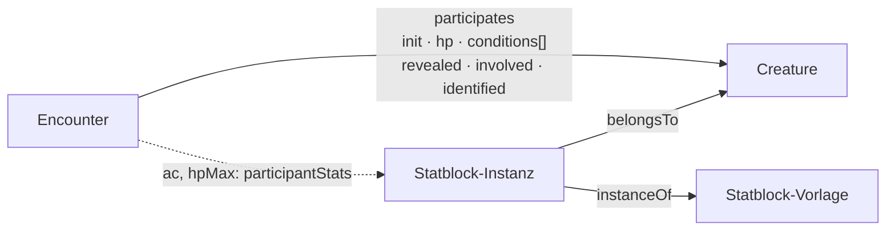

**Die Art einer Begegnung** (T-178): `Encounter.kind` hält Wörter aus der
Aufzählungszeile `EncounterKind` — `combat`, `social`, `puzzle`,
`exploration`, `hazard`, `trap`, `resource`, `story` —, mehrere zugleich,
weil ein Gespräch in einen Kampf kippt. Eine Zeile und keine Liste am
Feld: Zufallstabellen (Biom, Region, Reise) liefern Begegnungen jeder Art,
und die Oberfläche handelt je Art anders. Leer heisst „nicht gesagt“;
Migration 077 setzt `combat`, wo schon `participates` steht.

**Felder und Anzeige je Art** (T-184): was nur eine Art braucht, steht als
Feld an der Begegnung selbst und nicht an einer Art je Sorte — ein Rätsel
kann zugleich eine Falle sein.

| Art | Felder und Kanten |
|---|---|
| `combat` | `participates` (Initiative) |
| `puzzle` | `solution` (nur Leitung), `hint` (je Eintrag freigebbar) |
| `social` | `goal`; Beteiligte über `features`, ihre Haltung als `regards` an der Kreatur |
| `resource` | `check`; was zu holen ist über `loot` und `tableFor` |
| `trap`, `hazard` | die Gefahr als eigener Artikel (`Hazard`: Auslöser, Wirkung, Gegenmassnahmen) über `features`; `check` |
| `story` | Vorlesetext (`ReadAloud`) und Verweise im Text |

`Encounter.solution` und `Encounter.hint` stehen in `gmFields`: sie gehen
nicht an den Tisch, bis eine bekannte Information sie nennt — ein Hinweis
einzeln (`Encounter.hint#id`), also einer nach dem anderen.

Gezeigt wird je Art über **`when` am Element der Anordnung**
(`LayoutWhen`, `forArticle`): ein Element gilt, wenn das Feld einen der
Werte hält (`has`), leer ist und `empty` es zulässt, oder der Artikel eine
Kante der Art trägt (`relation`). Die Initiative steht bei `combat`, bei
Teilnehmenden und ohne Art (wie vor T-178); Lösung, Hinweise, Ziel und
Probe stehen oben nur bei ihrer Art. Was ein ausgelassenes Element
gezeichnet hätte, nimmt die Feldtabelle (`fields: 'all'`) — ein befülltes
Feld verschwindet nie. Die Karten-Seitenleiste zeigt die Art je Begegnung.

**Wer wo steht, und ein Hinweis mit einem Klick** (T-215): im Gespräch
(`social`) zeichnet das Element `standing` die Beteiligten — die Ziele von
`features`, die ein Gegenüber sein können (`Creature`, `Faction`) — mit
ihrer `regards`-Kante auf die Gruppen der laufenden Kampagne (Marken und
Grund). Das ist eine **Abfrage beim Lesen** (D8): der Server rechnet sie
beim Ausliefern als `refs.encounter.stances`, gesiebt wie jeder Artikel —
wen der Betrachter nicht sieht, der steht nicht da; eine Haltung zu einer
anderen Gruppe auch nicht. Geändert wird sie am Urteilenden, nicht an der
Begegnung. Bei `trap` und `hazard` zeigt eine Collection die beteiligten
`Hazard` in Kurzansicht. An jedem Hinweis steht für die Leitung
„Reveal to the party“: eine Information über diese Begegnung mit genau
`Encounter.hint#id`, den Gruppen zugeteilt (`/api/knowledge/of/:id/reveal`,
derselbe Weg wie „Reveal“ an der Karte); welche schon eine Gruppe kennt,
sagt `refs.encounter.revealed` (nur der Leitung). Migration 163 ergänzt
die Anordnung, wo sie `e-social` trägt.

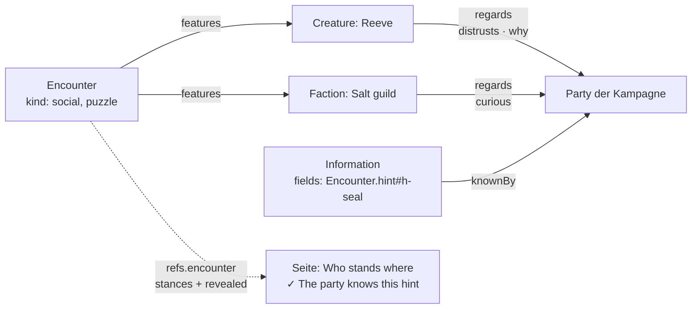

**Was vorbereitet ist: Ort, Karte, Beute und mehrere Kämpfer** (T-333):
eine Begegnung findet **an einem Ort** statt (`happensAt` → `Place`, wie
bei einer Szene), wird **auf einer Karte** gekämpft (`onMap`) und hat
**Beute** (`loot` mit `qty` und `chance`). Die drei stehen in der Anordnung
`full` als Collections (`e-place` in Kurzansicht, `e-map` als Liste,
`e-loot` als Tabelle mit Menge und Chance) — Elemente wie jedes andere, im
Ansichtsdesigner verschieb- und abschaltbar, und leer steht keines da.
Angelegt werden die Kanten unter „Edit“ › Relations; die Auswahl dort
bietet „Create … as …“ (T-131) an.

**Eine Anzahl ist so viele Kanten.** Vier Goblins sind vier
`participates`-Kanten auf denselben Statblock, nicht eine mit `count: 4`:
Trefferpunkte, Initiative und Zustände stehen an der Kante, und eine
Anzahl daran hiesse, vier Stände in einem Feld zu führen. Darum nimmt der
Tracker `count` (1 bis `MAX_ADD` = 20) nur beim **Hinzufügen** (`op:
'add'`) und legt so viele Kanten an, jede mit eigenem Initiativewurf und
durchgezählt am Tisch (`label` „Goblin 1“ … — weitergezählt nach der
höchsten Nummer, die schon dasteht). „Add a combatant“ bietet dabei
„Create … as …“ an. Migration 165 ergänzt `happensAt` und die Anordnung,
wo sie `e-yield` trägt.

Ob Szene und Begegnung **eine Art** werden, entscheidet E-118 — das hier
gilt in beiden Fällen.

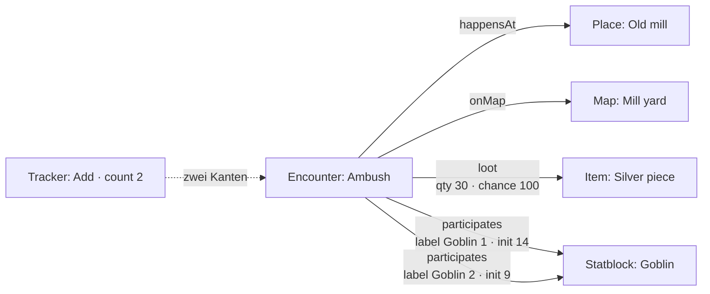

### 5.9 Zeitleisten und Spuren (D57, REQ-220)

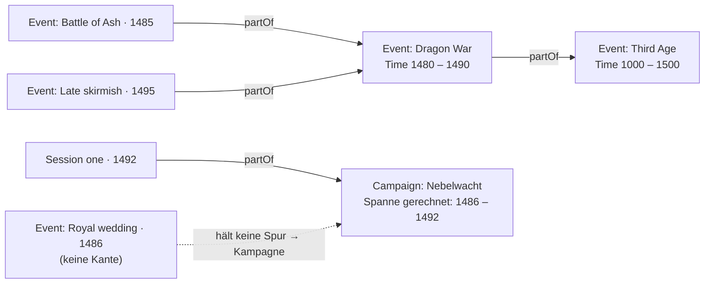

| | Regel | Geprüft durch |
|---|---|---|
| I1 | **RK und TP-Maximum stehen am Statblock** (der Instanz, mit der Vorlage darunter), `props.hp` ist der Stand. `props.hpMax` ist eine Abschrift aus der Zeit davor und gilt nur, wo kein Statblock hängt. | Modell (`participantStats`) |
| I2 | **Ein Eintrag in `props.conditions` trägt seine Dauer:** `rounds`, `anchor` (Id einer Teilnehmerkante derselben Begegnung) und `at` (`start`/`end`). Er zählt herunter, wenn der Zug des Ankers anfängt bzw. endet, und fällt bei null weg. **Ohne `anchor` der eigene Zug, ohne `at` das Ende** — so zählte der Bestand, und er bleibt gültig. Ohne `rounds` bleibt er, bis ihn jemand entfernt. | Modell (`tickEntries`) |
| I3 | **Gezählt wird ab jetzt:** das Ende des laufenden Zuges kommt noch, sein Anfang ist vorbei. Die Maske sagt beim Setzen, wann ein Eintrag abläuft. | Modell (`expiresAt`) |
| I4 | **Eine Notiz ist ein Eintrag mit `text` statt `rule`**, mit derselben Dauer. `hidden` hält einen Eintrag von den Spielenden fern. | — |
| I5 | **Spielende sehen die Gruppe und wer `revealed` oder `involved` ist**; ohne `identified` den Decknamen (`Identity.cover`) und keinen Verweis auf den Artikel; die Trefferpunkte aller ausser der Gruppe als Wort (`unhurt`, `bloodied`, `down`); `hidden`-Einträge und `props.note` nie. Zurückgehalten wird in `redactEntity`, nicht in der Maske. Wer getroffen wird, ist `involved`. | Modell (`redactParticipants`, in `redactEntity`) |

| I6 | **In der ersten Runde steht ein Gegner erst, wenn sein Zug gekommen ist** (REQ-226, D58): vor Runde 1 keiner, in Runde 1 sobald sein Zug beginnt, und dann bleibt er; ab Runde 2 gilt I5. Gemessen wird an der ganzen Reihe (`initiativeOrder`, wie der Prototyp sortiert) und an `Encounter.round`/`turn`. Wer nie aufgedeckt wurde, bleibt verborgen — ein Zug allein deckt weiter nicht auf. Verbündete (`ally`) und die Gruppe sind keine Gegner. | Modell (`turnHasCome`, `redactParticipants` mit `FightState`) |
| I7 | **Die Zugnummer geht nicht an Spielende**: `Encounter.turn` zählt die ganze Reihe und verriete, wie viele davor verborgen sind oder noch nicht erschienen. `redactEntity` lässt sie weg; wer dran ist, sagt die Marke `props.current` an diesem Teilnehmer — nur, wenn er gezeigt wird. | Modell (`redactEntity`) |
| I8 | **Der Tracker ist ein eigenes System, und die Kampagne stellt ihn ein** (T-022): `Campaign.combat` (`on`/`off`; aus heisst kein Tracker, weder für die Leitung noch für Spielende — Beginnen und Würfeln bleiben), `initNames` (`cover`: Deckname wie I5, `real`: Tischname, der Verweis weiter erst mit `identified`), `initHealth` (`none`, `coarse` = das Wort aus I5, `exact` = Zahlen), `initEffects` (`all`, `party` = Gruppe und Verbündete, `none`; `hidden` nie), `initActions` (die Namen der Regeln am Statblock, `composedOf`, für Spielende nur mit `shown`), `initColumns` und `initQuickActions`. Ohne Angabe gilt, was vor T-022 galt. Gelesen über `initiativeRulesOf`; die drei Sichtregeln gibt der Server `redactEntity` mit, also gelten sie in jeder Route und im Live-Kanal. | Modell (`initiativeRulesOf`, `redactParticipants` mit `PlayerViewRules`) |
| I9 | **Ein Zugwechsel zählt zweimal** (REQ-212): „Next turn" zählt das Ende des laufenden Zuges, dann den Anfang des nächsten (`tickEntries`, I2); nach dem letzten beginnt die nächste Runde. Zurück zählt nichts zurück — was abgelaufen ist, kommt nicht wieder. Dieselbe Zählung nutzt die Regelwirkung (T-275); was ein Zustand an RK oder Schaden tut, steht nicht hier. | Modell (`nextTurn`, `previousTurn`) |
| I10 | **Verzögern ist ein Ort in der Reihe, keine Marke** (REQ-128): wer dran ist, bekommt eine Initiative zwischen den nächsten beiden und rückt einen Platz nach hinten; der nächste ist dran. Ändert sich die Reihe sonst (Initiative, Teilnehmer dazu oder weg), bleibt dran, wer dran war (`turn` wird neu gesucht). Ein Entfernter nimmt seinen Anker mit: Einträge, die an seinem Zug zählten, zählen am eigenen. | Modell (`delayTurn`, `applyTrackerOp`) |
| I11 | **Den Tracker führt die Leitung; eine Spielerin beendet nur ihren eigenen Zug** (`POST /api/encounters/:id/tracker`, `next`, wenn die Figur ihres Kontos dran ist). Begonnen wird über „Start" (K15), nicht über den Tracker. Die Reihe kommt gerechnet (`trackerView`): für die Leitung aus der rohen Begegnung, für alle anderen aus der gesiebten — die Aktionen eines Unerkannten liest der Server vom rohen Statblock, nur Regeln, die der Betrachter sieht. | `apps/server/src/initiative.ts`, `trackerView` |
| I12 | **Ohne Stand ist ein Teilnehmer unverletzt** (T-334, D8): fehlt `props.hp`, gilt beim Lesen das Maximum vom Statblock — „22/22", nicht „?/22". Gespeichert wird nichts; der erste Schaden schreibt den Stand. Für Spielende gilt dasselbe, wo sie Zahlen sehen (Gruppe, `initHealth: exact`). | Modell (`trackerView`, `redactParticipants`) |
| I13 | **Den Zug frei setzen zählt nichts** (T-334): „Make current" (`turn` mit Kante), „Skip" (der nächste, nach dem letzten die nächste Runde) und „Back to top" (der erste, die Runde bleibt) setzen nur `Encounter.turn`/`round`. Effekte laufen allein beim regulären Zugwechsel (I9) ab — wer übersprungen wird, hatte keinen Zug, also endet an seinem Ende auch nichts. Zug x von y bekommt nur die Leitung (I7). | Modell (`setTurn`) |
| I14 | **Die Initiative ist ein Regelsystem** (T-334, E-100): `Campaign.combat` heisst „Initiative"; `on` ist das System „D&D 5e (standard)" (`INITIATIVE_SYSTEMS`), `off` kein Tracker. Ein System sagt, welche Knöpfe es kennt: „D&D 5e (standard)" kein Verzögern — es steht nicht im Grundregelwerk —, also bietet die Maske es nicht an, auch wenn `initQuickActions` es nennt, und der Server lehnt `delay` ab. `delayTurn` (I10) bleibt für ein Hausregelsystem (T-336). Die übrigen `init*`-Felder gelten unter dem System. | Modell (`initiativeRulesOf`, `initiativeSystemOf`) |
| I15 | **Eine Zeile klappt auf und zeigt, was der Teilnehmer kann** (T-334): die Abschnitte seines Statblocks wie im Buch (`bookSections`, Instanz mit Vorlage darunter) und seine Zauber (`casts`), mit Würfen im Text. Die Leitung bekommt sie für jeden; Spielende für die Gruppe und, mit `initActions: shown`, für erschienene Gegner — und nur Teile und Zauber, die sie sehen (`sieve` am Server). | `participantOptions`, `apps/server/src/initiative.ts` |

Offen: dass `bloodied` schon unter dem Maximum gilt und nicht erst ab der
Hälfte; ob ein Gegner, den die Gruppe in Runde 1 vor seinem Zug trifft
(`involved`), schon dann erscheinen soll (heute nicht — D58 wörtlich).
| Z1 | **Eine Spur ist ein Ereignis mit Spanne** (`Event`, `Time.sort` … `Time.untilSort`). Ein Ende vor dem Anfang ist keine Spanne. Eine neue Art gibt es dafür nicht: ein Krieg, eine Dynastie, ein Zeitalter sind Ereignisse, die dauern (`Event.kind` sagt, welche Sorte). | `isTrack` |
| Z2 | **Was in einer Spur liegt, sagt `partOf`**, nicht der Zeitraum (D57): die Schlacht ist Teil des Kriegs, der Krieg Teil des Zeitalters. Die Kante ist dafür auf `Event` verbreitert (`from`/`to`). Ein Artikel liegt in der **nächsten** Spur über seine Kette; ein Glied, das keine Spur ist oder nicht gesehen wird, wird übersprungen. | Kantenprüfung, `worldHistory` |
| Z3 | **Die Spanne prüft mit, sie ordnet nicht ein.** Was über die Kante drinliegt und ausserhalb fällt, nennt die Rechnung (`outside`) — die Leitung sieht es gestrichelt; verschoben oder abgelehnt wird nichts. | `worldHistory` |
| Z4 | **Eine Spur in einer Spur ist beides**: ein Balken in der äusseren und eine eigene Spur darunter. Ihr Inhalt steht nur in ihr. | `worldHistory` |
| Z5 | **Die Kampagne ist eine Spur.** Was keine Spur hält, gehört ihr (ausser es gehört über seine Ebene einer anderen Kampagne). Ihre Spanne ist ihre `Time`, sonst die ihres Inhalts — beim Lesen gerechnet (D8). Liegt sie selbst über `partOf` in einer Spur, hängt sie darunter. | `worldHistory` |
| Z6 | **Eine Achse für alle**: `sort` ist der Wert im Weltkalender (`World.calendar`), und alle Kampagnen einer Welt lesen so. | — |
| Z7 | **Welche Zauber eine Klasse lernen darf, ist die Kante `spellList`** (Class, Subclass → Spell, T-212) — die Zauberliste, nicht was jemand wirkt (`casts`) und nicht was er bekommt (`grants`: dessen Ziele brächten ihre Wirkungen ohne Bedingung an die Figur, `effectsAt`). Von der Unterklasse die erweiterte Liste (Paktgeber, Eldritch Knight); `props.optional` sind die Ergänzungen aus Tasha's, die eine Kampagne erlaubt oder nicht. Der Importer liest sie aus `generated/gendata-spell-source-lookup.json` (`arten/zauberlisten.ts`); auf einen bestehenden Bestand kommen sie über eine Massenänderung (`--spell-lists`, `scripts/zauberlisten-5etools.mjs`). Am Zauber ist „Class spell list" die erste Facette (`facet.order: 0`). | Kantenprüfung |
| Z7 | **Was man nicht sieht, steht nicht da**: Sichtbarkeit (`articleVisible`) zuerst; wessen Zeit man nicht weiss (eine unbekannte Information nennt `Time`), der steht nicht auf der Leiste — man wüsste nicht, wo. | `worldHistory` (`visible`, `dated`) |

Gezeichnet wird im Element `timeline` an der Kampagne, in zwei Reitern:
**Campaign** (die Liste der Kampagnenspur) und **World history** (die
Spuren auf einer Achse, je Spur ein- und ausblendbar, herangezoomt auf
eine; ein Klick auf einen Balken öffnet den Artikel).

Offen: der Kalender ist ein Name und keine Rechnung — `sort` tippt die
Leitung selbst, aus „Mirtul 12, 1492 DR" wird keine Zahl. Ein Zeitalter
als Hintergrund **über allen** Spuren (alles in seiner Spanne, ohne Kante)
gibt es nicht; es ist eine Spur wie die anderen.

---

## 6. Gerechnet, nicht gespeichert

Drei Dinge entstehen beim Lesen und stehen nie in den Daten (D8):

**Gerechnete Felder** (`derived`). `evalArith` ist ein Auswerter mit
Operatorvorrang, kein `eval`; Namen lösen **erst gegen die Nachbarfelder
derselben Karte, dann gegen die übrigen Karten des Artikels** auf, dazu
`mod(feld)`, `modOf(feld)` (der Modifikator des Attributs, das ein Feld
nennt), `sum(kante.feld)` (die Summe einer Kanteneigenschaft über die
eigenen Vorwärtskanten — die Stufe einer Figur aus `hasClass`, §5.7) und
die Formfunktionen `rowCount`, `colCount`, `cellCount`. Unsinn
ergibt `null`, nie eine irreführende 0. `of` lässt den Wert in der Zelle
des Nachbarn reiten. Der Rückgriff auf den Artikel ist für den Statblock
da: `prof` und das Zauberwirken stehen in seiner Karte, die sechs Werte in
`Abilities`, und der Zauber-SG braucht beide (§5.6). Was die eigene Karte
trägt, gewinnt immer; tragen zwei andere Karten denselben Namen
verschieden, hat die Rechnung keinen Wert.

**Variablen** `{VAR}`. Aufgelöst in dieser Reihenfolge, die erste Stelle
gewinnt: die Bindung an der Kante (`composedOf.props.vars`) → die eigene
Karte `Vars.bindings` → die gerechneten Kampagnenwerte (`{PARTY}`,
`{PARTYSIZE}`, `{PARTYLEVEL}`, `{PARTYTIER}`, `{PARTYWHERE}`, `{TODAY}`,
`{CALENDAR}`) → die Registerzeile `vars`. **Nie in den gespeicherten Text
eingesetzt**; ein unaufgelöster Platzhalter bleibt sichtbar stehen.
**Am Satzanfang schreibt ein eingesetzter Wert gross** (Textanfang oder
nach `.`, `!`, `?`, `:` und Zeilenumbruch; Hervorhebung zählt nicht) —
gespeichert bleibt die Bindung, wie sie ist. Darum **trägt ein
Platzhalter seinen Artikel**: das Merkmal heisst „{CREATURE} can breathe
air and water.", die Kante bindet `CREATURE` an „the dragon" oder
„Venomfang", und die Vorgabe an der Vorlage ist `Vars.bindings.CREATURE`
= „the creature". So teilen sich Drache, Riese und benannte Kreatur einen
Text (W1).

**Würfel** `{{1d6+2}}` (M12, REQ-070). Ein Ausdruck aus Würfeln und
Zahlen, `d` oder `W`; ein blosser Modifikator `{{+4}}` ist ein Wurf auf
den W20 mit diesem Bonus. Ein `{VAR}` darin wird zuerst aufgelöst
(`{{1d8+{STR}}}`). Gewürfelt wird beim Klick, ohne `eval` (`rollDice`);
was kein Ausdruck ist oder einen offenen Platzhalter hat, bleibt Text,
wie es dasteht.

**Das Tragraster und die Ziehstufe** (D54). Ein Inventar ohne eigene
Form, das eine Kreatur trägt, ist nach Basils Blatt 11 × 6: links das
Grundquadrat nach Grösse, rechts das Zusatzquadrat, das der Statblock als
`carryExtra` rechnet (`mod(str)`, geklemmt auf 0…5) — wie ein Angriff
seinen Treffer am Statblock rechnet. Was ein Stück zum Herausholen kostet,
wird die Behälterkette hinauf gerechnet:

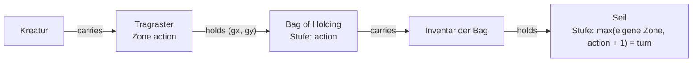

**Der Kalender** steht an der **Welt** (`World.calendar`), und jede Kampagne
hängt über `inWorld` an genau einer: alle Runden in derselben Welt lesen
ihre Weltdaten (`Time.sort`, `Time.display`) im selben Kalender, und
`{CALENDAR}` kommt von dort. Er war eine Einstellung je Kampagne und ein
Feld je Artikel (A11, 7.10.).

**Masse.** Eine Zahl steht in der Einheit ihres Feldes (`unit`); gezeigt wird
nach der Einstellung `units` (`imperial` · `metric` · `both`), die eine Art
überschreiben darf. Wie gerechnet wird, steht in der Zeile `units`
(`quantity`, `system`, `base` in der Grundeinheit); die Zieleinheit wählt die
Grössenordnung. In einem Text mit `measure` greift das Ausgangsmass nur für
Zahlen ohne Buchstaben — „7 zorp" bleibt sieben Zorp.

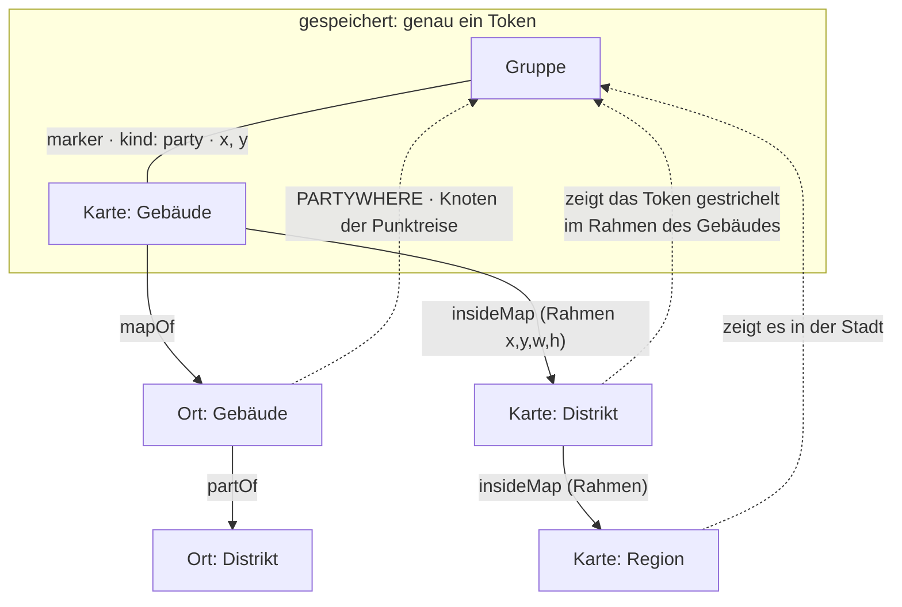

**Wo die Gruppe ist.** Genau eine Stelle: ihr Token (`marker`, `kind:
party`) auf der feinsten Karte, auf der sie steht. Der Ort ist die Marke,
auf der es steht, sonst der Ort der Karte (`mapOf`); der Knoten der
Punktreise ist dieser Ort oder der Knoten, in dem er liegt (`partOf`); jede
gröbere Karte bildet das Token durch den Rahmen ihrer Unterkarte ab
(`insideMap`), ohne ein zweites zu halten. Weiterziehen setzt das Token um.
`Party.at` war ein Feld daneben und ist seit dem 7.10. weg (A6).

**Wo eine Karte steht** (T-330, `locationPath` in
`packages/model/src/location.ts`): der Ort, den sie zeigt (`mapOf` auf einen
`Place` oder Untertyp — eine Geschichte ist kein Standort), sonst der Ort
ihrer Karte darüber (`insideMap`); darüber die grösseren Orte über
`partOf`, der nächste zuerst. Gerechnet beim Lesen, nichts gespeichert. Die
Kartenliste (`GET /api/maps`) liefert den Weg mit, gesiebt bis zum ersten
Ort, den der Betrachter nicht sieht; gruppiert wird nach dem nächsten Ort
(„Location") und dem äussersten („Region"). Die Kanten stehen als Listen da
(`LOCATION_RELATIONS`, `PLACE_PARENT_RELATIONS`): ein allgemeines
`locatedIn` (T-331, E-120) wird dort ein Eintrag.

**Die Karte in der Seite (T-115).** Gerechnet wird in
`packages/model/src/map.ts`, gezeichnet von `nw-karte` (Element `map` auf
der Artikelseite und Play › Map):

| | Regel | Wo |
|---|---|---|
| K1 | **Alles in Anteilen, das Gitter in Bildpunkten.** Marker (`x`, `y`), Rahmen (`x`, `y`, `w`, `h`) und Messpunkte stehen in 0–1 des Kartenbildes; das Gitter (`gridSize`, `gridOffsetX/Y`) in Bildpunkten des Bildes, weil man es dort misst. Gezoomt wird der Kasten, der genau so gross ist wie das Bild; bei Zoom 1 ist er so breit wie das Fenster. | `mapSettings`, `gridGeometry` |
| K2 | **Blätter:** das Kartenbild (`Image.image`) ist das unterste und bleibt auch ausgeblendet (`baseHidden`) im Fluss — durchsichtig, nicht weg; die Blätter aus `Map.sheets` liegen darüber. Ein- und ausschalten in der Leiste gilt nur für den Betrachter und wird nicht gespeichert. | `mapSheets`, `drawnSheets` |
| K3 | **Messen:** auf Quadraten jede zweite Diagonale doppelt (wie Z1), auf Hexfeldern die Hexdistanz, ohne Gitter gerade über die Feldgrösse; mal dem Massstab (`scale`, „1,5 m"). | `measure`, `cellAt`, `cellDistance` |
| K4 | **Hinein und hinaus zoomen:** füllt ein Rahmen den Blick zu `MAP_NEAR` (55 %) in beiden Richtungen, sagt er an; der nächste Schritt hinein betritt ihn. Ganz draussen führt der Schritt hinaus zur Karte darüber. Mit zwei Fingern dieselben Fragen am Ende der Geste. Mit dem Schloss (`locked`, REQ-132) nur näher und weiter. | `zoomStep`, `frameShare` |
| K5 | **Was neben einer Karte steht, ist eine Abfrage** (`GET /api/maps/:id/context`): die Karten darüber (Brotkrumen), die Unterkarten mit Rahmen (Gegenrichtung von `insideMap`), die Ziele der Marker (Name, Art, Bild) und die Gruppe (`partyPosition`). Gesiebt wie jede Liste. | `apps/server/src/karten.ts` |
| K6 | **Was auf dem Tisch liegt, sagt die Sitzung** (`SessionState.activeMap`): Play nimmt die gewählte Sitzung, sonst die jüngste mit Karte (`Time.sort`, dann Nummer). Hineinzoomen unter Play ändert die Sitzung nicht (`?map=`). Gelesen wird die Karte `Session`, die die Maske schreibt, und das ältere `SessionState` darunter (`sessionState`, T-202 — vorher nur `SessionState`, und die gesetzte Karte lag nie auf dem Tisch). | `GET /api/play`, `sessionState` |
| K7 | **Marker setzen und verschieben schreibt die Kante** (`marker`), nichts sonst — durch `validateEntity` und `PUT`, wie ein Board. | `addMarker`, `moveMarker` |
| K8 | **Nebel** (T-117, REQ-139): `Map.fog` schaltet ihn, `Map.reveal` hält die aufgedeckten Formen — `rect`, `circle`, `poly` und der Pinselstrich `path` (Linienzug mit Halbmesser `r`), alles in Anteilen; Kreis und Strich tragen das Seitenverhältnis `ar`, mit dem sie gezogen wurden, damit der Server ohne Bildgrösse prüfen kann. Zudecken nimmt die Formen weg, deren Mitte im Kasten liegt. Für Spielende hält `redactMap` die Marker unter dem Nebel zurück — ausser dem Gruppen-Token und den Figuren der Gruppe —, und der Kontext die Rahmen, von denen weder Mitte noch Ecke aufgedeckt ist. Das Bild geht ganz hinaus und wird im Browser zugedeckt (E-041). | `revealShapes`, `isRevealed`, `revealArea`, `coverArea`, `redactMap` |
| K9 | **Die Spielersicht der Leitung** ist dieselbe Rechnung (`redactMap` mit `gm: false`) im Browser — eine Vorschau und keine Schranke; zurückgehalten wird am Server. Gilt der Nebel je Figur, zeigt sie die Sicht der Figur, die unter „For“ gewählt ist (ohne Wahl nur das für alle Aufgedeckte). Gezeichnet wird der Nebel auf einer Leinwand, nicht mit einer SVG-Maske: `url(#…)` löst nicht jeder Browser unter `<base href>` auf (T-204). | `nw-karte`, `karten/nebel.ts` |
| K10 | **Spiel-Tokens** (T-117, REQ-135): „Place combatants" setzt je Teilnehmer der laufenden Begegnung ohne Token einen Marker `kind: play` in einem Block in die Mitte des Ausschnitts; „Clear play tokens" nimmt alle `play`-Marker weg. Sie liegen bis zu E-039 an der Karte wie jeder Marker und laufen über den Live-Kanal wie jede Änderung der Karte. Das Bild eines Tokens ist `Statblock.token` (über `belongsTo`, gesiebt), sonst `Image.image`, sonst die Anfangsbuchstaben des gesiebten Namens — für Spielende der Deckname (REQ-178). | `placeTokens`, `clearPlayTokens`, `apps/server/src/karten.ts` |
| K11 | **Wer dran ist** (REQ-144): der Kontext nennt die Begegnung auf dieser Karte (die eine Sitzung führt, `activeEncounter`, sonst eine laufende mit `onMap`) und die Artikel hinter dem laufenden und dem nächsten Teilnehmer (`turnOf`); das Token bekommt einen Ring, der Nächste einen gestrichelten. Spielende bekommen nur, was ihre Reihe zeigt (D53, D58): den Laufenden, wenn `current` an ihrer gesiebten Kante steht, den Nächsten, wenn seine Kante für sie dasteht — und beides nur für ein Token, das auf ihrer Karte steht. | `turnOf`, `apps/server/src/karten.ts` |
| K12 | **Ein Kartenbild wird beim Wählen zur Karte** (T-202): eine Auswahl, die `Map` verlangt (`Session.activeMap`), bietet auch Bilder der Klasse an, die `targets['Image.image']` an der Karte nennt (`imageBecomes`); gewählt, entsteht eine Karte mit Name aus dem Bild und dem Bild als `Image.image`, angelegt in der Schreibebene (`fromImage` → `mapFromImage` mit dem vorgeschlagenen Gitter, dieselbe Funktion wie „Use as map“ am Bild, T-201). | `maplist.ts`, `nw-wahl` |
| K13 | **Karten haben einen Ort** (T-202): Play › Maps (`GET /api/maps`) listet jede sichtbare Karte als Baum über `insideMap` (`mapTree`, eine Karte ohne sichtbare Obere steht oben), mit Bild, Marken und Ebenen; der Filter lässt die Karten über einem Treffer stehen. Wo eine Karte vorkommt (`GET /api/maps/:id/uses`, `mapUses`): Artikel, die sie in einem Feld halten (`Session.activeMap`), `onMap` auf sie und ihr `mapOf` — Marken und Unterkarten nicht; gesiebt. | `maplist.ts`, `apps/server/src/kartenliste.ts` |
| K14 | **Die Karte am Tisch sagt die Kampagne** (T-204, Regeloptionen „On the map“): `Campaign.fog` — `party` (alle sehen alles Aufgedeckte) oder `player`: eine Form darf `for` nennen (Figur oder Gruppe), dann sehen sie nur diese, ihre Gruppe und die Leitung; ohne `for` gilt sie allen. Der Server schickt jedem nur seine Formen und nimmt die Marker unter den übrigen heraus (`revealFor` in `redactMap`). `Campaign.moves` — ausserhalb eines Kampfes zieht eine Spielerin ihre Figur frei oder macht einen Vorschlag (ein Zugplan mit einem Schritt, gestrichelt), den die Leitung bestätigt; im Kampf gilt der Zugplan (T-198). Gezogen wird über `POST /api/maps/:id/move`, auch ohne Schreibrecht an der Karte. `Campaign.revealOnMove`, an der Karte überschreibbar (`Map.revealOnMove`): ein Zug deckt seinen Weg zwei Felder breit auf, `for` die Figur; die Bewegung zählt in beiden Fällen. | `mapRulesOf`, `revealFor`, `moveRevealRadius`, `zugplan.ts` (`wegAufdecken`) |
| K15 | **Vorplatzieren und Beginnen** (T-203): „Prepare“ in der Seitenleiste setzt die Teilnehmer einer nicht laufenden Begegnung als Spiel-Tokens mit `hidden` und `encounter` (die Begegnung) — Spielenden hält `redactMap` sie zurück wie jeden versteckten Marker, „Clear play tokens“ lässt sie stehen. „Start“ (`POST /api/encounters/:id/start`, nur die Leitung) setzt Runde 1, Zug 0, `phase: running`, würfelt die Initiative für jeden ohne (W20 plus Geschicklichkeit des Statblocks, ins Log; die der Gegner verdeckt), deckt die vorplatzierten Tokens dieser Begegnung auf und lässt die Sitzung sie führen (`activeEncounter`). | `prepareMarker`, `startPrepared`, `startEncounter`, `kampfstart.ts` |
| K16 | **Sperren** (T-118, docs/Karten.md › Sperren): `Map.walls` ist eine Liste, je Eintrag `kind` — `wall`, `door`, `secret`, `window`, `chasm` (Hindernis), `invisible` —, die Strecke `x1/y1/x2/y2` in Anteilen und an Türen `state` (`open`, `closed`, `locked`; der alte Schalter `open: true` wird gelesen). Was eine Art hält (Bewegung, Sicht, Licht), sind Daten (`WALL_KINDS`); eine offene Tür hält nichts. Spielende bekommen nur die Sperren am Aufgedeckten, eine geschlossene Geheimtür als Wand, eine verschlossene Tür als zu (`redactWalls` in `redactMap`); gezeichnet werden für sie nur die Türen. Ein Zug einer Spielerin durch eine Sperre, die den Schritt hält, wird abgelehnt; der Zugplan rechnet sie als Wände (`planGrid`). | `walls.ts`, `zugplan.ts` (`/move`), `planGrid` |
| K17 | **Türen und Sichtlinie** (T-118): `POST /api/maps/:id/door` schaltet eine Tür — die Leitung jede, Spielende auf und zu, wenn `Campaign.doors` `players` sagt, mit einer eigenen Figur höchstens anderthalb Felder davon; verschlossen bleibt zu (423). Hält auf einer Karte etwas den Blick, deckt ein Zug (mit `revealOnMove`) das **Sichtpolygon** von den Punkten seines Weges auf (höchstens sechs, `revealAlong`), und eine geöffnete Tür das der Gruppenfiguren, die sie sehen (`tuerAufdecken`) — jeweils als Form `poly` mit `for`. Ohne Sperren bleibt es der Pinselstrich; Licht und Dunkelsicht zählen noch nicht. | `visionPolygon`, `sightPolygon`, `sightReveal`, `tueren.ts` |
| K18 | **Licht und Dunkelsicht** (T-216, REQ-140, docs/Karten.md › Licht und Dunkelsicht): `Map.lighting` (`bright`, `dim`, `dark`; ohne Angabe hell) sagt, wie hell die Karte ist; ein Licht ist ein Marker mit `props.light` (hell) und `props.dim` (der ganze Radius), in Feldern; es reicht bis zur nächsten Sperre, die Licht hält. Die Dunkelsicht wird aus `senses` am Statblock gelesen (D8), ein Gruppen-Token sieht wie seine weitestsehende Figur. Im Dunkeln deckt ein Zug oder eine geöffnete Tür auf, was die Dunkelsicht reicht, und von jedem Licht den Teil, in den die Figur hineinsieht: als `poly` mit `within` (das Sichtpolygon als Klammer — gilt nur, wo es in beiden liegt). Die Seite zeichnet darüber die Dunkelheit und die **laufende Sicht** (das gerade Gesehene hell, das einmal Aufgedeckte gedämpft), im Browser gerechnet; der Kontext schickt dafür `darkvision` je eigener Figur. **T-305:** ein Gegenstand leuchtet mit `Item.lightBright`/`lightDim` (Fuss, dämmrig darüber hinaus) — als Marker selbst, in der Hand einer Figur (`inHand`) ihr Token, eine Gruppe wie ihr hellstes Mitglied; ein Radius an der Kante schlägt ihn, `marker.props.lightOff` macht jedes Licht des Markers aus; der Kontext schickt `lights` je Markerziel. Im Dunkeln ist, was nur die Dunkelsicht erreicht, **grau** (das Licht bleibt farbig). **T-219:** auf einer dunklen Ebene bekommen Spielende ein Spiel-Token nur, wenn eine eigene Figur auf dieser Ebene es sieht (`redactDark` am Server, nach `redactMap`); ohne eigene Figur dort bleibt die Ebene, wie sie ist. | `itemLight`, `carriedLight`, `carriedLights`, `setLightOff`, `mapLighting`, `mapLights`, `litAreas`, `darkvisionFor`, `figureView`, `revealSeenAlong`, `revealView`, `redactDark` |
| K19 | **Karteneditor** (T-304, docs/Karten.md › Zeichnen): eine Form (Linienzug, Linie, Rechteck, Ellipse, Polygon) wird beim Fertigstellen zu Strecken in `Map.walls` und ist kein eigener Eintrag; „Closed“ schliesst den Linienzug. Eine Tür trägt ihre Dicke `width` (Anteile der Breite, ohne Angabe `DOOR_WIDTH`) und wird als Viereck gezeichnet und geklickt; Sicht, Licht und Schritt lesen die Mittellinie. Eine Tür oder ein Fenster über einer Wand schneidet sie an ihren Rändern (Schalter, Vorgabe an); das Löschen bietet an, sie wieder zusammenzufügen. Eingerastet wird an Punkt, Gitterecke oder Linie, mit einem Fangradius in Bildschirmpunkten. Das Gitter setzt man auf der Karte (Ursprung, ein Feld abgreifen); geschrieben werden `gridShape`, `gridSize`, `gridOffsetX/Y`. | `mapdraw.ts` (`shapeOutline`, `outlineWalls`, `snapPoint`, `cutWalls`, `joinAround`, `moveWallPoint`, `gridFromCell`, `setGrid`) |
| K20 | **Gitter gestalten und Tokens am Gitter** (T-314, T-317): `Map.gridColor` (`#rrggbb`), `Map.gridOpacity` (0–1) und `Map.gridHidden` sagen, wie das Gitter aussieht; ausgeblendet misst und rastet es weiter. `Map.snapTokens` (Vorgabe an) rastet ein Token beim Loslassen so, dass sein Platz auf ganzen oder halben Feldern liegt. Der Platz ist `marker.props.size`, sonst die Grösse des Statblocks nach `Campaign.tokenSizes` (`rules`, `tinyHalf`), sonst ein Feld; der Zugplan bleibt bei ganzen Feldern (D58). | `gridStroke`, `tokenSpan`, `snapTokenCentre`, `setMarkerSize`, Migration 108 |
| K21 | **Wer Tokens zieht, sagt die Kampagne** (T-290, E-040): `Campaign.tokenMove` — `none` (nur die Leitung), `own` (die Figuren des Kontos, `app_user_actor`; Vorgabe), `party` (dazu die Gruppe der Kampagne und ihre Mitglieder, `memberOfParty`), `allies` (dazu, wer auf der Seite der Gruppe steht: im Kampf `participates.props.ally`, sonst Spielerfiguren) oder `all` (jedes Token, das der Betrachter auf seiner gesiebten Karte sieht). Jede Stufe nimmt die engere mit; die Leitung zieht immer. Ob ein Zug sofort gilt oder ein Vorschlag ist, bleibt `Campaign.moves` (K14) — keine zweite Einstellung für dieselbe Frage. Gefragt wird an einer Stelle (`mayMoveToken`), der Server rechnet die Mengen (`zieher`) und schickt der Seite, was sie ziehen darf (`movable` im Kartenkontext); geschrieben wird nur die Stelle des einen Tokens (`POST /api/maps/:id/move`). Im Kampf plant eine Spielerin **nur ihre eigenen Figuren** über den Zugplan (K28, seit T-325); `none` nimmt ihr den Plan der eigenen Figur nicht. Ein Vorschlag steht gestrichelt für jeden, der das Token sieht. | `mayMoveToken`, `zieher`/`darfZiehen` (`zugplan.ts`), Migration 109 |
| K22 | **Assets auf der Karte: fix oder verschiebbar** (T-306, docs/Karten.md › Assets): ein Asset ist ein Marker `kind: scenery` (Tokens › Add asset), er rastet nicht und darf dasselbe Ziel mehrfach zeigen. **Vorgabe fix:** `marker.props.movable` fehlt. In der **Bearbeitung** (Seite der Karte, wer sie schreibt) ist jedes zieh-, dreh- (`rot`) und skalierbar (`size`, `ratio`, Tokens › Asset); in **Play** bewegt sich nur, was `movable` ist — über `POST /api/maps/:id/move` an der offenen Karte (der Instanz, T-289), durch die Leitung immer, durch Spielende nach `mayMoveAsset` (`tokenMove` `party`, `allies` oder `all`, und Züge nicht mit Bestätigung — ein Vorschlag nennt eine Figur); der Kontext schickt `movableAssets` (Kanten-Ids). Ein fixes schiebt in Play niemand (403). **Sperren:** `marker.props.blocks` nennt eine Sperrart ausser Türen (`WALL_KINDS`); der gedrehte Umriss wird **beim Lesen** zu vier Sperren dieser Art (`assetWalls`, D8) und gilt für Schritt, Sicht und Licht (`blockingWalls`) — in `Map.walls` steht nichts davon. Das eigene Licht eines Assets leuchtet aus seinem Umriss heraus; ein gezogenes Asset hält sich nicht selbst. Licht am Asset wie an jedem Marker (K18). | `markerMovable`, `mayMoveAsset`, `assetCorners`, `assetWalls`, `blockingWalls`, `setAssetProps` |
| K23 | **Zwischen Karten wechseln in Play** (T-308, docs/Karten.md › Hineinzoomen): an einer Karte im Spiel sagt die Sitzung, ob Spielende zu einer anderen Karte zoomen dürfen (`Session.mapNavigation`, Vorgabe aus, `mapNavigationOn`). Aus: der Kontext schickt ihnen keine Brotkrumen und keine Rahmen (`navigation: false`). An: Rahmen und Brotkrumen nur auf Instanzen **derselben Sitzung**, die sie sehen — eine nicht freigegebene nimmt das Sieb (`heldBackMap`). Die Leitung navigiert immer, in die Instanz der Sitzung, sonst in die Vorlage. Was läuft, steht an der Sitzung, nicht an der Karte. | `GET /api/maps/:id/context`, `mapNavigationOn`, `sessionInstance` |
| K24 | **Ebenen einer Karte und Übergänge** (T-307, E-108, docs/Karten.md › Stockwerke und Portale): `Map.floors` ist eine flache Liste weiterer Ebenen — `id`, `name`, `structure` (Gebäudeteil), `elevation` ({from, to} in Fuss), `gmOnly`, eigenes `image` und dieselben Felder, die die erste Ebene an der Karte trägt (Gitter samt Massstab, Blätter, Sperren, `lighting`). Die erste Ebene ist die Karte selbst; bestehende Karten haben ohne Umschreiben genau eine (Migration 112). Nebel und Freigabe je Ebene stehen als Stand daneben (`Map.floorReveal`, `Map.floorReleased`). Ein Marker steht auf `props.floor`. Gerechnet wird je Ebene über die Projektion `floorView`/`withFloorView` — Sicht, Licht, Türen, Züge und Zurückhalten unverändert. Ein **Übergang** ist ein Marker `kind: passage` auf die Zielkarte mit `toFloor`, `toX`, `toY`, `passage` (`stairs`, `ladder`, `bridge`, `portal`), `sight` (`through`, `none`) und `oneWay`; in beide Richtungen steht am Ziel ein gespiegeltes Ende. Wer auf einem Ende mit Sicht steht, sieht auch vom Ziel aus, im Massstab der Zielebene. Durchgehen: `POST /api/maps/:id/move` mit `via`. Spielende bekommen keine Ebene mit `gmOnly` oder `floorReleased: false`, samt Markern und Übergängen dorthin. | `floors.ts` (`mapFloors`, `floorGroups`, `floorView`, `withFloorView`, `passageEnds`, `goThrough`, `sightInto`, `redactFloors`), `zugplan.ts`, `tueren.ts`, `kartenbild.ts`, Migration 112 |
| K25 | **Ein Licht ohne Artikel** (T-320, docs/Karten.md › Licht und Dunkelsicht): ein Marker `kind: light` zeigt auf seine eigene Karte (wie ein Übergang) und trägt `light`/`dim` in Feldern, `lightOff` wie jeder Marker. Kein eigener Artikel: eine Fackel an der Wand ist keiner. Spielende bekommen den Schein, keinen Marker; kein Token für `tokenMove` — ziehen tut es nur die Leitung (`POST /api/maps/:id/move` lehnt Spielende ab). | `lighting.ts` (`addLight`, `mapLights`), `zugplan.ts`, `karten.ts`, Migration 115 |
| K26 | **Werkzeuge je Kartentyp** (T-320, docs/Karten.md › In der Seite): `Campaign.mapTools` ist ein Objekt je `Map.kind` mit der Liste der Werkzeuggruppen (`walls`, `fog`, `light`, `grid`, `tokens`, `assets`, `frames`, `markers`). Eine Art, die fehlt, hat die Vorgabe (`defaultMapTools`: Kampfkarten Wände, Nebel, Licht, Gitter, Tokens, Assets, Marker; alle anderen Unterkarten, Marker, Assets); eine leere Liste heisst keine. Eine Karte ohne Art ist `region` (Vorgabe des Registers). Es ist eine Frage an die Leiste, keine Schranke: was auf der Karte steht, gilt weiter, und eine Gruppe, deren Inhalt an ist (Nebel an, Karte nicht hell), bleibt in der Leiste. Der Kartenkontext liefert die Gruppen der Art (`tools`). | `map.ts` (`mapKindOf`, `mapToolsOf`, `mapToolTable`, `withMapTool`), `ruleOptions.ts` (`mapTools`), `karten.ts`, Migration 116 |
| K27 | **Massstab je Feld und sauberes Hexmuster** (T-321, docs/Karten.md › Das Gitter auf der Karte setzen): `Map.scale` bleibt Text mit Zahl und Einheit („5 ft", „1 mi", „6 mi", frei), an der Karte und je Ebene (K24); gesetzt im Gitter-Werkzeug (`setGrid`, leer: Vorgabe „1,5 m"). **Umgerechnet beim Lesen** (D8): `scaleFeet` liest die Einheit aus dem Register (`units.ts`; ohne Register ft, mi, m, km), metrisch nach der Tischregel 1,5 m = 5 ft; ohne Längeneinheit `null`, dann 5 ft. Das Gitter trägt die Fuss je Feld (`GridGeometry.cellFeet`); Bewegungsraster (`planGrid`), Reichweite (`feetBetween`), Gelegenheitsangriffe und Reichweitenausgang (`per`), Licht und Dunkelsicht (`feetPerSquare`) rechnen damit. Bestehende Karten rechnen unverändert. Die Hexkachel zeichnet nur Kanten (`HEX_TILE_PATH`, `hexTileSegments`). | `map.ts` (`scaleFeet`, `scaleLabel`, `SCALE_PRESETS`, `gridGeometry`), `mapdraw.ts`, `zugplan.ts`, `lighting.ts` |
| K28 | **Der Zugplan ist ein Werkzeug der Karte, nur für Besitzende, und seine Stufe sagt die Kampagne** (T-325): `Campaign.turnPlanner` — `off`, `move` (nur Bewegung), `actions` (Bewegung, Aktion, Bonusaktion; keine Reaktion) oder `full` (Vorgabe: dazu Reaktionen — Gelegenheitsangriff, Angebote der Regeln, REQ-357). Jede Stufe nimmt die engere mit. Geplant wird **nur für die eigenen Figuren** (`app_user_actor`) mit Token auf der Karte, die Leitung für jede Kreatur mit Statblock; gesiebt am Server (`figuren` in `zugplan.ts`), eine Spielerin ohne eigene Figur bekommt nichts und sieht kein Werkzeug. Der Server bietet nur die Kacheln der Stufe an (`plannerTiles`), lehnt Schritte darüber ab (`plannerAllows`, 422) und fragt ohne `full` niemanden um eine Reaktion (`plannerReacts`). Auf der Karte ist „Plan turn“ eine Gruppe der einen Werkzeugleiste; Initiative und Party sind Panels aus derselben Leiste, die Stockwerkwahl steht unter Floors. | `turnPlannerOf`, `plannerTiles`, `plannerAllows`, `plannerReacts`, Migration 118 |
| K28a | **Ein bestätigter Zug wirkt am Tisch** (T-275): der Server würfelt den Angriff gegen die **gelesene RK** des Ziels (`creatureStats`), mit **Vorteil oder Nachteil** aus den Wirkungen beider (`attack` am Angreifer, `attacked` am Ziel — Dodge, Help, Hide, Zustände; `attacked.near`/`.far` nach Abstand) und auf **langer Reichweite** (`attackRollMode`, T-351) und der **Krit-Schwelle** des Angreifers; **die Reichweite prüft der Server** beim Einreichen (422 ausser Reichweite, gemessen vom Ende des Wegs davor) und beim Ausführen (ausser Reichweite kein Wurf) mit `rangeBand` — ohne Gitter prüft niemand; der Schaden geht **nach der Abwehr** ab (`damageAfterDefenses`: immun 0, resistent halb, verwundbar doppelt) — an der Teilnehmerkante der Begegnung (`participates.props.hp`) und, bei einer Spielerfigur oder ausserhalb einer Begegnung, an `Vitals` (zeitweilige zuerst). Konzentriert sich das Ziel (`Vitals.concentration`), würfelt der Server den KON-Rettungswurf gegen `concentrationDc` (E-128); misslingt er, endet die Konzentration. Alles steht im Ergebnis des Plans und im Würfellog (T-172). **Die allgemeinen Aktionen stehen einmal** (`COMMON_ACTION_CATALOGUE` in `actions.ts`): „Your turn" am Bogen und der Zugplan lesen dieselbe Liste und denselben Kostenleser (`turnTypeOf`, `costOf` daraus). Was eine Aktion an Zahlen ändert, ist eine Wirkung auf einem **Eintrag der Initiative** mit `action` (`dodge`: Nachteil gegen dich bis zum Anfang deines Zugs; `help`: Vorteil auf den nächsten Angriff des Ziels, Anker der Helfende; `hide`: Probe am Server, Vorteil auf den nächsten eigenen Angriff; `ready`: Notiz) — verbraucht beim Angriff, was die Regel so sagt (`spent: 'attack'`). | `actions.ts`, `damage.ts`, `zugplan.ts` (`trefferWurf`, `schadenAnwenden`, `aktionWirkt`) |
| K29 | **Übergänge als Fläche** (T-326, docs/Karten.md › Übergänge als Fläche): am Marker `passage` ein Vieleck `area` (am Ziel `toArea`) in Anteilen der Karte; ohne es ist ein Ende das Feld um seinen Punkt. Wer in der Fläche steht, steht am Übergang, sieht (mit `sight: through`) von der entsprechenden Stelle der Zielfläche und landet beim Durchgehen auf einem freien Feld der Zielfläche. Die Leitung schickt alle in der Fläche (`POST /api/maps/:id/passage`), auch durch ein Portal in die Instanz der Zielkarte für die Sitzung, die dann mitwechselt. Wer, wann im Kampf, Kosten (Bewegung, Aktion) und Bestätigung: Vorgabe `Campaign.passageTrigger`/`passageWhen`/`passageMove`/`passageAction`/`passageConfirm`, je Übergang `props.rules`. Im Kampf ist der Durchgang ein Schritt `kind: 'passage'` im Zugplan, dessen Kosten der Server rechnet. | `passages.ts` (`passageArea`, `inPassage`, `landingSpots`, `passageRulesOf`, `mayUsePassage`), `floors.ts` (`sightInto`, `goThrough`), `zugplan.ts`, `apps/server/src/uebergang.ts`, Migration 119 |
| K30 | **Kartenverknüpfung als Form, mit Zoomtiefe, Anzeige und Rand** (T-327, docs/Karten.md › Verknüpfung als Form): an `insideMap` darf ein Vieleck `area` stehen (in Anteilen der Karte darüber; `x`/`y`/`w`/`h` bleiben sein Kasten, auf den das Bild der Unterkarte gelegt wird), `near` (Zoomtiefe als Anteil des Blicks, Vorgabe `MAP_NEAR` 0,55), `show`/`showPlayers` (`jump`, `frame`, `icon`, `hidden`) und `outer` (`faded`, `none`). Ohne Angabe gilt die Kampagne (`mapLinkShow`, `mapLinkShowPlayers`, `mapLinkOuter`), sonst `jump` und kein Rand. Der Kartenkontext schickt je Unterkarte die Anzeige, die für den Betrachter gilt, die eigenen Angaben nur der Leitung, und `outer`: die Karte darüber mit dem Bild, wie der Betrachter es bekommt (unter Nebel beschnitten), nur wenn sie unter seinen `parents` steht. Die Lage rechnet die Seite (`outerPlacement`, D8). | `maplinks.ts`, `map.ts` (`zoomStep`, `frameNear`), `karten.ts`, Migration 120 |
| K31 | **Unterkarte am Raster darüber ausrichten** (T-329, docs/Karten.md › Gitter über den Massstab): an `insideMap` der Schalter `align`. Mit ihm folgt die Grösse des Bereichs aus beiden Massstäben (`alignedSize`, Fuss je Bildpunkt; Bildgrösse aus `Asset.width`/`height`), die Lage rastet am Raster der Karte darüber ein (Quadrat: Ecke an Gitterecke; Hex: Mitte in Hexmitte), eine Form wird mitgestreckt — gerechnet beim Lesen (D8), `x`/`y`/`w`/`h` bleiben die freie Lage und Grösse. Ohne Länge in einem Massstab (`1 day`) oder ohne Bildgrösse nicht (`alignIssue`). Strecken zwischen Karten: `convertDistance`, Gesamtstrecke über Karten `routeFeet`. | `mapscale.ts`, `map.ts` (`partyPosition` mit `frameFor`), `karten.ts`, Migration 121 |
| K32 | **Marker zwischen Kartenstufen** (T-328, docs/Karten.md › Marker und Tokens zwischen Kartenstufen): die Marker einer Unterkarte (`static`, `quest`, `play`; erste Ebene) erscheinen auf der Karte darüber an ihrer umgerechneten Lage (`liftMarkers`, über die geltende Verknüpfung), bei mehr als sechs als Bündel mit Zahl — gerechnet beim Lesen (D8), gesiebt wie beide Karten. Ein Marker der Karte darüber im Bereich einer Unterkarte ist dort ein Vorschlag „To place" (`placementSuggestions`, nur Leitung); bestätigt wandert er hinunter (`confirmPlacement`: unten neu, oben weg), mit `stay` an der Kante `marker` bleibt er oben gemeint. Keine zweite Kopie. |
| K33 | **Markeransicht wählbar** (T-214, docs/Karten.md › Markeransicht): ein Marker steht als `symbol` (Anfangsbuchstaben), `name` (Symbol mit Namen), `image` (Token oder Bild, sonst Symbol) oder `card` (die Ansicht `quick` des Ziels als kleine Karte). Die genaueste Angabe gilt: `marker.props.view`, `Map.markerView`, `Campaign.markerViews[Map.kind]`, `InterfaceDef.markerView` der Art des Ziels (die `extends`-Kette hoch geerbt), sonst `image` — so standen Marker vorher, bestehende Karten ändern sich nicht. Assets (`scenery`) und freie Lichter fragen nicht. Die Vorgabe der Art liefert der Kartenkontext je Ziel (`targets[id].view`), die der Kartenart als `kindMarkerView`; die Karte zeichnet daraus, zurückgehalten wird wie bei jedem Marker am Server. | `map.ts` (`markerViewOf`, `markerViewForType`, `mapMarkerViewOf`, `kindMarkerViewOf`, `withMarkerView`, `withMapMarkerView`, `withKindMarkerView`), `ruleOptions.ts` (`markerViews`), `karten.ts`, Spalte `interface_def.marker_view`, Migration 133 |
| K34 | **Notizen auf der Karte sind Artikel** (T-214, E-070 a, docs/Karten.md › Notizen): Art `Note` (Bereich `play`, `Identity`, `Description` als „Text“, `Status`, `Visibility`, `Tags`; `markerView: 'card'`). Notes › Add note legt sie an (Name: die erste Zeile, `noteName`; Sichtbarkeit `gm` oder `players`; Stand `ready`) und setzt einen gewöhnlichen Marker auf sie — verschoben, entfernt und eingestellt wie jeder Marker. Kein Text an der Kante: so hat die Notiz Ebene, Stand, Verweise und Sichtbarkeit wie jeder Artikel, und zurückgehalten wird sie am Server wie jeder (`redactMap` nimmt den Marker, das Sieb den Namen im Kartenkontext). | `Note` in `interfaces.ts`, `noteName` (`map.ts`), `karte.ts` (`notizAnlegen`), Migration 134 |
| K35 | **Zonen und Gebiete auf der Karte** (T-219, REQ-193, docs/Karten.md › Zonen und Gebiete): die Kanten `zone` (auf eine `ZoneKind`) und `territory` (auf irgendeinen Artikel) tragen eine Form in Anteilen — `rect` (`x`, `y`, `w`, `h`), `circle` (`r`) oder `poly` (`pts`) — und wie ein Marker ihre Ebene (`floor`, leer: das Erdgeschoss). Gezeichnet wird **aufs Gitter gerastert**: ein Feld gehört dazu, wenn seine Mitte in der Form liegt — dieselbe Regel wie das Gelände im Zugplan (Z3); ohne Gitter steht die Form selbst da, über `AREA_CELL_LIMIT` Feldern auch. Die Farbe ist `territory.color`, sonst sagt sie die Regel der Zone (Dunkelheit, Schaden, Gelände, Licht), ein Gebiet ohne Farbe bekommt einen Farbton aus der Id seines Herrn. Spielende bekommen keine Fläche auf einen Artikel, den sie nicht sehen, keine versteckte Zone (`hiddenUntil` an der Art, `found` an der Kante noch nicht) und unter dem Nebel nur, was davon aufgedeckt ist (`redactMap` mit `hideZone`). Name und Regel der Ziele schickt der Kontext (`areas`), gesiebt. Gezogen wird in der Gruppe *Zones*: Rechteck, Ellipse (als Vieleck) oder Vieleck auf eine Zonenart oder Fraktion (`addArea`); `found` gilt je Kante (`setAreaFound`), *Remove* nimmt nur die Kante (`removeArea`, `areaAt`). | `areas.ts` (`mapAreas`, `addArea`, `areaAt`, `removeArea`, `setAreaFound`, `areaCells`, `cellCorners`, `areaColor`, `zoneRuleSummary`, `zoneHidden`), `shapeRevealed`, `redactMap`, Migration 164 |

**Der Zug auf der Karte (D56, REQ-206–210; Grössen D58, REQ-224).** Gerechnet wird beim Lesen,
gespeichert nur, was danach gilt:

| | Regel | Wo |
|---|---|---|
| Z1 | **Diagonalen 5-10-5 je Kreatur und Zug** (D52). Die Parität gehört zum Suchzustand des Weges (Dijkstra über Feld × Parität), läuft über Wegpunkte und über mehrere Bewegungen desselben Zuges weiter und fängt mit jedem Zug neu an. Wände (`blocksMove`) halten den Schritt von Feldmitte zu Feldmitte, eine Ecke hält mit; Gegner sind nicht passierbar, Verbündete passierbar, aber kein Ziel. | `packages/model` `movement.ts` (`cheapestPath`, `pathVia`, `reachable`), Prototyp `moveGrid` |
| Z2 | **Das Tempo des Zuges ist eine Zahl** und steht im **Sitzungszustand** (`SessionState.moves`: `token`, `turn`, `speed`, `used`, `parity`), nicht an der Kreatur. Die Kurzwahl (Grundtempo, Spurt ×2, Klettern/Schwimmen mit eigenem Tempo oder ½) setzt nur die Zahl (`speedPresets`); jede weitere Ausnahme ist eine andere Zahl. Ein Eintrag mit einem anderen `turn` gilt als frisch (`currentMove`). | Modell, Prototyp `turnKey` |
| Z3 | **Eine Zonenart ist ein Regelartikel** (`ZoneKind` erbt von `Rule`), wo sie liegt, sagt die Kante `zone` (Form wie `territory`, aufs Gitter gerastert). Gerechnet werden `moveCost` (Faktor auf das betretene Feld), `light`, `obscured` und `hiddenUntil` (versteckt bis passive Wahrnehmung n, `zone.props.found`); gezeigt und beim Betreten in `SessionState.log` geschrieben werden Schaden, Rettungswurf, Zustand und die Beschreibung als freie Regel. | Prototyp `zonesAt` |
| Z4 | **Gesehen wird mit Sichtlinie, Licht und passiver Wahrnehmung** gegen `marker.props.stealth` (−5 im Dämmerlicht und in leicht verdeckten Feldern, im Dunkeln nur mit Dunkelsicht). Dieselbe Prüfung dient dem Aufdecken von Hand („sees / seen by“) und **entlang des bestätigten Pfads**, Schritt für Schritt; dabei weicht auch der Nebel im Sichtkreis. | `sight.ts` (`notices`, `lightAt`), Prototyp `sightCheck` |
| Z5 | **Versteckt ist eine Angabe an der Kante** (`marker.props.hidden`): Spielende sehen versteckte Tokens und unentdeckte Zonen nicht, und der Weg, den sie sich rechnen lassen, kennt nur, was sie sehen. **Zurückgehalten wird am Server** (T-115): `redactMap` nimmt aus einer Karte für alle, die sie nicht leiten oder schreiben (`seesUnfinished`), versteckte Marker, Marker auf Artikel, die sie nicht sehen (`articleVisible`), die Kante zu einer Karte darüber, die sie nicht sehen, die Blätter mit `gmOnly` und mit `baseGmOnly` das Kartenbild selbst. Unentdeckte Zonen noch nicht. | `map.ts` (`redactMap`, im Sieb des Servers), Prototyp `tokenShown` |
| Z6 | **Eine Kreatur nimmt Felder nach ihrer Grösse ein** (D58, REQ-224, Regeln 2014): tiny, small, medium ein Feld — tiny darf es teilen (es hält Verbündete nicht ab, und es darf auf ihnen stehen) —, large 2 × 2, huge 3 × 3, gargantuan 4 × 4. Die Grösse wird **beim Lesen** vom Statblock genommen (`Statblock.size`; eine Instanz über `resolveInstance`), nicht am Token gespeichert (D8); ohne Statblock oder Grösse ein Feld. Gezeichnet wird das Token in der Grösse seines Platzes; nur was keine Kreatur ist, behält die Breite an der Kante (`marker.props.size`). | `sizeSpan`, `statblockSize`, Prototyp `tokenSpan` |
| Z7 | **Welche Zauber eine Klasse lernen darf, ist die Kante `spellList`** (Class, Subclass → Spell, T-212) — die Zauberliste, nicht was jemand wirkt (`casts`) und nicht was er bekommt (`grants`: dessen Ziele brächten ihre Wirkungen ohne Bedingung an die Figur, `effectsAt`). Von der Unterklasse die erweiterte Liste (Paktgeber, Eldritch Knight); `props.optional` sind die Ergänzungen aus Tasha's, die eine Kampagne erlaubt oder nicht. Der Importer liest sie aus `generated/gendata-spell-source-lookup.json` (`arten/zauberlisten.ts`); auf einen bestehenden Bestand kommen sie über eine Massenänderung (`--spell-lists`, `scripts/zauberlisten-5etools.mjs`). Am Zauber ist „Class spell list" die erste Facette (`facet.order: 0`). | Kantenprüfung |
| Z7 | **Gespeichert ist die Mitte des Platzes, gerechnet über seine Ecke.** `marker.props.x/y` ist die Mitte (bei einem Feld die Feldmitte wie bisher, bei 2 × 2 eine Rasterecke); der Rechner sucht über den **Anker** — das Feld oben links (`anchorAt`, `footprintCentre`). Ein Klick oder ein Ziehen meint die Mitte: bei 2 × 2 setzt er den Platz auf die nächste Rasterecke. | `movement.ts`, Prototyp `tokenAnchorAt`, `anchorMid` |
| Z8 | **Der ganze Platz muss passen und jeder Schritt für jedes seiner Felder gehen**: kein Feld ausserhalb, gesperrt oder unbetretbar (Faktor `Infinity`), keine Wand quer durch den Platz, und keine Wand, die den Schritt für eines seiner Felder hält (Ecke hält mit). Andere Kreaturen sperren mit ihrem **ganzen Platz** (Gegner) bzw. sind dort kein Ziel (Verbündete); die Reichweite eines Gegners (Meiden) ist der Ring um seinen ganzen Platz, 5 ft (`footprintRing`). **Ein Schritt kostet nach dem teuersten Feld, das er neu betritt** (D58) — nicht nach der Summe und nicht nach Feldern, die der Platz schon belegt. 5-10-5 bleibt. | `cheapestPath` (`MoveGrid.span`, `share`) |
| Z9 | **Gesehen wird vom ganzen Platz zum ganzen Platz**: von irgendeinem Feld des eigenen zu irgendeinem Feld des Ziels; gilt das erste Paar, das sieht, sonst das, das am weitesten kam (`bestNotice`). Dasselbe beim Aufdecken entlang des Pfads; der Sichtkreis im Nebel geht von der Mitte des Platzes aus, um seine halbe Breite weiter. | `sight.ts` (`pairsOf`, `spaceLineOfSight`, `bestNotice`), Prototyp `sightFrom` |

Dazu die beiden Abfragen, die wie Daten aussehen: die **Gegenrichtung einer
Kante** (`backlinks`) und **was gerade gilt** (§8).

---

## 7. Vorlage und Instanz

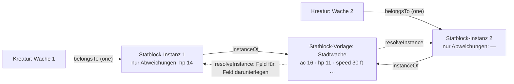

Ein Statblock darf aus einer **Vorlage** lesen: die Kante `instanceOf` zeigt
auf sie, gespeichert wird an der Instanz **nur, was abweicht**, gelesen wird
beides zusammen (`resolveInstance`), Feld für Feld.

| | Regel |
|---|---|
| V1 | **Gleich wie die Vorlage heisst: folgt der Vorlage.** Beim Speichern fällt weg, was gleich steht (`thinInstance`); den Wert der Vorlage eintragen oder das Feld leeren heisst, ihr wieder zu folgen. |
| V2 | **Kanten nach Art:** die Aktionen der Vorlage (`composedOf`) kommen mit, solange die Instanz keine eigenen hat; eine geänderte Liste gehört ganz ihr. |
| V3 | **Nicht vererbt:** `Identity`, `Visibility` und die Kanten, die zur Vorlage als Artikel gehören (`inLayer`, `belongsTo`, `overrides`, `variantOf`) — dazu, was ein **Stück** trägt (`carries`, `PIECE_RELATIONS`, T-150): zwei Rucksäcke aus einer Vorlage haben nicht denselben Inhalt. Anders als `inLayer` ist `carries` eine Abweichung: ein Behälter mit eigenem Inhalt folgt der Vorlage nicht mehr (`followsTemplate`) und bildet keinen Stapel. |
| V4 | **Eine Vorlage darf selbst Instanz sein**; gelesen wird die Kette hoch, ein Kreis bricht ab. |
| V5 | **Instanzen stehen an ihrer Kreatur oder in ihrem Inventar und sonst nirgends** — nicht in Listen, nicht als Verweisziel. Ausnahme V8. |
| V6 | **Löschen nimmt nichts weg:** geht die Vorlage, bekommen die Instanzen vorher, was sie lasen (`detachInstance`); geht die Kreatur, geht ihre Instanz mit. |
| V7 | Am Server kommt eine Instanz aufgelöst an, mit `fromTemplate` (Vorlage, geerbte Felder) — nur gelesen, nie gespeichert. |
| V8 | **Eine Karte oder Begegnung im Spiel ist eine Instanz** (T-289, E-039): Tokens, Nebel (`Map.reveal`), Freigabe (`Map.released`) und Kampfstand stehen an ihr, wann und wo an `Played`. **Sie steht in genau einer Liste: „Played" an ihrer Vorlage** (`playedOf`) — ein gespielter Stand ist etwas, das man wiederfinden will, und zwar dort, wo man nach der Karte sucht; in Kompendium, Kartenliste und Suche steht sie nicht. Für Spielende ist eine Karteninstanz bis zur Freigabe nicht vorhanden (`heldBackMap` in `articleVisible`). |

Welche Arten Vorlagen haben dürfen, sagt die Kante (`instanceOf.from`/`to`),
heute `Statblock`, `Item` (M4: das +1-Langschwert am Tisch ist eine
Instanz des Langschwerts), `CraftingOrder`, `Map` und `Encounter` (T-289),
und `to: same` hält die Instanz in der Art ihrer Vorlage. Ein eigener Typ
dafür wäre derselbe Typ ein zweites Mal.

**Eine Karte oder Begegnung im Spiel** (T-289, `playinstance.ts`):
`newPlayInstance` legt sie beim Nutzen an — wie ein Stück, dazu `Played`
(`playedAt`, `playedIn` → Sitzung), die Sichtbarkeit der Vorlage und an
einer Karte `Map: {fog: true, reveal: [], released: false}`; eine
Begegnungsinstanz zeigt mit `onMap` auf die Karteninstanz. Die Tischrouten
lesen sie aufgelöst (`resolvePlay`), geschrieben wird ausgedünnt wie jede
Instanz. Die Marker der Vorlage liest sie, bis sie eigene hat (V2: Kanten
je Art) — dann stehen alle an ihr. Siehe [Karten.md › Karten und
Begegnungen im Spiel](Karten.md#karten-und-begegnungen-im-spiel-t-289).

**Was eine Figur in die Hand bekommt, entsteht als Instanz** (T-150, zuerst
beim Kauf, T-133): `newInstance` legt den Artikel an — `instanceOf` auf den
Grundartikel, `inLayer` in die Ebene der Kampagne, `Identity` mit dem Namen
der Vorlage und einer neuen Nummer, `Status: ready`, sonst nichts. Eine
Funktion für alle Wege, und eine fürs Einlegen (`receivePiece`): liegt ein
loser Stapel desselben Grundartikels da, wächst er, sonst kommt eine neue
`holds`-Kante auf das neue Stück. `followsTemplate` sagt, ob eine Instanz in
nichts abweicht — dann ist sie ein beliebiges Stück und darf einen Stapel
bilden. Am Server legt `stueckWerkstatt` (`apps/server/src/stueck.ts`) die
Stücke einer Anfrage an und nimmt sie zurück, wenn das Inventar danach
nicht geschrieben werden kann. Die Wege:

| Weg | Wo |
|---|---|
| Kauf (T-133) | `POST /api/shops/:id/buy` |
| Handwerk, der Ertrag bei Erfolg (T-128) | `abrechnen` in `handwerk.ts` |
| Startausrüstung (T-096) | `POST /api/entities/:id/equipment` |
| **Geben** — Beute, Geschenke, „Add an item" am Inventar | `POST /api/inventories/:id/give` (`{ item, qty }`): die Leitung der laufenden Kampagne in jedes Inventar, das sie sieht, sonst wer das Inventar schreibt; der Gegenstand muss sichtbar sein. Protokoll `inventory.given` |

Wer ein Stück **weitergibt** (verschieben zwischen Figur, Gruppe und
Behälter, `moveHeld`), gibt dieses Stück — eine Instanz einer Instanz
entsteht nie. **Material zählt nach dem Grundartikel** (`baseArticle`): das
Rezept braucht „Eisenbarren", der gekaufte Barren ist eine Instanz davon.
Reservierte Stücke (T-134) bleiben gesperrt; die Reservierung steht an der
Kante und nicht am Gegenstand.

**Der Bestand vor T-150** (Migration 067): jede `holds`-Kante, die direkt auf
einen Gegenstand zeigte, zeigt danach auf ein eigenes Stück — Name, Art und
Sichtbarkeit des Gegenstands, eine neue Nummer, `ready`, in den Ebenen
seines Inventars, verfasst von dem, der das Inventar verfasst hat. Menge,
Lage und Reservierung bleiben an der Kante. Ein Behälter mit eigenem Inhalt
und ein Ziel, das kein Gegenstand ist, bleiben und werden aufgezählt.

---

## 8. Ebenen und Stapel

| Zeile | Was sie sagt |
|---|---|
| Artikelart `Layer` | `kind` (`system` · `expansion` · `book` · `adventure` · `world` · `pack` · `campaign` · `overrides` · `group`), `order`, und die **Beschreibung** (T-088, REQ-245): `abbreviation` (das Kürzel, unter dem ihre Artikel die Quelle nennen, „XGE"), `published`, `author`, `version` (Regelstand, „2014"), bei Abenteuern `levels` und `storyline`; der volle Titel ist der Name. An einer Gruppe sagt `groupBy` (`category` · `publisher`, T-094), wonach sie ordnet (E10). `kind` ist **Beschreibung**, keine Regel — ausser `group` (E8): eine Gruppe enthält Ebenen. Die Ausfuhr lässt `system`/`expansion`/`book`/`adventure` als Regelwerk weg. |
| Kante `partOf` (Layer → Layer) | die Ebene gehört zu dieser **Gruppe** (E-022 b, T-088); eine Ebene darf in mehreren sein, eine Gruppe in einer Gruppe |
| Kante `inLayer` (`*` → Layer) | der Artikel liegt in dieser Ebene; `props.mode` `adds` (Vorgabe) oder `removes` |
| Kante `activates` (Campaign → Layer, „Layers in play" / „In play in") | die Kampagne schaltet die Ebene auf; `props.order` ordnet, sonst `Layer.order`. Gepflegt auf der Kampagnenseite (Häkchen, und die Reihenfolge unter „Order in play" zum Ziehen, T-188; `PUT /api/campaigns/:c/layers`) |
| `activates` mit `props.mode: 'compare'` | **Vergleichsebene** (T-092, E-021 d): nicht im Spiel, ihre Fassungen stehen auf Wunsch an den Feldern und lassen sich übernehmen. Eine **Gruppe** zum Vergleich vergleicht ihre Mitglieder, verschachtelt, soweit sie nicht im Spiel sind (`playStack`, T-143). Zählt nicht für `activeStack`, `campaignsOf`, `campaignsActivating` und die Ausfuhr. Gepflegt auf der Kampagnenseite und im Popup der Kopfleiste (`PUT /api/campaigns/:c/compare`) |
| `activates` mit `props.mode: 'off'` | **ausdrücklich aus** (T-088): die Ebene ist nicht im Spiel, auch wenn eine aufgeschaltete Gruppe sie brächte. Ohne Gruppe tut die Kante nichts. Gepflegt auf der Kampagnenseite (`PUT /api/campaigns/:c/layers` mit `off`) |
| `activates` mit `props.areas` / `props.types` | **was die Ebene bringt** (T-105, REQ-255): Bereiche (`area` der Art, geerbt) und einzelne Arten; ein Artikel passt, wenn seine Art genannt ist oder ihr Bereich. Ohne beide: alles. Gilt an aufgeschalteten Ebenen, an Gruppen (die Mitglieder tragen die Auswahl ihrer Gruppe, eine ausdrückliche Kante ihre eigene) und an Vergleichsebenen. Gepflegt auf der Kampagnenseite (`PUT /api/campaigns/:c/layers/:layer/only`) |
| `activates` mit `props.exempt` | **von den Typ-Regeln ausgenommen** (T-187): die Ebene bringt alles, auch wenn eine Regel ihrer Gruppe weniger sagt. Gepflegt an derselben Stelle wie die Auswahl (`PUT …/layers/:layer/only` mit `{ exempt }`) |
| Kante `layerRule` (Campaign → Layer, „Type rule for") | **Typ-Regel über viele Quellen** (T-187): `props.areas`/`props.types` an einer **Gruppe** gelten für jede Ebene darin, die im Spiel ist und selbst nichts sagt — „aus allen Abenteuern nur Regeln, Gegenstände und Zauber", einmal statt je Buch. Gepflegt an der Gruppe auf der Kampagnenseite (`PUT /api/campaigns/:c/rules/:group`, leer nimmt sie weg) |
| Kante `enables` (Campaign → `*`, „Extra content") | **ein einzelner Artikel ist im Spiel**, auch wenn seine Ebene es nicht ist (T-187) — Extra-Inhalt aus einer Vergleichsebene. „Enable in campaign" am Artikel (`PUT /api/campaigns/:c/enabled/:id`), zurück an derselben Stelle oder unter „Extra content" auf der Kampagnenseite (`DELETE …`) |
| Kante `prefers` (Campaign → `*`, „Prefers") | **welche Fassung derselben Sache Listen und Verweise zeigen** (T-403, E-111 a): an einem Artikel „Prefer this version" (in den Fassungen am Artikel und in „Articles and their layers"), an einer Ebene mit `props.types` „First for some types" unter Order in play; `props.over` nennt, worüber (eine Ebene oder einen Artikel), ohne: über alles. `PUT /api/campaigns/:c/prefers { to, over?, types? }`, `DELETE …/prefers/:to?type=` — nur die Leitung (`manage`) |
| Feld `Campaign.compareFor` | wer die Vergleichsebenen sieht: `gm` (Vorgabe — Verwaltung, `gm`, `co-gm`) oder `players` (jede Rolle am Tisch) |
| Kante `overrides` (`*` → `*`, one) | der neue Artikel gilt statt des alten, solange seine Ebene läuft. **So passt eine Kampagne ein Abenteuer an** (E-018 a, T-082): „Adapt" (`POST /api/entities/:id/adapt`, `adaptedVersion`) legt eine Fassung mit denselben Karten und Kanten in die Ebene der Kampagne (`campaignLayer`) — seit T-098 auch „Edit" an einem fremden Artikel, in eine Ebene, in der man schreibt (§ 9.4); zurück heisst, die Fassung zu löschen |
| „Copy…" am Artikel (T-405, REQ-400) | **Fassung, Variante oder Kopie in einer anderen Ebene**: `POST /api/entities/:id/copy { mode, layer?, include?, dryRun? }` mit `copyArticles` (`kopie.ts`). *Fassung* (`overrides`) in eine Ebene wie bei „Edit" (`anpassZiele`, nie eine Spielerebene), *Variante* (`variantOf`) und *Kopie* (ohne Kante zurück, „(copy)" im Namen) in jede eigene Schreibebene (`schreibZiele`). Die Mitläufer (Teile, Statblock, Inventar, `layerMovePlan`) gehen mit, wenn angehakt, und ihre Kanten auf Mitkopiertes zeigen danach auf die Kopie; Kanten nach draussen bleiben, eine Instanz bleibt Instanz ihrer Vorlage. Neue Id, neue Nummer (`nextId`), geprüft durch `validateEntity`. Eine Kopie, die dem Original folgt (`copyOf`, E-167), ist der zweite Schritt und steht noch aus |
| Kante `variantOf` (`*` → `*`, one) | eine Kopie mit Herkunft; sie ersetzt nichts |

| | Regel |
|---|---|
| E1 | **Ohne `inLayer` gehört ein Artikel der Kampagne und ist immer da.** Das ist der Normalfall und kostet keine Zeile. |
| E2 | **Was gilt, ist eine Abfrage** (`inStack`, `resolveArticle`, `inPlay` in `packages/model/src/stack.ts`): ein Artikel steht im Stapel, wenn eine aufgeschaltete Ebene ihn bringt und keine spezifischere ihn herausnimmt; Überschreibungen werden bis zum Ende der Kette verfolgt, nicht im Kreis. Gelöscht wird dabei nie. **Der Server siebt damit zuerst** — vor Sichtbarkeit und Wissen, für jeden, auch die Verwaltung (A2, 7.10.); die laufende Kampagne ist die Einstellung `campaign`, sonst die erste. Ohne irgendeine Kampagne gilt alles. |
| E2a | **Ohne Aufschalten ist ein Artikel einer Ebene nicht da** — er ist nicht gelöscht, er steht nur in keiner Liste der Kampagne. Sobald es eine Kampagne gibt, zeigt der Server nur, was ihre aufgeschalteten Ebenen bringen, und Artikel ohne Ebene; eine Ebene, die sie nicht aufschaltet (z. B. ein Buch aus 5e.tools nach dem Einlesen), bleibt mit all ihren Artikeln aussen vor. **Darum sagen es die Listen** (T-069): `/api/list` zählt je Ebene, was mit denselben Filtern fehlt, weil die laufende Kampagne die Ebene nicht aufschaltet (`unactivatedLayers`, Feld `unactivated`), und Kompendium, Bereiche und Board-Suche sagen es in **einer Zeile** mit der Zahl und einem Link auf die Kampagne (`canManage`) — ohne die Ebenen aufzuzählen (T-207). Was eine aufgeschaltete Ebene herausnimmt oder eine Fassung überschreibt, zählt nicht — das ist Absicht. Das Register zählt je Art beides: im Stapel und gespeichert. |
| E2b | **Was nicht aufgeschaltet ist, steht nicht da** (T-207, `shownLayers` in `stack.ts`): genannt werden die Ebenen des Stapels (`resolvedStack`, Gruppen und ihre Mitglieder) und — wer sie sieht (`Campaign.compareFor`) — die Vergleichsebenen; eine andere erscheint weder als Artikel (die Ebene selbst), noch als Ebene einer Zeile, Fassung, Filteroption, Quellenkürzel oder Zählung. Gesiebt wird am Server **einmal im Listenindex** (`buildListIndex(…, shown)`) — damit gilt es für `/api/list`, `/api/search`, `/api/sources` und jede Auswahl —, dazu an `GET /api/entities/:id` (`refs.names` der `inLayer`-Ziele) und `…/versions`. Ohne Kampagne gibt es keinen Stapel und alles steht da. Ausnahmen bewusst: die Kampagnenseite und das Popup der Kopfleiste (dort wird geschaltet), die Bibliothek (Bücher zum Aufschalten, T-168) und die Werkbank (`/api/list?allLayers=1`, nur Verwaltung, `gm` und `co-gm`). |
| E2c | **Vergleichsartikel auf Wunsch in Listen** (T-213): mit `compare=1` hängen `/api/list` und `/api/search` einen Block `compare` an (`total`, `rows` mit `notInPlay`, `canEnable`), gerechnet in einem **eigenen Index** (`indexFor(…, 'compare')`: `sieve(…, 'compare')`, also `inCompare` und nicht im Stapel) — Facetten und `total` des Spiels zählen ihn nicht. Darin steht nur, was **keine Fassung im Spiel** hat (`versionGroups`); dieselben Filter gelten, geblättert wird für sich (`compareOffset`). Nur wer Vergleichsebenen sieht (`siehtVergleich`), sonst fehlt der Block; `canEnable` nur die Leitung (`manage`), „Enable" schreibt `enables` (E13a). Die Oberfläche fragt danach nur mit dem Schalter im Popup (aus als Vorgabe, `GET /api/campaigns` → `current.compare` sagt, ob es Vergleichsebenen gibt). |
| E2b | **Aufschalten dürfen die Verwaltung und die Leitung (`gm`) der Kampagne**, wie bei den Mitgliedern; ein Mitleiter sieht die Liste. Eine Ebene, die genau **einer anderen** Kampagne gehört (E3), schaltet nur die Verwaltung dazu — sonst würde sie gemeinsam, und die Leitung sähe, was dort nur deren Leitung sieht (`mayActivate`). Neu aufgeschaltet steht eine Ebene, wo ihre `Layer.order` sie hinstellt; danach ordnet die Kante. |
| E3 | **Wem ein Artikel gehört, sagt der Stapel** (`campaignsOf`): eine Ebene, die genau eine Kampagne aufschaltet, gehört ihr; eine, die mehrere aufschalten, ist gemeinsam; ohne Ebene ist er niemandem zuzuordnen. `removes` zählt nicht. |
| E4 | **Instanzen und Varianten** erben die Ebene nicht (V3). |
| E5 | **Ein Verweis aufs Original führt zur Fassung, die gilt** (E-018, T-082): der Server liefert beim Öffnen, in den Namen der Kantenziele und in den Treffern von `[[…]]` die Fassung, die in der laufenden Kampagne das Original ersetzt (`resolveArticle`), und die Rückbezüge einer Fassung sammeln auch, was aufs Original zeigt (`replacedIds`) — die Szenen eines angepassten Kapitels bleiben seine. Die Seite zieht die Adresse nach. Das Original selbst sieht in dieser Kampagne niemand; es bleibt für jede andere. |
| E6 | **Fassungen derselben Sache** (`versions.ts`, T-092, E-021 d): zwei Artikel derselben Art, verbunden über `variantOf` (in beide Richtungen) oder `overrides`, mit demselben Namen nach Abzug eines angehängten „ (Buch)" der eigenen Quelle (`versionName`, `sameThing`); `overrides` zählt immer. Die Gruppe ist alles, was so erreichbar ist (`versionsOf` je Artikel, `versionGroups` für eine Liste — beide ein Gang über den Bestand). Es gibt **keinen Umschalter**: die Artikelseite zeigt an jedem Feld, an jeder Kantenart und an jedem Text, was eine Fassung aus einer Spiel- oder Vergleichsebene anders sagt (`versionDiff`), mit dem Kürzel ihrer Ebene (`layerShort`) — **an genau der Stelle, an der es gelesen wird** (T-103): ein langer Text Abschnitt für Abschnitt unter seinen Überschriften (`textSections`, `sectionDiff`; was nur die Fassung hat, unter seiner eigenen Überschrift), die Zeilen eines Statblocks, Zaubers oder Gegenstands nach Beschriftung (`linesDiff`), ein Feld, das nur die Fassung füllt, an seinem Platz mit „—", auch in der Maske; Kantenziele gleichen Namens zählen nicht als Abweichung; ein- und ausschaltbar und je Ebene, gemerkt am Konto (`app_user_pref`, Schlüssel `versions`). Das Kompendium zeigt eine Zeile je Sache, Kopf ist die Fassung aus der obersten Spielebene (`/api/list?versions=1`). Die Fassungen eines Artikels: `GET /api/entities/:id/versions`, je Ebene im Spiel mit ihrem Platz im Stapel (`rank`). **Auf einen Blick** (T-173): unter dem Namen ein Abzeichen „2 versions · differs in tier", je Fassung im Kasten ein Satz, was sie anders hat oder dass nur die Quelle anders steht (`versionSummary`), ein Feld, das die Fassung nicht setzt, als „— not set in XDMG", und sind zwei Fassungen im Spiel, welche gilt — die aus der obersten Ebene (`versionInPlay`, dieselbe Regel wie das Kompendium). **Nebeneinander** (`/artikel/:id/compare/:other`): alle Felder und Kanten beider Artikel, gleiche mit, Name, Quelle und Ebene am Ende (`compareRows`), lange Texte Zeile für Zeile wie ein Git-Vergleich (`lineDiff`); die Komponente `nw-vergleich` nimmt zwei beliebige Artikel und dient auch der Übertragung dev → prod (T-130). |
| E7 | **Übernehmen** (T-092): die Leitung macht eine Fassung aus einer Vergleichsebene zur geltenden — `POST /api/campaigns/:c/adopt {version, over}` legt eine **Kopie** in die Ebene der Kampagne (`campaignLayer`) mit `overrides` → `over` und `variantOf` → `version`, mit dem Namen von `over` — wie „Adapt" (E5), nur aus einer Vergleichsebene und mit der Herkunft in `variantOf`. Keine Kante am Buchartikel: eine Überschreibung in einer geteilten Ebene gälte in jeder Kampagne, die sie aufschaltet. Rückgängig: `DELETE /api/campaigns/:c/adopt/:kopie`. |
| E8 | **Gruppen sind Ebenen, die Ebenen enthalten** (E-022 b, T-088, REQ-244; `resolvedStack`, `groupMembers`, `layersInGroup` in `stack.ts`). Schaltet die Kampagne eine Gruppe auf, sind alle Mitglieder im Spiel, verschachtelt auch deren Mitglieder, nicht im Kreis. **Den Rang gibt die Gruppe**: an ihrer Stelle im Stapel steht sie selbst, darüber ihre Mitglieder nach `Layer.published` (ohne Datum zuletzt), das neuere höher; bringen zwei Gruppen dieselbe Ebene, zählt die höhere. **Die ausdrückliche Kante schlägt die Gruppe:** eine Ebene, die die Kampagne selbst aufschaltet, steht an ihrer eigenen Stelle; eine mit `mode: 'off'` ist aus, und was nur über sie käme, auch — aus schlägt an. Gerechnet wird einmal je Anfrage (`playStack`, T-086); die Mitglieder werden einmal gesammelt. **Wem eine Ebene gehört (E3), sagt nur die ausdrückliche Kante** — eine Gruppe macht ihre Mitglieder nicht zu Eigentum; dafür schaltet eine Leitung eine Gruppe nur auf, wenn sie jedes Mitglied aufschalten dürfte (`mayActivate`, E2b). Eine Gruppe ist kein Ort für neue Artikel (`campaignLayer`). Der Importer legt die Gruppen aus der 5e.tools-Gruppe an (Core rules, Supplements, Settings, Adventures, Unearthed Arcana, 2024 rules, Screens & other); eigene legt die Leitung als Ebene mit `kind: 'group'` an. **Eine Gruppe ganz schalten** (T-185, `groupSwitched`, `PUT /api/campaigns/:c/layers/:gruppe/group` mit `{ on }`): an bringt die Gruppe in den Stapel und nimmt jede Abschaltung darin weg; aus nimmt die Gruppe und jede ausdrückliche Kante darin aus dem Stapel und schaltet ab, was eine andere aufgeschaltete Gruppe noch brächte — eine Gruppe, in der danach nichts mehr an ist, geht mit. Das Häkchen der Gruppe zeigt den Stand ihrer Bücher (alle, keines, teilweise), nicht ihre Kante. |
| E9 | **Eine Ebene beschreibt sich selbst** (T-088, REQ-245): Kürzel, Erscheinen, Autor, Regelstand, Stufen und Handlungsstrang stehen an `Layer`, der Importer füllt sie (`import --layers` trägt sie an bestehenden Ebenen nach, ohne einen Artikel anzufassen), die Leitung darf sie ändern. **Was sie enthält, wird gerechnet** (D8): `GET /api/campaigns/:c/layers` zählt je Ebene ihre Artikel je Art (`content`). Ein Quellenkürzel zeigt überall seinen vollen Titel (`GET /api/sources`: Kürzel → Name, aus `Layer.abbreviation`). |
| E7a | **Eine Ergänzung ersetzt nicht, sie legt Felder darüber** (T-142, E-125): eine Fassung, deren Kante `overrides` die Felder nennt, die sie trägt (`props.fields`, z. B. `['Item.rows', 'Item.stackSize']`). Sie gewinnt nicht gegen das Original oder eine ganze Fassung (`overriderOf`, `playStack` überspringen sie), sondern beim Lesen legt `resolveArticle` bzw. `PlayStack.resolve` ihre Felder über die geltende Fassung, aufgeschaltete in Rangfolge, die höhere zuletzt (`withSupplements`). So gelten die Formen aus „Item shapes (Basil Homebrew)" neben den geschätzten Preisen aus „AI generated prices" — zwei ganze Fassungen schlössen einander aus. Für sich steht eine Ergänzung nicht im Spiel (`inPlay`): keine Liste, keine Suche, kein Verweisziel. `GET /api/entities/:id` nennt je ergänztes Feld die Ergänzung (`refs.supplied`), `?ids=` liefert die Felder mit. **Geschrieben** wird ein ergänztes Feld nie in den Artikel darunter: wer es ändert, ändert die Ergänzung (wenn er sie schreiben darf), sonst bleibt es, wie es war. Abschalten heisst, ihre Ebene oder Gruppe in der Kampagne abzuschalten. **Für Formen gibt es keine Ergänzungen mehr** (T-394, E-165): Migration 141 macht eine Ebene, die nur Ergänzungen mit `Item.rows`/`Item.stackSize` bringt, zur Regelmechanik (`RuleMechanic`, `method: shapes`, Karte `ShapeDefaults`, `partOf` Inventory, `compatibleWith` Grid), schreibt je Ergänzung einen Wert je Gegenstand und löscht die Ergänzungen; die Ebene behält Gruppe und Aufschaltungen, die Formen gelten also, wo sie galten (G15). | `isSupplement`, `supplementFields`, `withSupplements`, `apps/server/test/ergaenzung.test.ts` |
| E8a | **Die Reihenfolge ist sichtbar, und was sie bewirkt, steht dabei** (T-188; `stackOutcomes` in `stack.ts`, `nw-stapelfolge`). Die Kampagnenseite und das Popup zeigen unter „Order in play" jede ausdrücklich aufgeschaltete Ebene von oben nach unten mit ihrem Platz (1 gewinnt), eine Gruppe als **eine** Zeile mit dem, was sie bringt, eingerückt darunter (das Neuere oben, wie E8). Gezogen wird mit Maus und Finger am Griff, ↑/↓ für die Tastatur; eine Gruppe zieht ihre Bücher als Block mit. **Herauslösen** ist kein neuer Begriff, sondern E8: ein Buch aus der Gruppe ziehen oder „Own place" gibt ihm eine eigene Kante `activates` (gleich über seiner Gruppe, oder wo es fällt) — die ausdrückliche Kante schlägt die Gruppe; „Back into …" nimmt sie wieder weg (eine eigene Auswahl an dieser Kante geht mit). **Was die Reihenfolge bewirkt**, je Ebene in Artikeln, gerechnet am Server (`GET /api/campaigns/:c/layers`, Felder `wins`/`loses`): eine **Fassung** (`overrides`) im Spiel ersetzt ihr Original, wo es auch steht („replaces 12 articles of PHB"); bringen mehrere Ebenen eine Fassung desselben Originals, gilt die aus der höchsten, die anderen verlieren gegen sie („1 version loses to …") — nur hier entscheidet der Platz, wer gilt. Eine **Herausnahme** gilt, wenn sie höher steht als jede Ebene, die den Artikel bringt („takes out …"), sonst verliert sie gegen die höchste davon. Treffer innerhalb einer Ebene und Einzelfreigaben (E13a) zählen nicht. Gespeichert wird nichts Neues: die Reihenfolge ist `activates.props.order`. Eine **neue Gruppe aus einer Auswahl** ist offen (E-071). |
| E10 | **Der Herausgeber ist eine Gruppe** (T-094, REQ-249; `publisherOf`, `groupingOf` in `stack.ts`). Neben den Kategorien (E8) ordnen Gruppen mit `Layer.groupBy: 'publisher'` nach Herausgeber: Official (Wizards of the Coast), Third party. **Partner-Bücher sind Official** (E-193, 28.10.2026, wie D&D Beyond seit Dez. 2025); „Partnered" bleibt als Kategorie, damit sie erkennbar bleiben (Migration 155), und kommt nicht in „D&D 5e (2014)". Ein Buch steht in einer Kategorie- *und* einer Herausgeber-Gruppe; aufgeschaltet bringt jede ihre Mitglieder wie in E8. **Der Herausgeber einer Ebene wird gerechnet** (`publisherInfo`): die Namen der Herausgeber-Gruppen, an denen sie mit `partOf` hängt; hängt sie an keiner, ist sie „Homebrew", wenn sie hier angelegt wurde (von einem Konto, mit einer Kampagne — alles ausser den Pegs `e5_…` des Importers), sonst „Unknown" (T-109; bis 28.10. „Unassigned", das Wort trägt seither die Parkplatz-Ebene, E-186). Ein Feld `publisher` daneben wäre die zweite Stelle. **Sichtbar und änderbar an der Ebene** (T-109): die Artikelseite einer Ebene zeigt „Publisher" mit dem Grund („Because this layer is part of the publisher group Official." / „Not part of any publisher group."), und für die Verwaltung und wer die Ebene besitzt eine Auswahl, die die `partOf`-Kante zur Herausgeber-Gruppe setzt (`GET`/`PUT /api/layers/:id/publisher`; Kanten zu Kategorien bleiben). Auf der Kampagnenseite steht der Grund an der Marke (`publisherWhy`). **„D&D 5e (2014)" ist eine Gruppe** (Kategorie, kein Herausgeber) aller offiziellen Ebenen mit Regelstand 2014; was kein Buch nennt (die Aktionsarten), liegt in „D&D 5e (2014) — no book given" unter Official (Migration 044, der Importer ebenso). `groupBy` zählt für den Stapel nicht; es sagt nur, in welcher Ansicht der Kampagnenseite (group by category / publisher) die Gruppe steht. Der Importer legt die Herausgeber-Gruppen aus den 5e.tools-Quelldaten an (Partner-Quellen nach `5etools-src/js/parser.js`) und zusätzlich die Kategorien der Content Blocklist, die E8 nicht hat (Non-standard, Comedy, Outside the Forgotten Realms); Regel und unklare Fälle: [5etools-Abgleich › Herausgeber](5etools-Abgleich.md#herausgeber-und-blocklist-kategorien-t-094). `GET /api/sources` nennt je Kürzel auch den Herausgeber (`publishers`), damit Listen und die Vorschau ihn als Marke zeigen. |
| E11 | **Eine Ebene liest sich als Buch** (T-091, REQ-247, `readingOrder` in `packages/model/src/reading.ts`): ihr Text sind die Artikel der Ebene von einer Leseart (`READING_TYPES`: `Chapter`, `Story`, `Arc`, `Scene`, dazu die Teile, E14), verbunden über `partOf`. **Hat die Ebene Kapitel, liest sie sich aus ihnen** (E14): jedes Kapitel eine Wurzel und ein Stück, darunter seine Teile nach `partOf.rank`; ins Inhaltsverzeichnis kommen Kapitel, Szenen und Überschriften (`toc`), eine Überschrift so tief, wie ihre Stufe sagt. Sonst gilt der Baum aus Story, Arc und Szene: Geschwister stehen nach ihrer Nummer (`Identity.id`), gelesen wird Tiefe zuerst. Gezeigt wird **ein Stück am Stück**: hat die Ebene genau eine Wurzel (das Abenteuer), ist sie die Titelseite und jedes Kapitel darunter ein Stück, sonst jede Wurzel. Karten (`mapOf`) und Begegnungen (`partOf`) stehen an ihrem Abschnitt. Gesiebt wird wie überall (E2, Sichtbarkeit, Wissen); eine Fassung steht an der Stelle ihres Originals (E5), der Baum bleibt der des Originals. Die Seite eines Abschnitts ist `Source.page`, bei `Story`/`Scene` (ohne `Source`) die Notiz `source` des Importers — darüber springt „XGE p. 12" an die Stelle (`nodeAtPage`). **Teile in der Leseansicht** (T-108): Absätze, Vorlesetexte und Verweise stehen ohne Kopf im Fluss des Stücks; ein Verweis-Teil bringt sein Ziel gesiebt mit (`target`), fällt es durchs Sieb, steht an der Stelle nichts; `?at=` und ein Suchtreffer dürfen ein Absatz sein (der Server findet sein Stück). Fürs Verzeichnis siebt der Server nur dessen Einträge. **Vor dem Aufschalten lesen** (T-167): die eine Ausnahme von der nullten Frage (E2) — für `/api/read/:layer` fragt das Sieb auch, was **nur** fehlt, weil diese Ebene (bei einer Gruppe: eine ihrer Ebenen) nicht aufgeschaltet ist (`{ preview }`); Sichtbarkeit und Wissen gelten danach wie immer. Das dürfen die Verwaltung, wer irgendwo leitet und wer die Ebene besitzt oder bearbeitet; Spielende nur bei ausdrücklichem `audience: 'public'` an der Ebene (die Vorgabe ohne Angabe reicht nicht). Die Antwort sagt `inactive` und `preview`. **Eine Gruppe liest sich als Regal** (`shelf`): ihre direkten Mitglieder, je mit `hasText` — ein Buch ohne Text steht ausgegraut da, statt zu fehlen; ebenso steht `refs.reading` an jeder Ebene, ohne Text mit `empty`. |
| E12 | **Ein Teil eines Abenteuers in die eigene Geschichte holen** (T-097, E-026, REQ-252; `takenWith`, `rehang` in `stack.ts`): `POST /api/entities/:id/take {into}` macht aus einem Kapitel (`Arc`) oder einer Szene **samt allem darunter** — was über `partOf` oder `mapOf` daran hängt, in jeder Tiefe: Szenen, Räume, Begegnungen, Karten — Fassungen in der Ebene der laufenden Kampagne (`overrides`, wie E5; E-018 a). Die Teile hängen an den Fassungen ihrer Eltern, das Geholte selbst nur noch an `into`: der Kampagne oder einem ihrer Arcs (`refs.takeInto` sagt, welche). Eine Fassung, die es schon gibt, wird genommen und nur umgehängt — zweimal holen legt nichts doppelt an. Holen darf, wer in der Ebene der Kampagne schreibt: Verwaltung, `gm`, `co-gm` (T-098). Nicht dasselbe wie „Übernehmen" (E7, aus einer Vergleichsebene). **Ein Kapitel und ein einzelner Teil** (T-108, E-028): ein `Chapter` lässt sich wie ein Arc holen (mit allen Teilen und Szenen darunter), ein Teil (`ReadAloudText`, `Paragraph` …) einzeln — dann auch in eine eigene Szene der Kampagne; beide stehen im Ziel an der nächsten Stelle (`partOf.rank`, `nextRank`). **Verwenden statt holen** (`take {into, use: true}`): statt einer Fassung legt der Server einen `Embed` in der Kampagnenebene an, der aufs Original zeigt — eine Korrektur am Original erreicht ihn, ändern heisst, den Teil doch zu holen. Ein geholtes Kapitel macht die Kampagnenebene nicht zum Buch: `readingOrder` liest eine Ebene nur dann aus Kapiteln, wenn sie eigene hat (keine Fassung). |
| E13 | **Teilweise aufschalten** (T-105, REQ-255; `filterOf`, `withFilter`, `resolvedEntries` in `stack.ts`): eine Kante `activates` darf mit `areas` und `types` sagen, was ihre Ebene bringt — aus einem Abenteuer nur Regeln und Gegenstände, nicht seine Orte, NSC und Begegnungen. **Was nicht passt, bringt die Ebene nicht, in keiner Rolle**: nicht als Artikel, nicht als Herausnahme (`removes`), nicht als Überschreibung. Der Bereich ist der der Art (`areaOf`, die `extends`-Kette hoch); die Arten werden genau genommen (ein `Weapon` ist nicht `Item`). Eine Gruppe gibt ihre Auswahl an alle Mitglieder weiter (E8), eine ausdrückliche Kante eines Mitglieds hat ihre eigene. Ein abgewählter Artikel zählt nicht als „nur nicht aufgeschaltet" (`unactivated`, T-069): die Ebene ist an, die Leitung hat ihn abgewählt. Gerechnet wird der Bereich einmal je Art und Anfrage (`playStack(…, registry)`, T-086); **ohne Register gilt die Bereichsauswahl nicht** (lieber zu viel als still ein ganzes Buch weg) — wer einen Stapel rechnet, gibt es mit. Die Kampagnenseite zeigt je Ebene und Gruppe „Brings: everything" zum Aufklappen, je Bereich ein Häkchen mit Zähler, darunter die Arten; sind alle an, schickt sie keine Auswahl, damit eine neue Art mitkommt. |
| E13a | **Typ-Regeln und Einzelfreigaben** (T-187; `layerRules`, `ruleFor`, `enabledArticles`, `withRule`, `withExempt`, `withEnabled` in `stack.ts`). **Regel:** sagt eine Ebene im Spiel nichts (keine eigene Auswahl, keine einer aufgeschalteten Gruppe) und ist nicht ausgenommen (`exempt`), gilt die Typ-Regel ihrer **nächsten** Gruppe mit Regel, die `partOf`-Kette hoch; mehrere auf derselben Höhe gelten zusammen. Die Reihenfolge ist also: eigene Auswahl › Auswahl der aufgeschalteten Gruppe › Ausnahme › Regel › alles. Eine Regel schaltet nichts auf und nimmt nichts aus dem Stapel; sie engt nur ein, was eine Ebene bringt, mit derselben Wirkung wie E13 (auch Herausnahmen und Überschreibungen). Für Vergleichsebenen gilt sie nicht. **Freigabe:** ein Artikel mit `enables` von der Kampagne steht im Stapel mit dem Rang `PICK_RANK` (0,5) — **unter jeder aufgeschalteten Ebene**: eine Herausnahme aus einer aufgeschalteten Ebene schlägt ihn, eine Fassung aus einer aufgeschalteten Ebene gilt vor seiner, und überschreibt er selbst etwas, gilt er statt des Originals. Seine Ebene bleibt, was sie war — sie erscheint nicht (E2b), nur er. Freigegeben wird nur, was eine Ebene hat und nicht schon im Stapel steht; Teile eines Kapitels kommen nicht mit (je Teil freigeben). Beides ist Sache der Leitung (`manage`); der Server siebt damit in jeder Route, die den Stapel fragt (Liste, Suche, Artikel). Eine Regel nach `Layer.kind` oder Marke gibt es nicht: `kind` ist Beschreibung, keine Regel (E3), und die Kategorie steht als Gruppe da. |
| E13b | **Vorrang** (T-403, E-111 a; `preferencesOf`, `withPreference` in `stack.ts`). Der Rang eines Artikels im Spiel (`playStack().rank`) ist der seiner höchsten Ebene; ein Vorrang der Kampagne hebt ihn: ein **bevorzugter Artikel** steht über dem, worüber er gilt (`over`, sonst über der obersten Ebene), plus 0,4; ein Artikel einer **für seine Art bevorzugten Ebene** plus 0,2 — also **Artikel vor Art vor Ebenenreihenfolge**. Gelesen wird der Rang, wo Fassungen derselben Sache (`variantOf`, `versionGroups`) zu einer Zeile werden: Listen mit `versions`, die Fassungen am Artikel (`shown`, `preferred`) und „Articles and their layers" (`versions: { n, shown, preferred }`). Ins Spiel bringt der Vorrang nichts (ein Rang 0 bleibt 0), und `overrides` bleibt, was es war: eine Überschreibung tritt an die Stelle des Originals, gleich wie die Ebenen stehen. Eine ganze Ebene vorn ist die Reihenfolge, kein Vorrang. |
| E14 | **Ein Buch besteht aus Kapiteln, ein Kapitel aus Teilen** (T-108, E-028, E-029; `partsIndex`, `isBookPart` in `packages/model/src/parts.ts`). `Chapter` ist die Lesestruktur eines Buchs oder Abenteuers (ohne Bereich); seine Teile sind eigene Artikel unter dem abstrakten `BookPart` — `Heading` (Text im Namen, `level`), `Paragraph` (`Prose.paragraph`, `kind`: text, list, table, sidebar, quote), `ReadAloudText` (`ReadAloud.readaloud`), `Embed` (`target`: ein Artikel, der für sich steht, etwa ein Monster aus dem Monster Manual — er bekommt keine Kante, die stünde in einer fremden Ebene), `Illustration` (ein Bild im Text, T-210: `Image.caption`, `Image.alt` und, sobald hochgeladen, `Image.image`; ohne Datei zeichnen Leseansicht und `parts` die Unterschrift als Platzhalter; sein Rang ist ein Bruch hinter dem Teil davor, `3.001`, damit kein bestehender Teil neu nummeriert wird) — und im Abenteuer Szenen, die selbst wieder Teile haben. **Die Reihenfolge steht an der Kante** (`partOf.props.rank`): derselbe Vorlesetext darf im Kapitel an dritter und in einem eigenen Arc an erster Stelle stehen; `partOf` ohne `rank` hängt etwas an (eine Begegnung an ihre Szene) und steht nicht im Fluss — **an einer Story-Art (Arc, Session, Scene …) steht es darunter als eigene Liste „Contains"** (T-422, `looseParts`, `contains` in `GET /api/entities/:id/parts`): die Szenen eines Arcs, die Begegnungen einer Szene, was zu einer Session gehört; nur Story- und Encounter-Arten, gesiebt wie alles, geordnet nach `Time.sort`, dann Nummer. Ein Ort mit Unterorten bekommt keine solche Liste. Die Session hat `parts` seit Migration 142 in ihrer eigenen Anordnung. **Ein Kapitel eines offiziellen Abenteuers gibt es zweimal und seine Teile einmal:** als `Chapter` zum Lesen und als `Arc` zum Spielen, verbunden über `chapterOf` (Chapter → Arc); beide zeigen auf dieselben Szenen. **Teile stehen in keiner Liste und sind kein Verweisziel nach Namen** (`isBookPart` in `linkFinder`, `linkCandidates`, der Liste und den Werten einer Art): ein Absatz heisst nach seinen ersten Worten (`partName`), eine Überschrift wie die Regel darunter; die Nummer bleibt ein Ziel. **Auf der Artikelseite** eines Kapitels, einer Szene oder eines Arcs zeichnet das Layout-Element `parts` (in der Grundanordnung `full`, Migration 047) die Teile wie im Buch (`GET /api/entities/:id/parts`; eine Fassung hat die Teile ihres Originals dazu); unter „Linked here" stehen sie nicht. Ein Textblock ist sonst ein Feld (F-Regeln) — Buchtext ist die Ausnahme, weil man einen Absatz einzeln wiederverwendet. |
| E15 | **Jeder Regelstand kommt herein, jede Quelle in ihre Ebene, und keine neue ist aufgeschaltet** (T-087, REQ-243; löst E2 des Arbeitsplans ab — 2014 als Basis, der Rest weggesiebt). `Layer.version` sagt `2014`, `2024` oder `UA`; 2024-Bücher stehen in der Gruppe „2024 rules", Unearthed Arcana in „Unearthed Arcana". Ein Merkmal oder eine Unterklasse, die 5e.tools aus einem 2014-Buch an eine 2024-Klasse hängt, liegt in der Ebene der Klasse und heisst nach beiden („Champion (PHB, XPHB)"). **Die Grundfassung ist die des Grundstands** (E-021 d): der 2014-Fireball behält seinen Namen, die 2024-Fassung heisst „Fireball (XPHB)" und zeigt mit `variantOf` auf ihn (E6 zeigt sie am Feld). Die Gruppe „D&D 5e (2014)" hält nur, was vor T-087 hereinkam: eine 2014-Ebene, die nur Fahrzeuge oder Karten bringt, käme sonst über die Gruppe in jede Kampagne, die sie aufschaltet. | `packages/import-5etools/src/lesen.ts` (`regelstandVon`, `ebeneQuelle`, `imGrundstand`), `test/lauf.test.ts` |
| E16 | **Ein Ort aus einem Buch ist ein `Place` neben seinem Text** (T-175; `packages/import-5etools/src/orte.ts`). Der Importer legt zu jedem Abschnitt, der einen Ort beschreibt, einen `Place` in der Ebene des Buchs an: im Abenteuer ein Raum mit Schlüssel („K1. Front Courtyard" → `kind: 'Raum'`) und ein Abschnitt mit eigener Karte (benannt nach dem Kartentitel: „Areas of the Village" mit „Map 3.1: Village of Barovia" → „Village of Barovia"; zwei Karten derselben Gegend sind ein Ort), überall ein Abschnitt, dessen erster Satz ihn als Ort nennt („X is a walled city …", das Ortswort als Hauptwort, die Art daraus). **Erfunden wird nichts:** ein Ortswort, das nicht der Abschnitt selbst ist, und eine Liste von Räumen ohne Karte zählen als Kandidat im Bericht; die Räume einer solchen Liste liegen im Ort der Karte daneben. Ein Abschnitt tiefer als Stufe 3 hat keine Überschrift — sein Ort zeigt auf den Absatz, der mit seinem Namen beginnt. Der Ort trägt Name, `kind`, Quelle mit Seite (`Place` nimmt `Source`, Migration 075) und zeigt mit **`describedIn` auf den Abschnitt**, der ihn beschreibt (Überschrift oder Szene — `describedIn` nimmt dafür `Story` und `BookPart` als Ziel); die Leseansicht zeigt ihn dort als Verweis. Hierarchie über `partOf` (Raum → Burg → Gegend), im Abenteuer `happensAt` von der Szene und `mapOf` von ihrer Karte. `arrival` bleibt leer: der Vorlesetext steht im Abschnitt, und eine Kopie liefe auseinander. Die Peg-Id hängt an der des Abschnitts, `--only-new` legt keinen Ort zweimal an. **Nachgeschärft (T-182):** Raumschlüssel auch mit Doppelpunkt, Spanne und „Area" („D27: …", „M14–M15. …", „Area 1: …"), auch als Überschrift im Abenteuer — dort aber nur in einem Ort; „This small village stands …" und „These caves are …" (nicht unter einer allgemeinen Überschrift wie „Treasure" oder „… Features"), die Apposition vor dem Namen („… home village, Oselo …") und ein Eintrag mit „Capital:". **Bereiche:** eine Karte „(Area O)" im ersten Raum O1 ist die Karte des Bereichs O — ein eigener Ort, in dem die Räume O1 … liegen und den die Karte auch zeigt; ein Ort liegt (`partOf`) in der Gegend, deren Buchstabenliste ihn nennt („N. Town of Vallaki" in der Liste von Barovia und die Karte „Vallaki (Area N)", oder derselbe Name hinter dem Buchstaben) — führen zwei Listen denselben Buchstaben, verbindet er nichts. **Wohnort:** eine benannte Kreatur, deren Statblock (Verweis oder `Embed`) im Text genau eines Orts steht, `livesIn` ihn (`wohnorte.ts`); nennen zwei Orte sie, auch ineinander liegende, bleibt es offen. Eine Überschrift, die selbst einen Ort beschreibt, wechselt innerhalb einer Szene den Ort (eine ohne Ort beendet die Zuordnung), und ein Ort, dem mehr als drei benannte Kreaturen zufallen, ist eine Sammelstelle und vergibt keinen Wohnort. **Fraktion (T-183):** `memberOf` nur, wenn der eigene Text der Kreatur (oder ihres Statblocks) auf genau eine Fraktion verweist oder der Text der Fraktion auf sie (`fraktionen.ts`); trägt eine Fraktion den Namen der Kreatur, ist sie ihr Schutzherr und bekommt keine. Was an schon geladenen Artikeln fehlt, tragen Massenänderungen nach (`scripts/orte-kanten.mjs`, „Ziel aus Kante"; `5-memberOf.json` für die Fraktionen). |

Offen und benannt: der Server kennt heute nur E3; E2 läuft im Prototyp
(siehe [Durchgang.md](Durchgang.md), Abgleich). Mit einer zweiten Kampagne
braucht jede ihre eigene Ebene — E1 stimmt bei einer.

---

## 9. Sichtbarkeit, Rollen, Wissen

**Zwei Fragen, und die grobe kommt zuerst.** Die Sichtbarkeit sagt, ob ein
Artikel an jemanden geht; das Wissen sagt, welche Felder darin.

### 9.1 Sichtbarkeit (`Visibility`, `articleVisible`)

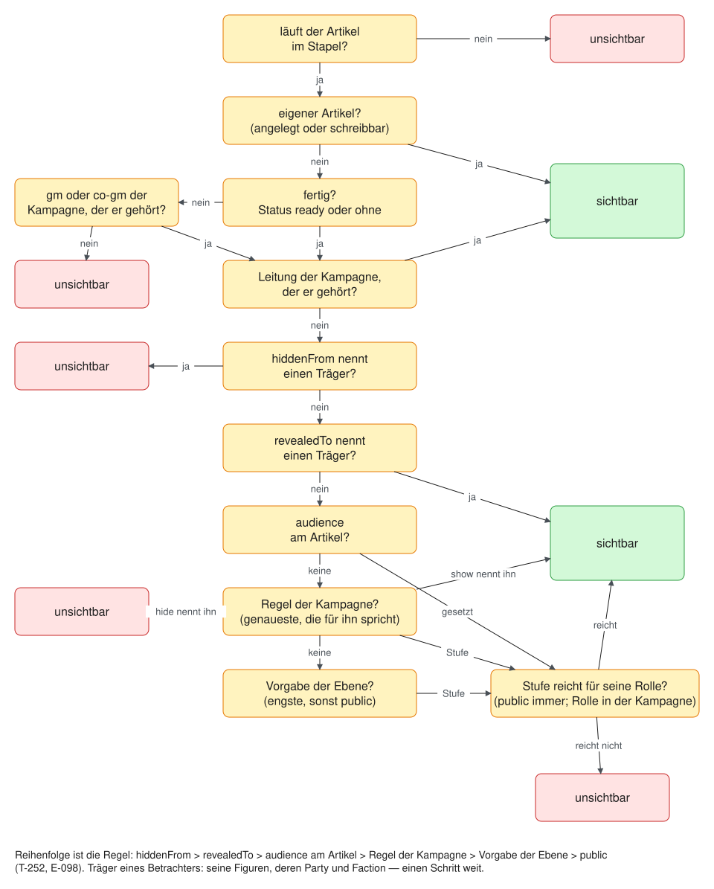

Gezeichnet in [Bilder/Sichtbarkeit.excalidraw.md](Bilder/Sichtbarkeit.excalidraw.md) — wer die Regel ändert, ändert die Zeichnung im selben Commit.

Träger eines Betrachters: seine Figuren, deren `Party` (`memberOfParty`)
und deren `Faction` (`memberOf`) — einen Schritt weit.

| Feld | Werte | Bedeutung |
|---|---|---|
| `audience` | `public` (Vorgabe) · `campaign` · `players` · `gm` | jedes Konto · jedes Konto mit Rolle am Tisch · `player`, `co-gm`, `gm` · `gm`, `co-gm` |
| `revealedTo` | Träger | ausdrücklich freigegeben |
| `hiddenFrom` | Träger | ausdrücklich verborgen |

`hiddenFrom` schlägt `revealedTo` schlägt `audience`. **Sagt der Artikel
keine Stufe, sagt es seine Gruppe** (T-252, E-098): erst die Regel der
laufenden Kampagne, dann die Vorgabe seiner Ebene, dann `public`.

| Wo | Feld | Bedeutung |
|---|---|---|
| Kampagne | `VisibilityRules.visibilityRules` | je Gruppe eine Regel `{id, audience?, show?, hide?}` — `id` ist der Schlüssel der Gruppe aus den Transformationen (`layer:dnd\|type:Spell`, T-253), `show`/`hide` nennen Träger |
| Ebene | `Layer.defaultAudience` | die Vorgabe für ihre Artikel (nicht die Sichtbarkeit der Ebene selbst); liegt ein Artikel in mehreren Ebenen, gilt die engste |

**Ein Eintrag je Artikel** (T-401, E-162 a, REQ-401): `article:<id>` im
selben Regelwerk. So entscheidet die Leitung über einen einzelnen Artikel
aus einer Ebene, die sie nicht schreibt — ein Grundregelwerk, das mehrere
Runden aufschalten —, ohne das Buch zu beschreiben und ohne Fassung. Er
gilt **vor jeder Gruppe**, gleich wie genau, aber nach dem eigenen Feld am
Artikel (`regelFuer`): **Feld › Eintrag › Merkmal (genaueste zuerst) ›
Vorgabe der Ebene › `public`**. Dazu das Merkmal **Beziehung**
(`relation:memberOf>f_kult`, eine Kante und ihr Ziel) neben Art, Bereich,
Marke und den übrigen. „Articles and their layers" schreibt, was die
Leitung nicht schreibt, als Eintrag (`withArticleRule`), und zeigt die
Herkunft „campaign (this article)"; ↺ nimmt Feld und Eintrag. Beide
Dimensionen stehen nur in `visibilityDimensions`, nicht in den
Gruppierungen der Übersicht: nach einzelnen Artikeln gruppiert man nicht.

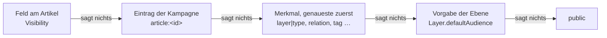

Von mehreren Regeln gilt **die genaueste, die für diesen Betrachter etwas
sagt** (`mostSpecific`, die meisten Glieder): ein Verbot oder eine Freigabe
für einen seiner Träger, sonst ihre Stufe — gefragt wird dann die Rolle in
**dieser** Kampagne. Eine Regel, die nur Rook etwas zeigt, sagt über Sela
nichts; für sie gilt die nächst gröbere. Die Dimensionen der Schlüssel
(Ebene, Ebenengruppe, Art, Bereich, Marke, Status, Sichtbarkeit) stehen in
`visibilityDimensions`; ein Glied einer Dimension, die es nicht gibt,
trifft nie. Gesetzt wird in der Übersicht der Kampagnenseite (Reiter
Visibility, `GET /api/campaigns/:c/visibility`, `PUT …/visibility/rules`,
`POST …/visibility/follow`), die je Gruppe und Spalte zählt, woher die
Stufe kommt (`effectiveAudience`: `article`, `campaign`, `layer`,
`default`), und Artikel mit eigenem Feld als Ausnahmen zeigt.
**Ein ausdrücklich gesetztes `audience`, auch `public`, ist ein eigenes
Feld** und schlägt jede Regel — „Follow the group" nimmt es weg. Die
Stufen sind die Zeile `Audience` (seit drei Felder sie brauchen).

Träger sind `Creature`,
`Party`, `Faction` — dieselben drei wie `knownBy`. Gefragt wird die
Rolle in **der** Kampagne, der der Artikel gehört (E3); gehört er keiner
einzelnen, zählt die stärkste Rolle irgendwo. **Vererbt wird nichts.** Wer
durchfällt, bekommt in der Liste nichts und beim Einzelabruf 404. Die
Verwaltung (`is_admin`) sieht alles.

**Spieler und Gruppe in der Auswahl** (T-100, E-007). Die Maske bietet in
`revealedTo` und `hiddenFrom` auch **Spieler** an — gespeichert werden ihre
Figuren, nie das Konto (REQ-199): ein Spieler zu wählen heisst, die
Figuren zu wählen, die er heute in der laufenden Kampagne führt
(`GET /api/players`, ohne Konto-Id). Eine Figur, die er später bekommt,
ist nicht mitgemeint; wer „alle Spieler" meint, nennt die Gruppe.
**Jede Kampagne hat eine Gruppe**: beim Anlegen (`pt_<kampagne>`, in ihrer
Ebene, `partyOf`), für ältere Migration 039. Bekommt ein Konto mit Rolle
`player` eine Figur zugeteilt (Kampagnenseite oder Einladung), kommt sie
in die erste Gruppe dieser Kampagne (`memberOfParty`, `inDieGruppe`) —
ausser sie steht schon in einer, oder die Leitung sagt `party: false`.
Danach ist es eine gewöhnliche Kante an der Figur und wird dort geändert.

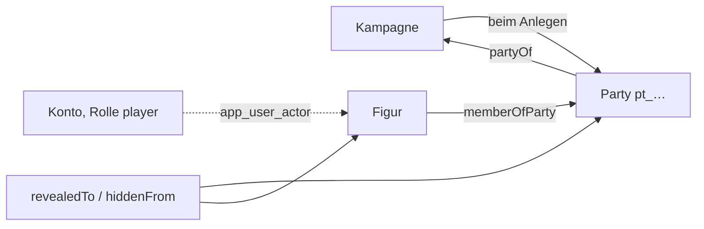

**Der Vorbereitungsstand ist Teil der groben Frage** (REQ-237, D72): wer
nicht `gm` oder `co-gm` der Kampagne ist, der der Artikel gehört, sieht nur
Artikel mit `Status.status: ready` — **ein Artikel ohne Status-Karte oder
ohne Wert zählt als fertig** (`isReady`), sonst verschwände, was keinen
Stand trägt. **Eigenes sieht man in jedem Stand**: was das Konto angelegt
hat (`app_user_article`) oder schreiben darf (seine Figuren samt dem, was an
ihnen hängt) — der Server gibt es als `Viewer.own` mit. Das gilt überall,
wo gesiebt wird: Liste, Artikel, Verweise, Rückbezüge, Auswahlen.

**Die eigene Figur ist ausgenommen** (E-014 d, D74): ein Spielercharakter,
der einem Konto zugeteilt ist (`app_user_actor`), samt seinem Statblock
(`belongsTo`, auch eine Instanz) und seinem Inventar (`carries`) geht nach
der gewöhnlichen Sichtbarkeit an die Mitspielenden, in jedem Stand — der
Server gibt die Figuren *aller* Konten als `Viewer.ungated` mit.

**Der letzte fertige Stand gilt** (E-012, D74): fiel ein Artikel nach einer
Änderung einer Spielerin auf `prepared` zurück, bekommt, wer den
Arbeitsstand nicht sieht (`seesUnfinished`: nicht Leitung, nicht Eigenes),
die Kopie von vorher aus `entity_ready` — in Liste, Artikel und als
Zusammenhang des Siebs. Wer ihn sieht, bekommt den neuen Stand mit dem
Datum des alten (`refs.ready`) und mit `?stand=ready` den alten.

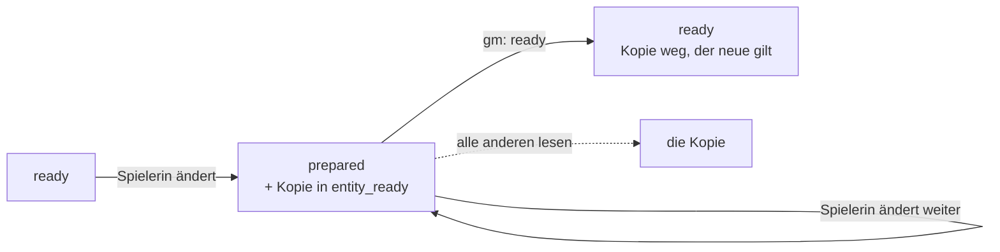

### 9.2 Rollen

Die Rolle am Tisch steht **am Konto, je Kampagne**: `gm` · `co-gm` · `player`
· `spectator`. Am Server `campaign_member (campaign_id, user_id, role)` neben
`app_user_actor` (welche Figuren ein Konto führt); im Prototyp die Sammlung
`members`. Gepflegt auf der Kampagnenseite (Element `members`) von Leitung
und Verwaltung; `gm` und `co-gm` sehen dasselbe. In keinem Artikel.

### 9.3 Wissen (`Information`, `Knowledge`, `redactEntity`)

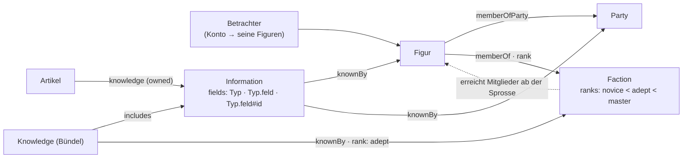

```
Artikel     --knowledge-->  Information        (owned)
Knowledge   --includes-->   Information        (ein Bündel; ein Schritt weit)
Information | Knowledge --knownBy--> Creature | Party | Faction
                                     | Ancestry | Background | Class | Subclass | Feat   (T-285)
Information.applies                  (für eine Gruppe von Artikeln, T-285)
```

**Eine Information kann für eine Gruppe gelten** (T-285, REQ-350):
`Information.applies` hat die Form der Geltung einer Ansicht
(`ViewApplies`: Typen, Bedingungen auf Felder und Kanten; dazu
`LayoutWhen.to` — die Kante zeigt auf einen dieser Artikel, eine Unterart
zählt für ihre Grundart, `ancestryLine`). „Der Trait jedes Orcs" ist eine
Information mit `applies: {types: ['Creature'], where: [{relation:
'hasAncestry', to: [<Orc>], field: 'Creature.species', has: ['orc']}]}`
(innerhalb eines `where`-Eintrags reicht eine Angabe). `informationsOf`
zählt sie an jedem passenden Artikel wie eine angehängte; ohne `applies`
gilt eine Information nur dort, wo ein Artikel sie über `knowledge` nennt.
**Was die Figur ist, weiss sie** (REQ-351): `knownBy` darf auf Herkunft,
Hintergrund, Klasse, Unterklasse und Talent zeigen, und
`knowledgeHolders` zählt für eine Figur ihre Herkunft samt Grundart, ihren
Hintergrund, ihre Klassen samt Unterklasse und gewählte Artikel (`chose`)
— ein Schritt weit, wie Gruppe und Fraktion.
**Verteilt wird am Artikel, gelesen am Wissen** (T-286, T-287): der Kasten
Knowledge in der Seitenspalte jedes Artikels (Leitung, `/api/knowledge/of/:id`)
legt Informationen an, die über `applies.article` für ihn gelten — der
Artikel selbst bleibt unverändert, auch in einem fremden Regelwerk —, und
hängt sie an Bündel; die Seite eines `Knowledge` zeichnet mit dem Element
`knowledgeContents` alles, was es vereint, je Information die Artikel mit genau den
abgedeckten Feldern, gesiebt am Server (`/api/knowledge/:id/contents`).

`Information.fields` nennt, was sie beansprucht: `Typ` (alle Felder des
Typs), `Typ.feld`, `Typ.feld#id` (ein Eintrag). **Was keine Information
nennt, liegt offen.** Ein Betrachter ist die Liste seiner Figuren; eine Figur
zählt einen Schritt weit auch als ihre `Party` (`memberOfParty`) und ihre
`Faction` (`memberOf`). **Eine Fraktion weiss nichts, ihre Mitglieder
wissen:** `Faction.ranks` ist die Leiter, `memberOf.props.rank` die Sprosse,
und `knownBy.props.rank` an einer Zuteilung an die Fraktion ein Mindestrang
(A7, REQ-203). Ohne Betrachter liest die Leitung.

Zurückgehalten wird **am Server**: Felder, die eine ungewusste Information
beansprucht; die Felder aus der Einstellung `gmFields`
(`Secrets.secret`, `Tactics.tactics`, `Encounter.solution`, `Encounter.hint`), es sei denn, eine gewusste
Information gibt einen Eintrag frei; der Name, wenn beansprucht — dann steht
der Deckname (`Identity.cover`). Kanten bleiben. Eine zweite Prüfung in der
Maske gibt es nicht.

### 9.4 Schreiben

Die Verwaltung schreibt alles. Ein Spieler schreibt seine Figuren und was an
ihnen hängt (`carries`, `holds`, `crafting`), **und was er selbst angelegt
hat** (D72). **Anlegen** darf, wer in der laufenden Kampagne `player` ist —
jede Art, die einen Stand trägt (E-013); der Server legt den Artikel in die
Ebene der Kampagne (`campaignLayer`: die spezifischste aufgeschaltete, die
keine andere Kampagne aufschaltet), auf `idea` oder `prepared`, und vermerkt
die Verfasserin neben dem Konto (`app_user_article`), nicht im Artikel
(REQ-199). Eine angelegte Spielerfigur führt sie gleich. **`ready` setzen
die Verwaltung und `gm` der Kampagne, der der Artikel gehört**, nicht
Spielende und nicht `co-gm`; der Server prüft es, auch wenn die Status-Karte
fehlt. Dafür schreibt `gm` die Artikel, die Spielende angelegt haben.
**Ausgenommen ist die eigene Figur** (E-014 d, D74): der Spieler schreibt
auch ihren Statblock (`belongsTo`) und setzt bei Figur, Statblock und
Inventar den Stand selbst, auch `ready`. **Ändert eine Spielerin einen
anderen fertigen Artikel, fällt er auf `prepared`** (E-012, D74), und der
Stand davor bleibt als Kopie (`entity_ready`, Migration 027) — jede
Änderung zählt, ein Speichern ohne Änderung nicht. Setzt `gm` wieder
`ready` (in der Maske oder per `POST /api/entities/:id/ready`), gilt der
neue und die Kopie fällt weg; ändert `gm` selbst, fällt nichts zurück. Was
wartet, listet `GET /api/unready` (Werkbank, „Not ready, by players"). Das
Register schreiben die Verwaltung und `gm` der laufenden Kampagne.

**Schreibrechte je Ebene** (T-098, E-001): jedes Konto schreibt, was
**ganz** in Ebenen liegt, in denen es schreibt (`inWritableLayers`: jede
Ebene, die den Artikel bringt, ohne `removes`) — ein Artikel, der auch im
geteilten Regelwerk liegt, änderte sonst dort mit. In welchen Ebenen ein
Konto schreibt, steht **neben dem Konto** (`app_user_layer`, Migration 035;
`owner` heisst: besitzt sie und sagt, wer sonst darin schreibt), und dazu
schreiben **`gm` und `co-gm` die Ebene ihrer Kampagne** aus ihrer Rolle.
**Eine eigene Ebene legt jedes Konto an** (`POST /api/layers`) und besitzt
sie; sie wirkt, sobald die Leitung sie aufschaltet. **Jede Kampagne hat
ihre Ebene** (`campaignLayer`: die spezifischste aufgeschaltete, die keine
andere Kampagne aufschaltet, keine Gruppe ist und **keinem Konto gehört** —
die aufgeschaltete eigene Ebene einer Spielerin wird nicht zur
Kampagnenebene); eine neue Kampagne bekommt sie beim Anlegen
(`ly_<kampagne>`, `kind: 'campaign'`, Spezifität 100), eine ältere legt
Migration 035 an. **Was nicht in den eigenen Ebenen liegt, ändert man als
Fassung:** „Edit" an einem fremden Artikel — auch einem ohne Ebene, der
bleibt bei der Verwaltung — legt über `POST /api/entities/:id/adapt` eine
Fassung (E5) in eine eigene Ebene, die im Spiel ist (`zielEbenen`; bei
mehreren `{ layer }`). Die Verwaltung wählt dabei zwischen der Ebene der
Kampagne und ihren eigenen Ebenen im Spiel — so legt die Werkbank geschätzte
Preise in „AI generated prices" (T-139). `ready` bleibt bei `gm`: ändert die Mitleitung oder
eine Spielerin in ihrer Ebene etwas Fertiges, fällt es zurück wie oben.

**Die gewählte Schreibebene** (T-176): jedes Konto darf je Kampagne eine
seiner Zielebenen als Vorgabe wählen (Kontoeinstellung `writeLayer`, neben
dem Konto wie jede Einstellung, nie im Artikel — REQ-199). Sie schlägt die
gerechnete Vorgabe (`grundEbene`), solange das Konto dort schreibt und
die Ebene im Spiel ist; sonst gilt wieder die gerechnete. Es ist dieselbe
Wahl wie die Schreibebene in der Kopfleiste (T-161, unten); Account ›
Layers setzt sie mit „Make default", die Verwaltung auch für ein anderes
Konto. Die Verwaltung
legt ohne Wahl wie bisher ohne Ebene an. Gedacht für eine Testebene der
Leitung (`Layer.kind: 'test'`, Beschreibung wie jedes `kind`; Migration 073), die sich mit „Empty this layer" (eine umkehrbare Massenänderung
`delete`, Teile und Kanten darauf eingeschlossen) wieder leeren lässt.

**Die Spielerebene** (T-164): je Konto und Kampagne, in der es `player`
ist, eine eigene Ebene — **die Vorgabe zum Schreiben**. Figur, Notizen und
was eine Spielerin sonst anlegt, landen dort (`vorgabeEbene`, für die
Kopfleiste `GET /api/layers/default`); ohne Spielerebene wie bisher in der
Ebene der Kampagne. Angelegt wird sie, sobald das Konto die Rolle `player`
bekommt (Kampagnenseite, Einladung, `user role`; ältere Mitglieder:
Migration 069), als `<Konto> · <Kampagne>`, umbenennbar, `Layer.kind:
'player'` — Beschreibung wie jedes `kind`. **Wessen sie ist, steht neben
dem Konto** (`app_user_layer.campaign_id`, REQ-199). Die Kampagne schaltet
sie **dicht unter ihrer eigenen Ebene** auf; genau eine Kampagne heisst,
sie gehört ihr (`campaignsOf`), also sieht deren Leitung darin, was sie in
der Kampagnenebene sähe — **die Sichtbarkeit bleibt am Artikel**, die Ebene
ist Herkunft und Schreibrecht, kein Versteck. `gm` und `co-gm` schreiben die
Spielerebenen ihrer Runde mit (wie D72). **Keine Fassung fremder Artikel
darin** (`anpassZiele`): der Stapel gilt für alle am Tisch, eine
Überschreibung in einer Spielerebene änderte den Artikel für alle — wer
etwas an einem fremden Artikel anmerken will, schreibt eine Notiz mit
Verweis. **Rolle weg, Ebene bleibt:** beschrieben wird sie nur, solange
ihr Konto in der Kampagne mitspielt oder leitet; danach holt die Leitung
den Inhalt in die Ebene der Kampagne und löscht die leere Ebene
(`POST /api/layers/:layer/takeover`), und wer eine Ebene mit Inhalt löschen
will, bekommt den Inhalt aufgezählt (`409`, `contents`). Migration 069 legt
die Spielerebenen der heutigen Mitglieder an und holt hinein, was ein
einziges Konto angelegt hat oder führt (`app_user_article`,
`app_user_actor`) und in der Ebene seiner Kampagne lag; was zwei Konten
zugleich gehört, bleibt und wird gezählt. Bei der Übernahme zwischen zwei
Installationen (T-130) wandert die Ebene als Artikel mit, die Zuordnung zum
Konto nicht.

**Die Schreibebene** (T-161): wohin ein Konto in der laufenden Kampagne
anlegt, wenn es keine Ebene nennt. Ohne Wahl ist es die Vorgabe oben
(`grundEbene`: als `player` die Spielerebene, als Leitung die Ebene der
Kampagne); **gewählt wird im Popup der Kopfleiste** unter den
**Schreibzielen** (`schreibZiele`, T-418): den Zielebenen (`zielEbenen`, im
Spiel) und dazu jeder Ebene ausserhalb des Stapels, in der das Konto
schreibt — die Verwaltung jede Ebene ausser Gruppen und fremden
Spielerebenen, also auch eine aufgeschaltete, die ihr nicht gehört (das
Regelwerk eines Drittverlags). Die ausserhalb tragen `inPlay: false` und
stehen zugeklappt unter „Layers not in this campaign": **was dort entsteht,
steht in dieser Kampagne erst, wenn sie die Ebene aufschaltet** — die
Kopfleiste und der Anlegedialog sagen es. Gruppen stehen ausgegraut mit dem
Grund. Dieselbe Liste gilt für das Anlegen mit genannter Ebene und für das
Verschieben am Artikel (`PUT /api/entities/:id`); Fassungen, Übernahme und
die Vorgabe bleiben bei `zielEbenen`, denn eine Fassung ausserhalb des
Stapels gälte nirgends. **Gespeichert am Server je Konto und Kampagne**
(Einstellung `writeLayer`: Kampagne → Ebene), gesetzt nur über
`PUT /api/layers/write`, das gegen die Schreibziele prüft; `/api/me/prefs`
nimmt den Schlüssel nicht. **Gelesen wird immer gegen die Schreibziele**
(`schreibEbene`): entfällt das Recht (die Ebene geht, die Rolle geht), gilt
die Vorgabe, und `GET /api/layers/write` sagt es (`dropped`). Schaltet die
Kampagne eine gewählte Ebene ab, bleibt die Wahl und ist als „not in play"
gekennzeichnet.
Sie wirkt beim **Anlegen** (auch aus einem Verweisfeld, eine im Dialog
genannte Ebene geht vor), bei **Fassungen** (`adapt` ohne `{ layer }`,
`adaptTo` mit ihr vorn — nur eine *gewählte*, ohne Wahl fragt der Server bei
mehreren Zielen zurück) und bei der **Übernahme** einer Spielerebene (in die
gewählte, wenn sie keine Spielerebene ist, sonst in die Ebene der
Kampagne). **Die Verwaltung** legt ohne Wahl wie bisher ausserhalb jeder
Ebene an (`none`); hat sie eine gewählt, dorthin. Die Oberfläche zeigt sie
unter der Kampagne („Writes to", am Telefon ✎), im Anlegedialog und beim
Bearbeiten — dort mit einer Warnung, wenn die Änderung in eine andere Ebene
geht als die Schreibebene.

**Die Ebene wechseln** (T-383): im Bearbeiten ist sie das erste Feld.
Gespeichert wird sie als das, was sie ist — die Kante `inLayer`
(`withHomeLayer`; Kanten mit `mode: 'removes'` bleiben, wie sie sind) —, im
selben `PUT` wie alles andere. Dort prüft der Server, was dazukommt
(`layerChange`): jede neue Ebene muss unter den Zielebenen des Kontos stehen,
und aus jeder Ebene heraus nimmt einen Artikel nur die Verwaltung. Den
Artikel zu schreiben heisst nicht, ihn in ein fremdes Regelwerk legen zu
dürfen. Kanten und Fassungen bleiben.

**Was mitgeht** (T-402, E-161 a+c): ein Artikel kommt nicht allein, wenn
etwas an ihm hängt. `layerMovePlan` sammelt die **Mitläufer** — Teile
(`partOf`, auch Teile von Teilen), den eigenen Statblock bzw. dessen
Instanz (Kante mit `asField: 'to'`), das Inventar (`asField: 'from'`) und
die Stücke darin (`holds` auf eine Instanz; ein Grundartikel im Inventar
steht für sich). Vorgewählt ist, was in derselben alten Ebene liegt, das
Konto schreibt und nicht schon im Ziel liegt; die übrigen stehen in der
Liste und bleiben. Je Mitläufer steht, wo er sonst noch hängt — Kanten und
`[[Verweise]]` von ausserhalb des Laufs —, damit niemand ein Teil mitnimmt,
das ein anderes Kapitel auch braucht. Ebenen gehen nie mit.
`POST /api/entities/move-layer { ids, layer, include?, from?, dryRun? }`
zeigt mit `dryRun` den Plan und schreibt sonst **eine** Massenänderung
(`kind: 'move-layer'`), die Undo zurücknimmt; die Zielebene muss eine
Schreibebene sein wie beim `PUT`. Im Bearbeiten wird erst gespeichert
(`PUT` mit der neuen Ebene) und dann mit `from` = alte Ebene nachgezogen.

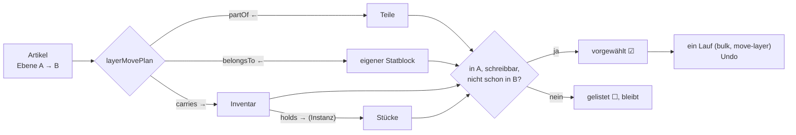


### 9.5 Handwerk: gelernt und gebunden (D55)

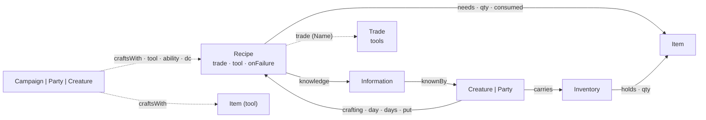

- **Eine Blaupause wird gelernt, und gelernt heisst zugeteilt** (REQ-218):
  jede Information am Rezept erreicht die Figur über `knownBy` (selbst,
  Gruppe, Fraktion — dieselbe Abfrage wie in 9.3). Ein Rezept **ohne**
  Information hat niemand gelernt; bis D52 hiess das „offen". Teilwissen
  ist nicht gelernt. Ob ein Rezept **dasteht**, sagt weiter
  `articleVisible`; ungelernte stehen gestrichelt mit „must still be
  learned", ohne Fundort. „Lehren" legt, wo nötig, eine Information ohne
  Felder an — sie hütet nichts, sie ist das, was man lernen kann.
- **Filter der Werkbank:** gelernt · alle; machbar · fast (1–2 fehlende
  **Posten**: je Zutat einer, das Werkzeug einer); nach Material (welche
  Rezepte es über `needs` nennen); nach Beruf (`Recipe.trade`) oder
  Werkzeug (`Recipe.tool`).
- **Material wird beim Start gebunden** (REQ-219): was das Rezept braucht
  und dabei ist, verlässt das Inventar und steht in `crafting.props.put` —
  auch, was nicht verbraucht wird. Fehlt etwas, darf trotzdem begonnen und
  unterwegs nachgelegt werden (Aufgabe #34); Vorgabe ist das nicht mehr.
  Das Werkzeug wird geprüft, nicht gebunden (es ist ein Name aus den
  Werkzeug-Artikeln, keine Kante — verglichen mit der Werkzeugübung, F13).
- **Was zurückkommt:** was nicht verbraucht wird, immer; das Übrige beim
  Misslingen und beim Abbruch nach `Recipe.onFailure` (`nothingLost` alles,
  `halfLost` die abgerundete Hälfte, `materialsLost` nichts); beim Gelingen
  nichts davon. Ein Gang aus der Zeit vor D55 ist dieselbe Kante mit
  weniger in `put`: nicht Verbrauchtes zählt dann in der Hand, und er
  läuft weiter.
- **Womit gefertigt wird, ist wählbar** (T-122): Werkzeug, Attribut und
  SG nennt das Rezept, wie seine Quelle sie druckt. Eine Kampagne, eine
  Gruppe oder eine Figur weicht ab mit einer Kante `craftsWith` — zum
  **Rezept** (dieses eine) oder zum **Werkzeug** (jedes Rezept, das von
  sich aus dieses Werkzeug nennt: „Kräuterkunde mit Weisheit"). Die Kante
  trägt nur, was sie ändert. Gelesen wird Kampagne → Gruppe (`memberOfParty`,
  ein Schritt) → Figur, je Träger erst Werkzeug, dann Rezept; das Spätere
  schlägt (`craftCheck`, `packages/model/src/crafting.ts`, mit der Herkunft
  jedes Werts). Das Werkzeug selbst tauscht nur eine Kante zum Rezept —
  sonst hinge das Ergebnis von der Reihenfolge der Werkzeugkanten ab. Eine
  Kopie des Rezepts wäre eine zweite Fassung, die eine Korrektur am
  Original nicht mehr erreicht; ein Feld an der Kampagne wäre eine Liste
  von Rezeptnamen neben den Rezepten.
  Die Artikelseite eines Rezepts zeigt das Ergebnis (Element `crafting`):
  am Tisch und je eigener Figur, mit dem, was nicht aus dem Rezept kommt —
  gerechnet am Server (`refs.craft`), nicht in der Maske.
- **Beruf, Werkzeug, Figur: was man womit fertigt** (T-196). Ein Beruf
  ist eine Art `Trade` (erbt von `Rule`: Text, Quelle, Marken) mit seinen
  Werkzeugen (`Trade.tools`, beim Namen wie `Recipe.tool`). Das Rezept
  nennt seinen Beruf (`Recipe.trade`, `enumRef: 'Trade'` — schlägt vor,
  hält nicht); gefunden wird er über Name **und Aliasse**. Eine Liste der
  Rezepte am Beruf gibt es nicht — sie wäre die zweite Stelle, die beim
  nächsten Rezept veraltet. Gerechnet wird in beide Richtungen
  (`recipesOfTrade`, `tradesOfTool`, `recipesOfTool` in `crafting.ts`):
  **womit ein Rezept gefertigt wird**, sagt sein eigenes Werkzeug, sonst
  die Werkzeuge seines Berufs (`recipeTools`) — das Rezept ist
  spezifischer. Das Element `crafting` zeichnet am Beruf die Übersicht
  (Werkzeuge, Rezepte mit Probe, Dauer, Ertrag und Seltenheit, das
  Material nach Zahl der Rezepte), an einem Werkzeug „Can craft", an einer
  Figur je Werkzeug, in dem ihr Statblock geübt ist, dasselbe mit
  **gelernt/nicht gelernt** (nur für Leitung und Führende). Gerechnet am
  Server aus dem **Gesiebten** (`GET /api/crafting/:id`, `kind: trade |
  tool | actor | none`): was eine Information zurückhält, steht nicht da,
  und was nicht im Stapel steht, auch nicht. Filter (Suche, Seltenheit,
  gelernt) sind die der Seite.
- **Fortschritt in Proben** (T-122): `Recipe.checks` sagt, wie viele
  gelungene Proben die Arbeit braucht — Regelwerke wie Kibbles’ Compendium
  zählen in Proben je Zeitabschnitt (zwei Stunden, eine Probe) statt in
  Tagen. Ohne Angabe gilt eine Probe am Ende. Auf bestehenden Datenbanken
  trägt Migration 059 das Feld nach.
- **Ein Regelwerk mit Rezepten** (Kibbles’ Compendium, T-122) ist eine
  Ebene wie ein Buch: Rezepte, Materialien und Gegenstände sind Artikel
  darin, `needs`/`yields` verbinden sie, und jedes Rezept trägt eine
  Information ohne Felder, die man lernen kann. Eine Kampagne lehrt, ohne
  das Regelwerk zu schreiben: ein `Knowledge`-Bündel in ihrer Ebene
  `includes` die Blaupausen und ist `knownBy` der Figur (9.3).

#### Der Fertigungsauftrag in der Seite (T-128)

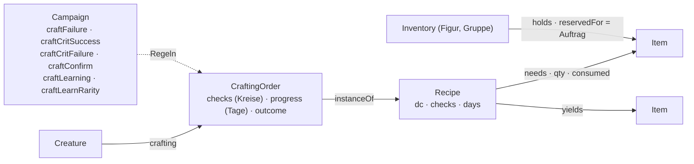

- **Ein Auftrag ist eine Instanz des Rezepts** (`CraftingOrder extends
  Recipe`, `instanceOf` aufs Rezept; `same` nimmt die Obertypen mit). Er
  liest Werkzeug, SG, Proben, Tage, Material und Ertrag beim Rezept und
  speichert nur, was abweicht — die Leitung gibt *diesem* Auftrag einen
  anderen SG, ohne das Rezept zu kopieren. Eigen sind ihm `checks` (die
  Proben als Kreise, unten), `progress` (gearbeitete Tage), `outcome`
  (`open`, `succeeded`, `failed`, `aborted`) und `started`. Wer fertigt, sagt `crafting` vom Fertigenden zum Auftrag. Wie
  jede Instanz steht er in keiner Liste; er hängt an der Figur und am
  Rezept. **Nicht das Endprodukt:** ein Ertrag von drei Tränken ist ein
  Stapel im Inventar und keine Instanz, und ein Gegenstand im Inventar ist
  ein Verweisziel, eine Instanz nicht.
- **Das Material bleibt im Inventar und wird reserviert**
  (`holds.props.reservedFor` = der Auftrag): aus dem Inventar der Figur
  und dem ihrer Gruppen, Behälter darin eingeschlossen; ein grösserer
  Stapel wird geteilt (`reserveIn`). Reserviert wandert nichts. Das löst
  in der Seite das Binden in `crafting.props.put` (D55) ab — gebunden ist
  es so wie dort, aber es bleibt sichtbar, wo es liegt.
- **Gesperrt wird am Server** (T-134, `reservationBreaches`): ein `PUT`
  oder `DELETE`, das ein reserviertes Stück eines **laufenden** Auftrags
  wegnimmt, ändert (Menge, Gegenstand, Reservierung) oder eine
  Reservierung erfindet, bekommt 423 mit „reserved for crafting order …".
  Umräumen im selben Behälter (Raster, Platz, Drehung, Griffweite) geht.
  Frei wird es durch Abschluss oder Abbruch, durch die Leitung (Knopf
  „Release" im Inventar) oder indem der Auftrag gelöscht wird — dann wie
  ein Abbruch. Ein Inventar mit Reserviertem und ein Gegenstand, der
  irgendwo reserviert liegt, lassen sich nicht löschen. Laden (T-133) und
  Übernahme (T-130) fragen dieselbe Funktion (`reservierteSperre`).
- **Fortschritt** (`orderNeed`): nennt das Rezept `checks`, zählt jede
  gelungene Probe eins; sonst zählen Arbeitstage, und am Ende entscheidet
  eine Probe. Die Probe rechnet gegen den SG aus `craftCheck` (mit den
  `craftsWith`-Kanten der Figur).
- **Die Regeln stehen an der Kampagne, und nur dort** (`craftRulesOf`,
  T-165; wandern mit T-132 in ein Modul): `craftFailure` —
  `noProgress`, `progressLost`, `materialsLost`, `halfLost` (Vorgabe),
  `nothingLost`, `custom` (die Leitung entscheidet); `craftCritSuccess`
  (`double`: die natürliche 20 zählt zweimal); `craftCritFailure`
  (eigener Ausgang der natürlichen 1); `craftConfirm` (`gm`: eine Probe
  der Spielenden wartet, bis die Leitung sie annimmt); `craftLearning`
  (T-280, REQ-349: welche Blaupausen eine Figur kennt — `all` jede von
  Anfang an wie bei Kibbles, `taught` nur Beigebrachtes (Vorgabe, so galt
  es vorher), `rarity` jede bis `craftLearnRarity` (Vorgabe `common`,
  `none` zählt darunter) für ein Werkzeug, das die Figur beherrscht
  (`proficienciesOf`), dazu Beigebrachtes; die Seltenheit ist die des
  Ertrags, `recipeRarity`; gerechnet in `blueprintKnown`, am Server an
  Rezept, Figur und Start). **Das Rezept
  entscheidet nichts mehr:** `Recipe.onFailure` ist der Text der Quelle
  („Source: on a failure") und steht im Kasten „Campaign rules" daneben,
  gilt aber nicht. Bis T-165 war es eine Auswahl, die über die
  Kampagnenregel `recipe` galt — zwei Stellen für eine Regel. Migration
  072 gibt einer Kampagne, die dem Rezept folgte, die Regel, die bei den
  Rezepten am häufigsten stand (auf dev: `materialsLost` bei allen 698),
  schreibt die Auswahlwerte am Rezept in Sätze und zählt die Rezepte auf,
  die bisher anders galten. Am Rezept
  und am Auftrag stehen die Regeln je ein Satz (`craftRuleSentences`),
  mit dem Link zur Kampagne, wo die Leitung sie ändert.
- **Die Proben sind Kreise** (T-165, `CraftingOrder.checks`, je Kreis
  `{ mark, by, at, total?, nat?, dc?, pending? }` oder `null`): ein Klick
  setzt ✓, der zweite ✗, der dritte leert (`nextMark`); ein Wurf setzt
  den ersten freien Kreis mit Summe und SG. **Was die Kreise bewirken,
  wird gerechnet** (`tallyChecks`, D8): der Reihe nach durch `applyRoll`,
  bis einer den Auftrag entscheidet; danach stehen so viele leere Kreise
  da, wie gelungene Proben fehlen (bei Tagen einer, offen erst, wenn die
  Tage gearbeitet sind — ein Verlust des Fortschritts verlangt neue Tage).
  Ein ✗ wendet die Regel also sofort an — Fortschritt, und am
  reservierten Material steht, was beim Abschluss verloren ginge —, und
  Zurückklicken nimmt sie zurück. **Endgültig ist erst der Abschluss**
  (`POST …/finish`: abrechnen, Ertrag) oder der Abbruch. Ein Kreis der
  Spielenden unter `craftConfirm: 'gm'` ist `pending` und zählt erst
  angenommen; verworfen wird er leer. Was jede zählende Probe auslöste,
  steht als Zeile im Verlauf (`lines`).

```mermaid
stateDiagram-v2
  [*] --> leer
  leer --> Erfolg: Klick
  Erfolg --> Misserfolg: Klick
  Misserfolg --> leer: Klick
  note right of Misserfolg: wendet craftFailure an — zurückgeklickt nimmt es zurück
```
- **Abrechnung** (`settlePieces`): bei Erfolg ist das Verbrauchte weg, das
  Übrige frei, und der Ertrag (`yieldCount` ×) liegt im Inventar der Figur
  (sonst der Gruppe); beim Abbruch kommt alles zurück; beim Misserfolg nach
  der Regel (`halfLost`: die abgerundete Hälfte zurück). Was nicht
  verbraucht wird, kommt immer zurück.
- **Geschrieben wird nur über `/api/crafting`** (`apps/server/src/handwerk.ts`;
  ein Kreis über `PUT /api/crafting/:id/checks/:index` mit dem Zielstand,
  damit zwei schnelle Klicks zwei Stände sind und nicht zweimal „weiter"),
  nicht über `PUT`: ein Ausgang, den jemand in der Maske setzt, hätte
  nichts abgerechnet — die Felder des Auftrags sind `readOnly`. Spielende
  starten für ihre Figur und nur Gelerntes (`recipeLearned`), mit allem
  Verbrauchten; die Leitung für jede Figur und auch mit Lücken. Was sich
  ändert, geht über den Live-Kanal (T-116).

#### Materialien beim Start, Gruppen und Ersatz (T-197)

```mermaid
flowchart LR
  R["Recipe"] -- "needs · qty · consumed" --> M["Item"]
  R -- "needs · qty" --> G["MaterialGroup<br/>materialTypes · rarityMin/Max<br/>tags · items"]
  K["Campaign"] -- "allowsSubstitution" --> S["Substitution<br/>replaces · with · withTags<br/>rarity · ratio"]
  Inv["Inventory"] -- "holds · reservedFor · forNeed" --> P["Stück (Material)"]
```

- **Gewählt wird erst beim Start.** Das Rezept zeigt, was es braucht;
  „Start crafting…" fragt `GET /api/crafting/:id/materials?actor=` und
  zeigt je Bestandteil die freien Stücke aus Figur und Gruppe, die passen,
  und die naheliegenden, die nicht passen, **mit Grund** („rarity common,
  below uncommon"). Erst „Reserve and start" reserviert (T-134). Vorgeschlagen
  wird das Genannte und die Gruppe; einen Ersatz wählt man selbst.
- **Ein Bestandteil darf eine Eigenschaft nennen** statt eines Gegenstands:
  `needs` zeigt auf eine **Materialgruppe** (`MaterialGroup`, erbt von
  `Rule`). Sie prüft am Stück Materialart (`Material.materialType`),
  Seltenheit (Grenzen in der Reihenfolge von `Item.rarity`; `varies` und
  `unknown` lassen sich nicht vergleichen), Marken, oder sie nennt es beim
  Namen. Was leer ist, schränkt nicht ein. Eine Liste der Mitglieder gibt
  es nicht — die Eigenschaften stehen am Stück.
- **Ersatz ist eine Regel, die die Kampagne spielt** (`Substitution`,
  Kante `allowsSubstitution`; Seite „Rules & options", Sorte Crafting):
  `replaces` nennt Materialarten, `with`/`withTags`, was einspringen darf,
  `rarity` (`same`, `atLeast`, `any`), ob der Ersatz die verlangte
  Seltenheit haben muss (bei einer Gruppe: ihre Untergrenze), `ratio`, wie
  viele Ersatzstücke ein Original decken. Der Text der Regel (etwa eine
  Zusatzregel eines Regelwerks) steht in ihrer Beschreibung; die Felder
  sagen, was gerechnet wird. Ohne Kante gilt nur das Rezept.
- **Gerechnet in `materialFit`** (`packages/model/src/substitutes.ts`):
  erst das Rezept, dann die Ersatzregeln in ihrer Reihenfolge — die erste,
  die passt, gilt. **Gedeckt** (`coverage`) zählt ein Ersatzstück `1/ratio`;
  mehr als gebraucht lehnt der Start ab. Am Server wird jedes Stück gegen
  seinen Bestandteil geprüft, nicht der Maske geglaubt.
- **Reserviert wird je Bestandteil** (`holds.props.forNeed` = die
  `needs`-Kante): ein Ersatz oder ein Stück aus einer Gruppe ist nicht der
  Gegenstand, den das Rezept nennt, und die Abrechnung muss wissen, ob es
  verbraucht wird. Ältere Reservierungen ohne `forNeed` finden ihren
  Bestandteil wie bisher nach dem Grundartikel. Migration 090.

### 9.6 Laden und Preise (T-129)

- **Ein Laden ist ein Ort** (`Shop extends Place`, Bereich `world`). Er
  trägt einen Abschlag für alle (`Shop.priceMod`); was er führt, steht an
  `sells` zum Gegenstand: `qty` (leer: unbegrenzt, 0: ausverkauft),
  `price` (in Kupfer, statt `Item.copperPrice`), `mod` (nur diese Ware),
  `available`. Wer ihn hält, steht an `shopkeeper`; eine Fraktion, die ihn
  kontrolliert, an ihrer Kante `controls`.
- **`sells` auf eine Collection** (T-425, REQ-439, E-175): die Kante steht
  für die Mitglieder der Collection (`collectionMemberIds`, dieselbe Regel
  wie die Seite der Collection, im Bestand gerechnet, nur Gegenstände,
  nach Name, höchstens 200), jede mit der Collection als Herkunft (`via`).
  `mod` und `available` gelten für jede, `qty` und `price` nicht — eine
  Menge für vierzig Waffen wäre keine. **Eine einzelne Kante schlägt die
  Collection**, gleich wo sie steht; von zwei Collections mit demselben
  Mitglied gilt die erste. Gesiebt wird jede Ware einzeln. Gekauft wird
  mit Kante **und** Gegenstand (`item`), denn die Kante allein nennt viele.
- **Ein Preis sagt, woher er kommt** (T-139, E-046): `Item.copperPrice`
  in Kupfer, daneben `Item.priceNote`. Leer heisst Listenpreis der
  Quelle; sonst steht da, wie gerechnet oder geschätzt wurde —
  „derived: base price + 100 gp" (der Importer rechnet so die
  `valueExpression` einer Variante am Grundgegenstand), „estimated: DMG
  2024 rare". Der Buchstil zeigt es hinter dem Preis. Ein Satz und keine
  Aufzählung: nach welcher Regel geschätzt wird, entscheidet die Leitung,
  und ein geschätzter Preis soll sich finden und ersetzen lassen.
- **Geschätzte Preise wohnen in einer eigenen Ebene** (T-139, Vorgabe der
  Leitung 14.10.): „AI generated prices" in der Herausgeber-Gruppe „AI
  content". Der Grundartikel behält, was die Quelle sagt; die Schätzung
  ist eine Fassung mit `overrides` aufs Original (E5) und `priceNote`.
  Schaltet die Kampagne die Gruppe ab (`activates` `mode: 'off'`), gilt
  wieder das Original — ohne Preis. Die Artikelseite zeigt den Unterschied
  an `copperPrice` wie jede Fassung (E6). Ein Listenpreis, den die Quelle
  als Rechnung gibt (`valueExpression`), ist keine Schätzung und bleibt im
  Grundartikel.
- **Ein Abschlag ist ein Wort**: `−10 gp`, `+5 sp`, `−10 %`
  (`parsePriceMod`). Ohne Einheit ist er keiner; was sich nicht lesen
  lässt, zählt 0 und steht als `invalid` in der Herkunft.
- **Rabatt** (`discount`, Geber → Empfänger, `props.mod`, `props.rank`):
  Geber sind der Laden, die Fraktionen, die ihn kontrollieren, und seine
  Ladenhalter. Er trifft die kaufende Figur, wenn der Empfänger sie selbst
  ist, eine ihrer Gruppen (`memberOfParty`) oder eine ihrer Fraktionen
  (`memberOf`) — dort ab dem Rang an der Kante, nach `Faction.ranks`; ein
  Rang ausserhalb der Leiter trifft niemanden. Eine Fraktion, die ihren
  eigenen Mitgliedern Rabatt gibt, zeigt auf sich selbst.
- **Gerechnet beim Lesen** (D8, `shopWares`, `packages/model/src/shop.ts`):
  Grundpreis = `sells.price` sonst Listenpreis **der geltenden Fassung**
  (T-139: der Server rechnet in der **Preissicht** `withVersionPrices` —
  jedes Original trägt Preis und Herkunft seiner geltenden Fassung, Ids
  bleiben; Kaufen, Verkaufen und Ankauf rechnen damit, gesiebt wird die
  Fassung; die Herkunft reitet als `listNote` mit); dann Laden, Rabatte,
  Ware.
  **Prozent auf den Grundpreis**, addiert, je Schritt auf Kupfer gerundet;
  nie unter 0. Jeder Schritt nennt Geber, Empfänger und Rang.
- **Am Server** (`refs.shop`): am Tisch (Laden und Ware) und je eigener
  Figur. Gerechnet über den ganzen Stand — ein Rabatt gilt auch, wenn die
  Figur den Geber nicht aufschlagen darf —, gezeigt wird nur, was der
  Betrachter sieht: verborgene Waren fehlen, ein verborgener Geber bleibt
  ohne Namen. Element `wares` auf der Artikelseite.
- **`regards` rechnet nicht mit** (E-043, offen): persönliche Rabatte sind
  `discount` vom Ladenhalter an die Figur.
- Migration 061 trägt Art und Kanten nach.
- **Kaufen** (T-133, `POST /api/shops/:id/buy`, `buyWare`): die Maske
  schickt Ware (`sells`-Kante), Menge und Figur — **nie einen Preis**; der
  Server rechnet `shopWares` für diese Figur neu. Die gezählte Menge sinkt
  (leer bleibt unbegrenzt), und `Inventory.copper` sinkt um Preis × Menge.
  Ins Inventar, das die Figur trägt (`carries`), kommt per `holds` **eine
  Instanz** des Gegenstands (`newInstance`, T-150): ein eigener Artikel mit
  `instanceOf` auf den Grundartikel, in der Ebene der Kampagne, `ready`,
  sonst nur Name und Nummer — Preis, Gewicht und Form liest er von der
  Vorlage, bis er abweicht. Liegt schon ein loser Stapel desselben da (der
  Grundartikel selbst oder eine Instanz, die nicht abweicht,
  `followsTemplate`), wächst der, und es entsteht nichts. Wer kauft, hat
  das Stück angelegt (`app_user_article`, D72) und darf es ändern. Nein
  sagen `soldOut`, `unavailable`, `tooFew`, `noPrice` (verschenkt wird
  nichts), `tooPoor`; ohne Inventar gibt es nichts zu bezahlen.
- **Verkaufen** (`POST /api/shops/:id/sell`, `sellPiece`): ein Stapel aus
  dem Inventar der Figur oder einem Behälter darin (nicht dem der Gruppe),
  zum **Ankaufspreis** dieses Ladens (`buybackFor`, E-045 b, E-175 a):
  **ohne `buys`-Kante kauft er alles** zu `Shop.buyRate` Prozent des
  Listenpreises (leer 50 %, die Regel aus 5e) — so verhält sich jeder
  bestehende Laden wie bisher. **Mit `buys`-Kanten** (Laden → Gegenstand
  oder Collection, `props.rate` in Prozent, sonst der Satz des Ladens,
  `props.mod` ein Abschlag danach) kauft er **nur das Genannte**: eine
  Kante auf den Gegenstand (bei einem Stück auf seinen Grundartikel)
  schlägt die Collection, von mehreren Collections gilt die erste; was
  keine nennt, lehnt er ab (`notBought`). Abgerundet auf Kupfer, nie unter
  0. Rabatte gelten nur beim Kaufen. `refs.shop.mine[].sellable` nennt je
  Stück Preis, Satz und Herkunft (`rate`, `from`, `viaName`) oder
  `refused: 'notBought'`. Ein **reserviertes** Stück (`holds.props.reservedFor`,
  T-128) und ein Behälter, in dem noch etwas liegt, bleiben. Eine
  Instanz, die **nicht abweicht**, zählt als Grundartikel: führt der Laden
  ihn mit gezählter Menge, steigt sie, und ist der Stapel ganz verkauft,
  wird die Instanz gelöscht. Eine, die **abweicht** (eigener Name, Gravur),
  geht als dieses Stück über den Tresen — der Laden führt sie danach selbst
  (`sells` auf die Instanz), und wer sie zurückkauft, bekommt genau sie.
- **Wer handelt:** für die eigene Figur (D74, wie beim Inventar), die
  Leitung für jede. Laden und Inventar werden **gegen die gelesene
  Revision** geschrieben — kaufen zwei die letzte Laterne, bekommt sie
  einer, der andere ein 409. `refs.shop.mine` nennt je Figur dazu ihr
  Inventar, ihr Geld (`purse`) und was sie verkaufen kann (`sellable`).
- **Protokoll:** `shop.bought` und `shop.sold` am Laden — Figur, Konto,
  Gegenstand, Menge, Stückpreis, Summe, beim Kauf Listen- und Grundpreis
  und jeder Abschlag mit Herkunft (`steps`), beim Verkauf die Regel
  (`rule: { rate, from, via }`; bis T-425 `'half'`).
- Migration 150 trägt `sells` auf Collections, `buys` und `Shop.buyRate`
  nach; kein Laden und keine Kante ändert sich.

```mermaid
flowchart LR
  F[Faction<br/>ranks Wick·Flame·Beacon] -- controls --> S[Shop<br/>priceMod −10 %]
  S -- "sells<br/>qty 3 · mod −1 gp" --> I[Item<br/>copperPrice 1000]
  S -- "sells · mod −10 %" --> C[Collection<br/>Weapon, tag simple]
  S -- "buys · rate 40" --> W[Collection<br/>Weapon]
  S -- shopkeeper --> K[Creature]
  F -- "discount<br/>−10 % · rank Flame" --> F
  K -- "discount −2 gp" --> P[PlayerCharacter]
  S -- "discount −5 %" --> G[Party]
  P -- "memberOf (Beacon)" --> F
  P -- memberOfParty --> G
```

### 9.7 Geld: Betrag, Sorten, Kurs (T-357, Teil 1)

Geld ist **eine ganze Zahl in der kleinsten Sorte** einer Währung und wird
beim Lesen in Sorten gezeigt (D8, wie die Masse). Die heutigen Felder
(`Item.copperPrice`, `Inventory.copper`, `price` an `sells`) sind das schon:
Kupfer ist die kleinste Sorte der Standardwährung, es ändert sich keine Zahl.
Gerechnet wird in `packages/model/src/money.ts`:

| Funktion | Was sie tut |
|---|---|
| `parseMoney` | „2 gp 5 sp", „2.5 gp", „250 cp", „1,500 gp" → 250 / 150000; eine nackte Zahl gilt in der kleinsten Sorte (oder `bareCoin`); Unsinn, unbekannte Sorte oder Bruchteil der kleinsten → `null` |
| `formatMoney` | `mixed` „2 gp 5 sp" (Vorgabe), `single` „2.5 gp", `book` „25 sp" — `book` ist `coinText` |
| `toCoins` | gierig in Sorten bis zur Anzeigesorte; Sorten mit `change: false` (Elektrum) werden gelesen, aber nicht ausgegeben |
| `parseMoneyRange` | Filter: „1–10 gp", „5 sp - 2 gp", „>= 5 gp", „< 1 gp" → `{min, max}` in der kleinsten Sorte |
| `exchangeMoney` | über die Basis (`rate` je Währung: Wert einer kleinsten Sorte in kleinsten Sorten der Basiswährung), Gebühr in Prozent, abgerundet zugunsten des Wechslers; ohne Kurs `null` |

```mermaid
flowchart LR
  T["Eingabe „2 gp 5 sp“"] -- parseMoney --> Z["250<br/>(kleinste Sorte)"]
  Z -- "formatMoney mixed" --> M["2 gp 5 sp"]
  Z -- "formatMoney single" --> S["2.5 gp"]
  Z -- "formatMoney book" --> B["25 sp"]
  Z -- "exchangeMoney<br/>rate 1 → rate 5" --> W["50 pinch Salt"]
  C["CurrencyDef<br/>cp 1 · sp 10 · ep 50 · gp 100 · pp 1000"] -.-> Z
```

**Offen, und darum noch nicht gebaut:** woher eine Währung kommt (Artikel
`Currency` in einer Ebene oder Registerzeile, **E-130**) und wie die Börse
zählt (Münzen je Sorte oder Gesamtwert, **E-129**). `CurrencyDef` ist nur
die gelesene Form, die beide Optionen liefern können; `DND_COINS` ist die
eine Währung, die heute gilt, und zieht um, sobald E-130 sagt, wohin. Ebenso
offen: das Feldformat `money`, die Währungswahl am Preis (Modul
„Currencies"), Bezahlen mit Wechselgeld und die Migration der Kupferfelder.

---

## 10. Ansichten und Anordnung

Sechs Ansichten, und der Ort wählt sie — dazu eigene (T-110, REQ-256,
E-030 b). Das „+" der Suche hatte von T-138 bis T-346 eine fünfte,
`search`; sie zeigte, was `quick` zeigte, und ist in ihr aufgegangen
(Migration 127). Wer `search` noch nennt, bekommt `quick`
(`RETIRED_PLACES`, beim Lesen):

| Ansicht | Wo | Zeigt |
|---|---|---|
| `overview` | ein Verweis, eine Listenzeile | ein Vorschaubild neben dem Namen (Element `image`, T-114), Beschreibung und die Felder, die die Art dafür wählt — **die Spalten im Kompendium** |
| `quick` | eine Kachel auf dem Board, die Vorschau, das Popup (auch am Marker der Karte), das „+" der Suche, die Schnellanlage | **das Relevanteste oben** (T-346): die Kennwerte der Art (Kreatur: ihre Kennzahlen; Zauber: Grad, Schule, Zeit, Reichweite …), dann Beschreibung, Prosa — **das Bild zuletzt**; im Kartenrahmen (Popup, Kachel) wird es bei Platzmangel unten abgeschnitten, nicht verkleinert |
| `full` | die Artikelseite | alles |
| `print` | „Print" an der Artikelseite: ein Blatt A4 (`/artikel/:id/print`) | Beschreibung, alle Felder ausser dem Vorbereitungsstand, Prosa, Teile, Abschnitte — ohne Seitenspalte; Statblock, Zauber, Gegenstand wie im Buch |
| `create` mit `builder` | „New article“ (T-425, REQ-433, E-169) | nichts zum Ausfüllen: das Anlegen führt in den Charakter-Assistenten (`/characters/new`, mit Name, Ebene und den schon gewählten Pflichtfeldern); Vorgabe der Spielerfigur (Migration 154, `hasBuilder`). Auf einer Seite zeichnet `builder` einen Verweis darauf |
| `create` | der schnelle Dialog „Create … as …“ aus einer Auswahl (T-425, REQ-432, E-169) | die Felder, die die Maske der Art nennt, in ihrer Reihenfolge und ohne Obergrenze; Pflichtfelder fragt der Dialog immer. **Ohne Gestaltung** (keine Art die Kette hoch sagt etwas, die Ansicht nennt keine Felder; `createLayout().designed`): wie bisher Pflichtfelder und die einfachen Felder von `quick`, höchstens acht |
| `createFull` | die Artikelseite im Bearbeiten gleich nach „New article“ (`?edit=create`) | die Seite in dieser Anordnung, und die Maske zeigt ihre Felder vorn, auch leer; die übrigen hinter „+ Add field“. Ohne Gestaltung öffnet „New article“ wie bisher `full` (`?edit=1`). Der Designer warnt, wenn eine Maske Pflichtfelder auslässt (`createMissingRequired`); die Leiste „Views“ bietet beide Masken nicht an — gestaltet werden sie unter Registry › Views. Migration 153 bringt die Zeilen. **Ein Ablauf** (REQ-440, E-176): ein Element `steps` in der Maske macht aus jedem Kind eine Seite (Titel: sein `text`, sonst „Step n“, `createSteps`); die Bearbeitung zeigt eine auf einmal mit Back und Next, und **wo man steht, wird gelesen, nicht gespeichert** (`currentStep`: nach dem letzten Schritt mit einem Wert der nächste, ausser weiter vorn fehlt ein Pflichtfeld). Gelesen stehen die Seiten untereinander |
| eigene, z. B. `handout` | dort, wo gewählt wird: die Kachel auf dem Board, der Druck | was sie sagt — der Handzettel: Bild, Beschreibung, die Werte, die die Art dafür wählt (T-234), Absatz, Vorlesetext |

**Ansichten sind Zeilen und werden im Register bearbeitet** (Register ›
Views, T-110): anlegen (als Abschrift einer anderen), umbenennen, ordnen,
löschen — die sechs, nach denen ein Ort fragt (`PLACE_VIEWS`), nicht. Je
Ansicht eine **globale Anordnung**: Elemente in ihrer Reihenfolge, ein
`fields`- oder `prose`-Element mit Einträgen „ganzer Typ" (`Spell` — ein
neues Feld erscheint von selbst) oder „Typ.Feld" (`Spell.level` — bleibt
genau das), gewählt mit „Add field". **Gezeigt wird die Schnittmenge**: was
die Ansicht nimmt und der Artikel hat. Zwei Einstellungen sagen, was mit
dem Übrigen geschieht:

| Einstellung | Wirkung |
|---|---|
| `rest: true` | Was kein Element nimmt, steht am Ende. `full` ja — so geht auf der Seite kein Feld verloren, auch eines, das nur ein noch nicht gezeichnetes Element (Bogen) zeigen sollte; die Karte nein. |
| `empty: 'show'` | Leere Felder stehen mit „—" da (ohne gerechnete und ohne Prosa). Vorgabe `hide`: ein Artikel zeigt, was er hat. |

**Je Art überschreiben** (`InterfaceDef.views[ansicht]`, die
`extends`-Kette hoch wie bisher):

- **eine eigene Anordnung** (eine Liste) ersetzt, was darüber gilt;
- **eine Anpassung** (`{ adjust: { drop, hide, add, extra, order } }`)
  nimmt, was darüber gilt — die nächste Art der Kette, die etwas sagt,
  sonst die Ansicht — und weicht ab: Elemente weglassen (`drop`, nach
  `id`), Einträge nirgends zeigen (`hide`, wird zu `except`), Felder in
  ein Element dazunehmen (`add`, Element-`id` → Einträge), Elemente nur
  hier (`extra`), umsortieren (`order`, nach `id`). Mehrere Anpassungen die
  Kette hoch gelten alle, die allgemeinste zuerst (`applyAdjust`,
  `layoutFor` gibt `mode: 'view' | 'adjusted' | 'own'` mit).

Eine Anpassung bleibt richtig, wenn die Ansicht sich ändert; eine Abschrift
bliebe beim Alten. Darum ist sie die Vorgabe der Maske, und eine eigene
Liste der Fall für eine Art, die wirklich anders aussieht (der Bogen der
Kreatur). Im Register steht dazu eine **Vorschau an einem Beispielartikel**,
gezeichnet aus dem Entwurf, und ohne Artikel, welches Feld der Art in
welchem Element landet (`viewFields`).

```mermaid
flowchart LR
  V["Ansicht: globale Anordnung"] --> A{"Art sagt etwas?<br/>(extends-Kette hoch)"}
  A -- nein --> L["Anordnung der Ansicht"]
  A -- "eigene Liste" --> E["eigene Anordnung"]
  A -- "adjust" --> P["darüber Geltendes,<br/>angepasst"]
  L & E & P --> Z["Zuteilung: Feld ins erste Element,<br/>das es nimmt (anordnen)"]
  Z --> S["Schnittmenge mit dem Artikel<br/>+ empty / rest"]
```

**Was eine eigene Seite war, ist ein Element** (T-191): die Leseansicht,
die Klassenübersicht und die Übersicht einer Herkunft oder eines
Hintergrunds hatten eigene Routen (`/read/:layer`, `/classes/:id`,
`/ancestries/:id`, `/backgrounds/:id`). Sie sind jetzt Layout-Elemente, die
die Art in `full` nennt — eine fünfte Ansicht braucht es dafür nicht, denn
der Ort ist derselbe: die Artikelseite. Die alten Wege leiten auf
`/artikel/:id` um (`?at=`, `?page=`, `?sub=`, `?opt=` gehen mit).

| Element | Art (`full`, Anpassung) | Zeichnet |
|---|---|---|
| `contents` | `Layer` | was die Quelle bringt (T-189): ihre Artikel nach Art, jeder verlinkt, mit dem Stand in der laufenden Kampagne — kommt mit der Ebene, einzeln freigegeben, nicht im Spiel, ersetzt; an einer Gruppe ihre Ebenen. Gerechnet am Server (`GET /api/layers/:layer/contents`), gesiebt wie die Leseansicht: wer ein Buch vor dem Aufschalten lesen darf (`vorschauEbenen`), sieht alle Artikel darin, auch was eine Auswahl oder Regel gerade nicht bringt; Spielende sonst nur, was im Spiel ist. Die Häkchen ändern **dieselbe Wahl** wie die Kampagnenseite, keine zweite: die Ebene an oder aus (`activates`, über eine Gruppe `mode: 'off'`), die Arten an ihrer eigenen Kante (`activates.props.types`; alle heisst wieder „alles“, eine Ebene ohne eigene Kante wählt man auf der Kampagnenseite), einzelne Artikel mit `enables`. Was mit der Ebene kommt, lässt sich einzeln nicht abwählen — dafür gibt es keine Kante (E-073). Teile eines Buchs stehen in der Leseansicht, nicht hier. Die Zahlen je Art werden gezählt, nicht gespeichert (D8). |
| `reader` | `Layer` | die Ebene als Buch (E11): Inhalt, Suche, ein Stück am Stück, Lesestand je Konto; eine Gruppe als Regal. Über die ganze Breite unter Haupt- und Seitenspalte. Gesprungen wird nur auf Wunsch (`?at=`, `?page=`, `?tab=read`) — wer die Ebene öffnet, sieht zuerst ihren Kopf, und solange das Buch nicht oben steht, bleibt der Lesestand. |
| `classOverview` | `Class` | Eckdaten, Stufentabelle, Unterklassen zum Wählen und Vergleichen, Merkmale je Stufe (C5). Nimmt `Proficiencies` und `Choices` aus der Feldtabelle (`BOOK_CARDS`); die Karte `Class` bleibt dort, weil die Übersicht nicht jedes ihrer Felder zeigt. |
| `originOverview` | `Ancestry`, `Background` | Eckdaten, Spielarten zum Umschalten und Vergleichen, Merkmale (C5, T-166); nimmt ebenso `Proficiencies` und `Choices`. |

Die Anpassungen stehen in `ansichten.ts` und kommen über Migration 084 in
bestehende Datenbanken, nur wo die Art für `full` noch nichts sagt. Boards,
Bibliothek und Handbuch nehmen dieselben Elemente, sobald sie Anordnungen
zeichnen (T-147, T-168, E-055).

**Die ersten Ansichten je Art** (T-110 Schritt 7, `ansichten.ts`,
Migration 052, [Bericht](Nachtarbeit/T-110-Ansichten.md)): die Karte
nimmt je Art die zwei, drei Werte, an denen man eine Sache erkennt (Zauber:
Grad, Schule …; Gegenstand: Art, Seltenheit, Einstimmung), der Druck setzt
Statblock, Zauber und Gegenstand wie im Buch obenan und lässt den
Vorbereitungsstand weg, und **`handout`** ist die erste eigene Ansicht:
Beschreibung, Absatz, Vorlesetext — ohne Werte und Geheimnisse. Alles
Anpassungen; Migration 052 schreibt nur, wo eine Art noch nichts sagt.

**Ansichten je Art und Stufe** (T-234, Migration 123,
[Bedarf](vorschlaege/Ansichten-Bedarf.md)): der Handzettel hat wie Karte
und Suche ein leeres Feldelement (`h-f`), das die Art füllt — Gegenstand,
Waffe und Rüstung ihre Kenndaten, ein Ort Art und Umgebung, eine Kreatur
ihr Volk, eine Fraktion nur ihre Art (das Ziel ist oft ihr Geheimnis); ein
Zauber kommt als Karte wie im Buch. Die Karte zeigt jetzt auch an
Begegnung, Karte, Rezept, Gruppe, Ereignis, Geschichte und Arc zwei, drei
Werte, und **das „+" der Suche nimmt je Art dieselben Werte wie die Karte**
(`suche()` in `ansichten.ts`, abgeleitet). Eine Spieleransicht gibt es
weiterhin nicht: Spielende sehen dieselben Ansichten, gesiebt am Server;
was man ihnen in die Hand gibt, ist der Handzettel. Den Bestand je Art und
Ort schreibt `node packages/registry/scripts/ansichten.mjs` aus.

Die Migration (050) änderte, was gezeichnet wird, nicht: `full` bekam
`rest: true` — das tat die Artikelseite schon immer, nur stand es nirgends —,
`print` kam dazu; die Anordnungen an den Arten bleiben Listen.

### Gestaltete Ansichten: Gruppe, Geltung, Baum (T-268, E-103)

**Der Ort wählt die Gruppe, die Geltung wählt die Ansicht darin.** Eine
Ansicht (`ViewDef`) darf zwei Angaben mehr tragen, beide optional und
additiv — die heutigen Zeilen haben keine und zeichnen wie bisher:

| Angabe | Sagt | Ohne Angabe |
|---|---|---|
| `group` | an welchem Ort sie gilt: `overview`, `quick`, `full`, `print` oder ein eigenes Wort (`shop`) | der Schlüssel ist die Gruppe |
| `applies` | für welche Artikel: `types` (die `extends`-Kette hoch), `where` (Bedingungen wie `LayoutWhen`, alle müssen gelten: Feldwert, ausgehende Kante `relation`, **eingehende Kante `incoming`**), `article` (genau einer) | für jeden Artikel (global) |

`viewsFor(artikel, register, { incoming })` (`viewScope.ts`) liefert alle
geltenden Ansichten, **genaueste zuerst**: Artikel › Bedingung › Typ ›
global; bei gleicher Genauigkeit geht die ausdrücklich gestaltete vor.
Eine Ansicht ohne Geltung ist „Typ", wenn die Art für sie etwas sagt
(`InterfaceDef.views`), sonst global. `viewFor(…, gruppe)` gibt die
genaueste einer Gruppe — dort, wo ein Ort genau eine braucht; wo gewählt
wird (Board-Kachel, Reihe „View" am Artikel), stehen alle. Eingehende Kanten
sind eine Abfrage (die Rückbezüge) und werden mitgegeben; ohne sie gilt
keine Bedingung darauf.

**Die Anordnung ist ein Baum.** Behälter tragen `children`: `section`
(Überschrift), `columns` (`columns` Spalten, am Telefon eine), `carousel`,
`collapsible` (`open`). Werte-Elemente lesen `fields` wie bisher, und mit
`path` an den Artikeln am Ende von Kanten: `shopkeeper › Shop › sells ›
Item` ist `[{ relation: 'shopkeeper', dir: 'in', type: 'Shop' }, {
relation: 'sells', type: 'Item' }]` (`followPath`). Neu dazu: `tileGroup`,
`quote`, `badges`, `edgeTable` (je Kante eine Zeile, `props` nennt die
Eigenschaften der Kante als Spalten — seit T-425 eine Collection als
Tabelle, Migration 146; der Zeichner kennt es weiter). `reader` nimmt `toc` (`left`, `top`,
`off`) und `side` (Werte am Rand `right`, `bottom`, `none`). `when` je
Element bleibt und sieht auch Kinder und eingehende Kanten (`forArticle`).

```mermaid
flowchart LR
  A["Artikel + Rückbezüge"] --> V{"viewsFor"}
  V --> L["alle geltenden<br/>(Wahl: Kachel, Reihe „View“)"]
  V --> G{"Gruppe des Orts"}
  G --> E["genaueste<br/>Artikel › Bedingung › Typ › global"]
  E --> B["Baum zeichnen<br/>(Werte auch über Kanten)"]
```

Gespeichert wird eine gewöhnliche Zeile in `view_def` (`config` als JSON) —
keine Migration, kein neuer Seed. Gestaltete Ansichten zeichnet
`nw-ansichtsbaum`; die Ansichten der Orte und die Anordnungen der Arten
zeichnet die Seite wie bisher.

**Gewählt wird an einer Stelle** (T-310): `pickView(artikel, register,
ort, { incoming, exact, fallback })` gibt Schlüssel, Anordnung (über
`layoutFor`), Herkunft und ob sie gestaltet ist. Ein Ort ist eine Gruppe —
es gilt die genaueste darin; nennt `ort` eine gestaltete Ansicht, gilt
genau sie, und `exact` nimmt auch eine Ortsansicht beim Wort (die Wahl oben
am Artikel, die Vorschau im Register, `?view=` im Druck). Kurzansicht
(Popup, Kompendium, Kartenmarker, Suche), Board-Kachel, Artikelseite und
Druck fragen dort; `layoutFor` rufen nur noch Stellen, die nach dem **Typ**
fragen (Designer, Typseite, Listenspalten, „hat die Art ein Element") — ein
Test zählt sie (`packages/model/test/pickView.test.ts`). Was nur der Baum
kennt (`drawnByTree`: die Behälter, `tileGroup`, `quote`, `badges`,
`edgeTable`, `table`, `structure`, `collection`), zeichnet `nw-ansichtsbaum` an seiner Stelle, auch
in einer Ortsansicht; eine gestaltete zeichnet er ganz. Die
Listenspalten (`listColumns`, `overview`) bleiben eine Frage des Typs:
eine Tabelle hat für alle Zeilen dieselben Spalten.

**Die Spalten sind wählbar** (T-343, `packages/model/src/listcolumns.ts`):
„Columns" an jeder Übersicht wählt je Seite und Art (`columnsKey`:
`world`, `compendium|Spell`), was die Tabelle zeigt — ein Feld (`Typ.feld`,
eigen oder geerbt, auch `derived`), eine Kante (`out.kante`, `in.kante`,
die Namen am anderen Ende) oder eine Angabe jeder Zeile (`@type`,
`@source`, `@layers`, `@tags`, `@status`, `@id`). Was eine Spalte sein
kann, sagt `columnChoices` (keine Prosa, keine Form, kein Bild). Es gilt
die Adresse (`?cols=`), dann die Wahl des Kontos (Einstellung
`listColumns.<seite>[.<Art>]`), dann die **Vorgabe der Kampagne** (die
Leitung, Tabelle `list_columns`, `/api/list-columns`), sonst die
`overview` wie bisher. Gerechnet wird am Server (`/api/list?cols=`) aus den
**gesiebten** Karten des Listenindex; ein gerechneter Wert nur, wenn alles
dasteht, was die Rechnung liest (`derivedInputs`) — sonst bliebe statt
eines zurückgehaltenen Felds eine falsche Zahl stehen (E-098). Gespeichert
wird nichts im Artikel (D8).

**Das Element `table`** zeichnet die Zeilen einer Tabelle (`Table.rows`)
mit Würfelspalte und „Roll" (`rollTableOf`, `rowForRoll` in
`rollTable.ts`): die Spanne steht in der ersten Zelle („2–3", „00" ist
100), bei einem Würfeltopf ohne Spalten wird sie aus den Gewichten
gezählt — gerechnet, nicht gespeichert (D8). Gewürfelt wird am Server, der
Wurf steht im Log des Artikels (T-172). Eine Collection als Tabelle zeigt
Kanten und ihre Ziele, nicht Zeilen.

**Das Element `collection`** (T-425, REQ-430, E-142, E-172) zeigt die
Artikel am Ende seines Pfads **in der Ansicht ihrer eigenen Art**: die
Session über `← partOf` ihre Szenen und Begegnungen. `types` engt auf
Arten ein (die `extends`-Kette hoch), `show` sagt Kacheln (`tiles`,
Vorgabe), Liste (`list`) oder Tabelle (`table`: Name, Art, die Werte der
Kante aus `props` und die Felder aus `fields` als Spalten — was früher
`edgeTable` war), `view` die Ansicht je Treffer (sonst `quick` bei
Kacheln, `overview` in Liste und Tabelle) und `viewByType` dieselbe Wahl je
Zielart — **das Element wählt, nicht die Kante**. `sort.by` ordnet nach
`Time.sort` (Vorgabe, dann Nummer), `name`, `id` oder einem Feld
`Typ.feld`, `sort.desc` umgekehrt; ein fehlender Wert steht hinten.
`groupBy: 'type'` setzt je Art eine Überschrift (`collectionHits`,
`collectionGroups`, `collectionView` in `packages/model/src/collection.ts`).
Gezeichnet wird jede Kachel als eingebettete Kurzansicht (`nw-vorschau`)
— die Views werden wiederverwendet, eine Sonderseite gibt es nicht.
Gesiebt hat der Server: die Treffer kommen über die Rückbezüge und
`/api/entities/:id`, was zurückgehalten ist, fehlt. **Eine Stufe:** in
einer Kachel zeichnet eine weitere Collection nichts. `unranked` nimmt
nur Kanten ohne `rank` — was mit Rang dasteht, zeigt der Lesefluss
(`parts`). **Quelle Filter** (`source: 'filter'`): statt eines Pfads
jeder sichtbare Artikel, der passt — `types` (mit Untertypen),
`filter.tags`, `filter.fields` (`Typ.feld:Wert|Wert`), `filter.q`,
höchstens `limit` (Vorgabe 24); gefragt wird `GET /api/list` wie im
Kompendium (`collectionQuery`), gesiebt am Server. **Vorgaben:** die
Session trägt `se-contains` (Migration 144), jede andere Geschichte
`st-contains` an `Story` (Arc, Szene, Kampagne; Position 65, nach den
Teilen), ein Ort `o-within` (Unterorte, Liste) und `o-residents` (wer dort
lebt, Kacheln; Migration 145); die Szene stellt `st-contains` als Liste
ein (Migration 147). Die feste Liste „Contains" aus T-422 und
`contains` an `/api/entities/:id/parts` gibt es nicht mehr.

**Ein Element gleicher Id stellt um** (T-425): bringt eine Anpassung
(`adjust.extra`) ein Element mit einer Id, die es schon gibt, ersetzt es
dieses an Ort und Stelle (`applyAdjust`) — so stellt eine Unterart ein
geerbtes Element anders ein, ohne es zu verdoppeln. Eine ausdrückliche
Position (`pos`) an einer Art stellt ein Element auch ohne Schicht an
seinen Platz.

**„Linked article" mit Kante** (T-425, E-172): ohne `path` zeichnet die
Seite wie bisher die Felder einer `asField`-Kante, bearbeitbar; mit `path`
zeichnet der Baum das erste Ziel in der Ansicht, die das Element nennt
(`view`, Vorgabe `quick`) — der Ort einer Szene als Karte.

**Die Kurzansicht eines Boards** ist eine Skizze (`bq-board`, Position 35
vor dem Bild, Migration 147): `boardSketch` in `packages/model/src/board.ts`
rechnet Fläche, Farbe und je Kachel ein Rechteck mit Namen; was „GM only"
ist, hat der Server vorher weggenommen (`redactBoard`). Eine Karte zeigt
in `quick` ihr Bild (`Image.image`), wie jede Art mit Bild. Gezählt, wie viele
Artikel eine Ansicht bekommen, wird am Server (`/api/registry/usage`,
`views`), im Stapel.

### Schichten (T-425, E-168, E-173)

Eine Ansichtszeile mit **`adjust`** ist keine Ansicht, sondern eine
**Schicht** (UI: *overlay*) über der Ansicht ihrer Gruppe (`group`). Sie
ersetzt nichts: sie fügt Elemente hinzu (`extra`), nimmt weg (`drop`),
blendet Felder aus (`hide`), ergänzt (`add`) oder ersetzt ein Element mit
derselben Id an seiner Stelle. Ihre Geltung (`applies`) sagt, für wen —
alle, ein Typ, eine Bedingung (Feld, Kante, eingehende Kante), ein
Artikel —, und daraus ihre Genauigkeit (`appliesScope`).

```mermaid
flowchart LR
  T["Anordnung der Art<br/>(layoutFor)"] --> G["Schichten: alle"]
  G --> Ty["Schichten: Typ"]
  Ty --> B["Schichten: Bedingung"]
  B --> A["Schichten: Artikel"]
  A --> S["nach Position sortiert<br/>(pos, Priorität, Genauigkeit)"]
  S --> W["forArticle: when"]
```

`pickView` legt die geltenden Schichten der Reihe nach über die Anordnung
(allgemein vor genau, bei gleicher Genauigkeit nach `priority`) und
sortiert danach nach **Position** (`LayoutElement.pos`): was keine nennt,
zählt in der Grundlage still 10, 20, 30 … — fest, auch wenn eine Schicht
ein früheres Element wegnimmt; was eine Schicht ohne Position bringt,
folgt seinem Vorgänger. Bei gleicher Position geht die höhere Priorität
vor, dann die genauere Schicht. `ViewPick` trägt dazu `origin` (woher
jedes Element kommt), `conflicts` und `positions`.

**Konflikte** (E-173): fassen zwei Schichten dasselbe Element an
(`conflict`), gilt die spätere — die genauere, bei gleicher die höher
priorisierte; steht ein Element mit Absicht auf der Position eines anderen
(`tie`), ordnet Priorität und Genauigkeit. Beides ist kein Fehler: der
Designer zeigt ⚠, die Werkbank-Prüfung `viewConflicts` listet es je Gruppe
und Art (`viewConflicts` in `viewScope.ts`; ein Artikel-Beitrag zählt bei
der Art seines Artikels).

Eine Schicht steht nicht zur Wahl (Kachel, Druck, Leiste „Views") und
wird nicht als gestaltete gezeichnet (`isContribution`, `isDesignedView`
ist für sie falsch). Der Designer speichert „nur dieser Artikel" und „mit
Bedingung" auf Wunsch als Schicht: `contributionFrom` rechnet den
Unterschied gegen das, was ohne sie gezeichnet würde — ein neues oder
verschobenes Element bekommt eine Position zwischen seinen Nachbarn, ein
geändertes wird an seiner Stelle ersetzt, `order` schreibt sie nie (eine
Reihenfolge über alles stiesse mit jeder anderen Schicht zusammen). Was
eine andere Schicht bringt und im Designer nie zu sehen war, nimmt sie
nicht weg. Gespeichert wird in `view_def.config` wie jede Ansicht; eine
Migration braucht es nicht.

### Collection als Artikel (T-425, REQ-438, E-174)

Eine **Collection** ist eine Art unter `Rule`: eine Gruppe von Artikeln
des Regelwerks. Ihre **Regel** steht in der Karte `Collection` (`types`
mit Untertypen, `tags`, `fields` wie der Filter des Kompendiums,
`Typ.feld:Wert|Wert`); von Hand kommt dazu, was über **`inCollection`**
hineinzeigt (von jeder Art, `props.exclude` nimmt aus — die Ausnahme
schlägt die Regel). Unterkollektionen hängen über `partOf`. Gezeigt
werden die Mitglieder mit dem Element `collection`, Quelle `members`
(`col-members` an der Art): die Regel fragt `GET /api/list`
(`collectionRuleQuery`, höchstens 200 wie die Liste), die Kanten kommen
aus den Rückbezügen — beides gesiebt. **`MaterialGroup` ist ein Untertyp**
(Migration 149, `extends: ['Collection']`): ihre Karte bleibt, sie erbt
`Rule` weiter.

### Design-Tokens (T-425, REQ-437, E-170 a)

Farben sind **Registerzeilen** (`Registry.tokens`, Tabelle `token_def`,
Migration 148): Name, Rolle (`surface`, `text`, `accent`, `line`), Wert
`light` und `dark`, für Text und Akzent die Fläche `on` (Vorgabe `paper`).
Die Startzeilen tragen die Werte aus `styles.scss`
(`packages/registry/src/tokens.ts`). Ein Element nennt an seinen **Stellen**
(`head`, `surface`, `frame`, `text`) ein Token (`LayoutElement.style`), die
Ansicht je Elementart eine Vorgabe (`ViewDef.styles`); `pickView` mischt
die Vorgabe in die Elemente (`withViewStyles`), das Element schlägt sie je
Stelle, und ein Token, das es nicht gibt, gilt nicht (`elementStyle`).
Gezeichnet wird über CSS-Variablen `--tok-<name>` (`kern/tokenfarben.ts`,
hell und dunkel wie `styles.scss`) und die Hülle `[nwStil]`
(`muster/stil.ts`, `display: contents`) im Baum, auf der Artikelseite und
in der Kurzansicht. **Kontrast** (`tokenContrast`): Text 4.5:1, Akzent 3:1
auf seiner Fläche, je Modus; die Werkbank-Prüfung `tokenContrast` meldet
es. Gepflegt wird unter Registry › Tokens; löschen geht nur, was keine
Ansicht nennt.

### Ein Editor für alle Ansichten (T-276)

**Die Leiste** (T-425, REQ-436, E-171): oben im Designer die Gruppen zum
Einfügen (`LEISTE` in `ansichten/palette.ts`, jedes Element in genau
einer), die Suche und allgemein Rückgängig, Wiederholen, Kopieren,
Einfügen; am gewählten Element die schwebende `nw-werkzeugleiste` (ordnen,
duplizieren, kopieren, entfernen). Der Verlauf ist ein Muster ohne Wissen
über seinen Inhalt (`packages/model/src/history.ts`, höchstens
`HISTORY_LIMIT` Schritte), die Ablage ebenso (`kern/ablage.ts`, je Sorte);
`duplicateElement` und `pasteElement` geben jedem Element eine freie Id,
auch innen. Gespeichert wird weiter erst mit „Save".

Der Designer ist seit T-276 der einzige Editor; Registry › Views (die
Liste), „Design" an der Typseite und „Design this view" im Full edit eines
Artikels (am Telefon ein Blatt von unten, die Seite darüber zeichnet den
Entwurf) öffnen ihn. Was er speichert, sagt die Frage **„Save for …"**:

| Wahl | Schreibt | Wofür |
|---|---|---|
| every article | `views[key]`: Anordnung, Name, `order`, `rest`, `empty` | die Ansicht selbst, für jede Art, die nichts Eigenes sagt |
| every article of T | `interfaces[T].views[key]`: **angepasst** `{ adjust }`, wo es geht, sonst eigene Liste | die Art und ihre Untertypen |
| this view | `views[key]` einer gestalteten Ansicht | alles, wofür sie gilt |
| only this article | neue Zeile, `applies: { types, article }` | genau einen Artikel |
| all with a condition | neue Zeile mit `applies` | Typen und Bedingungen |

**Kommt man von einem Typ, ändert man diesen Typ** (T-318): öffnet die
Typseite, die Leiste am Artikel oder `?type=` den Designer, ist „every
article of T" mit genau diesem Typ vorgewählt — auch wenn er für die
Ansicht noch nichts Eigenes sagt. Vorher stand dann „every article" da, und
die Änderung landete an jedem Artikel.

**Angepasst, wo es geht — gesagt, nicht gefragt** (T-318): der Designer
zeigt die geltende Anordnung, und beim Speichern rechnet `adjustFrom(basis,
baum, hide)` die Abweichung zurück — `drop`, `add`, `extra`, `order`,
`hide` bleibt. Lässt sich der Baum so nicht sagen (ein Element in einen
Behälter verschoben oder anders eingestellt), wird es die eigene Anordnung,
und die Zeile unter „Save for" sagt es. Eine Anpassung ohne Abweichung
lässt den Typ wieder der Ansicht folgen. Ein Häkchen dafür gab es; mit ihm
schlug das Speichern still fehl, wo der Entwurf mehr tat, als eine
Anpassung sagen kann. Unter „More" bleiben „fixed" (immer eigene Anordnung;
vorgewählt, wenn der Typ schon eine hat) und „Use the general view" (die
Zeile des Typs geht).

**Was in einer Ansicht gilt, steht beisammen** (T-318): Registry › Views
nennt unter jeder Ansicht die Typen mit Eigenem (angepasst oder eigene
Anordnung) und die gestalteten Ansichten ihrer Gruppe (`ansichtsTeile`), der
Designer dieselben als Zeile „In this view" — eine Typanordnung stand vorher
nur auf der Seite ihres Typs. Die Ansichten der Orte
(`PLACE_VIEWS`) lassen sich umbauen, nicht löschen; eine andere zu
löschen nimmt die Anordnungen der Arten für sie mit.

**Der Baum im Designer:** Reiter (`tabs: [{ id, label, layout }]`) stehen
als Element `tabs` mit je Reiter einem Knoten `tab` darunter
(`tabsAsTree`, zurück mit `treeAsTabs`) — so ordnet man in Reitern mit
denselben Griffen. Die Griffe (`moveTree`): ↑ ↓, → in das Element
darüber, wenn es ein Behälter ist, der es nimmt (in eine Reiterleiste: in
ihren letzten Reiter), ← hinaus (aus einem Reiter hinter die Leiste);
`canMove` sagt, was geht, und nur das steht da. Ziehen ist ein Zusatz
(`moveToElement`: hinein oder dahinter, nie in sich selbst).

Noch offen (Folgeaufgaben): Kapitel als Reiter/Rahmen (T-277), die grossen
Blöcke (Statblock, Zauber, Gegenstand, Bogen) als Ansichten aus diesen
Elementen, Counter, Dots, Ability row, Steps, Charakterassistent als
Ansicht der Gruppe Edit; Seiten-Elemente (Bogen, Reiter …) zeichnet in einer
gestalteten Ansicht noch die Seite und nicht `nw-ansichtsbaum`.

**Eine Listenzeile ist `overview`** (W7): welche Spalten das Kompendium
für eine Art zeigt und wonach es filtert, sagen die `fields`-Elemente ihrer
`overview`-Anordnung (`listColumns` in `views.ts`: `Typ.feld` oder ein
Typname für alle seine Felder, ohne gerechnete). Ein Feld mit
`enum`/`enumRef` wird ein Filter mit Häkchen, eine Zahl (oder ein Text,
der fast überall eine Zahl ist, wie der HG „1/4") eine Spanne. Heute sagen
es Zauber (Grad, Schule, Dauer, Konzentration, Ritual), Statblock (HG,
Grösse, Typ, Gesinnung), Gegenstand (Art, Seltenheit, Einstimmung), Waffe,
Rüstung, Aktion, Merkmal, Talent, Sprache, Klasse, Unterklasse,
Abstammung, Zustand, Gefahr, Gottheit, Tabelle, Regel und Kreatur. Eine
Art ohne eigene `overview` erbt die ihres Obertyps; sagt keiner etwas,
hat die Zeile keine Spalten ausser Name und Quelle.

**Filtergruppen je Seite** (T-137): eine Listenseite — Kompendium, World,
Story, Rules — hat benannte, gespeicherte Filter als Unterreiter
(`/world?view=<id>`), in der Kopfleiste über ▾ neben der Seite direkt
aufrufbar. Eine Gruppe gehört **der Kampagne** (die Leitung — Verwaltung,
`gm`, `co-gm` — legt sie an, jedes Mitglied sieht sie) oder **einem Konto**
(nur seine, in jeder Runde). **Die Vorgabe einer Seite ist eine Gruppe der
Kampagne mit `default`**, je Kampagne und Seite höchstens eine: sie gilt,
solange niemand einen anderen Reiter wählt, und „All" (`?view=all`) zeigt
die Seite ohne sie. So ist „World ohne Items" ein Eintrag und keine Liste im
Code. Was eine Gruppe festhält, ist zweierlei: **was den Reiter ausmacht** —
Arten samt Untertypen (`of`), ohne Arten samt Untertypen (`notype`),
Marken, Stand (`status`; ohne Status-Karte zählt `ready`) — geht als
Grenze an `/api/list`; **womit er anfängt** — Suche, Facetten — setzt die
Seitenleiste einmal beim Betreten, danach gehört der Filter der Seite.
Gespeichert in `list_filter` (Migration 066), nicht im Artikel: eine
Konto-Id wandert nicht mit der Ausfuhr (REQ-199). Routen:
`GET`/`POST /api/filters`, `PUT`/`DELETE /api/filters/:id`.

**Ebenen filtert keine Seite selbst** (T-186, REQ-318): die Listen folgen
dem Stand der laufenden Kampagne, den das Popup der Kopfleiste schaltet;
eine Gruppe trägt kein `layer`/`nolayer` mehr (Migration 080 legt alte
Angaben nach `list_filter_ebenen_alt`, gezählt). Stattdessen speichert das
Popup **Ebenenauswahlen** („Saved selections"): der Stapel von unten nach
oben (`layers`, Gruppen inbegriffen) und was trotz Gruppe aus ist (`off`),
unter einem Namen, je Konto und wahlweise nur für eine Kampagne
(`app_user_pref`, Schlüssel `layerSets`; Routen `GET`/`POST
/api/me/layer-sets`, `DELETE …/:id`). Laden schreibt den Stapel über
`PUT /api/campaigns/:c/layers` — dort prüft der Server die Rolle wie bei
jedem Häkchen; was fehlt oder sich hier nicht aufschalten lässt, bleibt
draussen und wird gezählt. Was eine Ebene bringt (`only`, T-105), bleibt
an ihrer Kante und gehört nicht zur Auswahl.

**Nur die Kachel auf dem Board wählt** (REQ-161, `placementView`): zuerst
die Platzierung (`placed.props.view`), dann die Regel des Boards je Art
(`Board.rules`, die `extends`-Kette hoch), und sagt keiner etwas, **die
Grösse** — eine Kachel bis 110 px Höhe ist eine Zeile und zeigt `overview`,
eine höhere eine Karte und zeigt `quick`. Wer sie grösser zieht, bekommt
die Karte, ohne etwas auszuwählen.

**Ein Board gehört über `partOf` zu seinem Geschichtsartikel** (REQ-205):
Kampagne, Arc (auch ein Abenteuerkapitel), Sitzung — nicht Szene, die ist eine
Karte auf dem Board ihrer Sitzung. Ein Board ohne die Kante ist ein
Regel-Board. Eine eigene Kante `boardOf` wäre eine zweite Hierarchie neben
`partOf`, mit Rückbezügen, die niemand neben „contains" sucht. Die Liste
der Boards und ihr Pfad „Kampagne › Kapitel › Sitzung" kommen ohne einen
ganzen Artikel aus: `/api/list?rel=partOf` schickt die Kante je Zeile mit
(W7).

**Ein Bereich ist ein Anker mit Rechteck** (T-073, REQ-159): ein Eintrag
in `Board.anchors` mit `id`, `name`, `x`, `y` und dazu `w`, `h`. Ohne
Breite und Höhe bleibt er ein Punkt (wie der Prototyp ihn anlegt, mit
`zoom`). Kein neues Feld: ein Bereich ist eine Stelle, zu der man
springt, und das war der Anker schon — eine Form mit Namen (`shapes`) ist
Zeichnung und springt nirgends hin. **Welche Karten dazugehören, sagt die
Lage** (`anchorAreaOf`): ihre Mitte liegt im Rechteck, bei mehreren im
kleinsten. Eine Kante dafür wäre dieselbe Auskunft zweimal, und nach dem
ersten Verschieben stimmte eine davon nicht mehr. Die Anker stehen oben
als Reiter (ein Klick springt hin), ein Bereich lässt sich einklappen —
dann zeigt er nur seine Titelzeile, und seine Karten sind verborgen,
nicht verschoben. **Eingeklappt ist je Betrachter** (im Browser): am
Board gespeichert klappte ein Spieler der Leitung die Conditions zu.
**Ein Bereich wird an seiner Titelzeile verschoben und nimmt seine Karten
mit** (T-146) — sonst stünden sie danach draussen und gehörten nach der
Lage zu keinem Bereich mehr; an der Ecke ändert er seine Grösse, und die
Karten bleiben liegen. Gezogen wird mit Pointer-Events, mit Maus, Stift
und Finger gleich.

**Eine Abfrage-Kachel ist eine Kante des Boards auf sich selbst** (T-340,
`boardquery.ts`): `placed` mit `props.query` — die Quelle als Daten:
Artikelarten (mit Untertypen), einzelne Artikel, Marken, Ebenen und eine
Filterkette aus T-253 (`steps`, als Wort wie in der Adresse). Arten,
Marken und Ebenen engen gemeinsam ein, innerhalb einer Angabe genügt eine;
einzelne Artikel kommen immer dazu und gehen durch die Kette nicht
verloren. Eine leere Quelle bringt nichts, nicht das ganze Kompendium.
So verschiebt, vergrössert, sperrt und verbirgt sie dieselbe Rechnung wie
jede Kachel, und es entsteht keine zweite Liste von Dingen auf dem Board;
als Rückbezug „liegt auf“ zählt sie nicht (`isQueryPlacement`).
**Beantwortet wird am Server, je Betrachter** (`GET
/api/boards/:board/query/:rel`, `queryPool` über den gesiebten Stapel):
Spielende bekommen nur, was sie sehen dürfen, und eine zurückgehaltene
Kachel (`hidden`) gibt es für sie nicht. `display` sagt, wie sie zeigt:
`list`, `draw` (zufällig **ohne Zurücklegen**, `POST …/draw` und `…/reset`,
nur wer das Board schreibt) oder `slideshow` (`interval` Sekunden, Weiter
und Zurück, Vollbild). **Was gezogen ist, steht an der Kante** (`drawn`)
**und gehört den Routen**: ein `PUT` des Boards behält den Stand, den der
Server hat (`keepDrawState`), sonst nähme die Seite mit ihrem letzten
Stand einen Zug zurück. Spielende bekommen vom Gezogenen und von den
einzeln genannten Artikeln nur, was sie sehen (`redactQueryTiles`).
**Beim Ziehen freigeben** (`reveal`, an `party` oder die erste Gruppe der
laufenden Kampagne): eine gezogene Information oder ein Bündel bekommt
`knownBy` auf die Gruppe, ein anderer Artikel gibt seine Informationen frei
(`informationsOf`), und sieht die Gruppe ihn selbst noch nicht, kommt sie
in `revealedTo`. Was der Ziehende nicht schreibt (ein geteiltes
Regelwerk), bleibt und wird genannt. Allgemein gehalten, weil dieselbe
Kachel die Live-Bereiche des Kampagnenboards trägt (T-342).

**Laufende Quellen** (T-342, `query.current`, `LIVE_SOURCES`): eine
Abfrage darf statt Ids eine Frage an die Kampagne des Boards stellen —
`scene` (die Szene im Spiel an der laufenden Sitzung), `arc` (der Arc
darüber), `session` und `nextSession`, `party` (die Figuren in der Gruppe
der Kampagne) und `quests` (Aufträge mit `progress` `offered` oder
`accepted`). Beantwortet wird beim Lesen (`liveArticles`) und wie einzeln
genannte Artikel gesiebt; gespeichert wird nur das Wort — die Szene von
heute ist morgen eine andere (D8). Die Kampagne ist die, an der das Board
über `partOf` hängt, sonst die laufende. **Die laufende Sitzung** ist die
späteste (nach `Time.sort`), an der etwas im Spiel steht (Szene, Karte,
Kampf), sonst die späteste überhaupt; die nächste ist die danach
(`sessionsOf`). Ein Feld „läuft“ gibt es nicht: was an der Sitzung steht,
sagt es schon.

**Das Kampagnenboard** (T-342, `campaignboard.ts`) ist ein gewöhnliches
Board mit `partOf` auf die Kampagne — keine Kante `boardOf`, dieselbe
Kette wie beim Board einer Sitzung. Hängen mehrere, gilt `bd_<kampagne>`,
sonst das älteste (`campaignBoardOf`). Die Vorlage (`newCampaignBoard`)
legt die Kampagne als Karte und fünf Abfrage-Kacheln hin: Now playing
(Arc, Szene), Next session, The party, Open quests, Rumours (Marke
`rumour`, zum Ziehen). Neue Kampagnen bekommen es beim Anlegen, bestehende
**beim ersten Öffnen** (`GET /api/home`, `sorgeKampagnenboard`) — nicht
über eine Datenmigration, die die Vorlage in SQL ein zweites Mal
hinschriebe. Angelegt wird einmal (Ereignis `campaign.board`); löscht die
Leitung es, bleibt es weg. **Wo Spielende landen** sagt
`Campaign.playerStart` (`board`, Vorgabe, oder `compendium`); die Leitung
und die Verwaltung behalten ihren Start. `GET /api/home` nennt Kampagne,
Rolle, Board (gesiebt), Landeplatz und die eigene Figur; daraus zeichnet
die Oberfläche für Spielende die **Basis-Leiste** (Board · My character ·
Maps · Search · Knowledge), am Telefon unten, am Desktop oben.

**Eine Struktur-Kachel ist ebenfalls eine Kante des Boards auf sich
selbst** (T-341, `structure.ts`): `placed` mit `props.structure` — ein
Startartikel (`root`), die Kanten, denen sie folgt (`edges`, aus
`STRUCTURE_EDGES`: `memberOf`, `partOf`, `controls`, `livesIn`,
`regards`; Vorgabe ohne `livesIn`), die Tiefe (`depth`, 1–5, Vorgabe 2)
und die Form (`layout`: `tree` oder `net`). Gespeichert ist nur die Frage;
**Knoten und Linien werden beim Lesen gerechnet** (D8): Breitensuche vom
Startartikel über die gewählten Kanten in beide Richtungen
(`structureGraph`), die Gegenrichtung als Abfrage. Je Kantenart steht, welches Ende
darunter gehört (`child`) — im Baum entscheidet der Weg vom Start, wer
oben steht, und eine Linie zum Übergeordneten zeigt hinauf (`up`).
Beschriftet wird mit den Marken (`regards.tags`), sonst dem Rang
(`memberOf.rank`), sonst dem Wort der Kantenart; `regards` in beide
Richtungen sind zwei Linien ([Beziehungen.md](Beziehungen.md)).
**Gerechnet wird am Server über den gesiebten Bestand** (`GET
/api/structure/:id?edges=…&depth=…`): zuerst grob über den rohen Bestand
einen Schritt tiefer, dann nur diese Artikel gesiebt, dann noch einmal —
so fehlt einer Spielerin ein verborgener Knoten, jede Linie zu ihm und
alles, was nur über ihn erreichbar war; eine Kante verrät dabei nichts,
was der Artikel, an dem sie steht, nicht ohnehin hinausgibt. Höchstens
`STRUCTURE_LIMIT` (120) Knoten; was hinter der Tiefe liegt, holt der
Knoten mit „+" nach (`mergeStructure`). Auf der Kachel passt sich das Netz der Kachel an; den Ausschnitt rechnet `netViewBox` samt der Breite der Namen (T-368). Dasselbe zeichnet das Element
**`structure`** einer Ansicht vom Artikel der Seite aus (Einstellungen
`edges`, `depth`, `layout` am Element); die Vollansicht der Fraktion trägt
es. **Unterfraktionen** hängen über `partOf` an ihrer Fraktion (`Faction`
ist dafür an beiden Enden erlaubt). `territory` (Formen auf einer Karte)
liest die Struktur noch nicht: die Karte zeichnet die Formen nicht, und
die Kante sagt das mit `intended`; Gebiete sind bis dahin `controls`.

Eine Spieleransicht gibt es nicht: gesiebt wird am Server, alle sehen
dieselbe Ansicht. **Die Sicht eines Mitglieds** (REQ-241) ist darum keine
Ansicht, sondern ein anderes Konto in derselben Rechnung: mit `X-View-As`
siebt der Server für die Leitung als dieses Mitglied, nur zum Lesen
(siehe [Zugang.md](Zugang.md#die-sicht-eines-mitglieds-req-241-e-019-a)). Gewählt wird
**zuerst nach Gruppe** (ein Typname in `fields` oder `except`) — ein ganzer
Typ nimmt ein Feld, das morgen dazukommt, von selbst mit; ein einzelnes
Feld (`Typ.feld`) ist richtig, wo genau dieses gemeint ist (die Spalten
einer Listenzeile, der Grad auf der Karte), und bleibt dann genau das.

**Die Anordnung wohnt am Typ** (`views.full` usw.) und ist eine geordnete
Liste von Elementen; `layoutFor` läuft die Kette hoch, sonst gilt die
Grundanordnung der Ansicht (`fields` · `linked` · `prose` · `composed` ·
`relations` · …). Jedes Element ist eine Zeichenfunktion im Code — **Daten
sind Zeilen, Darstellung ist Code.**

| Element | Zeichnet |
|---|---|
| `heading`, `text` | eine Überschrift, einen festen Text |
| `description`, `image` | die Beschreibung, das Bild |
| `fields` | die Feldtabelle: `fields: 'all'` oder `['Typ', 'Typ.feld']`, `except`, `columns`. `'all'` und der Rest nehmen `Image` nicht — Bild, Unterschrift und Alternativtext gehören dem Element `image`; einzeln genannt stehen sie da (T-090) |
| `prose` | die Prosafelder, mit Anlegen und Bearbeiten an Ort und Stelle |
| `linked` | die Felder der Teil-Artikel (§5.3), mit eigenen Eingaben |
| `composed` | die eingesetzten Regeln (`section`-Kanten), Variablen aufgelöst |
| `relations` | die Kanten als Liste |
| `standing` | die Beziehungen (`regards`), vorwärts und zurück |
| `knowledge` | der Artikel nach Informationen geordnet |
| `sheet`, `inventory`, `crafting` | Bogen, Kachelraster, Werkbank |
| `map`, `board`, `initiative`, `live` | Karte, Leinwand, Initiative, Sitzungsschirm |
| `quests`, `timeline`, `prep`, `table`, `crawl` | Auftragsbrett, Zeitleiste, Vorbereitung, Tabelle, Punktreise |
| `travel` | **die Reise einer Gruppe** (T-350, REQ-170): Tag, Wache und wann Rationen und Licht fällig sind (`travelLine`), dazu „Wait a watch" und „Next node" (`travelStep`, `travel.ts`) — geschrieben in `Party`, gerechnet aus den Einstellungen `travel*`. Vom Inventar nimmt es nichts. Die Zähler bleiben in der Feldtabelle |
| `stack`, `members` | der Ebenenstapel, die Konten am Tisch |
| `statblock`, `spell`, `item` | **wie im Buch** (W2): Statblock wie im MM (Kopf kursiv, Kopfzeilen, sechs Werte in einer Reihe, Saves bis Challenge, Abschnitte aus `composedOf` je Aktionsart), Zauber wie im PHB (Casting Time, Range, Components, Duration, At Higher Levels), Gegenstand wie im DMG (Art, Seltenheit, Einstimmung kursiv; AC, Schaden, Preis, Gewicht). Jedes zeichnet **alle** Felder seiner Karten (`BOOK_CARDS`, `book.ts`), was keine Stelle im Buch hat als Zusatzzeile; die Feldtabelle derselben Anordnung nimmt diese Karten mit `except` heraus. Masse in der Einheit von `units` |
| `stats` | **die Kennzahlen** (T-206): Rüstungsklasse, Trefferpunkte, Bewegung, Initiative, passive Wahrnehmung, Herausforderung als eine Reihe Kacheln (`keyStats`, `book.ts`), dazu die Zustände einer Figur. An einem Statblock aus ihm selbst; an einem anderen Artikel aus dem, was über eine `asField`-Kante hängt und in `quick` selbst `stats` zeigt (der Statblock einer Kreatur), mit dessen Stand: Trefferpunkte jetzt/Maximum aus `Vitals`. Die Kurzansicht von `Statblock` und `Creature` — Karte, Popup, Token; der Bogen (`statblock`) bleibt der Artikelseite. Nimmt kein Feld aus der Tabelle |
| `rules` | die Regeloptionen (T-190): nimmt die Felder, die `fields` nennt, aus der Feldtabelle und verweist auf den Reiter „Rules & options"; auf einem Blatt ohne Reiter stehen sie als Felder |
| `tabs` | benannte Gruppen desselben Layouts |

**Was kein Element zeichnet, steht am Ende — wo die Ansicht `rest` sagt.**
Die Artikelseite der Oberfläche kennt noch nicht jedes Element (Bogen,
Inventar …; die Karte seit T-115); ein Feld, das nur dort stünde, setzt sie unter die
Anordnung, statt es zu verschweigen. Zugeteilt wird an einer Stelle
(`anordnen` in `apps/web/src/app/artikel/anordnung.ts`) für Artikelseite,
Druck und Registervorschau.

### Boards: Formen, Hintergrund, Ausdehnung (T-339, E-123)

| Nr | Regel | Wo |
|---|---|---|
| B1 | **Was auf dem Board liegt und kein Artikel ist, ist eine Form am Board** (`Board.shapes`): `text` (Markdown, mit `[[Verweisen]]` und `{VAR}`, nie eingesetzt gespeichert), `image` (Asset-Id oder Adresse), `pen`, `line`, `arrow`, `rect`, `ellipse`. Linien und Freihand tragen ihre Punkte relativ zur Ecke. Eine Form, deren Art die Seite nicht kennt, bleibt beim Schreiben stehen. | `shapesOf`, `withShapes`, `fitPoints` |
| B2 | **Der Hintergrund** ist ein Bild (`background`, gestreckt/gekachelt/einmal: `backgroundFit`), eine Farbe (`backgroundColor`) oder eine Karte (`backgroundMap`, Verweis auf `Map`) — die Karte so, wie der Server sie dem Betrachter schickt (`redactMap`, Bild unter dem Nebel beschnitten). | `boardBackground`, `withBackground` |
| B3 | **Die Leinwand wächst beim Lesen mit dem Inhalt** (D8): `width`/`height` sind die Mindestgrösse, dazu das Äusserste von Kacheln, Bereichen und Formen plus ein Rand. Ein Board mit allem innerhalb sieht aus wie vorher. | `boardExtent`, `boardContentBounds` |
| B4 | **Eine Kachel wählt jede Ansicht**, `full` eingeschlossen (sie scrollt in der Kachel); keine eigene Stufe „board“. Ohne Wahl und ohne Regel des Boards bekommt, wer das Board nicht schreibt, den Handzettel (`handout`), sonst entscheidet die Grösse. Eine Karte ohne Wahl ist auf der Kachel die lebendige Karte. | `placementView` (`player`) |
| B5 | **„GM only“ hält am Server zurück**: Formen und Kacheln mit `hidden` gehen an niemanden, der den Arbeitsstand des Boards nicht sieht; wer es schreibt, bekommt es ganz. Ob der Artikel einer Kachel ankommt, sagt weiter seine eigene Sichtbarkeit. | `redactBoard` im Sieb |

### 10.1 Die Regeloptionen einer Kampagne (T-190)

Wonach eine Kampagne spielt, steht heute an drei Stellen: als **Feld an
der Kampagne** (`Campaign.inventory`, `stowing`, `craft*`, `feats`,
`languages`, `playerRolls`, `compareFor`), als **Kante auf ein Verfahren**
(`allowsMethod` → `AbilityMethod`, `allowsEquipment` → `EquipmentMethod`)
und als **Einstellung der Installation** (`units`, `travel*`, Basils Blatt).
Der Reiter **„Rules & options"** an der Kampagne
(`/artikel/:id?tab=rules`) zeigt alle drei **nach Sorte** — Ability scores,
Starting equipment, Character options, Inventory, Crafting, Travel, Units,
At the table; dieselben Sorten, die T-132 als Module baut —, je Option
einen Satz, was sie bewirkt, und je Variante, welche gilt.

- **Gerechnet am Server** (`GET /api/campaigns/:id/rules`,
  `apps/server/src/regeloptionen.ts`) mit `ruleOptionsOf`
  (`packages/model/src/ruleOptions.ts`). Jede Option liest über die
  Funktion ihres Teilsystems (`inventoryRulesOf`, `craftRulesOf`,
  `allowedMethods` …) — die Seite sagt nie etwas anderes, als gilt.
- **Der Katalog** (`RULE_OPTIONS`) nennt je Option ihre Quelle, die
  Varianten mit einem eigenen Satz und die Namen der Regelartikel, die sie
  erklären. Ein Test hält ihn mit `CampaignInfo` zusammen: jedes Feld eine
  Option, jeder Aufzählungswert eine Variante.
- **Die Auswahl kommt aus Regelartikeln** (T-270, E-102 a): **jeder
  Artikel steht für ein System, eine Regel oder eine Option.**
  `Rule.kind` sagt was (`system`, `rule`, `option`), `Rule.key` sagt der
  Laufzeit, welches (`inventory`, `craftFailure`, `materialsLost`), und
  `partOf` hängt die Option an ihre Regel und die Regel an ihr System
  (`indexRuleArticles`; Optionen als `regel:option`, denn `gm` ist an
  mehreren Regeln eine Option). Die Seite zeigt nur, wofür ein Artikel
  steht, mit dessen Namen und Text, und der Name führt hin; eine gewählte
  Option ohne Artikel steht trotzdem da — sonst sähe niemand, was gilt.
  Der Katalog im Code sagt nur noch, was die Laufzeit ausführen kann und
  woher der Wert kommt; seine Sätze und Buchnamen (`rules`) sind der
  Anfang, mit dem `scripts/regeln-anlegen.mjs` fehlende Artikel anlegt
  (`missingRuleArticles`). Genannt wird ein Artikel nur, wenn er im Stapel
  steht und der Betrachter ihn sieht (E2, Sichtbarkeit). Einen Knopf zum
  Schreiben gibt es nicht; die Leitung sieht, wie viele Artikel fehlen.
- **Woher eine Regel kommt, sagt ihre Ebene:** Hausregeln in der Ebene der
  Hausregeln, was auf einem Buch beruht oder nur die App betrifft in einer
  eigenen Ebene „Table rules" — nie in einer eingelesenen Buchebene, die
  ein Neuladen ersetzt. Der Artikel nennt das Buch in `Source` und
  verweist im Text auf dessen Regelartikel. Buchtext steht keiner da.
- **Der Graph des Regel-Builders wohnt am Artikel** (`Rule.graph`), wie die
  Formen eines Boards am Board: der Artikel *ist* die Regel, ein eigener
  Graph-Artikel daneben wäre zwei Dinge für eine Sache. Migration 099.
- **Geändert wird, wo es steht:** Felder und Kanten in der Maske der
  Kampagne; die Einstellungen der Installation sind als
  „installation-wide" markiert und gelten für jede Kampagne, bis T-132 sie
  ins Modul holt. Auf der Artikelseite selbst nimmt das Layout-Element
  `rules` (`fields: ['Campaign']`) die eigenen Felder der Kampagne aus der
  Feldtabelle und verweist auf den Reiter — sie stünden dort ein zweites
  Mal, ungeordnet; ein `except` an der Feldtabelle reichte nicht, weil der
  Rest (`rest`) sie am Ende wieder hereinholte. Migration 081.
- **Was unter der gewählten Variante nichts sagt, steht nicht da**
  (T-248): eine Option mit `when: { field, is }` erscheint nur, solange
  die genannte Option eine dieser Varianten hat — Basils Raster, Zonen und
  Körperplätze (`carrying`) nur unter `inventory = grid`. Eine Kampagne,
  die nach Gewicht zählt, sieht keine Rastereinstellungen.
- **Mit T-132** schaut `ruleOptionsOf` je Sorte ins gewählte Modul (ein
  lesbarer Regelartikel); Route und Reiter bleiben.
- **Regeln am Tisch** (REQ-357, `packages/model/src/ruleTable.ts`): mit
  `Campaign.ruleGraphs = 'on'` (Rules & options › At the table › Rules
  from graphs; Vorgabe `off`, Migration 112) hören die Graphen der
  Regelartikel im Stapel auf den Zugplan. Der Zug sendet Ereignisse —
  `leavesReach` je verlassene Reichweite (`reachExits`), `attacked` vor
  dem Wurf, `hit`/`missed` danach, `damaged` mit dem Schaden —, und
  `runRules` rechnet am Server je Kreatur der Karte (`tischKreaturen`:
  Feld, Reichweite, Seite, Reaktion, was sie beim Namen kennt —
  `knownNames`; Abstand im Raster, `tableDistance`). Eine angebotene
  Reaktion hält den Zug an wie der Gelegenheitsangriff (`pending` mit
  `rule`, `offer`, `strike`); was schon gewürfelt ist, steht im `cursor`
  und wird nicht wiederholt. Jede andere Folge ist ein Satz im Ergebnis
  des Zugs; geschrieben wird nichts (`offersFrom`). **Der Graph führt:**
  ist die Option an, gibt es keinen eingebauten Gelegenheitsangriff mehr —
  er kommt aus der Regel „Opportunity attack", und ohne sie fragt niemand.
  Aus gilt der Code wie bisher, nie beide. Neu dafür im Graphen: die
  Bedingung `sameSide` (Gruppe und Verbündete gegen den Rest, `seiteVon`)
  und `strike` an einer Reaktion (Annehmen ist ein Nahkampfangriff).


### 10.1a Die Entscheidungen einer Kampagne (T-141)

Die Übersicht auf `/campaign` listet die Entscheidungen der Kampagne:
Ebenen im Spiel, Vergleichsebenen, Mitglieder und Rollen, dann je Regel
aus „Rules & options" eine Zeile, nach System. `campaignDecisions`
(`packages/model/src/campaignSetup.ts`) rechnet sie aus den Antworten von
`…/layers`, `…/rules` und der Mitgliederliste (D8, nichts gespeichert);
die Seite zeichnet sie (`verwaltung/entscheidungen.ts`).

| Feld | Bedeutung |
|---|---|
| `value` | der Stand in Worten; Ebenen über sechs als Zahl und die ersten fünf (`157 layers: … and 152 more`) |
| `state` | `set` gewählt; `default` es gilt die Vorgabe (keine Vergleichsebene, nur eingebaute Verfahren); `open` nichts gewählt (keine Ebene im Spiel, niemand leitet, keine Variante) |
| `change` | der Reiter (`layers`, `members`, `rules`), bei Regeln die Stelle `regel-<System>` |
| `consequence` | Anlegen (`abilities`, `equipment`, `character`): nur für neue und aufsteigende Figuren; sonst: beim Lesen, nichts wird umgeschrieben; Installation: gilt für jede Kampagne, ändert die Verwaltung |

```mermaid
flowchart LR
  L["GET …/layers"] --> D[campaignDecisions]
  R["GET …/rules"] --> D
  M[Mitglieder der Seite] --> D
  D --> Z["Zeile: Stand · Change · Folgen"]
  Z -->|Change| T["Reiter Layers / Members / Rules (#regel-…)"]
```

### 10.1a Regelsysteme und Regelmechaniken sind Ebenen (E-166, T-394)

Ein **Regelsystem** ist eine Ebene der Art `RuleSystem` (Karte `RuleSystem.sort`: welcher Bereich der Regeloptionen, z. B. `inventory`), als Gruppe (`Layer.kind: 'group'`): aufgeschaltet bringt es seine Mechaniken, und jede lässt sich wie jedes Gruppenmitglied ausnehmen und umsortieren (E-091). Eine **Regelmechanik** ist eine Ebene der Art `RuleMechanic` (`RuleMechanic.method`: das Wort, das die Laufzeit ausführt — `weight`, `slots`, `grid`, `shapes`), Mitglied ihres Regelsystems über `partOf`. **Wer mit wem gilt, sagt die Kante `compatibleWith`** zwischen Mechaniken — einmal gespeichert, in beide Richtungen gelesen (`compatibleMechanics`); Grid gilt mit Weight, Default shapes mit Grid und Slots. Was nicht so verbunden ist, schliesst sich innerhalb eines Regelsystems aus.

- **Beide sind Ebenen**, und „ist eine Ebene“ fragt `isLayer` (`LAYER_TYPES` in `stack.ts`) statt `interfaces[0] === 'Layer'` — Stapel, Schreibrechte, Listen, Löschschutz und Ausfuhr behandeln sie wie jede Ebene. Ein Registertest hält `LAYER_TYPES` mit den Arten zusammen, die von `Layer` erben.
- **Startzeilen, keine Migration**: `RULE_SYSTEM_LAYERS` (`packages/registry/src/regelsysteme.ts`) beschreibt Inventory, Weight, Slots, Grid und Default shapes; der Start legt an, was fehlt (`regelsystemeNachziehen`), mit Nummer (`rulesystem-0001`, `rulemechanic-0001` …) und durch `validateEntity`, und ändert nichts, was da ist. Migration 140 bringt nur die Registerzeilen.
- **Was am Tisch zählt, wählt vorerst `Campaign.inventory`** (`inventoryRulesOf`, unverändert). Wie zwei kompatible Mechaniken zusammen zählen (Raster und Gewicht), ist eine eigene Aufgabe.
- **Grid** trägt die Vorgabeformen (Karte `ShapeDefaults`, G15, D90): ist das Raster in der Kampagne aufgeschaltet, gelten ihre Gruppen und Werte je Gegenstand. Default shapes kann sie ebenso tragen und steht im Stapel darunter.

### 10.2 Glossar und Handbuch (T-242, T-225)

**Ein Begriff ist ein Artikel der Art `GlossaryTerm`** (erbt von `Rule`,
Bereich rules): die Definition ist `Description.description` (an der Art
„Definition"), die Aliasse `Identity.aliases`, dazu `GlossaryTerm.sort`
(app, rule, condition, property, action, other), `effect` („How it affects
play"), `example` (`many`) und `translations` (`many`, je Eintrag `lang`,
`term`, `definition`). Worauf er sich bezieht, sagt die Kante **`explains`**
(Begriff → beliebiger Artikel: der Zustand, die Eigenschaft, die Regel).
Spielbegriffe liegen **in der Ebene ihrer Quelle** — der Ebene des
Artikels, den sie erklären (ein Buch, Kibbles, die Hausregeln), nie in
einer Gruppe; `Source.publication` nennt sie. Eigene in der Kampagne —
Ebenen wie überall. Ein Neuladen der Buchebene lässt sie stehen
(`--replace-layer` löscht nur Ids mit dem Präfix der Datei, T-270).
**Die Begriffe, auf denen eine Regel aufbaut** (T-270): der Regel-Builder
nennt sie je Regel unter „Builds on" — aus ihren Knoten
(`ruleGraphWords`: Auslöser, Werte in Bedingungen, Folgen) und aus ihrem
Text (`spotTerms`); ein Wort ohne Begriff steht gestrichelt da. Angelegt
werden sie mit `scripts/glossar-anlegen.mjs` nach einem Plan ausserhalb des
Repos. **Der Grundbestand** (T-347: Zustände, Waffeneigenschaften,
Aktionen …) mit `scripts/glossar.mjs plan|apply`: der Plan prüft gegen die
Installation, bestehende Begriffe werden nur ergänzt, wo leer, die Kanten
`explains` gehen als Massenänderung. **Zwei Regelstände, ein Name:** der
Begriff von 2024 ist eine Fassung (`overrides`) dessen von 2014 — zwei
gleichnamige Einträge im Stapel erkennte `termIndex` beide nicht.

**Felder und Regeloptionen nennen ihren Begriff** (T-347, T-225: eine
Erklärung, eine Stelle): `PropertySchema.glossary`, `RuleOptionDef.glossary`
und `RuleVariantDef.glossary` tragen den Namen eines Spielbegriffs. Am
Artikel ist der Feldname dann gepunktet — Titel ist die Definition,
Strg/⌘+Klick öffnet die Leiste —, Handbuch und Rules & options setzen den
Eintrag unter den Satz der Option. Gesucht wird nach Namen
(`glossaryEntryNamed`: erst ein Glossarartikel, dann ein Wort der App,
dann ein Alias, nur eindeutig). Welche Namen der Code nennen darf, steht
in `GAME_TERMS` (`@nw/registry`, nur Namen, kein Text; der Test hält die
Verweise daran); ob die Installation den Begriff hat, sagt die Werkbank
(`missingGlossaryTerms`) — fehlt er, steht wieder der eigene Satz da.

**Die Wörter der App sind Code** (`packages/registry/src/glossar.ts`,
`APP_TERMS`): die neun Wörter aus [Begriffe.md](Begriffe.md), Ebene,
Stapel, Rolle, Regeloption … und **je anlegbare Art ein Eintrag**
(`types`). Sie gehören zum Code wie die Arten selbst und kommen nicht in
die Datenbank.

- **Eine Liste, zwei Quellen:** `GET /api/glossary` legt die Wörter der App
  und die Glossarartikel im Stapel zusammen, die der Betrachter sieht
  (`glossaryEntryOf`); ein Ziel von `explains`, das er nicht sieht, fehlt.
- **Erkennen** (`termIndex`, `spotTerms`): im Fliesstext (`nw-text`) werden
  Name und Aliasse der Glossarartikel mit `Rule.autolink` als ganze Wörter
  erkannt, längste zuerst; ein Name, den zwei tragen, nicht (wie M11). Ein
  `[[Verweis]]` auf einen Glossarartikel zeichnet sich ebenso. Die Wörter
  der App werden nie erkannt — „field" stünde sonst in jedem Regeltext.
- **Öffnen:** Darüberfahren und Klick zeigen die Kurzansicht, Strg/⌘+Klick
  und Enter die **Glossarleiste** (Begriff, Aliasse, Definition, Wirkung,
  Beispiele, Ziele, Nennungen, Übersetzungen). An Zuständen und an Kanten
  auf einen erklärten Artikel gilt dasselbe (`begriffZu`: über `explains`,
  sonst den gleichnamigen Begriff).
- **Nennungen** (`GET /api/glossary/:id/uses`, `mentionsTerm`): Artikel,
  deren Texte den Begriff als Wort, Alias oder Verweis auf seine Nummer
  nennen — vorgefiltert am rohen Bestand, gezählt am gesiebten. Die Wörter
  der App zählt der Server nicht.

**Das Handbuch** (`/handbook`) ist **eine Quelle für alle Erklärungen**:
„First steps" und „Workflows" stehen in `apps/web/src/handbook.json`; die
übrigen Kapitel werden erzeugt — „Pages" aus `help.json` (dieselben Texte
wie hinter „?"), „Rules & options" aus `RULE_SORTS`/`RULE_OPTIONS`
(`does`), „Article types" und „Glossary" aus `GET /api/glossary`. Das „?"
und What's new führen in den Abschnitt der Seite (`abschnittId`).

**Erzwungen, nicht erhofft:** `packages/registry/test/glossar.test.ts`
verlangt einen Eintrag je anlegbarer Art und je Wort aus Begriffe.md und
ein `does` an jeder Regeloption und Variante; `apps/web/test/hilfe.test.ts`
einen Hilfetext je Route, `apps/web/test/glossar.test.ts` jedes Kapitel
und jede Regeloption im Handbuch. Fehlt etwas, nennt der Test es.

---

## 11. Bezeichner und Namen

| Was | Wo | Regel |
|---|---|---|
| die Id | `entity.id` | undurchsichtig, nie wiederverwendet; keine Herkunft darin (REQ-163) |
| die Nummer | `Identity.id` | `art-0042`, beim Anlegen ausgegeben (`nextId`: das Höchste plus eins), `readOnly`; überlebt den Wechsel der Art. Zwischen dev und prod gehört sie prod (§12.2): kommt ein Artikel neu nach prod und ist seine Nummer dort vergeben, gibt prod die nächste freie, und dev nimmt sie samt `[[…]]`-Verweisen an; holt dev von prod, weicht auf dev, was dieselbe Nummer trägt |
| der Name | `entity.name` und `Identity.name` | die Überschrift; beide gleich |
| Aliasse | `Identity.aliases` | Vorschläge und Verweise finden sie |
| Deckname | `Identity.cover` | steht statt des Namens, solange der Name beansprucht und ungewusst ist |
| Verweis im Text | `[[npc-0042|Anzeige]]`; als Eingabe auch `[[Name]]` | zuerst über die Nummer (`Identity.id`), sonst über Name und Alias (`linkCandidates`, ohne Instanzen). Beim Speichern wird ein eindeutiger Name zur Nummer (`idLinks`, M11); ein mehrdeutiger bleibt stehen und sagt es, statt den ersten Treffer zu nehmen; einer ohne Artikel bietet das Anlegen an |
| Eintrags-Id | `Typ.feld#id` | aus dem Text gebildet, eindeutig je Artikel, übersteht einen Import |

---

## 12. Was ausserhalb der Artikel steht

| Was | Wo | Wandert mit der Ausfuhr |
|---|---|---|
| Konten, Passwörter, Sitzungen, Einladungen, Fehlversuche | Server: `app_user`, `app_session`, `app_invite`, `login_attempt` | nein (REQ-199) |
| welche Figuren ein Konto führt | `app_user_actor` | nein |
| wer einen Artikel angelegt hat (D72) | `app_user_article` | nein |
| wer in welcher Ebene schreibt, wer sie besitzt (T-098) | `app_user_layer` | nein |
| der letzte fertige Stand eines zurückgefallenen Artikels (D74) | `entity_ready` | nein |
| wo ein Konto in einem Buch stehen blieb (T-091) | `reading_position` (Konto, Ebene, Abschnitt) | nein |
| wie jemand liest — Fassungen an den Feldern an/aus, welche Ebenen (T-092) | `app_user_pref` (Konto, Schlüssel, JSON) | nein |
| Filtergruppen je Seite und die Vorgabe einer Seite (T-137) | `list_filter` (Seite, Name, Kampagne *oder* Konto, Filter, `is_default`) | nein |
| gespeicherte Ebenenauswahlen (T-186) | `app_user_pref`, Schlüssel `layerSets` | nein |
| Rolle je Kampagne | `campaign_member`; Prototyp: Sammlung `members` | nein |
| Verwaltung der Installation | `app_user.is_admin` | nein |
| das Register | Tabellen `interface_def`, `relation_def`, `view_def`, `unit_def`, `var_def`, `enum_def` (Aufzählungen), `setting_def` (Einstellungen, seit Migration 019); Prototyp: Sammlung `registry` | ja — allein weiterreichbar (`register-datei.mjs`) |
| Einstellungen | Registerteil `settings` | ja |
| Dateien | Asset-Ablage (`AssetStore`, 12.1); der Artikel `Asset` trägt `backend`, `ref`, `mime`, Masse | der Artikel ja, die Bytes nein — die Ausfuhr nennt sie (`files`) |
| Ereignisse | `event_log` | nein |
| der Stand der letzten Übernahme je Gegenstelle (T-130) | `transfer_base` (Gegenstelle, Peg-Id oder `registry:<teil>:<name>`, JSON) | nein |
| Würfe auf einem Artikel (T-172) | `event_log`, `name: 'roll'`, `subject` der Artikel (12.3) | nein |
| Augenblicke (Zeigen) | der Raum-Kanal, nicht gespeichert | nein |

### 12.1 Bilder (T-114, REQ-021, E-032)

```mermaid
flowchart LR
  NSC["Creature<br/>Image.image = e_7f…"] -->|Id| A["Asset (Artikel)<br/>backend app · ref 3fa9….png<br/>mime · width · height · bytes<br/>Visibility · Status"]
  A -->|ref| D[("AssetStore<br/>3f/3fa9….png<br/>3f/3fa9….png.thumb.webp")]
  B["GET /api/assets/e_7f…?v=3fa9…"] -->|articleVisible?| A
  V["Asset (neue Fassung)<br/>kind token"] -->|variantOf| A
  M["Map<br/>Image.image (targets: kind map)"] -->|Id| A
```

| Nr | Regel | Wo |
|---|---|---|
| B1 | **Ein Bild ist ein Asset-Artikel und eine Datei.** Ein Feld mit `format: 'asset'` (`Image.image`, `token`, `background`) hält die **Id des Artikels**; die Datei kennt nur er (`Asset.ref`). Eine fremde Adresse ist ein Asset mit `backend: external` und der Adresse in `ref`. | `bilder.ts` |
| B2 | **Die Datei heisst nach ihrem Inhalt:** `<sha256>.<endung>`, die Vorschau (480 px, WebP) `<…>.thumb.webp`. Dieselbe Datei liegt einmal da, auch wenn zwei Assets sie nennen; sie geht erst mit dem letzten. Ein `ref`, das nicht so aussieht, liest die Ablage nicht (`validKey`). | `assets.ts` |
| B3 | **Hochladen legt den Artikel an** (`POST /api/assets`, multipart) — mit den Regeln von `POST /api/entities`: wer dort nicht anlegt, lädt nichts hoch; durch `validateEntity`. Angenommen werden JPEG, PNG, WebP, GIF, AVIF, geprüft am Inhalt; **kein SVG**. Ein Foto verliert sein EXIF (der Aufnahmeort) und wird aufgerichtet. Grenze `ASSET_MAX_MB` (40). | `bilder.ts` |
| B4 | **Aus einem Artikel heraus** (`for`) übernimmt das Asset dessen `audience`, `revealedTo`, `hiddenFrom`, Stand und Ebene: das Bild eines verborgenen NSC ist nicht öffentlich. **Nennt der Artikel keine Stufe, nennt das Bild auch keine** (T-211) — die Vorgabe `public` als eigenes Feld schlüge Kampagnenregel und Ebenenvorgabe (T-252), und das Bild stünde offen, wo sein Artikel es nicht ist; ebenso eine neue Fassung (B11). Ohne Status-Karte zählt der Artikel als fertig, das Bild auch; wer `ready` nicht setzen darf, bekommt `idea` (D74). Das Bild der eigenen Figur nennt ihr Spieler fertig (E-014 d). | `bilder.ts`, `anlegen` |
| B5 | **Ausgeliefert wird nur, was sichtbar ist** (`GET /api/assets/:id`, `?size=thumb`): das Sieb über den Asset-Artikel; sonst 404. `private`; mit `?v=<hash>` für immer im Browser, ohne `ETag` und 304. | `bilder.ts` |
| B6 | **Die Ablage ist eine Schnittstelle** (`AssetStore`): heute eine Dateiablage im Volume (`ASSET_DIR`, E-032 a), in Tests im Speicher. Ein Wechsel heisst Dateien umkopieren — kein Artikel ändert sich. | `assets.ts` |
| B8 | **Die Klasse eines Bildes ist ein Wort** (`Asset.kind`: `image` · `map` · `token` · `prop`, Vorgabe `image`, T-119): ein allgemeines Bild (Porträt, Handout), ein Kartenbild, ein Token, ein Stück zum Platzieren (Möbel, Requisite, Stempel). **Keine Unterart**: keine der vier trägt ein eigenes Feld — die Grösse eines Tokens ist die seiner Kreatur, das Raster gehört der Karte. Braucht eine Klasse eigene Felder, wird sie eine Art, die von `Asset` erbt. | `fieldgroups.ts` |
| B9 | **Wo eine Klasse angeboten wird, sagt das Feld**: `target.where` `{component: 'Asset', property: 'kind', value}` — `Image.image` allgemeine Bilder, `Statblock.token` Tokens, an der Karte über `Map.targets` Kartenbilder (`fieldTarget`, `offeredAssetKind`). Ein Vorschlag wie jedes `where`: die Eingabe zeigt die Klasse zuerst und die übrigen auf Wunsch; gespeichert ist ein Bild jeder Klasse gültig. Wer Tokens braucht (T-117), fragt `GET /api/list?type=Asset&f=Asset.kind:token`. | `assets.ts`, `bild.ts` |
| B10 | **Wo ein Bild verwendet wird, ist eine Rückfrage** (`assetUses`, `GET /api/assets/:id/uses`): jeder Artikel, der die Id als ganzen Wert in einer Karte hält (in jeder Tiefe — Kartenblätter zählen) oder mit einer Kante auf das Asset zeigt; `variantOf` und `inLayer` zählen nicht. **Nur, was der Betrachter sieht**: die Verwender gehen durchs Sieb, ebenso `unused=1` in der Liste („von niemandem verwendet, den du siehst"). Je Bestandsstempel einmal gerechnet. | `assets.ts`, `bilder.ts` |
| B11 | **Ersetzen auf zwei Wegen.** *Neue Fassung* (`POST /api/assets` mit `variantOf`): ein eigenes Asset mit `variantOf` auf das alte, mit dessen Klasse, Marken, Quelle, Sichtbarkeit, Stand und Ebene; die Verwender bleiben beim alten, bis man sie umstellt. *Quelle ersetzen* (`PUT /api/assets/:id/file`, gegen `revision`): derselbe Artikel bekommt `ref`, `mime` und Masse der neuen Datei, alle Verwender zeigen sofort das neue Bild (die Adresse trägt die Version); geschrieben wird mit den Regeln von `PUT /api/entities/:id` (`schreiben`), ersetzen darf, wer den Artikel schreibt. **Die alte Datei bleibt liegen** (Ereignis `asset.replaced` nennt sie) und kommt in die nächste Sicherung. | `bilder.ts`, `app.ts` |
| B12 | **Die Galerie** (`/images`, Kopfleiste „Images"): alle Bilder, die der Betrachter sieht, als Raster — gefiltert nach Klasse (`f=Asset.kind:…`), Marken (`tag=a,b`, jede engt ein; `facets.tags` zählt), Ebene, „Unused" und Suche, über dieselbe Liste wie das Kompendium (`/api/list`). Ein Klick zeigt die Kurzansicht, „Open article" das Bild als Artikel; dort stehen „Used in" (B10), seine Fassungen und „Replace image" mit der Frage *neue Fassung* oder *Quelle* (B11). Mehrfachauswahl setzt und nimmt Marken über die Massenänderung (`/api/bulk`, die Leitung, mit Rückgängig). Die Bildeingabe (`nw-bildwahl`) zeigt beim Wählen Vorschaubilder der angebotenen Klasse (B9), auf Wunsch alle, und gibt einem neuen Bild diese Klasse. Nach „Quelle ersetzen" fragt jedes Bild mit dieser Id auf der Seite nach der neuen Version (`BildStand`, `?v=`). | `bilder/galerie.ts`, `bilder/bildpanel.ts`, `bild.ts` |
| B13 | **Die Masse einer Datei stehen am Asset** (`Asset.width`, `height`, `mime`, `bytes`, T-201): gelesen beim Hochladen und Ersetzen am Server, aus der Datei — sie ist die Quelle, gerechnet wird beim Lesen nichts. Das **Seitenverhältnis** steht nirgends: es ist eine Rechnung aus zwei gespeicherten Zahlen (D8, `aspectRatio`). Die Liste gibt die Masse je Bild mit (`rows[].asset`, `assetMeta`), die Galerie schreibt sie als eine Zeile (`describeAsset`: `1920×1080 px · 16:9 · 640 KB · WEBP`). Fehlende trägt `scripts/bilder-nachtrag.mjs` aus dem Kopf der Datei nach (`imageHeader`: PNG, JPEG, WebP, GIF, ohne Bibliothek — eine Adresse wird nur angelesen). | `assets.ts` (Modell, Server), `liste.ts` |
| B14 | **Ein Bild als Adresse ist für die Galerie nicht da.** Ein Feld mit `format: 'asset'`, in dem eine `http(s)`-Adresse steht (die Karten der Abenteuer aus 5e.tools), zeigt das Bild, führt es aber nicht als Artikel; die Prüfung `imageAddress` (Werkbank) zählt solche Felder, `scripts/bilder-nachtrag.mjs --write` legt je Adresse ein Asset `backend: 'external'` **in der Ebene des zeigenden Artikels** an und stellt das Feld darauf um (`imageAddresses`). Das Einlesen der Dateien selbst ist T-144. | `assets.ts`, `checks.ts` |
| B15 | **Ein Bild verwenden** (`POST /api/assets/:id/use`, `{as: 'map'|'token'|'prop', for?}`, T-201): setzt die Klasse, wenn man das Bild schreibt, und legt an oder hängt an — `map` einen `Map`-Artikel mit dem Bild und einem **Gitter aus der Auflösung** (`mapFromImage`/`suggestGrid`: Felder aus dem Namen wie „30x20“, sonst die erste übliche Feldgrösse, die in beiden Richtungen aufgeht; sonst keins), `token` das Token **am Statblock** der genannten Kreatur (ohne Statblock 409; ohne `for` nur die Klasse), `prop` nur die Klasse. Angelegt wird mit den Regeln von `POST /api/entities`; die Antwort nennt den Artikel für „Open“. Dieselbe Funktion baut die Karte beim Wählen in der Sitzung (T-202). | `bilder.ts`, `assets.ts` |
| B17 | **Das Bild eines Artikels wird gerechnet** (`articleImage`, T-211): an einem Asset es selbst, sonst `Image.image`, an einer **Kreatur ohne eigenes das ihres Statblocks** (`belongsTo` drüben; dessen `Image.image`, sonst `Statblock.token`, beide durch die Vorlage einer Instanz gelesen). Nichts wird an der Kreatur gespeichert (D8); ein eigenes Bild schlägt das geerbte. Listenzeile (`image`, `imageVersion`) und Artikel (`refs.image` mit `from`, `refs.assets`: Version je genannter Bilddatei) tragen die **Version**, damit der Browser behält (B5); nur, was der Betrachter sieht. Statblock und Gruppe haben `image` obenan in `full` (Migration 102). | `assets.ts` (Modell), `liste.ts`, `app.ts` |
| B18 | **Ein Token ist ein Bild in einem Kreis — oder schon rund** (T-297). `Asset.round`: ein fertiges Rundtoken (Ring und Schatten im Bild, Ecken durchsichtig — erkannt beim Hochladen, `looksRound`), gezeigt, wie es ist. Sonst sitzt das Bild im Kreis nach `Asset.frame` (Mitte x/y in Prozent, Zoom 1–4; `tokenPlacement`: deckt den Kreis wie `cover`, nie leere Ränder). **Am Bild, nicht am Statblock**: dasselbe Token zeigen viele Statblöcke. **Rand** (T-301): `Asset.frame.ring`, eine Id aus `TOKEN_RINGS` (Plain, None, Gold, Silver, Bronze, Crimson, Emerald, Shadow; ohne oder unbekannt: Plain), nur um ein ausgeschnittenes Bild. **Eigene Ränder** (T-302): `customRing` liest Id, Beschriftung, `colors` (nur Hex, höchstens 8; eine Farbe flach, mehrere als Verlauf, `ringPaint`), `image` (Asset-Id, im Ring über den Farben) und `width` (0–0,2, Vorgabe 0,06); `tokenRings(custom)` bietet die festen zuerst an, `tokenRing(id, custom)` sucht in beiden, `frame.ring` behält jede Id in Id-Form. Die Quelle der Liste ist offen (E-205). „Change image“ schreibt `Statblock.token` des Statblocks, der es trägt (`refs.token.statblock`, `changeable`). Karte (`MarkerZiel.look`), Element `token` (am Statblock seins, an der Kreatur das ihres Statblocks, `refs.token` mit `adjustable` = darf das Bild schreiben) und „Adjust token" rechnen gleich. | `assets.ts` (Modell, Server), `karten.ts`, `app.ts`, `token-bild.ts` |
| B16 | **Der Platz der Ablage ist eine Frage der Verwaltung** (`GET /api/assets/storage`, T-211): Dateien, Bytes und der freie Platz ihres Datenträgers (`AssetStore.usage`); andere bekommen 403. Ein grosser Lauf (5e.tools-Bilder) fragt vorher. | `assets.ts`, `bilder.ts` |
| B7 | **Gezeigt wird mit dem Element `image`**, und der Ort wählt die Grösse: in `overview` ein Daumennagel neben dem Namen in der Listenzeile (die Liste nennt das Asset nur, wenn der Betrachter es sieht — `rows[].image`), in `quick` die Vorschau, in `full` das ganze Bild. An einem Asset ist das Bild es selbst, sonst `Image.image` (`bildDes`). Ein Feld mit `format: 'asset'` steht in der Feldtabelle als Vorschau. Die Eingabe (`nw-bildwahl`) lädt hoch — Datei, Ziehen, Einfügen, Telefonkamera —, wählt ein vorhandenes Asset oder nimmt eine `https`-Adresse; hochgeladen wird sofort, das Feld hält danach die Id. Bestehende Anordnungen bekommen `image` über Migration 053. | `bild.ts`, `liste.ts`, `views.ts` |

### 12.3 Würfe im Protokoll (T-172, REQ-070)

Gewürfelt wird **am Server** (`POST /api/rolls`), nicht im Browser: das
Log stimmt, und niemand würfelt nach, was er nicht mag. Ein Wurf ist ein
Eintrag im Protokoll — kein neues Speicherfach — mit dem Artikel, auf dem
gewürfelt wurde, als `subject`. Die Oberfläche zeigt das Ergebnis aus der
Antwort; der Tisch bekommt den Eintrag über den Live-Kanal (`roll`).

```mermaid
flowchart LR
  K["Würfelknopf {{+4}}<br/>auf dem Statblock"] -->|"POST /api/rolls<br/>{expr, subject, label, mode}"| S["Server würfelt<br/>(crypto)"]
  S --> E[("event_log<br/>name roll · subject sb_wolf<br/>payload: expr, rolls, total, nat, by, actor, campaign, session, hidden")]
  S -->|"Live: roll"| T["Geräte am Tisch<br/>(rollVisible je Empfänger)"]
  E -->|"GET /api/rolls?subject=cr_wolf"| L["Log an der Kreatur:<br/>ihre Würfe + die ihres Statblocks"]
```

| Nr | Regel | Wo |
|---|---|---|
| W1 | **Ein Wurf ist ein Eintrag `roll`** im `event_log`, `subject` der Artikel. `payload` (`RollPayload`): `expr` (mit Vorteil umgeschrieben, `asked` der Ausdruck davor), `rolls` (die einzelnen Würfel und festen Glieder), `modifier`, `total`, `mode` (`adv`/`dis`), `nat` und `crit` (`crit`/`fumble`, nur bei genau einem gezählten W20), `label`, `by` (Konto, Name), `actor` (die Figur), `campaign`, `session`, `hidden`, `entered` (am Tisch gewürfelt und eingetragen, die Handwerksprobe). | `packages/model/src/rolls.ts`, `apps/server/src/wuerfe.ts` |
| W2 | **Vorteil** schreibt den ersten W20 zu `2d20kh1` (Nachteil `kl1`, `withAdvantage`); Schaden bleibt, wie er ist. | `dice.ts` |
| W3 | **Die Figur** ist die genannte, wenn sie dem Konto gehört, sonst der Artikel selbst oder die Figur seines Statblocks, sonst die einzige des Kontos. **Die Sitzung** ist die genannte (Play), am Sitzungsartikel er selbst, sonst die am Tisch (`tischSitzung`: die jüngste, an der Karte, Kampf oder Szene läuft). | `wuerfe.ts` |
| W4 | **Das Log eines Artikels** (`GET /api/rolls`): neueste zuerst, seitenweise, nach Person und Sitzung filterbar. An einer Kreatur auch die Würfe auf ihrem Statblock (`belongsTo` hoch), an einer Sitzung alle, die während ihr fielen (`payload.session`). **Gelesen wird Fenster um Fenster** (je 1000 aus der Datenbank, geordnet nach `at` und `id`, T-181), bis keiner mehr kommt — „Total“ stimmt auch nach dem tausendsten Wurf; ab 50 000 Einträgen hört es auf und sagt `capped`. | `wuerfe.ts` |
| W5 | **Sichtbarkeit** (`rollVisible`): wer den Artikel nicht sieht (`articleVisible` über das Sieb), sieht seine Würfe nicht. Danach sieht ihn, wer gewürfelt hat, die Leitung der Kampagne des Wurfs jeden, einen verdeckten (`hidden`) sonst niemand, alle übrigen mit einer Rolle an diesem Tisch. Verdeckt würfelt nur die Leitung; `Campaign.playerRolls: 'gm'` macht jeden Wurf der Spielenden verdeckt — festgehalten beim Wurf, ein späteres Umstellen deckt nichts auf. Der Live-Kanal siebt mit derselben Rechnung. | `rolls.ts`, `live.ts` |
| W6 | **Würfe sind Spielgeschehen, kein Inhalt:** sie stehen in keiner Ausfuhr und keiner Übertragung dev→prod. Das Protokoll ist append-only; ein gelöschter Artikel lässt seine Würfe stehen („deleted article"). | — |

| W7 | **Was gewürfelt wird, sagt der Statblock** (T-181): `statblockBook` gibt an den Zeilen *Saving Throws* und *Skills* je Eintrag einen Wurf mit (`BookLine.rolls`: Name, Ausdruck `+6`, Beschriftung „Stealth check“ / „DEX save“), an jedem Attribut die Probe (`AbilityCell.check`, „DEX check“). Der Statblock zeichnet sie als Würfelknöpfe; die Beschriftung steht im Log. Angriff und Schaden würfeln aus dem Aktionstext (`{{+4}}`, `attackLine`), Tabellen über ihre Zeile (T-310), Initiative beim Kampfbeginn (`kampfstart.ts`). | `book.ts`, `artikel/statblock.ts` |
| W8 | **Die Handwerksprobe würfelt der Server, wenn man will** (T-181): `POST /api/crafting/:id/roll` mit `{ roll: true }` würfelt W20 plus den Bonus der Figur aus ihrem Statblock — Attribut des Rezepts, Übung mit dem Werkzeug, Expertise, feste Buchzahl (`handwerksBonus` → `checkBonus`, dieselbe Rechnung wie am Bogen). Der Eintrag trägt die Würfel und kein `entered`. Ohne Statblock oder Attributswert 422: dann bleibt das Eintragen (`{ total, nat }`). | `apps/server/src/handwerk.ts` |

```mermaid
flowchart LR
  B["Statblock<br/>Skills: Stealth [+6]"] -->|"label: Stealth check"| R["POST /api/rolls"]
  H["Werkbank<br/>Roll check"] -->|"roll: true"| C["POST /api/crafting/:id/roll<br/>W20 + handwerksBonus"]
  R --> E[("event_log · roll")]
  C --> E
  E -->|"Fenster um Fenster"| L["Log am Artikel"]
```

Offen: eine Würfel-Werkzeugleiste (REQ-407) ist nicht geplant; sie
nähme denselben Weg (`POST /api/rolls` mit `label`, `subject`, `mode`).

### 12.2 Übernahme zwischen Installationen (T-130, REQ-155)

Die Leitung prüft auf dev vor und zieht auf prod nach — nach Artikeln,
Arten, Ebenen, Marken, Suchauswahl und Registerzeilen. Ausgelöst wird auf
dev (Werkbank › Transfer between installations); prod ist die Gegenstelle. Ablauf und
Einrichtung: [Betrieb › Übernahme dev ↔ prod](Betrieb.md#übernahme-dev--prod).

```mermaid
flowchart LR
  subgraph dev["dev (löst aus)"]
    W["Werkbank › Transfer between installations"] --> P["/api/transfer/preview<br/>/api/transfer/run"]
    B[("transfer_base<br/>Stand der letzten Übernahme")]
    P --- B
  end
  subgraph prod["prod (Gegenstelle)"]
    R["/api/transfer/peer/read"]
    A["/api/transfer/peer/apply<br/>nur mit ATLAS_TRANSFER_ACCEPT"]
    S[("backups/uebernahme<br/>vorher-Fassungen")]
    A --> S
  end
  P -->|"ATLAS_PEER_TOKEN<br/>(nur am Server)"| R
  P -->|Ergebnis, Bilder| A
  A -->|"Nummern, geschrieben"| P
```

| Nr | Regel | Wo |
|---|---|---|
| Ü1 | **Wie git, mit einer Basis.** Je Feld (`Karte.feld`), je Kante (nach ihrer Id), für die Arten und `adhoc`: hat seit der letzten Übernahme nur die Quelle geändert, gilt die Quelle; nur das Ziel, bleibt das Ziel; beide verschieden, ist es ein **Konflikt** und wird einzeln gelöst (Quelle nehmen, Ziel behalten, von Hand). Ohne Basis ist jeder Unterschied ein Konflikt — nichts wird still überschrieben. | `compareThree`, `mergeTransfer` |
| Ü2 | **Die Basis steht beim Auslöser** (`transfer_base`), je Gegenstelle: nach jeder Übernahme der Stand, auf dem beide gleich stehen. Schieben: das Ergebnis auf prod, und dev übernimmt es selbst (prod ist der Master). Holen: der Stand von prod — was dev dabei abweichend behielt, schlägt die nächste Übernahme nach prod vor. | `uebernahme.ts` (Server) |
| Ü3 | **Die Id ist dieselbe, die Nummer gehört prod.** Ein Artikel ist auf beiden Seiten derselbe, wenn die Peg-Id gleich ist. Neue Artikel behalten auf prod ihre Nummer, wenn sie frei ist, sonst gibt prod die nächste (`assignNumbers`); dev zieht nach und hängt `[[…]]`-Verweise um (`repoint`). Holt dev von prod, bekommt auf dev eine neue Nummer, was die Nummer eines ankommenden Artikels trug (`yieldNumbers`). | `uebernahme.ts` (Modell) |
| Ü4 | **Vorschau, dann genau sie.** Der Lauf rechnet die Vorschau neu und schreibt nur, wenn jeder gewählte Artikel auf beiden Seiten noch so steht (`transferKey`); prod prüft zudem die Revision. Sonst 409, nichts geschrieben. | `/api/transfer/run`, `/api/transfer/peer/apply` |
| Ü5 | **Geschrieben wird durch `validateEntity`**, auf prod gegen den Bestand danach; vorher die Sicherung (die alten Fassungen als Ausfuhrdatei in `ATLAS_BACKUP_DIR`) und das Ereignis mit jeder alten Fassung (`transfer`, `transfer.in`). **Rückgängig** je Übernahme nimmt beide Seiten zurück, wenn seither niemand geändert hat. | Server |
| Ü6 | **Abhängigkeiten auf Wunsch:** was zum Artikel gehört, ganz (Statblock und Instanz über `belongsTo`, Teile über `partOf`, Inventar und Inhalt über `carries`/`holds`, die Vorlage über `instanceOf`), und jedes Kantenziel und jeder Verweis in einem Feld einen Schritt weit — auch Bilder, deren Dateien mitgehen. | `withDependencies` |
| Ü7 | **Was kein Artikel ist, wandert nicht** (REQ-199, A10): Konten, Rollen (`campaign_member`), Figuren eines Kontos, wer was angelegt hat, wer in welcher Ebene schreibt, Tokens. Auch nicht beim **Überklonen**, das dev ganz aus prod neu bestückt (Register, Artikel, Bilder; mit `confirm` und ganzer Sicherung vorher). | `uebernahme.ts`, `runImport` |
| Ü8 | **Nur die Verwaltung der Installation**, nie in einer Sicht. Auf `prod` wird nichts ausgelöst; prod nimmt nur mit `ATLAS_TRANSFER_ACCEPT=1` an. Die Verbindung ist eine Server-Einstellung (`ATLAS_PEER_URL`, `ATLAS_PEER_TOKEN`) — das Token geht nie an den Browser. | Server |

---

## 13. Das Register heute

Erzeugt aus `packages/registry` — nicht von Hand ändern:
`pnpm --filter @nw/registry catalogue` schreibt diesen Abschnitt und
[Artikeltypen.md](Artikeltypen.md) neu.

<!-- register:anfang -->
Stand 2026-10-29: 66 Artikelarten, 28 Grundtypen, 74 Kantenarten, 9 Aufzählungszeilen, 14 Einheiten, 6 Variablen.

### Grundtypen

| Grundtyp | Felder | genommen von |
|---|---|---|
| `Abilities` | `str` `strMod*` `dex` `dexMod*` `con` `conMod*` `int` `intMod*` `wis` `wisMod*` `cha` `chaMod*` `initiative*` `passivePerception*` | `Statblock` |
| `BookPart` | — | 5 |
| `Choices` | `choices` | 6 |
| `Description` | `description` | 26 |
| `Difficulty` | `difficulty` | `Scene` `Encounter` |
| `Effects` | `effects` | 5 |
| `Facts` | `fact` | 4 |
| `Identity` | `name` `id` `aliases` `cover` | 27 |
| `Image` | `image` `caption` `alt` | 17 |
| `ItemFeature` (rules) | `appliesTo` `namePrefix` `nameSuffix` `priceAdd` `priceMult` `mechanics` | `ItemProperty` `Enhancement` |
| `Lore` | `lore` | 18 |
| `Notes` | `note` | 26 |
| `Played` | `playedAt` `playedIn` | `Map` `Encounter` |
| `Proficiencies` | `proficient` `expertise` `saves` | 5 |
| `Prose` | `paragraph` | 26 |
| `ReadAloud` | `readaloud` | 7 |
| `Secrets` | `secret` | 16 |
| `ShapeDefaults` | `shapeGroups` `shapeItems` | `RuleMechanic` |
| `Source` | `publication` `page` `anchor` `url` `srd` | 13 |
| `Status` | `status` | 24 |
| `Tactics` | `tactics` | `Statblock` `Scene` `Encounter` |
| `Tags` | `tags` | 27 |
| `Time` | `sort` `display` `untilSort` `until` `duration` | `Story` `Quest` `Event` |
| `Todos` | `items` | 4 |
| `Vars` | `bindings` | `Creature` `Rule` `Statblock` |
| `Visibility` | `audience` `revealedTo` `hiddenFrom` | 27 |
| `VisibilityRules` | `visibilityRules` | `Campaign` |
| `Vitals` | `hp` `hpTemp` `hitDiceLeft` `deathSuccess` `deathFail` `inspiration` `conditions` `nat1` `slotsUsed` `concentration` `durations` `hidden` `turnUsed` | `Creature` |

Ein `*` am Feld heisst gerechnet.

### Artikelarten

Die Grundausstattung (`Identity`, `Status`, `Description`, `Visibility`, `Tags`, `Notes`, `Prose`) nimmt jede Art und steht nicht dabei; „erbt" nennt die übrigen direkten Obertypen.

**World**

| Art | erbt | eigene Felder | Kanten von hier | Kanten hierher | Anordnung |
|---|---|---|---|---|---|
| `Armor` | `Item` | `ac` `armorType` `strength` `stealthDisadvantage` | `casts` `hasProperty` `enchantedWith` `carries` `instanceOf` | `equips` `sells` `buys` `holds` `leftBehind` `needs` `yields` `craftsWith` `loot` `instanceOf` | quick, handout, overview |
| `Article` | `Source` `Todos` `Lore` `Secrets` | — | — | `describedIn` | — |
| `Creature` | `Image` `Source` `Vars` `Vitals` `Lore` `Facts` `Secrets` `ReadAloud` | `appearance` `personality` `species` `kind` `role` `attitude` `figure` | `worships` `owes` `memberOf` `livesIn` `discount` `memberOfParty` `carries` `craftsWith` `crafting` `regards` | `belongsTo` `owes` `discount` `shopkeeper` `questGiver` `features` `knownBy` `participates` `regards` | quick, handout, overview, full |
| `Deity` | `Image` `Source` `Lore` `Secrets` | `pantheon` `title` `alignment` `domains` `symbol` `province` `plane` | — | `worships` | quick, handout, overview |
| `Event` | `Time` `Lore` `Secrets` `ReadAloud` | `kind` | `partOf` `involves` | `partOf` | overview, quick |
| `Faction` | `Image` `Lore` `Secrets` | `kind` `color` `ranks` `goal` | `worships` `casts` `partOf` `controls` `discount` `regards` | `memberOf` `partOf` `discount` `questGiver` `features` `knownBy` `regards` | overview, quick, handout, full |
| `Hazard` | `Image` `Source` `Secrets` | `kind` `category` `tier` `threat` `trigger` `duration` `effect` `countermeasures` `initiative` | — | `features` | quick, overview |
| `Item` | `Image` `Source` `Lore` `Secrets` `Facts` `Effects` | `itemType` `rarity` `tier` `attunement` `attunementNote` `charges` `recharge` `rechargeAmount` `bonusWeapon` `bonusAc` `bonusSpellAttack` `bonusSave` `availability` `copperPrice` `priceNote` `stackSize` `weight` `lightBright` `lightDim` `rows` `width*` `height*` `cells*` `inventoryImage` `inventoryFrame` | `casts` `hasProperty` `enchantedWith` `carries` `instanceOf` | `equips` `sells` `buys` `holds` `leftBehind` `needs` `yields` `craftsWith` `loot` `instanceOf` | quick, print, handout, overview, full |
| `Material` | `Item` | `materialType` `trades` | `casts` `hasProperty` `enchantedWith` `carries` `instanceOf` | `equips` `sells` `buys` `holds` `leftBehind` `needs` `yields` `craftsWith` `loot` `instanceOf` | — |
| `Party` | `Image` `Lore` | `level` `motto` `day` `watch` `sinceRation` `sinceLight` `actions` | `abilityPool` `partyOf` `carries` `craftsWith` `crafting` `regards` | `discount` `memberOfParty` `knownBy` `participates` `regards` | overview, quick, full |
| `Place` | `Image` `Lore` `ReadAloud` `Secrets` `Source` | `kind` `environment` `state` `arrival` | `partOf` `tableFor` `route` | `livesIn` `partOf` `controls` `happensAt` `mapOf` `route` | overview, quick, handout, full |
| `PlayerCharacter` | `Creature` | `backstory` `level*` `proficiency*` | `worships` `casts` `hasClass` `hasAncestry` `hasBackground` `chose` `owes` `memberOf` `livesIn` `discount` `memberOfParty` `carries` `craftsWith` `crafting` `regards` | `belongsTo` `owes` `discount` `shopkeeper` `questGiver` `features` `knownBy` `participates` `regards` | create |
| `Shop` | `Place` | `priceMod` `buyRate` | `partOf` `sells` `buys` `discount` `shopkeeper` `tableFor` `route` | `livesIn` `partOf` `controls` `happensAt` `mapOf` `route` | full |
| `Weapon` | `Item` | `category` `damage` `damage2` `damageType` `range` `ammoType` | `casts` `hasProperty` `enchantedWith` `carries` `instanceOf` | `equips` `sells` `buys` `holds` `leftBehind` `needs` `yields` `craftsWith` `loot` `instanceOf` | quick, handout, overview |
| `World` | `Image` `Lore` | `calendar` | — | `inWorld` | — |

**story**

| Art | erbt | eigene Felder | Kanten von hier | Kanten hierher | Anordnung |
|---|---|---|---|---|---|
| `Arc` | `Story` | `levelFrom` `levelTo` `hook` `outcome` | `partOf` `happensAt` `features` `onMap` `loot` `tableFor` | `partOf` `chapterOf` `describedIn` `mapOf` | overview, quick |
| `Campaign` | `Story` `VisibilityRules` | `compareFor` `playerStart` `languages` `feats` `hitPoints` `inventory` `itemPricing` `enhancementsBy` `stowing` `craftFailure` `craftCritSuccess` `craftCritFailure` `craftConfirm` `craftLearning` `craftLearnRarity` `playerRolls` `ruleGraphs` `combat` `initNames` `initHealth` `initEffects` `initActions` `initColumns` `initQuickActions` `turnPlanner` `fog` `moves` `tokenMove` `revealOnMove` `doors` `tokenSizes` `passageTrigger` `passageWhen` `passageMove` `passageAction` `passageConfirm` `mapLinkShow` `mapLinkShowPlayers` `mapLinkOuter` `mapTools` `markerViews` | `allowsMethod` `allowsSubstitution` `allowsEquipment` `partOf` `happensAt` `features` `craftsWith` `onMap` `loot` `tableFor` `inWorld` `activates` `layerRule` `enables` `prefers` | `partOf` `chapterOf` `describedIn` `partyOf` `mapOf` | full |
| `Quest` | `Todos` `Time` `Lore` `Secrets` | `progress` `reward` `deadline` `restriction` `tasks` | `partOf` `questGiver` `questAbout` `loot` | — | overview, quick, handout, full |
| `Scene` | `Story` `Tactics` `Difficulty` | `mode` | `partOf` `happensAt` `features` `onMap` `loot` `tableFor` | `partOf` `chapterOf` `describedIn` `mapOf` | overview, quick, full |
| `Session` | `Story` | `activeScene` `activeEncounter` `activeMap` `mapNavigation` `nowPlaying` `moves` `log` `partyNote` `stewardship` | `partOf` `leftBehind` `happensAt` `features` `onMap` `loot` `tableFor` | `partOf` `chapterOf` `describedIn` `mapOf` | full |
| `Story` | `Todos` `Time` `Lore` `Secrets` `ReadAloud` | `kind` `played` `summary` | `partOf` `happensAt` `features` `onMap` `loot` `tableFor` | `partOf` `chapterOf` `describedIn` `mapOf` | overview, quick, full |

**Rules**

| Art | erbt | eigene Felder | Kanten von hier | Kanten hierher | Anordnung |
|---|---|---|---|---|---|
| `AbilityMethod` | `Rule` | `method` `scores` `budget` `costs` `dice` `count` `scope` | `affects` `casts` `partOf` | `composedOf` `affects` `allowsMethod` `abilityPool` `grants` `partOf` | overview |
| `Action` | `Rule` | `actionType` `recharge` `uses` `attack` `ability` `toHitBonus` `reach` `range` `target` `damageDice` `damageBonus` `damageType` `extraDamageDice` `extraDamageType` | `affects` `casts` `partOf` | `composedOf` `affects` `grants` `partOf` | overview |
| `ActionType` | `Rule` | `per` `count` | `affects` `casts` `partOf` | `composedOf` `affects` `grants` `partOf` | — |
| `Ancestry` | `Rule` `Proficiencies` `Choices` `Lore` `Image` | `size` `speed` `abilityBonus` `abilityNote` `age` `darkvision` `creatureType` `resistances` | `affects` `casts` `subraceOf` `grants` `partOf` `tableFor` | `composedOf` `affects` `subraceOf` `hasAncestry` `chose` `grants` `partOf` `knownBy` | quick, full, overview |
| `Background` | `Rule` `Proficiencies` `Choices` `Lore` `Image` | `startingEquipment` | `affects` `casts` `grants` `partOf` `tableFor` | `composedOf` `affects` `hasBackground` `chose` `grants` `partOf` `knownBy` | full |
| `Class` | `Rule` `Proficiencies` `Choices` `Lore` `Image` | `hitDie` `primaryAbility` `startingEquipment` `startingGold` `multiclassRequirement` `multiclassProficient` `subclassTitle` `casterProgression` `spellAbility` | `affects` `casts` `spellList` `grants` `partOf` `tableFor` | `composedOf` `affects` `subclassOf` `hasClass` `chose` `grants` `partOf` `knownBy` | quick, full, overview |
| `Collection` | `Rule` | `types` `tags` `fields` | `affects` `casts` `partOf` | `composedOf` `affects` `grants` `inCollection` `partOf` `sells` `buys` | full |
| `Condition` | `Rule` `Effects` | `kind` `stage` `recovery` | `stageOf` `affects` `casts` `partOf` | `composedOf` `stageOf` `affects` `grants` `partOf` | overview |
| `Disease` | `Condition` | `kind` `save` `dc` `incubation` `transmission` | `stageOf` `affects` `casts` `partOf` | `composedOf` `stageOf` `affects` `grants` `partOf` | — |
| `Enhancement` | `ItemFeature` | `rarity` `attunement` `attunementNote` `bonusWeapon` `bonusAc` `bonusSpellAttack` `bonusSave` | `affects` `casts` `partOf` | `composedOf` `affects` `grants` `enchantedWith` `partOf` | overview |
| `EquipmentMethod` | `Rule` | `method` `gold` `budget` `magic` `itemTypes` | `affects` `casts` `partOf` | `composedOf` `affects` `allowsEquipment` `grants` `partOf` | overview |
| `Feat` | `Rule` `Choices` `Effects` | `prerequisite` `repeatable` | `affects` `casts` `grants` `partOf` | `composedOf` `affects` `chose` `grants` `partOf` `knownBy` `loot` | quick, overview |
| `Feature` | `Rule` `Choices` `Effects` | `featureType` | `affects` `casts` `partOf` | `composedOf` `affects` `chose` `grants` `partOf` | overview |
| `GlossaryTerm` | `Rule` | `sort` `effect` `example` `translations` | `affects` `casts` `explains` `partOf` | `composedOf` `affects` `grants` `partOf` | overview |
| `Information` | `Secrets` `Facts` | `fields` `applies` `tier` | `knownBy` | `knowledge` `includes` `loot` | — |
| `Inventory` | — | `capacity` `copper` `grid` `zones` | `holds` | `carries` | full |
| `ItemProperty` | `ItemFeature` | `abbreviation` | `affects` `casts` `partOf` | `composedOf` `affects` `grants` `hasProperty` `partOf` | — |
| `Knowledge` | — | — | `knownBy` `includes` | — | full |
| `Language` | `Rule` | `languageType` `script` `typicalSpeakers` | `affects` `casts` `partOf` | `composedOf` `affects` `grants` `partOf` | overview |
| `MaterialGroup` | `Collection` | `materialTypes` `rarityMin` `rarityMax` `tags` `items` | `affects` `casts` `partOf` | `composedOf` `affects` `grants` `inCollection` `partOf` `sells` `buys` `needs` | — |
| `Recipe` | `Source` `Secrets` `Lore` | `trade` `tool` `ability` `dc` `time` `days` `checks` `yieldCount` `onFailure` | `needs` `yields` | `craftsWith` `crafting` | overview, quick, full |
| `Rule` | `Source` `Vars` | `kind` `autolink` `key` `graph` | `affects` `casts` `partOf` | `composedOf` `affects` `grants` `partOf` | quick, overview |
| `Skill` | `Rule` | `ability` | `affects` `casts` `partOf` | `composedOf` `affects` `grants` `partOf` `loot` | — |
| `Spell` | `Rule` | `level` `school` `castingTime` `castingAction` `castingUnit` `castingCondition` `rangeKind` `range` `components` `material` `materialCost` `materialConsumed` `duration` `durationAmount` `durationUnit` `concentration` `ritual` `higherLevels` `save` `attack` `damageTypes` | `affects` `casts` `partOf` | `composedOf` `affects` `casts` `spellList` `grants` `partOf` | quick, print, handout, overview, full |
| `Statblock` | `Source` `Abilities` `Proficiencies` `Vars` `Tactics` `Lore` `Image` | `system` `size` `creatureType` `alignment` `ac` `acNote` `hp` `hpFormula` `speed` `cr` `prof` `carryExtra*` `combatRole` `senses` `languageNote` `resistances` `vulnerabilities` `immunities` `conditionImmunities` `legendaryActions` `legendaryActionsLair` `bonuses` `token` `spellAbility` `casterLevel` `spellSlots` `spellDc*` `spellAttack*` | `composedOf` `belongsTo` `casts` `equips` `instanceOf` | `features` `participates` `instanceOf` | print, overview, quick, full |
| `Subclass` | `Rule` `Proficiencies` `Choices` `Lore` `Image` | `shortName` `casterProgression` `spellAbility` | `affects` `casts` `spellList` `subclassOf` `grants` `partOf` `tableFor` | `composedOf` `affects` `chose` `grants` `partOf` `knownBy` | overview |
| `Substitution` | `Rule` | `replaces` `with` `withTags` `rarity` `ratio` | `affects` `casts` `partOf` | `composedOf` `affects` `allowsSubstitution` `grants` `partOf` | — |
| `Table` | `Source` `Secrets` | `kind` `die` `columns` `rows` | `entry` | `tableFor` | overview, full |
| `Trade` | `Rule` | `tools` | `affects` `casts` `partOf` | `composedOf` `affects` `grants` `partOf` | quick, full |
| `ZoneKind` | `Rule` | `moveCost` `light` `obscured` `hiddenUntil` `damage` `damageType` `save` `saveDC` `condition` `trigger` | `affects` `casts` `partOf` | `composedOf` `affects` `grants` `partOf` `zone` | — |

**Play**

| Art | erbt | eigene Felder | Kanten von hier | Kanten hierher | Anordnung |
|---|---|---|---|---|---|
| `Board` | — | `width` `height` `snap` `background` `backgroundColor` `backgroundFit` `backgroundMap` `rules` `shapes` `anchors` | `partOf` `placed` | — | full, quick |
| `CraftingOrder` | `Recipe` | `progress` `outcome` `started` `checks` | `needs` `yields` `instanceOf` | `craftsWith` `instanceOf` `crafting` | overview, full |
| `Encounter` | `Todos` `Tactics` `ReadAloud` `Secrets` `Difficulty` `Played` | `kind` `xpBudget` `phase` `round` `turn` `surprise` `solution` `hint` `goal` `check` | `partOf` `happensAt` `features` `participates` `onMap` `loot` `tableFor` `instanceOf` | `instanceOf` | quick, overview, full |
| `Map` | `Image` `Secrets` `ReadAloud` `Played` | `sheets` `floors` `floorReveal` `floorReleased` `baseHidden` `baseGmOnly` `kind` `markerView` `gridShape` `gridSize` `gridOffsetX` `gridOffsetY` `gridColor` `gridOpacity` `gridHidden` `snapTokens` `scale` `lighting` `fog` `released` `reveal` `revealOnMove` `walls` `tiles` `tileCols` `tileRows` `tileSize` | `mapOf` `insideMap` `marker` `zone` `territory` `instanceOf` | `insideMap` `onMap` `instanceOf` | overview, quick, full |
| `Note` | — | — | — | — | — |

**Ohne Bereich**

| Art | erbt | eigene Felder | Kanten von hier | Kanten hierher | Anordnung |
|---|---|---|---|---|---|
| `Asset` | `Image` `Source` | `backend` `ref` `kind` `mime` `width` `height` `bytes` `round` `frame` | — | — | overview |
| `Chapter` | `Source` | `ordinal` | `partOf` `chapterOf` | `partOf` | — |
| `Embed` | `BookPart` | `target` | `partOf` | `describedIn` | — |
| `Heading` | `BookPart` | `level` | `partOf` | `describedIn` | — |
| `Illustration` | `BookPart` `Image` | — | `partOf` | `describedIn` | — |
| `Layer` | — | `kind` `order` `abbreviation` `published` `author` `version` `levels` `storyline` `groupBy` `defaultAudience` | `partOf` | `partOf` `inLayer` `activates` `layerRule` | full |
| `Paragraph` | `BookPart` | `kind` | `partOf` | `describedIn` | — |
| `ReadAloudText` | `BookPart` `ReadAloud` | — | `partOf` | `describedIn` | — |
| `RuleMechanic` | `Layer` `ShapeDefaults` | `method` | `partOf` `compatibleWith` | `partOf` `compatibleWith` `inLayer` `activates` `layerRule` | — |
| `RuleSystem` | `Layer` | `sort` | `partOf` | `partOf` `inLayer` `activates` `layerRule` | — |

### Kanten

| Kante | von → nach | eins | liest sich / setzt ein | Eigenschaften |
|---|---|---|---|---|
| `abilityPool` | Party → AbilityMethod |  | — | `values` `rolls` `at` |
| `activates` | Campaign → Layer |  | — | `order` `mode` `areas` `types` `exempt` |
| `affects` | Rule → Rule |  | — | `effect` `on` `note` |
| `allowsEquipment` | Campaign → EquipmentMethod |  | — | — |
| `allowsMethod` | Campaign → AbilityMethod |  | — | — |
| `allowsSubstitution` | Campaign → Substitution |  | — | — |
| `belongsTo` | Statblock → Creature | ja | Feld am `to`-Ende | — |
| `buys` | Shop → Item \| Collection |  | — | `rate` `mod` |
| `carries` | Creature \| Party \| Item → Inventory | ja | Feld am `from`-Ende | — |
| `casts` | Statblock \| PlayerCharacter \| Item \| Subclass \| Ancestry \| Feat \| Faction \| Rule → Spell |  | — | `mode` `uses` `ability` `level` `charges` `fromLevel` |
| `chapterOf` | Chapter → Story | ja | — | — |
| `chose` | PlayerCharacter → Choices |  | — | `choice` `picks` `by` `level` `items` |
| `compatibleWith` | RuleMechanic → RuleMechanic |  | — | — |
| `composedOf` | Statblock → Rule |  | Abschnitt „Actions & traits" | `vars` `ability` `damageDice` `damageType` `reach` `range` `target` `toHitBonus` `damageBonus` `extraDamageDice` `extraDamageType` `toHit` `damageFlat` `note` |
| `controls` | Faction → Place |  | — | — |
| `crafting` | Creature \| PlayerCharacter \| Party → Recipe |  | — | `day` `days` `put` `rolls` |
| `craftsWith` | Campaign \| Party \| Creature → Recipe \| Item |  | — | `tool` `ability` `dc` `note` |
| `describedIn` | * → Article \| Story \| BookPart |  | — | — |
| `discount` | Shop \| Faction \| Creature → Creature \| Party \| Faction |  | — | `mod` `rank` `note` |
| `enables` | Campaign → * |  | — | — |
| `enchantedWith` | Item → Enhancement |  | — | — |
| `entry` | Table → * |  | — | `weight` `qty` `label` `requiresTag` `note` |
| `equips` | Statblock → Item |  | — | — |
| `explains` | GlossaryTerm → * |  | — | — |
| `features` | Story \| Encounter → Creature \| Statblock \| Faction \| Hazard |  | — | — |
| `grants` | Class \| Subclass \| Ancestry \| Background \| Feat → Rule |  | — | `level` |
| `happensAt` | Story \| Encounter → Place |  | — | — |
| `hasAncestry` | PlayerCharacter → Ancestry | ja | — | — |
| `hasBackground` | PlayerCharacter → Background | ja | — | — |
| `hasClass` | PlayerCharacter → Class |  | — | `level` `subclass` `hp` |
| `hasProperty` | Weapon \| Item \| Armor → ItemProperty |  | — | `damage` `range` `note` |
| `holds` | Inventory → Item |  | — | `qty` `tier` `slot` `grip` `gx` `gy` `rot` `flip` `attuned` `note` `reservedFor` `forNeed` `unstowed` |
| `includes` | Knowledge → Information |  | — | — |
| `inCollection` | * → Collection |  | — | `exclude` |
| `inLayer` | * → Layer |  | — | `mode` `addedAt` |
| `insideMap` | Map → Map | ja | — | `x` `y` `w` `h` `area` `near` `show` `showPlayers` `outer` `align` |
| `instanceOf` | Statblock \| Item \| CraftingOrder \| Map \| Encounter → same | ja | — | — |
| `involves` | Event → * |  | — | — |
| `inWorld` | Campaign → World | ja | — | — |
| `knowledge` | * → Information |  | owned | — |
| `knownBy` | Information \| Knowledge → Creature \| Party \| Faction \| Ancestry \| Background \| Class \| Subclass \| Feat |  | — | `rank` |
| `layerRule` | Campaign → Layer |  | — | `areas` `types` |
| `leftBehind` | Session → Item |  | — | `qty` `from` `at` |
| `livesIn` | Creature → Place |  | — | — |
| `loot` | Encounter \| Story \| Quest → Item \| Information \| Feat \| Skill |  | — | `qty` `chance` |
| `mapOf` | Map → Place \| Story |  | — | — |
| `marker` | Map → * |  | — | `x` `y` `kind` `size` `sizeSource` `rot` `ratio` `note` `light` `dim` `lightOff` `movable` `blocks` `hidden` `stealth` `encounter` `floor` `passage` `toFloor` `toX` `toY` `sight` `oneWay` `area` `toArea` `rules` `stay` `view` |
| `memberOf` | Creature → Faction |  | — | `rank` `note` |
| `memberOfParty` | Creature → Party |  | — | — |
| `needs` | Recipe → Item \| MaterialGroup |  | — | `qty` `consumed` `note` |
| `onMap` | Encounter \| Story → Map | ja | — | — |
| `overrides` | * → * | ja | — | `scope` `note` `fields` |
| `owes` | Creature → Creature |  | — | — |
| `participates` | Encounter → Creature \| Statblock \| Party |  | — | `label` `init` `hp` `hpMax` `ally` `conditions` `note` `revealed` `involved` `identified` |
| `partOf` | Place \| Story \| Quest \| Event \| Board \| Encounter \| Layer \| Chapter \| BookPart \| Rule \| Faction → Place \| Story \| Event \| Layer \| Chapter \| Rule \| Faction |  | — | `rank` |
| `partyOf` | Party → Campaign | ja | — | — |
| `placed` | Board → * |  | — | `x` `y` `w` `h` `view` `z` `locked` `note` `hidden` `title` `query` `display` `drawn` `interval` `reveal` `party` `structure` |
| `prefers` | Campaign → * |  | — | `over` `types` |
| `questAbout` | Quest → * |  | — | — |
| `questGiver` | Quest → Creature \| Faction |  | — | — |
| `regards` | Creature \| Party \| Faction → Creature \| Party \| Faction |  | — | `tags` `note` |
| `route` | Place → Place |  | — | `hours` `terrain` `signal` `hidden` `oneWay` |
| `sells` | Shop → Item \| Collection |  | — | `qty` `price` `mod` `available` |
| `shopkeeper` | Shop → Creature |  | — | — |
| `spellList` | Class \| Subclass → Spell |  | — | `optional` |
| `stageOf` | Condition → Condition | ja | — | — |
| `subclassOf` | Subclass → Class | ja | — | — |
| `subraceOf` | Ancestry → Ancestry | ja | — | — |
| `tableFor` | Place \| Story \| Encounter \| Class \| Subclass \| Ancestry \| Background → Table |  | — | — |
| `territory` | Map → * |  | — | `kind` `x` `y` `w` `h` `r` `pts` `color` `opacity` `floor` |
| `variantOf` | * → * | ja | — | — |
| `worships` | Creature \| Faction → Deity |  | — | — |
| `yields` | Recipe → Item | ja | — | — |
| `zone` | Map → ZoneKind |  | — | `kind` `x` `y` `w` `h` `r` `pts` `found` `note` `floor` |

### Aufzählungszeilen

| Zeile | Wörter | genannt von |
|---|---|---|
| `Ability` | str · dex · con · int · wis · cha | `Proficiencies.saves` `Skill.ability` `Class.primaryAbility` `Class.spellAbility` `Subclass.spellAbility` `Disease.save` `Spell.save` `ZoneKind.save` `Statblock.spellAbility` `Recipe.ability` |
| `Audience` | public · campaign · players · gm | `Visibility.audience` `Layer.defaultAudience` |
| `DamageType` | 13: acid · bludgeoning · cold · fire … | `Ancestry.resistances` `Action.damageType` `Action.extraDamageType` `Spell.damageTypes` `Weapon.damageType` |
| `DrawTime` | free action · bonus action · action · turn · round | `Inventory.zones` |
| `EncounterKind` | combat · social · puzzle · exploration · hazard · trap · resource · story | `Encounter.kind` |
| `PlaceKind` | Reich · Stadt · Distrikt · Gasse · Gebäude · Raum · Wildnis | `Place.kind` |
| `RuleKind` | 10: rule · travel · sense · reward … | `Rule.kind` |
| `Size` | tiny · small · medium · large · huge · gargantuan | `Ancestry.size` `Statblock.size` |
| `State` | idea · prepared · ready | `Status.status` |

### Einheiten, Variablen, Einstellungen

- Einheiten: length · imperial: `ft` `in` `mi`; length · metric: `cm` `m` `km`; weight · imperial: `lb` `oz`; weight · metric: `g` `kg`; volume · imperial: `gal` `pt`; volume · metric: `ml` `l`
- Variablen: `ATK` `DMG` `DMG2` `DMGTYP` `DMGTYP2` `RNG`
- Einstellungen: `gridSize` `gridUnit` `inventoryCols` `inventoryRows` `carrySheet` `carrySquares` `carryZones` `slotDraw` `handActions` `container:Backpack` `container:Bag of Holding` `today` `gmFields` `units` `travelRationEvery` `travelLightEvery` `travelWatchesPerDay`
<!-- register:ende -->

---

## 14. Was die Prüfung hält und was nur hier steht

| Regel | Gehalten durch |
|---|---|
| A1–A4, A6 (one), F1–F4 (Werte, Spanne, Einheit, Zieltyp), R3 und R6 | `validateEntity`, am Server und im Prototyp (R3 und R6 nur mit mitgegebenen Arten und `stageOf`; im Prototyp setzt `withCondition` die Stufe um, statt sie abzulehnen) |
| Schema des Registers (welche Angaben eine Zeile tragen darf) | `RegistrySchema` (zod) am Server |
| `measure` ohne `unit`, `link` ohne `target`, `asField` ist `one`, Grundausstattung, Bereiche aus dem Register, Bezugstreue des Seeds | `packages/registry/test` |
| T2 (Wort statt Zeile), T6, F7, K2, K3, R2, R4, die Familien, E1–E4, §9, §10 | **nur dokumentiert** — darum der Abgleich in [Durchgang.md](Durchgang.md) |
