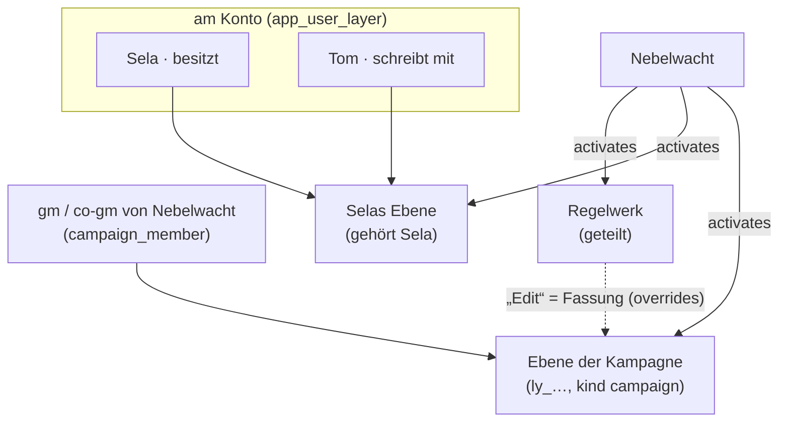

# Ebenen und Stapelauflösung

Stand 2026-09-20. REQ-004 bis 009 und REQ-044 aus
[`VTT/`](../VTT/) in diesem Repo (überholt durch [Datenmodell.md](Datenmodell.md)).

---

> **Nicht zu verwechseln mit den Zeichenebenen einer Karte.** Die hier
> sagen, *welche Artikel es überhaupt gibt*; die auf einer Karte sagen,
> *was auf dem Bild liegt*. Sie heissen im Schema `sheets` und sind in
> [Karten.md](Karten.md) beschrieben.

## Die Frage, die dahintersteht

Eine Kampagne besteht selten nur aus dem, was ihre Leitung geschrieben hat.
Darunter liegt ein Grundregelwerk, daneben ein gekauftes Abenteuer, darüber
die Hausregeln, und irgendwo dazwischen die eine Regel, auf die man sich am
Tisch geeinigt hat, weil die gedruckte nicht taugte.

Die alte App kannte davon nichts. Wer die Regel „Verstrickt“ nicht wollte,
löschte sie — und beim nächsten Import war sie wieder da, weil sie dem
Grundregelwerk gehört und nicht der Kampagne.

---

## Wie es hier gelöst ist

**Ein Artikel ohne `inLayer`-Kante gehört der Kampagne und ist immer da.**
Das ist der Normalfall, und er soll keine Zeile kosten: wer keine Pakete
benutzt, merkt vom Stapel nichts.

Eine **Ebene** (`Layer`) sammelt, was zusammengehört. Die
Kampagne schaltet sie mit einer `activates`-Kante auf; die Reihenfolge steht
an der Kante, sonst an der Ebene. Was eine aufgeschaltete Ebene mitbringt,
ist da.

Eine höhere Ebene hat zwei Werkzeuge:

| Werkzeug | Zeile | Wirkung |
|---|---|---|
| **Überschreiben** | `overrides` vom neuen auf den alten Artikel | Der alte bleibt liegen, der neue gilt |
| **Herausnehmen** | `inLayer` mit `mode: "removes"` | Der Artikel ist aus dem Spiel, solange die Ebene läuft |

**Löschen wäre in beiden Fällen falsch.** Der Artikel gehört der anderen
Ebene; ein Löschvorgang wäre beim nächsten Import rückgängig gemacht, und er
wäre nicht rückgängig zu machen, wenn man die Ebene wieder abschaltet.

---

## Die Auflösung ist eine Abfrage

Was gerade gilt, wird **beim Lesen berechnet und nie gespeichert** — dieselbe
Regel wie bei abgeleiteten Werten (D8). Der ganze Mechanismus sitzt in zwei
Funktionen:

> Seit dem 7.10. (A2) steht die Rechnung einmal, in `packages/model/src/stack.ts`
> (`currentCampaign`, `activeStack`, `inStack`, `overriderOf`,
> `resolveArticle`, `inPlay`), und der Server siebt damit **vor** der
> Sichtbarkeit — für jeden, auch die Verwaltung. Der Prototyp rechnet gleich.

- `inStack(e)` — steht dieser Artikel im laufenden Stapel? Ohne Ebenenkante:
  ja. Mit: nur, wenn eine aufgeschaltete Ebene ihn hinzufügt und keine
  spezifischere ihn herausnimmt (`addAt > remAt`, beides Ränge im Stapel).
- `resolveArticle(e)` — folgt der Kette von Überschreibungen bis zum Ende,
  aber nicht im Kreis (Sicherung bei acht Schritten).

Beide hängen in `articleVisible`, also genau dort, wo auch Sichtbarkeit und
Wissen hängen. **Wer eine dritte Stelle bräuchte, hätte das Modell
verfehlt** — und genau das ist der Test, ob die Ebenen richtig modelliert
sind.

Eine Überschreibung, die zu keiner Ebene gehört, zählt nicht. Sie wäre keine
Überschreibung, sondern eine Bearbeitung — dafür gibt es den Artikel selbst.

---

## Die Ebene sagt auch, wem ein Artikel gehört

Seit dem 30.9. hat der Stapel eine zweite Aufgabe. Eine Kampagne nennt ihre
Leitung (am Konto: `campaign_member`, Rolle `gm` oder `co-gm`), und `audience: 'gm'`
fragt nicht mehr „ist das die Verwaltung dieser Installation", sondern **„ist
das die Leitung der Kampagne, der dieser Artikel gehört"**.

Wem er gehört, steht in keinem Feld — es fällt aus dem heraus, was ohnehin
dasteht:

> Eine Ebene, die genau **eine** Kampagne aufschaltet, gehört ihr. Eine, die
> **mehrere** aufschalten, ist gemeinsam.

| Der Artikel liegt … | `audience: 'gm'` heisst |
|---|---|
| in der Ebene **einer** Kampagne | nur deren Leitung |
| in einer Ebene, die **mehrere** aufschalten | jede Leitung |
| in **keiner** Ebene | jede Leitung |

Das Grundregelwerk, das drei Runden aufschalten, gehört keiner davon; seine
Spielleitungshinweise vor den anderen zwei zu verbergen wäre eine Sperre ohne
Grund. Die Hausregeln, die nur eine Runde aufschaltet, gehören ihr.

**Warum kein Feld:** `Layer.kind` kennt ein Wort `campaign`, und es wäre
naheliegend, daran zu hängen. Ein Feld, das gleichzeitig Regel ist, leckt
aber beim ersten Tippfehler — ein Paket, das versehentlich `campaign` heisst,
gehörte plötzlich wem? Und ein geteiltes Paket mit `kind: 'campaign'`, das
drei Runden aufschalten, gehörte welcher? Das `kind` bleibt Beschreibung.

`mode: 'removes'` zählt nicht mit: eine Ebene, die den Artikel herausnimmt,
bringt ihn nicht mit und besitzt ihn nicht.

> **Die dritte Zeile ist heute die häufigste.** Fünfundsechzig von
> fünfundsiebzig Artikeln tragen keine Ebenenkante — das ist der Normalfall
> von oben, und er ist richtig, solange es *eine* Kampagne gibt. Sobald eine
> zweite dazukommt, braucht jede ihre eigene Ebene, sonst gehört jeder
> ungelegte Artikel beiden. Die Umkehrung („keine Ebene heisst gemeinsam,
> eigene Artikel liegen in der Kampagnenebene") kostet eine Wanderung über
> diese fünfundsechzig und eine Kante je neuem Artikel, die die Maske setzt.
> Sie ist **nicht** entschieden.

---

## Die Ebene sagt auch, wer darin schreibt (T-098, E-001)

Seit dem 14.10. hängt am Stapel eine dritte Frage: **wer einen Artikel
ändern darf.** Die Leitung entschied (E-001, eigener Weg): je Konto ist
verwaltbar, welche Ebenen es bearbeitet; eigene Ebenen legt jede und jeder
an; jede Kampagne hat eine eigene Ebene, die `gm` und `co-gm` bearbeiten;
was in anderen Ebenen liegt, ändert man als Fassung in einer eigenen.

- **Geschrieben wird, was ganz in eigenen Ebenen liegt** (`inWritableLayers`).
  Ein Artikel, der auch im Regelwerk liegt, gehört nicht ganz der Runde —
  ihn zu ändern hiesse, ihn in jeder Runde zu ändern, die das Regelwerk
  aufschaltet. Ein Artikel **ohne Ebene** gehört niemandem besonders und
  bleibt bei der Verwaltung; die Leitung ändert ihn als Fassung.
- **Die Ebene der Kampagne** ist dieselbe wie oben (`campaignLayer`), mit
  einer Ausnahme: **eine Ebene, die einem Konto gehört, ist es nie.** Schaltet
  die Leitung Selas Ebene auf, und sie ist die spezifischste, die nur diese
  Runde aufschaltet, bliebe sie sonst die „Ebene der Kampagne" — und Leitung
  wie Neuangelegtes landeten in Selas Ebene. Eine neue Kampagne bekommt ihre
  Ebene beim Anlegen, eine ältere über Migration 035.
- **Eine eigene Ebene wirkt erst, wenn sie aufgeschaltet ist.** Was in einer
  Ebene liegt, die die laufende Kampagne nicht aufschaltet, ist für niemanden
  da (die nullte Frage) — darum bietet der Server als Ziel für Anlegen und
  Fassung nur Ebenen an, die im Spiel sind (`zielEbenen`).
- **„Edit" an einem fremden Artikel** legt eine Fassung (`adaptedVersion`,
  E-018) in eine dieser Ebenen; bei mehreren fragt die Seite, welche. Das
  Original bleibt; zurück heisst, die Fassung zu löschen.
- **`ready` bleibt bei `gm`** der Kampagne, der der Artikel gehört. Ändert
  die Mitleitung oder eine Spielerin in ihrer Ebene etwas Fertiges, fällt es
  zurück (E-012), und für die anderen gilt der fertige Stand.

---

## Die Herkunftsanzeige (REQ-044)

Am Artikelkopf steht, woher er kommt: die Ebene, ob etwas ihn ersetzt, wovon
er eine Variante ist (`variantOf`). Nicht in einem Register, sondern dort, wo
man liest — die Frage stellt sich beim Lesen, nicht beim Verwalten.

Die Ansicht `stack` zeigt daneben die eine Frage, die sonst niemand
beantwortet: **was ist gerade nicht im Spiel, und warum.**

---

## Die Zeilen

| Art | Name | Zweck |
|---|---|---|
| Felder der Art | `Layer` | `kind`, `order`, `version` |
| Artikelart | `Layer` | `kind`, `order`, `version` an der Art selbst |
| Kante | `inLayer` | Artikel → Ebene, `props.mode: "adds" \| "removes"` |
| Kante | `activates` | Kampagne → Ebene, `props.order` |
| Kante | `overrides` | neuer Artikel → alter Artikel |
| Tabelle | `campaign_member` (Server), `members` (Prototyp) | wer in welcher Kampagne welche Rolle hat — am Konto, nicht an der Kampagne |
| Kante | `variantOf` | Fassung → Vorlage |
| Ansicht | `stack` | der Stapel und was er ausblendet |

---

## Schaudaten

Vier Ebenen belegen den Mechanismus:

- **Grundregelwerk** (`system`, Rang 10) — was in jedem Spiel gilt.
- **Paket: Nebeldistrikt** (`pack`, Rang 20) — die Orte und die Kreatur.
- **Hausregeln** (`overrides`, Rang 90) — enthält eine zweite Fassung von
  „Amorph“, die die erste über `overrides` ersetzt.
- **Verzicht: Verstrickt** (`overrides`, Rang 95, **nicht aufgeschaltet**) — nimmt die
  Regel „Verstrickt“ mit `mode: "removes"` heraus. Wer sie aufschaltet, sieht
  die Regel verschwinden; wer sie abschaltet, sieht sie wiederkommen. Nichts
  wurde dabei gelöscht.
