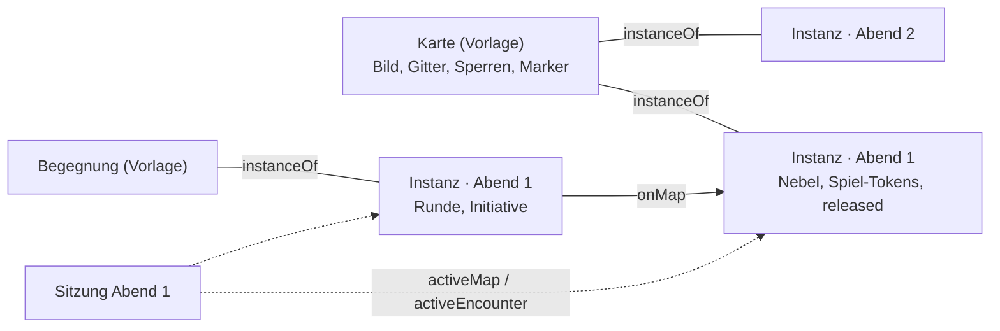

# Karten: Zeichenebenen, Sperren, Unterkarten

↑ [Technik](Themen/Technik.md) · [Einstieg](README.md)

Stand 2026-09-20. REQ-130 bis 140 und REQ-193 aus
[`VTT/`](../VTT/) in diesem Repo (überholt durch [Datenmodell.md](Datenmodell.md)).

---

## Achtung, ein Wort für zwei Dinge

„Ebene“ heisst in diesem Projekt zweierlei, und wer die beiden verwechselt,
sucht den Fehler an der falschen Stelle:

- **Inhaltsebene** — `Layer`, der Stapel aus
  [Ebenen.md](Ebenen.md). Sie sagt, *welche Artikel es überhaupt gibt*:
  Grundregelwerk, Abenteuer, Hausregeln.
- **Zeichenebene** — ein Blatt auf *einer* Karte. Sie sagt, *was auf dem
  Bild liegt*: Gelände, Beschriftung, Ruinen, Schnee.

Dazu kommt seit T-307 ein drittes:

- **Kartenebene** (Stockwerk, Geschoss) — `Map.floors`. Sie sagt, *in
  welchem Stock man steht*: Keller, Erdgeschoss, Turmspitze. Jede hat ihr
  eigenes Bild, Gitter, ihre Sperren und Blätter; in der Leiste heissen sie
  „Floors“. Siehe [Stockwerke und Portale](#stockwerke-und-portale-t-307).

Im Schema heissen die zweiten deshalb `sheets` (Kartenblätter) und nicht
`layers`. In der Kartenleiste steht trotzdem „Layers“, weil dort nichts zu
verwechseln ist — man steht auf einer Karte, und eine Inhaltsebene hat auf
ihr nichts zu suchen.

---

## Zeichenebenen

Jedes Blatt trägt ein Hintergrundbild, eine Deckkraft, einen Schalter für
sichtbar und einen dafür, ob es der Spielleitung gehört.

**Das unterste Blatt ist das Kartenbild selbst** (`Map.image`) und hat
keinen Eintrag in `sheets`. Das ist kein Sonderfall aus Bequemlichkeit: an
ihm hängt die natürliche Grösse der Karte, und aus ihr rechnen Nebel, Licht,
Gitter und jede Tokenposition. Eine Karte ohne unterstes Blatt hätte keine
Koordinaten.

Ausblenden lässt es sich trotzdem (`baseHidden`) — wer ein Gelände über eine
Skizze legt, will die Skizze weghaben, ohne sie zu verlieren. Ausgeblendet
heisst dann **durchsichtig und nicht weg**; die Grösse bleibt.

Die Leiste zeigt oben, was obenauf liegt. Gezeichnet wird von hinten nach
vorn, die Liste also rückwärts — eine Reihenfolge, die im Feld anders herum
steht als auf dem Schirm, sortiert früher oder später jemand falsch.

Ein Blatt mit `gmOnly` sieht nur, wer die Karte leitet. In der
Artefakt-Seite hält die Seite es zurück, weil sie keinen Server hat; im
echten Stapel tut es `redactEntity`, bevor es losgeschickt wird.

---

## Sperren: Wand, Tür, Fenster, Abgrund

Eine Liste, drei Fragen. `Map.walls` hiess einmal „Sichtblocker“ und
war es auch — jede Linie hielt den Blick. Jetzt trägt jede Linie ihre Art
(T-118, `packages/model/src/walls.ts`):

| Art (`kind`) | in der Leiste | Schritt | Blick | Licht |
|---|---|---|---|---|
| `wall` | Wall | hält | hält | hält |
| `door`, zu oder verschlossen | Door | hält | hält | hält |
| `door`, offen | Door | — | — | — |
| `secret` | Secret door | wie eine Tür; für Spielende eine Wand, bis sie offen ist | | |
| `window` | Window | hält | — | — |
| `chasm` | Obstacle | hält | — | — |
| `invisible` | Invisible wall | hält | — | — |

Die Art steht **an der Sperre** (`kind`) und nicht in Listen, die
dasselbe meinen: wer eine Tür zur Wand macht, ändert ein Feld und nicht den
Ort des Eintrags. Was eine Art hält, ist eine Zeile in `WALL_KINDS`, und
jede Rechnung fragt die Zeile (`wallBlocks`). Eine Linie ohne `kind` ist
eine Wand — was vor den Sorten gezeichnet wurde, bleibt, was es war; der
alte Schalter `open: true` des Prototyps wird als `state: 'open'` gelesen.

```json
{ "id": "w-1", "kind": "door", "x1": 0.5, "y1": 0.4, "x2": 0.5, "y2": 0.5, "state": "closed", "width": 0.012 }
```

**Gezeichnet werden die Sperren bei jedem Licht**, nicht nur im Dunkeln —
für die Leitung, nach Art gefärbt; was nur den Schritt hält, gestrichelt.
Spielende sehen keine Linien, nur die **Türen** als Knopf an ihrer Mitte.
Der Server schickt ihnen nur die Sperren am Rand des Aufgedeckten, eine
geschlossene Geheimtür als Wand und eine verschlossene als zu
(`redactWalls`) — dass sie klemmt, merkt man beim Versuch.

Am Werkzeug (Gruppe *Walls*, W): **Draw** tippt Punkt um Punkt, Enter oder
derselbe Punkt noch einmal beendet; **Points** zieht eine Ecke, **Set
kind** macht eine angetippte Sperre zur gewählten Art, **Lock** schliesst
eine Tür ab oder auf, **Erase** nimmt eine weg. Geöffnet wird in der
Auswahl: ein Klick auf die Tür. Eine Tür, die man nur über ein Menü
aufbekommt, bleibt am Tisch zu.

### Zeichnen: Formen, Türen, Einrasten, Schneiden (T-304)

Gerechnet in `packages/model/src/mapdraw.ts`, gezeichnet in
`apps/web/src/app/karten/karte.ts` (Schalter in `karten/editor.ts`).

- **Eine Form ist eine Folge von Sperren** und kein eigener Eintrag:
  Linienzug, Linie, Rechteck, Ellipse und Polygon (`DRAW_SHAPES`) werden
  beim Fertigstellen zu Strecken in `Map.walls` (`shapeOutline`,
  `outlineWalls`). Sicht, Licht und Zugplan lesen dieselbe Liste wie
  vorher — eine Form als eigene Sorte Sperre müsste jede Rechnung zweimal
  fragen. Der Schalter **Closed** schliesst den Linienzug; Rechteck,
  Ellipse (24 Ecken, `ELLIPSE_STEPS`) und Polygon sind immer geschlossen,
  die Linie nie.
- **Eine Tür ist ein Viereck über der Öffnung:** gezogen als Linie (zwei
  Punkte), die Dicke kommt dazu — `width` am Eintrag, in Anteilen der
  Breite, beim Zeichnen ein Teil eines Feldes (Vorgabe 25 %), ohne Angabe
  `DOOR_WIDTH`. Geklickt wird das Viereck (`doorRect`), gerechnet die
  Mittellinie: die Dicke ist Griff und Bild, keine zweite Sperre.
- **Einrasten mit Stärke** (`snapPoint`): an einen vorhandenen Punkt, eine
  Gitterecke (Quadrate) oder eine Linie, so weit, wie der Regler sagt —
  in **Bildschirmpunkten**, also beim Zoomen gleich, am Telefon um 1,6
  weiter. Der Punkt geht vor der Ecke, die Ecke vor der Linie. Alt setzt
  ohne Einrasten.
- **Die Lupe** (T-315): in jedem Werkzeug, das einen Punkt setzt (Draw,
  Points, Set origin, Pick a square, Add marker), öffnet **Halten** eine
  Lupe über dem Finger — Kartenbild, Gitter und Sperren dreifach, ein
  Fadenkreuz in der Mitte, der Einrastring dazu. Ziehen zielt, Loslassen
  setzt dort, wie ein Antippen. Wer vor dem Aufgehen zieht, schiebt die
  Karte; ein zweiter Finger schliesst sie. Gezeichnet im Browser, nichts
  davon wird gespeichert.
- **Schneiden** (Schalter *Cut walls*, Vorgabe an): eine Tür oder ein
  Fenster über einer Wand teilt die Wand (`cutWalls`); die Teile enden
  genau an den Rändern der Öffnung. Getroffen ist, was auf der Geraden der
  Öffnung liegt (ein paar Bildschirmpunkte Spiel) und sich mit ihr
  überlappt; eine Tür in einer Tür schneidet nicht. Wird die Öffnung
  gelöscht, **bietet** die Seite an, die Wand wieder zusammenzufügen
  (`joinAround`) — nicht still: vielleicht war die Lücke gewollt.
- **Punkte zeigen und ziehen** (`wallPoints`, `moveWallPoint`): jedes Ende
  an derselben Stelle wandert mit, zwei Wände an einer Ecke bleiben
  verbunden; wird eine Sperre zum Punkt, fällt sie weg.

Die Schalter gehören dem Werkzeug und nicht der Karte: der Browser merkt
sie sich (`localStorage`), eine Karte trägt sie nicht.

### Das Gitter auf der Karte setzen (T-304)

Gruppe *Grid* (G): **Set origin** legt zwei Gitterlinien auf einen Punkt
(`gridOrigin`), **Pick a square** nimmt zwei gegenüberliegende Ecken eines
Feldes und daraus Grösse (Mittel aus Breite und Höhe) und Versatz
(`gridFromCell`); Regler und Zahlen stellen fein nach. Geschrieben werden
die Felder, die es gibt — `gridShape`, `gridSize`, `gridOffsetX`,
`gridOffsetY` (`setGrid`) —, zuerst als **Vorschau** in der Seite, mit
*Save grid* an der Karte. Wer die Gruppe mit einer Vorschau verlässt, wird
gefragt.

**Fein einstellen** (T-314): Pfeile für Grösse (0,05 px) und Versatz
(0,5 px), mit Umschalt zehnmal so weit; der Grössenregler reicht nur
±10 % um die Grösse beim Öffnen (Schritt 0,01 px) — über 10 bis 300 px
war eine Grösse zwischen 15,3 und 15,4 nicht zu treffen. Eine getippte
oder abgegriffene Grösse wird die neue Mitte.

**Aussehen** (T-314): `gridColor` (`#rrggbb`, Farbton und Sättigung aus
der Farbwahl; leer das Braun der Vorgabe), `gridOpacity` (0–1, Vorgabe
0,5) und `gridHidden`. Ausgeblendet fehlt nur das Bild: gemessen,
eingerastet und geplant wird weiter auf dem Gitter (`gridStroke`).

### Tokens am Gitter (T-317)

**Der Platz eines Tokens in Feldern** (`tokenSpan`): was das Token selbst
sagt (`marker.props.size`, Tokens › Size, auch 0,5 oder 1,5), sonst die
Grösse seines Statblocks nach der Tabelle der Kampagne
(`Campaign.tokenSizes`: `rules` — tiny, small, medium ein Feld, large 2,
huge 3, gargantuan 4 — oder `tinyHalf` mit tiny als halbem Feld), sonst
ein Feld. Der Server gibt die Grösse je Ziel im Kartenkontext mit
(`targets[id].size`, gesiebt gelesen). Dieselbe Zahl zeichnet das Token
und rastet es ein.

**Einrasten** (`Map.snapTokens`, Vorgabe an; `snapTokenCentre`): beim
Ziehen, Setzen und Platzieren landet der Mittelpunkt so, dass der Platz
auf dem Gitter liegt — ein Feld in der Feldmitte, zwei Felder auf einer
Ecke; gebrochene Plätze rasten an halben (oder Viertel-)Feldern. Auf Hex
in die Feldmitte. Möbel (`scenery`) rasten nicht. Der Zugplan rechnet
weiter in ganzen Feldern nach Statblock (D58).

### Gespielte Stände an der Karte (T-316)

„Played“ an der Vorlage (T-289) steht offen; jeder Stand hat **Open in
Play** (`/play?map=<stand>&session=<sitzung>`), ebenso der Hinweis „Map in
play“ auf der Seite eines Standes.

### Türen am Tisch

`POST /api/maps/:id/door` `{wall, state, nat}` schaltet eine Tür. Die
Leitung schaltet jede in jeden Zustand. Spielende öffnen und schliessen,
wenn die Kampagne es sagt (`Campaign.doors: 'players'`, Vorgabe), eine Tür,
die ihre Karte als Tür trägt, mit einer eigenen Figur höchstens
anderthalb Felder davon.

### Sichtlinie

Das **Sichtpolygon** (`visionPolygon`) rechnet von einem Punkt aus, bis die
nächste Sperre den Blick hält — mit Strahlen auf jede Ecke einer Strecke
(knapp davor, genau, knapp dahinter) in einem Raum mit gleichen Achsen.
Aufgedeckt wird damit:

- **beim Zug** (wenn `revealOnMove` gilt): von den Punkten des Weges aus,
  höchstens sechs, der letzte immer (`revealAlong`) — als Form `poly` mit
  `for` auf die Figur. Ohne Sperren auf der Karte bleibt es der
  Pinselstrich zwei Felder breit: ohne Wand reichte der Blick über die
  ganze Karte.
- **beim Öffnen einer Tür**: für jede Figur der Gruppe, die die Tür sieht,
  was sie jetzt dahinter sieht (`tuerAufdecken`).

Ohne Token, das zieht, deckt nichts von selbst auf — dann deckt die
Leitung von Hand auf. Wie weit der Blick im Dunkeln reicht, sagt der
nächste Abschnitt.

### Licht und Dunkelsicht (T-216)

`packages/model/src/lighting.ts`, REQ-140.

- **Die Karte sagt, wie hell es ist** (`Map.lighting`: `bright`, `dim`,
  `dark`; ohne Angabe hell). Gesetzt unter Light › Lighting.
- **Ein Licht ist ein Marker mit Radius** (`marker.props.light` hell,
  `dim` der ganze Radius, beides in Feldern; `mapLights`). Kein eigener
  Artikel: dieselbe Laterne leuchtet auf einer Stadtkarte anders weit als
  auf einer Kampfkarte. Gesetzt mit Light › Light source (ein Token,
  Asset oder Marker antippen; 0 und 0 nimmt das Licht weg).
  **Ein Licht ohne Artikel** (T-320) — eine Fackel an der Wand, ein
  Lichtschacht — ist ein Marker `kind: 'light'`, der wie ein Übergang auf
  seine eigene Karte zeigt (`addLight`): Light source und auf eine freie
  Stelle tippen. Spielende sehen nur seinen Schein, keinen Marker; ziehen
  tut es nur die Leitung. Solange „Light" offen ist, zeigt die Karte der
  Leitung die Reichweite jedes Lichts als Kreis — auf einer hellen Karte
  sähe man sonst nicht, ob ein Licht gesetzt ist. Was ein Licht erreicht, ist das
  Sichtpolygon gegen die Sperren, die **Licht** halten (`lightPolygon`,
  `litAreas`).
- **Die Dunkelsicht steht am Statblock** (`senses`, „darkvision 60 ft.")
  und wird beim Lesen gezogen (`darkvisionFor`, D8), durch eine Instanz
  hindurch auf ihre Vorlage. Das Gruppen-Token sieht so weit wie die Figur
  der Gruppe, die am weitesten sieht. Fuss werden über den Massstab der
  Karte in Felder umgerechnet (`feetPerSquare`: „1,5 m" sind 5 ft).
- **Was eine Figur sieht** (`figureView`): auf einer hellen oder
  dämmrigen Karte bis zur nächsten Sperre; im **Dunkeln** so weit wie ihre
  Dunkelsicht, dazu von jedem Licht der Teil, in den sie hineinsieht —
  auch durch eine Tür in einen Raum, dessen Laterne hinter der Wand
  steht. **Die Schnittmenge wird nicht ausgerechnet:** gespeichert wird
  das Lichtpolygon mit dem Sichtpolygon als Klammer (Form `poly` mit
  `within`); `inShape` fragt beide, die Leinwand zeichnet mit `clip()`.
  Zwei beliebige Polygone zu schneiden wäre eine Rechnung mit vielen
  Sonderfällen.
- **Aufgedeckt** wird beim Zug und beim Öffnen einer Tür genau das
  (`revealSeenAlong`, `revealView`): im Dunkeln ohne Dunkelsicht und ohne
  Licht nichts. Ein Polygon, das für dieselbe Figur schon dasteht, kommt
  nicht noch einmal dazu.

**Gezeichnet** wird in zwei Leinwänden unter dem Nebel (`schichtMalen`,
nebel.ts):

1. **Dunkelheit** auf einer dämmrigen oder dunklen Karte; helles Licht
   schneidet sie ganz heraus, Dämmerlicht und die Dunkelsicht der eigenen
   Figur zur Hälfte. Alle Polygone eines Schnitts in einem Pfad — zwei
   überlappende Dämmerlichter bleiben Dämmerung. Die Leitung sieht durch.
2. **Die laufende Sicht** (wie Owlbears „Dynamic Fog"): auf einer Karte mit
   Nebel ist hell, was die eigene Figur **gerade** sieht, das einmal
   Aufgedeckte gedämpft; der Nebel darüber deckt den Rest. Gerechnet im
   Browser aus der Karte, die er bekommt — also gegen die Sperren am
   Aufgedeckten (`redactWalls`); was dahinter fehlt, liegt ohnehin unter
   dem Nebel. Die Dunkelsicht dafür schickt der Kartenkontext
   (`darkvision`, je eigener Figur und Gruppen-Token; für die Leitung je
   Spiel-Token). In der Spielersicht der Leitung gilt die gewählte Figur,
   sonst das Gruppen-Token. **Die Sicht gilt den Spielertokens**
   (T-305, die Leitung 20.10.): das Gruppen-Token zählt nur, solange keine
   Figur der Spielenden auf der Karte steht — für die laufende Sicht wie
   fürs Aufdecken an einer geöffneten Tür. Die Spielersicht ist die
   Vereinigung der eigenen Figuren.
   **Auch ohne Nebel endet die Sicht an der Wand** (T-305): hält auf der
   Karte etwas den Blick, oder ist sie dunkel, deckt die Schicht für
   Spielende fast ganz zu, was ihre Figuren gerade nicht sehen — ein
   Licht hinter einer geschlossenen Tür bleibt dunkel. Mit Nebel bleibt es
   beim Gedämpften (das Gedächtnis).
3. **Dunkelsicht in Graustufen** (T-305): auf einer dunklen Karte nimmt
   eine dritte Leinwand (`grauMalen`, `mix-blend-mode: saturation`) dem
   Bild die Farbe, wo nur die Dunkelsicht hinreicht; was ein Licht
   erhellt, bleibt farbig. Die Leitung sieht die Karte, wie sie ist; in der
   Spielersicht und mit „View as" (T-269) wie die Spielenden.

### Lichter an Gegenständen, an und aus (T-305)

**Licht ist ein eigenes Werkzeug** (Light, Taste L): Helligkeit der Karte,
Light source und Light on/off stehen dort und nicht mehr unter Fog.

- **Ein Gegenstand leuchtet** mit `Item.lightBright` (hell, in Fuss) und
  `Item.lightDim` (dämmrig **darüber hinaus**, wie die Regel schreibt: eine
  Fackel 20 ft hell, weitere 20 ft dämmrig). Liegt er als Marker auf der
  Karte (Kulisse: der Fackelhalter, die Laterne), leuchtet der Marker;
  hält eine Figur ihn **in der Hand** (Platz `mainHand`/`offHand`, `inHand`),
  leuchtet ihr Token, ein Gruppen-Token wie sein hellstes Mitglied
  (`itemLight`, `carriedLight`, `carriedLights`). Gerechnet beim Lesen
  (D8): wer die Fackel verstaut, löscht sie. Der Kartenkontext schickt die
  Radien (`lights`, je Markerziel), Zug und Tür am Server rechnen gleich.
- **Ein Radius an der Kante schlägt den des Gegenstands** — dieselbe
  Laterne darf auf einer Karte weiter leuchten.
- **An und aus** (`marker.props.lightOff`, Light › Light on/off): die Radien
  bleiben, das Licht ist nur gerade aus — auch das getragene.
- **Leistung:** die Strahlen rechnen über Zahlenreihen statt Objekte, und
  die Fläche eines Lichts wird je Sperrenliste zwischengespeichert
  (`lightPolygon`) — beim Ziehen eines Tokens ändern sich die Sperren nicht.
  Gemessen mit 200 Sperren und vier Lichtern: eine Sicht samt Dunkelsicht
  rund 6 ms am Rechner (`sichtlicht.test.ts` prüft unter 60 ms).

Noch nicht: Tokens im Dunkeln, die die Figur nicht sieht, stehen für
Spielende weiter da (zurückgehalten wird nur unter dem Nebel).

Ein Zug einer Spielerin durch eine Sperre, die den Schritt hält, wird
abgelehnt („A wall is in the way.“); der Zugplan rechnet dieselben Sperren
als Wände (`planGrid`). Die Leitung zieht weiter durch alles.

---

## Unterkarten

`insideMap` ist die Kante vom Kind zum Elternteil — gespeichert wird nur
vorwärts, die Karte nennt ihre Umgebung. An der Kante steht der Rahmen
(`x`, `y`, `w`, `h` in Anteilen), also **wo** auf der grossen Karte die
kleine liegt.

Der Rahmen wird mit dem Werkzeug *Sub-maps › Link map* aufgezogen und nicht
in die Mitte gelegt (T-320): Rahmen ziehen, die Karte wählen, die dort
liegt — geschrieben wird an ihr (`insideMap` mit dem Rahmen; eine alte
Kante wird ersetzt, denn eine Karte liegt in genau einer). *Unlink* nimmt
die Kante wieder weg; die Karte bleibt. Zur Wahl stehen alle Karten ausser
dieser und denen darüber — sonst entstünde ein Kreis. Eine Karte im Spiel
verlinkt nichts, das tut ihre Vorlage. Eine Karte, die zeigt, wo sie liegt, ist der halbe Zweck der
Verschachtelung: `world > continent > settlement > district > battle` ist
eine Kette von Rahmen, und ein Klick hinein ist der Zoom.

Alles in Anteilen, nie in Bildpunkten — dieselbe Entscheidung wie bei Nebel
und Tokens. Eine Karte, die neu ausgeschnitten wird, verlöre sonst jeden
Rahmen.

---

## Stockwerke und Portale (T-307)

Ein Turm, ein Keller, ein Schiff mit drei Decks: **eine Karte, mehrere
Ebenen** (E-108). Unterkarten (oben) sind für einen anderen Massstab —
Region, Stadt, Haus —, nicht für gestapelte Geschosse, die gemeinsam
gespielt werden.

**Eine flache Liste, keine Stapelnummer.** Je Ebene ein Name, ein
Gebäudeteil (`structure`: Halle, Westturm, Ostturm) und optional ein
Höhenbereich (`elevation`, von–bis in Fuss). Welche Ebenen verbunden sind,
sagen **allein die Übergänge**, nie die Reihenfolge. So decken sich zwei
ungleich hohe Türme ab:

| Ebene | Gebäudeteil | Höhe |
|---|---|---|
| West 1 | West tower | 0–20 ft |
| East 1 | East tower | 0–10 ft |
| East 2 | East tower | 10–20 ft |

West 1 liegt neben East 1 *und* East 2 (`elevationsOverlap`); eine Brücke
von West 1 nach East 2 ist ein Übergang wie jeder andere. Die Leiste
gruppiert nach Gebäudeteil und sortiert darin nach Höhe (`floorGroups`);
zwei Bereiche auf derselben Höhe dürfen auch eine Ebene sein — ein Bild mit
beiden Turmsockeln.

**Die erste Ebene ist die Karte selbst** („Ground"): ihr Bild ist
`Image.image`, Gitter, Sperren und Blätter stehen, wo sie vor T-307
standen. Bestehende Karten sind darum ohne Umschreiben Karten mit einer
Ebene (Migration 112 zieht das Register nach und zählt sie). Jede weitere
Ebene trägt in `Map.floors` **dieselben Felder** — eigenes Bild, eigenes
Gitter, **eigener Massstab** (ein Turm kleiner, ein Keller grösser), eigene
Sperren und Blätter, eigenes Licht (`lighting`). Ein Marker steht auf der
Ebene, die `props.floor` nennt, ohne Angabe auf der ersten.

**Gerechnet wird je Ebene über eine Projektion** (`floorView`): eine
Ebene sieht aus wie eine Karte ohne weitere Ebenen, mit ihrem Bild, Gitter,
Nebel und nur ihren Markern. Sicht, Licht, Messen, Aufdecken, Türen,
Zugplan und Zurückhalten rechnen damit unverändert; `withFloorView`
schreibt eine geänderte Ebene in die Karte zurück.

**Nebel und Freigabe sind Stand am Tisch** und stehen neben den Ebenen:
`Map.floorReveal` (je Ebene die aufgedeckten Formen) und
`Map.floorReleased` (`false` hält eine Ebene zurück). An einer Instanz
(T-289) kopiert ein Aufdecken im Keller so nicht alle Ebenen der Vorlage
in die Instanz. Eine Ebene mit `gmOnly` geht nie an Spielende, eine
zurückgehaltene erst nach „Held back“ aus — beide samt ihren Markern und
den Übergängen, die dorthin führen (`redactFloors`; ein Treppenpfeil in
ein verborgenes Geschoss verriete es). Das beschnittene Kartenbild
(T-312) gilt je Ebene: die Adresse nennt `ebene~blatt`.

### Übergänge

Ein Übergang ist **eine Markerart** (`kind: 'passage'`) mit Ziel
{Karte, Ebene, Punkt}: die Kante zeigt auf die Zielkarte (dieselbe für
Treppe und Leiter), `toFloor`, `toX`, `toY` sagen Ebene und Punkt dort.
Gestalten: `stairs`, `ladder`, `bridge`, `portal`. Gesetzt wird mit
Floors › Add passage: das Ende hier antippen, „Leads to“ wählen, das Ende
dort antippen — oder „another map…“ für ein Portal auf eine andere Karte
(es führt auf deren erste Ebene, in die Mitte).

- **Beide Richtungen** (Vorgabe): am Ziel steht ein **gespiegeltes Ende**
  (`passageEnds`, gestrichelt), kein zweiter Marker — ein Paar von Hand zu
  pflegen hiesse, dass eines wandert und das andere nicht.
- **Einbahn** (`oneWay`): kein gespiegeltes Ende, also kein Weg und kein
  Blick zurück.
- **Durchsehen oder nur durchgehen** (`sight: through | none`): wer auf
  einem Ende steht, durch das man sieht, sieht auch vom Zielpunkt aus —
  auf der Zielebene, mit deren Sperren und **in deren Massstab**
  (`sightInto`). Ein Portal mit `none` zeigt nichts von drüben.

**Durchgehen:** ein Token, das man nah an einem Ende loslässt (ein halbes
Feld), steht genau darauf. Antippen des Übergangs zeigt das Ziel, „Show
…“ und „Take … through“: `POST /api/maps/:id/move` mit `via` versetzt
das Token auf Zielebene und Zielpunkt (`goThrough`) — wer es ziehen darf,
darf es durchgehen lassen; mit Bestätigung durch die Leitung (`moves:
confirm`) und im Kampf wartet auch das. Ein Portal auf eine andere Karte
versetzt nichts: das Token gehört dort einer anderen Instanz; der Knopf
öffnet die Karte.

**Später:** Sicht zwischen Ebenen nur über Übergänge — ein Fenster nach
aussen, der Blick vom Turmdach in den Hof wird ein eigener Übergang
„Ausblick“. Das Aufdecken beim Ankommen oben (heute deckt erst der nächste
Zug auf) und das Versetzen in die Instanz einer anderen Karte kommen
danach.

---

## Hineinzoomen statt hineinspringen

Das Rad zoomt. Füllt ein Unterkartenrahmen den Blick — mehr als 55 % in
**beiden** Richtungen; ein Rahmen, der nur quer voll ist, ist ein Streifen
und kein Ziel —, dann wird er aufdringlich: durchgezogen, beschriftet,
„zoom in to enter". **Erst der Schritt danach betritt ihn.**

Zwei Stufen, weil eine Schwelle allein ein Sprung wäre, den niemand kommen
sieht. Und zurück geht es genauso: wer auf einer Unterkarte ganz
hinauszoomt, landet auf der Karte darüber. Ohne das wäre das Hineinzoomen
eine Einbahnstrasse.

**In Play nur, wenn die Sitzung es erlaubt** (T-308). Auf einer Karte im
Spiel bleiben Spielende, wo der Tisch ist: der Schalter
`Session.mapNavigation` (Vorgabe aus, in der Kartenleiste der Leitung
„Players stay here" / „Players change maps") sagt, ob sie zoomen dürfen.
Aus schickt der Kontext ihnen weder Brotkrumen noch Rahmen
(`navigation: false`), und die Seite fällt beim Hinauszoomen auch nicht
auf die Kante der Karte zurück — Rahmen sind Bild. An führen Rahmen und
Brotkrumen **nur in Instanzen derselben Sitzung**, die freigegeben sind;
eine Vorlage, die nicht im Spiel ist, ist für sie kein Ziel. Die Leitung
navigiert immer, im Spiel in die Instanz der Sitzung, wenn es eine gibt,
sonst in die Vorlage. Gesiebt wird am Server (`/api/maps/:id/context`).
Abseits des Spiels (eine Vorlage, in der Vorbereitung) gilt die
Sichtbarkeit allein.

Gemessen wird das Sichtfenster, **gerechnet** das Bild. Beim Zeichnen hängt
das neue Bild noch nicht im Baum — es zu messen ergäbe null, und dann wäre
jeder Rahmen winzig, obwohl er den halben Schirm füllt. Die Breite des
Bildes ist ohnehin Zoom mal Fenster; sie auszurechnen ist genauer, als sie
abzulesen. Die Fenstergrösse wird nach jedem Zeichnen gemerkt: sie ändert
sich mit dem Fenster und nicht mit dem Zoom.

**Eine fehlende Messung ist keine Messung von null.** Die Höhe des Fensters
steht nicht immer — beim Zeichnen hängt die Bühne nicht im Baum, und ein
Bild, das noch lädt, gibt ihr keine. Dann zählt die Breite allein. Solange
die Höhe als null in die Rechnung ging, war der Anteil immer null: der
Rahmen sagte nie an, und der Zoomschritt, der ihn hätte ankündigen sollen,
betrat ihn.

---

## Der Kasten ist das Bild

Alles, was in Kartenkoordinaten liegt — Tokens, Gitter, Nebel,
Zeichenebenen, Unterkartenrahmen —, steht in Prozent von `.mapinner`.
Also muss `.mapinner` **genau so gross sein wie das Bild**, und gezoomt
wird der Kasten und nicht das Bild darin.

Es war einmal umgekehrt: der Kasten blieb so breit wie die Bühne
(`min-width:100%`), und das Bild darin wuchs mit dem Zoom. Ein Token bei
`left:50%` sass danach in der Mitte der *Bühne* statt in der Mitte der
Karte — es wanderte beim Hineinzoomen weg von der Stelle, auf die es
gesetzt worden war. Ein Token wächst mit der Karte, weil es eine Fläche
darauf belegt; wandern darf es nicht.

---

## Möbel statt Tokens

Ein Token ist ein Kreis mit einem Rand: jemand steht auf der Karte. Ein
Möbel liegt auf ihr. Die Tokenart `scenery` wird deshalb ohne Kreis,
ohne Rand und ohne Schatten gezeichnet — erst beim Darüberfahren zeigt
es, dass man es anfassen kann.

Dazu zwei Angaben an der Kante:

- `rot` — die Drehung in Grad.
- `ratio` — Höhe geteilt durch Breite. Ohne sie wäre jeder Tisch ein
  Quadrat. Nur `scenery` braucht es; eine Kreatur belegt Felder, kein
  Rechteck.

Beide stehen **an der Kante** und nicht am Asset: dasselbe Fass steht auf
einer Karte quer und auf der nächsten längs, und ein gedrehtes Bild als
eigenes Asset wäre ein zweites Fass. Dieselbe Regel wie beim Lichtradius.

Rechtsklick auf ein Token stellt es ein — Art, Grösse, Drehung,
Seitenverhältnis, Notiz, Licht — und nimmt es nicht mehr sofort weg. Ein
Rechtsklick, der ohne Rückfrage etwas löscht, ist der Klick, den man auf
einem Laptop-Touchpad aus Versehen macht. Der Weg hinaus steht im selben
Dialog, mit Rückfrage.

### Assets: fix oder verschiebbar (T-306)

In der Seite heisst ein Möbel **Asset**: Tokens › **Add asset** setzt
eines (dasselbe Bild darf zehnmal dastehen, es rastet nicht), Tokens ›
**Asset** stellt ein angetipptes ein — Breite in Feldern, Höhe ÷ Breite,
Drehung (⟲ ⟳ in 15°-Schritten), **Movable in play** und **Blocks**.

- **Vorgabe fix.** Ein Asset bewegt sich in Play nicht, auch für die
  Leitung nicht: die richtet es in der **Bearbeitung** ein (auf der Seite
  der Karte, wer sie schreibt — dort ist jedes zieh-, dreh- und
  skalierbar). Mit `movable` schiebt es in Play die Leitung immer und
  Spielende, wenn die Kampagne sie mehr als die eigene Figur ziehen lässt
  (`tokenMove` `party`, `allies`, `all`) und Züge nicht erst bestätigt —
  ein Vorschlag nennt eine Figur, und eine Kiste ist keine. Geschrieben
  wird an der offenen Karte, im Spiel also an der Instanz (T-289), nicht
  an der Vorlage.
- **Was es hält** (`blocks`): eine Sperrart ausser Türen — Wand (Schrank:
  Schritt, Blick, Licht), Fenster, Hindernis (Kiste: nur der Schritt),
  unsichtbare Wand. Der gedrehte Umriss wird **beim Lesen** zu vier
  Sperren dieser Art (`assetWalls`); in `Map.walls` steht nichts davon,
  sonst wanderte die Sperre nicht mit der Kiste. Sicht, Licht und der Weg
  eines Zuges rechnen damit (`blockingWalls`), der Server prüft den Schritt
  der Spielenden gegen dieselben Sperren.
- **Licht** wie an jedem Marker (Light › Light source, an/aus) — eine
  Laterne, die als Schrank sperrt, leuchtet aus sich heraus.

---

Mit dem Werkzeug *Sub-map* lässt sich ein gesetzter Rahmen auch wieder
anfassen: aus der Mitte heraus ziehen verschiebt ihn, an seiner Ecke ändert
die Grösse, und daneben entsteht ein neuer. Ein Rahmen, den man nur neu
aufziehen kann, wird beim ersten Vertun neu aufgezogen — und die Unterkarte
hängt danach zweimal.

Die Ecke misst in Anteilen und nicht in Bildpunkten: auf einer
herangezoomten Karte wäre eine Ecke von zwanzig Bildpunkten ein Fleck, auf
einer herausgezoomten der halbe Rahmen.

---

## In der Seite (T-115)

Die Seite zeichnet die Karte mit `nw-karte` — auf der Artikelseite
(Layout-Element `map`) und unter **Play** (`/play`). Gerechnet wird in
`packages/model/src/map.ts`, nicht in der Komponente: Blätter
(`drawnSheets`), Gitter und Messen (`gridGeometry`, `measure`), Rahmen
und der Schritt hinein oder hinaus (`frameShare`, `zoomStep`), das
Gruppen-Token (`partyPosition`) und was ein Spieler nicht bekommt
(`redactMap`). Dieselben Regeln wie oben; die Tabelle K1–K7 in
[Datenmodell.md](Datenmodell.md) sagt, wo was steht.

- **Gesten:** ein Finger oder die Maus schwenkt, das Rad und zwei Finger
  zoomen, `+`/`-` auf der Tastatur auch. Ein Marker antippen öffnet seine
  Kurzansicht mit „Open article" — wie jeder genannte Artikel.
- **Play folgt der Sitzung** (`SessionState.activeMap`, `GET /api/play`).
  Wer unter Play in eine Unterkarte zoomt, schaut hinein (`?map=`) — die
  Sitzung und der Beamer bleiben, wo sie sind.
- **Der Stand kommt aus dem Bestand.** Die Karte ist ein Artikel; was
  neben ihr steht (Brotkrumen, Unterkarten, Markerziele, Gruppe), fragt
  `GET /api/maps/:id/context`, neu, sobald der Artikel neu kommt. Über
  den Live-Kanal (T-116) kommt die Karte neu, wenn jemand einen Marker
  setzt; der Kontext, wenn sich eine Karte oder ein Markerziel ändert, und
  Play, wenn die Leitung eine andere Karte auf den Tisch legt.
- **Die Leitung** (und wer die Karte schreibt) zieht Marker an eine neue
  Stelle und setzt neue mit „Add marker" — beides schreibt nur die Kante.
  Gitter, Massstab und Blätter stellt sie in den Feldern der Karte ein.
- **Die Werkzeugleiste** (T-203, nach dem
  [Vergleich mit anderen VTTs](vorschlaege/Karten-VTT-Vergleich.md)):
  links senkrecht, am Telefon waagrecht über der Bühne. Gruppen Auswahl
  (S), Tokens (T, Leitung), Messen (M) und Nebel (F, Leitung); die aktive
  Gruppe zeigt ihre Unterwerkzeuge in einer Zeile über der Karte, noch
  einmal wählen oder Esc führt zurück zur Auswahl. Wände (T-118), Notizen
  und Zeichnen sind in `GRUPPEN` vorgesehen und stehen erst mit ihrem
  Werkzeug da. Die Tasten gelten unter Play, im Vollbild oder mit dem
  Fokus in der Karte, nie beim Tippen. Über der Bühne bleibt, was die
  Sicht einstellt: Zoom, Blätter, „View as“ (GM · all players · eine
  Figur, T-320 — vorher „Player view“ und „For“), Vollbild.
- **Werkzeuge je Kartentyp** (T-320, `Campaign.mapTools`, `mapToolsOf`):
  welche Gruppen die Leiste zeigt, sagt die Kampagne je `Map.kind`. Ohne
  Einstellung: auf `battle` Wände, Nebel, Licht, Gitter, Tokens, Assets
  und Marker; auf allen anderen Unterkarten (*Sub-maps*), Marker und
  Assets — Nebel lässt sich einschalten. Eine Karte ohne Art ist `region`,
  wie das Register vorgibt. Auswahl, Messen und Ebenen stehen immer da;
  Wege und Reise haben noch kein Werkzeug auf der Karte. **Was auf der
  Karte schon gilt, bleibt bearbeitbar:** Nebel, der an ist, und eine
  Karte, die nicht hell ist, behalten ihre Gruppe — sonst liesse sich der
  Nebel nicht mehr aufdecken. Eingestellt wird unter Rules & options ›
  Map tools (eine Tabelle Art × Gruppe) oder an der Leiste mit „⚙ Tools“
  für die Art der offenen Karte.
- **Am Telefon** (T-320) liegt die Leiste als eine Zeile fest am unteren
  Rand unter der Karte (`position: sticky`), die Unterwerkzeuge darüber;
  Sicht, Freigabe und „Party & encounters“ stehen hinter „⋯ View“.
- **Vollbild** (Umschalt+F): unter Play geht die ganze Seite ins Vollbild
  (`.vollbild-ziel`), damit der Zugplan dabei bleibt; auf der
  Artikelseite die Karte allein. Ohne Fullscreen API (iPhone) legt sich
  die Karte über die Seite; Esc verlässt beides.
- **Die Seitenleiste** („Party & encounters“, bis T-320 „Table“, unter Play offen, auf der Artikelseite
  zu; `seitenleiste.ts`, `GET /api/maps/:id/side`): die Figuren der Gruppe
  der laufenden Kampagne mit Trefferpunkten (Stand an der Figur, Maximum
  am Statblock) und Zuständen — ◎ zentriert die Karte auf ihr Token,
  „Place“ oder Ziehen der Zeile aufs Feld setzt ein Spiel-Token. Für die
  Leitung darunter die Begegnungen der Sitzung (`?session=`, sonst die,
  die diese Karte auf dem Tisch hat): was über `partOf` unter ihr hängt,
  die geführte und die auf dieser Karte, mit „Place n“ für die noch
  fehlenden Teilnehmer. Gerechnet in `packages/model/src/kartenseite.ts`
  über **gesiebte** Artikel — ein zurückgehaltenes Maximum fehlt hier wie
  am Bogen.
- **Vorplatzieren und Beginnen** (Datenmodell K15): an einer Begegnung,
  die nicht läuft, „Prepare n“ — die Teilnehmer stehen blass und
  gestrichelt auf der Karte, nur die Leitung sieht sie, und können an
  ihren Platz gezogen werden. „▶ Start“ würfelt die Initiative, deckt sie
  auf und lässt die Sitzung die Begegnung führen; Ring und Zugplan folgen
  von selbst.

## Karten finden und anlegen (T-202)

Karten haben einen festen Ort: **Play › Maps** (`/maps`) listet jede
Karte, die man sieht, mit Vorschaubild, Unterkarten eingerückt unter ihrer
Karte, gefiltert nach Ebene, Marke und Namen. „New map“ nimmt ein
Kartenbild (hochladen oder wählen) und legt daraus die Karte an — Name aus
dem Bild, Ebene die Schreibebene (`mapFromImage`). Ohne Karten steht dort
gleich die Kurz-Hilfe: *A map is an image with a grid.*

An der Sitzung bietet „Map on the table“ neben Karten auch **Kartenbilder**
an; wer eines wählt, bekommt die Karte dazu, und die liegt dann auf dem
Tisch. Auf der Artikelseite einer Karte steht, in welchen Sitzungen,
Szenen und Kämpfen sie vorkommt („Used in“).

## Nebel in der Seite (T-117)

**Zugedeckt ist alles, was keine aufgedeckte Form berührt** — wie im
Prototyp. `Map.fog` schaltet den Nebel, `Map.reveal` hält, was aufgedeckt
ist; beides steht an der Karte, weil Aufgedecktes bleibt.

- **Formen:** `rect` (aufgezogen), `circle`, `poly` (das Sichtpolygon des
  Prototyps) und `path`, der **Pinselstrich**: ein Linienzug mit Halbmesser
  `r`. Kreis und Strich messen `r` in Anteilen der Breite und tragen das
  Seitenverhältnis `ar`, mit dem sie gezogen wurden — der Server kennt die
  Bildgrösse nicht und muss trotzdem sagen können, ob ein Marker darin
  steht.
- **Werkzeuge der Leitung** (Knopf *Fog*): *Reveal* zieht ein Rechteck auf,
  *Brush* malt in der gewählten Breite (in Feldern), *Hide* deckt zu, was
  mit seiner Mitte im Kasten liegt, dazu *Reveal all* und *Cover all*.
  Ein Finger zieht die Form, zwei zoomen weiter.
- **Entlang des Weges** (*Reveal along moves*): wer ein Token im Nebel
  zieht, deckt den Weg auf — die Leitung so breit wie der Pinsel, ein Zug
  über den Server zwei Felder breit, `for` die gezogene Figur. **Ob, sagt
  die Kampagne** (`Campaign.revealOnMove`, T-204); die Karte darf es
  überschreiben (`Map.revealOnMove`, die Wahl in der Nebelleiste: campaign
  / on / off). Die Bewegung zählt in beiden Fällen; ohne Aufdecken deckt
  die Leitung nachher auf. Wände rechnet die Seite dabei noch nicht — der
  Prototyp nimmt das Sichtpolygon.
- **Je Gruppe oder je Figur** (`Campaign.fog`, T-204): je Gruppe sieht
  jede Spielerin alles Aufgedeckte. Je Figur darf eine Form `for` nennen —
  eine Figur oder eine Gruppe —, und dann sehen sie nur diese, ihre
  Gruppe und die Leitung; was die Leitung ohne Wahl aufdeckt, gilt allen.
  In der Kopfleiste der Karte wählt die Leitung unter *For*, für wen sie
  aufdeckt und wessen Sicht *Player view* zeigt; ohne *Player view* sieht
  sie die Vereinigung.
- **Züge der Spielenden** (`Campaign.moves`, T-204): ausserhalb eines
  Kampfes zieht eine Spielerin ihre eigene Figur, auch wenn sie die Karte
  nicht schreibt (`POST /api/maps/:id/move`). `free` zieht sofort,
  `confirm` legt einen Vorschlag an — gestrichelt vom Token zum Ziel, mit
  ✓ und ✗ für die Leitung, gespeichert als Zugplan mit einem Schritt
  (T-198), live über den Kanal. Im Kampf gilt ohnehin der Zugplan.
- **Wer zieht** (`Campaign.tokenMove`, T-290, E-040): nur die Leitung,
  die eigenen Figuren (Vorgabe), die Gruppe, dazu die Verbündeten (wer an
  der Begegnung `Ally` trägt) oder jedes Token. Der Server rechnet es
  (`mayMoveToken`) und schickt der Seite die ziehbaren (`movable`); im
  Kampf plant man für dieselben über den Zugplan. In der Werkzeuggruppe
  *Tokens* zeigt die Leitung der Knopf *Movement: own · confirm* den
  Stand und öffnet ihn als kleines Blatt — geändert wird an der
  Kampagne, für alle sofort. Den Vorschlag sieht jeder, der das Token
  sieht.
- **Gezeichnet auf einer Leinwand** (T-204): der Nebel war ein
  SVG-Rechteck mit `mask="url(#…)"`; unter `<base href="/">` löst nicht
  jeder Browser den Verweis gegen das eigene Dokument auf, und dann deckte
  das Rechteck alles zu — die Spielersicht war schwarz, auch das
  Aufgedeckte. Jetzt deckt eine Leinwand alles zu und schneidet die
  Formen heraus (`karten/nebel.ts`).
- **Zurückgehalten wird am Server** (`redactMap`): Marker unter dem Nebel
  gehen nicht an Spielende, ausser dem Gruppen-Token und den Figuren der
  Gruppe — wer im Dunkeln steht, steht trotzdem auf der Karte. Rahmen von
  Unterkarten nur, wenn ihre Mitte oder eine Ecke aufgedeckt ist.
- **Das Bild beschneidet der Server** (T-312, E-041,
  `apps/server/src/kartenbild.ts`). Solange der Nebel an ist und nicht
  alles aufgedeckt (`fullyRevealed`: ein Rechteck über die ganze Karte,
  wie *Reveal all* es schreibt, oder Nebel aus), zeigen `Image.image` und
  die Blätter für Spielende nicht auf das Asset, sondern auf
  `/api/maps/:id/image?sheet=<blatt>&fog=<stand>` — das Bild mit der Maske
  des Aufgedeckten (`revealMaskSvg`, dieselbe Fläche wie `inShape`), der
  Rest durchsichtig, in der Grösse des Originals. Gerechnet wird aus der
  gesiebten Karte, also bei Nebel je Figur aus dem, was **diese** Figur
  aufgedeckt hat. Das Original gibt `/api/assets/:id` Spielenden nicht,
  solange es unter einem Nebel liegt, den sie sehen (auch nicht als
  Vorschau). Der **Stand** ist ein Hash aus Bildversion, Blatt und den
  sichtbaren Formen: Spielende mit gleichem Aufgedecktem teilen ihn, der
  Server rechnet ein Bild je Stand einmal (Zwischenspeicher im Speicher,
  `MAP_CROP_CACHE_MB`, Vorgabe 256), und der Browser behält es. Gebündelt
  wird beim Aufdecken selbst — ein Pinselstrich wird beim Loslassen
  gespeichert, also lädt der Beamer ein neues Bild je Strich. Eine
  beschnittene Adresse als Bild zurückzuschreiben lehnt der Server ab.
  **Grenzen:** ein Bild, das nur als Adresse woanders liegt (`https://…`),
  kann der Server nicht beschneiden — es geht weiter, wie es ist; und eine
  Vorlage, die Spielende sehen und die keinen Nebel trägt, zeigt ihr Bild
  ganz (die Vorlage einer Karte im Spiel auf `gm` stellen). Kachelweise
  (REQ-138) kommt mit den Kacheln. Was wirklich geheim ist, gehört
  weiter auf ein Blatt `gmOnly` — das geht gar nicht hinaus.
- **Die Leitung sieht halb hindurch.** Mit *Player view* sieht sie die
  Karte, wie Spielende sie bekommen: Nebel deckend, ohne Blätter der
  Leitung, ohne versteckte Marker — dieselbe Rechnung (`redactMap`), im
  Browser, als Vorschau.

## Tokens im Spiel und wer dran ist (T-117)

- **Teilnehmer auf die Karte** (REQ-135): läuft auf dieser Karte ein Kampf
  (die Begegnung, die die Sitzung führt, oder eine laufende mit `onMap`),
  setzt *Place combatants* jeden Teilnehmer ohne Token als Marker
  `kind: play` in die Mitte des Ausschnitts, ein Feld auseinander; die
  Leitung zieht sie an ihren Platz. *Clear play tokens* räumt nach dem
  Kampf auf — Vorbereitetes und die Gruppe bleiben. Seit T-289 stehen
  Spiel-Tokens an der **Karte im Spiel** (unten), also je Runde.
- **Live:** ein Zug ist eine Änderung der Karte und geht über den
  Live-Kanal an jedes Gerät, gesiebt je Empfänger.
- **Wer dran ist** (REQ-144): ein goldener Ring um das Token des
  Laufenden, ein gestrichelter um das des Nächsten, und in der Zeile
  darunter „Round 2 · Ghoul’s turn · next: Rook". Spielende sehen den
  Ring nur, wo ihre Initiative-Reihe den Teilnehmer zeigt (D53, D58) —
  ein Gegner, dessen Zug noch nicht kam, ist auch nicht „next".
- **Das Tokenbild** ist `Statblock.token` des Statblocks der Kreatur — ein
  Asset der Klasse „Token" (T-119), gesiebt, eine Instanz mit dem Token
  ihrer Vorlage —, sonst ihr Bild (`Image.image`). **Ohne Bild** stehen
  die Anfangsbuchstaben des Namens, den der Server schickt — für Spielende
  ist das der Deckname, solange der Name nicht freigegeben ist (REQ-178,
  `redactEntity`); die Maske entscheidet das nicht.
- **Spielende ziehen die eigene Figur** noch nicht — wer es erlaubt und
  wo das steht, ist E-040.

## Karten und Begegnungen im Spiel (T-289)

Entschieden 19.10. (E-039, E-041): **wer eine Karte oder Begegnung nutzt,
nutzt eine Instanz davon** — wie eine Wache aus einem Statblock
(Datenmodell §7). Die Vorlage bleibt die Vorbereitung; was am Tisch
geschieht, steht an der Instanz.



- **Take into play** (Play, die Leitung, `POST /api/play/take`): die Karte
  wird eine Instanz der Sitzung — in der Ebene der Kampagne, Nebel an,
  nichts aufgedeckt, **nicht freigegeben**; die Sitzung zeigt auf sie
  (`activeMap`). Dieselbe Karte noch einmal in derselben Sitzung setzt
  den Stand fort (`sessionInstance`); eine andere Sitzung bekommt eine
  eigene. **Start encounter** an einer Vorlage tut dasselbe für die
  Begegnung: ihre Instanz liegt mit `onMap` auf der Instanz der Karte,
  die vorplatzierten Tokens der Vorlage werden Spiel-Tokens der
  Karteninstanz, und die Vorlage bleibt bei Runde 0.
- **Freigabe** (`Map.released`, Knopf *Release to players*): bis dahin ist
  die Instanz für Spielende **nicht vorhanden** — nicht in Listen, nicht
  über die Id, nicht im Live-Kanal, nicht unter Play (`heldBackMap`, in
  `articleVisible`). Danach sehen sie sie sofort mit Nebel.
- **Nebel je Instanz:** `Map.reveal` und `Map.fog` stehen an der Instanz;
  der Nebel der Vorlage gilt ihr nicht. Spiel-Tokens sind Marker der
  Instanz — die zweite Runde sieht die der ersten nicht (E-109: vorerst
  Marker und nicht `participates.props.x/y`).
- **Played** an der Vorlage (Artikelseite der Karte): die gespielten
  Stände mit Datum, Sitzung und Begegnung, ein Klick öffnet den Stand
  (die Instanz, mit Nebel; die Leitung sieht beides). Das ist die
  bewusste Ausnahme von „Instanzen stehen in keiner Liste" (Datenmodell
  V8). Gelesen über `GET /api/maps/:id/played`, gesiebt.
- **Bestand** (Migration 106): je Karte mit Spiel-Tokens oder auf dem
  Tisch einer Sitzung eine Instanz `mi_<karte>`, freigegeben; Tokens und
  Aufgedecktes wandern hin, die Sitzung zeigt auf sie.
- **Stockwerke** (T-307, E-108) kommen als Ebenen derselben Karte: eine
  Instanz je Gebäude, Formen und Marker tragen dann ihre Ebene.

## Der Zugplan (T-198, Prototyp)

Unter Play steht unter der Karte eine **Aktionsleiste** wie in Baldur's
Gate 3 — ein Prototyp zum Testen, Bedienung vor Vollständigkeit.

- **Ressourcen** oben rechts: ● Aktion, ▲ Bonusaktion, ◆ Reaktion und die
  Bewegung als Balken (`planBudget`, `packages/model/src/zugplan.ts`).
  „Dash" gibt das Tempo noch einmal.
- **Kacheln** rechnet der Server beim Lesen (D8, D51): die Aktionen des
  Statblocks (`composedOf` auf Artikel mit `Action`-Karte, die Art aus
  `Action.actionType`), dazu waffenloser Schlag und die allgemeinen
  Aktionen (Dash, Disengage, Dodge, Help, Hide).
- **Auf der Karte**: *Move* zeigt die erreichbaren Felder im übrigen
  Tempo (5-10-5, andere Tokens besetzt, `planReach`), mit der Maus die
  Wegvorschau mit Fuss; ein Antippen legt den Weg in die Zugfolge. Ein
  Angriff zeigt seine Reichweite als Ring, Ziele in Reichweite rot
  umrandet mit der **Trefferchance** (`hitChance`, natürliche 1 und 20),
  die übrigen blass.
- **Die Zugfolge** liest sich „Move 20 ft → Greataxe → Goblin → Bonus:
  Rage", mit Vorschau (Trefferchance, Schaden, erwarteter Schaden);
  umordnen per Ziehen oder ← →, zwei Wege tauschen nicht.
- **Einreichen und bestätigen**: der Plan geht an die Leitung (Echtzeit
  über den Live-Kanal, Meldung `plan`). Bestätigt sie, würfelt der Server
  Angriff und Schaden ins Log (T-172, kritisch die Würfel doppelt), und das
  Token wandert ans Ende des Weges. Abgelehnt mit Grund geht er zurück.
- **Wer plant:** wer die Figur führt (`app_user_actor`) und ein Token auf
  der Karte hat; die Leitung für jede Kreatur mit Statblock, auch für
  einen Gegner. Die **Rüstungsklasse** eines Ziels sieht nur die Leitung;
  Spielende sehen die Chance.
- **Ein Plan ist Spielgeschehen, kein Inhalt**: er steht im Protokoll
  (`event_log`, `turnplan`, `subject` die Karte), je Änderung ein Eintrag
  mit derselben Plan-Id; es gilt der jüngste. Keine Migration, kein
  Artikel, keine Ausfuhr.

### Runde 2: Gelegenheitsangriffe und kein freies Ziehen

- **Wer bedroht:** die Tokens der Gegenseite mit Statblock, im Kampf nur
  die Teilnehmer. Seiten gibt es zwei: die der Gruppe (Spielerfigur,
  Mitglied einer Gruppe, `participates.ally`) und alle anderen
  (`seiteVon`, `apps/server/src/zugplan.ts`). Die Reichweite ist der
  weiteste Nahkampfangriff, sonst 5 ft.
- **Vor dem Senden:** verlässt ein geplanter Weg (oder die Vorschau) die
  Reichweite eines Gegners, steht ein ⚠ am Feld davor, und der Schritt
  sagt „provokes an opportunity attack from Goblin" (`opportunityAttacks`,
  jeder Gegner einmal je Zug). **Disengage** vor dem Weg hebt es auf.
  Die Felder rechnet die Karte; dem Server schickt der Plan dafür die
  Bildgrösse mit (`nat`).
- **Beim Ausführen** hält der Zug am Feld an, das das Token verlassen
  will (`state: 'reacting'`, `pending`), und fragt, wer reagieren darf —
  die Leitung für Gegner, Spielende für ihre Figur: „Opportunity attack?"
  Ja würfelt den besten Nahkampfangriff am Server ins Log und verbraucht
  die Reaktion (`event_log`, `reaction`); Nein lässt ziehen. Danach geht
  der Zug weiter (`POST /api/maps/:id/turn-plan/:plan/react`).
- **Die Reaktion ist weg bis zum eigenen nächsten Zug** (`reactionBack`,
  nach Runde und Platz in der Reihe); ohne Kampf, bis ein Zug der Figur
  bestätigt ist. Die Leiste zeigt ◆ dann blass, und ein Plan mit einer
  Reaktion geht nicht durch.
- **Kein freies Ziehen im Kampf:** läuft auf der Karte eine Begegnung
  (`encounterOnMap`), lehnt der Server das Schreiben der Karte ab, wenn
  jemand, der nicht leitet, ein Spiel-Token oder das Token eines
  Teilnehmers verschiebt (`zugSperre`, 423). Die Maske sagt es vorher;
  die Leitung zieht weiter und liest „Moved outside the plan." Ausserhalb
  eines Kampfes gilt die Kampagneneinstellung (T-204).

Noch nicht (Folgeaufgaben): weitere Reaktionen (Shield, Counterspell) als
Kacheln, die auf einen Auslöser warten; Waffen aus dem Inventar als
Kacheln, Zauber mit Flächen und Zauberplätzen, Schaden an der Figur
abziehen, Initiative und „wer ist dran" als Bedingung, Hex-Raster, Wände
(`mapBarriers`), Vorteil/Nachteil und Deckung.

## Was noch fehlt

- **Zonen** in der Seite (REQ-193, 208) — der Prototyp kann sie, die
  Seite zeichnet sie noch nicht. Sperren und Sichtlinie stehen seit
  T-118, Licht, Dunkelsicht und laufende Sicht seit T-216.
- **Rahmen aufziehen** und Marker einstellen (Art, versteckt) mit der
  Maus; heute über die Kanten im Bearbeiten. Assets stellt Tokens › Asset
  ein (T-306).
- **Kacheln** für grosse Karten (REQ-138, `Map.tiles`).
- **Mehrere Tokens auf einmal** verschieben.
- **Spielende ziehen die eigene Figur** (E-040).
- **Das Kartenbild am Server beschnitten** (E-041): solange nicht alles
  aufgedeckt ist, nur das Aufgedeckte an Spielende — Folgeaufgabe von
  T-289.
