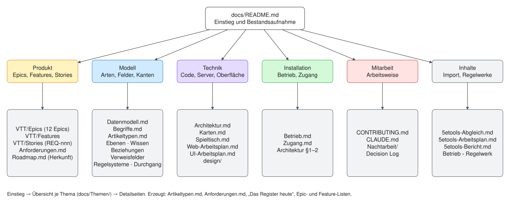

# Dokumentation — Einstieg

Stand 2026-10-15 (T-156). Von hier aus geht es in drei Stufen hinunter:
**Einstieg** (diese Seite) → **Übersicht je Thema** (`docs/Themen/`) →
**Detailseiten**. Jede Übersicht sagt kurz, worum es geht, zeigt ein Bild,
sagt, wo es tiefer weitergeht, und wie weit es steht.

## Die sechs Themen

| Thema | Worum es geht | Übersicht |
|---|---|---|
| **Produkt** | Was die Seite können soll: Epics, Features, Stories und ihr Stand | [Themen/Produkt.md](Themen/Produkt.md) |
| **Modell** | Artikel, Typen, Felder, Kanten, Ebenen, Sichtbarkeit — was gilt | [Themen/Modell.md](Themen/Modell.md) |
| **Technik** | Pakete, Server, Oberfläche, wo welcher Code liegt | [Themen/Technik.md](Themen/Technik.md) |
| **Installation** | Ausrollen, Sichern, Zugang, Konten | [Themen/Installation.md](Themen/Installation.md) |
| **Mitarbeit** | Zweige, Stories, Entscheidungen, Nachtarbeit, What's new | [Themen/Mitarbeit.md](Themen/Mitarbeit.md) |
| **Inhalte** | 5e.tools und Regelwerke anderer Verlage einlesen | [Themen/Inhalte.md](Themen/Inhalte.md) |

**Wer neu ist**, liest [Themen/Modell.md](Themen/Modell.md) und danach
[Begriffe.md › Die neun Wörter](Begriffe.md#die-neun-wörter) — ohne die
neun Wörter liest sich jede andere Seite schief. **Wer etwas baut**, liest
dazu [../CLAUDE.md](../CLAUDE.md) (die Regeln, die hier gelten) und
[../CONTRIBUTING.md](../CONTRIBUTING.md).

## Bilder

Ein grosses Bild — eine Übersicht, das Modell, ein Ablauf mit vielen
Knoten — ist eine **Excalidraw-Zeichnung** in `docs/Bilder/`
(`Name.excalidraw.md`, gezeichnet in Obsidian mit dem Excalidraw-Plugin) und
wird als `Name.excalidraw.svg` daneben eingebunden; GitHub kann Excalidraw
nicht zeichnen, das SVG schon. Das Plugin schreibt das SVG bei jedem
Speichern neu (`autoexportSVG`, `keepInSync` in
`.obsidian/plugins/obsidian-excalidraw-plugin/data.json`) und speichert die
Zeichnung unkomprimiert, damit ein Diff lesbar bleibt. Eine neue Zeichnung
ohne Obsidian legt `node scripts/excalidraw.mjs docs/Bilder/Name.json` an —
aus Kästen, Pfeilen und Rahmen; danach gilt die Zeichnung, und die
Beschreibung bleibt nur als Anfang liegen.

**Mermaid** bleibt für kleine Abläufe und Graphen bis etwa zehn Knoten,
direkt im Text. Was grösser ist, wird beim nächsten Anfassen eine
Zeichnung; welche Mermaid-Bilder noch zu gross sind, steht unten.

## Bestandsaufnahme

Jede Seite mit Zweck, Stand und wer sie schreibt. **Stand**: *gilt* — ist
die geltende Beschreibung; *Herkunft* — ein Abschnitt der Geschichte, der
erklärt, warum etwas so ist, aber nicht mehr beschreibt, was ist (die
geltende Fassung steht daneben); *Plan* — ein Arbeitsplan, dessen Pakete
teils stehen; *Protokoll* — was eine Sitzung getan hat; *erzeugt* — nicht
von Hand ändern.

### docs/

| Seite | Zweck | Stand | Geschrieben von |
|---|---|---|---|
| [Datenmodell.md](Datenmodell.md) | Der Vertrag: Artikel, Typen, Felder, Kanten, Ebenen, Sichtbarkeit, Ansichten | gilt | Hand; Abschnitt „Das Register heute“: `catalogue` |
| [Begriffe.md](Begriffe.md) | Wie die Dinge heissen, und warum | gilt | Hand |
| [Artikeltypen.md](Artikeltypen.md) | Jede Artikelart mit Feldern, Kanten, Anordnung | erzeugt | `pnpm --filter @nw/registry catalogue` |
| [Anforderungen.md](Anforderungen.md) | Jede Story mit Stand, nach Epic und Feature | erzeugt | `pnpm --filter @nw/registry anforderungen` |
| [Architektur.md](Architektur.md) | Container, Frameworks, Repo, Server, Oberfläche | gilt (Stand 12.10.) | Hand |
| [Betrieb.md](Betrieb.md) | Ausrollen, Sichern, Zurück, Daten laden | gilt | Hand |
| [Zugang.md](Zugang.md) | Konten, Rollen, Sieben, API-Tokens | gilt | Hand |
| [Ebenen.md](Ebenen.md) | Ebenen und Stapelauflösung ausführlich | gilt, Kurzform in Datenmodell §8 | Hand |
| [Wissen.md](Wissen.md) | Wer weiss was: Information, Knowledge, `knownBy` | gilt, Kurzform in Datenmodell §9 | Hand |
| [Beziehungen.md](Beziehungen.md) | Beziehungen als Kanten mit Marken | gilt | Hand |
| [Verweisfelder.md](Verweisfelder.md) | Welche Felder Verweise wurden (T-078, T-099) | Protokoll | Hand |
| [Karten.md](Karten.md) | Zeichenebenen, Sperren, Unterkarten; die Karte in der Seite; der Zugplan (T-198) | gilt | Hand |
| [vorschlaege/Ansichten-Bedarf.md](vorschlaege/Ansichten-Bedarf.md) | Ansichten: Bestand je Art und Ort, Bedarf je Stufe, was T-234 anlegte und was offen ist (E-124) | Vorschlag, Bestand | Hand, Tabelle aus `scripts/ansichten.mjs` |
| [vorschlaege/Karten-VTT-Vergleich.md](vorschlaege/Karten-VTT-Vergleich.md) | Was andere VTTs an der Karte können und was wir übernehmen (T-203) | Vorschlag | Hand |
| [vorschlaege/Regel-Builder.md](vorschlaege/Regel-Builder.md) | Versuch: Regeln als Knoten (Auslöser → Bedingung → Folge), hinter einem Schalter (T-270, E-102) | Versuch, Bericht | Hand |
| [vorschlaege/Regeln-Uebersicht.md](vorschlaege/Regeln-Uebersicht.md) | Alle Regeln in Gruppen: was Einstellung oder Rechenwerk bleibt, was Graph wird, welche Bausteine fehlen (T-270, E-102) | Vorschlag | Hand |
| [Regelsysteme.md](Regelsysteme.md) | Regelsysteme als Behälter (T-132) | Entscheidungsvorlage, E-044 | Hand |
| [Spieltisch.md](Spieltisch.md) | Wie der Spieltisch im Prototyp entstand | Herkunft (Prototyp, eingefroren D59) | Hand |
| [Durchgang.md](Durchgang.md) | Abgleich Register ↔ Konzept, mit Entscheidungen | Herkunft, Entscheidungen gelten | Hand |
| [Roadmap.md](Roadmap.md) | Der Fahrplan vom 19.9. (Etappen A–D) | Herkunft — offene Arbeit steht im Projektbrett | Hand |
| [Web-Arbeitsplan.md](Web-Arbeitsplan.md) | Port Prototyp → Seite (W1–W9) | Plan | Hand |
| [UI-Arbeitsplan.md](UI-Arbeitsplan.md) | Die UI-Runde vom 12.10. (D52, D58) | Plan | Hand |
| [5etools-Abgleich.md](5etools-Abgleich.md) | Was 5e.tools kennt und wir noch nicht | gilt (Stand 8.10.) | Hand |
| [5etools-Arbeitsplan.md](5etools-Arbeitsplan.md) | In welcher Reihenfolge 5e.tools hereinkommt (P1–P7) | Plan | Hand |
| [5etools-Bericht.md](5etools-Bericht.md) | Was der letzte Lauf des Importers gelesen hat | erzeugt | `packages/import-5etools` |
| [Requirements from Kanalgang.md](Requirements%20from%20Kanalgang.md) | Ernte aus der alten App, Englisch | Herkunft — die Stories stehen im Vault | Hand |
| [Nachtarbeit/](Nachtarbeit/) | Protokolle der Nachtläufe: was auf dev geändert wurde | Protokoll | je Sitzung |
| [design/](design/) | Der Design-Canvas (Runden 1–5) als HTML | Vorlage | Design-Canvas |
| [Bilder/](Bilder/) | Excalidraw-Zeichnungen und ihre SVG | gilt | Obsidian / `scripts/excalidraw.mjs` |
| [Themen/](Themen/) | Die Übersichten je Thema | gilt | Hand |

### Vault (`VTT/`) und Wurzel

| Seite | Zweck | Stand | Geschrieben von |
|---|---|---|---|
| [../README.md](../README.md) | Was das Repo ist, Entwickeln, Zweige | gilt | Hand |
| [../CLAUDE.md](../CLAUDE.md) | Regeln, Orte, Arbeitsweise — für jeden, der baut | gilt | Hand |
| [../CONTRIBUTING.md](../CONTRIBUTING.md) | Zweige, Stories, Commits, Register ändern | gilt | Hand |
| `VTT/Epics/`, `VTT/Features/`, `VTT/Stories/` | Die Anforderungen als Notizen (T-154) | gilt | Hand; Listen zwischen `stories:anfang`/`stories:ende`: `anforderungen` |
| `VTT/Requirements.md`, `Requirements by Epic.md`, `Umsetzung.md`, `Areas.md` | Übersichten über die Stories | erzeugt | `anforderungen` |
| `VTT/Decision Log.md` | Architekturentscheidungen AD-nn | gilt | Hand |
| `VTT/Glossary.md` | Glossar des Konzepts (Englisch) | Herkunft — gilt: [Begriffe.md](Begriffe.md) | Hand |
| `VTT/Backbone Concept.md`, `Schemas.md`, `Data Definitions.md` | Das ursprüngliche Konzept (D0–D17) | Herkunft — gilt: [Datenmodell.md](Datenmodell.md) | Hand |
| `VTT/Project Plan.md`, `Scope v1.md`, `Features.md` | Plan, Umfang v1, Ideen ohne Nummer | Herkunft | Hand |
| `VTT/35_Data_Architecture_Overview.html` | Bild des Konzepts | Herkunft | — |
| `Ideen/` | Lose Notizen der Leitung | — | Hand (auch vom Telefon) |

### Noch zu tun

Was diese Bestandsaufnahme gefunden hat und nicht in diesem Schritt erledigt
ist — als Folgeaufgabe im Projektbrett:

- **Mermaid-Bilder an der Grenze** (elf, zwölf Knoten), die bei ihrer
  nächsten Änderung eine Zeichnung werden: [Datenmodell §1](Datenmodell.md#1-die-bausteine)
  und [§5.7](Datenmodell.md#57-statblock-charakterbau-und-übungen-aus-artikeln-m5-m3-m6),
  das erste Bild in [Regelsysteme.md](Regelsysteme.md). Schon Zeichnungen:
  Architektur §1 und §6, Datenmodell §9.1.
- **Zwei Begriffe warten auf die Leitung:** ob Feldformen Registerzeilen
  werden (E-060) und ob ein Geheimnis ein eigener Artikel sein darf
  (E-061). Die übrigen Definitionen der Ernte stehen abgeglichen in
  [Begriffe.md › Ein Wort, mehrere Sachen](Begriffe.md#ein-wort-mehrere-sachen).
