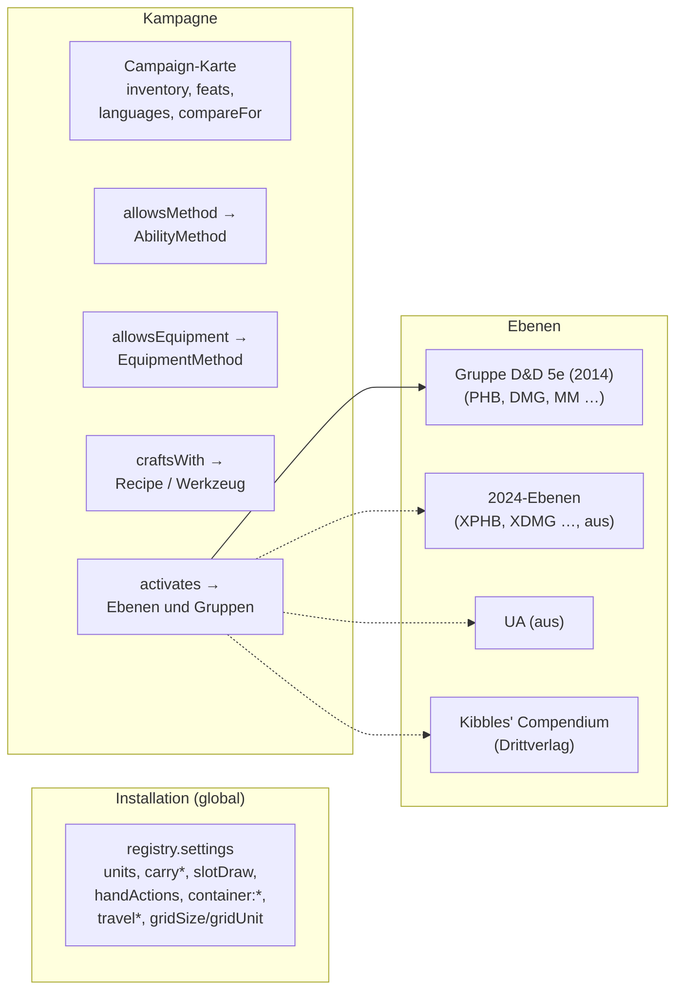
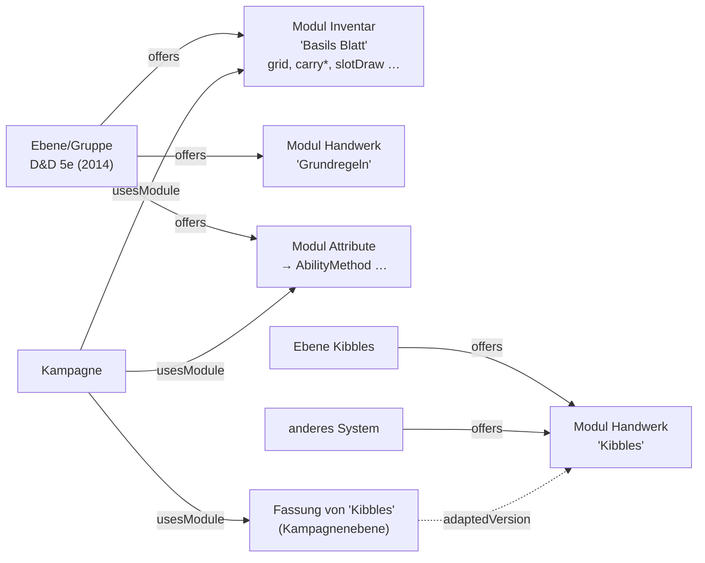

# Regelsysteme als Behälter (T-132)

↑ [Modell](Themen/Modell.md) · [Einstieg](README.md)

Stand 14.10.2026 — **Bestandsaufnahme und Entscheidungsvorlage**, noch
keine Umsetzung. Die Wahl liegt als **E-044** bei der Leitung.

Der Wunsch der Leitung: in der Kampagne wird das Regelset gewählt. Ein
System (hier D&D) gibt Optionen vor, die Kampagne übernimmt sie oder
wandelt sie ab. Teilsysteme wie das Handwerk gehören zu D&D, sollen aber
auch in einem anderen System stecken können.

> Nicht zu verwechseln mit **REQ-223** („Regelsysteme als Rahmen":
> Taverne, Alley, Kanalisation — ein Ort mit Kennzahlen und Wochenwurf).
> Das ist ein Spielinhalt; hier geht es darum, *nach welchen Regeln* eine
> Kampagne spielt.

## 1. Was es heute gibt

Regeln stehen heute an **fünf Stellen**, und jede hat ihren eigenen Weg,
gewählt zu werden.

### 1.1 Ebenen: welcher Inhalt gilt

| Was | Wo | Bemerkung |
|---|---|---|
| Grundstand 2014 | Gruppe „D&D 5e (2014)" (`Layer.kind: 'group'`), Mitglieder über `partOf` | aufgeschaltet; bringt Klassen, Zauber, Fertigkeiten, `Ability`-Artikel, Zustände (`Condition`), Regeln (`Rule`) |
| Regelstand 2024 | 34 Ebenen, `LayerInfo.version: '2024'` | eingelesen (T-087), keine aufgeschaltet |
| Unearthed Arcana | eine Ebene, `version: 'UA'` | eingelesen, aus |
| Kibbles' Compendium | Drittverlag-Ebene (T-122) | 698 Rezepte, 23 Handwerksregeln als `Rule`-Artikel; bringt **eigene Rezepte**, aber keine Einstellung |
| Homebrew / Kampagne | Kampagnenebene (`campaignLayer`), eigene Ebenen | Fassungen über `adaptedVersion`, `overrides` |
| Wort „system" | `LayerInfo.kind` kennt `system` schon (Grundregelwerk ohne Buch im Importer) | **Beschreibung**, keine Regel — so will es CLAUDE.md |

Ebenen beantworten nur, **welche Artikel** gelten. Ob gewürfelt oder
gekauft wird, wie Inventar zählt oder ob Talente erlaubt sind, sagt keine
Ebene.

### 1.2 Einstellungen und Wahlen: wie gespielt wird

| Teilsystem | Heute | Wo | Je Kampagne? |
|---|---|---|---|
| **Inventar** — Zählweise | `Campaign.inventory`: `grid` / `weight` / `slots` (T-127) | Kampagnenkarte, gelesen nur über `inventoryRulesOf` | ja |
| Inventar — Basils Blatt | `carrySquares`, `carryZones`, `slotDraw`, `handActions`, `container:*`, `inventoryCols/Rows` | `registry.settings` | **nein, global** |
| **Handwerk** — Werkzeug, Attribut, SG | Vorgabe am Rezept; Abweichung als Kante `craftsWith` von Kampagne, Gruppe oder Figur (T-122) | Kanten, gelesen über `craftCheck` | ja |
| Handwerk — Regeln (Grundregeln, Kibbles, eigene) | T-128 baut sie als Kampagneneinstellung | — | ja (geplant) |
| **Attributwerte** | Artikel `AbilityMethod` (Reihe, Punktekauf, Würfel), Kampagne wählt über `allowsMethod`; ohne Kante Standardreihe und Punktekauf | Artikel + Kante (E-016 a) | ja |
| **Startausrüstung** | Artikel `EquipmentMethod` (`rules`, `gold`, `free`), Kampagne wählt über `allowsEquipment` | Artikel + Kante (T-096) | ja |
| **Sprachen** | `Campaign.languages` (Namen von `Language`-Artikeln) | Kampagnenkarte | ja |
| **Talente** | `Campaign.feats` (ja/nein, T-107) | Kampagnenkarte | ja |
| **Masse** | `units` (`imperial`/`metric`/`both`), je Art überschreibbar | `registry.settings`, Umrechnung in `units.ts` | nein, global |
| **Reise** | `travelRationEvery`, `travelLightEvery`, `travelWatchesPerDay` | `registry.settings` | nein, global |
| Fertigkeiten | einst `skills`; seit M6 Artikel `Skill` mit `ability` | Ebene | über die Ebene |
| Zustände, Reiseaktionen | einst Wortlisten; seit A3/D48 Artikel | Ebene | über die Ebene |

**Keine Regel, sondern Tisch oder Darstellung** — bleibt, wo es ist:
`gridSize`, `gridUnit` (Karte), `today`, `gmFields`, `compareFor`.

### 1.3 Was daraus folgt

1. Es gibt **schon zwei bewährte Muster**: *Wort an der Kampagne*
   (`inventory`, `feats`) und *Artikel, den die Kampagne über eine Kante
   wählt* (`AbilityMethod`, `EquipmentMethod`). Das zweite tut bereits,
   was die Leitung beschreibt: die Leitung legt eigene Verfahren an, die
   Kampagne wählt, und ein Verfahren kann von mehreren Kampagnen gewählt
   werden.
2. **Was global steht, ist der eigentliche Mangel**: Basils Blatt, Reise
   und Masse gelten für die ganze Installation. Mit einer zweiten
   Kampagne nach anderen Regeln geht das nicht mehr (dieselbe offene
   Stelle wie „die laufende Kampagne ist eine globale Einstellung").
3. **Nichts sagt, was zusammengehört.** Dass `grid` mit Basils Blatt,
   `slotDraw` und den Behältervorlagen ein Paket ist, steht nur in
   Kommentaren.
4. **2014 und 2024** unterscheiden sich in Inhalt (Ebenen, das gibt es)
   *und* in Regeln (Hintergrund gibt die Attributsteigerung, Waffenmeisterschaft,
   Startausrüstung als Gold oder Paket) — das Zweite hat heute keinen Ort.

## 2. Drei Wege

Allen gemeinsam: gelesen wird über **eine Funktion je Teilsystem**, wie
heute schon `inventoryRulesOf`, `allowedMethods`, `craftCheck`. Wohin
diese Funktionen schauen, ist die Frage; die Aufrufer merken nichts.

### a) Einstellungen an der System-Ebene

Die Ebene mit `kind: 'system'` (oder die Gruppe „D&D 5e (2014)") bekommt
eine Karte `RuleSettings` mit allen Optionen. Die Kampagne trägt dieselbe
Karte und überschreibt Feld für Feld. Gelesen wird: Kampagne → stärkste
aufgeschaltete System-Ebene → Vorgabe.

- **Gut:** klein, nutzt den Stapel, kein neuer Begriff.
- **Schlecht:** `kind` würde Regel (CLAUDE.md: „ein Feld, das gleichzeitig
  Regel ist, leckt beim ersten Tippfehler"); zwei aufgeschaltete Systeme
  brauchen eine Vorrangregel; ein Teilsystem (Handwerk) kann **nicht** in
  einem zweiten System stecken, ohne kopiert zu werden; `RuleSettings`
  wächst mit jedem Teilsystem zu einer Feldwand.
- **Aufwand:** ~2 Abende.

### b) Untertyp `RuleSystem` von Layer

Eine eigene Art `RuleSystem extends Layer`: sie ist eine Ebene (bringt
Artikel, wird aufgeschaltet) und trägt die Optionen als eigene Felder.

- **Gut:** das System ist sichtbar ein Ding, mit eigener Seite; `kind`
  bleibt Beschreibung.
- **Schlecht:** die Gruppe „D&D 5e (2014)" müsste die Art wechseln (das
  ist eine Migration an einer eingelesenen Ebene); sonst dieselben Nachteile
  wie a — ein Modul lebt in genau einem System, die Felder wachsen.
- **Aufwand:** ~3 Abende.

### c) Module als Artikel, das System schlägt vor, die Kampagne wählt

Ein **Modul** ist ein Artikel der Art `RuleModule` mit einer Sorte
(`inventory`, `crafting`, `abilities`, `equipment`, `travel`, `units`,
`character` für Talente/Sprachen …) und den Optionen dieser Sorte als
Felder. Ein **System** ist, was es heute schon gibt: eine Ebene oder
Gruppe (`kind: 'system'` bleibt Beschreibung) — es **schlägt** Module über
eine Kante `offers` vor. Die Kampagne **wählt** je Sorte ein Modul
(`usesModule`, eine Kante je Sorte) und wandelt es ab, wie man heute
jeden fremden Artikel abwandelt: als **Fassung** in ihrer Ebene
(`adaptedVersion`, T-098).

- **Gut:**
  - **Ein Modul steckt in mehreren Systemen** — mehrere `offers`-Kanten,
    keine Kopie. Genau das verlangt die Aufgabe für das Handwerk.
  - Abwandeln ist kein neuer Mechanismus, sondern die Fassung, die es
    schon gibt — die Korrektur am Original erreicht sie, solange sie das
    Feld nicht selbst setzt.
  - Es ist das Muster von `AbilityMethod`/`EquipmentMethod`, nur
    verallgemeinert; die beiden bleiben, was sie sind, und das Modul
    „Attribute" nennt die erlaubten (die Kanten `allowsMethod` und
    `allowsEquipment` wandern vom Modul oder bleiben an der Kampagne als
    Abwandlung).
  - Die globalen Einstellungen werden **je Kampagne**, ohne dass jede
    Kampagne alle Werte abschreiben muss.
  - Eine neue Sorte ist eine Zeile (Feldgruppe), keine Codeänderung am
    Rahmen.
- **Schlecht:**
  - Ein neuer Begriff (Modul), der in `Begriffe.md` erklärt werden muss.
  - Ohne gewähltes Modul braucht jede Sorte eine Vorgabe: entweder das
    erste vorgeschlagene Modul der aufgeschalteten Systeme (bei zweien eine
    Vorrangfrage, gelöst durch `activates.order`) oder die heutige
    eingebaute Vorgabe.
  - Die Oberfläche braucht auf der Kampagnenseite einen Block „Rules":
    je Sorte eine Auswahl und „Adapt".
- **Aufwand:** Rahmen (Art, zwei Kanten, `moduleOf(campaign, sorte)`,
  Block auf der Kampagnenseite, Migration) **~3 Abende**; danach je
  Teilsystem **~½ Abend** (Inventar, Handwerk, Reise, Masse, Attribute,
  Startausrüstung, Charakter) — zusammen **~6–7 Abende**, in Schritten
  lieferbar.

### Vergleich

| | a) Einstellungen an der Ebene | b) `RuleSystem extends Layer` | c) Module |
|---|---|---|---|
| Teilsystem in mehreren Systemen | nein (Kopie) | nein (Kopie) | **ja** |
| Abwandeln durch die Kampagne | Feld überschreiben | Feld überschreiben | Fassung (gibt es schon) |
| neue Begriffe | keine | Art | Art + 2 Kanten |
| `kind` bleibt Beschreibung | **nein** | ja | ja |
| globale Einstellungen je Kampagne | ja | ja | ja |
| Aufwand bis „Inventar + Handwerk" | ~2 Abende | ~3 Abende | ~4 Abende |
| Aufwand alles | ~3 Abende | ~4 Abende | ~6–7 Abende |

## 3. Migration ohne sichtbare Änderung

Für jeden Weg gleich gebaut, hier für c:

1. **Lesestellen zuerst.** Jede heutige Lesestelle bekommt ihre Funktion
   (`inventoryRulesOf` gibt es; neu `carryRulesOf`, `travelRulesOf`,
   `unitsOf`), und die Funktion schaut der Reihe nach: gewähltes Modul der
   Kampagne → vom System vorgeschlagenes → heutige Einstellung bzw.
   Kampagnenfeld → eingebaute Vorgabe. **Dieser Schritt ändert nichts
   Sichtbares** und ist bei jedem Weg nötig.
2. **Migration** legt in der Gruppe „D&D 5e (2014)" die Module mit den
   heutigen Werten an (aus `registry.settings` der Installation, nicht aus
   der Vorgabe — wer `slotDraw` geändert hat, behält es), dazu `offers`.
   Weicht `Campaign.inventory` von der Vorgabe ab, bekommt die Kampagne eine
   Fassung des Inventarmoduls mit diesem Wert und `usesModule`.
3. **Erst danach** fallen die globalen Schlüssel und `Campaign.inventory`
   weg — mit Prüfabfrage im Kopf der Migration (`-- verlust:`) und
   `register-abgleich` im CI, wie T-076/T-123 es verlangen.
4. `craftsWith` bleibt, was es ist: die Abweichung **je Rezept oder
   Werkzeug**. Das Handwerksmodul sagt, welche Regeln gelten (Grundregeln,
   Kibbles, eigene) — das ist eine andere Frage.

## 3a. Schon gebaut: die Seite (T-190)

Unabhängig vom Entscheid steht seit T-190 der Reiter **„Rules & options"**
an der Kampagne: alle Optionen aus 1.2 nach Sorte, je Option ein Satz und
je Variante ihr Regelartikel (Datenmodell.md › 10.1). Die Sorten sind die
Modulsorten von Weg c; die Seite liest über `ruleOptionsOf`, und mit dem
Modul ändert sich nur, wohin diese Funktion schaut. Dieselbe Ansicht an
der System-Ebene („was dieses System anbietet") kommt mit dem Modulrahmen.

## 4. Empfehlung

**c, in Schritten — Schritt 1 als Nächstes, Schritt 2 erst bei Bedarf.** (Dieser PR baut noch nichts davon; er legt die Wahl vor.)

- **Schritt 1 (~1 Abend, unabhängig vom Entscheid):** die Lesefunktionen
  aus §3.1 für die globalen Einstellungen. Danach liest kein Bereich
  mehr `registry.settings` direkt für eine Regel, und jeder spätere
  Umbau ändert nur diese Funktionen. T-127 (`inventoryRulesOf`) und T-128
  (Handwerk) sind schon so gebaut.
- **Schritt 2 (~3 Abende):** Art `RuleModule`, `offers`, `usesModule`,
  Block auf der Kampagnenseite, Migration der Inventar- und
  Handwerksregeln.
- **Schritt 3 (je ~½ Abend):** die übrigen Teilsysteme, wenn eine zweite
  Kampagne oder ein zweites System sie braucht.

Warum c: es ist der einzige Weg, auf dem das Handwerk in zwei Systemen
stecken kann, ohne kopiert zu werden, und er erfindet für das Abwandeln
nichts Neues. a ist kleiner, macht aber `kind` zur Regel und verschiebt
das Modulproblem nur. Da Schritt 2 erst mit einer zweiten Kampagne oder
einem zweiten System wirklich nötig wird, kann er in der Priorität nach
hinten — der Aufwand ist mittel, nicht gross.
