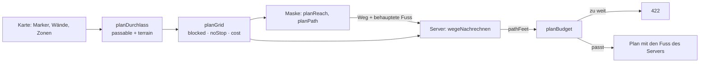

# Regelwirkung — wirken die Regeln am Tisch?

**Bereich Regelwirkung (T-322).** Die Grundlinie für die Prüfung nach jedem
Release: je Regel aus dem Regelkatalog (18.10., 157 Regeln, Tafel „Rule
catalogue" im Design-Canvas, Reiter Findings) die Frage, ob sie **am Tisch
eine Zahl ändert** — nicht, ob sie irgendwo gerechnet wird. Eine Wirkung,
die gesammelt und nicht angewandt wird, ist eine Behauptung.

Je Punkt steht hier, was heute wirkt, wo es gerechnet wird, welcher Test es
am Tisch prüft und was fehlt. Wer nach einem Release prüft, geht die
Tabelle durch und lässt die genannten Tests laufen; was rot wird oder
anders wirkt, ist ein Fehler am Tisch.

Grundsatz für alles hier (E-102 bleibt offen): **keine eigene Engine**. Die
Rechnung steht im Modell (`packages/model`), beim Lesen (D8), mit genau den
Eingaben, die eine spätere Automation hätte — sie zieht dann um, statt neu
zu entstehen.

## Stand (T-275, Teil 1 — 21.10.2026)

| # | Lücke aus dem Katalog | Stand | Wo | Test „wirkt am Tisch" |
|---|---|---|---|---|
| 1 | Wirkungen gesammelt, nicht angewandt; RK nur gespeichert | **wirkt** | `characterStats`, `creatureStats` (`stats.ts`), `effectsAt`/`itemsAt` (`effects.ts`); Initiative `participantStats`, Zugplan `rkVon` | `packages/model/test/regelwirkung.test.ts` › Punkt 1, `wirkungen-anwenden.test.ts` (Rettungswürfe, Zauber-SG, Kacheln, Unarmored Defense, T-355), Server `wirkungen-am-tisch.test.ts` |
| 2 | Schaden nicht von den TP abgezogen, Konzentration nur angezeigt | **wirkt** (Zugplan und Tracker, eine Rechnung `damageAtTable`, T-355) | `damageAtTable`, `damageAfterDefenses`, `concentrationCheck` (`damage.ts`), `trackerDamage` (`tracker.ts`); Server `schadenAnwenden` (`zugplan.ts`), `schadenImTracker` (`initiative.ts`) | `apps/server/test/regelwirkung.test.ts` › Punkt 2, `regelwirkung.test.ts` › Punkt 2, `tracker-schaden.test.ts`, `schaden-am-tisch.test.ts`, E2E `tracker-schaden.spec.ts` |
| 3 | Zwei Aktionskataloge, zwei Kostenleser; nur Dash/Disengage wirken | **eine Quelle**; Dodge, Help, Hide wirken (Vorteil/Nachteil), Ready als Eintrag | `COMMON_ACTION_CATALOGUE`, `turnTypeOf`/`costOf` (`actions.ts`); Server `aktionWirkt`, `trefferWurf` | `apps/server/test/regelwirkung.test.ts` › Punkt 3, `regelwirkung.test.ts` › Punkt 3 |
| 4 | Zwei Übungsbonus-Formeln | **eine Quelle** | `proficiencyBonus` (`calc.ts`), Register `profBonus(hasClass.level)` | `regelwirkung.test.ts` › Punkt 4 |
| 5 | Passive Wahrnehmung ohne Übung/Expertise | **wirkt** | `checkBonus` (`calc.ts`), Register `10+check(wis.Perception)`, Bogen `passivePerception` | `regelwirkung.test.ts` › Punkt 5 |
| 6 | Zugraster sperrt Verbündete, kein schwieriges Gelände | **wirkt** (T-349): durch Verbündete ja, auf ihnen enden nein; Zonen mit `moveCost` kosten je Feld mehr; der Server rechnet die Fuss nach | `planGrid`, `mapTerrain`, `terrainCosts` (`zugplan.ts`), `pathFeet` (`movement.ts`); Server `planDurchlass`, `wegeNachrechnen` | `packages/model/test/zugplan-raster.test.ts`, `apps/server/test/zugplan-raster.test.ts`, E2E `zugplan-raster.spec.ts` |
| 7 | drawStage, handActions, Sicht, Reise, tickEntries nur im Prototyp | **wirkt** (T-350): Ziehstufe über Behälter am Inventar, Kosten der Hände aus `handActions`, Bemerken und Zonen betreten beim Ziehen, Reise an der Gruppe; `tickEntries` seit T-334 | `drawStage` (Inventar `ziehstufe`), `handCost` + `handActions`, `spotsAlong`/`zonesEntered` (`spotting.ts`, Server `bemerkenUnterwegs`), `travelStep` (`travel.ts`, Element `travel`) | `packages/model/test/spotting.test.ts`, `travel.test.ts`, `wield.test.ts`; `apps/server/test/bemerken-unterwegs.test.ts`; E2E `ziehstufe.spec.ts`, `reise.spec.ts` |
| 8 | Reichweite nur in der Maske, lange Reichweite ohne Nachteil | Folgeaufgabe | — | — |
| 9 | Kein Auslöser für Rasten | **wirkt** (T-352): kurze Rast (Trefferwürfel), lange Rast (TP, Trefferwürfel, Plätze, Erschöpfung, Todesrettungen) am Bogen; offen: Pakt-Plätze bei kurzer Rast, Merkmale mit Nutzungen, Rast für die ganze Gruppe | `longRest`, `spendHitDie`, `stageDown` (`rest.ts`); Bogen `kopf.ts` | `packages/model/test/rest.test.ts` |
| 10 | Tragestufen ohne Folge, ZoneInfo unausgewertet | Folgeaufgabe | — | — |
| 11 | Registerformeln als Brücke zu Automationen | Grundlage: `profBonus`, `check` sind neue Funktionen des Rechenwerks | `calc.ts` (`FUNCTIONS`) | `regelwirkung.test.ts` › Punkt 4, 5 |
| 12 | Kanten mit `intended` ohne Auswerter | `equips` wird gelesen (Wirkungen), `zone` vom Zugplan (Bewegungskosten, T-349), `intended` dort weg; **Waffen in der Hand sind Angriffe** (T-354); `affects`, `loot`, `entry`, `route`, `territory`, `inWorld` offen (Entscheid E-206) | `itemsAt`, `mapTerrain`, `heldWeaponTiles` (`weapons.ts`), Server `kachelnVon` | `edges.test.ts`, `weapons.test.ts`, `apps/server/test/waffen-am-tisch.test.ts` |

## Punkt 1 — was jetzt wirkt

Am Bogen, in der Initiative und im Zugplan liest jede Stelle **dieselbe
Rechnung** (`creatureStats`: Statblock finden, aufgelöst, `characterStats`).

- **RK:** trägt die Figur Rüstung oder Schild im Inventar (`holds.tier`
  worn/held oder ein Platz), rechnet die RK daraus — leicht mit ganzer,
  mittel mit höchstens +2 GE, schwer ohne GE, Schild dazu. Sonst gilt die
  Zahl am Statblock, sonst 10 + GE. Steht am Statblock eine andere Zahl,
  sagt es der Hinweis. Wirkungen `ac` (`bonusAc`, Ring des Schutzes)
  kommen dazu, solange sie gelten (getragen, eingestimmt).
- **Statblock mit `equips`:** die Buch-RK enthält die Rüstung schon; was er
  führt, zählt nur mit seinen Wirkungen (ein Schild +1 gibt +1).
- **Tempo:** je Bewegungsart; `add` (Stiefel +10), `set` (Fliegen so
  schnell wie Gehen), `limit` (gepackt: höchstens 0).
- **Abwehr:** Resistenz, Immunität, Verwundbarkeit, Zustandsimmunität aus
  Statblock (Sätze), Herkunft (`Ancestry.resistances`) und Wirkungen
  (`grant`), je Wort mit Quelle; im gelesenen Statblock als Satz.
- **Kritischer Treffer:** `critThreshold` (kleinste gesetzte Schwelle).
- **Zustände wirken:** `Condition` nimmt `Effects`; gelesen werden
  `Vitals.conditions` der Kreatur und die Einträge der Initiative (`rule`).
- **Stücke sind Instanzen:** gelesen wird aufgelöst (`resolvedLookup`), ein
  Stück trägt die Wirkungen seiner Vorlage.
- **Aufschlüsselung (T-272):** „How the numbers come about" zeigt je Teil
  die Quelle (item, equipped, condition, feature …), dazu Abwehr und
  kritischen Treffer.

**Seit T-355 angewandt:** `save` und `save.<attr>` an den Rettungswürfen
des Bogens (und der Konzentration), `spellSaveDc` und `spellAttack` am
Bogen, `check` in der passiven Wahrnehmung und den Proben von Hide und
Search, `spellAttack`/`spellDamage` und `weapon.attack`/`weapon.damage`/
`weapon` in den Kacheln des Zugplans (`withEffectBonuses`). **Unarmored
Defense** ist eine Wirkung am Merkmal: `ac.base` mit einer Formel
(`10 + mod(dex) + mod(con)`, Barbar) oder `ac.base.noShield` (Mönch:
`10 + mod(dex) + mod(wis)`, nur ohne Schild); ohne Rüstung gilt die beste
Grundlage.

Noch nicht angewandt: `carry` (was der Wert heisst, ist offen — Faktor
oder Grössenstufe, siehe Entscheid auf dem Brett) und, was an der Waffe
selbst steht (`when: self`, +1-Waffe): die Kachel hängt an einer Aktion,
nicht an einem Gegenstand.

## Punkte 2 und 3 — was jetzt wirkt

- **Schaden:** bestätigt die Leitung einen Zug, würfelt der Server Treffer
  und Schaden und **zieht ab** — nach Immunität (0), Resistenz (halb,
  abgerundet) und Verwundbarkeit (doppelt) des Ziels; ein Satz mit
  Einschränkung („from nonmagical attacks") greift, das Wort steht im
  Ergebnis. Abgezogen wird an der Teilnehmerkante der Begegnung, bei einer
  Spielerfigur auch an `Vitals` (zeitweilige zuerst), ausserhalb einer
  Begegnung an `Vitals`.
- **Konzentration:** konzentriert sich das Ziel, würfelt der Server den
  KON-Rettungswurf gegen SG 10 oder den halben Schaden (Bonus: KON, Übung
  im Rettungswurf, Wirkungen `save`, `save.con`, `save.concentration`);
  misslingt er, endet die Konzentration (E-128: Server würfelt statt einer
  Anfrage an die Spielerin).
- **Vorteil/Nachteil und Krit:** der Angriff würfelt `2d20kh1`/`2d20kl1`,
  wenn die Wirkungen es sagen, und trifft kritisch ab der Krit-Schwelle
  des Angreifers.
- **Ein Aktionskatalog:** Dash, Disengage, Dodge, Help, Hide, Ready,
  Search, Use an object im Zugplan; dieselbe Liste in „Your turn".
  Dodge/Help/Hide/Ready legen einen Eintrag in der Initiative an
  (`TimedEntry.action`), den die Initiative herunterzählt; Help und Hide
  sind beim nächsten Angriff verbraucht.

- **Reichweite am Server** (T-351): Einreichen lehnt einen Angriff ausser
  Reichweite ab (422, mit Hinweis), gemessen vom Ende des Wegs davor
  (`abstandImPlan`, `rangeBand`); Ausführen misst neu, wo die Tokens dann
  stehen, und würfelt ausser Reichweite nicht. Ohne Gitter prüft niemand.
- **Lange Reichweite mit Nachteil** (T-351): `attackRollMode` nimmt die
  lange Reichweite als eine Quelle von Nachteil; das Würfellog sagt
  „(disadvantage, long range)".
- **Zustände geben Vorteil und Nachteil** (T-351) über die Wirkungen ihres
  `Condition`-Artikels: `attack`, `attacked`, und nach Abstand
  `attacked.near` (bis 5 ft) und `attacked.far` — Prone. Die Vorschau im
  Zugplan zeigt die Chance mit dem Modus (`modes`, `long`).

- **Der Tracker rechnet wie der Zugplan** (T-355): „Damage" nimmt eine
  Schadensart (Zeile `DamageType`), `damageAtTable` zieht nach der Abwehr
  ab, die Konzentrationsprobe würfelt der Server ins Log. Eine
  Spielerfigur führt ihren Stand an `Vitals`, die Kante spiegelt ihn —
  auch bei Heal (E-128, zweite Frage: so schreiben beide Wege gleich).

Noch nicht: Wirkungen, die nur unter einer
Bedingung gelten (Restrained: Nachteil auf DEX-Rettungswürfe, Paralyzed:
Krit in 5 ft), brauchen noch eigene Ziele.

## Punkt 7 — was jetzt wirkt (T-350)

Je Funktion zuerst geprüft, ob die Seite sie schon anders hat:

- **Sicht und Licht** (`lightAt`, `figureView`) hatte die Seite schon
  (T-216: laufende Sicht, Aufdecken im Dunkeln). Gefehlt hat das
  **Bemerken unterwegs**: Versteckte und versteckte Zonen, an denen eine
  Figur vorbeigeht, und die Zeile beim Betreten einer Zone mit Wirkung —
  jetzt `spotsAlong`/`zonesEntered`, am Server beim freien Ziehen und im
  bestätigten Zugplan (docs/Karten.md › Unterwegs bemerken).
- **Ziehstufe** (`drawStage`): die Seite zeigte je Stück nur seine Zone.
  Jetzt die Kette hinauf — Platz (`slotDraw`) oder Zone aussen, je
  Behälter eine Stufe dazu; das eingebettete Inventar bekommt die Stufe
  seines Behälters mit (`aussen`).
- **Handaktionen** (`handActions`): die Hände nannten einen festen Text.
  Jetzt sagen sie, was die Kampagne für Verstauen und Fallenlassen
  einstellt; ein Schild bleibt eine Aktion (PHB).
- **Reise**: die Zähler standen nur als Felder an der Gruppe. Jetzt das
  Element `travel` (Tag, Wache, „rations in …", „light in …", „Wait a
  watch", „Next node"), gerechnet in `travelStep`. Vom Inventar geht
  nichts ab — die Zeile sagt, dass etwas fällig ist. Die Punktreise selbst
  (Knoten wählen, Token umsetzen) steht in der Seite noch nicht.
- **Dodge/Help/Ready** laufen mit `tickEntries` (T-334) ab: Einträge mit
  `rounds` zählen in der Initiative herunter, Help und Hide sind beim
  nächsten Angriff verbraucht (Punkt 3).

Offen: die Punktreise in der Seite (`crawl`), das Element `travel` im
Ansichtsdesigner (Palette, T-425), Rationen vom Inventar abziehen.

## Punkt 12 — Waffen in der Hand (T-354)

Ein Statblock nennt seine Angriffe als Aktionen (`composedOf`, D51); eine
Spielerfigur hat ihren Angriff in der Hand. Bis T-354 hatte sie im
Zugplan nur den waffenlosen Schlag. Jetzt wird jede Waffe in der Hand
(`carries` → Inventar → `holds` mit Handplatz) eine Angriffskachel
(`heldWeaponTiles`), gerechnet wie jeder Angriff (`attackNumbers`):

- Treffer = Übung (nur geübt: Waffengruppe `simple`/`martial` oder die
  Waffe beim Namen) + Mod (STR; DEX im Fernkampf; Finesse das bessere).
- Schaden = Würfel + Mod; vielseitig mit beiden Händen der Würfel der
  Kante `hasProperty` (sonst `Weapon.damage2`).
- Wirkungen der Figur (`weapon`, `weapon.attack`, `weapon.damage`, T-355)
  und **die der Waffe selbst** (`when: self`, die +1-Waffe).
- Zwei leichte Nahkampfwaffen: der Nebenhand-Angriff als Bonusaktion,
  ohne positiven Mod beim Schaden (PHB, Two-Weapon Fighting).
- Reichweite und Wurf lesen den Namen der Eigenschaft (Reach, Thrown),
  solange sie keine `mechanics` haben.

Nennt der Statblock schon eine Aktion mit demselben Namen, kommt die
Waffe nicht doppelt. Was T-354 sonst verlangt (Rechnungen als
Automationen, Leser für `affects`, `loot`, `entry`, `route`) liegt als
Entscheid E-206 bei der Leitung.

## Von Hand: die freie Aktion (REQ-403, T-453)

Eine Regel, die es hier (noch) nicht gibt, darf den Zug nicht
blockieren. Darum hat die Aktionsleiste je Platz eine Kachel „Other
action“, „Other bonus action“, „Other reaction“, „Other free action“
(`MANUAL_TILES`, `zugplan.ts`): angetippt fragt sie, was geschieht, und
kommt mit dieser Notiz in den Zug. Sie verbraucht ihren Platz wie jede
Aktion (`planBudget`) und prüft nichts; was sie kostet, sagt die Kachel,
nicht die Maske (`cleanStep`). Ohne Notiz nimmt der Server sie nicht an
(422, „Say in a note what the free action does.“). Bestätigt steht sie im
Ergebnis als „<Figur>: <Notiz> (manual, …)“ mit `manual: true` — so lassen
sich fehlende Regeln später auswerten.

Teil 2 (eigene Karte): Wirkungen von Hand (Schaden, Zustand, Würfel),
berechnete Ergebnisse überschreiben, Filter „manual“ im Protokoll.

## Punkt 6 — was jetzt wirkt (T-349)

Das Raster des Zugplans (`planGrid`) kennt drei Sorten Feld: frei,
**gesperrt** (Gegner, Wände) und **Durchgang** (Verbündete, `noStop`): man
darf hindurch, aber nicht darauf stehen bleiben — 5e erlaubt das Ziehen
durch den Platz einer freundlichen Kreatur. Wer verbündet ist, sagt der
Server (`seiteVon`: Gruppe, Spielerfiguren, `ally` an der Begegnung; die
Seite der planenden Figur zählt) und schickt die Markerkanten als
`passable` mit.

Schwieriges Gelände sind die Zonen der Karte (Kante `zone` auf eine
`ZoneKind` mit `moveCost` über 1, REQ-208): `mapTerrain` liest sie als
Formen mit Kosten, `terrainCosts` rastert sie aufs Gitter (die Mitte eines
Feldes in der Form; das teuerste gilt). Eine Zone mit `hiddenUntil` zählt
für Spielende erst, wenn sie gefunden ist (`props.found`) — ein Umweg um
eine unbekannte Falle hätte sie verraten. Die Leitung sieht und zählt sie.

Der Server glaubt die Fuss der Maske nicht: `wegeNachrechnen` baut dasselbe
Raster aus der gesiebten Karte und zählt je Bewegung mit `pathFeet` nach.
Ein Weg muss beim Token anfangen (oder wo der letzte endete), Schritt für
Schritt gehen und darf nicht durch einen Gegner, eine Wand oder bis auf
einen Verbündeten führen; dann prüft `planBudget` das Tempo mit den
nachgerechneten Fuss.

Noch nicht: die Diagonalen zählen je Bewegung von vorn (wie die Maske), die
Grösse der planenden Figur (`span`) nimmt das Raster des Plans noch nicht
mit, und Gelände, das nur für einige gilt (Spinnennetz, Wurzeln einer
Druidin), bräuchte eine Regel an der Zonenart.

## Prüfen nach einem Release

1. `pnpm vitest run packages/model/test/regelwirkung.test.ts apps/server/test/regelwirkung.test.ts` — grün.
2. Auf dev mit der Testfigur in „basil · Tests": Rüstung an- und ablegen →
   RK in Bogen und Initiative folgt; Ring der Resistenz → Resistenzen;
   Zustand „Grappled" setzen → Tempo 0; einen Zug mit Angriff bestätigen →
   TP des Ziels in der Initiative sinken; Dodge planen → nächster Angriff
   gegen die Figur mit Nachteil.
   Einen Bogenschuss über die lange Reichweite planen → „with
   disadvantage"; einen Schlag auf ein entferntes Ziel einreichen → 422
   „out of range"; Zustand „Prone" am Ziel → aus 5 ft Vorteil.
   Auf einer Karte mit einer Zone „Difficult terrain“ (`moveCost` 2): der
   Bereich zeigt die Felder braun und reicht dahinter kürzer; ein Weg durch
   eine verbündete Figur geht, auf ihr enden nicht (T-349).
   Im Tracker „− Damage" mit Art „fire" an einer Kreatur mit
   Feuerresistenz → die Zeile über der Reihe sagt „resistant (fire) → …";
   an der Testfigur sinken Tracker und Bogen gleich. Barbar ohne Rüstung
   mit Unarmored Defense (`ac.base`) → RK 10 + GE + KO (T-355).
3. Diese Tabelle nachziehen, wenn eine Lücke geschlossen ist.
