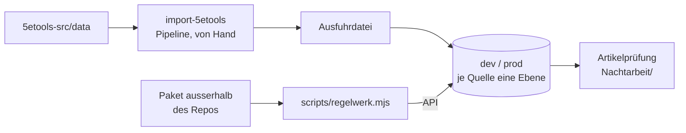

# Inhalte — wie Regeln und Bücher hereinkommen

Stand 2026-10-15. Zurück zum [Einstieg](../README.md).

Der Bestand an Regeln kommt nicht aus diesem Repository, sondern wird
eingelesen — jede Quelle in **ihre Ebene**, keine neue aufgeschaltet. Für
5e.tools gibt es einen eigenen Importer (`packages/import-5etools`), der in
einer Pipeline läuft, nur von Hand: **einmal einlesen, danach nur
ergänzen** (D71). Regelwerke anderer Verlage liest `scripts/regelwerk.mjs`
aus einem Paket **ausserhalb** des Repos über die API nach dev (T-122).
Was danach an den Artikeln geprüft und ergänzt wird, protokolliert je Lauf
eine Seite unter [Nachtarbeit/](../Nachtarbeit/).

## Wo es tiefer weitergeht

| Frage | Seite |
|---|---|
| Was 5e.tools kennt und wir noch nicht | [5etools-Abgleich.md](../5etools-Abgleich.md) |
| In welcher Reihenfolge es hereinkam (P1–P7) | [5etools-Arbeitsplan.md](../5etools-Arbeitsplan.md) |
| Was der letzte Lauf gelesen hat | [5etools-Bericht.md](../5etools-Bericht.md) (**erzeugt**) |
| 5e.tools laden, ergänzen, eine Ebene ersetzen | [Betrieb › 5e.tools laden](../Betrieb.md#5etools-laden) |
| Ein Regelwerk eines Drittverlags laden | [Betrieb › Ein Regelwerk eines Drittverlags laden](../Betrieb.md#ein-regelwerk-eines-drittverlags-laden) |
| Regelsysteme als Behälter (offen) | [Regelsysteme.md](../Regelsysteme.md) |
| Die Stories dazu | [EP-12 Import & Inhalte](<../../VTT/Epics/EP-12 Import & Inhalte.md>) |

## Stand

5e.tools ist mit jedem Regelstand eingelesen (T-087: 2014, 2024, UA,
Fahrzeuge, Decks, Bastionen); die Artikelprüfung läuft in Gruppen
(T-089). Die Obsidian-Importer für Gegenstände und Statblocks gibt es nicht
mehr; kommen sie wieder, werden sie neu geschrieben.
