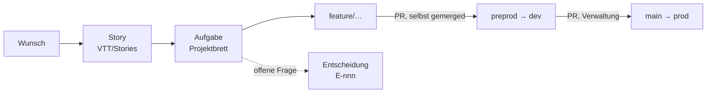

# Mitarbeit — wie hier gearbeitet wird

Stand 2026-10-15. Zurück zum [Einstieg](../README.md).

Jeder Wunsch wird zuerst eine **Story** im Vault; Aufgaben im Projektbrett
hängen an Stories. Gebaut wird je Anliegen auf einem Zweig
`feature/<anliegen>` von `preprod`, mit kleinen deutschen Commits, die sagen
warum. Ist das Anliegen fertig — Tests, Lint, Durchstich bei Migrationen,
Doku nachgezogen, What's new ergänzt —, geht ein Pull Request nach
`preprod`. Nach `main` merged die Verwaltung. **Einschneidende Änderungen
entscheidet die Verwaltung**: was Daten verliert, die Arbeitsweise ändert
oder eine Art wegnimmt, wird als Entscheidung vorgelegt.

## Wo es tiefer weitergeht

| Frage | Seite |
|---|---|
| Zweige, Pull Request, Commits, Register ändern, Datenbank | [CONTRIBUTING.md](../../CONTRIBUTING.md) |
| Die Regeln, die beim Bauen gelten | [CLAUDE.md](../../CLAUDE.md) |
| Eine Story anlegen, ändern, fallen lassen | [CONTRIBUTING › Anforderungen als User Stories](../../CONTRIBUTING.md#anforderungen-als-user-stories) |
| What's new ergänzen | [CONTRIBUTING › What's new ergänzen](../../CONTRIBUTING.md#whats-new-ergänzen) |
| Wo Entscheidungen stehen | Modell: [Durchgang.md](../Durchgang.md) und [Begriffe.md](../Begriffe.md); Architektur: `VTT/Decision Log.md`; offene: im Projektbrett (E-nnn) |
| Was ein Nachtlauf auf dev geändert hat | [Nachtarbeit/](../Nachtarbeit/) — je Lauf ein Protokoll: Id, Art, Feld, vorher → nachher, nie Inhaltstext |
| Wie gross ein Bild sein darf und wo es liegt | [Einstieg › Bilder](../README.md#bilder) |

## Was nie ins Repository kommt

Das Repo ist öffentlich: keine Kampagneninhalte, kein Text aus Büchern
anderer Verlage (auch nicht in Tests oder Commits), keine Tokens, keine
gebauten Dateien. Protokolle nennen Ids, Arten und Felder.
