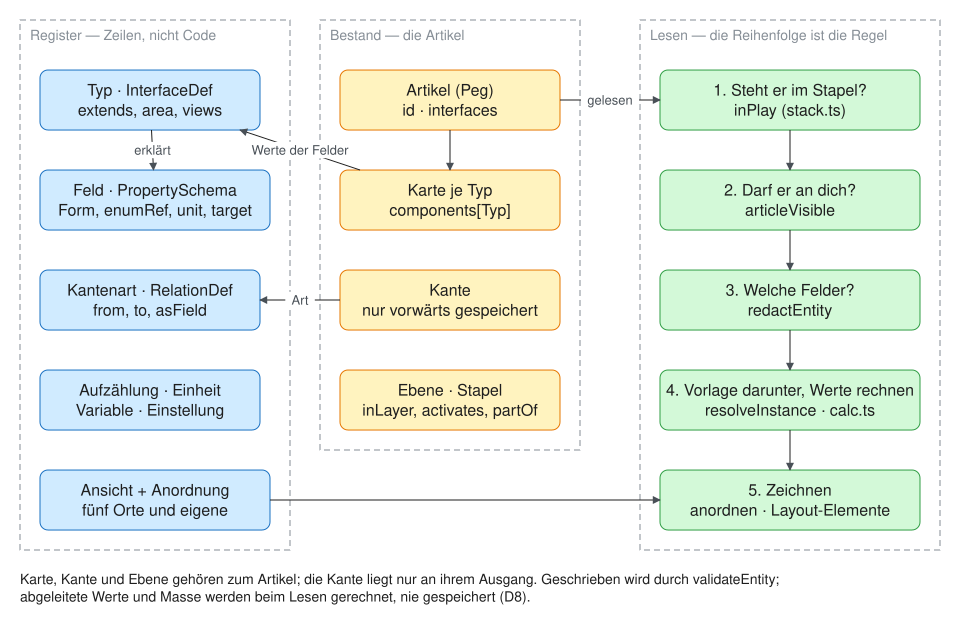

# Modell — Artikel, Typen, Felder, Kanten

Stand 2026-10-15. Zurück zum [Einstieg](../README.md).

Alles in Atlas Mentis ist ein **Artikel**: eine undurchsichtige Id und sonst
nichts. Was er ist, sagen seine **Typen** — Registerzeilen, die ihre
**Felder** selbst tragen und über `extends` von beliebig vielen Obertypen
erben. Gespeichert wird **eine Karte je Typ**; Verbindungen sind
typisierte, gerichtete **Kanten**, nur vorwärts gespeichert. Welche Arten
es gibt, ist Daten und kein Code: eine neue Artikelart ist ein Einfügen,
keine Migration. Gelesen wird in einer festen Reihenfolge — erst der
Stapel, dann die Sichtbarkeit, dann das Wissen, dann gerechnet und
gezeichnet.

## Wo es tiefer weitergeht

| Frage | Seite |
|---|---|
| Was gilt — der Vertrag | [Datenmodell.md](../Datenmodell.md), §1–14 |
| Wie die Dinge heissen und warum | [Begriffe.md](../Begriffe.md), zuerst [Die neun Wörter](../Begriffe.md#die-neun-wörter) |
| Welche Arten und Kanten es heute gibt | [Artikeltypen.md](../Artikeltypen.md) und [Datenmodell › Das Register heute](../Datenmodell.md#13-das-register-heute) — beide **erzeugt** von `catalogue` |
| Bausteine, Artikel, Typen, Felder | [Datenmodell §1–4](../Datenmodell.md#1-die-bausteine) |
| Kanten, Teil-Kanten (`asField`), Wirkungen | [Datenmodell §5](../Datenmodell.md#5-kanten), [Beziehungen.md](../Beziehungen.md) |
| Gerechnet, nicht gespeichert; Masse | [Datenmodell §6](../Datenmodell.md#6-gerechnet-nicht-gespeichert) |
| Vorlage und Instanz (Statblock, Stück im Inventar) | [Datenmodell §7](../Datenmodell.md#7-vorlage-und-instanz) |
| Ebenen, Gruppen, Stapel, Fassungen | [Datenmodell §8](../Datenmodell.md#8-ebenen-und-stapel), ausführlich [Ebenen.md](../Ebenen.md) |
| Sichtbarkeit, Rollen, Wissen, Schreiben | [Datenmodell §9](../Datenmodell.md#9-sichtbarkeit-rollen-wissen), ausführlich [Wissen.md](../Wissen.md) und [Zugang.md](../Zugang.md) |
| Ansichten und Anordnung | [Datenmodell §10](../Datenmodell.md#10-ansichten-und-anordnung) |
| Verweisfelder, Zieltypen | [Datenmodell §4](../Datenmodell.md#4-felder), Herkunft [Verweisfelder.md](../Verweisfelder.md) |
| Regelsysteme als Behälter (offen, E-044) | [Regelsysteme.md](../Regelsysteme.md) |
| Warum das Register so aussieht, wie es aussieht | [Durchgang.md](../Durchgang.md) (Abgleich mit dem Konzept, Entscheidungen) |
| Einen Typ ganz ausgeschrieben, mit Belegung | `node packages/registry/scripts/typ.mjs <Typ> [bestand]` |

**Im Code:** `packages/model` (Typen, `validateEntity`, `calc.ts`,
`stack.ts`, `views.ts`, `inline.ts`, `entity.ts`, `map.ts`,
`inventory.ts` — kein Framework, gilt für Server und Oberfläche) und
`packages/registry` (die Startzeilen, einzige Quelle; `emit-seed`,
`catalogue`). Wo das liegt: [Technik](Technik.md).

## Stand

Das Modell steht und ist geprüft; was sich ändert, ändert sich zeilenweise
und mit Migration (T-123, [Betrieb › Register](../Betrieb.md#register-datenbank-gegen-startzeilen-t-123)).
Das ursprüngliche Konzept (`VTT/Backbone Concept.md`, `Schemas.md`,
`Data Definitions.md`, `Glossary.md`) ist überholt und Herkunft.
**Bei jeder Modelländerung wandert die Erklärung mit**: Datenmodell.md,
Begriffe.md und „How it works“ im Register, im selben Commit.
