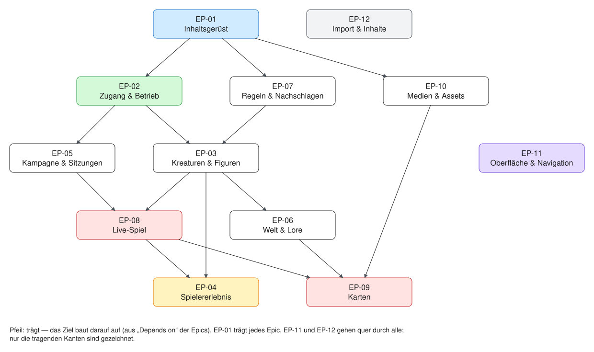

# Produkt — was die Seite können soll

Stand 2026-10-15. Zurück zum [Einstieg](../README.md).

Atlas Mentis ist die Seite für eine Leitung und ihre Gruppen, kein
generisches VTT: was der Tisch von Nebelwacht braucht, kommt vor dem, was
ein beliebiger Tisch brauchen könnte. Was gewünscht ist, steht als **User
Story** im Vault, in drei Stufen (T-154):

- **Epic** — ein Funktionsbereich mit seinem Umfang, `VTT/Epics/EP-nn …`;
- **Feature** — eine Funktion, Artikelart oder Ansicht, `VTT/Features/F-nnn …`;
- **Story** — ein Wunsch einer Rolle mit Akzeptanzkriterien,
  `VTT/Stories/REQ-nnn.md`; ihr Stand (`stand`, `standNotiz`) steht in
  der Notiz.

## Die Epics

Jede Epic-Notiz ist die Übersicht ihres Bereichs: Umfang, Features mit
Stand (erzeugt), und darunter, wo der Bereich im Modell und im Code
wohnt und welche Seite ihn erklärt.

| Epic | Umfang | Stand |
|---|---|---|
| [EP-01 Inhaltsgerüst](<../../VTT/Epics/EP-01 Inhaltsgerüst.md>) | Register, Arten, Felder, Kanten, Ebenen und Fassungen, Ansichten — das Modell, mit dem jeder Artikel beschrieben, gespeichert und gezeichnet wird. | [Stories](../Anforderungen.md#ep-01-inhaltsgerüst) |
| [EP-02 Zugang & Betrieb](<../../VTT/Epics/EP-02 Zugang & Betrieb.md>) | Konten, Rollen je Kampagne, Sichtbarkeit und Wissen, Schreibrechte, API-Tokens, Werkbank, Ausrollen, Sicherung, Übernahme zwischen dev und prod, Leistung. | [Stories](../Anforderungen.md#ep-02-zugang--betrieb) |
| [EP-03 Kreaturen & Figuren](<../../VTT/Epics/EP-03 Kreaturen & Figuren.md>) | Kreatur, Statblock (Vorlage und Instanz), Charakterbogen und Charaktermanager — alles, was eine Figur oder ein Monster beschreibt. | [Stories](../Anforderungen.md#ep-03-kreaturen--figuren) |
| [EP-04 Spielererlebnis](<../../VTT/Epics/EP-04 Spielererlebnis.md>) | Was Spielende sehen und tun: Spieleransicht und Telefon, eigene Figur und eigene Inhalte, Inventar, Chat. | [Stories](../Anforderungen.md#ep-04-spielererlebnis) |
| [EP-05 Kampagne & Sitzungen](<../../VTT/Epics/EP-05 Kampagne & Sitzungen.md>) | Kampagnenmanager, Bereich Story (Arcs, Quests, Szenen), Sitzungen und Vorbereitung, Begegnungen, Abenteuer übernehmen, Party, Ladebildschirm. | [Stories](../Anforderungen.md#ep-05-kampagne--sitzungen) |
| [EP-06 Welt & Lore](<../../VTT/Epics/EP-06 Welt & Lore.md>) | Bereich World: Orte, Fraktionen, Gottheiten, Lore, Kalender und Zeitleisten, Beziehungen, Läden und Wirtschaft. | [Stories](../Anforderungen.md#ep-06-welt--lore) |
| [EP-07 Regeln & Nachschlagen](<../../VTT/Epics/EP-07 Regeln & Nachschlagen.md>) | Bereich Rules und Kompendium, Bücher und Leseansicht, Klassen, Zauber, Zustände, Handwerk, Regelsysteme und die Auswertung von Regeln. | [Stories](../Anforderungen.md#ep-07-regeln--nachschlagen) |
| [EP-08 Live-Spiel](<../../VTT/Epics/EP-08 Live-Spiel.md>) | Bereich Play: Spielleiter-Schirm, Initiative, Sitzungszustand und Live-Kanal, Würfel, Werkzeuge am Tisch. | [Stories](../Anforderungen.md#ep-08-live-spiel) |
| [EP-09 Karten](<../../VTT/Epics/EP-09 Karten.md>) | Karte und Kartenebenen, Tokens und Marker, Nebel, Licht und Sicht, Bewegung und Zonen, Gebiete, Reisen, Karteneditor. | [Stories](../Anforderungen.md#ep-09-karten) |
| [EP-10 Medien & Assets](<../../VTT/Epics/EP-10 Medien & Assets.md>) | Bilder und Dateien: Ablage, Bildverwaltung und Bildklassen, Token-Werkstatt, Druck und Ausfuhr, PDF. | [Stories](../Anforderungen.md#ep-10-medien--assets) |
| [EP-11 Oberfläche & Navigation](<../../VTT/Epics/EP-11 Oberfläche & Navigation.md>) | Boards, Suche, Filter und Filtergruppen, Navigation und Kurzansicht, Bearbeiten in der Ansicht, Design und Stilkonzept. | [Stories](../Anforderungen.md#ep-11-oberfläche--navigation) |
| [EP-12 Import & Inhalte](<../../VTT/Epics/EP-12 Import & Inhalte.md>) | 5e.tools, Regelwerke anderer Verlage, Obsidian-Vault, Artikelprüfung und KI-erzeugte Inhalte — wie Inhalte hereinkommen und vollständig werden. | [Stories](../Anforderungen.md#ep-12-import--inhalte) |

## Wo es tiefer weitergeht

- [Anforderungen.md](../Anforderungen.md) — jede Story mit Stand und
  Anmerkung, nach Epic und Feature; oben die Zählung. **Erzeugt** von
  `pnpm --filter @nw/registry anforderungen -- --umsetzung VTT/Umsetzung.md`.
- `VTT/Requirements.md` (Skalen, Übersicht), `VTT/Umsetzung.md`,
  `VTT/Requirements by Epic.md` — dieselben Stories, anders geordnet, ebenso
  erzeugt. `VTT/Stories.base` und `VTT/Features.base` sind Obsidian-Bases
  zum Filtern.
- **Offene Arbeit** — Aufgaben (T-nnn) und offene Entscheidungen (E-nnn)
  stehen im Projektbrett; jede Aufgabe nennt ihre Stories. [Roadmap.md](../Roadmap.md)
  ist der Fahrplan vom 19.9. und Herkunft.
- Wie eine Story entsteht, sich ändert oder wegfällt:
  [CONTRIBUTING.md › Anforderungen als User Stories](../../CONTRIBUTING.md#anforderungen-als-user-stories).

## Herkunft

Das ursprüngliche Konzept (`VTT/Scope v1.md`, `Project Plan.md`,
`Features.md`) und die Ernte aus der alten App
([Requirements from Kanalgang.md](../Requirements%20from%20Kanalgang.md))
sind in die Stories eingegangen und bleiben als Herkunft stehen; ein
Verweis `herkunft` in der Story nennt, woher sie kam.
