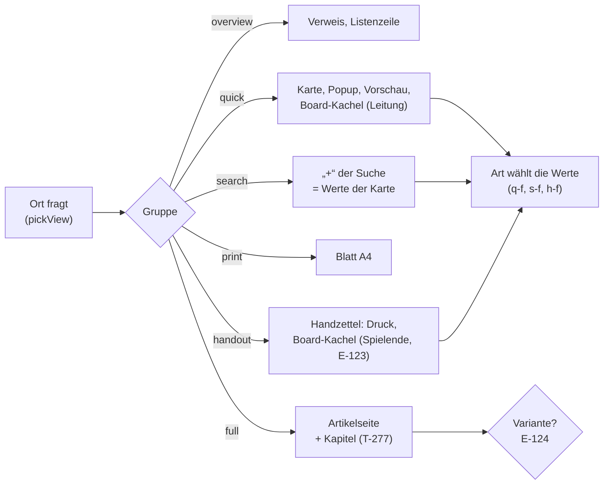

# Ansichten: Bestand, Bedarf je Art und Stufe

Stand 21.10.2026, T-234. Gelesen aus dem Register (`packages/registry`,
`seedRegistry`) mit `node packages/registry/scripts/ansichten.mjs` — das
Skript schreibt die Tabelle unten neu (`… <Typ>` je Art Element für Element,
`--json` maschinenlesbar). Gestaltete Ansichten aus dem Designer stehen in der
Datenbank, nicht im Register; die zeigt Registry › Views.

Vorher/Nachher (Druckseite mit `?view=`, 1360 und 390 px, Probeartikel auf
einer lokalen Datenbank): [`docs/Nachtarbeit/T-234-bilder/`](../Nachtarbeit/T-234-bilder/).

Grundlage: E-103 (Ansicht = Anordnung + Geltung + Gruppe), der Designer als
einziger Editor (T-276), alle Zeichenwege über `pickView` (T-310), Kapitel
(T-277), der Handzettel (T-110). Offen dazu: E-123 (Boards), E-124 (unten).

## Kurzfassung

- **Stufen bleiben, wie sie sind.** `overview`, `quick`, `full`, `print`,
  `search` sind die Orte; `handout` ist die eigene Gruppe für das, was man
  Spielenden in die Hand gibt. **Eine Stufe „player" gibt es nicht** und
  kommt nicht dazu (CLAUDE.md: es gibt keine Spieleransicht — Spielende sehen
  dieselben Ansichten, gesiebt am Server mit `redactEntity`). Wo die Aufgabe
  „player" sagt, ist das hier der **Handzettel**. Eine Stufe „board" auch
  nicht (E-123, Empfehlung a).
- **Vorher:** 60 anlegbare Arten; Eigenes je Ort: overview 34, quick 36,
  full 27, print 6, **handout 0, search 0**. Das „+" der Suche zeigte an
  keiner Art einen Wert, der Handzettel nirgends einen; Begegnung, Karte,
  Rezept, Gruppe, Ereignis, Geschichte und Arc zeigten auf der Karte nur
  Bild und Satz.
- **Umgesetzt** (Migration 123, `ansichten.ts`): Handzettel mit Feldelement
  `h-f` und Werten an 8 Arten plus Zauberkarte; Kartenwerte an 7 Arten
  mehr; das „+" der Suche nimmt **abgeleitet** dieselben Werte wie die Karte
  (45 Arten). **Nachher:** quick 46, handout 12, search 45.
- **Nicht umgesetzt, weil es eine Entscheidung braucht:** Varianten einer
  Art an einem Ort (Kreatur „Kampf", Ort „Reiseführer") — E-124. Spalten
  der Übersicht für Arten ohne (T-343). Grosse Blöcke zerlegen: T-282.

## Bedarf: Art × Stufe

`●` sagt die Art selbst (eigene Anordnung oder Anpassung), `○` erbt es von
einem Obertyp, `—` die Grundanordnung reicht, **fett** ist neu mit T-234.
„Handout" nur, wo man die Sache Spielenden austeilt; Regelartikel stehen für
alle offen und brauchen keinen Zettel.

| Art | overview | quick | full | print | handout | search | Bemerkung |
|---|---|---|---|---|---|---|---|
| Spell | ● | ● Grad, Schule, Konz., Ritual | ● `spell` | ● `spell` | **● Zauberkarte** | **● wie quick** | |
| Item / Weapon / Armor / Material | ● | ● Art, Seltenheit, Einstimmung (+ Kenndaten) | ● `item`, `crafting` | ● `item` | **● dieselben Werte** | **● wie quick** | |
| Statblock | ● | ● `stats` | ● `statblock` | ● `statblock` | — | — | Zahlen teilt man nicht aus |
| Creature / PlayerCharacter | ● | ● `stats`, Art, Volk, Rolle, Haltung | ● Bogen (`sheet`, `turn`, `spells` …) | — | **● nur Volk** | **● wie quick** | Haltung, Rolle sind Leitung; Variante „Kampf" → E-124 |
| Place / Shop | — | ● Art, Umgebung | ● `crawl` (Shop: `wares`) | — | **● Art, Umgebung** | **● wie quick** | Variante „Reiseführer" → E-124; Spalten → T-343 |
| Faction | — | ● Art, Ziel | — | — | **● nur Art** | **● wie quick** | Ziel ist oft Geheimnis; Struktur → T-341 |
| Deity | ● | ● Pantheon, Gesinnung | — | — | **● Pantheon, Domänen** | **● wie quick** | |
| Hazard | ● | ● Art, Bedrohung | — | — | — | **● wie quick** | eine Falle teilt man nicht aus |
| Quest | — | ● Stand, Lohn | ● | — | **● Stand, Lohn** | **● wie quick** | Spalten → T-343 |
| Scene | — | ● Modus, Schwierigkeit | — | — | — (Vorlesetext global) | **● wie quick** | |
| Encounter | ● | **● Art, Phase, Schwierigkeit** | ● `initiative` | — | — | **● wie quick** | |
| Map | — | **● Art** | ● `map` | — | — | **● wie quick** | Masse nicht auf der Karte (Rohwert) |
| Recipe | — | **● Beruf, Zeit** | ● `crafting` | — | — | **● wie quick** | |
| Party | — | **● Stufe, Motto** | ● `inventory`, `crafting` | — | — | **● wie quick** | |
| Event | — | **● Art, Datum** | — | — | — | **● wie quick** | |
| Story / Session | — | **● Art, gespielt am** | Session: `live`, `prep` | — | — | **● wie quick** | Session erbt von Story |
| Arc | — | **● Stufen von/bis** (+ ○ Story) | — | — | — | **● wie quick** | |
| Class / Ancestry / Background | ● | ● | ● Übersicht | — | — | **● wie quick** (Class, Ancestry) | |
| Feat, Rule und Unterarten | ● | ● (○ Rule) | — | — | — | **● wie quick** | |
| Campaign | — | — | ● viele Blöcke | — | — | — | |
| Layer | — | — | ● `contents`, `reader` | — | — | — | |
| Board | — | — | ● `board` | — | — | — | Kacheln: E-123, T-339 |
| Article, World, Chapter, Asset, Buchteile | (Asset ●) | — | — | — | — | — | Grundanordnung reicht; Teile stehen in keiner Liste |

**Doppelungen:** keine gefunden — jede Anpassung sagt eine Abweichung, keine
Abschrift einer Ansicht. Dass Karte und Suche dieselben Werte tragen, ist
gewollt (beide beantworten „was habe ich vor mir?") und darum **abgeleitet**
(`suche()`), nicht zweimal geschrieben. **Ungenutzt:** keine Ortsansicht; die
gestalteten Ansichten der Datenbank zählt Registry › Views (`appliesCount`).

## Die Elementbäume

Die Grundanordnungen stehen in `packages/registry/src/views.ts`; je Art nur
die Abweichung (`{ adjust }`).

```text
handout (global)
├─ h-img    image
├─ h-desc   description
├─ h-f      fields []                       ← neu, die Art füllt es
└─ h-b      prose [Prose.paragraph, ReadAloud.readaloud]

handout · Item (Anpassung: add h-f)
├─ h-img    image
├─ h-desc   description
├─ h-f      fields [Item.itemType, Item.rarity, Item.attunement]
└─ h-b      prose

handout · Spell (Anpassung: drop h-desc, extra h-spell, order)
├─ h-img    image
├─ h-spell  spell                           ← zeichnet die Beschreibung selbst
├─ h-f      fields []
└─ h-b      prose

quick · Encounter (Anpassung: add q-f)
├─ q-img    image
├─ q-desc   description
├─ q-f      fields [Encounter.kind, Encounter.phase, Difficulty]
└─ q-b      prose

search · <Art> (abgeleitet aus quick)
├─ s-img    image
├─ s-desc   description
└─ s-f      fields = q-f der Art
```



## Offene Punkte

- **E-124 — Varianten einer Art an einem Ort.** Die Leitung nannte „Kreatur:
  Bogen, Kampf; Ort: Reiseführer, Karte; Fraktion: Struktur". Bogen, Karte
  und Struktur gibt es oder sind in Arbeit (`sheet`, `map`, T-341). Eine
  Variante „Kampf" (nur `stats`, `turn`, Zustände) oder „Reiseführer"
  (Bild, Beschreibung, Unterorte, Wege) wäre als gestaltete Ansicht mit
  eigener Gruppe (`combat`, `guide`) und Geltung auf die Art zu haben —
  gewählt an der Leiste „Views" und auf der Kachel. Ob solche Ansichten mit
  dem Register kommen (Startzeilen) oder die Leitung sie im Designer anlegt,
  ist ihre Entscheidung.
- **T-343 — Spalten der Übersicht** für Place, Faction, Quest, Scene, Event,
  Story, Arc, Party, Map, Recipe: heute nur Name und Beschreibung im
  Kompendium. Klein, aber es ändert, was Listen zeigen.
- **T-282 — grosse Blöcke.** Die Liste unten; am dringendsten `sheet`,
  `turn`, `spells` der Kreatur und `crawl` am Ort, weil eine Variante
  (E-124) Teile daraus bräuchte.

## Bestand (erzeugt)

`—` Grundanordnung, `±` Anpassung, `■` eigene Anordnung; in Klammern die
Art, an der sie steht, dahinter die grossen Blöcke.

| Art | Bereich | overview | quick | full | print | handout | search |
|---|---|---|---|---|---|---|---|
| Board | play | — | — | ■ board | — | — | — |
| CraftingOrder | play | — | ± (Recipe) | ■ crafting | — | — | ± (Recipe) |
| Encounter | play | ■ | ± | ■ initiative | — | — | ± |
| Map | play | — | ± | ■ map | — | — | ± |
| AbilityMethod | rules | ■ | ± (Rule) | — | — | — | ± (Rule) |
| Action | rules | ■ | ± (Rule) | — | — | — | ± (Rule) |
| ActionType | rules | ■ (Rule) | ± (Rule) | — | — | — | ± (Rule) |
| Ancestry | rules | ■ | ± | ± originOverview | — | — | ± |
| Background | rules | ■ (Rule) | ± (Rule) | ± originOverview | — | — | ± (Rule) |
| Class | rules | ■ | ± | ± classOverview | — | — | ± |
| Condition | rules | ■ | ± (Rule) | — | — | — | ± (Rule) |
| Disease | rules | ■ (Condition) | ± (Rule) | — | — | — | ± (Rule) |
| EquipmentMethod | rules | ■ | ± (Rule) | — | — | — | ± (Rule) |
| Feat | rules | ■ | ± | — | — | — | ± |
| Feature | rules | ■ | ± (Rule) | — | — | — | ± (Rule) |
| GlossaryTerm | rules | ■ | ± (Rule) | — | — | — | ± (Rule) |
| Information | rules | — | — | — | — | — | — |
| Inventory | rules | — | — | ■ inventory | — | — | — |
| ItemProperty | rules | ■ (Rule) | ± (Rule) | — | — | — | ± (Rule) |
| Knowledge | rules | — | — | ± knowledgeContents | — | — | — |
| Language | rules | ■ | ± (Rule) | — | — | — | ± (Rule) |
| MaterialGroup | rules | ■ (Rule) | ± (Rule) | — | — | — | ± (Rule) |
| Recipe | rules | — | ± | ■ crafting | — | — | ± |
| Rule | rules | ■ | ± | — | — | — | ± |
| Skill | rules | ■ (Rule) | ± (Rule) | — | — | — | ± (Rule) |
| Spell | rules | ■ | ± | ■ spell | ± spell | ± spell | ± |
| Statblock | rules | ■ | ■ stats | ■ statblock | ± statblock | — | — |
| Subclass | rules | ■ | ± (Rule) | — | — | — | ± (Rule) |
| Substitution | rules | ■ (Rule) | ± (Rule) | — | — | — | ± (Rule) |
| Table | rules | ■ | — | ■ | — | — | — |
| Trade | rules | ■ (Rule) | ± | ± crafting | — | — | ± (Rule) |
| ZoneKind | rules | ■ (Rule) | ± (Rule) | — | — | — | ± (Rule) |
| Arc | story | — | ± | — | — | — | ± |
| Campaign | story | — | ± (Story) | ■ rules, stack, members, timeline, prep | — | — | ± (Story) |
| Quest | story | — | ± | ■ | — | ± | ± |
| Scene | story | — | ± | — | — | — | ± |
| Session | story | — | ± (Story) | ■ live, prep | — | — | ± (Story) |
| Story | story | — | ± | — | — | — | ± |
| Armor | world | ■ | ± | ■ (Item) item, crafting | ± (Item) item | ± | ± |
| Article | world | — | — | — | — | — | — |
| Creature | world | ■ | ± stats | ■ sheet, turn, spells, inventory, crafting, campaign | — | ± | ± |
| Deity | world | ■ | ± | — | — | ± | ± |
| Event | world | — | ± | — | — | — | ± |
| Faction | world | — | ± | — | — | ± | ± |
| Hazard | world | ■ | ± | — | — | — | ± |
| Item | world | ■ | ± | ■ item, crafting | ± item | ± | ± |
| Material | world | ■ (Item) | ± (Item) | ■ (Item) item, crafting | ± (Item) item | ± (Item) | ± (Item) |
| Party | world | — | ± | ■ inventory, crafting | — | — | ± |
| Place | world | — | ± | ■ crawl | — | ± | ± |
| PlayerCharacter | world | ■ (Creature) | ± (Creature) stats | ■ (Creature) sheet, turn, spells, inventory, crafting, campaign | — | ± (Creature) | ± (Creature) |
| Shop | world | — | ± (Place) | ± wares, crawl | — | ± (Place) | ± (Place) |
| Weapon | world | ■ | ± | ■ (Item) item, crafting | ± (Item) item | ± | ± |
| World | world | — | — | — | — | — | — |
| Asset | — | ■ | — | — | — | — | — |
| Chapter | — | — | — | — | — | — | — |
| Embed | — | — | — | — | — | — | — |
| Heading | — | — | — | — | — | — | — |
| Layer | — | — | — | ± contents, reader | — | — | — |
| Paragraph | — | — | — | — | — | — | — |
| ReadAloudText | — | — | — | — | — | — | — |
60 anlegbare Arten. Eigenes je Ort: overview 34, quick 46, full 27, print 6, handout 12, search 45.

Grosse Blöcke (T-282):
- board: 1 — Board.full
- campaign: 2 — Creature.full, PlayerCharacter.full
- classOverview: 1 — Class.full
- contents: 1 — Layer.full
- crafting: 10 — CraftingOrder.full, Recipe.full, Trade.full, Armor.full, Creature.full, Item.full, Material.full, Party.full …
- crawl: 2 — Place.full, Shop.full
- initiative: 1 — Encounter.full
- inventory: 4 — Inventory.full, Creature.full, Party.full, PlayerCharacter.full
- item: 8 — Armor.full, Armor.print, Item.full, Item.print, Material.full, Material.print, Weapon.full, Weapon.print
- knowledgeContents: 1 — Knowledge.full
- live: 1 — Session.full
- map: 1 — Map.full
- members: 1 — Campaign.full
- originOverview: 2 — Ancestry.full, Background.full
- prep: 2 — Campaign.full, Session.full
- reader: 1 — Layer.full
- rules: 1 — Campaign.full
- sheet: 2 — Creature.full, PlayerCharacter.full
- spell: 3 — Spell.full, Spell.print, Spell.handout
- spells: 2 — Creature.full, PlayerCharacter.full
- stack: 1 — Campaign.full
- statblock: 2 — Statblock.full, Statblock.print
- stats: 3 — Statblock.quick, Creature.quick, PlayerCharacter.quick
- timeline: 1 — Campaign.full
- turn: 2 — Creature.full, PlayerCharacter.full
- wares: 1 — Shop.full
