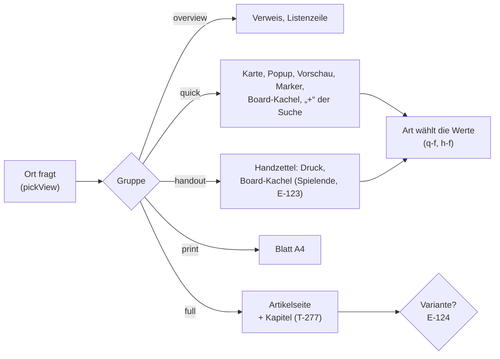

# Ansichten: Bestand, Bedarf je Art und Stufe

Stand 21.10.2026, T-234; **nachgeführt mit T-346** (Abschnitt
„quick: Reihenfolge je Art", die Suche liest `quick`) und mit **T-344**
(Spalten der Übersicht, 28.10.). Gelesen aus dem Register (`packages/registry`,
`seedRegistry`) mit `node packages/registry/scripts/ansichten.mjs` — das
Skript schreibt die Tabelle unten neu (`… <Typ>` je Art Element für Element,
`--json` maschinenlesbar). Gestaltete Ansichten aus dem Designer stehen in der
Datenbank, nicht im Register; die zeigt Registry › Views.

Vorher/Nachher (Druckseite mit `?view=`, 1360 und 390 px, Probeartikel auf
einer lokalen Datenbank): [`docs/Nachtarbeit/T-234-bilder/`](../Nachtarbeit/T-234-bilder/).

Grundlage: E-103 (Ansicht = Anordnung + Geltung + Gruppe), der Designer als
einziger Editor (T-276), alle Zeichenwege über `pickView` (T-310), Kapitel
(T-277), der Handzettel (T-110). E-123 (Boards) ist entschieden: keine Stufe
„board“, auf der Kachel soll eine sinnvolle Ansicht die Vorgabe sein — am
liebsten der Handzettel —, und die Leitung wählt weiter. Die Werte je Art
dafür legt dieser Stand an, die Vorgabe der Kachel gehört T-339. Offen: E-124 (unten).

## Kurzfassung

- **Stufen bleiben, wie sie sind.** `overview`, `quick`, `full`, `print`
  sind die Orte (bis T-346 auch `search`, siehe unten); `handout` ist die eigene Gruppe für das, was man
  Spielenden in die Hand gibt. **Eine Stufe „player" gibt es nicht** und
  kommt nicht dazu (CLAUDE.md: es gibt keine Spieleransicht — Spielende sehen
  dieselben Ansichten, gesiebt am Server mit `redactEntity`). Wo die Aufgabe
  „player" sagt, ist das hier der **Handzettel**. Eine Stufe „board" auch
  nicht (E-123, Empfehlung a).
- **Vorher:** 60 anlegbare Arten; Eigenes je Ort: overview 34, quick 36,
  full 27, print 6, **handout 0, search 0**. Das „+" der Suche zeigte an
  keiner Art einen Wert, der Handzettel nirgends einen; Begegnung, Karte,
  Rezept, Gruppe, Ereignis, Geschichte und Arc zeigten auf der Karte nur
  Bild und Satz.
- **Umgesetzt** (Migration 123, `ansichten.ts`): Handzettel mit Feldelement
  `h-f` und Werten an 8 Arten plus Zauberkarte; Kartenwerte an 7 Arten
  mehr; das „+" der Suche nimmt **abgeleitet** dieselben Werte wie die Karte
  (45 Arten). **Nachher:** quick 46, handout 12, search 45.
- **Nicht umgesetzt, weil es eine Entscheidung braucht:** Varianten einer
  Art an einem Ort (Kreatur „Kampf", Ort „Reiseführer") — E-124. Grosse
  Blöcke zerlegen: T-282.
- **Spalten der Übersicht (T-344, Migration 156):** elf Arten, die für
  `overview` nichts sagten, nehmen die Werte der Karte, soweit sie als
  Spalte taugen — Rohwerte, kein Mass, kein langer Text (das Ziel einer
  Fraktion ist beides: lang und oft ein Geheimnis). Untertypen erben sie:
  Shop von Place, Arc, Szene, Sitzung und Kampagne von Story. Das ist die
  Vorgabe hinter „Reset to default" der Spaltenwahl (T-343).
  Vorher/Nachher bei 1360 und 390 px:
  [`docs/Nachtarbeit/T-344-bilder/`](../Nachtarbeit/T-344-bilder/).

## Bedarf: Art × Stufe

`●` sagt die Art selbst (eigene Anordnung oder Anpassung), `○` erbt es von
einem Obertyp, `—` die Grundanordnung reicht, **fett** ist neu mit T-234.
„Handout" nur, wo man die Sache Spielenden austeilt; Regelartikel stehen für
alle offen und brauchen keinen Zettel.

| Art | overview | quick | full | print | handout | search | Bemerkung |
|---|---|---|---|---|---|---|---|
| Spell | ● | ● Grad, Schule, Konz., Ritual | ● `spell` | ● `spell` | **● Zauberkarte** | **● wie quick** | |
| Item / Weapon / Armor / Material | ● | ● Art, Seltenheit, Einstimmung (+ Kenndaten) | ● `item`, `crafting` | ● `item` | **● dieselben Werte** | **● wie quick** | |
| Statblock | ● | ● `stats` | ● `statblock` | ● `statblock` | — | — | Zahlen teilt man nicht aus |
| Creature / PlayerCharacter | ● | ● `stats`, Art, Volk, Rolle, Haltung | ● Bogen (`sheet`, `turn`, `spells` …) | — | **● nur Volk** | **● wie quick** | Haltung, Rolle sind Leitung; Variante „Kampf" → E-124 |
| Place / Shop | **● Art, Umgebung** (T-344) | ● Art, Umgebung | ● `crawl` (Shop: `wares`) | — | **● Art, Umgebung** | **● wie quick** | Variante „Reiseführer" → E-124 |
| Faction | **● Art** (T-344) | ● Art, Ziel | — | — | **● nur Art** | **● wie quick** | Ziel ist oft Geheimnis; Struktur → T-341 |
| Deity | ● | ● Pantheon, Gesinnung | — | — | **● Pantheon, Domänen** | **● wie quick** | |
| Hazard | ● | ● Art, Bedrohung | — | — | — | **● wie quick** | eine Falle teilt man nicht aus |
| Quest | **● Stand, Lohn** (T-344) | ● Stand, Lohn | ● | — | **● Stand, Lohn** | **● wie quick** | |
| Scene | **● Modus, Schwierigkeit** (+ ○ Story) | ● Modus, Schwierigkeit | — | — | — (Vorlesetext global) | **● wie quick** | |
| Encounter | ● | **● Art, Phase, Schwierigkeit** | ● `initiative` | — | — | **● wie quick** | |
| Map | **● Art** (T-344) | **● Art** | ● `map` | — | — | **● wie quick** | Masse nicht auf der Karte (Rohwert) |
| Recipe / CraftingOrder | **● Beruf** (Auftrag: + Ausgang) | **● Beruf, Zeit** | ● `crafting` | — | — | **● wie quick** | |
| Party | **● Stufe** (T-344) | **● Stufe, Motto** | ● `inventory`, `crafting` | — | — | **● wie quick** | |
| Event | **● Art, Datum** (T-344) | **● Art, Datum** | — | — | — | **● wie quick** | |
| Story / Session | **● Art, gespielt am** (T-344) | **● Art, gespielt am** | Session: `live`, `prep` | — | — | **● wie quick** | Session erbt von Story |
| Arc | **● Stufen von/bis** (+ ○ Story) | **● Stufen von/bis** (+ ○ Story) | — | — | — | **● wie quick** | |
| Class / Ancestry / Background | ● | ● | ● Übersicht | — | — | **● wie quick** (Class, Ancestry) | |
| Feat, Rule und Unterarten | ● | ● (○ Rule) | — | — | — | **● wie quick** | |
| Campaign | — | — | ● viele Blöcke | — | — | — | |
| Layer | — | — | ● `contents`, `reader` | — | — | — | |
| Board | — | — | ● `board` | — | — | — | Kacheln: E-123, T-339 |
| Article, World, Chapter, Asset, Buchteile | (Asset ●) | — | — | — | — | — | Grundanordnung reicht; Teile stehen in keiner Liste |

**Doppelungen:** keine gefunden — jede Anpassung sagt eine Abweichung, keine
Abschrift einer Ansicht. Dass Karte und Suche dieselben Werte tragen, war
gewollt (beide beantworten „was habe ich vor mir?") und darum **abgeleitet**
(`suche()`) — mit T-346 ist daraus eine Ansicht geworden: das „+" der Suche
liest `quick`, die Spalte `search` oben gilt nicht mehr. **Ungenutzt:** keine Ortsansicht; die
gestalteten Ansichten der Datenbank zählt Registry › Views (`appliesCount`).

## Die Elementbäume

Die Grundanordnungen stehen in `packages/registry/src/views.ts`; je Art nur
die Abweichung (`{ adjust }`).

```text
handout (global)
├─ h-img    image
├─ h-desc   description
├─ h-f      fields []                       ← neu, die Art füllt es
└─ h-b      prose [Prose.paragraph, ReadAloud.readaloud]

handout · Item (Anpassung: add h-f)
├─ h-img    image
├─ h-desc   description
├─ h-f      fields [Item.itemType, Item.rarity, Item.attunement]
└─ h-b      prose

handout · Spell (Anpassung: drop h-desc, extra h-spell, order)
├─ h-img    image
├─ h-spell  spell                           ← zeichnet die Beschreibung selbst
├─ h-f      fields []
└─ h-b      prose

quick (global, seit T-346)
├─ q-f      fields []                       ← die Kennwerte der Art, oben
├─ q-desc   description
├─ q-b      prose [Prose.paragraph, ReadAloud.readaloud]
└─ q-img    image                           ← zuletzt; der Rahmen schneidet es unten ab

quick · Creature (Anpassung: add q-f, extra c-q-stats, order [c-q-stats])
├─ c-q-stats stats                          ← AC, HP, Tempo, Initiative, CR
├─ q-f      fields [Creature.kind, species, role, attitude]
├─ q-desc   description
├─ q-b      prose
└─ q-img    image
```



## quick: Reihenfolge je Art (T-346)

Die Leitung (21.10.): „search ist meist wie quick" und „Bilder sollten in
der Quick-Ansicht unten angeordnet werden, dass sie notfalls abgeschnitten
werden. Generell sollte die Anordnung geprüft werden, damit das
Relevanteste oben steht."

- **Die Suche liest `quick`.** Die Ansicht `search` und ihre 22
  Anpassungen je Art sind weg (Migration 127, nur wo sie noch so standen,
  wie das Register sie brachte); wer `search` noch nennt, bekommt `quick`
  (`RETIRED_PLACES`, beim Lesen). Eine gestaltete Ansicht der Gruppe
  `search` käme in die Gruppe `quick` — auf dev gab es keine.
- **Reihenfolge:** Kennwerte → Beschreibung → Absatz/Vorlesetext → **Bild**.
  Die Kennwerte stehen in der Reihenfolge, in der die Art sie erklärt;
  leere fallen weg, also zeigt eine gewöhnliche Rüstung keine Seltenheit.
- **Abschneiden:** Popup (auch am Marker der Karte) und Board-Kachel sind
  Spalten, in denen nur das Bildfach nachgibt (`flex-shrink`, `overflow:
  hidden`) — das Bild wird unten abgeschnitten, nicht verkleinert. Reicht
  der Platz nicht einmal für Werte und Text, scrollt der Rahmen wie bisher.
  Die Kachel zeigt das Bild jetzt überhaupt (vorher zeichnete sie kein
  `image`). Kompendium-Vorschau und Suche haben keinen festen Rahmen: dort
  steht das Bild ganz.
- **Masse** stehen auf Karte und Kachel jetzt in Einheiten wie auf der
  Seite („60 ft", `fieldText`) — darum dürfen Reichweite und Gewicht auf die
  Karte. **Der Preis nicht:** er steht in Kupfer, und eine Währung als
  Einheit gibt es nicht; „Price in copper 5000" wäre keine Auskunft.
- **Nicht übernommen, was die Leitung auf dev selbst eingestellt hat:**
  siehe [Protokoll](../Nachtarbeit/2026-10-21-T-346.md) (Party, Table).

`●` sagt die Art selbst, `○` erbt von der genannten; „neu" heisst, die Art
nimmt mit T-346 andere Werte oder eine andere Reihenfolge als ihre
Vorgängerin (die Grundreihenfolge gilt für alle).

| Art | woher | quick, von oben nach unten | |
|---|---|---|---|
| Creature | ● | Kennzahlen (`stats`) → kind, species, role, attitude → Beschreibung → Absatz, Vorlesetext → Bild | neu |
| PlayerCharacter | ○ Creature | Kennzahlen (`stats`) → kind, species, role, attitude → Beschreibung → Absatz, Vorlesetext → Bild |  |
| Place | ● | kind, environment, state → Beschreibung → Absatz, Vorlesetext → Bild | neu |
| Shop | ○ Place | kind, environment, state → Beschreibung → Absatz, Vorlesetext → Bild |  |
| Faction | ● | kind, goal → Beschreibung → Absatz, Vorlesetext → Bild |  |
| Rule | ● | kind → Beschreibung → Absatz, Vorlesetext → Bild |  |
| Feat | ● | kind, prerequisite, repeatable → Beschreibung → Absatz, Vorlesetext → Bild | neu |
| Skill | ○ Rule | kind → Beschreibung → Absatz, Vorlesetext → Bild |  |
| Language | ○ Rule | kind → Beschreibung → Absatz, Vorlesetext → Bild |  |
| Class | ● | kind, hitDie, primaryAbility, spellAbility → Beschreibung → Absatz, Vorlesetext → Bild | neu |
| Subclass | ○ Rule | kind → Beschreibung → Absatz, Vorlesetext → Bild |  |
| Ancestry | ● | kind, size, speed, creatureType, darkvision → Beschreibung → Absatz, Vorlesetext → Bild | neu |
| Background | ○ Rule | kind → Beschreibung → Absatz, Vorlesetext → Bild |  |
| AbilityMethod | ○ Rule | kind → Beschreibung → Absatz, Vorlesetext → Bild |  |
| EquipmentMethod | ○ Rule | kind → Beschreibung → Absatz, Vorlesetext → Bild |  |
| Condition | ○ Rule | kind → Beschreibung → Absatz, Vorlesetext → Bild |  |
| Disease | ○ Rule | kind → Beschreibung → Absatz, Vorlesetext → Bild |  |
| ActionType | ○ Rule | kind → Beschreibung → Absatz, Vorlesetext → Bild |  |
| Action | ○ Rule | kind → Beschreibung → Absatz, Vorlesetext → Bild |  |
| Feature | ○ Rule | kind → Beschreibung → Absatz, Vorlesetext → Bild |  |
| ItemProperty | ○ Rule | kind → Beschreibung → Absatz, Vorlesetext → Bild |  |
| Spell | ● | kind, level, school, castingAction, range, concentration, ritual → Beschreibung → Absatz, Vorlesetext → Bild | neu |
| Hazard | ● | kind, tier, threat, trigger → Beschreibung → Absatz, Vorlesetext → Bild | neu |
| ZoneKind | ○ Rule | kind → Beschreibung → Absatz, Vorlesetext → Bild |  |
| Deity | ● | pantheon, title, alignment, domains → Beschreibung → Absatz, Vorlesetext → Bild | neu |
| Statblock | ● | Kennzahlen (`stats`) → Bild | neu |
| Item | ● | itemType, rarity, attunement, weight → Beschreibung → Absatz, Vorlesetext → Bild | neu |
| Weapon | ● | itemType, rarity, attunement, weight, category, damage, damageType → Beschreibung → Absatz, Vorlesetext → Bild |  |
| Armor | ● | itemType, rarity, attunement, weight, armorType, ac, strength, stealthDisadvantage → Beschreibung → Absatz, Vorlesetext → Bild | neu |
| Material | ○ Item | itemType, rarity, attunement, weight → Beschreibung → Absatz, Vorlesetext → Bild |  |
| Party | ● | level, motto → Beschreibung → Absatz, Vorlesetext → Bild |  |
| Story | ● | kind, played → Beschreibung → Absatz, Vorlesetext → Bild |  |
| Arc | ● | kind, played, levelFrom, levelTo → Beschreibung → Absatz, Vorlesetext → Bild |  |
| Campaign | ○ Story | kind, played → Beschreibung → Absatz, Vorlesetext → Bild |  |
| Session | ○ Story | kind, played → Beschreibung → Absatz, Vorlesetext → Bild |  |
| Scene | ● | kind, played, mode, Difficulty → Beschreibung → Absatz, Vorlesetext → Bild |  |
| Quest | ● | progress, reward, deadline → Beschreibung → Absatz, Vorlesetext → Bild | neu |
| Map | ● | kind → Beschreibung → Absatz, Vorlesetext → Bild |  |
| Recipe | ● | trade, tool, dc, time → Beschreibung → Absatz, Vorlesetext → Bild | neu |
| Trade | ● | kind, tools → Beschreibung → Absatz, Vorlesetext → Bild |  |
| MaterialGroup | ○ Rule | kind → Beschreibung → Absatz, Vorlesetext → Bild |  |
| Substitution | ○ Rule | kind → Beschreibung → Absatz, Vorlesetext → Bild |  |
| GlossaryTerm | ○ Rule | kind → Beschreibung → Absatz, Vorlesetext → Bild |  |
| CraftingOrder | ○ Recipe | trade, tool, dc, time → Beschreibung → Absatz, Vorlesetext → Bild |  |
| Encounter | ● | kind, phase, Difficulty → Beschreibung → Absatz, Vorlesetext → Bild |  |
| Event | ● | kind, display → Beschreibung → Absatz, Vorlesetext → Bild |  |

## Offene Punkte

- **E-124 — Varianten einer Art an einem Ort.** Die Leitung nannte „Kreatur:
  Bogen, Kampf; Ort: Reiseführer, Karte; Fraktion: Struktur". Bogen, Karte
  und Struktur gibt es oder sind in Arbeit (`sheet`, `map`, T-341). Eine
  Variante „Kampf" (nur `stats`, `turn`, Zustände) oder „Reiseführer"
  (Bild, Beschreibung, Unterorte, Wege) wäre als gestaltete Ansicht mit
  eigener Gruppe (`combat`, `guide`) und Geltung auf die Art zu haben —
  gewählt an der Leiste „Views" und auf der Kachel. Ob solche Ansichten mit
  dem Register kommen (Startzeilen) oder die Leitung sie im Designer anlegt,
  ist ihre Entscheidung. Umsetzung danach: T-345.
- ~~**T-344 — Spalten der Übersicht**~~ umgesetzt am 28.10. (oben,
  Kurzfassung; Migration 156).
- **T-282 — grosse Blöcke.** Die Liste unten; am dringendsten `sheet`,
  `turn`, `spells` der Kreatur und `crawl` am Ort, weil eine Variante
  (E-124) Teile daraus bräuchte.

## Bestand (erzeugt)

`—` Grundanordnung, `±` Anpassung, `■` eigene Anordnung; in Klammern die
Art, an der sie steht, dahinter die grossen Blöcke.

| Art | Bereich | overview | quick | full | print | handout |
|---|---|---|---|---|---|---|
| Board | play | — | — | ■ board | — | — |
| CraftingOrder | play | — | ± (Recipe) | ■ crafting | — | — |
| Encounter | play | ■ | ± | ■ initiative | — | — |
| Map | play | — | ± | ■ map | — | — |
| AbilityMethod | rules | ■ | ± (Rule) | — | — | — |
| Action | rules | ■ | ± (Rule) | — | — | — |
| ActionType | rules | ■ (Rule) | ± (Rule) | — | — | — |
| Ancestry | rules | ■ | ± | ± originOverview | — | — |
| Background | rules | ■ (Rule) | ± (Rule) | ± originOverview | — | — |
| Class | rules | ■ | ± | ± classOverview | — | — |
| Condition | rules | ■ | ± (Rule) | — | — | — |
| Disease | rules | ■ (Condition) | ± (Rule) | — | — | — |
| EquipmentMethod | rules | ■ | ± (Rule) | — | — | — |
| Feat | rules | ■ | ± | — | — | — |
| Feature | rules | ■ | ± (Rule) | — | — | — |
| GlossaryTerm | rules | ■ | ± (Rule) | — | — | — |
| Information | rules | — | — | — | — | — |
| Inventory | rules | — | — | ■ inventory | — | — |
| ItemProperty | rules | ■ (Rule) | ± (Rule) | — | — | — |
| Knowledge | rules | — | — | ± knowledgeContents | — | — |
| Language | rules | ■ | ± (Rule) | — | — | — |
| MaterialGroup | rules | ■ (Rule) | ± (Rule) | — | — | — |
| Recipe | rules | — | ± | ■ crafting | — | — |
| Rule | rules | ■ | ± | — | — | — |
| Skill | rules | ■ (Rule) | ± (Rule) | — | — | — |
| Spell | rules | ■ | ± | ■ spell | ± spell | ± spell |
| Statblock | rules | ■ | ■ stats | ■ statblock | ± statblock | — |
| Subclass | rules | ■ | ± (Rule) | — | — | — |
| Substitution | rules | ■ (Rule) | ± (Rule) | — | — | — |
| Table | rules | ■ | — | ■ | — | — |
| Trade | rules | ■ (Rule) | ± | ± crafting | — | — |
| ZoneKind | rules | ■ (Rule) | ± (Rule) | — | — | — |
| Arc | story | — | ± | — | — | — |
| Campaign | story | — | ± (Story) | ■ rules, stack, members, timeline, prep | — | — |
| Quest | story | — | ± | ■ | — | ± |
| Scene | story | — | ± | — | — | — |
| Session | story | — | ± (Story) | ■ live, prep | — | — |
| Story | story | — | ± | — | — | — |
| Armor | world | ■ | ± | ■ (Item) item, crafting | ± (Item) item | ± |
| Article | world | — | — | — | — | — |
| Creature | world | ■ | ± stats | ■ sheet, turn, spells, inventory, crafting, campaign | — | ± |
| Deity | world | ■ | ± | — | — | ± |
| Event | world | — | ± | — | — | — |
| Faction | world | — | ± | — | — | ± |
| Hazard | world | ■ | ± | — | — | — |
| Item | world | ■ | ± | ■ item, crafting | ± item | ± |
| Material | world | ■ (Item) | ± (Item) | ■ (Item) item, crafting | ± (Item) item | ± (Item) |
| Party | world | — | ± | ■ inventory, crafting | — | — |
| Place | world | — | ± | ■ crawl | — | ± |
| PlayerCharacter | world | ■ (Creature) | ± (Creature) stats | ■ (Creature) sheet, turn, spells, inventory, crafting, campaign | — | ± (Creature) |
| Shop | world | — | ± (Place) | ± wares, crawl | — | ± (Place) |
| Weapon | world | ■ | ± | ■ (Item) item, crafting | ± (Item) item | ± |
| World | world | — | — | — | — | — |
| Asset | — | ■ | — | — | — | — |
| Chapter | — | — | — | — | — | — |
| Embed | — | — | — | — | — | — |
| Heading | — | — | — | — | — | — |
| Layer | — | — | — | ± contents, reader | — | — |
| Paragraph | — | — | — | — | — | — |
| ReadAloudText | — | — | — | — | — | — |
60 anlegbare Arten. Eigenes je Ort: overview 34, quick 46, full 27, print 6, handout 12, search 45.

Grosse Blöcke (T-282):
- board: 1 — Board.full
- campaign: 2 — Creature.full, PlayerCharacter.full
- classOverview: 1 — Class.full
- contents: 1 — Layer.full
- crafting: 10 — CraftingOrder.full, Recipe.full, Trade.full, Armor.full, Creature.full, Item.full, Material.full, Party.full …
- crawl: 2 — Place.full, Shop.full
- initiative: 1 — Encounter.full
- inventory: 4 — Inventory.full, Creature.full, Party.full, PlayerCharacter.full
- item: 8 — Armor.full, Armor.print, Item.full, Item.print, Material.full, Material.print, Weapon.full, Weapon.print
- knowledgeContents: 1 — Knowledge.full
- live: 1 — Session.full
- map: 1 — Map.full
- members: 1 — Campaign.full
- originOverview: 2 — Ancestry.full, Background.full
- prep: 2 — Campaign.full, Session.full
- reader: 1 — Layer.full
- rules: 1 — Campaign.full
- sheet: 2 — Creature.full, PlayerCharacter.full
- spell: 3 — Spell.full, Spell.print, Spell.handout
- spells: 2 — Creature.full, PlayerCharacter.full
- stack: 1 — Campaign.full
- statblock: 2 — Statblock.full, Statblock.print
- stats: 3 — Statblock.quick, Creature.quick, PlayerCharacter.quick
- timeline: 1 — Campaign.full
- turn: 2 — Creature.full, PlayerCharacter.full
- wares: 1 — Shop.full
